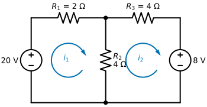
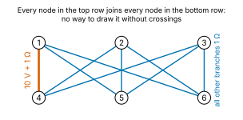
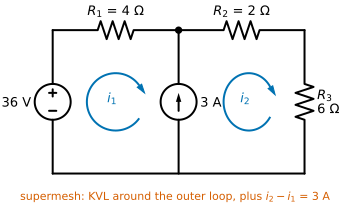

<!-- status: reviewed -->
# 06-05 · Mesh Analysis

| | |
|---|---|
| **Course** | [06 · Circuit Analysis I (DC)](../README.md) |
| **University equivalent** | The mesh-current method of a sophomore Circuits course (Nilsson & Riedel, *Techniques of Circuit Analysis*; Alexander & Sadiku, *Methods of Analysis*), with the loop/cut-set and duality material of a network-topology course |
| **Prerequisites** | [06-04](06-04-nodal-analysis.md) (nodal analysis, supernodes, the matrix form, MNA), [06-03](06-03-kirchhoffs-laws.md) (meshes, spanning trees, $b - n + 1$ independent loops), [02-07](../../02-complex-numbers-des-and-linear-algebra/chapters/02-07-determinants-inverses-and-vector-spaces.md) (determinants, Cramer's rule). Each fact used is restated where it is needed. |
| **Estimated study hours** | 8 |
| **Last verified** | 2026-11-19 |

**Learning objectives.** After this chapter you can:

1. Define mesh currents in a planar circuit, explain why they satisfy KCL automatically, and write KVL around every mesh in terms of them.
2. Write the mesh equations $\mathbf{R}\mathbf{i} = \mathbf{v}$ by inspection, and explain why $\mathbf{R}$ is symmetric and positive definite.
3. Handle current sources: one on an outer branch, which fixes a mesh current, and one shared by two meshes, with a supermesh and a constraint.
4. Count the unknowns of nodal and mesh analysis for a given circuit, choose the cheaper method, and explain why simulators use nodal analysis.
5. Explain planarity, loop analysis on a spanning tree and circuit duality, and use mesh thinking to find shared-impedance coupling, such as a ground return shared by a noisy and a sensitive load.

## 1. Big picture

Nodal analysis (06-04) chose node voltages as unknowns because they satisfy KVL automatically. **Mesh analysis** makes the mirror-image choice: it uses circulating **mesh currents**, which satisfy KCL automatically, and writes one KVL equation per mesh. For circuits with many nodes and few loops, such as long series chains, it needs fewer unknowns; for circuits with many parallel branches, nodal analysis wins. Knowing both, and when each is cheaper, is part of being fluent at hand analysis, and the FE exam expects both.

- **Hand analysis of loops.** Series-heavy circuits (sensor loops, battery strings, ladder attenuators) often reduce to two or three mesh equations.
- **Return currents and ground.** Every current returns to its source around a loop. Mesh analysis makes visible what nodal thinking hides: when two loops share a conductor (a ground trace, a bond wire, a busbar), each loop's current produces a voltage in the other's. That is *common-impedance coupling*, a leading cause of noisy measurements and ground bounce (Example 06-05.5).
- **Duality.** Every planar circuit has a dual in which meshes become nodes, voltages become currents and series becomes parallel. The two methods are the same mathematics in two costumes.
- **Why simulators chose nodes.** Mesh analysis needs a flat (planar) drawing and a search for meshes; nodal analysis needs only the netlist. That is why SPICE formulates with nodes (06-04 §3.5).

## 2. Intuition first

### Circulating currents

Picture each window of a planar circuit drawing as a hamster wheel with a current circulating around it, all of them clockwise. A branch on the outer edge belongs to one window, so its current is that window's circulation. A branch shared by two windows carries the *difference* of their circulations, because they run through it in opposite directions. Every circulation enters each node it visits and leaves it again, so KCL holds automatically: whatever the mesh currents are, current is conserved everywhere. Only KVL remains to be enforced, one equation per window: the voltage drops around it must add up to the source voltages that drive it.

*Figure 1. The circuit of Example 06-05.1. Mesh current $i_1$ flows alone through the 20 V source and $R_1$, $i_2$ alone through $R_3$ and the 8 V source, and the shared $R_2$ carries $i_1 - i_2$ downward.*

### The business analogy, and where it breaks

Think of mesh currents as money flows through a set of internal accounts. Each account (mesh) has its own circulating flow; a ledger line shared by two accounts records the net of the two flows. Balancing each account's books (KVL) determines all the flows, and conservation at every junction (KCL) is guaranteed by the bookkeeping itself. *Where it breaks:* the "accounts" exist only for a circuit drawn flat. If the circuit cannot be drawn without crossing wires, there are no windows, and the method must be generalized to loops chosen from a spanning tree (§3.5).

## 3. Theory

### 3.1 Meshes and mesh currents

> **Recap from 06-03.** A **mesh** is a loop of a planar drawing that encloses no other branch: a window pane. A connected planar circuit with $n$ nodes and $b$ branches has exactly $b - n + 1$ meshes, and their KVL equations are independent.

> **Math refresher — Euler's formula.** For a connected graph drawn in a plane without crossings, $n - b + f = 2$, where $f$ counts the faces (regions) including the unbounded outside one. The meshes are the bounded faces, so their number is $f - 1 = b - n + 1$, the same count of independent loops that 06-03 found with a spanning tree.

Assign a **mesh current** $i_k$ to each mesh, all circulating clockwise (any directions work; one convention keeps the signs systematic). Each branch current is then a combination of mesh currents:

- an **outer branch**, on the boundary of one mesh, carries that mesh current;
- an **inner branch**, shared by meshes $j$ and $k$, carries $i_j - i_k$ in mesh $j$'s direction, because clockwise currents of adjacent meshes traverse their shared branch in opposite directions.

**Mesh currents satisfy KCL by construction.** A mesh current that enters a node along one branch of its loop leaves it along the next, so each mesh current contributes zero to the sum of currents at every node. That removes the $n - 1$ KCL equations; the element laws express each branch voltage in terms of mesh currents; what is left is $b - n + 1$ unknowns and $b - n + 1$ KVL equations. A planar circuit with 50 nodes and 120 branches has 71 mesh currents (and 49 node voltages).

### 3.2 KVL in terms of mesh currents

Go around mesh $k$ in the direction of its current and add the voltage drops. A resistor $R$ on an outer branch drops $R\,i_k$; a resistor shared with mesh $j$ drops $R\,(i_k - i_j)$ in mesh $k$'s direction. KVL, written as "drops across resistors equal rises across sources":

$$
\sum_{\text{resistors in mesh } k} R\,\bigl(i_k - i_{\text{other}}\bigr) = \sum_{\text{sources in mesh } k} v_{\text{rise}},
$$

where $i_{\text{other}}$ is the neighboring mesh current for a shared resistor and zero for an outer one, and a source counts as a rise when the mesh direction passes through it from − to +. The procedure mirrors nodal analysis:

1. Check that the circuit is planar and draw it without crossings.
2. Assign a clockwise current to each mesh.
3. Write KVL around each mesh in the form above.
4. Solve the $b - n + 1$ linear equations.
5. Recover branch currents (differences of mesh currents for shared branches), voltages and powers, and check the power balance.

### 3.3 The matrix form, written by inspection

Collect coefficients. In mesh $k$'s equation, $i_k$ is multiplied by the total resistance around mesh $k$, and each neighboring $i_j$ by minus the resistance shared with mesh $j$:

$$
\mathbf{R}\,\mathbf{i} = \mathbf{v}, \qquad
R_{kk} = \sum_{\text{resistances around mesh } k}, \qquad
R_{kj} = -\!\!\sum_{\text{resistances shared by } k \text{ and } j}, \qquad
v_k = \sum_{\text{source rises around mesh } k}.
$$

For Figure 1:

$$
\begin{bmatrix} 2 + 4 & -4 \\ -4 & 4 + 4 \end{bmatrix}
\begin{bmatrix} i_1 \\ i_2 \end{bmatrix} =
\begin{bmatrix} 20 \\ -8 \end{bmatrix}.
$$

The 8 V source counts as −8 in mesh 2's row because $i_2$, flowing clockwise, enters it at the + terminal: going around the mesh, that is a drop, not a rise.

**Properties of the mesh matrix.** For a planar circuit of positive resistors and independent voltage sources, with all mesh currents clockwise:

- **Symmetric:** $R_{kj} = R_{jk}$, the shared resistance seen from either side.
- **Positive definite:** $\mathbf{i}^\mathsf{T}\mathbf{R}\,\mathbf{i} = \sum_{\text{resistors}} R\,i_{\text{branch}}^2$, the power the resistors would dissipate with those mesh currents (the proof mirrors 06-04's Problem 06-04.9: write $\mathbf{R} = \sum_r R_r\,\mathbf{m}_r\mathbf{m}_r^\mathsf{T}$ with $\mathbf{m}_r$ the branch's mesh-incidence vector). It can vanish only if every resistor carries zero current, which forces every mesh current to zero unless some loop consists entirely of zero-resistance elements (ideal voltage sources and wires). Barring such a loop, $\mathbf{R}$ is positive definite and therefore invertible. A loop of ideal voltage sources is the mesh analogue of 06-04's floating node: its current is undetermined, and SPICE rejects it too.

### 3.4 Current sources: outer and shared

A current source fixes a branch current but says nothing about its own voltage, which is exactly the unknown KVL around its mesh would need. As with voltage sources in nodal analysis, there are two cases.

**A current source on an outer branch** belongs to one mesh only, so it fixes that mesh current directly: $i_k = \pm I_s$ (plus if the source points in the mesh direction). That mesh's KVL equation is dropped (it would only determine the source's voltage), and $i_k$ becomes a known term in its neighbors' equations.

**A current source shared by two meshes** sets the difference of their currents. Combine the two meshes into a **supermesh**: the loop around both of them that avoids the source's branch. KVL around the supermesh does not involve the source's unknown voltage. The two equations for the two mesh currents are then

$$
\text{KVL around the supermesh} \qquad\text{and}\qquad i_a - i_b = \pm I_s ,
$$

with the sign fixed by comparing the source's arrow with the two mesh directions in its branch. After solving, the source's voltage follows from KVL around either of its meshes alone (Example 06-05.3). Supermeshes are the dual of supernodes: the roles of voltage and current, KVL and KCL, are exchanged.

### 3.5 Planarity, loop analysis and duality

Mesh analysis needs meshes, and meshes need a planar drawing. Some circuits cannot be drawn in a plane without crossings: the classic example is the "utility graph" $K_{3,3}$ (Figure 2), in which each of three nodes is joined to each of three others. A theorem of Kuratowski (1930) says that a circuit is planar exactly when it contains no subdivision of $K_{3,3}$ or of $K_5$ (five nodes all joined to each other). A nonplanar circuit has no meshes, so mesh analysis does not apply.

*Figure 2. A nonplanar resistor network ($K_{3,3}$). It has no meshes, but loop analysis on a spanning tree solves it (Problem 06-05.12).*

**Loop analysis** generalizes the method to any circuit. Choose a spanning tree (06-03): $n - 1$ branches that connect every node without closing a loop. Each of the remaining $b - n + 1$ branches (the links) closes exactly one **fundamental loop** through the tree. Assign a loop current to each fundamental loop. Each link carries only its own loop current; each tree branch carries the sum of the loop currents that pass through it, with signs. KCL is again automatic, KVL around each fundamental loop gives the equations, and the matrix is again symmetric and positive definite. Meshes are simply a convenient choice of loops for planar drawings.

**Duality.** Draw a node inside every mesh of a planar circuit and one more outside it (the dual's reference node). Every element shared by two meshes becomes an element between their dual nodes; every outer element connects its mesh's dual node to the reference. Replace each resistance $R$ by a conductance of the same number of siemens, each voltage source by a current source of the same number of amperes, and series by parallel. Orientation follows the equations, with clockwise mesh currents: a voltage source that pushes mesh $k$'s current forward (it appears with a + sign in $v_k$) becomes a current source pushing current *into* dual node $k$, and one that opposes it becomes a source drawing current *out of* node $k$ (Example 06-05.4's 8 V source); a source shared by meshes $j$ and $k$, which aids one and opposes the other, becomes a current source between their dual nodes pointing into the node of the mesh it aids. In the other direction, a current source shared by meshes $a$ and $b$ that imposes $i_a - i_b = I_s$ becomes a voltage source with $v_a - v_b = I_s$: its + terminal at the dual node of the mesh whose current flows along the source's arrow. The dual circuit's nodal equations are then *numerically identical* to the original's mesh equations, so its node voltages equal the original's mesh currents (Example 06-05.4). The full dictionary:

| Circuit | Dual |
|---|---|
| mesh, mesh current | node, node voltage |
| KVL | KCL |
| resistance $R$ (Ω) | conductance $G$ (S), same number |
| voltage source | current source |
| series | parallel |
| short circuit | open circuit |
| supermesh | supernode |
| capacitor (Course 07) | inductor |

Duality is why every result in this course comes in pairs: voltage and current dividers (06-03), Thévenin and Norton (06-08), and later the duality of series and parallel resonance (07-08).

### 3.6 Choosing nodal or mesh

Both methods give the same answer; the question is which is less work. Count the unknowns that remain after the sources have done what they can:

$$
\text{nodal: } (n - 1) - N_V, \qquad \text{mesh: } (b - n + 1) - N_I,
$$

where $N_V$ is the number of voltage sources (each grounded one fixes a node; each floating one turns two unknowns into a supernode plus a constraint, which is the same saving) and $N_I$ the number of current sources (each fixes a mesh current or creates a supermesh). With these counts:

- **Choose nodal** when the circuit has many parallel branches, many voltage sources, or nonplanar topology, or when you want the result in node voltages (as you usually do: voltages are what you measure).
- **Choose mesh** when the circuit is a few loops with many series elements, has current sources, or when the quantities you want are loop currents.
- **For a computer, choose nodal, always.** A netlist names the two nodes of every element, so the nodal matrix can be stamped directly (06-04); meshes would require finding a planar embedding (impossible for nonplanar circuits) or a spanning tree, and their matrices tend to be denser. Nagel's 1975 SPICE2 thesis reported that modified nodal analysis needed "substantially less computational effort" than the alternatives tested, and SPICE-class simulators have used it since ([R-054](../../../reference/research-log.md#r-054--spice-and-spice2-origins), [R-103](../../../reference/research-log.md#r-103--modified-nodal-analysis-and-simulator-capacity)).

Example 06-05.4 shows how lopsided the counts can be: the circuit of Figure 1 needs two mesh currents but only one node voltage.

## 4. Worked examples

### Example 06-05.1 · Two meshes and a battery on charge (tier A)

**Setup.** In Figure 1, a 20 V charger with $R_1$ = 2 Ω of internal and wiring resistance feeds a 4 Ω load ($R_2$) and, through $R_3$ = 4 Ω, an 8 V battery whose + terminal is at the top. Find the mesh currents, the load current, the battery's charging current, and check the power balance.

**Solution.** By inspection (§3.3), $\mathbf{R} = \begin{bmatrix} 6 & -4 \\ -4 & 8\end{bmatrix}$ Ω and $\mathbf{v} = (20, -8)$ V. $\Delta = 6\times8 - (-4)^2 = 32$ Ω². Cramer's rule:

$$
i_1 = \frac{20\times8 - (-4)(-8)}{32} = \frac{128}{32} = \mathbf{4\ A}, \qquad
i_2 = \frac{6\times(-8) - 20\times(-4)}{32} = \frac{32}{32} = \mathbf{1\ A}.
$$

The load carries \$i_1 - i_2 = \$ **3 A** downward. The battery carries $i_2$ = **1 A** into its + terminal: it is being charged.

**Power balance.** The charger delivers \$20\times4 = \$ **80 W**. The battery absorbs \$8\times1 = \$ **8 W**. Resistors: \$2\times4^2 + 4\times3^2 + 4\times1^2 = 32 + 36 + 4 = \$ **72 W** $= 80 - 8$ ✓.

**Units check.** Ω × A = V on both sides of each row ✓.

**Sanity check.** The load voltage is $4\times3 = 12$ V, between the battery's 8 V and the charger's 20 V, and it drives 1 A through $R_3$ into the battery: $(12 - 8)/4 = 1$ A ✓.

### Example 06-05.2 · The bridge network by meshes (tier B)

**Setup.** Solve Example 06-03.5's bridge network (10 V source; $R_{ac}$ = 10, $R_{ad}$ = 20, $R_{cd}$ = 30, $R_{cb}$ = 40, $R_{db}$ = 50 Ω) with the three clockwise mesh currents of Figure 3, and compare the work with 06-04's two-unknown nodal solution.

*Figure 3. Three meshes of the bridge network. Mesh 1 contains the source, 10 Ω and 40 Ω; mesh 2 contains 10 Ω, 20 Ω and 30 Ω; mesh 3 contains 30 Ω, 50 Ω and 40 Ω.*

**Solution.** By inspection: $R_{11} = 10 + 40 = 50$, $R_{22} = 10 + 20 + 30 = 60$, $R_{33} = 30 + 50 + 40 = 120$; shared $R_{12} = -10$, $R_{13} = -40$, $R_{23} = -30$ (all Ω); $\mathbf{v} = (10, 0, 0)$ V. Expanding along the first row,

$$
\Delta = 50(60\times120 - 30^2) + 10(-10\times120 - 30\times40) - 40(10\times30 + 60\times40) = 315{,}000 - 24{,}000 - 108{,}000 = 183{,}000\ \Omega^3 .
$$

Only the first entry of $\mathbf{v}$ is nonzero, so each Cramer numerator is 10 V times a cofactor of the first row: \$i_1 = 10\times6300/183{,}000 = \$ **0.3443 A**, \$i_2 = 10\times2400/183{,}000 = \$ **0.1311 A** and \$i_3 = 10\times2700/183{,}000 = \$ **0.1475 A**. The bridge resistor carries \$i_3 - i_2 = \$ **16.39 mA** from c to d, and the source current is $i_1$: both exactly as in 06-03 and 06-04.

**Units check.** Ω × A = V ✓.

**Sanity check.** Node voltages from mesh currents: $v_c = 10 - 10(i_1 - i_2) = 10 - 2.131 = 7.869$ V, matching Example 06-04.2 ✓. Mesh analysis needed three unknowns where nodal needed two, because this circuit has $b - n + 1 = 3$ meshes but only $n - 1 - N_V = 2$ unknown node voltages (§3.6).

### Example 06-05.3 · A shared current source and a supermesh (tier B)

**Setup.** In Figure 4, a 36 V source and $R_1$ = 4 Ω form the left mesh; $R_2$ = 2 Ω and $R_3$ = 6 Ω the right mesh; the branch they share holds a 3 A current source pointing up. Find the mesh currents, the voltage across the current source and the power each source delivers.

*Figure 4. The circuit of Example 06-05.3. KVL around the outer loop (the supermesh) avoids the current source, whose voltage is unknown.*

**Solution.** In the shared branch $i_1$ flows down and $i_2$ flows up, so the source's upward current is $i_2 - i_1 = 3$ A. KVL around the supermesh (36 V source, $R_1$, $R_2$, $R_3$):

$$
36 = 4i_1 + 2i_2 + 6i_2 = 4i_1 + 8i_2 .
$$

Substituting $i_2 = i_1 + 3$: $36 = 12i_1 + 24$, so \$i_1 = \$ **1 A** and \$i_2 = \$ **4 A**.

The current source's voltage from KVL around the left mesh alone, top relative to bottom: up through the 36 V source, minus the drop $4\times1$ in $R_1$: **32 V** (check with the right mesh: $2\times4 + 6\times4 = 32$ V ✓). It pushes 3 A out of its top terminal at 32 V, so it delivers \$32\times3 = \$ **96 W**; the 36 V source delivers \$36\times1 = \$ **36 W**.

**Power balance.** \$4\times1^2 + 2\times4^2 + 6\times4^2 = 4 + 32 + 96 = \$ **132 W** $= 96 + 36$ ✓.

**Units check.** Ω × A = V; V × A = W ✓.

**Sanity check.** The current source supplies most of the power: it holds 4 A in the right mesh, more than the 36 V source alone could push through those resistors ✓.

### Example 06-05.4 · Nodal or mesh? And the dual circuit (tier B)

**Setup.** (a) For the circuit of Figure 1, count the unknowns of each method and solve it with the cheaper one. (b) Build the dual of the circuit and show that its node voltages reproduce the mesh currents.

**Solution.** (a) The circuit has 4 nodes (bottom, top left, the junction above $R_2$, top right) and 5 branches, so 2 meshes but \$(4 - 1) - 2 = \$ **1** unknown node voltage once the two voltage sources, both with − terminals on the bottom node, fix the top-left node at 20 V and the top-right node at 8 V. With the bottom node as reference, KCL at the junction $v_m$:

$$
\frac{v_m - 20}{2} + \frac{v_m}{4} + \frac{v_m - 8}{4} = 0 \;\Rightarrow\; 4v_m = 48 \;\Rightarrow\; v_m = \mathbf{12\ V},
$$

and then $i_1 = (20 - 12)/2 = 4$ A and $i_2 = (12 - 8)/4 = 1$ A, as before, with one equation instead of two.

(b) Put a dual node inside each mesh (nodes 1 and 2) and the reference outside. $R_1$ and the 20 V source lie on mesh 1's outer boundary; $R_3$ and the 8 V source on mesh 2's; $R_2$ is shared. The dual has 2 S from node 1 to reference, 4 S between nodes 1 and 2, 4 S from node 2 to reference, a 20 A source into node 1 and an 8 A source drawing current out of node 2 (the source that opposed $i_2$ becomes one that opposes $v_2$). Its nodal equations,

$$
\begin{bmatrix} 6 & -4 \\ -4 & 8 \end{bmatrix}
\begin{bmatrix} v_1 \\ v_2 \end{bmatrix} =
\begin{bmatrix} 20 \\ -8 \end{bmatrix}\ \text{(S, V, A)},
$$

are Example 06-05.1's mesh equations with the units relabeled, so $v_1$ = **4 V** and $v_2$ = **1 V**.

**Units check.** S × V = A in the dual; Ω × A = V in the original ✓.

**Sanity check.** In the original, $R_1$ and the 20 V source are in series (same mesh current); in the dual, 2 S and the 20 A source are in parallel (same node voltage), as the dictionary says ✓.

### Example 06-05.5 · A shared ground return (tier C)

**Setup.** A 5 V supply feeds two loads on a small board: a motor driver (modeled as 2.5 Ω, drawing about 2 A) and a sensor whose output an ADC reads (modeled as 1 kΩ). Each load has its own 20 mΩ supply trace, but both return to the supply through one shared 10 mΩ ground trace, so their "ground" node G is not the supply's − terminal. With mesh 1 running through the supply, the motor branch and the shared return, and mesh 2 around the window between the motor and sensor branches, find the mesh currents and the voltage of G relative to the supply's −. The ADC is referenced to the supply's − terminal and has 12 bits over 5 V. How large is the error in LSBs? What happens if the sensor gets its own 10 mΩ return (a **star ground**)?

**Solution.** Mesh 1: $r_1 + R_m + R_g = 0.020 + 2.5 + 0.010 = 2.530$ Ω. Mesh 2: $r_1 + R_m + r_2 + R_s = 2.520 + 0.020 + 1000 = 1002.54$ Ω. Shared: the motor branch, $-(r_1 + R_m) = -2.520$ Ω. With $\mathbf{v} = (5, 0)$ V and $\Delta = 2.530\times1002.54 - 2.520^2 = 2530.08$ Ω²:

$$
i_1 = \frac{5\times1002.54}{2530.08} = \mathbf{1.981\ A}, \qquad i_2 = \frac{5\times2.520}{2530.08} = \mathbf{4.980\ mA}.
$$

The shared return carries $i_1$, the total current, so G sits at \$v_G = R_g\,i_1 = 0.010\times1.981 = \$ **19.81 mV** above the supply's −. The sensor's output is produced relative to G, but the ADC measures it relative to the supply's −, so every reading is offset by 19.81 mV. One LSB is \$5/4096 = \$ **1.221 mV**, so the error is **16.2 LSB**, and it moves whenever the motor current changes.

With a star ground, the sensor's return carries only its own 5.00 mA, so its ground offset is $0.010\times0.00500 = $ **50.0 µV**: about **396** times smaller and now independent of the motor.

**Units check.** Ω × A = V; mV/mV = LSB ✓.

**Sanity check.** The off-diagonal entry is the motor branch (shared by both meshes), but the coupling that matters for the ADC comes from $R_g$, which only mesh 1 contains: $R_g$ carries $i_1$, which is almost all motor current. A different drawing makes the coupling visible in the matrix itself. All three branches (motor, supply with $R_g$, sensor) join the same two nodes, so they can be drawn side by side with the supply in the *middle*: one mesh through the motor and supply branches, another through the supply and sensor branches. The shared element is then the supply branch, the off-diagonal entry is exactly $-R_g$, and the mesh equations say directly that the shared return couples the two loads; with $R_g = 0$ they decouple. The general lesson is that any impedance carrying two circuits' return currents couples them, and the cure is to give the sensitive circuit a return path of its own ✓.

### Answer key

<!-- answer-key -->
| ID | Quantity | Value | Unit |
|---|---|---|---|
| T 06-05.a | meshes for 50 nodes, 120 branches | 71 | — |
| Ex 06-05.1a | determinant | 32 | Ω² |
| Ex 06-05.1b | i_1 | 4 | A |
| Ex 06-05.1c | i_2 | 1 | A |
| Ex 06-05.1d | load current | 3 | A |
| Ex 06-05.1e | power delivered by the charger | 80 | W |
| Ex 06-05.1f | power absorbed by the battery | 8 | W |
| Ex 06-05.1g | total resistor power | 72 | W |
| Ex 06-05.1h | power in R_1 | 32 | W |
| Ex 06-05.1i | power in R_2 | 36 | W |
| Ex 06-05.1j | power in R_3 | 4 | W |
| Ex 06-05.1k | load voltage | 12 | V |
| Ex 06-05.2a | determinant | 183000 | Ω³ |
| Ex 06-05.2b | i_1 | 0.3443 | A |
| Ex 06-05.2c | i_2 | 0.1311 | A |
| Ex 06-05.2d | i_3 | 0.1475 | A |
| Ex 06-05.2e | bridge current | 16.39 | mA |
| Ex 06-05.2f | v_c | 7.869 | V |
| Ex 06-05.2g | cofactor for i_1 | 6300 | Ω² |
| Ex 06-05.2h | cofactor for i_2 | 2400 | Ω² |
| Ex 06-05.2i | cofactor for i_3 | 2700 | Ω² |
| Ex 06-05.3a | i_1 | 1 | A |
| Ex 06-05.3b | i_2 | 4 | A |
| Ex 06-05.3c | voltage across the current source | 32 | V |
| Ex 06-05.3d | power delivered by the current source | 96 | W |
| Ex 06-05.3e | power delivered by the 36 V source | 36 | W |
| Ex 06-05.3f | total resistor power | 132 | W |
| Ex 06-05.4a | nodal unknowns | 1 | — |
| Ex 06-05.4b | v_m | 12 | V |
| Ex 06-05.4c | dual v_1 | 4 | V |
| Ex 06-05.4d | dual v_2 | 1 | V |
| Ex 06-05.5a | R_11 | 2.530 | Ω |
| Ex 06-05.5b | R_22 | 1002.54 | Ω |
| Ex 06-05.5c | determinant | 2530.08 | Ω² |
| Ex 06-05.5d | i_1 | 1.981 | A |
| Ex 06-05.5e | i_2 | 4.980 | mA |
| Ex 06-05.5f | ground offset, shared return | 19.81 | mV |
| Ex 06-05.5g | ADC LSB | 1.221 | mV |
| Ex 06-05.5h | error in LSB | 16.2 | — |
| Ex 06-05.5i | ground offset, star ground | 50.0 | µV |
| Ex 06-05.5j | improvement factor | 396 | — |

## 5. Simulate it

Open [labs/06-05-lab/](../labs/06-05-lab/README.md): a notebook and an ngspice netlist.

1. **Mesh matrices from a drawing.** Describe each mesh as a list of branches and let the notebook build $\mathbf{R}$ and $\mathbf{v}$ for Examples 06-05.1 to 06-05.3. *Predict first:* which entries of the bridge's 3 × 3 matrix are largest, and is it symmetric?
2. **Mesh against nodal against ngspice.** Solve every example three ways and compare. *Predict first:* how many unknowns does each method need for each example?
3. **Loop analysis of a nonplanar circuit.** Build the $K_{3,3}$ network of Figure 2, choose a spanning tree, form the fundamental loops and solve Problem 06-05.12. Check against a nodal solve.
4. **Shared return.** Sweep the motor current of Example 06-05.5 and plot the ADC error with a shared return and with a star ground. *Predict first:* how does the error scale with the motor current and with the ground resistance?

## 6. Engineering tradeoffs

| Knob | Improves | Costs | Typical decision owner |
|---|---|---|---|
| Mesh versus nodal for hand analysis | Mesh: fewer unknowns for series-heavy, few-loop circuits and circuits with current sources | Planar circuits only; voltages need an extra step | Analyst |
| Loop analysis on a spanning tree | Works for nonplanar circuits; same symmetric matrix | Choosing a tree and loops is extra bookkeeping a computer avoids with nodal analysis | Analyst, simulator developer |
| Star ground (separate returns) | Removes common-impedance coupling between noisy and sensitive circuits | More traces or plane splits, more board area, careful routing of where returns meet | Board and system designer |
| Wider, shorter shared return | Smaller coupling voltage ($R_g\,i$) | Area and routing resources | Layout engineer |
| Differential (Kelvin) sensing | Measures the sensor relative to its own ground, rejecting the offset | Extra pin and wiring, a differential input | Analog designer |

## 7. Numbers to know

| Quantity | Value | Note |
|---|---|---|
| Unknowns, mesh method | $b - n + 1$ (minus one per current source) | 50 nodes, 120 branches: 71 |
| Unknowns, nodal method | $n - 1$ (minus one per voltage source) | same circuit: 49 |
| Mesh matrix entries | diagonal: total resistance around the mesh; off-diagonal: −(shared resistance) | symmetric, all meshes clockwise |
| Coupling through a shared return | $v = R_g\,i_{\text{other}}$ | 10 mΩ × 2 A = 20 mV |
| One LSB, 12-bit ADC over 5 V | 1.221 mV | 16 LSB error from a 20 mV offset |

## 8. Common mistakes

1. **Mixing directions.** Assign all mesh currents clockwise; then every off-diagonal entry is minus a shared resistance.
2. **Forgetting that a shared branch carries a difference** of mesh currents, and reporting a mesh current as that branch's current.
3. **Getting a source's sign wrong.** A source is a rise (+ on the right side) only if the mesh direction passes through it from − to +.
4. **Writing KVL around a mesh that contains a current source** with a guessed voltage for the source; use a supermesh, or fix the mesh current if the source is on an outer branch.
5. **Forgetting the constraint equation** of a supermesh, or its sign.
6. **Applying mesh analysis to a nonplanar circuit,** where the "meshes" you draw are not independent or do not cover every branch; use loop analysis or nodal analysis.
7. **Assuming "ground" is one potential.** Ground is a node in the model only if its conductor has negligible resistance compared with what it carries; a shared return is a resistor shared by two meshes.

## 9. Practitioner lens

### State of the art (as of Nov 2026)

- **Simulators are nodal.** SPICE2 (1975) formulated with modified nodal analysis after Nagel found it needed "substantially less computational effort" than the alternatives tested, and the 1975 MNA paper reported fewer equations, nonzeros and fill-ins than the tableau method on its test circuits; SPICE-class simulators since build on MNA ([R-054](../../../reference/research-log.md#r-054--spice-and-spice2-origins), [R-103](../../../reference/research-log.md#r-103--modified-nodal-analysis-and-simulator-capacity)) **[Established]**. Mesh analysis survives as a hand method and as a way of *thinking* about current loops.
- **Return paths are a sign-off concern.** Shared-impedance coupling is physics (Ohm's law on a shared conductor), so it never goes out of date: it scales with the shared resistance (or, at high frequency, inductance) and the current. What changes is the currents: as supply voltages fall and currents rise (06-01), the same milliohms produce larger fractions of the supply. Power-integrity and board-design reviews therefore examine which circuits share which return paths **[Established]**.

### Why it matters commercially

Mixed-signal products (sensor hubs, battery-powered wearables with radios, motor and power stages next to precision measurement, automotive control units) live or die on whether the sensitive measurement shares a return path with the noisy current. A 20 mV offset that moves with motor current is 16 LSB of a 12-bit converter (Example 06-05.5) and far more for a 16-bit one: no datasheet number of the ADC can fix it. In diligence, how a team handles grounding and return paths, and whether its layout extraction models them, is a cheap indicator of mixed-signal maturity.

### Marketing vs Reality

- **"The board has a solid ground plane, so ground is ground."** *Reality:* a plane has small but nonzero resistance and inductance, and every return current spreads through it; two circuits whose return currents overlap share impedance. A plane helps a lot, but where the currents flow still matters.
- **"Our ADC has 16-bit resolution."** *Reality:* resolution is not accuracy. A ground offset of a few millivolts dwarfs a 16-bit LSB (76 µV over 5 V; Problem 06-05.14). Ask for the measured system-level error, not the converter's resolution.
- **"The simulation shows no coupling."** *Reality:* only if the netlist includes the shared return resistances from the layout. A schematic simulation with ideal ground nodes cannot show common-impedance coupling at all.

### Questions for engineering leaders

1. **"Where do the high-current and the precision returns meet, and what is the impedance of the shared part?"** *Strong:* a specific answer from the layout, with a number. *Evasive:* "it's all one ground plane".
2. **"Is the layout's ground resistance extracted into your simulations?"** *Strong:* yes, with post-layout extraction of power and ground nets and correlation to measurement. *Evasive:* "we simulate the schematic".
3. **"How does the measurement error change when the motor (or radio, or processor) is active?"** *Strong:* measured error in each operating mode. *Evasive:* only quiet-mode numbers.
4. **"Do sensitive inputs use differential or Kelvin sensing?"** *Strong:* yes where the budget demands it, with the reasoning. *Evasive:* no awareness of the issue.

## 10. Concept check

1. Why do mesh currents satisfy KCL automatically?

   

Answer

   Each mesh current flows around a closed loop, so it enters every node it visits along one branch and leaves along another. Its net contribution at each node is zero, whatever its value.

   

2. A planar circuit has 7 nodes and 11 branches, one of them a current source on an outer branch. How many mesh equations must you solve, and how many unknowns would plain nodal analysis have?

   

Answer

   $b - n + 1 = 5$ meshes, minus 1 for the current source that fixes a mesh current: 4 mesh equations. Nodal: $n - 1 = 6$ unknowns (fewer if there are voltage sources).

   

3. Write by inspection the mesh matrix for two meshes: mesh 1 has 3 Ω on its own branches, mesh 2 has 5 Ω on its own, and they share 2 Ω.

   

Answer

   $\begin{bmatrix} 3 + 2 & -2 \\ -2 & 5 + 2 \end{bmatrix} = \begin{bmatrix} 5 & -2 \\ -2 & 7 \end{bmatrix}$ Ω.

   

4. When do you need a supermesh, and what equation replaces the lost KVL equation?

   

Answer

   When a current source sits in a branch shared by two meshes: its voltage is unknown, so KVL is written around the loop enclosing both meshes (avoiding the source), and the constraint $i_a - i_b = \pm I_s$ supplies the second equation.

   

5. Why can mesh analysis not be applied to the circuit of Figure 2, and what can be used instead?

   

Answer

   It is nonplanar ($K_{3,3}$), so it has no meshes. Loop analysis on the fundamental loops of a spanning tree, or nodal analysis, works for any circuit.

   

6. In the dual of a circuit, what does a 5 Ω resistor in series with a 10 V source become?

   

Answer

   A 5 S conductance in parallel with a 10 A current source.

   

7. Two loads share a 5 mΩ return trace. One draws 4 A. What offset does the other load's ground see, and how do you remove it?

   

Answer

   $5\ \text{mΩ}\times4\ \text{A} = 20$ mV (plus a little from its own current). Give the sensitive load its own return to the supply (star ground), or measure it differentially relative to its own ground.

   

Problem set: [06-05 problems](../problems/06-05-problems.md) · [solutions](../solutions/06-05-solutions.md).

## 11. Key terms

[Mesh](../../../reference/glossary.md#mesh) ·
[Mesh analysis](../../../reference/glossary.md#mesh-analysis) ·
[Mesh current](../../../reference/glossary.md#mesh-current) ·
[Supermesh](../../../reference/glossary.md#supermesh) ·
[Planar circuit](../../../reference/glossary.md#planar-circuit) ·
[Loop analysis](../../../reference/glossary.md#loop-analysis) ·
[Spanning tree](../../../reference/glossary.md#spanning-tree) ·
[Dual circuit](../../../reference/glossary.md#dual-circuit) ·
[Common-impedance coupling](../../../reference/glossary.md#common-impedance-coupling) ·
[Star ground](../../../reference/glossary.md#star-ground)

## 12. Connections

- **Previous:** [06-04](06-04-nodal-analysis.md) (nodal analysis, the dual method; supernodes, MNA); [06-03](06-03-kirchhoffs-laws.md) (meshes, spanning trees and the count of independent loops).
- **Next:** [06-06 Dependent Sources](06-06-dependent-sources.md), which both methods must handle and which break the symmetry of $\mathbf{G}$ and $\mathbf{R}$.
- **Used later:** duality pairs Thévenin with Norton ([06-08](06-08-thevenin-and-norton.md)); mesh analysis with impedances ([07-05](../../07-circuit-analysis-2-transient-and-ac/chapters/07-05-sinusoidal-steady-state-and-impedance.md)); series and parallel resonance as duals ([07-08](../../07-circuit-analysis-2-transient-and-ac/chapters/07-08-filters-and-resonance.md)); ground returns and measurement ([06-11](06-11-practical-dc-circuits-and-measurement.md)).

## 13. Further study

- Nilsson, J. W. and Riedel, S. A., *Electric Circuits*, chapter 4, "Techniques of Circuit Analysis" (the mesh-current method, supermeshes, and choosing between the node-voltage and mesh-current methods).
- Alexander, C. K. and Sadiku, M. N. O., *Fundamentals of Electric Circuits*, chapter 3, "Methods of Analysis" (mesh analysis, nodal versus mesh).
- *Video:* W. McAllister, "Mesh current method" (steps 1–3 and 4–5), Spinning Numbers (spinningnumbers.org), short videos originally made for Khan Academy's electrical engineering course.

## 14. Sources

1. Nilsson and Riedel, ch. 4; Alexander and Sadiku, ch. 3.
2. L. W. Nagel, SPICE2, ERL-M520 (1975). [R-054]
3. C.-W. Ho, A. E. Ruehli and P. A. Brennan, "The modified nodal approach to network analysis", *IEEE Trans. Circuits and Systems* CAS-22(6), 504–509, June 1975. [R-103]
4. C. Kuratowski, "Sur le problème des courbes gauches en Topologie", *Fundamenta Mathematicae* 15, 271–283 (1930), DOI 10.4064/fm-15-1-271-283 (the planarity theorem; bibliographic data confirmed on Crossref).
