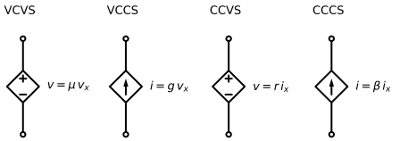
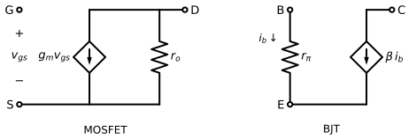

<!-- status: reviewed -->
# 06-06 · Dependent Sources

| | |
|---|---|
| **Course** | [06 · Circuit Analysis I (DC)](../README.md) |
| **University equivalent** | Dependent (controlled) sources in a sophomore Circuits course (Nilsson & Riedel, *Circuit Elements* and *Techniques of Circuit Analysis*; Alexander & Sadiku, *Basic Laws* and *Methods of Analysis*), with the small-signal transistor models that open an Electronics I course (Sedra & Smith) |
| **Prerequisites** | [06-04](06-04-nodal-analysis.md) (nodal analysis, MNA stamps), [06-05](06-05-mesh-analysis.md) (mesh analysis, supermeshes), [01-09](../../01-calculus-for-engineers/chapters/01-09-multivariable-calculus-1.md) (partial derivatives, $g_m$, $r_o$ and intrinsic gain as linearization). Each fact used is restated where it is needed. |
| **Estimated study hours** | 8 |
| **Last verified** | 2026-11-19 |

**Learning objectives.** After this chapter you can:

1. Name the four dependent sources (VCVS, VCCS, CCVS, CCCS), give the units of each gain, and say which device behavior each one models.
2. Solve circuits containing dependent sources by nodal and mesh analysis, and explain why their matrices are no longer symmetric.
3. Find the resistance seen at a port of a circuit with dependent sources by the test-source method, including negative and "reflected" resistances.
4. Analyze single-transistor amplifiers and a finite-gain op-amp with dependent-source models, and check the results against the ideal approximations.
5. Write dependent sources in SPICE (E, G, F and H elements) and state their MNA stamps.

## 1. Big picture

Every element so far has been *independent*: a resistor's current depends only on its own voltage, and a source's value is fixed. Transistors and amplifiers are different: a small voltage or current in one place controls a large current or voltage somewhere else. A **dependent source** (or controlled source) captures exactly that: an ideal source whose value is set by a voltage or current elsewhere in the circuit. Dependent sources are the language in which every amplifier, every transistor model and every feedback loop is analyzed, and they are what SPICE turns every transistor into at each step of a simulation.

- **Transistors are dependent sources.** Around its operating point a MOSFET is a voltage-controlled current source $g_m v_{gs}$ in parallel with $r_o$; a bipolar transistor is a current-controlled current source $\beta i_b$ behind a base resistance $r_\pi$ (§3.5).
- **Op-amps are dependent sources.** An op-amp is, to first order, a voltage-controlled voltage source with enormous gain; feedback around it is what makes its circuits precise (Example 06-06.5, and 06-10).
- **Dependent sources can deliver power.** Unlike resistors, they are *active*: in the model, the controlled source pushes energy into the circuit (the real energy comes from the power supply, which the small-signal model hides).
- **They break symmetry.** The nodal and mesh matrices of 06-04 and 06-05 were symmetric and positive definite; with dependent sources they are neither, which is why amplifiers can have gain, negative resistance, and in later courses instability and oscillation.

## 2. Intuition first

### A remote-controlled valve

Picture a large water main feeding a valve whose opening is set not by a hand but by a pressure gauge somewhere else in the plumbing. A tiny change in that distant pressure swings a large flow through the valve. That is a voltage-controlled current source: the output flow (current) is set by a reading (voltage) elsewhere, with a fixed ratio $g$. The other three kinds swap what is read (voltage or current) and what is delivered (a pressure or a flow).



*Figure 1. The four dependent sources. Diamonds distinguish them from independent sources (circles). The controlling variable $v_x$ or $i_x$ is a voltage or current somewhere else in the circuit.*

*Where the analogy breaks:* a real valve saturates (fully open or shut) and needs a supply of water behind it. An ideal dependent source has no limits: double the control and the output doubles, forever, with no supply in sight. Real transistors and op-amps behave like dependent sources only for small changes around a chosen operating point, and only while their supplies hold them in their active region. Forgetting that limit is the most common way to misuse the models (§8).

## 3. Theory

### 3.1 The four dependent sources

A dependent source is an ideal voltage or current source whose value is a fixed multiple of a voltage or current somewhere else:

| Name | Law | Gain | Gain units | SPICE element | Typical use |
|---|---|---|---|---|---|
| Voltage-controlled voltage source (VCVS) | $v = \mu\,v_x$ | voltage gain $\mu$ | V/V | `E` | op-amp, ideal amplifier |
| Voltage-controlled current source (VCCS) | $i = g\,v_x$ | transconductance $g$ | S | `G` | MOSFET ($g_m$), transconductance amplifier |
| Current-controlled voltage source (CCVS) | $v = r\,i_x$ | transresistance $r$ | Ω | `H` | transimpedance amplifier (photodiode front end) |
| Current-controlled current source (CCCS) | $i = \beta\,i_x$ | current gain $\beta$ | A/A | `F` | bipolar transistor ($\beta$), current mirror |

Two things distinguish them from independent sources. First, a dependent source has no value of its own: if the controlling variable is zero, its output is zero. A circuit made only of resistors and dependent sources, with no independent source, has all voltages and currents zero (unless its equations are singular). Second, a dependent source is part of the circuit's *structure*, not an input. When later chapters "turn off" sources (superposition in 06-07, Thévenin resistance in 06-08), only independent sources are turned off; dependent sources always stay.

### 3.2 Nodal analysis with dependent sources

The procedure of 06-04 needs one extra step:

1. Write KCL at each node exactly as before, treating each dependent source as if it were an independent source of unknown value.
2. Express each controlling variable in terms of the node voltages (a controlling voltage is a difference of node voltages; a controlling current is a resistor's voltage over its resistance, or a branch current already in the equations).
3. Substitute, move every unknown to the left-hand side, and solve.

Step 3 is where symmetry is lost. A VCCS $g\,(v_c - v_d)$ flowing out of node $a$ into node $b$ adds $+g$ at row $a$, column $c$, but nothing at row $c$, column $a$: the control affects node $a$, but node $a$ does not affect the control. For Figure 2 (Example 06-06.1), the nodal matrix is

$$
\begin{bmatrix} \tfrac12 + \tfrac14 & -\tfrac14 \\ -\tfrac14 + g & \tfrac14 + \tfrac14 \end{bmatrix} = \begin{bmatrix} 0.75 & -0.25 \\ 0.75 & 0.5 \end{bmatrix}\ \text{mS},
$$

with $G_{21} \ne G_{12}$.


*Figure 2. The circuit of Example 06-06.1. The VCCS draws $g\,v_1$ from node 2, controlled by the voltage of node 1.*

**What the loss of symmetry means.** The power argument of 06-04 ($\mathbf{v}^\mathsf{T}\mathbf{G}\mathbf{v}$ = dissipated power $> 0$) no longer holds, because dependent sources can supply power. So $\mathbf{G}$ need not be positive definite, and for particular gain values it can be singular: the circuit then has no unique solution, which in a real circuit shows up as instability: latch-up or runaway when a natural response grows without oscillating, or oscillation when energy storage (capacitance with inductance, or enough stages of delay) lets the growing response swing (Course 07 and the feedback and stability chapters of Courses 12 and 15).

### 3.3 Mesh analysis with dependent sources

Mesh analysis takes dependent sources the same way: write KVL with each dependent voltage source as a rise of unknown value, express the controlling variable in mesh currents, substitute. A dependent *current* source on an outer branch fixes its mesh current as a multiple of the controlling variable; one shared by two meshes forms a supermesh whose constraint is $i_a - i_b = \beta\,i_x$ or $g\,v_x$. Example 06-06.3 uses the outer-branch case to show how a bipolar transistor's current gain multiplies an emitter resistance seen from its base; Problem 06-06.16 uses the shared case, and Problem 06-06.15 the nodal counterpart, a dependent voltage source between two non-reference nodes (a dependent supernode).

### 3.4 Resistance at a port: the test-source method

With dependent sources present, the resistance seen at a pair of terminals cannot be found by combining resistors in series and parallel, because the dependent sources respond to whatever you connect. Instead:

1. Turn off every independent source (voltage sources become shorts, current sources opens); leave dependent sources alone.
2. Apply a **test source** at the port: a voltage $v_t$ (or a current $i_t$).
3. Solve for the other quantity, and take $R = v_t/i_t$.

Two results that surprise people follow directly, and both are used constantly in electronics:

- **Reflected resistance.** An emitter resistor $R_E$ seen from a bipolar transistor's base looks $(\beta + 1)$ times larger, because the base current $i_b$ produces an emitter current $(\beta + 1)\,i_b$ through it (Example 06-06.3).
- **The Miller effect and negative resistance.** A resistor $R_f$ connected from the input to the output of an amplifier with voltage gain $-A$ looks like $R_f/(1 + A)$ from the input: the amplifier multiplies the voltage across $R_f$ by $(1 + A)$. If the gain is positive and greater than 1, the same formula gives a **negative resistance**: applying a voltage makes current flow *out* of the port (Example 06-06.4). Negative resistance is how oscillators make up for losses ([12-09](../../12-electronics-2/chapters/12-09-oscillators.md)).

### 3.5 Transistors and op-amps as dependent sources

> **Math refresher — linearization (01-09).** A device whose current depends on two voltages, $i_D = f(v_{GS}, v_{DS})$, changes by $\Delta i_D \approx \frac{\partial f}{\partial v_{GS}}\Delta v_{GS} + \frac{\partial f}{\partial v_{DS}}\Delta v_{DS}$ for small changes. The partial derivatives at the operating point are the **transconductance** $g_m$ and the **output conductance** $g_o = 1/r_o$. Writing small changes in lowercase with lowercase subscripts (notation of this curriculum: $v_{gs}$ for the small-signal part of $v_{GS}$), the linear relation $i_d = g_m v_{gs} + v_{ds}/r_o$ *is* a circuit: a VCCS $g_m v_{gs}$ in parallel with a resistor $r_o$.



*Figure 3. Small-signal models. The MOSFET's gate draws no current; the controlling variable is $v_{gs}$. The bipolar transistor's controlling variable is its base current $i_b$ through $r_\pi$.*

**MOSFET.** In saturation, the small-signal model is the VCCS $g_m v_{gs}$ from drain to source with $r_o$ in parallel (Figure 3). The **intrinsic gain** $g_m r_o$ (01-09) is the most voltage gain one transistor can give.

**Bipolar transistor.** The collector current is $\beta$ times the base current, and the base–emitter junction looks like a resistance $r_\pi = \beta/g_m$ with $g_m = I_C/V_T$; the model is $r_\pi$ from base to emitter and a CCCS $\beta i_b$ from collector to emitter (Figure 3). The same model can be drawn with a VCCS $g_m v_{be}$, because $\beta i_b = \beta v_{be}/r_\pi = g_m v_{be}$: two dependent sources can describe the same device.

**Op-amp.** An op-amp amplifies the difference of its input voltages: a VCCS would do, but the natural model is a VCVS $A(v_+ - v_-)$ behind an output resistance $R_o$, with a differential input resistance $R_{id}$ between the inputs (Example 06-06.5). Real op-amps have $A$ of $10^5$ or more at DC, so precise circuits never rely on $A$; they rely on feedback resistors, and $A$ only sets how small the error is (06-10).

**Validity.** Every one of these models is a *small-signal* model: linear, valid for small changes around a DC operating point that a separate (nonlinear) analysis sets. The DC supply, the bias currents and the device's limits are invisible in it. An ideal dependent source will happily output a thousand volts; the real op-amp it models stops at its supply rails.

### 3.6 Dependent sources in SPICE

SPICE has one element letter per kind. Current-controlled sources are controlled by the current through a named voltage source (often a 0 V "ammeter" source inserted for the purpose):

```text
* VCVS: v(out) - v(0) = 1e5 * (v(inp) - v(inn))
E1 out 0 inp inn 1e5
* VCCS: 2 mS * v(g,s) flows from d through G1 to s
G1 d s g s 2m
* CCCS: 100 * i(Vsense) flows from c through F1 to e
F1 c e Vsense 100
* CCVS: v(out) = 10 kOhm * i(Vsense)
H1 out 0 Vsense 10k
```

Their MNA stamps (06-04 §3.5), with nodes $a$ (+) and $b$ (−) for the output and $c$, $d$ for a controlling voltage:

| Element | Adds to the matrix |
|---|---|
| VCCS (`G`), current $g(v_c - v_d)$ from $a$ to $b$ | $+g$ at $(a,c)$ and $(b,d)$; $-g$ at $(a,d)$ and $(b,c)$ |
| VCVS (`E`), new unknown $j$ in row/column $m$ | voltage-source stamp at $(a,m)$, $(m,a)$, $(b,m)$, $(m,b)$, plus $-\mu$ at $(m,c)$ and $+\mu$ at $(m,d)$ |
| CCCS (`F`), controlled by the current $j_k$ of voltage source $k$ | $+\beta$ at $(a,k)$ and $-\beta$ at $(b,k)$ |
| CCVS (`H`) | voltage-source stamp with a new unknown $j$ in row $m$, plus $-r$ at $(m,k)$ |

Every stamp puts entries in rows and columns that do not mirror each other, which is the matrix form of "the control affects the output but not the reverse". SPICE's sparse LU with pivoting handles the nonsymmetric matrix without any special treatment; the same stamps are used for every transistor at every Newton iteration, because a transistor's companion model (06-04 §3.5) is a VCCS $g_m$ plus conductances plus a current source.

## 4. Worked examples

### Example 06-06.1 · A VCCS in nodal analysis (tier A)

**Setup.** In Figure 2, find $v_1$, $v_2$ and the gain $v_2/v_1$, and show that the dependent source delivers power.

**Solution.** In kΩ, mA and V. Node 1: $v_1/2 + (v_1 - v_2)/4 = 1$. Node 2: $(v_2 - v_1)/4 + v_2/4 + g\,v_1 = 0$ with $g$ = 1 mS (the VCCS current leaves node 2). In matrix form (§3.2), $\begin{bmatrix} 0.75 & -0.25 \\ 0.75 & 0.5\end{bmatrix}\mathbf{v} = \begin{bmatrix} 1 \\ 0\end{bmatrix}$, with determinant \$0.375 + 0.1875 = \$ **0.5625 mS²**. Node 2 gives $v_2 = -1.5\,v_1$; substituting in node 1, $0.75v_1 + 0.375v_1 = 1$:

$$
v_1 = \mathbf{0.8889\ V}, \qquad v_2 = \mathbf{-1.333\ V}, \qquad v_2/v_1 = \mathbf{-1.5}.
$$

**Power.** The independent source delivers \$1\times0.8889 = \$ **0.8889 mW**. The VCCS carries $g\,v_1 = 0.8889$ mA from node 2 (at −1.333 V) to ground (0 V), uphill in potential, so it delivers \$1.333\times0.8889 = \$ **1.185 mW**. Resistors: \$0.8889^2/2 + 2.222^2/4 + 1.333^2/4 = 0.395 + 1.235 + 0.444 = \$ **2.074 mW** $= 0.889 + 1.185$ ✓. The dependent source supplies more power than the input does: in the circuit it models, that energy would come from a DC supply.

**Units check.** mS × V = mA ✓.

**Sanity check.** Inverting gain: the VCCS pulls current out of node 2 in proportion to $v_1$, dragging $v_2$ negative ✓.

### Example 06-06.2 · A MOSFET amplifier with source degeneration (tier B)

**Setup.** A MOSFET with $g_m$ = 2 mS and $r_o$ = 50 kΩ has a drain resistor $R_D$ = 10 kΩ to the (small-signal grounded) supply and a source resistor $R_S$ = 1 kΩ to ground. The gate is driven by a small-signal voltage $v_{in}$. Find the voltage gain $v_d/v_{in}$, compare it with the approximation $-g_mR_D/(1 + g_mR_S)$, and with the gain without $R_S$.

**Solution.** Replace the transistor by Figure 3's model. Unknowns: drain voltage $v_d$ and source voltage $v_s$; the controlling voltage is $v_{gs} = v_{in} - v_s$; the VCCS current $g_m v_{gs}$ flows from drain to source. Per volt of input, in kΩ and mA:

$$
\text{drain:}\ \frac{v_d}{10} + \frac{v_d - v_s}{50} + 2(1 - v_s) = 0, \qquad
\text{source:}\ \frac{v_s}{1} + \frac{v_s - v_d}{50} - 2(1 - v_s) = 0 .
$$

Collecting: $0.12v_d - 2.02v_s = -2$ and $-0.02v_d + 3.02v_s = 2$. From the second, $v_s = (2 + 0.02v_d)/3.02$; substituting and multiplying by 3.02, $0.3624v_d - 4.04 - 0.0404v_d = -6.04$, so $0.322\,v_d = -2$:

$$
\frac{v_d}{v_{in}} = \mathbf{-6.211}, \qquad v_s = \mathbf{0.6211}\,v_{in}.
$$

The VCCS carries \$g_m(v_{in} - v_s) = \$ **0.7578 mA per volt**, but that is not the drain current. The drain current (by the definition of §3.5, the VCCS current plus the current in $r_o$) is \$0.7578 + (v_d - v_s)/50 = 0.7578 + (-6.211 - 0.621)/50 = \$ **0.6211 mA per volt**, equal to $-v_d/R_D$ and to $v_s/R_S$, as KCL requires: **0.1366 mA per volt** of the VCCS current circulates back through $r_o$.

The approximation (ignoring $r_o$) gives \$-2\times10/(1 + 2\times1) = \$ **−6.667**; without degeneration the gain is \$-g_m(R_D\parallel r_o) = -2\times8.333 = \$ **−16.67**.

**Units check.** mS × kΩ = dimensionless gain ✓.

**Sanity check.** Degeneration trades gain for predictability: $R_S$ feeds back part of the output current as a voltage that opposes $v_{gs}$, so the gain falls by about $1 + g_mR_S = 3$, and it now depends mainly on the ratio $R_D/R_S$ rather than on $g_m$, which varies with temperature and from part to part. The exact answer sits slightly below the approximation because $r_o$ shunts some current around $R_D$ ✓.

### Example 06-06.3 · A bipolar stage by mesh analysis: reflected resistance (tier B)

**Setup.** A bipolar transistor ($\beta$ = 100, $r_\pi$ = 2.5 kΩ) has $R_C$ = 4 kΩ in its collector and $R_E$ = 100 Ω in its emitter. A 10 mV signal with 1 kΩ source resistance drives the base. Using two meshes (the input loop through the source, $r_\pi$ and $R_E$; the output loop through $R_C$, the CCCS and $R_E$), find $i_b$, the output voltage, the gain, and the resistance seen looking into the base.

**Solution.** The CCCS $\beta i_b$ is on the output mesh's outer branch, so it fixes the output mesh current: $i_2 = \beta\,i_1 = 100\,i_1$, with $i_1 = i_b$. Both mesh currents flow down through $R_E$, so KVL around the input mesh is

$$
v_s = (R_s + r_\pi + R_E)\,i_1 + R_E\,i_2 = \bigl(R_s + r_\pi + (\beta + 1)R_E\bigr)\,i_b .
$$

In kΩ: $1 + 2.5 + 101\times0.1 = 13.6$ kΩ, so \$i_b = 10\ \text{mV}/13.6\ \text{kΩ} = \$ **0.7353 µA**. The collector current $100\,i_b$ flows from the (small-signal grounded) supply down through $R_C$ into the collector, so the output node sits below ground: \$v_o = -\beta i_bR_C = -100\times0.7353\ \text{µA}\times4\ \text{kΩ} = \$ **−294.1 mV**: a gain of **−29.41**. The base sees \$r_\pi + (\beta + 1)R_E = \$ **12.6 kΩ**.

**Units check.** kΩ × µA = mV ✓.

**Sanity check.** Without $R_E$ the gain would be \$-\beta R_C/(R_s + r_\pi) = \$ **−114.3**; the 100 Ω emitter resistor, multiplied by $\beta + 1$ to 10.1 kΩ, dominates the input loop and cuts the gain by a factor of about 4 while making it far less sensitive to $\beta$ ✓.

### Example 06-06.4 · The Miller effect and a negative resistance (tier B)

**Setup.** A resistor $R_f$ = 100 kΩ connects node 1 to the output of an ideal VCVS whose output is $\mu\,v_1$. Find the resistance seen looking into node 1 (a) for an inverting amplifier, $\mu = -99$; (b) for a non-inverting gain $\mu = +2$.

**Solution.** No independent sources remain, so apply a test voltage $v_t$ at node 1. The output is $\mu v_t$, and the test source supplies the current through $R_f$:

$$
i_t = \frac{v_t - \mu v_t}{R_f} \;\Rightarrow\; R_{in} = \frac{v_t}{i_t} = \frac{R_f}{1 - \mu}.
$$

(a) $\mu = -99$: \$R_{in} = 100\ \text{kΩ}/100 = \$ **1 kΩ**. The amplifier multiplies the voltage across $R_f$ a hundredfold, so the input supplies a hundred times the current a grounded $R_f$ would draw: the **Miller effect**. (b) $\mu = +2$: \$R_{in} = 100\ \text{kΩ}/(1 - 2) = \$ **−100 kΩ**. With 1 V applied, the output sits at 2 V and pushes **10 µA** *into* the test source: the port delivers power, a **negative resistance**.

**Units check.** kΩ/(V/V) = kΩ ✓.

**Sanity check.** At $\mu = 1$ the output follows the input exactly, no current flows, and $R_{in}$ is infinite: the formula's pole at $\mu = 1$ is the "bootstrapping" trick used to make high input resistances ✓.

### Example 06-06.5 · An op-amp with finite gain (tier C)

**Setup.** Figure 4 models an op-amp as a VCVS with $A = 10^5$, $R_{id}$ = 1 MΩ and $R_o$ = 100 Ω, in a non-inverting amplifier with $R_1$ = 1 kΩ, $R_2$ = 9 kΩ and a 2 kΩ load. The ideal gain is $1 + R_2/R_1 = 10$. Find the actual gain, the difference voltage $v_+ - v_-$ and the current into the + input for $v_s$ = 1 V, and compare with the feedback formula $A/(1 + A\beta)$, $\beta = R_1/(R_1 + R_2)$.


*Figure 4. A non-inverting amplifier with the op-amp modeled by a VCVS, an input resistance and an output resistance.*

**Solution.** Unknowns $v_-$ and $v_{out}$ (with $v_+ = v_s$), in kΩ and mA:

$$
\begin{aligned}
\text{node } v_-:&\quad \frac{v_- - v_s}{1000} + \frac{v_-}{1} + \frac{v_- - v_{out}}{9} = 0,\\
\text{node } v_{out}:&\quad \frac{v_{out} - A(v_s - v_-)}{0.1} + \frac{v_{out}}{2} + \frac{v_{out} - v_-}{9} = 0.
\end{aligned}
$$

The second row contains $+A/0.1 = 10^6$ in the $v_-$ column but the first row has only $-1/9$ in the $v_{out}$ column: strongly nonsymmetric. Solving (by computer; the lab does it) gives $v_{out}$ = **9.9989 V** and \$v_s - v_- = \$ **106.0 µV**, so the + input draws \$106\ \text{µV}/1\ \text{MΩ} = \$ **0.106 nA**. The gain error is **106 ppm**. The same answer follows by hand in two steps. *The feedback formula.* If the amplifier's input drew no current and its output were unloaded, the divider would give $v_- = \beta v_{out}$ with $\beta = R_1/(R_1 + R_2) = 0.1$, and the VCVS would give $v_{out} = A(v_s - \beta v_{out})$. Solving, $v_{out}(1 + A\beta) = Av_s$:

$$
\frac{v_{out}}{v_s} = \frac{A}{1 + A\beta} = \frac{1}{\beta}\cdot\frac{1}{1 + 1/(A\beta)},
$$

\$10^5/(1 + 10^4) = \$ **9.9990**, an error of about $1/(A\beta)$ = 100 ppm. *The loading.* $R_o$ drives $R_L$ in parallel with $R_1 + R_2$, that is $2\parallel10 = 1.667$ kΩ, so only the fraction $1.667/(1.667 + 0.1)$ of the VCVS voltage reaches the output: the effective open-loop gain is \$A' = 10^5\times0.9434 = \$ **94,340**, and \$1/(A'\beta) = \$ **106.0 ppm**, matching the computer result. ($R_{id}$, with only 106 µV across 1 MΩ, changes nothing visible.)

**Units check.** V/kΩ = mA in every term ✓.

**Sanity check.** The difference voltage is the output divided by the effective gain, about $10/10^5 = 100$ µV, and it is what lets us treat the inputs as equal ("virtual short") with an error of order $1/(A\beta) = 10^{-4}$ ✓.

### Answer key

<!-- answer-key -->
| ID | Quantity | Value | Unit |
|---|---|---|---|
| Ex 06-06.1a | v_1 | 0.8889 | V |
| Ex 06-06.1b | v_2 | −1.333 | V |
| Ex 06-06.1c | gain v_2/v_1 | −1.5 | — |
| Ex 06-06.1d | determinant | 0.5625 | mS² |
| Ex 06-06.1e | power from the independent source | 0.8889 | mW |
| Ex 06-06.1f | power from the VCCS | 1.185 | mW |
| Ex 06-06.1g | total resistor power | 2.074 | mW |
| Ex 06-06.1h | G_21 | 0.75 | mS |
| Ex 06-06.2a | gain v_d/v_in | −6.211 | — |
| Ex 06-06.2b | v_s per volt of input | 0.6211 | — |
| Ex 06-06.2c | VCCS current per volt | 0.7578 | mA |
| Ex 06-06.2h | drain current per volt | 0.6211 | mA |
| Ex 06-06.2i | current returning through r_o per volt | 0.1366 | mA |
| Ex 06-06.2d | approximate gain | −6.667 | — |
| Ex 06-06.2e | gain without R_S | −16.67 | — |
| Ex 06-06.2f | reduced coefficient | 0.322 | — |
| Ex 06-06.2g | R_D ∥ r_o | 8.333 | kΩ |
| Ex 06-06.3a | input-loop resistance | 13.6 | kΩ |
| Ex 06-06.3b | i_b | 0.7353 | µA |
| Ex 06-06.3c | v_o | −294.1 | mV |
| Ex 06-06.3d | gain | −29.41 | — |
| Ex 06-06.3e | resistance into the base | 12.6 | kΩ |
| Ex 06-06.3f | gain without R_E | −114.3 | — |
| Ex 06-06.4a | R_in, μ = −99 | 1 | kΩ |
| Ex 06-06.4b | R_in, μ = +2 | −100 | kΩ |
| Ex 06-06.4c | current pushed out at 1 V, μ = +2 | 10 | µA |
| Ex 06-06.5a | v_out | 9.9989 | V |
| Ex 06-06.5b | v_+ − v_− | 106.0 | µV |
| Ex 06-06.5c | input current | 0.106 | nA |
| Ex 06-06.5d | gain error | 106 | ppm |
| Ex 06-06.5e | feedback-formula gain | 9.9990 | — |
| Ex 06-06.5f | feedback-formula error | 100 | ppm |
| Ex 06-06.5g | effective open-loop gain with loading | 94340 | — |
| Ex 06-06.5h | 1/(A′β) | 106.0 | ppm |

## 5. Simulate it

Open [labs/06-06-lab/](../labs/06-06-lab/README.md): a notebook and an ngspice netlist.

1. **E, G, F and H in ngspice.** Run Examples 06-06.1 to 06-06.5 with SPICE's dependent sources and compare with the answer key. *Predict first:* what sign will ngspice report for the current of the 0 V sense source in Example 06-06.3?
2. **Nonsymmetric matrices.** Extend 06-04's mini-SPICE with VCCS and VCVS stamps and print the matrices. *Predict first:* which entries break the symmetry in Example 06-06.1?
3. **Sweep the gain.** For Example 06-06.4, sweep $\mu$ from −100 to +100 and plot $R_{in}$. *Predict first:* where does it change sign, and what happens at $\mu = 1$?
4. **How much loop gain is enough?** Sweep the op-amp gain $A$ of Example 06-06.5 from 10 to $10^7$ and plot the closed-loop gain error. *Predict first:* how does the error scale with $A$?

## 6. Engineering tradeoffs

| Knob | Improves | Costs | Typical decision owner |
|---|---|---|---|
| Source or emitter degeneration ($R_S$, $R_E$) | Gain set by a resistor ratio, less sensitivity to $g_m$ or $\beta$, more linearity, higher input resistance | Lower gain (by about $1 + g_mR_S$), more voltage headroom used | Analog designer |
| Higher open-loop gain $A$ | Smaller closed-loop error ($\approx 1/(A\beta)$) | More stages, power, harder frequency compensation (Course 12) | Amplifier architect |
| Larger $g_m$ (more bias current) | More gain and speed | Power; at fixed current, larger devices and capacitance | Analog designer (the $g_m/I_D$ tradeoff) |
| Using the Miller effect | Large effective resistance or capacitance from a small component | Depends on the amplifier's gain, which varies | Analog designer |
| Dependent-source (small-signal) models in hand analysis | Insight, closed-form gains | Valid only near the operating point; no limits, no supplies | Everyone, with a simulator check |

## 7. Numbers to know

| Quantity | Value | Note |
|---|---|---|
| VCVS, VCCS, CCVS, CCCS gain units | V/V, S, Ω, A/A | SPICE letters E, G, H, F |
| Bipolar $g_m$ | $I_C/V_T$ = 38.7 mS per mA at 300 K | $V_T$ = 25.85 mV |
| Bipolar $r_\pi$ | $\beta/g_m$ | 2.585 kΩ at 1 mA with $\beta$ = 100 |
| Resistance reflected into a base | $(\beta + 1)R_E$ | 100 Ω → 10.1 kΩ at $\beta$ = 100 |
| Degenerated gain | $\approx -R_D/(R_S + 1/g_m)$ | equals $-g_mR_D/(1 + g_mR_S)$ |
| Miller resistance | $R_f/(1 - \mu)$ | $R_f/(1 + A)$ for inverting gain $-A$ |
| Closed-loop gain error | $\approx 1/(A\beta)$ | $10^{-4}$ for $A = 10^5$, gain 10 |

## 8. Common mistakes

1. **Turning off dependent sources** when finding a Thévenin resistance or applying superposition. Only independent sources are turned off; dependent sources stay.
2. **Forgetting to express the controlling variable** in terms of the unknowns, leaving one more unknown than equations.
3. **Getting the controlling variable's polarity or direction wrong.** $v_x$ is defined with specific + and − terminals and $i_x$ with a specific arrow; reversing one flips the sign of the gain.
4. **Assuming the matrix is symmetric** and writing it "by inspection" with the dependent source's entries mirrored.
5. **Treating a small-signal model as a large-signal one,** for example predicting a 1000 V output from a gain of 1000 and a 1 V input.
6. **Mixing DC and small-signal quantities:** $g_m$ and $r_o$ come from the DC operating point, but the model is solved only for the small changes ($v_{gs}$, $i_d$), with DC supplies replaced by small-signal grounds.

## 9. Practitioner lens

### State of the art (as of Nov 2026)

- **Simulators linearize every device into dependent sources.** At each Newton iteration and at each frequency of an AC analysis, SPICE evaluates each transistor's compact model and stamps its conductances and transconductances, which are VCCS stamps (06-04 §3.5, §3.6 here) **[Established]**.
- **The compact models are industry standards.** Foundries deliver transistor behavior to designers as compact models in their process design kits. For FinFET processes the standard is BSIM-CMG, developed at UC Berkeley and standardized through the Si2 Compact Model Coalition, a group of foundries, EDA vendors and chip companies; new CMC standards reach the public 18 months after members receive them ([R-104](../../../reference/research-log.md#r-104--compact-models-and-gmid-design)) **[Industry estimate]**: read from search excerpts only (Si2's pages returned a bot check), with the current version not confirmed.
- **Design by $g_m/I_D$.** A systematic analog design method sizes transistors with precomputed tables of $g_m/I_D$ (transconductance per unit current) and related small-signal parameters, set out in Jespers and Murmann's *Systematic Design of Analog CMOS Circuits* (Cambridge, 2017) ([R-104](../../../reference/research-log.md#r-104--compact-models-and-gmid-design)) **[Industry estimate]**; how widely it is used in industry was not established from a source. The quantity it optimizes is exactly the dependent source's gain per unit of bias power.

### Why it matters commercially

Every analog and mixed-signal product (power management, data converters, RF front ends, sensor interfaces, SerDes) is designed with these models, and its competitiveness rests on how much gain, bandwidth and accuracy each milliwatt of bias buys. For a strategic reviewer, two things follow. First, an analog team's quality shows in how it bridges hand analysis (dependent-source models, as here) and silicon: model correlation, corners and margins. Second, analog design depends on the foundry's compact models and on the PDK's maturity, which makes a node migration or a foundry switch for analog IP slower and riskier than for digital logic.

### Marketing vs Reality

- **"Our amplifier has 140 dB of gain."** *Reality:* that is open-loop gain at DC. What the system sees is the closed-loop gain, set by resistors, and its error, about $1/(A\beta)$ at DC but rising as the loop gain falls with frequency (Course 12). Ask for the error at the signal frequency.
- **"Negative-resistance" or "infinite-impedance" circuits.** *Reality:* these come from dependent sources with gain near a critical value (Example 06-06.4) and are only as good as the gain's accuracy and the bandwidth over which it holds. They also tend to oscillate.
- **"The model says it works."** *Reality:* a small-signal analysis says nothing about whether the circuit is biased correctly, saturates, or survives its supply's range. Ask what DC operating-point and large-signal checks were run.

### Questions for engineering leaders

1. **"How do your simulation models correlate with silicon for the analog blocks, and across which corners?"** *Strong:* measured-versus-simulated data across process, voltage and temperature. *Evasive:* "the foundry models are accurate".
2. **"What sets the accuracy of this amplifier: the loop gain or the resistors?"** *Strong:* a budget showing both, with the dominant term at the operating frequency. *Evasive:* only the open-loop gain.
3. **"What is your $g_m/I_D$ strategy for this block, and how does it change at the next node?"** *Strong:* a clear tradeoff of power, speed and area, and what scaling does to intrinsic gain. *Evasive:* "we'll port it".
4. **"Where in this design could a dependent-source loop go unstable?"** *Strong:* identified feedback loops with stability margins. *Evasive:* none considered.

## 10. Concept check

1. Name the four dependent sources and the units of their gains.

   <details><summary>Answer</summary>

   VCVS (V/V), VCCS (S), CCVS (Ω), CCCS (A/A).

   </details>

2. Why is the nodal matrix of a circuit with a VCCS generally not symmetric?

   <details><summary>Answer</summary>

   The VCCS adds an entry in the row of the node it drives and the column of the node that controls it, but nothing in the mirrored position: the control affects the output, not the other way round.

   </details>

3. When finding the Thévenin resistance of a circuit, what do you do with a dependent source?

   <details><summary>Answer</summary>

   Leave it in place. Turn off only independent sources, apply a test source, and compute $v_t/i_t$.

   </details>

4. An emitter resistor of 200 Ω is in a bipolar stage with $\beta$ = 150. What resistance does it add looking into the base?

   <details><summary>Answer</summary>

   $(\beta + 1)R_E = 151\times200 = 30.2$ kΩ.

   </details>

5. A 1 MΩ resistor connects the input and output of an inverting amplifier with gain −999. What resistance does it present at the input?

   <details><summary>Answer</summary>

   $1\ \text{MΩ}/(1 + 999) = 1$ kΩ (the Miller effect).

   </details>

6. Can a circuit with only resistors and dependent sources deliver power to an external load? Can it have nonzero voltages with no external source?

   <details><summary>Answer</summary>

   It can present a negative resistance and so deliver power to whatever drives it, but with no independent source anywhere, every voltage and current is zero unless the equations are singular (in a real circuit, an oscillation or latch-up condition). The energy in a real circuit comes from the power supply the model hides.

   </details>

7. Why does a degenerated amplifier's gain depend less on the transistor?

   <details><summary>Answer</summary>

   Its gain is $-g_mR_D/(1 + g_mR_S)$; when $g_mR_S \gg 1$ this approaches $-R_D/R_S$, a resistor ratio, so changes in $g_m$ matter less. It is negative feedback in its simplest form.

   </details>

Problem set: [06-06 problems](../problems/06-06-problems.md) · [solutions](../solutions/06-06-solutions.md).

## 11. Key terms

[Dependent source](../../../reference/glossary.md#dependent-source) ·
[VCVS](../../../reference/glossary.md#vcvs) ·
[VCCS](../../../reference/glossary.md#vccs) ·
[CCVS](../../../reference/glossary.md#ccvs) ·
[CCCS](../../../reference/glossary.md#cccs) ·
[Transconductance](../../../reference/glossary.md#transconductance) ·
[Small-signal model](../../../reference/glossary.md#small-signal-model) ·
[Test source](../../../reference/glossary.md#test-source) ·
[Miller effect](../../../reference/glossary.md#miller-effect) ·
[Negative resistance](../../../reference/glossary.md#negative-resistance) ·
[Source degeneration](../../../reference/glossary.md#source-degeneration)

## 12. Connections

- **Previous:** [06-04](06-04-nodal-analysis.md) and [06-05](06-05-mesh-analysis.md) (the two methods, now with nonsymmetric matrices); [01-09](../../01-calculus-for-engineers/chapters/01-09-multivariable-calculus-1.md) (small-signal parameters as partial derivatives).
- **Next:** [06-07 Linearity and Superposition](06-07-linearity-and-superposition.md), where dependent sources stay on while independent sources are switched off one at a time; [06-08](06-08-thevenin-and-norton.md), Thévenin equivalents by the test-source method; [06-10](06-10-ideal-op-amp.md), the op-amp with $A \to \infty$.
- **Used later:** small-signal models of diodes, MOSFETs and BJTs (Course 10), multistage amplifiers, cascodes and feedback (Course 12), the Miller effect on capacitance and frequency response (Courses 07 and 12).

## 13. Further study

- Nilsson, J. W. and Riedel, S. A., *Electric Circuits*, chapter 2 (dependent sources as circuit elements) and chapter 4 (node-voltage and mesh-current methods with dependent sources).
- Sedra, A. S. and Smith, K. C., *Microelectronic Circuits*, the chapters on MOSFET and BJT small-signal models and the basic single-stage amplifiers.
- *Video:* MIT OpenCourseWare 6.002, *Circuits and Electronics* (Spring 2007, A. Agarwal), Lecture 8, "Dependent Sources and Amplifiers".

## 14. Sources

1. Nilsson and Riedel, ch. 2 and 4; Alexander and Sadiku, ch. 2 and 3; Sedra and Smith, small-signal model chapters.
2. ngspice, element letters E, G, F and H (confirmed by running the lab netlist with ngspice-42).
3. Si2 Compact Model Coalition and BSIM-CMG release notes; Jespers and Murmann (2017). [R-104]
