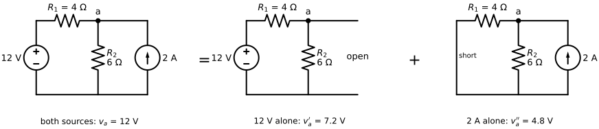
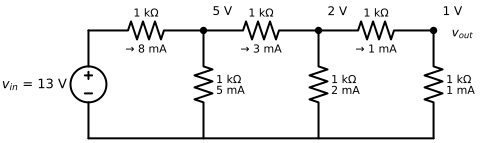
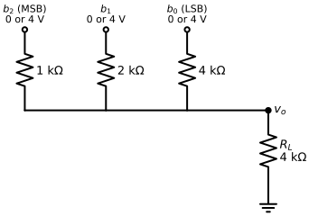

<!-- status: reviewed -->
# 06-07 · Linearity and Superposition

| | |
|---|---|
| **Course** | [06 · Circuit Analysis I (DC)](../README.md) |
| **University equivalent** | Linearity, superposition and source transformations in a sophomore Circuits course (Nilsson & Riedel, *Techniques of Circuit Analysis*; Alexander & Sadiku, *Circuit Theorems*; MIT 6.002's superposition lecture) |
| **Prerequisites** | [06-04](06-04-nodal-analysis.md) (nodal analysis and MNA), [06-06](06-06-dependent-sources.md) (dependent sources stay on), [03-04](../../03-probability-statistics-and-random-variables/chapters/03-04-joint-distributions-and-clt.md) (sums of independent random variables, for error budgets). Each fact used is restated where it is needed. |
| **Estimated study hours** | 6 |
| **Last verified** | 2026-11-19 |

**Learning objectives.** After this chapter you can:

1. State the two properties that make a circuit linear (homogeneity and additivity), prove that every response of a linear circuit is a weighted sum of its independent sources, and say which elements break linearity.
2. Apply superposition: find a response by switching on one independent source at a time, with dependent sources always left in place.
3. Explain why power does not superpose, compute the cross term, and say when average powers *do* add.
4. Use source transformations and the unit-output (proportionality) method to simplify circuits.
5. Use superposition to build error budgets and to analyze converters and small-signal circuits, combining contributions by worst case or root-sum-square.

## 1. Big picture

A circuit of resistors, dependent sources and independent sources has a property so useful that much of electrical engineering is built on it: its response to several sources acting together is the sum of its responses to each source acting alone. This is **superposition**, and it follows from **linearity**. It lets you split a hard problem into easy ones, find how sensitive an output is to each input, and reason about signals, noise and errors separately. It fails the moment a nonlinear element (a diode, a transistor over its full range, a saturating amplifier) matters, and it never applies to power directly.

- **Analysis by parts.** Signal plus bias, signal plus interference, two supplies feeding one load: each contribution can be found alone and added.
- **Error and noise budgets.** An instrument's output error is the sum of the contributions of every offset, bias current, tolerance and drift term; noise powers from independent sources add (03-06). Every precision design review rests on this.
- **Data converters.** A digital-to-analog converter is superposition made into hardware: each bit switches a weighted contribution in or out (Example 06-07.5).
- **The foundation of what follows.** Thévenin's and Norton's theorems (06-08), small-signal analysis (06-06, Course 10), phasors and frequency response (Course 07) and the theory of linear time-invariant systems (Course 11) are all consequences of linearity.

## 2. Intuition first

### Several hands on one spring

Push on a spring with one hand and it compresses by some amount; push with a second hand elsewhere and it compresses by another amount. If the spring is ideal (linear), pushing with both hands compresses it by the sum. Circuits made of resistors behave the same way: each source "pushes" on every node voltage, and the pushes add. Figure 1 shows the bookkeeping: the circuit with both sources equals the sum of two circuits with one source each, the other source switched off.

*Figure 1. Superposition in Example 06-07.1. A voltage source switched off becomes a short circuit (0 V); a current source switched off becomes an open circuit (0 A).*

### The business analogy, and where it breaks

Think of a portfolio's return as the sum of each position's contribution: you can attribute performance position by position, and the attributions add up to the total. That is superposition. *Where it breaks:* risk does not add that way. The variance of a portfolio has cross terms (covariances), exactly as the power in a resistor has a cross term when two sources drive it (§3.3). Returns superpose; their squares do not.

## 3. Theory

### 3.1 Linearity

A system with input $x$ and output $y = f(x)$ is **linear** if it has two properties:

- **Homogeneity (scaling):** $f(a\,x) = a\,f(x)$ for any number $a$;
- **Additivity:** $f(x_1 + x_2) = f(x_1) + f(x_2)$.

**Which elements are linear.** A resistor ($v = Ri$) is linear. So are the four dependent sources (06-06): their outputs are fixed multiples of their controls. Capacitors and inductors, whose laws are linear differential relations, are also linear, provided their initial charge or current is counted as an input: an initial condition acts like an extra source (Course 07). Diodes and transistors are not: $i_D = I_S(e^{v/V_T} - 1)$ fails both tests. Independent sources are not elements that respond to anything; they are the **inputs**.

**Theorem (superposition).** In a circuit made of linear elements and independent sources $s_1, \dots, s_m$, every node voltage and branch current is a weighted sum of the source values:

$$
y = k_1 s_1 + k_2 s_2 + \cdots + k_m s_m ,
$$

where each weight $k_j$ depends only on the circuit, not on the sources.

*Proof.* Write the circuit's modified nodal equations (06-04 §3.5), $\mathbf{A}\mathbf{x} = \mathbf{z}$. The matrix $\mathbf{A}$ contains only the stamps of resistors and dependent sources, so it does not depend on the sources. Each independent source stamps its value into the right-hand side at fixed positions, so $\mathbf{z} = \sum_j s_j\,\mathbf{b}_j$ for fixed vectors $\mathbf{b}_j$. If $\mathbf{A}$ is nonsingular, $\mathbf{x} = \mathbf{A}^{-1}\mathbf{z} = \sum_j s_j\,(\mathbf{A}^{-1}\mathbf{b}_j)$, a weighted sum of the sources. Any response $y$ is one component of $\mathbf{x}$ (or a fixed linear combination of components), which proves the claim. ∎

The proof also shows when superposition fails: if any element's stamp depends on the solution (a diode's conductance depends on its voltage), $\mathbf{A}$ depends on the sources and the argument collapses.

> **Math refresher — linear versus affine.** A function $y = kx + c$ with $c \ne 0$ is *affine*, not linear: doubling $x$ does not double $y$. A linear circuit looks affine if you treat one of its sources as part of the circuit: with a fixed 5 V supply inside, the output is (constant from the supply) + $k\times$(signal). Superposition still applies as long as the supply is counted as one of the sources.

### 3.2 Superposition, step by step

1. Choose one independent source and switch off all the others: a voltage source becomes a **short circuit** (0 V across it), a current source an **open circuit** (0 A through it).
2. **Leave every dependent source in place.** It is part of the circuit's structure, not an input (06-06 §3.1).
3. Solve for the response you want. Each sub-problem often reduces to series–parallel combinations and dividers (06-03).
4. Repeat for every independent source (or group of sources), and add the results with their signs.

Superposition is not always less work: for a circuit with many sources, one nodal solve beats many sub-problems. It pays off when the sub-circuits are simple, when you need each source's contribution separately (sensitivity, error budgets), or when the sources are of different kinds (a DC bias and a small signal, a signal and an interference).

### 3.3 Power does not superpose

Let a resistor $R$ carry $i = i' + i''$, the sum of the currents due to two sources. Its power is

$$
p = R\,(i' + i'')^2 = R\,i'^2 + R\,i''^2 + 2R\,i'i'' .
$$

The cross term $2R\,i'i''$ is the reason powers computed source by source do not add. It can be positive or negative, and it can dominate: in Example 06-07.1 the two sources drive equal and opposite currents through $R_1$, so the true power is zero while the "superposed" powers add to 11.52 W.

There are two important cases in which the cross term vanishes *on average*, and average powers do add:

- **Signals at different frequencies.** The average of $\cos(\omega_1 t)\cos(\omega_2 t)$ over a long time is zero when $\omega_1 \ne \omega_2$, so the average powers of a DC component and of sinusoids at distinct frequencies add (Course 07, and the RMS of a waveform in 06-01).
- **Independent random noise.** The mean of $i'i''$ is zero when the two are independent with zero mean, so mean-square values (noise powers) add: $\overline{i^2} = \overline{i'^2} + \overline{i''^2}$ (03-04, 03-06). That is why independent noise sources are combined by root-sum-square.

### 3.4 Source transformation

A practical voltage source, $V_s$ in series with $R$, and a practical current source, $I_s = V_s/R$ in parallel with the same $R$, are **equivalent at their terminals**. Proof: the first has terminal law $v = V_s - R\,i$; the second, $i = I_s - v/R$, which rearranges to $v = R\,I_s - R\,i = V_s - R\,i$. Every external voltage and current is therefore identical. What happens *inside* is not: Problem 06-04.14 showed that the two forms dissipate different powers internally.

Two uses follow:

- **Convert to suit the method.** Turn voltage sources with series resistors into current sources for nodal analysis, or the reverse for mesh analysis.
- **Combine practical sources in parallel** (Millman's theorem). Convert each to a current source, add the currents and the conductances, and convert back:

$$
V_{eq} = \frac{\sum_k V_k/R_k}{\sum_k 1/R_k}, \qquad R_{eq} = \Bigl(\sum_k 1/R_k\Bigr)^{-1}.
$$

Example 06-07.3 uses this for two batteries feeding a load.

### 3.5 Proportionality: the unit-output method

With a single source, homogeneity alone says every response is proportional to the source. In a ladder this gives a quick method: *assume* the output is 1 (volt or ampere), work backwards toward the source using only Ohm's law and KCL, find the source value $s_1$ that this requires, then scale everything by $s/s_1$ for the actual source $s$. No simultaneous equations are needed (Example 06-07.4).

### 3.6 Superposition in practice

**Small-signal analysis.** A transistor amplifier is nonlinear, but around a fixed operating point its small changes obey the linear small-signal model (06-06 §3.5). Engineers analyze the DC bias and the small signal separately and add them: superposition applied to the linearized circuit, valid as long as the signal stays small.

**Error budgets.** The output error of a measurement chain is the sum of the contributions of each error source (an op-amp's offset voltage, its input bias currents, resistor tolerances, reference error). By superposition, each contribution is the error source times its own gain to the output. Combining them:

- **worst case:** add the magnitudes, $|e_1| + |e_2| + \cdots$, a hard bound;
- **statistical:** if the errors are independent random variables with zero mean, their variances add (03-04), so their standard deviations combine by **root-sum-square**, $\sigma = \sqrt{\sigma_1^2 + \sigma_2^2 + \cdots}$, smaller than the worst case. Applying the same formula to error *limits* gives a total at the same confidence level only if every limit sits at the same number of standard deviations (for example, all ±3σ for Gaussian errors); for errors uniform within their limits, the RSS of the limits is only about 1.7σ and is exceeded by several percent of units (lab Part 4).

**Converters.** A DAC's output is a superposition of bit contributions; its linearity errors (differential and integral nonlinearity) come from the bit weights being slightly wrong, and superposition is what lets you predict them (Example 06-07.5).

> **Going deeper — linear time-invariant systems.** For circuits with capacitors and inductors, superposition holds for whole waveforms: the response to a sum of input signals is the sum of the responses, provided the circuit starts from rest (zero initial charge and current) or the initial conditions are treated as additional sources. Combined with time invariance, it leads to the impulse response and convolution, and to describing a circuit completely by its transfer function (Course 11, [11-03](../../11-signals-and-systems/chapters/11-03-convolution.md)). Everything there rests on the theorem of §3.1.

## 4. Worked examples

### Example 06-07.1 · Two sources, and a power trap (tier A)

**Setup.** In Figure 1, a 12 V source in series with $R_1$ = 4 Ω feeds node a, $R_2$ = 6 Ω connects node a to ground, and a 2 A source pushes current into node a. Find $v_a$ and the currents by superposition, check with nodal analysis, and compare the true powers in $R_1$ and $R_2$ with the sums of the single-source powers.

**Solution.** *12 V alone* (2 A source open): a divider, \$v_a' = 12\times6/10 = \$ **7.2 V**; the current in $R_1$ toward node a is $(12 - 7.2)/4 = 1.2$ A. *2 A alone* (12 V source shorted): the 2 A flows into $R_1\parallel R_2 = 2.4$ Ω, so \$v_a'' = \$ **4.8 V**; $R_1$ now carries $4.8/4 = 1.2$ A *away* from node a, toward the shorted source. Adding: \$v_a = 7.2 + 4.8 = \$ **12 V**, and the $R_1$ current is \$1.2 - 1.2 = \$ **0 A**. $R_2$ carries \$1.2 + 0.8 = \$ **2 A**.

**Check.** Nodal: $(v_a - 12)/4 + v_a/6 = 2$, so $5v_a = 60$ and $v_a = 12$ V ✓.

**Powers.** $R_2$: true \$6\times2^2 = \$ **24 W**, but \$6\times1.2^2 + 6\times0.8^2 = 8.64 + 3.84 = \$ **12.48 W**; the cross term \$2\times6\times1.2\times0.8 = \$ **11.52 W** is the difference. $R_1$: true power **0 W**, while the single-source powers add to \$4\times1.2^2 + 4\times1.2^2 = \$ **11.52 W**. The 12 V source happens to deliver nothing; the 2 A source delivers $2\times12 = 24$ W, all of it in $R_2$ ✓.

**Units check.** A × Ω = V; Ω × A² = W ✓.

**Sanity check.** Voltages and currents superpose; powers do not ✓.

### Example 06-07.2 · Superposition with a dependent source (tier B)

**Setup.** A 10 V source in series with $R_1$ = 2 Ω drives current $i_x$ into node a. A 2 A source also pushes current into node a. From node a to ground runs a branch made of $R_3$ = 1 Ω in series with a CCVS of value $3\,i_x$ (Ω × A), + terminal toward node a. Find $v_a$ and $i_x$ by superposition, keeping the CCVS in both sub-circuits.

**Solution.** The branch to ground carries $(v_a - 3i_x)/1$ away from node a, and $i_x = (V_s - v_a)/2$ with $V_s$ the source voltage (zero when it is shorted). KCL at node a: $i_x + I_s = v_a - 3i_x$.

*10 V alone* ($I_s = 0$): $i_x = (10 - v_a)/2$ and $4i_x = v_a$, so $2(10 - v_a) = v_a$: \$v_a' = \$ **6.667 V**, \$i_x' = \$ **1.667 A**.

*2 A alone* ($V_s = 0$, the CCVS still present): $i_x = -v_a/2$, and $i_x + 2 = v_a - 3i_x$ becomes $-v_a/2 + 2 = v_a + 1.5v_a$, so $3v_a = 2$: \$v_a'' = \$ **0.6667 V**, \$i_x'' = \$ **−0.3333 A**.

*Sum:* \$v_a = \$ **7.333 V** and \$i_x = \$ **1.333 A**. Direct check with both sources: $(10 - v_a)/2 + 2 = v_a - 1.5(10 - v_a)$, so $6v_a = 44$ and $v_a = 7.333$ V ✓.

**Units check.** Ω × A = V for the CCVS ✓.

**Sanity check.** Had the CCVS been "switched off" (replaced by a short) in the 2 A sub-circuit, that sub-problem would have given $v_a'' = 2\times(2\parallel1) = 1.333$ V and a wrong total. Dependent sources always stay ✓.

### Example 06-07.3 · Two practical sources in parallel (tier B)

**Setup.** A 12 V source with 4 Ω internal resistance and a 6 V source with 3 Ω are connected in parallel (+ to +) across a 2 Ω load. Find the load current and voltage and each source's current by source transformation (Millman's theorem).

**Solution.** Transform each source: $12/4 = 3$ A in parallel with 4 Ω, and $6/3 = 2$ A in parallel with 3 Ω. In parallel, the currents add to **5 A** and the resistances combine to \$4\parallel3 = \$ **1.714 Ω**. Transforming back: \$V_{eq} = 5\times1.714 = \$ **8.571 V** behind 1.714 Ω. The load draws \$8.571/(1.714 + 2) = \$ **2.308 A** at **4.615 V**. The sources supply \$(12 - 4.615)/4 = \$ **1.846 A** and \$(6 - 4.615)/3 = \$ **0.4615 A**, which add to the load current ✓.

**Units check.** V/Ω = A ✓.

**Sanity check.** The load voltage, 4.615 V, is below both open-circuit voltages, so both sources deliver current; with a lighter load it would rise above 6 V and the 12 V source would start charging the 6 V one (Problem 06-05.6) ✓.

### Example 06-07.4 · A ladder by the unit-output method (tier B)

**Setup.** A source drives three ladder sections, each a 1 kΩ series resistor followed by a 1 kΩ shunt resistor to ground; the output is across the last shunt (Figure 2). Find the voltage ratio $v_{out}/v_{in}$, the output for $v_{in}$ = 10 V and the input resistance.

*Figure 2. The unit-output method. Starting from $v_{out}$ = 1 V and working back, the currents and voltages are Fibonacci numbers.*

**Solution.** Assume $v_{out}$ = 1 V (in kΩ, mA, V). The last shunt carries 1 mA, and so does the last series resistor, so the middle node is at $1 + 1 = 2$ V. Its shunt carries 2 mA; the middle series resistor carries $1 + 2 = 3$ mA, so the first node is at $2 + 3 = 5$ V. Its shunt carries 5 mA, the first series resistor $3 + 5 = 8$ mA, and the input must be \$5 + 8 = \$ **13 V**. So \$v_{out}/v_{in} = 1/13 = \$ **0.07692**, a 10 V input gives **0.7692 V**, and the input resistance is \$13\ \text{V}/8\ \text{mA} = \$ **1.625 kΩ**.

**Units check.** kΩ × mA = V ✓.

**Sanity check.** The numbers 1, 1, 2, 3, 5, 8, 13 are the Fibonacci sequence, because each node voltage is the sum of the two quantities before it. A longer ladder of equal resistors attenuates by successive Fibonacci numbers, and its input resistance approaches the golden ratio times 1 kΩ (1.618 kΩ) ✓.

### Example 06-07.5 · A digital-to-analog converter is superposition (tier C)

**Setup.** A 3-bit DAC (Figure 3) connects bit lines $b_2$ (MSB), $b_1$, $b_0$ (LSB), each at 0 V or 4 V, through 1 kΩ, 2 kΩ and 4 kΩ to an output node loaded by $R_L$ = 4 kΩ. (a) Use superposition to find the output for every code. (b) The MSB resistor is 1% high (1.01 kΩ). Find the outputs for codes 011 and 100 and the step between them, in LSBs.

*Figure 3. A binary-weighted resistor DAC. Each bit line at 4 V contributes to the output in proportion to its conductance.*

**Solution.** (a) With only bit $k$ at 4 V (the others at 0 V, which grounds their resistors), the output is a divider: $4\,G_k/G_{total}$, where $G_{total} = 1 + 0.5 + 0.25 + 0.25 = 2$ mS. The contributions are $4\times1/2 = 2$ V (MSB), 1 V and **0.5 V** (LSB). By superposition, the output for code $(b_2b_1b_0)$ is $2b_2 + b_1 + 0.5b_0$ volts $= 0.5\times\text{code}$: 0, 0.5, 1.0, …, 3.5 V, a perfect staircase with a 0.5 V step (1 LSB).

(b) With $R_{MSB}$ = 1.01 kΩ, $G_{total} = 0.9901 + 1 = 1.9901$ mS. Code 011: \$4\times0.75/1.9901 = \$ **1.5075 V**. Code 100: \$4\times0.9901/1.9901 = \$ **1.9900 V**. The step is **0.4826 V** instead of 0.5 V: a differential nonlinearity of **−0.035 LSB** at the "major carry", where every bit changes. (DNL here is measured against the *ideal* LSB, 0.5 V. Measured against the actual end-point LSB, the full-scale span divided by 7, which shifts slightly with the mismatch, the same step gives about −0.034 LSB, as in the lab. Converter datasheets state which definition they use.)

**Units check.** V × mS/mS = V ✓.

**Sanity check.** Superposition makes the output exactly linear in the bits; mismatched weights are the only source of nonlinearity, and they matter most where the MSB switches against all the others. That is why binary-weighted DACs need precise ratios in their largest elements, and why the R–2R ladder (06-03), which uses only two values, is popular ✓.

### Answer key

<!-- answer-key -->
| ID | Quantity | Value | Unit |
|---|---|---|---|
| T 06-07.a | RSS of uniform limits, in standard deviations | 1.7 | σ |
| Ex 06-07.1a | v_a, 12 V alone | 7.2 | V |
| Ex 06-07.1b | v_a, 2 A alone | 4.8 | V |
| Ex 06-07.1c | v_a | 12 | V |
| Ex 06-07.1d | R_1 current, 12 V alone | 1.2 | A |
| Ex 06-07.1e | R_1 current, both sources | 0 | A |
| Ex 06-07.1f | R_2 current | 2 | A |
| Ex 06-07.1g | R_2 power | 24 | W |
| Ex 06-07.1h | sum of single-source R_2 powers | 12.48 | W |
| Ex 06-07.1i | cross term | 11.52 | W |
| Ex 06-07.1j | R_1∥R_2 | 2.4 | Ω |
| Ex 06-07.1k | power from the 2 A source | 24 | W |
| Ex 06-07.2a | v_a, 10 V alone | 6.667 | V |
| Ex 06-07.2b | i_x, 10 V alone | 1.667 | A |
| Ex 06-07.2c | v_a, 2 A alone | 0.6667 | V |
| Ex 06-07.2d | i_x, 2 A alone | −0.3333 | A |
| Ex 06-07.2e | v_a | 7.333 | V |
| Ex 06-07.2f | i_x | 1.333 | A |
| Ex 06-07.2g | wrong v_a with the CCVS shorted | 1.333 | V |
| Ex 06-07.3a | total Norton current | 5 | A |
| Ex 06-07.3b | equivalent resistance | 1.714 | Ω |
| Ex 06-07.3c | equivalent voltage | 8.571 | V |
| Ex 06-07.3d | load current | 2.308 | A |
| Ex 06-07.3e | load voltage | 4.615 | V |
| Ex 06-07.3f | current from the 12 V source | 1.846 | A |
| Ex 06-07.3g | current from the 6 V source | 0.4615 | A |
| Ex 06-07.4a | input for 1 V out | 13 | V |
| Ex 06-07.4b | voltage ratio | 0.07692 | — |
| Ex 06-07.4c | output for 10 V in | 0.7692 | V |
| Ex 06-07.4d | input resistance | 1.625 | kΩ |
| Ex 06-07.4e | golden-ratio limit of the input resistance | 1.618 | kΩ |
| Ex 06-07.5a | total conductance | 2 | mS |
| Ex 06-07.5b | LSB step | 0.5 | V |
| Ex 06-07.5c | MSB contribution | 2 | V |
| Ex 06-07.5d | code 011 with the mismatch | 1.5075 | V |
| Ex 06-07.5e | code 100 with the mismatch | 1.9900 | V |
| Ex 06-07.5f | step at the major carry | 0.4826 | V |
| Ex 06-07.5g | differential nonlinearity | −0.035 | LSB |

## 5. Simulate it

Open [labs/06-07-lab/](../labs/06-07-lab/README.md): a notebook and an ngspice netlist.

1. **Superposition in ngspice.** Run each example with all sources, then with each source alone (the netlist switches sources off by setting them to zero), and add. *Predict first:* in Example 06-07.1, which source delivers power?
2. **Watch linearity fail.** Replace $R_2$ in Example 06-07.1 with a diode in series with a resistor and repeat. *Predict first:* will the two single-source answers still add up?
3. **DAC linearity.** Compute all eight codes of Example 06-07.5 with random 1% resistor errors, plot DNL and INL, and repeat 1000 times. *Predict first:* at which code is the DNL worst?
4. **Worst case versus RSS.** Build an error budget for an amplifier with three independent error sources, compare the worst-case sum with the RSS total and with a Monte Carlo simulation.

## 6. Engineering tradeoffs

| Knob | Improves | Costs | Typical decision owner |
|---|---|---|---|
| Superposition versus one nodal solve | Superposition: per-source contributions, simple sub-circuits, insight | More separate solutions for many sources | Analyst |
| Worst-case versus RSS error budget | Worst case: guaranteed bound; RSS: realistic (less overdesign) | Worst case overdesigns; RSS can be exceeded by a small fraction of units | Systems and test engineers, with quality |
| Keeping signals small (staying linear) | Superposition and small-signal models stay valid; low distortion | Lower signal-to-noise ratio, or more supply voltage | Analog designer |
| Binary-weighted versus R–2R DAC | Binary-weighted: few elements | Wide ratio of values, poor matching for many bits | Data-converter designer |
| Source transformation | Matches the circuit to the analysis method | None for terminal quantities; internal powers differ | Analyst |

## 7. Numbers to know

| Quantity | Value | Note |
|---|---|---|
| Switched-off sources | V → short, I → open | dependent sources stay |
| Cross term in power | $2R\,i'i''$ | zero on average for different frequencies or independent noise |
| Millman's theorem | $V_{eq} = \sum(V_k/R_k)/\sum(1/R_k)$ | parallel practical sources |
| Equal-resistor ladder | Fibonacci ratios | input resistance → 1.618 R |
| Error combination | worst case $\sum\lvert e_k\rvert$; RSS $\sqrt{\sum e_k^2}$ | RSS for independent random errors |

## 8. Common mistakes

1. **Switching off dependent sources.** Only independent sources are switched off; a dependent source stays in every sub-circuit (Example 06-07.2).
2. **Switching off a source the wrong way:** a voltage source becomes a short, not an open; a current source an open, not a short.
3. **Adding powers** found source by source. Find each current or voltage by superposition, add them, then compute the power.
4. **Losing signs** when adding contributions; give every partial response a reference direction and keep it.
5. **Using superposition with a nonlinear element** (a diode, a saturating amplifier) beyond its small-signal range.
6. **Treating a fixed internal supply as "part of the circuit"** and then expecting the output to scale with the signal: the response is affine until the supply is counted as a source.

## 9. Practitioner lens

### State of the art (as of Nov 2026)

- **Simulators exploit linearity.** SPICE's small-signal AC and noise analyses linearize the circuit at its DC operating point and then use superposition: an AC analysis solves one complex linear system per frequency, and a noise analysis computes each noise source's contribution to the output separately and adds the mean-square values, reporting each device's share (06-04, Course 07; the ngspice user manual's chapters on AC and noise analysis) **[Established]**.
- **Error budgets are standard engineering practice.** Precision-signal-chain design and component selection rest on summing error contributions by worst case or RSS, and on specifying which (03-04, 06-02) **[Established]**.

### Why it matters commercially

Every precision product (sensor interfaces, battery monitors, medical front ends, metering, test equipment) is specified by an error budget built by superposition, and the choice between worst-case and statistical combination is a cost decision: worst-case designs need tighter, more expensive parts; statistical designs accept that a small fraction of units will fall outside the typical numbers and must be screened. Data-converter linearity (DNL and INL), a headline specification for ADCs and DACs, is a measure of how well real hardware achieves superposition.

### Marketing vs Reality

- **"Typical accuracy 0.01%."** *Reality:* "typical" conventionally means a characterization mean or median, usually at 25 °C, not a guarantee; the guaranteed (maximum) number can be several times larger. Ask whether it is worst case over temperature and lifetime, or typical at 25 °C.
- **"The amplifier is linear."** *Reality:* only up to a signal level; distortion grows as signals approach the supply rails or as transistor currents swing far from their bias. Ask for linearity (distortion) at the actual signal level.
- **"Noise is 1 µV."** *Reality:* noise from independent sources adds as RSS, so a system's noise is dominated by its largest contributor; quoting one component's noise says little about the chain. Ask for the full noise budget.

### Questions for engineering leaders

1. **"Is this accuracy number worst case or statistical, and over what conditions?"** *Strong:* explicit about the method and the conditions, with test coverage for the tails. *Evasive:* "typical".
2. **"What dominates your error budget, and what would it cost to halve it?"** *Strong:* a ranked list of contributors with sensitivities. *Evasive:* a single total.
3. **"Where does your signal chain leave its linear range, and how is that handled?"** *Strong:* headroom analysis, overload behavior, recovery tests. *Evasive:* "it's within spec".
4. **"How do your converters' DNL and INL vary across units and temperature?"** *Strong:* distributions from production test. *Evasive:* only a datasheet maximum.

## 10. Concept check

1. State homogeneity and additivity, and name one element that violates them.

   

Answer

   Homogeneity: scaling the input by $a$ scales the output by $a$. Additivity: the response to a sum of inputs is the sum of the responses. A diode ($i = I_S(e^{v/V_T} - 1)$) violates both.

   

2. How do you switch off a voltage source and a current source for superposition? What about a dependent source?

   

Answer

   A voltage source becomes a short circuit (0 V), a current source an open circuit (0 A). A dependent source is never switched off.

   

3. Two sources drive currents of 3 A and −1 A through a 2 Ω resistor. What is its power? What would adding the single-source powers give?

   

Answer

   True: $2\times(3 - 1)^2 = 8$ W. Single-source powers: $2\times9 + 2\times1 = 20$ W. The cross term $2\times2\times3\times(-1) = -12$ W accounts for the difference.

   

4. When do average powers add?

   

Answer

   When the cross term averages to zero: for signals at different frequencies (including DC and a sinusoid), and for independent zero-mean random signals such as noise from different sources.

   

5. Convert 9 V in series with 3 Ω into a current source.

   

Answer

   3 A in parallel with 3 Ω.

   

6. Three independent errors of 3, 4 and 12 mV contribute to an output. What are the worst-case and RSS totals?

   

Answer

   Worst case: 19 mV. RSS: $\sqrt{9 + 16 + 144} = 13$ mV.

   

7. Why is a binary-weighted DAC's linearity worst at the major carry?

   

Answer

   At the major carry (for example 011 to 100) the largest weight switches in while all the smaller ones switch out, so any error in the MSB's weight relative to the sum of the others appears as a wrong step size there.

   

Problem set: [06-07 problems](../problems/06-07-problems.md) · [solutions](../solutions/06-07-solutions.md).

## 11. Key terms

[Linearity](../../../reference/glossary.md#linearity) ·
[Homogeneity](../../../reference/glossary.md#homogeneity) ·
[Superposition](../../../reference/glossary.md#superposition) ·
[Source transformation](../../../reference/glossary.md#source-transformation) ·
[Millman's theorem](../../../reference/glossary.md#millmans-theorem) ·
[Unit-output method](../../../reference/glossary.md#unit-output-method) ·
[Error budget](../../../reference/glossary.md#error-budget) ·
[Root-sum-square (RSS)](../../../reference/glossary.md#root-sum-square-rss) ·
[Differential nonlinearity (DNL)](../../../reference/glossary.md#differential-nonlinearity-dnl) ·
[Worst-case analysis](../../../reference/glossary.md#worst-case-analysis)

## 12. Connections

- **Previous:** [06-06](06-06-dependent-sources.md) (dependent sources, which stay on); [06-04](06-04-nodal-analysis.md) (the MNA equations behind the proof); [06-03](06-03-kirchhoffs-laws.md) (dividers and the R–2R ladder); [03-04](../../03-probability-statistics-and-random-variables/chapters/03-04-joint-distributions-and-clt.md) (variances of independent sums).
- **Next:** [06-08 Thévenin and Norton](06-08-thevenin-and-norton.md), whose proof is superposition.
- **Used later:** small-signal analysis ([10-04](../../10-electronics-1/chapters/10-04-small-signal-models.md)); phasors and frequency response (Course 07); convolution and LTI systems ([11-03](../../11-signals-and-systems/chapters/11-03-convolution.md)); noise in circuits ([12-10](../../12-electronics-2/chapters/12-10-noise-in-circuits.md)); data converters (Course 20).

## 13. Further study

- Nilsson, J. W. and Riedel, S. A., *Electric Circuits*, chapter 4, sections on source transformations and superposition.
- Alexander, C. K. and Sadiku, M. N. O., *Fundamentals of Electric Circuits*, chapter 4, "Circuit Theorems" (linearity, superposition, source transformation).
- *Video:* MIT OpenCourseWare 6.002, *Circuits and Electronics* (Spring 2007, A. Agarwal), Lecture 3, "Superposition, Thévenin and Norton".

## 14. Sources

1. Nilsson and Riedel, ch. 4; Alexander and Sadiku, ch. 4; Agarwal and Lang (2005), ch. 3.
2. MIT OpenCourseWare 6.002 (Spring 2007), Lecture 3 materials (superposition).
3. *Ngspice User's Manual* (ngspice project), the chapters on small-signal AC and noise analysis.
