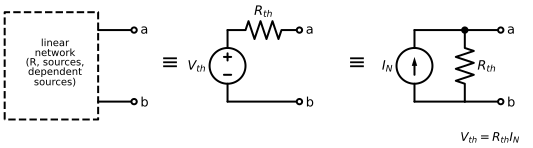
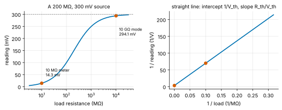

<!-- status: verified -->
# 06-08 · Thévenin and Norton Equivalents

| | |
|---|---|
| **Course** | [06 · Circuit Analysis I (DC)](../README.md) |
| **University equivalent** | Thévenin and Norton equivalents in a sophomore Circuits course (Nilsson & Riedel, *Techniques of Circuit Analysis*; Alexander & Sadiku, *Circuit Theorems*; MIT 6.002, Lecture 3) |
| **Prerequisites** | [06-07](06-07-linearity-and-superposition.md) (superposition, source transformation), [06-06](06-06-dependent-sources.md) (the test-source method), [06-02](06-02-circuit-elements-and-ohms-law.md) (practical sources and load lines). Each fact used is restated where it is needed. |
| **Estimated study hours** | 8 |
| **Last verified** | 2026-11-19 |

**Learning objectives.** After this chapter you can:

1. State Thévenin's and Norton's theorems, prove Thévenin's from superposition, and convert between the two forms.
2. Find $V_{th}$, $I_N$ and $R_{th}$ by open-circuit and short-circuit tests, by switching off independent sources, and by a test source when dependent sources are present.
3. Use equivalents to predict loading: the voltage a sensor, amplifier or power port delivers into a given load, and how much is lost on the way.
4. Measure a real source's equivalent with two loads, correcting for the meter's own loading.
5. State what an equivalent does not tell you: internal power and efficiency, and behavior with nonlinear loads.

## 1. Big picture

From outside, any linear circuit seen at two terminals, however complicated, behaves exactly like one voltage source in series with one resistor (**Thévenin**), or like one current source in parallel with one resistor (**Norton**). This is the most used theorem in circuit design. It lets you replace a whole sensor, amplifier stage, battery or power port by two numbers, then reason about what happens when you connect something to it. Every interface specification in electronics (output resistance, input resistance, source impedance, load regulation) is a statement about Thévenin equivalents.

- **Interfaces between blocks.** An amplifier's output resistance and the next stage's input resistance form a divider that sets how much signal survives. Designers check every interface this way.
- **Power delivery.** A battery, a USB-C port or a Power-over-Ethernet port is, to first order, a voltage source behind a resistance (internal resistance plus cable). How much power reaches the device, and at what voltage, follows directly (Example 06-08.4).
- **Measurement.** Every meter loads what it measures. Knowing the source's Thévenin resistance tells you whether the reading is trustworthy (Example 06-08.5, and 06-11).
- **The bridge to the next chapter.** Maximum power transfer (06-09) is a one-line consequence of the Thévenin form.

## 2. Intuition first

### What the outside world can see

Stand at the two terminals of a black box and do the only two experiments you can: measure the voltage with nothing connected (the **open-circuit voltage**), and measure the current with the terminals shorted (the **short-circuit current**). For a linear box, every other load gives a voltage and current on the straight line joining those two points: the box's terminal $i$–$v$ characteristic is a straight line. A straight line has two parameters, so two numbers describe the box completely as far as the outside is concerned. Thévenin's form expresses the line by its voltage intercept and slope; Norton's by its current intercept and slope (Figure 1).

*Figure 1. Any linear two-terminal network is equivalent, at its terminals, to a Thévenin source or a Norton source.*

### The business analogy, and where it breaks

A company's financial statements condense thousands of transactions into a few summary numbers that are all an outside investor needs to value it. Likewise, a Thévenin equivalent condenses a circuit into the two numbers an outside load needs. *Where it breaks:* summaries hide internal details that sometimes matter. A Thévenin equivalent says nothing about the power dissipated *inside* the original network (a voltage source with a series resistor and a current source with a parallel resistor waste different amounts internally, Problem 06-04.14), and it fails for loads or networks that are not linear.

## 3. Theory

### 3.1 The theorems

**Thévenin's theorem.** A linear two-terminal network (resistors, linear dependent sources and independent sources) is equivalent at its terminals to an ideal voltage source $V_{th}$ in series with a resistance $R_{th}$, where

- $V_{th}$ is the **open-circuit voltage** at the terminals, $v_{oc}$;
- $R_{th}$ is the resistance seen at the terminals with every *independent* source switched off (dependent sources left on).

**Norton's theorem.** The same network is equivalent to an ideal current source $I_N$ in parallel with the same $R_{th}$, where $I_N$ is the **short-circuit current** $i_{sc}$ (flowing out of terminal a through the short).

The two are related by source transformation (06-07 §3.4):

$$
V_{th} = R_{th}\,I_N, \qquad R_{th} = \frac{v_{oc}}{i_{sc}} .
$$

### 3.2 Proof from superposition

Connect an arbitrary external current source $i$ to the terminals, drawing current $i$ out of terminal a (so the network delivers $i$). The network plus this source is linear, so by superposition (06-07) the terminal voltage $v$ is the sum of two parts:

1. **Internal sources on, external source off** ($i = 0$, an open circuit): $v' = v_{oc}$, the open-circuit voltage.
2. **Internal independent sources off, external source on:** the network is now resistors and dependent sources only, a linear network with no sources of its own, so by homogeneity its response to $i$ is proportional to $i$: $v'' = -R_{th}\,i$, where $R_{th}$ is by definition the resistance it presents (the minus sign because $i$ is drawn out of terminal a).

So $v = v_{oc} - R_{th}\,i$ for every $i$. Any load connected to the terminals must satisfy this same relation, whatever it is, because the load only "sees" $v$ and $i$. That is exactly the terminal law of a source $v_{oc}$ in series with $R_{th}$. ∎

The proof shows the theorem's limits: it needs the *network* to be linear, but the load can be anything (a diode, a motor, another network), because the derivation never used the load's law.

### 3.3 Finding the equivalent

There are three methods. Use whichever needs the least work.

**Method 1 — open circuit and short circuit.** Compute $v_{oc}$ and $i_{sc}$ by any method (nodal, mesh, superposition); then $R_{th} = v_{oc}/i_{sc}$. Works for every linear network, with or without dependent sources, provided $i_{sc}$ is finite and nonzero.

**Method 2 — switch off independent sources.** If the network has *no dependent sources*, switch off its independent sources (voltage sources to shorts, current sources to opens) and combine the remaining resistors in series and parallel to get $R_{th}$; find $V_{th}$ separately as $v_{oc}$.

**Method 3 — test source.** With *dependent sources* present, switch off the independent sources but leave the dependent ones, apply a test voltage $v_t$ (or test current $i_t$) at the terminals, solve for the other, and take $R_{th} = v_t/i_t$ (06-06 §3.4). This is the only method that works when the network contains dependent sources but no independent ones (then $V_{th} = 0$ and the network is just a resistance, possibly negative).

Three special cases are worth recognizing:

- $R_{th} = 0$: an ideal voltage source; no Norton equivalent exists (infinite $I_N$).
- $R_{th} \to \infty$: an ideal current source; no Thévenin equivalent exists.
- $R_{th} < 0$: possible only with dependent sources (06-06, Example 06-06.4); such a port can deliver power to a positive load with no independent source inside.

### 3.4 Using an equivalent: loading

With the equivalent in hand, a load $R_L$ gets

$$
v_L = V_{th}\,\frac{R_L}{R_{th} + R_L}, \qquad i_L = \frac{V_{th}}{R_{th} + R_L}, \qquad p_L = \frac{V_{th}^2 R_L}{(R_{th} + R_L)^2}.
$$

The divider factor $R_L/(R_{th} + R_L)$ is the **loading** loss: the source delivers nearly its open-circuit voltage only into loads much larger than $R_{th}$. Two rules of thumb follow directly:

- **Voltage interfaces** (sensor to ADC, stage to stage): make $R_L \gg R_{th}$. The error is $R_{th}/(R_{th} + R_L) \approx R_{th}/R_L$: a 1 kΩ source into a 1 MΩ input loses 0.1%.
- **Current interfaces** (current-output sensors, transimpedance amplifiers): make $R_L \ll R_{th}$, so that nearly all of the Norton current flows into the load.

For a *nonlinear* load (a diode, an LED, a constant-power converter), draw the Thévenin **load line** $i = (V_{th} - v)/R_{th}$ on the load's $i$–$v$ curve (06-02): the intersection is the operating point. Example 06-08.4 does this algebraically for a constant-power load.

### 3.5 Measuring an equivalent

In the lab you rarely know the circuit inside the box, so you measure:

- **Open circuit and short circuit,** if shorting the source is safe (it is not for a battery or a mains supply).
- **Two loads.** Measure $v_1$ with load $R_1$ and $v_2$ with load $R_2$. From $v_k = V_{th}R_k/(R_{th} + R_k)$, the reciprocal $1/v_k = (1/V_{th}) + (R_{th}/V_{th})(1/R_k)$ is a straight line in $1/R_k$, so two points determine $V_{th}$ and $R_{th}$. The meter's own input resistance is simply part of each load (Example 06-08.5).
- **Small change.** For a source whose equivalent changes with operating point (a battery, a regulator), apply a small load step $\Delta i$ and measure $\Delta v$: $R_{th} = -\Delta v/\Delta i$ is the *incremental* (small-signal) output resistance.

### 3.6 History and naming

The voltage-source equivalent is named after Léon Charles Thévenin, a French telegraph engineer who published it in 1883, but Hermann von Helmholtz had stated it in 1853. The current-source form is named after Edward L. Norton of Bell Labs, who described it in an internal technical report dated 3 November 1926; Hans Ferdinand Mayer of Siemens published it independently the same year, and in German-speaking countries it is often called the Mayer–Norton theorem. Don H. Johnson traced both histories in two short articles in *Proceedings of the IEEE* in 2003 ([R-105](../../../reference/research-log.md#r-105--thevenin-and-norton-history-and-power-over-ethernet)) **[Industry estimate]**: the dates and attributions come from the articles as summarized in search results, not from the original publications. The lesson is general: a result's name often records who popularized it, not who found it first.

## 4. Worked examples

### Example 06-08.1 · A divider network (tier A)

**Setup.** A 12 V source feeds a divider of $R_1$ = 6 kΩ (top) and $R_2$ = 3 kΩ (bottom); a series $R_3$ = 1 kΩ leads from the divider's midpoint to terminal a (terminal b is ground). Find the Thévenin and Norton equivalents, and the load voltage for 1 kΩ and for 3 kΩ loads.

**Solution.** $V_{th} = v_{oc}$: with nothing connected, no current flows in $R_3$, so $v_{oc}$ is the divider output, $12\times3/9 = $ **4 V**. $R_{th}$ by Method 2: short the 12 V source; $R_1\parallel R_2 = 2$ kΩ, in series with $R_3$: **3 kΩ**. Norton: $I_N = 4/3 = $ **1.333 mA**. Loads: $4\times1/(3 + 1) = $ **1 V** into 1 kΩ, and $4\times3/6 = $ **2 V** into 3 kΩ.

**Check by Method 1.** Shorting the terminals, the 1 kΩ in parallel with the 3 kΩ gives 0.75 kΩ, the 6 kΩ takes $12\times0.75/6.75 = 1.333$ V at the midpoint, and $i_{sc} = 1.333/1 = 1.333$ mA ✓.

**Units check.** V/kΩ = mA ✓.

**Sanity check.** A load equal to $R_{th}$ receives half of $V_{th}$ ✓.

### Example 06-08.2 · A bridge seen by its meter (tier B)

**Setup.** The bridge of Problem 06-04.6 (5 V excitation; $R_1$ = $R_2$ = $R_3$ = 1 kΩ, $R_4$ = 1.1 kΩ) is read by a galvanometer between A and B. Find the bridge's Thévenin equivalent at A–B and the meter current for a 100 Ω and a 50 Ω meter.

**Solution.** $V_{th}$ = open-circuit $v_B - v_A = 5\times1.1/2.1 - 2.5 = $ **119.0 mV**. $R_{th}$: short the 5 V source; from A and B the bridge is $R_1\parallel R_2$ in series with $R_3\parallel R_4$: $0.5 + 0.5238 = $ **1.024 kΩ**. Meter currents: $119.05/(1023.8 + 100) = $ **0.1059 mA** (as Problem 06-04.6 found with two simultaneous equations) and $119.05/(1023.8 + 50) = $ **0.1109 mA**. Norton: $I_N = 119.05/1023.8 = $ **0.1163 mA**, the current an ideal ammeter would read.

**Units check.** mV/kΩ = µA ✓.

**Sanity check.** Once the equivalent is known, each new meter costs one division instead of a new circuit solution ✓.

### Example 06-08.3 · Output resistance with feedback (tier B)

**Setup.** An amplifier is modeled as a VCVS with output $-10\,v_x$ behind $R_o$ = 2 kΩ, where $v_x$ is its input node. A 1 V source drives the input through $R_s$ = 1 kΩ, and a feedback resistor $R_f$ = 9 kΩ joins the output to the input node. Find the Thévenin equivalent at the output.

**Solution.** *Open circuit.* KCL at $v_x$: $(v_x - 1)/1 + (v_x - v_o)/9 = 0$. KCL at the output, through $R_o$ to the VCVS and through $R_f$: $(v_o + 10v_x)/2 + (v_o - v_x)/9 = 0$. Solving: $v_x = 0.5$ V and $v_o = $ **−4 V** $= V_{th}$.

*Test source* (input source shorted, VCVS kept): inject 1 mA into the output. KCL at $v_x$: $v_x/1 + (v_x - v_o)/9 = 0$; at the output: $(v_o + 10v_x)/2 + (v_o - v_x)/9 = 1$. Solving: $v_x = 0.0909$ V and $v_o = 0.9091$ V, so $R_{th} = $ **0.9091 kΩ**. Norton: $I_N = -4/0.9091 = $ **−4.4 mA**.

**Units check.** V/mA = kΩ ✓.

**Sanity check.** The feedback lowers the output resistance from 2 kΩ to 0.91 kΩ: when a load pulls the output down, $R_f$ carries part of that change back to the input, and the inverting amplifier pushes the output back up. Negative feedback lowering output resistance is a general rule (Course 12) ✓.

### Example 06-08.4 · A Power-over-Ethernet port (tier B)

**Setup.** IEEE 802.3bt Type 4 PoE equipment must supply at least 52 V, and the standard's worst-case cable (100 m, power on all four pairs) has a DC loop resistance of 6.25 Ω; the highest power class allows 90 W at the source (PSE) and 71.3 W at the powered device (PD) ([R-105](../../../reference/research-log.md#r-105--thevenin-and-norton-history-and-power-over-ethernet)). Model the port as a Thévenin source (Figure 2). With the PSE delivering 90 W at 52 V, find the current, the PD's voltage and power, and the cable loss. Then check the earlier PoE generations the same way.

*Figure 2. A PoE link as a Thévenin source: the port voltage behind the cable's loop resistance.*

**Solution.** The current is $90/52 = $ **1.731 A**. The cable drops $1.731\times6.25 = 10.82$ V, so the PD sees **41.18 V** and receives $41.18\times1.731 = $ **71.28 W**, which rounds to the standard's 71.3 W. The cable dissipates $1.731^2\times6.25 = $ **18.72 W**, **20.8%** of the source's output.

The same model reproduces the class figures of the earlier generations, given each one's minimum PSE voltage and worst-case cable resistance:

| Generation (class) | $V_{PSE,min}$ | $R_{cable}$ | PSE power | Model: PD power | Model: PD voltage | Ethernet Alliance figures |
|---|---|---|---|---|---|---|
| 802.3af Type 1 (Class 3) | 44 V | 20 Ω | 15.4 W | 12.95 W | 37.0 V | 13 W (12.95 W); "as low as 37 V" |
| 802.3at Type 2 (Class 4) | 50 V | 12.5 Ω | 30 W | 25.5 W | 42.5 V | 25.5 W; 42.5 V minimum |
| 802.3bt Type 3 (Class 6) | 50 V | 6.25 Ω | 60 W | 51.0 W | 42.5 V | 51 W; 42.5 V minimum |
| 802.3bt Type 4 (Class 8) | 52 V | 6.25 Ω | 90 W | 71.28 W | 41.18 V | 71.3 W; 43.0 V minimum |

**Units check.** W/V = A; A²·Ω = W ✓.

**Sanity check.** The PD powers agree in every row, and the PD voltages agree for the first three. For Class 8 the white paper's table lists a 43.0 V minimum, 1.8 V above this model's 41.18 V; the standard evidently sets that minimum under conditions the simple model does not capture, and we have not resolved the difference. Note also what the equivalent says about the limit: this source could deliver at most $V^2/4R = 52^2/25 = $ **108.2 W**, but only at a PD voltage of 26 V, far below what a PD can run on (06-09) ✓.

### Example 06-08.5 · Measuring a high-impedance source (tier C)

**Setup.** A sensor with an unknown equivalent of (it happens) 300 mV behind 200 MΩ is measured with a voltmeter whose input resistance is 10 MΩ in its normal mode and 10 GΩ in a high-impedance mode. (a) What does each mode read? (b) From the two readings alone, recover $V_{th}$ and $R_{th}$. (c) How wrong is the high-impedance reading if taken at face value?

*Figure 3. Two loads determine a Thévenin equivalent: plotted as $1/v$ against $1/R_L$, the readings lie on a straight line.*

**Solution.** (a) $300\times10/210 = $ **14.29 mV** in the 10 MΩ mode and $300\times10{,}000/10{,}200 = $ **294.1 mV** in the 10 GΩ mode.

(b) Each reading satisfies $1/v_k = 1/V_{th} + (R_{th}/V_{th})(1/R_k)$. In V and MΩ: $1/0.014286 = 70.0 = a + b/10$ and $1/0.29412 = 3.40 = a + b/10{,}000$, with $a = 1/V_{th}$ and $b = R_{th}/V_{th}$. Subtracting, $b(0.1 - 0.0001) = 66.6$, so $b = 666.7$ and $a = 3.333$: $V_{th} = $ **0.300 V** and $R_{th} = b/a = $ **200 MΩ**.

(c) Taking 294.1 mV as the source voltage is **1.96%** low.

**Units check.** (1/V)·MΩ / (1/V) = MΩ ✓.

**Sanity check.** The ordinary 10 MΩ meter reads under 5% of the true voltage: for sources with very high internal resistance (glass pH electrodes are the classic case), the meter's input resistance, not the source, sets the reading. Two loads expose the problem and correct it ✓.

### Answer key

<!-- answer-key -->
| ID | Quantity | Value | Unit |
|---|---|---|---|
| Ex 06-08.1a | V_th | 4 | V |
| Ex 06-08.1b | R_th | 3 | kΩ |
| Ex 06-08.1c | I_N | 1.333 | mA |
| Ex 06-08.1d | load voltage, 1 kΩ | 1 | V |
| Ex 06-08.1e | load voltage, 3 kΩ | 2 | V |
| Ex 06-08.2a | V_th | 119.0 | mV |
| Ex 06-08.2b | R_th | 1.024 | kΩ |
| Ex 06-08.2c | meter current, 100 Ω | 0.1059 | mA |
| Ex 06-08.2d | meter current, 50 Ω | 0.1109 | mA |
| Ex 06-08.2e | I_N | 0.1163 | mA |
| Ex 06-08.3a | V_th | −4 | V |
| Ex 06-08.3b | v_x, open circuit | 0.5 | V |
| Ex 06-08.3c | R_th | 0.9091 | kΩ |
| Ex 06-08.3d | I_N | −4.4 | mA |
| Ex 06-08.4a | current | 1.731 | A |
| Ex 06-08.4b | PD voltage | 41.18 | V |
| Ex 06-08.4c | PD power | 71.28 | W |
| Ex 06-08.4d | cable loss | 18.72 | W |
| Ex 06-08.4e | cable loss fraction | 20.8 | % |
| Ex 06-08.4f | Type 1 PD power | 12.95 | W |
| Ex 06-08.4g | Type 1 PD voltage | 37.0 | V |
| Ex 06-08.4h | Type 2 PD power | 25.5 | W |
| Ex 06-08.4i | Type 2 PD voltage | 42.5 | V |
| Ex 06-08.4j | Type 3 PD power | 51.0 | W |
| Ex 06-08.4k | maximum deliverable power | 108.2 | W |
| Ex 06-08.4l | cable drop | 10.82 | V |
| Ex 06-08.5a | reading, 10 MΩ | 14.29 | mV |
| Ex 06-08.5b | reading, 10 GΩ | 294.1 | mV |
| Ex 06-08.5c | recovered V_th | 0.300 | V |
| Ex 06-08.5d | recovered R_th | 200 | MΩ |
| Ex 06-08.5e | high-impedance reading error | 1.96 | % |
| Ex 06-08.5f | slope b | 666.7 | MΩ/V |
| Ex 06-08.5g | intercept a | 3.333 | 1/V |

## 5. Simulate it

Open [labs/06-08-lab/](../labs/06-08-lab/README.md): a notebook and an ngspice netlist.

1. **Three methods, one answer.** For Examples 06-08.1 to 06-08.3, find the equivalent by open/short circuit, by switching off sources and by a test source, in ngspice and in Python. *Predict first:* which method fails for Example 06-08.3, and why?
2. **Equivalent versus original.** Sweep a load from 10 Ω to 1 MΩ on the original circuit and on its equivalent; overlay the curves. *Predict first:* will the internal power dissipation curves also overlap?
3. **PoE under a constant-power load.** Solve the quadratic for the PD voltage as its power demand rises. *Predict first:* at what power does the solution disappear, and what happens physically?
4. **Two-load measurement with noise.** Add 0.1% reading noise to Example 06-08.5's measurement and see how the recovered $R_{th}$ scatters. *Predict first:* which pair of load values gives the most reliable result?

## 6. Engineering tradeoffs

| Knob | Improves | Costs | Typical decision owner |
|---|---|---|---|
| Lower source resistance (buffer, feedback) | Less loading error, drives heavy loads | Power, an extra stage, stability (Course 12) | Analog designer |
| Higher input resistance at the receiver | Less loading of sensitive sources | Noise and bias-current errors (06-10), cost | Analog designer |
| Higher distribution voltage (PoE 44 → 52 V, 800 V DC racks) | Less current and cable loss for the same power | Safety limits, insulation, conversion stages | System and power architects |
| More conductors in parallel (4-pair PoE) | Halves the cable resistance and loss | Connector and cabling cost | Standards bodies, system designers |
| Measuring with two loads | Removes meter-loading error | Two measurements, a known reference load | Test engineer |

## 7. Numbers to know

| Quantity | Value | Note |
|---|---|---|
| Thévenin–Norton relation | $V_{th} = R_{th}I_N$, $R_{th} = v_{oc}/i_{sc}$ | |
| Loading error | $\approx R_{th}/R_L$ for $R_L \gg R_{th}$ | 1 kΩ into 1 MΩ: 0.1% |
| PoE Type 4 (Class 8) | 52 V min at the PSE, 90 W at the PSE, 71.3 W at the PD, 6.25 Ω worst-case loop | [R-105](../../../reference/research-log.md#r-105--thevenin-and-norton-history-and-power-over-ethernet), as of Nov 2026 |
| PoE Type 2 (Class 4) | 50 V min, 30 W at the PSE, 25.5 W at the PD, 12.5 Ω worst-case loop | [R-105](../../../reference/research-log.md#r-105--thevenin-and-norton-history-and-power-over-ethernet) |
| Maximum PoE voltage | 57 V | all types |
| Typical DMM input resistance | 10 MΩ (many offer > 10 GΩ on low ranges) | see 06-11 |

## 8. Common mistakes

1. **Switching off dependent sources** when finding $R_{th}$. Only independent sources are switched off; with dependent sources present, use a test source or $v_{oc}/i_{sc}$.
2. **Combining resistors "as seen from the load" without switching off the sources,** or switching a voltage source to an open instead of a short.
3. **Sign errors in $I_N$:** define it as the current flowing out of terminal a through a short to terminal b, and $V_{th}$ as $v_a - v_b$ open-circuited; then $V_{th} = R_{th}I_N$ with matching signs.
4. **Using the equivalent to compute internal power or efficiency.** The equivalent is exact only at the terminals.
5. **Short-circuiting a real source to measure $I_N$.** Batteries, supplies and mains can deliver dangerous currents; use two loads instead.
6. **Forgetting the meter is a load.** A 10 MΩ meter on a high-impedance source reads the divider, not the source.

## 9. Practitioner lens

### State of the art (as of Nov 2026)

- **Power over Ethernet** is the most visible Thévenin problem in networking. The 2018 IEEE 802.3bt amendment added Types 3 and 4, raising the power available at the device from 25.5 W (802.3at, 2009) to 51 W and 71.3 W, mainly by powering all four pairs (which halves the loop resistance) and raising Type 4's minimum source voltage to 52 V; the maximum voltage stays 57 V. The worst-case channel is 12.5 Ω per pairset, 6.25 Ω with four pairs ([R-105](../../../reference/research-log.md#r-105--thevenin-and-norton-history-and-power-over-ethernet), from the Ethernet Alliance's 802.3bt overview, Dec 2019) **[Established]**.
- **Data centers use the same physics at larger scale.** Moving rack power distribution from 54 V to 800 V DC is the Thévenin argument of Example 06-08.4 again: for the same power, current falls in proportion to voltage and resistive loss with its square ([R-098](../../../reference/research-log.md#r-098--usb-power-delivery-rack-power-distribution-and-ai-rack-power), 06-01) **[Industry estimate]**.

### Why it matters commercially

Interface specifications decide whether parts from different vendors work together: PoE classes, USB Power Delivery profiles, sensor output impedances and ADC input requirements are all Thévenin statements, and products are designed (and sometimes fail) at the worst-case corners of these models. In diligence, power and signal interfaces are where integration risk hides: a powered device designed at the edge of its class budget, or a sensor whose source impedance needs a buffer the bill of materials omits, will fail in the field and not in the lab.

### Marketing vs Reality

- **"90 W PoE."** *Reality:* 90 W is what the switch port must be able to source; the device is guaranteed 71.3 W after worst-case cable loss, and gets more only on short or thick cables. Ask which end of the cable a power figure refers to.
- **"Sensor output accuracy 0.1%."** *Reality:* at what load? A sensor's output resistance divides with the input resistance of whatever reads it; the accuracy holds only into the specified load.
- **"Low output impedance."** *Reality:* often quoted at DC; the output resistance of a feedback amplifier rises with frequency as its loop gain falls (Course 12). Ask at what frequency.

### Questions for engineering leaders

1. **"What is the worst-case source impedance at each interface, and what input impedance do you require downstream?"** *Strong:* a table of interfaces with ratios and resulting errors. *Evasive:* "the parts are compatible".
2. **"How much margin does your powered device have at the worst-case cable and minimum source voltage?"** *Strong:* a budget at the class's corner conditions, tested on a 100 m worst-case cable. *Evasive:* tested on a short patch cable.
3. **"How do you measure output resistance in production?"** *Strong:* a load-step or two-load test with limits. *Evasive:* none.
4. **"What happens to your design if the input voltage is at its minimum and the load at its maximum?"** *Strong:* analyzed and tested, including start-up. *Evasive:* only nominal conditions.

## 10. Concept check

1. A network has $v_{oc}$ = 6 V and $i_{sc}$ = 2 mA. Give its Thévenin and Norton equivalents.

   

Answer

   $R_{th} = 6/2 = 3$ kΩ; Thévenin: 6 V in series with 3 kΩ; Norton: 2 mA in parallel with 3 kΩ.

   

2. Why does the proof of Thévenin's theorem allow the load to be nonlinear?

   

Answer

   The proof derives the terminal law $v = v_{oc} - R_{th}i$ from the network alone, for every possible current $i$. Whatever is connected must satisfy that relation together with its own law, so the operating point is the same for the equivalent; the load's law is never used in the proof.

   

3. When must you use a test source to find $R_{th}$?

   

Answer

   When the network contains dependent sources (series–parallel reduction is then invalid), and in particular when it has no independent sources (so $v_{oc}$ and $i_{sc}$ are both zero).

   

4. A 2 kΩ-output sensor feeds an ADC with 100 kΩ input resistance. What fraction of its signal is lost?

   

Answer

   $2/(2 + 100) = 1.96\%$.

   

5. Does a Thévenin equivalent tell you how much power the original circuit dissipates internally?

   

Answer

   No. It is exact only at the terminals; a Thévenin and a Norton equivalent of the same network dissipate different amounts internally, and neither need equal the original.

   

6. Why does powering all four pairs help PoE deliver more power?

   

Answer

   It puts the two pairsets in parallel, halving the loop resistance from 12.5 Ω to 6.25 Ω, so the same current loses half the power in the cable (or twice the current can flow for the same loss).

   

Problem set: [06-08 problems](../problems/06-08-problems.md) · [solutions](../solutions/06-08-solutions.md).

## 11. Key terms

[Thévenin equivalent](../../../reference/glossary.md#thevenin-equivalent) ·
[Thévenin resistance](../../../reference/glossary.md#thevenin-resistance) ·
[Norton equivalent](../../../reference/glossary.md#norton-equivalent) ·
[Open-circuit voltage](../../../reference/glossary.md#open-circuit-voltage) ·
[Short-circuit current](../../../reference/glossary.md#short-circuit-current) ·
[Output resistance](../../../reference/glossary.md#output-resistance) ·
[Loading effect](../../../reference/glossary.md#loading-effect) ·
[Two-load method](../../../reference/glossary.md#two-load-method) ·
[Power over Ethernet (PoE)](../../../reference/glossary.md#power-over-ethernet-poe) ·
[Test source](../../../reference/glossary.md#test-source)

## 12. Connections

- **Previous:** [06-07](06-07-linearity-and-superposition.md) (superposition, which proves the theorem, and source transformation); [06-06](06-06-dependent-sources.md) (test sources); [06-02](06-02-circuit-elements-and-ohms-law.md) (practical sources and load lines).
- **Next:** [06-09 Maximum Power Transfer](06-09-maximum-power-transfer.md), a one-line consequence of the Thévenin form; [06-11](06-11-practical-dc-circuits-and-measurement.md) (meters as loads).
- **Used later:** amplifier input and output resistances ([10-05](../../10-electronics-1/chapters/10-05-amplifier-fundamentals.md)); Thévenin impedance in AC circuits (Course 07); source and load impedances in RF and signal integrity (Courses 21 and 24).

## 13. Further study

- Nilsson, J. W. and Riedel, S. A., *Electric Circuits*, chapter 4, sections on Thévenin and Norton equivalents.
- Alexander, C. K. and Sadiku, M. N. O., *Fundamentals of Electric Circuits*, chapter 4, "Circuit Theorems".
- D. H. Johnson, "Origins of the equivalent circuit concept: the voltage-source equivalent" and "…: the current-source equivalent", *Proceedings of the IEEE* 91(4), 636–640, and 91(5), 817–821 (2003): two short, readable histories.
- *Video:* MIT OpenCourseWare 6.002, *Circuits and Electronics* (Spring 2007, A. Agarwal), Lecture 3, "Superposition, Thévenin and Norton".

## 14. Sources

1. Nilsson and Riedel, ch. 4; Alexander and Sadiku, ch. 4.
2. Ethernet Alliance, *Overview of 802.3bt Power over Ethernet* (Dec 2019): types, classes, PSE output voltages, PD minimum voltages and channel resistance. [R-105]
3. D. H. Johnson, *Proc. IEEE* 91(4):636–640 and 91(5):817–821 (2003). [R-105]
4. 800 V DC rack power. [R-098]
