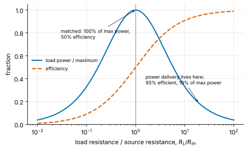
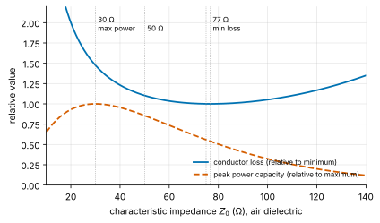

<!-- status: verified -->
# 06-09 · Maximum Power Transfer

| | |
|---|---|
| **Course** | [06 · Circuit Analysis I (DC)](../README.md) |
| **University equivalent** | Maximum power transfer in a sophomore Circuits course (Nilsson & Riedel, *Techniques of Circuit Analysis*; Alexander & Sadiku, *Circuit Theorems*), with the matching-versus-efficiency discussion of an introductory power or RF course |
| **Prerequisites** | [06-08](06-08-thevenin-and-norton.md) (Thévenin equivalents), [01-04](../../01-calculus-for-engineers/chapters/01-04-applications-of-derivatives.md) (optimization by derivatives; Example 01-04.1 first derived the result). Each fact used is restated where it is needed. |
| **Estimated study hours** | 5 |
| **Last verified** | 2026-11-19 |

**Learning objectives.** After this chapter you can:

1. Derive the maximum-power-transfer condition $R_L = R_{th}$ and the maximum power $V_{th}^2/(4R_{th})$ from a Thévenin equivalent, including one that contains dependent sources.
2. Compute load power and efficiency for any load, and use the relation $p/p_{max} = 4\eta(1 - \eta)$ to show why maximum power and high efficiency are incompatible.
3. Decide when to match (fixed-source, weak-signal and transmission-line situations) and when not to (power delivery), and explain why a designer who can choose the *source* makes $R_{th}$ small rather than equal to $R_L$.
4. Derive the two optima of air coaxial cable (about 77 Ω for minimum loss, 30 Ω for maximum peak power) and explain 50 Ω as a compromise.
5. Apply the result to energy harvesting, where the operating point is set to extract the most power from a weak source.

## 1. Big picture

Given a source you cannot change, how should you choose the load to extract the most power? Thévenin's theorem reduces the source to $V_{th}$ and $R_{th}$, and a one-line optimization gives the answer: make the load equal to the source's resistance. That is the **maximum power transfer theorem**. It is one of the most quoted and most misapplied results in electrical engineering. At the maximum, exactly half the power is lost inside the source, so no power system ever runs there; yet in radio receivers, sensor front ends, transmission lines and energy harvesters, matching is exactly right.

- **Signals and RF:** antennas, cables and amplifiers are matched (usually to 50 Ω) so that weak signals are transferred without waste and without reflections (Courses 13 and 21).
- **Power delivery:** batteries, power supplies, PoE ports and the grid are designed with source resistances far below their loads, trading peak power for efficiency (Example 06-09.2).
- **Energy harvesting:** a solar cell, thermoelectric generator or vibration harvester is a weak source whose power is scarce; its converter hunts for the maximum-power point (Example 06-09.4).
- **Why 50 Ω:** the standard impedance of RF systems is itself the outcome of an optimization with two competing optima (Example 06-09.5).

## 2. Intuition first

### Too small and too large both lose

Short the source ($R_L = 0$): plenty of current flows but the load has no voltage across it, so it gets no power. Open the source ($R_L \to \infty$): full voltage, no current, again no power. Somewhere between, power peaks. Because the load power $p = v\,i$ is a product of a voltage that rises with $R_L$ and a current that falls with it, the peak sits where the two effects balance: where the load takes half the source voltage, which happens when $R_L = R_{th}$.

*Figure 1. Power peaks at the matched load, where efficiency is only 50%. High efficiency needs loads much larger than the source resistance, at a fraction of the maximum power.*

### The business analogy, and where it breaks

Think of a toll road whose operator wants the most total toll revenue: price too low and revenue per car is tiny; price too high and nobody drives. Revenue peaks in between. *Where it breaks:* the toll-road owner keeps the revenue, while in a circuit the "price" (the source resistance's share) is pure waste. Maximizing the load's power is the right goal only when the source is given and its own losses do not matter; when you are paying for the source's losses too, you want efficiency instead.

## 3. Theory

### 3.1 The maximum

A load $R_L$ on a Thévenin source receives

$$
p(R_L) = \frac{V_{th}^2\,R_L}{(R_{th} + R_L)^2}.
$$

Setting the derivative to zero (01-04),

$$
\frac{dp}{dR_L} = V_{th}^2\,\frac{(R_{th} + R_L)^2 - 2R_L(R_{th} + R_L)}{(R_{th} + R_L)^4} = V_{th}^2\,\frac{R_{th} - R_L}{(R_{th} + R_L)^3} = 0
\;\Rightarrow\; R_L = R_{th},
$$

and the derivative changes from positive to negative there, so it is a maximum:

$$
p_{max} = \frac{V_{th}^2}{4R_{th}} = \frac{I_N^2\,R_{th}}{4} = \frac{V_{th}\,I_N}{4}.
$$

**A cleaner view.** Write the load power in terms of the load voltage $v$ instead: the current is $(V_{th} - v)/R_{th}$, so $p = v(V_{th} - v)/R_{th}$, a downward parabola in $v$ with its peak at $v = V_{th}/2$. Maximum power transfer means operating at half the open-circuit voltage (and half the short-circuit current). This form does not need $R_L$ at all, which is why harvesting converters can track it by adjusting their input voltage (Example 06-09.4).

**A symmetry.** $p(R_L) = p(R_{th}^2/R_L)$: loads a factor $k$ above and below the match receive the same power. On a logarithmic axis the power curve is symmetric about the match (Figure 1), and it is flat: a load 2× off still receives $4\times2/9 = 89\%$ of the maximum.

### 3.2 Efficiency

The source's internal resistance carries the same current as the load, so the fraction of the source's power that reaches the load is

$$
\eta = \frac{i^2R_L}{i^2(R_{th} + R_L)} = \frac{R_L}{R_{th} + R_L}.
$$

At the match, $\eta$ = **50%**. Eliminating $R_L$ between $p/p_{max} = 4R_LR_{th}/(R_{th} + R_L)^2$ and $\eta$ gives a compact tradeoff:

$$
\frac{p}{p_{max}} = 4\eta(1 - \eta).
$$

| Efficiency $\eta$ | 50% | 80% | 90% | 95% | 99% |
|---|---|---|---|---|---|
| $p/p_{max}$ | 1.00 | 0.64 | 0.36 | 0.19 | 0.0396 |

High efficiency means operating far from maximum power, with $R_L \gg R_{th}$.

### 3.3 When to match, and when not to

The theorem answers one question: *given a source*, which load extracts the most power? Its most common misuse is to answer a different question.

- **If you can design the source,** make $R_{th}$ as small as you can afford, not equal to the load. A power supply with lower output resistance delivers the same power more efficiently. Nobody designs a 230 V mains supply, a battery or a PoE port to have the same resistance as its load.
- **Match when the source is given and its losses do not matter, or when its power is scarce:** an antenna (its radiation resistance is set by physics, and the received power is tiny), a sensor with a fixed internal resistance, a harvester, a single-shot pulse.
- **Match when reflections matter:** on a transmission line, a load equal to the line's characteristic impedance absorbs the arriving wave completely; any mismatch reflects part of it back (06-01, Course 13). In RF systems "matching" usually means this, and it is also maximum power transfer from a source whose resistance equals the line impedance.

For AC sources with reactance, the condition becomes the **conjugate match**, $Z_L = Z_{th}^*$ (Course 07): the load's resistance equals the source's and its reactance cancels the source's.

### 3.4 Sources with dependent elements

The derivation used only the Thévenin form, so it holds for any linear source, including amplifiers modeled with dependent sources (06-06): find $V_{th}$ and $R_{th}$ by the methods of 06-08, then match. Two cautions. First, if $R_{th}$ is negative (positive feedback, 06-06), the formula $V_{th}^2/4R_{th}$ is meaningless: the power grows without bound as $R_L$ approaches $-R_{th}$, and a real circuit oscillates or saturates. Second, an amplifier's real limits (output voltage and current swing, heating) usually bind before the small-signal maximum is reached; the theorem gives an upper bound for the linear model, not the device's capability.

### 3.5 Why 50 Ω

Coaxial cable has an inner conductor of radius $a$ inside an outer one of inner radius $b$, separated by a dielectric of relative permittivity $\varepsilon_r$. Its characteristic impedance (derived in [13-08](../../13-electromagnetics/chapters/13-08-transmission-lines-sinusoidal-steady-state.md)) is

$$
Z_0 = \frac{60\ \Omega}{\sqrt{\varepsilon_r}}\,\ln\frac{b}{a}.
$$

Hold the outer size $b$ fixed (it sets the cable's bulk and its highest usable frequency) and ask what ratio $x = b/a$ is best:

- **Minimum conductor loss.** At high frequency the current flows in a thin skin on each conductor, so the resistance per meter is proportional to $1/a + 1/b$. The power lost per meter relative to the power carried scales as resistance over impedance, $(1/a + 1/b)/\ln(b/a) = (1 + x)/(b\ln x)$. Minimizing $(1 + x)/\ln x$ gives $\ln x = 1 + 1/x$, solved numerically by $x = 3.591$: $Z_0$ = **76.7 Ω** in air.
- **Maximum peak power.** The field is strongest at the inner conductor's surface, $E = V/(a\ln x)$, and the line fails when it reaches the dielectric's breakdown field. The power carried is $V^2/(2Z_0) \propto a^2\ln^2x/\ln x = b^2\ln x/x^2$, maximized at $x = \sqrt e = 1.649$: $Z_0$ = **30.0 Ω**.

No single geometry achieves both. A 50 Ω air line has 10.3% more loss than the 77 Ω optimum and 85.6% of the 30 Ω line's peak-power capacity (Example 06-09.5): a reasonable compromise. With solid polyethylene ($\varepsilon_r$ = 2.25), the minimum-loss geometry has $Z_0 = 76.7/1.5 = 51.1$ Ω, so for the most common flexible cables 50 Ω is also close to the low-loss optimum. Video and cable-TV systems, which care most about loss and carry little power, standardized on 75 Ω instead, close to the air-line optimum ([R-106](../../../reference/research-log.md#r-106--the-50-ohm-standard)).

## 4. Worked examples

### Example 06-09.1 · The match and its neighbors (tier A)

**Setup.** A source has $V_{th}$ = 10 V and $R_{th}$ = 8 Ω. Find the power and the efficiency for loads of 8 Ω, 4 Ω and 16 Ω.

**Solution.** 8 Ω: $100\times8/16^2 = $ **3.125 W** $= V_{th}^2/4R_{th}$, at **50%** efficiency. 4 Ω: $100\times4/12^2 = $ **2.778 W**, at $4/12 = $ **33.3%**. 16 Ω: $100\times16/24^2 = $ **2.778 W**, at $16/24 = $ **66.7%**.

**Units check.** V²/Ω = W ✓.

**Sanity check.** 4 Ω and 16 Ω are a factor 2 below and above 8 Ω and give the same power (§3.1), 88.9% of the maximum; the larger load is twice as efficient ✓.

### Example 06-09.2 · A battery is never matched (tier B)

**Setup.** A 12 V battery has 0.1 Ω internal resistance. (a) What is the most power it could deliver, and at what efficiency and current? (b) What load gives 95% efficiency, and how much power does it receive? (c) Why does no product run the battery at maximum power?

**Solution.** (a) $12^2/(4\times0.1) = $ **360 W** into 0.1 Ω, at 50% efficiency: the battery would dissipate another 360 W internally, at a current of $12/0.2 = $ **60 A**.

(b) $\eta = R_L/(R_L + 0.1) = 0.95$ gives $R_L = $ **1.9 Ω**. The current is $12/2 = 6$ A, the load receives $6^2\times1.9 = $ **68.4 W** (19% of the maximum, as $4\times0.95\times0.05$ predicts) and the battery dissipates only $6^2\times0.1 = $ **3.6 W**.

(c) At maximum power the battery heats as much as the load is powered, wastes half its energy and draws a current far beyond its rating. Designers choose batteries with internal resistance small compared with the load, so they always operate on the right-hand side of Figure 1.

**Units check.** V/Ω = A; A²·Ω = W ✓.

**Sanity check.** 68.4 W + 3.6 W = 72 W = 12 V × 6 A ✓.

### Example 06-09.3 · Matching an amplifier's output (tier B)

**Setup.** The feedback amplifier of Example 06-08.3 has the Thévenin equivalent $V_{th}$ = −4 V (per volt of input) and $R_{th}$ = 909.1 Ω. What load extracts the most power, and how much is it per volt of input?

**Solution.** $R_L = R_{th} = $ **909.1 Ω**, and $p_{max} = 4^2/(4\times909.1) = $ **4.4 mW** (in kΩ and V, $16/(4\times0.9091) = 4.4$ mW). The sign of $V_{th}$ does not matter: power depends on its square.

**Units check.** V²/kΩ = mW ✓.

**Sanity check.** The equivalent includes the amplifier's dependent source and feedback, so the matched load is set by the *closed-loop* output resistance, not by the 2 kΩ inside the model. Whether the real amplifier can swing the 2 V across 909 Ω without distorting is a separate, large-signal question (§3.4) ✓.

### Example 06-09.4 · Harvesting from a thermoelectric generator (tier B)

**Setup.** A small thermoelectric generator (TEG) on a warm surface behaves as a source of 0.5 V open-circuit behind 2 Ω. (a) What is the most power it can deliver, and at what voltage? (b) A converter that holds its input at 0.4 V instead receives how much? And at 0.1 V? (c) Why do harvesting converters track this point instead of presenting a fixed load?

**Solution.** (a) $0.5^2/(4\times2) = $ **31.25 mW**, at $V_{oc}/2$ = **0.25 V** (and 125 mA).

(b) With $p = v(V_{oc} - v)/R$: at 0.4 V, $0.4\times0.1/2 = $ **20 mW**; at 0.1 V, $0.1\times0.4/2 = $ **20 mW**. Both are 64% of the maximum: the parabola in $v$ is symmetric.

(c) The TEG's open-circuit voltage rises with the temperature difference across it (Seebeck effect), so the best operating voltage moves as conditions change. A **maximum-power-point tracking** (MPPT) converter measures its input power and adjusts its input voltage to stay near $V_{oc}/2$. Solar cells are not linear sources (their $i$–$v$ curve is a diode curve, 06-02), so their maximum-power point is not at half the open-circuit voltage, but the tracking principle is the same.

**Units check.** V²/Ω = W ✓.

**Sanity check.** At 0.25 V the TEG delivers 125 mA and dissipates $0.125^2\times2 = 31.25$ mW internally: 50% efficiency, which is fine when the heat is free ✓.

### Example 06-09.5 · Deriving the 50 Ω compromise (tier C)

**Setup.** For air-dielectric coax with fixed outer radius, (a) find the ratio $b/a$ and $Z_0$ that minimize conductor loss, and those that maximize peak power; (b) evaluate a 50 Ω line's loss and power capacity relative to these optima; (c) find the minimum-loss impedance with polyethylene ($\varepsilon_r$ = 2.25); (d) a popular account says 50 Ω is the geometric mean of 30 Ω and 77 Ω. Check the arithmetic.

**Solution.** (a) *Loss:* minimize $f(x) = (1 + x)/\ln x$. Its derivative vanishes where $\ln x = (1 + x)/x$, that is $\ln x = 1 + 1/x$; numerically $x = $ **3.591**, giving $Z_0 = 60\ln 3.591 = $ **76.7 Ω**. (At the optimum $f = x$, a curiosity of this function.) *Power:* maximize $g(x) = \ln x/x^2$. Its derivative vanishes where $1 - 2\ln x = 0$, so $x = \sqrt e = $ **1.649** and $Z_0 = 60\times0.5 = $ **30.0 Ω**.

(b) 50 Ω in air means $\ln x = 50/60$, $x = 2.301$. Then $f(2.301)/f(3.591) = 3.961/3.591 = $ **1.103**: 10.3% more loss than the optimum. And $g(2.301)/g(1.649) = 0.1574/0.1839 = $ **0.856**: 85.6% of the maximum peak power.

(c) $Z_0 = 76.7/\sqrt{2.25} = $ **51.1 Ω**.

(d) $\sqrt{76.7\times30.0} = $ **47.97 Ω** (or 48.06 Ω with 77 Ω), not the 48.5 Ω sometimes quoted; the arithmetic mean is 53.4 Ω. Either way 50 Ω sits between the optima, and the "geometric mean" story is a mnemonic, not a derivation.

**Units check.** $Z_0$ in ohms from $60\ \Omega\times$ a dimensionless logarithm ✓.

**Sanity check.** 75 Ω (video) gives $f$ within 0.03% of the minimum but only 56% of the peak-power capacity: right for loss-sensitive, low-power use ✓.

### Answer key

<!-- answer-key -->
| ID | Quantity | Value | Unit |
|---|---|---|---|
| T 06-09.a | power fraction for a load 2× off | 89 | % |
| T 06-09.b | p/p_max at 80% efficiency | 0.64 | — |
| T 06-09.c | p/p_max at 90% efficiency | 0.36 | — |
| T 06-09.d | p/p_max at 95% efficiency | 0.19 | — |
| T 06-09.e | p/p_max at 99% efficiency | 0.0396 | — |
| Ex 06-09.1a | power, 8 Ω | 3.125 | W |
| Ex 06-09.1b | power, 4 Ω | 2.778 | W |
| Ex 06-09.1c | efficiency, 4 Ω | 33.3 | % |
| Ex 06-09.1d | power, 16 Ω | 2.778 | W |
| Ex 06-09.1e | efficiency, 16 Ω | 66.7 | % |
| Ex 06-09.1f | fraction of maximum | 88.9 | % |
| Ex 06-09.2a | maximum power | 360 | W |
| Ex 06-09.2b | current at maximum power | 60 | A |
| Ex 06-09.2c | load for 95% efficiency | 1.9 | Ω |
| Ex 06-09.2d | power at 95% efficiency | 68.4 | W |
| Ex 06-09.2e | battery dissipation at 95% | 3.6 | W |
| Ex 06-09.2f | current at 95% | 6 | A |
| Ex 06-09.3a | matched load | 909.1 | Ω |
| Ex 06-09.3b | maximum power per volt of input | 4.4 | mW |
| Ex 06-09.4a | maximum power | 31.25 | mW |
| Ex 06-09.4b | voltage at maximum power | 0.25 | V |
| Ex 06-09.4c | current at maximum power | 125 | mA |
| Ex 06-09.4d | power at 0.4 V | 20 | mW |
| Ex 06-09.4e | power at 0.1 V | 20 | mW |
| Ex 06-09.4f | fraction of maximum at 0.4 V | 64 | % |
| Ex 06-09.5a | b/a for minimum loss | 3.591 | — |
| Ex 06-09.5b | Z_0 for minimum loss | 76.7 | Ω |
| Ex 06-09.5c | b/a for maximum power | 1.649 | — |
| Ex 06-09.5d | Z_0 for maximum power | 30.0 | Ω |
| Ex 06-09.5e | b/a at 50 Ω | 2.301 | — |
| Ex 06-09.5f | loss relative to the optimum at 50 Ω | 1.103 | — |
| Ex 06-09.5g | power capacity relative to the maximum at 50 Ω | 0.856 | — |
| Ex 06-09.5h | minimum-loss Z_0 with polyethylene | 51.1 | Ω |
| Ex 06-09.5i | geometric mean of the optima | 47.97 | Ω |
| Ex 06-09.5j | geometric mean with 77 Ω | 48.06 | Ω |
| Ex 06-09.5k | arithmetic mean of the optima | 53.4 | Ω |
| Ex 06-09.5l | f at 50 Ω | 3.961 | — |
| Ex 06-09.5m | g at 50 Ω | 0.1574 | — |
| Ex 06-09.5n | power capacity at 75 Ω | 56 | % |

## 5. Simulate it

Open [labs/06-09-lab/](../labs/06-09-lab/README.md): a notebook and an ngspice netlist.

1. **Sweep the load in ngspice.** Use a DC sweep of a load resistor on Example 06-09.1's source and measure the peak. *Predict first:* where is the peak, and how flat is it within a factor of 2?
2. **Efficiency versus power.** Plot $p/p_{max}$ against $\eta$ for random sources and loads. *Predict first:* will all the points fall on one curve?
3. **Find the maximum-power point.** Implement a simple "perturb and observe" tracker for the TEG of Example 06-09.4, then for a diode-model solar cell. *Predict first:* will the tracker settle at $V_{oc}/2$ for both?
4. **Coax optima.** Reproduce Figure 2 numerically and explore how the optima move with $\varepsilon_r$.

*Figure 2. Air coax with a fixed outer diameter: no single impedance minimizes loss and maximizes power capacity together.*

## 6. Engineering tradeoffs

| Knob | Improves | Costs | Typical decision owner |
|---|---|---|---|
| Matching the load to a given source | Maximum power from the source; no reflections on lines | 50% of the power lost in the source | RF and sensor-interface designers |
| Lowering the source resistance | Efficiency, voltage regulation | Larger conductors, lower-resistance devices, cost | Power-delivery designers |
| Operating at high efficiency ($R_L \gg R_{th}$) | Less heat, longer battery life | Only a fraction of the source's maximum power | System architect |
| MPPT in harvesters | Extracts the most from a weak, varying source | Converter complexity and its own quiescent power | Energy-harvesting IC designer |
| 50 Ω versus 75 Ω cable | 50 Ω: balance of loss and power; 75 Ω: lower loss | 75 Ω: lower power capacity; non-standard in RF test gear | Standards bodies, system designers |

## 7. Numbers to know

| Quantity | Value | Note |
|---|---|---|
| Matched load | $R_L = R_{th}$, $v = V_{th}/2$ | $p_{max} = V_{th}^2/4R_{th}$ |
| Efficiency at the match | 50% | $\eta = R_L/(R_{th} + R_L)$ |
| Power–efficiency tradeoff | $p/p_{max} = 4\eta(1 - \eta)$ | 95% efficient → 19% of max |
| Flatness | a factor 2 off loses 11% | |
| Coax optima (air) | 76.7 Ω (min loss), 30.0 Ω (max power) | $Z_0 = (60/\sqrt{\varepsilon_r})\ln(b/a)$ |
| Standard impedances | 50 Ω (RF, test equipment), 75 Ω (video, cable TV) | [R-106](../../../reference/research-log.md#r-106--the-50-ohm-standard) |

## 8. Common mistakes

1. **Designing a power source to match its load.** The theorem chooses the load for a given source; if you choose the source, make its resistance small.
2. **Equating maximum power with maximum efficiency.** At maximum power the efficiency is 50%; efficiency rises toward 100% as $R_L/R_{th}$ grows, while power falls.
3. **Using the original circuit's resistance instead of $R_{th}$.** The match is to the Thévenin resistance at the load's terminals, with dependent sources included.
4. **Ignoring real limits.** The small-signal maximum may demand more voltage swing, current or dissipation than a device can provide.
5. **Assuming a nonlinear source peaks at $V_{oc}/2$.** That holds only for a linear (Thévenin) source; a solar cell's maximum-power point is elsewhere.
6. **Calling every impedance match "maximum power transfer".** On transmission lines the main reason to match is to avoid reflections.

## 9. Practitioner lens

### State of the art (as of Nov 2026)

- **50 Ω is the universal RF and test-equipment impedance and 75 Ω the video and broadband-cable impedance;** the two optima behind them are physics and are derived in Example 06-09.5 **[Established]**. The popular history (a compromise attributed to work in the 1930s) appears in trade and secondary sources; we did not verify the attribution and treat it as folklore ([R-106](../../../reference/research-log.md#r-106--the-50-ohm-standard)) **[Industry estimate]**.
- **Power delivery runs far from maximum power.** Power-over-Ethernet's highest class delivers 71.3 W of a theoretical 108 W at 79% cable efficiency ([R-105](../../../reference/research-log.md#r-105--thevenin-and-norton-history-and-power-over-ethernet), Example 06-08.4), and the shift of AI data-center racks toward 800 V DC distribution is motivated by cutting $I^2R$ loss ([R-098](../../../reference/research-log.md#r-098--usb-power-delivery-rack-power-distribution-and-ai-rack-power)) **[Industry estimate]**.

### Why it matters commercially

Two businesses sit on opposite sides of Figure 1. RF front ends, antennas, cables and test equipment live at the match, and their specifications (return loss, VSWR, impedance) describe how close they come. Power management, batteries and power delivery live far to the right, and their specifications (efficiency, output impedance, load regulation) describe how far from the match they stay. Energy harvesting, a growing piece of the IoT and wearables market, sits at the match by necessity, and its key competitive figure is how much of the source's available power a tracking converter actually delivers after its own quiescent consumption.

### Marketing vs Reality

- **"Our harvester delivers the maximum power."** *Reality:* maximum power from a given source happens at 50% source efficiency (fine when the heat or light is free), but the converter's own consumption and tracking accuracy decide what reaches the battery. Ask for end-to-end efficiency at realistic input levels, especially at the low end.
- **"Matched for maximum power."** *Reality:* in power systems, a design at the match would waste half its energy. In RF, "matched" usually means "no reflection", which is the useful property.
- **"50 Ω is optimal."** *Reality:* it is a compromise between two optima; for a loss-critical, low-power link, 75 Ω cable is measurably better.

### Questions for engineering leaders

1. **"Is this interface designed for power, efficiency or signal fidelity?"** *Strong:* a clear answer with the corresponding metric (power, efficiency, return loss). *Evasive:* "it's matched".
2. **"What is the end-to-end efficiency of your harvesting chain at the lowest input you claim to support?"** *Strong:* a measured curve down to the cold-start level. *Evasive:* peak efficiency only.
3. **"What source impedance does your power stage present, and what fraction of its maximum power does it deliver at full load?"** *Strong:* knows the margin and the thermal consequences. *Evasive:* only the rated power.
4. **"Why this cable impedance?"** *Strong:* loss, power and ecosystem reasons. *Evasive:* "it's standard".

## 10. Concept check

1. Derive the load that maximizes power from a Thévenin source in one line, using the load voltage.

   

Answer

   $p = v(V_{th} - v)/R_{th}$ is a parabola in $v$ with its peak at $v = V_{th}/2$, which requires $R_L = R_{th}$.

   

2. What is the efficiency at maximum power transfer, and why?

   

Answer

   50%: the same current flows through $R_{th}$ and $R_L$, and they are equal, so they dissipate equal power.

   

3. A power supply designer wants to deliver as much power as possible to a 10 Ω load. Should the supply's output resistance be 10 Ω?

   

Answer

   No: the theorem applies to choosing a load for a fixed source. A designer who controls the source makes its resistance as small as possible, which delivers more power and wastes less.

   

4. At 90% efficiency, what fraction of the maximum power does a load receive?

   

Answer

   $4\times0.9\times0.1 = 0.36$.

   

5. Why is the coax impedance for minimum loss different from that for maximum power?

   

Answer

   Loss favors a fatter inner conductor (less resistance) but not too fat (the impedance, which divides the loss, shrinks), giving $b/a \approx 3.6$ (77 Ω in air). Power capacity is limited by the field at the inner conductor's surface, which favors a different ratio, $b/a = \sqrt e$ (30 Ω). One geometry cannot satisfy both.

   

6. Does a solar cell deliver maximum power at half its open-circuit voltage?

   

Answer

   No. The half-voltage rule holds for linear (Thévenin) sources; a solar cell's $i$–$v$ curve is that of an illuminated diode, and its maximum-power point lies at a higher fraction of $V_{oc}$. Trackers find it by measurement.

   

Problem set: [06-09 problems](../problems/06-09-problems.md) · [solutions](../solutions/06-09-solutions.md).

## 11. Key terms

[Maximum power transfer](../../../reference/glossary.md#maximum-power-transfer) ·
[Matched load](../../../reference/glossary.md#matched-load) ·
[Efficiency](../../../reference/glossary.md#efficiency) ·
[Maximum power point tracking (MPPT)](../../../reference/glossary.md#maximum-power-point-tracking-mppt) ·
[Characteristic impedance](../../../reference/glossary.md#characteristic-impedance) ·
[Conjugate match](../../../reference/glossary.md#conjugate-match) ·
[Thévenin equivalent](../../../reference/glossary.md#thevenin-equivalent)

## 12. Connections

- **Previous:** [06-08](06-08-thevenin-and-norton.md) (Thévenin equivalents); [01-04](../../01-calculus-for-engineers/chapters/01-04-applications-of-derivatives.md) (the optimization itself).
- **Next:** [06-10 The Ideal Op-Amp](06-10-ideal-op-amp.md), whose near-zero output resistance makes it a near-ideal voltage source.
- **Used later:** AC power and the conjugate match ([07-06](../../07-circuit-analysis-2-transient-and-ac/chapters/07-06-ac-power-and-power-factor.md)); transmission lines and matching ([13-08](../../13-electromagnetics/chapters/13-08-transmission-lines-sinusoidal-steady-state.md), [13-09](../../13-electromagnetics/chapters/13-09-smith-chart-and-matching.md)); matching networks ([21-02](../../21-rf-and-microwave-engineering/chapters/21-02-impedance-matching-networks.md)); power conversion efficiency ([22-01](../../22-power-electronics-and-energy-conversion/chapters/22-01-power-conversion-principles.md)).

## 13. Further study

- Nilsson, J. W. and Riedel, S. A., *Electric Circuits*, chapter 4, section on maximum power transfer.
- Alexander, C. K. and Sadiku, M. N. O., *Fundamentals of Electric Circuits*, chapter 4, "Maximum Power Transfer".
- Pozar, D. M., *Microwave Engineering*, the chapter on transmission-line theory (coaxial line parameters and loss), for the physics behind Example 06-09.5.
- *Video:* MIT OpenCourseWare 6.002, *Circuits and Electronics* (Spring 2007, A. Agarwal), Lecture 3, "Superposition, Thévenin and Norton" (Thévenin equivalents, the basis of this chapter).

## 14. Sources

1. Nilsson and Riedel, ch. 4; Alexander and Sadiku, ch. 4; Pozar, transmission-line chapter.
2. The 50 Ω rationale and its history in trade sources. [R-106]
3. Power over Ethernet class figures. [R-105]
4. 800 V DC rack power. [R-098]
