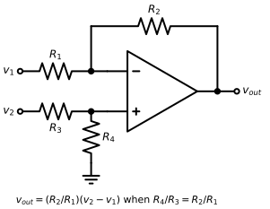

<!-- status: verified -->
# 06-10 · The Ideal Op-Amp

| | |
|---|---|
| **Course** | [06 · Circuit Analysis I (DC)](../README.md) |
| **University equivalent** | The operational amplifier chapter of a sophomore Circuits course (Nilsson & Riedel, *The Operational Amplifier*; Alexander & Sadiku, *Operational Amplifiers*), with the DC error analysis that opens an Electronics course (Sedra & Smith) |
| **Prerequisites** | [06-06](06-06-dependent-sources.md) (the op-amp as a VCVS, finite-gain analysis), [06-07](06-07-linearity-and-superposition.md) (superposition and error budgets), [06-08](06-08-thevenin-and-norton.md) (input and output resistance, loading). Each fact used is restated where it is needed. |
| **Estimated study hours** | 10 |
| **Last verified** | 2026-11-19 |

**Learning objectives.** After this chapter you can:

1. Derive the ideal op-amp's two rules (no input current; equal input voltages under negative feedback) as the limit $A \to \infty$ of a VCVS, and state when they do not apply.
2. Analyze the inverting, non-inverting, follower, summing, difference, transimpedance and three-op-amp instrumentation amplifiers, including their input and output resistances.
3. Calculate the common-mode error of a difference amplifier from resistor mismatch, and explain why instrumentation amplifiers and matched resistor networks exist.
4. Build a DC error budget from finite gain, offset voltage and bias currents by superposition, using real datasheet values.
5. Choose between a general-purpose and a precision (zero-drift) op-amp from the size of the signal and the required accuracy.

## 1. Big picture

An **operational amplifier** is a high-gain differential amplifier in a package: it amplifies the difference between its two inputs by a factor of $10^5$ to $10^8$. Used alone, that gain is useless (any input saturates the output); wrapped in negative feedback, it disappears from the answer, and the circuit's behavior is set almost entirely by a few resistors. That trick, gain traded for precision, makes the op-amp the most widely used analog building block: amplifiers, filters, references, sensor interfaces, regulators and data converters all contain one or more.

- **Sensor interfaces:** bridges, thermocouples, photodiodes and current shunts produce millivolts or microamps that op-amp circuits scale, buffer and convert (Examples 06-06.5, 06-10.3, 06-10.5).
- **Precision from resistors:** the gain of a feedback amplifier depends on resistor *ratios*, which integrated and thin-film resistor networks can match to 0.01% or better.
- **Errors you can budget:** offset voltage, bias current and finite gain add by superposition (06-07), and datasheets specify each.
- **A large market:** analog products are a major business; TI reported $14.0 billion of Analog revenue in 2025 and ADI $11.0 billion of total revenue in its 2025 fiscal year ([R-107](../../../reference/research-log.md#r-107--op-amp-datasheets-and-analog-revenue)).

## 2. Intuition first

### A servo that drives its inputs together

Think of an op-amp in a negative-feedback loop as a tireless servo. It watches the difference between its two inputs and drives its output in whatever direction shrinks that difference. Because its gain is enormous, it only stops when the difference is tiny, a few microvolts. So with negative feedback, the two inputs end up at (almost) the same voltage: the **virtual short**. The output becomes whatever voltage is needed to make that true, and the feedback network decides what that is.

*Figure 1. The three basic configurations. In each, feedback from the output to the inverting input keeps the two inputs at nearly the same voltage.*

### The business analogy, and where it breaks

An op-amp with feedback is like a company with an extremely aggressive controller who adjusts spending until the budget variance is essentially zero: the outcome is set by the budget (the resistors), not by the controller's personality (the op-amp's exact gain). *Where it breaks:* the controller has limited authority. A real op-amp's output cannot go beyond its supply rails or deliver more than its rated current, and its gain falls at higher frequencies. When any of those limits binds, the virtual short fails and the "budget" no longer controls the outcome.

## 3. Theory

### 3.1 From the VCVS model to the ideal op-amp

06-06 modeled an op-amp as a VCVS: output $A(v_+ - v_-)$ behind a small output resistance $R_o$, with a large differential input resistance $R_{id}$. Representative values span a wide range: a precision zero-drift part such as TI's OPA187 has a typical open-loop gain of 160 dB ($10^8$) and a differential input impedance of 100 MΩ; the LM358, a decades-old general-purpose part, has a gain-bandwidth product of 0.7 MHz ([R-107](../../../reference/research-log.md#r-107--op-amp-datasheets-and-analog-revenue)). The **ideal op-amp** takes the limits

$$
A \to \infty, \qquad R_{id} \to \infty, \qquad R_o \to 0 .
$$

**The two rules.** In a circuit with negative feedback whose output stays within its linear range:

1. **No input current:** $i_+ = i_- = 0$ (because $R_{id} \to \infty$).
2. **Virtual short:** $v_+ = v_-$. The output is finite, so $v_+ - v_- = v_{out}/A \to 0$ as $A \to \infty$.

Rule 2 is a *consequence* of negative feedback, not a property of the op-amp alone. Without feedback (or with positive feedback), the output saturates at one of the supply rails, $v_+ \ne v_-$, and the circuit is a comparator, not an amplifier. 06-06's Example 06-06.5 showed how small the residual difference is: about 100 µV for a gain-of-10 amplifier with $A = 10^5$.

**The method.** Write KCL at the inverting input (and anywhere else needed) using rule 1, apply rule 2, solve. Because the output is an ideal voltage source, the output node needs no KCL equation; its current is whatever the load and feedback demand.

### 3.2 Inverting and summing amplifiers

**Inverting amplifier** (Figure 1, left). The + input is grounded, so by rule 2 the − input is at 0 V, a **virtual ground**. The current through $R_1$ is $v_{in}/R_1$; by rule 1 it all continues through $R_2$:

$$
\frac{v_{in}}{R_1} = \frac{0 - v_{out}}{R_2} \;\Rightarrow\; v_{out} = -\frac{R_2}{R_1}\,v_{in}.
$$

The input resistance is $R_1$ (the source sees $R_1$ to a virtual ground), and the output resistance is zero.

**Summing amplifier.** Several inputs, each through its own resistor $R_k$, into the same virtual ground: the currents add in the feedback resistor,

$$
v_{out} = -R_f\sum_k \frac{v_k}{R_k}.
$$

Unlike the passive summer of Example 06-07.5, the inputs do not interact: the virtual ground holds the summing node at 0 V whatever the inputs do, so each input's current depends only on its own voltage (Example 06-10.2).

### 3.3 Non-inverting amplifier and follower

**Non-inverting amplifier** (Figure 1, middle). The input drives the + terminal; by rule 2 the − terminal follows it, and $R_1$, $R_2$ form a divider from the output: $v_- = v_{out}R_1/(R_1 + R_2) = v_{in}$, so

$$
v_{out} = \Bigl(1 + \frac{R_2}{R_1}\Bigr)v_{in}.
$$

The input resistance is infinite (rule 1), which is its great advantage over the inverting form. The divider ratio $\beta = R_1/(R_1 + R_2)$ is the **feedback factor**, and $1/\beta$ is called the **noise gain**: it is the gain from the + input to the output, and it is also the gain applied to the op-amp's own input-referred errors (§3.7).

**Follower** (Figure 1, right; $R_2 = 0$, $R_1 \to \infty$): $v_{out} = v_{in}$ with infinite input and zero output resistance. It is a perfect impedance converter, the cure for every loading problem of 06-08.

### 3.4 The difference amplifier and common-mode rejection

Signals from bridges and current shunts are small *differences* riding on large common voltages. The **difference amplifier** (Figure 2) subtracts:

*Figure 2. The difference amplifier. With matched ratios it amplifies $v_2 - v_1$ and ignores their common part.*

By superposition, $v_1$ alone gives $-(R_2/R_1)v_1$, and $v_2$ alone gives $v_2\,\frac{R_4}{R_3 + R_4}\bigl(1 + \frac{R_2}{R_1}\bigr)$. If $R_4/R_3 = R_2/R_1 = G$, the second term becomes $G\,v_2$ and

$$
v_{out} = G\,(v_2 - v_1).
$$

**Common-mode rejection.** Write the inputs as a difference $v_d = v_2 - v_1$ and a common part $v_{cm} = (v_1 + v_2)/2$. Ideally the output responds only to $v_d$. If the resistor ratios differ slightly, a common-mode gain $A_{cm}$ appears: the output contains $A_{cm}v_{cm}$. The **common-mode rejection ratio** is $\text{CMRR} = A_d/A_{cm}$, usually quoted in decibels ($20\log_{10}$).

To find $A_{cm}$, write the two ratios separately, $a = R_2/R_1$ and $b = R_4/R_3$, and apply the same voltage $v_{cm}$ to both inputs. The superposition result above gives

$$
v_{out} = v_{cm}\Bigl[\frac{b}{1 + b}(1 + a) - a\Bigr] = v_{cm}\,\frac{b - a}{1 + b},
\qquad
A_{cm} = \frac{b - a}{1 + b}.
$$

With matched ratios ($a = b$) it vanishes. Now let each ratio be off by a small fraction, $a = G(1 + \delta_a)$ and $b = G(1 + \delta_b)$. A ratio of two resistors of tolerance $t$ is off by at most about $\pm2t$ (numerator high, denominator low), so $|\delta_b - \delta_a| \le 4t$ in the worst case, and

$$
|A_{cm}| \approx \frac{G\,|\delta_b - \delta_a|}{1 + G} \le \frac{4tG}{1 + G}
\quad\Longrightarrow\quad
\text{CMRR} = \frac{G}{|A_{cm}|} \approx \frac{1 + G}{4t}.
$$

so 1% resistors and $G$ = 100 give only about 2500 (68 dB). Example 06-10.3 shows what that means: a 1.25 V common-mode voltage leaks to the output as a 50 mV error, 40% of a strain-gauge signal. The cure is ratio matching (resistor networks trimmed on one die) and the instrumentation amplifier.

### 3.5 The instrumentation amplifier

The three-op-amp **instrumentation amplifier** (Figure 3) puts two non-inverting amplifiers in front of a difference amplifier. Call the in-amp's two inputs $v_P$ and $v_N$ (not $v_+$ and $v_-$, which name each op-amp's own terminals). Each drives an op-amp's + terminal (infinite input resistance, so it never loads a bridge). By rule 2 applied to each input op-amp, its − terminal sits at its + terminal, so the gain resistor $R_G$, connected between the two − terminals, has exactly $v_P - v_N$ across it. By rule 1 its current $(v_P - v_N)/R_G$ cannot enter either op-amp, so it flows through both resistors $R$ as well, and the first stage's outputs differ by

$$
(v_P - v_N)\Bigl(1 + \frac{2R}{R_G}\Bigr).
$$

If both inputs carry the same voltage, $R_G$ has nothing across it, no current flows in it or in the resistors $R$, and each output simply equals its input: the common-mode voltage passes through the first stage with gain 1. The difference stage then rejects it. Because the first stage amplifies the difference but not the common mode, the overall CMRR is the difference stage's CMRR multiplied by the first-stage gain. One resistor, $R_G$, sets the gain, which is why integrated in-amps bring out just two pins for it.

*Figure 3. The three-op-amp instrumentation amplifier.*

### 3.6 Transimpedance amplifier

A photodiode, a current-output sensor or a DAC produces a current. Feed it into the virtual ground of an inverting stage with no input resistor: all of it flows through the feedback resistor $R_f$, and

$$
v_{out} = -R_f\,i_{in}.
$$

This is a CCVS (06-06) with transresistance $R_f$; the source sees zero resistance (an ideal current measurement, 06-08's "current interface"). Large $R_f$ makes the op-amp's input bias current a serious error (Problem 06-10.5).

### 3.7 First non-idealities and the error budget

Three DC imperfections matter most, and by superposition (06-07) each contributes independently to the output:

- **Finite gain** $A$: the closed-loop gain is $G_{ideal}/(1 + G_{ideal}/A)$ for the non-inverting amplifier, a relative error of about $1/(A\beta)$ (06-06).
- **Input offset voltage** $V_{OS}$: the op-amp behaves as if a small voltage source sat in series with its + input. It is amplified by the noise gain $1 + R_2/R_1$, whichever configuration the signal uses. Datasheets give typical and maximum values: OPA187, 1 µV typical and 10 µV maximum; LM358, 3 mV typical and 7 mV maximum at 25 °C ([R-107](../../../reference/research-log.md#r-107--op-amp-datasheets-and-analog-revenue)).
- **Input bias currents** $I_B$: small currents that flow into (or, for PNP input stages such as the LM358's, out of) the inputs. A bias current through a resistance $R$ produces a voltage $I_BR$ that is amplified like a signal. OPA187: ±350 pA maximum; LM358: −250 nA maximum ([R-107](../../../reference/research-log.md#r-107--op-amp-datasheets-and-analog-revenue)). If the resistances seen by the two inputs are equal (a resistor $R_1\parallel R_2$ in series with the + input), the bias-current errors cancel, leaving only the difference between the two currents, the **input offset current** $I_{OS}$.

> **Going deeper — zero-drift op-amps.** Precision parts such as the OPA187 achieve microvolt offsets by **autozeroing** or **chopping**: they periodically measure and cancel their own offset, or modulate the signal above the offset's frequency and back. The cost is switching artifacts and higher current noise. How they work belongs to Course 20; here only their DC specifications matter.

### 3.8 The comparator: an op-amp without feedback

Remove the feedback and the op-amp becomes a **comparator**. Its output is $A(v_+ - v_-)$ clipped at the rails, so any input difference larger than $V_{sat}/A$ (120 µV for ±12 V outputs and $A = 10^5$) drives the output to $+V_{sat}$ if $v_+ > v_-$ and to $-V_{sat}$ otherwise. The circuit answers one question, "which input is higher?": it is a 1-bit analog-to-digital converter, the decision element inside every ADC ([20-05](../../20-analog-and-mixed-signal-ic-design/chapters/20-05-comparators-and-sample-and-hold.md)) and the heart of every threshold detector (battery low, over-temperature, zero crossing). Rule 1 still holds, but rule 2 does not: with no feedback, nothing pulls the inputs together, and they can sit volts apart (Problem 06-10.13). A threshold is usually set by a divider on one input.

Two practical points. A slowly varying or noisy input near the threshold makes the output chatter between the rails; a little *positive* feedback gives two thresholds (hysteresis) and cures it, the Schmitt trigger of [10-10](../../10-electronics-1/chapters/10-10-op-amp-application-circuits.md). And dedicated comparator chips are designed to saturate and recover quickly and to drive logic directly, while a general-purpose op-amp used as a comparator can be slow to come out of saturation.

## 4. Worked examples

### Example 06-10.1 · An inverting amplifier (tier A)

**Setup.** An inverting amplifier has $R_1$ = 10 kΩ and $R_2$ = 47 kΩ. For a 0.5 V input, find the gain, the output, the input current and the input resistance.

**Solution.** Gain $-47/10 = $ **−4.7**; output $-4.7\times0.5 = $ **−2.35 V**. The − input is a virtual ground, so the input current is $0.5/10\ \text{kΩ} = $ **50 µA** and the input resistance is **10 kΩ**. The same 50 µA flows through $R_2$: $50\ \text{µA}\times47\ \text{kΩ} = 2.35$ V across it, with the output end negative ✓.

**Units check.** V/kΩ = mA ✓.

**Sanity check.** The output must stay inside the supply rails; with ±15 V supplies, inputs up to about ±3 V are fine ✓.

### Example 06-10.2 · A summing amplifier as a DAC (tier B)

**Setup.** A 3-bit DAC uses a summing amplifier: bits $b_2$, $b_1$, $b_0$ (0 or 5 V) drive 10 kΩ, 20 kΩ and 40 kΩ into the virtual ground, with $R_f$ = 10 kΩ. Find the output for codes 101, 111 and 001, and compare with the passive DAC of Example 06-07.5.

**Solution.** $v_{out} = -10\ \text{kΩ}\times\sum_k v_k/R_k = -(b_2 + b_1/2 + b_0/4)\times5$ V. Code 101: $-(5 + 1.25) = $ **−6.25 V**; 111: **−8.75 V**; 001: **−1.25 V** (1 LSB = 1.25 V).

**Units check.** kΩ × V/kΩ = V ✓.

**Sanity check.** In the passive DAC, the output node moved with the code, so each bit's current depended on the other bits (and on the load). Here the summing node is held at 0 V, so each bit contributes exactly $5\ \text{V}/R_k$, and a load on the output changes nothing (zero output resistance) ✓.

### Example 06-10.3 · Reading a bridge with a difference amplifier (tier B)

**Setup.** The strain-gauge quarter bridge of Example 06-03.4 produces a 1.249 mV difference on a 1.25 V common-mode level. A difference amplifier with $R_1 = R_3$ = 1 kΩ and $R_2 = R_4$ = 100 kΩ amplifies it. (a) Find the nominal output. (b) With every resistor anywhere within ±1%, find the worst-case output from the common-mode voltage alone, the resulting CMRR, and compare with $(1 + G)/(4t)$. (c) What else is wrong with this circuit for a 350 Ω bridge?

**Solution.** (a) $100\times1.249\ \text{mV} = $ **124.9 mV**.

(b) Apply 1.25 V to both inputs and search all 16 corner combinations of the four tolerances. The worst corner (the − path's ratio $R_2/R_1$ high and the + path's ratio $R_4/R_3$ low) gives **50.5 mV**; the opposite corner gives a slightly smaller 48.5 mV, because the denominator $1 + R_4/R_3$ is then larger. The worst corner's output is a common-mode gain of 0.0404 and a CMRR of $100/0.0404 = $ **2475** (**67.9 dB**). The approximation gives $101/0.04 = 2525$ (68.0 dB). The common-mode error is **40%** of the signal.

(c) The amplifier's input resistance on the − side is only $R_1$ = 1 kΩ (and about 101 kΩ on the + side), unequal and comparable to the bridge's 350 Ω output resistance (Problem 06-08.4): it loads the bridge unequally, unbalancing it. Both problems point to the instrumentation amplifier.

**Units check.** mV/V = dimensionless gain ✓.

**Sanity check.** CMRR improves with gain and with matching, as $(1 + G)/(4t)$ says; at 0.01% matching it would be about 108 dB ✓.

### Example 06-10.4 · An error budget: LM358 against OPA187 (tier B)

**Setup.** A non-inverting amplifier with gain 101 ($R_1$ = 1 kΩ, $R_2$ = 100 kΩ) amplifies a 10 mV sensor signal that has 10 kΩ of source resistance in series with the + input. Using the 25 °C maximum values of offset voltage and bias current, compare the worst-case output errors of an LM358 (7 mV, 250 nA) and an OPA187 (10 µV, 350 pA).

**Solution.** The signal gives $101\times10\ \text{mV} = 1.01$ V. By superposition, the error terms are:

| Error source | Path to the output | LM358 | OPA187 |
|---|---|---|---|
| Offset voltage | $V_{OS}\times101$ | **707 mV** | **1.01 mV** |
| Bias current at − | $I_B\times R_2$ | **25 mV** | **0.035 mV** |
| Bias current at + | $I_B\times10\ \text{kΩ}\times101$ | **252.5 mV** | **0.3535 mV** |
| Worst-case total | sum of magnitudes | **984.5 mV** | **1.40 mV** |

The LM358's worst-case error (97% of the 1.01 V signal) makes it useless here; the OPA187's is 0.14%.

Adding magnitudes is the safe bound when the signs are unknown. Here one sign is known: both of the LM358's bias currents flow *out* of its inputs (a PNP input stage), so the + term raises the output while the − term lowers it. Only the offset voltage's sign varies from unit to unit, and the signed worst case is $707 + 252.5 - 25 = $ **934.5 mV** (lab Part 4). The conclusion does not change.

**Units check.** V × gain = V; A × Ω = V ✓.

**Sanity check.** The offset-voltage ratio is $7\ \text{mV}/10\ \text{µV} = $ **700** (at typical values, 3000). For a 10 mV signal, offset is the dominant spec; for a 10 V signal the LM358 would be acceptable. Choose the op-amp by the size of the signal ✓.

### Example 06-10.5 · An instrumentation amplifier on the bridge (tier C)

**Setup.** Replace Example 06-10.3's difference amplifier with a three-op-amp in-amp: $R$ = 25 kΩ, $R_G$ = 500 Ω, and a unity-gain difference stage of four 10 kΩ resistors with ±1% tolerance. Find the first-stage gain, the output signal, the difference stage's worst-case common-mode gain, the overall CMRR and the common-mode error at the output.

**Solution.** First stage: $1 + 2\times25/0.5 = $ **101**; the difference stage has gain 1, so the output signal is $101\times1.249 = $ **126.1 mV**. The common-mode 1.25 V passes the first stage unchanged; the difference stage's worst-corner common-mode gain is **0.0202**, so the output error is $1.25\times0.0202 = $ **25.3 mV**. The overall CMRR is $101/0.0202 = $ **5000** (**74.0 dB**).

**Units check.** Gains dimensionless; V × gain = V ✓.

**Sanity check.** The in-amp never loads the bridge, and its CMRR is twice the difference amplifier's at the same gain (the first stage does the amplifying), but with 1% resistors the error is still 20% of the signal. Integrated in-amps use laser-trimmed resistor networks that match to a few hundredths of a percent, which is why they are bought rather than built ✓.

### Answer key

<!-- answer-key -->
| ID | Quantity | Value | Unit |
|---|---|---|---|
| T 06-10.a | OPA187 open-loop gain | 160 | dB |
| T 06-10.b | OPA187 open-loop gain as a ratio | 1e8 | — |
| T 06-10.c | CMRR, 1% resistors, G = 100 (approximation) | 68 | dB |
| T 06-10.d | CMRR at 0.01% matching | 108 | dB |
| Ex 06-10.1a | gain | −4.7 | — |
| Ex 06-10.1b | output | −2.35 | V |
| Ex 06-10.1c | input current | 50 | µA |
| Ex 06-10.1d | input resistance | 10 | kΩ |
| Ex 06-10.2a | output, code 101 | −6.25 | V |
| Ex 06-10.2b | output, code 111 | −8.75 | V |
| Ex 06-10.2c | output, code 001 | −1.25 | V |
| Ex 06-10.3a | nominal output | 124.9 | mV |
| Ex 06-10.3b | worst-case common-mode output | 50.5 | mV |
| Ex 06-10.3c | common-mode gain | 0.0404 | — |
| Ex 06-10.3d | CMRR | 2475 | — |
| Ex 06-10.3e | CMRR in dB | 67.9 | dB |
| Ex 06-10.3f | approximate CMRR | 2525 | — |
| Ex 06-10.3g | error as a fraction of the signal | 40 | % |
| Ex 06-10.3h | common-mode output at the opposite corner | 48.5 | mV |
| Ex 06-10.4a | signal output | 1.01 | V |
| Ex 06-10.4b | LM358 offset term | 707 | mV |
| Ex 06-10.4c | LM358 bias term at − | 25 | mV |
| Ex 06-10.4d | LM358 bias term at + | 252.5 | mV |
| Ex 06-10.4e | LM358 worst-case total | 984.5 | mV |
| Ex 06-10.4f | OPA187 offset term | 1.01 | mV |
| Ex 06-10.4g | OPA187 bias term at − | 0.035 | mV |
| Ex 06-10.4h | OPA187 bias term at + | 0.3535 | mV |
| Ex 06-10.4i | OPA187 worst-case total | 1.40 | mV |
| Ex 06-10.4j | offset ratio, maximum values | 700 | — |
| Ex 06-10.4k | offset ratio, typical values | 3000 | — |
| Ex 06-10.4l | LM358 error relative to the signal | 97 | % |
| Ex 06-10.4m | OPA187 error relative to the signal | 0.14 | % |
| Ex 06-10.4n | LM358 signed worst-case total | 934.5 | mV |
| Ex 06-10.5a | first-stage gain | 101 | — |
| Ex 06-10.5b | output signal | 126.1 | mV |
| Ex 06-10.5c | difference-stage common-mode gain | 0.0202 | — |
| Ex 06-10.5d | common-mode error at the output | 25.3 | mV |
| Ex 06-10.5e | overall CMRR | 5000 | — |
| Ex 06-10.5f | overall CMRR in dB | 74.0 | dB |
| Ex 06-10.5g | error as a fraction of the signal | 20 | % |

## 5. Simulate it

Open [labs/06-10-lab/](../labs/06-10-lab/README.md): a notebook and an ngspice netlist.

1. **Ideal versus finite gain.** The notebook evaluates the exact inverting and non-inverting gains at open-loop gains of $10^3$, $10^5$ and $10^8$; the netlist runs every example with an E-source op-amp of gain $10^8$. *Predict first:* how close is each to its ideal gain, and which ratio sets the error?
2. **Saturation.** Give the op-amp an output that saturates smoothly at ±12 V (a $\tanh$ model, also used in the netlist for Problem 06-10.9) and sweep the input of Example 06-10.1. *Predict first:* at what input does the virtual short fail, and what does $v_-$ do then?
3. **Monte Carlo CMRR.** Draw 20,000 sets of ±1% resistors for Example 06-10.3. *Predict first:* how does the typical CMRR compare with the 67.9 dB worst case?
4. **Error budget with signs.** The netlist reproduces each term of Example 06-10.4 with its own offset or bias-current source; the notebook then adds the terms with their physical signs. *Predict first:* do the LM358's two bias-current terms add or partly cancel?

## 6. Engineering tradeoffs

| Knob | Improves | Costs | Typical decision owner |
|---|---|---|---|
| Inverting versus non-inverting | Inverting: virtual ground, summing, simple; non-inverting: infinite input resistance | Inverting loads the source with $R_1$; non-inverting has common-mode input swing | Analog designer |
| Higher closed-loop gain | Larger output signal | Bandwidth (gain × bandwidth ≈ constant), larger offset and noise at the output (noise gain) | Analog designer |
| Precision (zero-drift) op-amp | Microvolt offsets, low drift | Price, switching artifacts, higher current noise | Designer, with purchasing |
| Matched resistor networks | CMRR, gain accuracy | Cost; custom parts | Analog designer |
| Integrated instrumentation amplifier | High CMRR, high input resistance, one-resistor gain | Price, limited output swing near the rails | System designer |
| Bias-current compensation resistor | Cancels $I_B$ errors (leaves $I_{OS}$) | One more resistor, its own noise | Analog designer |

## 7. Numbers to know

| Quantity | Value | Note |
|---|---|---|
| Ideal rules (with negative feedback) | $i_\pm = 0$, $v_+ = v_-$ | fail when the output saturates |
| Inverting / non-inverting gain | $-R_2/R_1$ / $1 + R_2/R_1$ | noise gain $1 + R_2/R_1$ in both |
| Difference-amplifier CMRR, tolerance $t$ | $\approx (1 + G)/(4t)$ | 1%, G = 100: 68 dB |
| OPA187 (zero-drift) | $V_{OS}$ 1 µV typ, 10 µV max; $I_B$ ±350 pA max; $A_{OL}$ 160 dB typ; GBW 550 kHz | 25 °C, datasheet SBOS807E ([R-107](../../../reference/research-log.md#r-107--op-amp-datasheets-and-analog-revenue)) |
| LM358 (general purpose) | $V_{OS}$ 3 mV typ, 7 mV max; $I_B$ −20 nA typ, −250 nA max; GBW 0.7 MHz | 25 °C, datasheet SLOS068AB ([R-107](../../../reference/research-log.md#r-107--op-amp-datasheets-and-analog-revenue)) |

## 8. Common mistakes

1. **Applying the virtual short without negative feedback** (or with the output saturated). Check the feedback goes to the inverting input and the output is inside its range.
2. **Writing KCL at the output node.** The ideal op-amp's output supplies whatever current is needed; KCL there only gives that current.
3. **Assuming the inverting amplifier's input resistance is infinite.** It is $R_1$.
4. **Forgetting the noise gain:** offset voltage is amplified by $1 + R_2/R_1$ even in an inverting stage whose signal gain is $-R_2/R_1$.
5. **Mismatched difference-amplifier resistors.** Matching the *ratios* $R_2/R_1 = R_4/R_3$ is what matters, and 1% parts are not enough for small signals on large common modes.
6. **Ignoring the source resistance** at the + input, through which bias current develops an amplified error.

## 9. Practitioner lens

### State of the art (as of Nov 2026)

- **Precision op-amps reach microvolts.** TI's OPA187, a 36 V zero-drift part, specifies 1 µV typical and 10 µV maximum offset, 0.001 µV/°C typical drift, ±350 pA maximum bias current and 160 dB typical open-loop gain at 25 °C, on 100 µA of supply current ([R-107](../../../reference/research-log.md#r-107--op-amp-datasheets-and-analog-revenue), datasheet SBOS807E, May 2020) **[Established]**.
- **General-purpose parts remain everywhere.** The LM358, first published in 1976 and still in TI's catalog (datasheet revised October 2024), specifies 3 mV typical and 7 mV maximum offset and −20 nA typical, −250 nA maximum bias current; the newer LM358B tightens these to 3 mV and −35 nA maximum ([R-107](../../../reference/research-log.md#r-107--op-amp-datasheets-and-analog-revenue)) **[Established]**.
- **Analog is a large, profitable business.** TI's Analog segment (power and signal chain) had 2025 revenue of $14.006 billion, about 79% of TI's $17.68 billion; ADI's fiscal 2025 revenue was $11.02 billion, up 17%, of which industrial was 45% and automotive 30% ([R-107](../../../reference/research-log.md#r-107--op-amp-datasheets-and-analog-revenue), from the companies' SEC filings) **[Established]**. These are company revenues, not op-amp market shares; no reliable public figure for op-amp market share was found.

### Why it matters commercially

Analog parts sell for years or decades (the LM358's datasheet dates from 1976, [R-107](../../../reference/research-log.md#r-107--op-amp-datasheets-and-analog-revenue)) and depend on process know-how and broad catalogs more than on leading-edge lithography, which is why the analog leaders' economics look so different from digital chip companies'. Gross margins are typically high for the analog leaders, though this chapter's sources do not quantify them **[Industry estimate]**. For a buyer or investor, the questions are catalog breadth, design-in stickiness (once an op-amp is in a qualified automotive or industrial design, it is rarely replaced), manufacturing on owned, depreciated fabs, and pricing power in precision niches.

### Marketing vs Reality

- **"1 µV offset."** *Reality:* is that typical or maximum, at 25 °C or over temperature, and before or after soldering and aging? The OPA187's guarantee is 10 µV maximum; "1 µV" is typical.
- **"160 dB open-loop gain."** *Reality:* at DC, into a light load. The gain falls with frequency (gain-bandwidth 550 kHz for the OPA187), so at 1 kHz the loop gain available is far lower (Course 12).
- **"High CMRR in-amp."** *Reality:* CMRR is specified at DC and a given gain; it falls with frequency and with source-impedance imbalance. Ask at the frequency of the interference (often 50/60 Hz and its harmonics).

### Questions for engineering leaders

1. **"What dominates your signal chain's DC error, and is it specified as typical or maximum?"** *Strong:* a budget listing offset, bias, gain and resistor terms with sources. *Evasive:* "the op-amp is precision".
2. **"Why this op-amp: what does the signal level demand?"** *Strong:* offset and bias requirements derived from the signal and accuracy. *Evasive:* "we always use it".
3. **"How do you achieve your CMRR: matched networks, an integrated in-amp, or calibration?"** *Strong:* specific parts and measured CMRR. *Evasive:* discrete 1% resistors.
4. **"What happens at the rails?"** *Strong:* headroom analysis and overload recovery tests. *Evasive:* none.

## 10. Concept check

1. Why does a virtual short exist only with negative feedback?

   

Answer

   With negative feedback, any difference between the inputs drives the output in the direction that reduces the difference, so the circuit settles where the difference is $v_{out}/A \approx 0$. Without it (or with positive feedback), nothing reduces the difference: the output runs to a rail and the inputs differ.

   

2. What are the gain and input resistance of an inverting amplifier with $R_1$ = 2 kΩ and $R_2$ = 20 kΩ?

   

Answer

   Gain −10; input resistance 2 kΩ.

   

3. A non-inverting amplifier has gain 11. By how much does it amplify the op-amp's 1 mV offset?

   

Answer

   By its noise gain, 11: 11 mV at the output.

   

4. Why is a summing amplifier's output exactly linear in its inputs, unlike the passive resistor summer?

   

Answer

   The virtual ground holds the summing node at 0 V, so each input's current depends only on its own voltage; in the passive summer the node voltage depends on all inputs and the load.

   

5. With 0.1% resistors and gain 10, roughly what CMRR does a difference amplifier achieve?

   

Answer

   $(1 + 10)/(4\times0.001) = 2750$, about 69 dB.

   

6. What does a transimpedance amplifier with $R_f$ = 1 MΩ output for a 2 µA photocurrent?

   

Answer

   −2 V (with the current flowing into the virtual ground).

   

7. When is an LM358 perfectly adequate?

   

Answer

   When the signals are large compared with its millivolt offset and the source resistances are small compared with what its tens of nanoamps of bias current would disturb: for example buffering a 0–5 V signal from a low-impedance source to 0.5% accuracy.

   

Problem set: [06-10 problems](../problems/06-10-problems.md) · [solutions](../solutions/06-10-solutions.md).

## 11. Key terms

[Operational amplifier](../../../reference/glossary.md#operational-amplifier) ·
[Virtual short](../../../reference/glossary.md#virtual-short) ·
[Negative feedback](../../../reference/glossary.md#negative-feedback) ·
[Noise gain](../../../reference/glossary.md#noise-gain) ·
[Common-mode rejection ratio (CMRR)](../../../reference/glossary.md#common-mode-rejection-ratio-cmrr) ·
[Instrumentation amplifier](../../../reference/glossary.md#instrumentation-amplifier) ·
[Transimpedance amplifier](../../../reference/glossary.md#transimpedance-amplifier) ·
[Input offset voltage](../../../reference/glossary.md#input-offset-voltage) ·
[Input bias current](../../../reference/glossary.md#input-bias-current) ·
[VCVS](../../../reference/glossary.md#vcvs)

## 12. Connections

- **Previous:** [06-06](06-06-dependent-sources.md) (the VCVS model and finite gain); [06-07](06-07-linearity-and-superposition.md) (superposition and error budgets); [06-08](06-08-thevenin-and-norton.md) (loading, which the follower cures).
- **Next:** [06-11 Practical DC Circuits and Measurement](06-11-practical-dc-circuits-and-measurement.md), meters and real measurements.
- **Used later:** active filters and integrators (Course 07); real op-amps, bandwidth and slew rate ([10-09](../../10-electronics-1/chapters/10-09-real-op-amps-nonidealities.md), [10-10](../../10-electronics-1/chapters/10-10-op-amp-application-circuits.md)); op-amp internals and stability ([12-06](../../12-electronics-2/chapters/12-06-stability-and-compensation.md), [12-08](../../12-electronics-2/chapters/12-08-op-amp-internals.md)); data converters and precision design (Course 20).

## 13. Further study

- Nilsson, J. W. and Riedel, S. A., *Electric Circuits*, chapter 5, "The Operational Amplifier".
- Alexander, C. K. and Sadiku, M. N. O., *Fundamentals of Electric Circuits*, chapter 5, "Operational Amplifiers".
- Sedra, A. S. and Smith, K. C., *Microelectronic Circuits*, chapter 2 (operational amplifiers, including DC imperfections).
- *Video:* MIT OpenCourseWare 6.002, *Circuits and Electronics* (Spring 2007, A. Agarwal), Lecture 19, "The Operational Amplifier Abstraction", and Lecture 20, op-amp circuits.

## 14. Sources

1. Nilsson and Riedel, ch. 5; Alexander and Sadiku, ch. 5; Sedra and Smith, ch. 2.
2. Texas Instruments, OPA187 datasheet SBOS807E (May 2020), and LM358 family datasheet SLOS068AB (Oct 2024). [R-107]
3. Texas Instruments Form 10-K for 2025; Analog Devices fourth-quarter fiscal 2025 earnings release (Form 8-K exhibit 99.1). [R-107]
