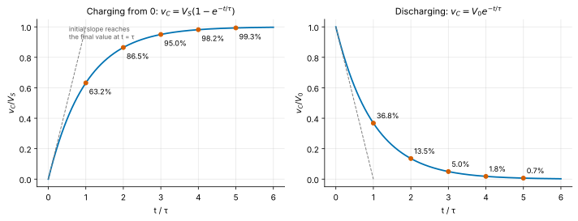
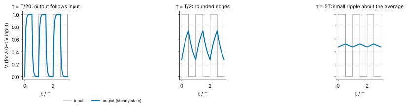
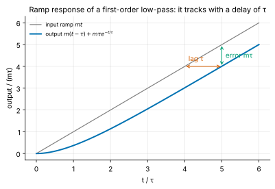
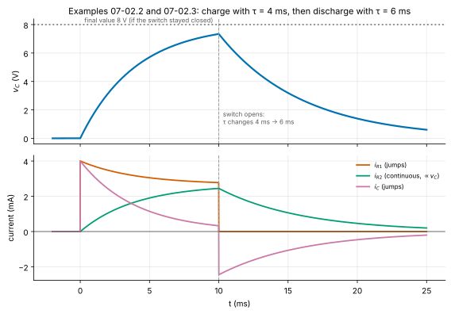
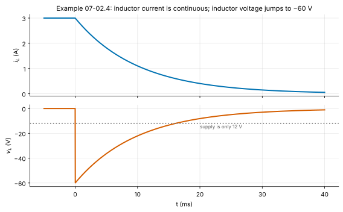

<!-- status: draft -->
# 07-02 · First-Order RC and RL Transients

| | |
|---|---|
| **Course** | [07 · Circuit Analysis II (Transient and AC)](../README.md) |
| **University equivalent** | The "first-order circuits" chapter of a sophomore Circuits course (Nilsson & Riedel, *Response of First-Order RL and RC Circuits*; Alexander & Sadiku, *First-Order Circuits*) and the first-order transient lectures of MIT 6.002 |
| **Prerequisites** | [06-08 Thevenin and Norton Equivalents](../../06-circuit-analysis-1-dc/chapters/06-08-thevenin-and-norton.md), [07-01 Capacitors and Inductors](07-01-capacitors-and-inductors.md), [02-02 First-Order Linear ODEs](../../02-complex-numbers-des-and-linear-algebra/chapters/02-02-first-order-linear-odes.md), [02-01 Complex Numbers and Phasors](../../02-complex-numbers-des-and-linear-algebra/chapters/02-01-complex-numbers-euler-and-phasors.md). The facts used from each are restated in *Recap* and *Math refresher* boxes, so you can start here. |
| **Estimated study hours** | 10 |
| **Last verified** | 2026-11-12 |

**Learning objectives.** After this chapter you can:

1. Derive the first-order differential equation of any circuit containing one capacitor or one inductor (after Thevenin/Norton reduction) and solve it for the natural and step responses.
2. Find initial ($t_0^+$) and final ($t \to \infty$) values using the continuity of capacitor voltage and inductor current, and compute the time constant from the Thevenin resistance.
3. Apply the "initial–final–τ" solution to switched circuits, including sequential switching and periodic square-wave drive.
4. Compute the energy stored and dissipated in transients, including the ½CV² charging loss, and connect it to CMOS dynamic power.
5. Use τ to estimate delay, 10–90% rise time, settling time to a stated accuracy (including N-bit ADC settling) and bandwidth.
6. Analyze first-order op-amp integrators and the response to a ramp input using the general (convolution-form) solution.

## 1. Big picture

Every node in an electronic system has some capacitance, and every wire carrying current has some inductance. So whenever something switches (a logic gate toggles, a sampling switch closes, a supply turns on, a relay opens), voltages and currents cannot jump to their new values. They glide there, and for one dominant storage element they glide along an exponential with a single **time constant** τ. This chapter is about that glide. It is arguably the most-used piece of circuit theory in industry: the time constant is the universal answer to "how fast can this go?", and its energy budget is the answer to "how much power does switching cost?".

- **Digital speed:** a logic gate driving a wire is an RC circuit. Gate delay, wire delay and clock frequency limits start here ([19-02](../../19-digital-vlsi-design/chapters/19-02-cmos-inverter-dynamic.md), [19-05](../../19-digital-vlsi-design/chapters/19-05-interconnect.md)).
- **Digital power:** charging a node through a transistor costs $CV^2$ per cycle no matter how fast it switches, which is the origin of $P = \alpha CV^2f$ ([19-06](../../19-digital-vlsi-design/chapters/19-06-power-and-low-power-design.md)).
- **Data converters:** an ADC's sampling capacitor must settle to within half a bit through its drive resistance, which sets acquisition time and driver bandwidth ([20-05](../../20-analog-and-mixed-signal-ic-design/chapters/20-05-comparators-and-sample-and-hold.md)).
- **Power and actuators:** interrupting an inductor's current produces a voltage spike that can destroy a switch. Flyback diodes, snubbers and converter design all manage it ([22-02](../../22-power-electronics-and-energy-conversion/chapters/22-02-buck-converter-steady-state.md)).
- **Everyday firmware hardware:** power-on reset delays, button debouncing and RC filters on sensor lines are first-order circuits ([18-05](../../18-embedded-systems-and-microcontrollers/chapters/18-05-gpio-uart-spi-i2c.md)).

## 2. Intuition first

### A tank filled through a narrow pipe

Picture a water tank (the **capacitor**) filled from a reservoir held at a fixed level (the **source voltage** $V_S$) through a narrow pipe (the **resistor**). The flow through the pipe is proportional to the *difference* in water level, which is Ohm's law: $i = (V_S - v_C)/R$. At first the tank is empty, the level difference is largest and water rushes in. As the tank fills, the difference shrinks, so the flow slows, so the filling slows. The tank approaches the reservoir level ever more slowly and never quite reaches it. A process whose rate of change is proportional to its remaining distance from a target is exactly an exponential approach.

A wider pipe (smaller $R$) or a smaller tank (smaller $C$) gets there faster. The product $RC$ sets the timescale.

*Figure 1. The canonical first-order circuit. When the switch closes, the capacitor voltage moves from its initial value toward $V_S$ with time constant τ = RC.*

### The inductor is inertia

An inductor resists changes in *current*, the way a heavy flywheel resists changes in speed. Push on it and its current builds up gradually. Try to stop it abruptly and it fights back with whatever voltage it takes to keep the current flowing, which can be enormous (§3.11).

### An analogy from finance: mean reversion

A mean-reverting interest-rate model (the Vasicek model, familiar from fixed income) has drift $dr = \kappa(\theta - r)\,dt$: the short rate moves toward its long-run level $\theta$ at a speed proportional to its distance from it. Strip out the random shock term and this is the RC equation exactly. Compare $\frac{dv_C}{dt} = \frac{1}{RC}(V_S - v_C)$: here $\theta \leftrightarrow V_S$, $\kappa \leftrightarrow 1/(RC)$, and the **half-life of a rate shock**, $\ln 2/\kappa$, is the circuit's 50% delay $\tau\ln 2$. Everything in §3.7 about "how many time constants until it's 99% done" is the same calculation you would do for how long a rate shock takes to decay.

*Where the analogy breaks:* the circuit has no random shocks at everyday scales, though it does at the microvolt level: thermal noise on a capacitor is the "kT/C" noise of §9. More importantly, the circuit obeys **energy conservation**. Charging a capacitor through any resistor wastes exactly as much energy as it stores (§3.8), a constraint with no counterpart in a rate model. And the analogy has nothing that plays the inductor's role (inertia).

## 3. Theory

### 3.1 What carries over from Chapter 07-01

> **Recap — capacitors and inductors** ([07-01](07-01-capacitors-and-inductors.md)).
>
> - **Element laws** (passive sign convention): $i_C = C\,\dfrac{dv_C}{dt}$ and $v_L = L\,\dfrac{di_L}{dt}$, with $C$ in farads (F = C/V = A·s/V) and $L$ in henries (H = V·s/A).
> - **Stored energy:** $w_C = \tfrac{1}{2}Cv_C^2$ and $w_L = \tfrac{1}{2}Li_L^2$, in joules.
> - **DC steady state:** when nothing is changing, $dv_C/dt = 0$ so $i_C = 0$, and **a capacitor acts as an open circuit**. Likewise $di_L/dt = 0$ so $v_L = 0$, and **an inductor acts as a short circuit**.

**Continuity.** Capacitor voltage cannot jump: a jump of $\Delta V$ in zero time would need $i_C = C\,\Delta V/\Delta t \to \infty$. Equivalently, the stored energy $\tfrac{1}{2}Cv_C^2$ would change in zero time, which takes infinite power. For the same reason inductor current cannot jump. These two facts are the anchor of every transient problem:

$$
v_C(t_0^+) = v_C(t_0^-), \qquad i_L(t_0^+) = i_L(t_0^-),
$$

where $t_0^-$ and $t_0^+$ denote the instants just before and just after a switching event at $t_0$. **Nothing else is guaranteed to be continuous.** Resistor currents, capacitor currents and inductor voltages can and do jump.

> **Math refresher — the first-order linear ODE** (developed fully in [02-02](../../02-complex-numbers-des-and-linear-algebra/chapters/02-02-first-order-linear-odes.md)).
>
> - **Homogeneous equation:** $\dfrac{dx}{dt} = -\dfrac{x}{\tau}$. Separate variables, $\dfrac{dx}{x} = -\dfrac{dt}{\tau}$, and integrate to get $\ln\lvert x\rvert = -t/\tau + c$, so $x(t) = Ae^{-t/\tau}$. The constant $A = x(0)$ is fixed by the initial condition.
> - **Constant forcing,** $\dfrac{dx}{dt} = \dfrac{X_\infty - x}{\tau}$, reduces to the same thing with the substitution $u = x - X_\infty$ (because $du/dt = dx/dt$). This gives $x(t) = X_\infty + \big(x(0) - X_\infty\big)e^{-t/\tau}$.
> - **Check by substitution:** $\dfrac{dx}{dt} = -\dfrac{1}{\tau}\big(x(0) - X_\infty\big)e^{-t/\tau} = \dfrac{X_\infty - x}{\tau}$. ✓

### 3.2 The source-free RC circuit (natural response)

A capacitor charged to $V_0$ is connected across a resistor $R$ at $t = 0$. Take the top node voltage $v = v_C$ and apply KCL: the capacitor current plus the resistor current, both leaving the node, sum to zero:

$$
C\frac{dv}{dt} + \frac{v}{R} = 0 \quad\Longrightarrow\quad \frac{dv}{dt} = -\frac{v}{RC}.
$$

With $v(0^+) = V_0$ by continuity, the refresher gives

$$
\boxed{\,v(t) = V_0\,e^{-t/\tau}, \qquad \tau = RC\,} \qquad (t \ge 0).
$$

**Units of τ:** $\Omega\cdot\text{F} = \dfrac{\text{V}}{\text{A}}\cdot\dfrac{\text{A}\cdot\text{s}}{\text{V}} = \text{s}$. ✓

The resistor current is $i_R = v/R = (V_0/R)e^{-t/\tau}$. It jumps from 0 to $V_0/R$ at the switching instant, while $v$ does not jump.

**Energy check.** The energy dissipated in the resistor over all time is

$$
\int_0^\infty \frac{v^2}{R}\,dt = \frac{V_0^2}{R}\int_0^\infty e^{-2t/\tau}dt = \frac{V_0^2}{R}\cdot\frac{\tau}{2} = \frac{V_0^2}{R}\cdot\frac{RC}{2} = \tfrac{1}{2}CV_0^2 ,
$$

exactly the energy that was stored in the capacitor. Energy is conserved, as it must be. The exponential's "$\tau/2$" appears because power goes as $v^2$, which decays twice as fast as $v$.

### 3.3 The source-free RL circuit

An inductor carrying current $I_0$ is connected across a resistor $R$ at $t = 0$. KVL around the loop, following the current, gives $L\,\dfrac{di}{dt} + Ri = 0$, so

$$
\boxed{\,i(t) = I_0\,e^{-t/\tau}, \qquad \tau = \frac{L}{R}\,} \qquad (t \ge 0).
$$

**Units:** $\dfrac{\text{H}}{\Omega} = \dfrac{\text{V}\cdot\text{s}/\text{A}}{\text{V}/\text{A}} = \text{s}$. ✓

Note the reversal. **A larger R makes an RL transient faster** (τ = L/R) but an RC transient slower (τ = RC). Two ways to see why:

- In the RL loop the resistor is what *dissipates* the inductor's energy, at rate $i^2R$. A bigger $R$ burns it faster.
- In the RC circuit the resistor *restricts* the current that changes the capacitor's charge. A bigger $R$ throttles it.

### 3.4 Step response

Now let a constant source $V_S$ charge a capacitor through $R$, starting from $v_C(0) = V_0$ (Figure 1). KVL around the loop gives $V_S = Ri + v_C$ with $i = C\,dv_C/dt$:

$$
RC\frac{dv_C}{dt} + v_C = V_S \quad\Longrightarrow\quad \frac{dv_C}{dt} = \frac{V_S - v_C}{\tau}.
$$

This is the constant-forcing case of the refresher, with $X_\infty = V_S$:

$$
\boxed{\,v_C(t) = V_S + (V_0 - V_S)\,e^{-t/\tau}\,} .
$$

At $t = 0$ it gives $V_0$, as $t \to \infty$ it gives $V_S$, and in between it moves exponentially. The current $i = (V_S - v_C)/R = \frac{V_S - V_0}{R}e^{-t/\tau}$ starts at $(V_S - V_0)/R$ and decays to zero. That is the capacitor becoming an open circuit at DC.

The RL step response is the dual. A source $V_S$ in series with $R$ and $L$, starting from $i(0) = I_0$, gives $i(t) = \frac{V_S}{R} + \big(I_0 - \frac{V_S}{R}\big)e^{-t/\tau}$ with $\tau = L/R$: the current approaches $V_S/R$ as the inductor becomes a short circuit.

*Figure 2. Universal first-order curves. After 1, 2, 3, 4 and 5 time constants the response has completed 63.2%, 86.5%, 95.0%, 98.2% and 99.3% of its change. The initial slope, extended, would reach the final value in exactly one τ.*

### 3.5 Any first-order circuit: Thevenin reduction and the master formula

Real circuits have more than one resistor and source. The key insight: **whatever the rest of the circuit is, as long as it contains only resistors and sources (independent or dependent), the capacitor sees it as a Thevenin equivalent** $V_{Th}$ in series with $R_{Th}$ ([06-08](../../06-circuit-analysis-1-dc/chapters/06-08-thevenin-and-norton.md)). The capacitor therefore obeys exactly the step-response equation of §3.4 with $V_S \to V_{Th}$ and $R \to R_{Th}$:

$$
\tau = R_{Th}\,C \qquad\text{or, for an inductor (Norton equivalent),}\qquad \tau = \frac{L}{R_{Th}} ,
$$

where $R_{Th}$ is the resistance seen from the storage element's terminals **with independent sources turned off** (voltage sources shorted, current sources opened).

**Every other voltage and current follows the same exponential.** Once the capacitor is replaced by a known voltage $v_C(t)$, the rest of the circuit is a linear resistive circuit driven by $v_C(t)$ and the constant sources. By superposition, any branch variable $x(t)$ is $x(t) = a\,v_C(t) + b$ for some constants $a$ and $b$. An affine function of an exponential approach is itself an exponential approach with the **same τ**. So any variable $x$ in a first-order circuit, after a switching event at $t_0$, obeys the **master formula**:

$$
\boxed{\,x(t) = x(\infty) + \big[x(t_0^+) - x(\infty)\big]\,e^{-(t - t_0)/\tau}, \qquad t \ge t_0\,}
$$

The catch is $x(t_0^+)$. For $v_C$ and $i_L$ it equals the value at $t_0^-$ (continuity). For any other variable, find it from the **$t_0^+$ circuit**: replace the capacitor by a voltage source of value $v_C(t_0^+)$ (or the inductor by a current source of value $i_L(t_0^+)$), then solve the resulting resistive circuit.

### 3.6 The procedure

1. **Before the switch** ($t_0^-$): the circuit has usually been in DC steady state. Replace C by an open circuit (L by a short) and find $v_C(t_0^-)$ or $i_L(t_0^-)$.
2. **Continuity:** $v_C(t_0^+) = v_C(t_0^-)$ and $i_L(t_0^+) = i_L(t_0^-)$.
3. **Initial values of other variables:** draw the $t_0^+$ circuit, with C replaced by a voltage source $v_C(t_0^+)$ or L by a current source $i_L(t_0^+)$, and solve it.
4. **Final values:** in the new configuration, C becomes an open circuit and L a short circuit. Solve the DC circuit for $x(\infty)$.
5. **Time constant:** turn off the independent sources, find $R_{Th}$ seen by C or L, and set $\tau = R_{Th}C$ or $L/R_{Th}$.
6. **Write the answer** with the master formula.
7. **Sanity-check:** the initial and final values match the two limiting circuits, τ has units of seconds, and the direction of change makes physical sense.

### 3.7 Timing landmarks: delay, rise time, settling and bandwidth

Because every first-order response is the same curve, a handful of numbers answer most practical timing questions. Write the fraction of the change *remaining* after time $t$ as $e^{-t/\tau}$.

| Elapsed time | Remaining | Completed |
|---|---|---|
| $1\tau$ | 36.8% | 63.2% |
| $2\tau$ | 13.5% | 86.5% |
| $3\tau$ | 5.0% | 95.0% |
| $4\tau$ | 1.8% | 98.2% |
| $5\tau$ | 0.7% | 99.3% |

**50% delay.** Solving $e^{-t/\tau} = \tfrac{1}{2}$ gives $t_{50} = \tau\ln 2 = 0.693\tau$. This is the "propagation delay" of a gate modeled as an RC.

**10–90% rise time.** The response reaches 10% of its change when $e^{-t/\tau} = 0.9$, at $t_{10} = \tau\ln(1/0.9)$, and 90% when $e^{-t/\tau} = 0.1$, at $t_{90} = \tau\ln 10$. So

$$
t_r = t_{90} - t_{10} = \tau\big(\ln 10 - \ln\tfrac{10}{9}\big) = \tau\ln 9 = 2.197\,\tau .
$$

**Settling to an accuracy.** To get within a fraction $\varepsilon$ of the final value, wait $t = \tau\ln(1/\varepsilon)$. For 0.1% that is $\tau\ln 1000 = 6.91\tau$. An **N-bit ADC** sampling a full-scale step must settle to within half a least-significant bit, $\varepsilon = 2^{-(N+1)}$, so

$$
t_{settle} = (N + 1)\ln 2\cdot\tau ,
$$

which is $9.01\tau$ at 12 bits and $11.78\tau$ at 16 bits ([R-008](../../../reference/research-log.md#r-008--sar-adc-settling)). Each extra bit of accuracy costs another $0.69\tau$ of waiting.

**Rise time and bandwidth.** In [02-01](../../02-complex-numbers-des-and-linear-algebra/chapters/02-01-complex-numbers-euler-and-phasors.md) we found that the same RC circuit, driven by sinusoids, has $\lvert H\rvert = 1/\sqrt{2}$ at the corner frequency $f_{3dB} = 1/(2\pi\tau)$. Substituting $\tau = 1/(2\pi f_{3dB})$ into $t_r = \tau\ln 9$:

$$
\boxed{\,t_r = \frac{\ln 9}{2\pi f_{3dB}} \approx \frac{0.35}{f_{3dB}}\,}
$$

This is the bridge between the time domain and the frequency domain that every oscilloscope datasheet uses ([R-010](../../../reference/research-log.md#r-010--rise-time-and-bandwidth)). A 100 MHz single-pole system cannot produce edges faster than about 3.5 ns.

### 3.8 Energy: the charging loss you cannot avoid

Charge an initially empty capacitor to $V_S$ through any resistor $R$.

- **Energy delivered by the source.** The source pushes a total charge $Q = CV_S$ through itself at constant voltage $V_S$:

$$
W_S = \int_0^\infty V_S\,i\,dt = V_S\int_0^\infty i\,dt = V_S\,Q = CV_S^2 .
$$

- **Energy stored at the end:** $\tfrac{1}{2}CV_S^2$.
- **Energy dissipated in the resistor:** the difference, $\tfrac{1}{2}CV_S^2$. Check directly: with $i = (V_S/R)e^{-t/\tau}$, $\int_0^\infty i^2R\,dt = \frac{V_S^2}{R}\cdot\frac{\tau}{2} = \tfrac{1}{2}CV_S^2$. ✓

**Exactly half the energy is lost, and the loss does not depend on R.** A smaller resistor gives a larger current for a shorter time, and the two effects cancel exactly. This is one of the most consequential facts in electronics.

**Why your phone gets warm: CMOS dynamic power.** A CMOS logic gate charges its load capacitance $C$ from the supply $V_{DD}$ through its pull-up transistor (a resistor, in this model), then discharges it to ground through its pull-down transistor:

- **Charging** draws $CV_{DD}^2$ from the supply. Half is dissipated in the pull-up and half is stored on the node.
- **Discharging** dumps the stored half as heat in the pull-down.

Every full 0 → 1 → 0 cycle therefore costs $CV_{DD}^2$ of supply energy, independent of transistor strength. If a node makes a 0 → 1 transition on a fraction $\alpha$ of clock cycles (its *activity factor*) at clock frequency $f$, the average power is

$$
\boxed{\,P_{dyn} = \alpha\,C\,V_{DD}^2\,f\,}
$$

The quadratic dependence on $V_{DD}$ is why lowering supply voltage is the most powerful lever in low-power design (DVFS, [19-06](../../19-digital-vlsi-design/chapters/19-06-power-and-low-power-design.md)).

> **Going deeper — beating ½CV² with stepwise ("adiabatic") charging.** The loss is ½CV² only because the full voltage step appears across the resistor at the start. Charge the capacitor in $N$ equal steps of $V_S/N$, waiting for each to settle. Each step loses $\tfrac{1}{2}C(V_S/N)^2$, so the total loss is $N\cdot\tfrac{1}{2}C\frac{V_S^2}{N^2} = \frac{CV_S^2}{2N}$. Ramping the source slowly compared with τ approaches zero loss. Adiabatic logic, energy-recovery clocking and the charge-recycling tricks in some low-power displays and SRAMs exploit this, trading speed and complexity for energy.

### 3.9 Sequential switching and periodic drive

When a circuit switches more than once, apply the master formula **one interval at a time**. The value of the state variable at the end of one interval is the initial condition for the next, and τ may change between intervals if the circuit's resistance changes (Example 07-02.3).

**Square-wave drive in steady state.** Drive an RC low-pass with a square wave alternating between $V$ (for $T/2$) and 0 (for $T/2$). After many periods the output repeats every cycle, rising from a minimum $V_{min}$ to a maximum $V_{max}$ and falling back. Let $k = e^{-T/(2\tau)}$. During the high half-period the output charges toward $V$; during the low half it discharges toward 0:

$$
V_{max} = V + (V_{min} - V)\,k, \qquad V_{min} = V_{max}\,k .
$$

Substitute the second equation into the first: $V_{max} = V - Vk + V_{max}k^2$. So $V_{max}(1 - k^2) = V(1 - k)$, and dividing by $1 - k^2 = (1 - k)(1 + k)$:

$$
V_{max} = \frac{V}{1 + k}, \qquad V_{min} = \frac{Vk}{1 + k}, \qquad \text{ripple } = V_{max} - V_{min} = V\,\frac{1 - k}{1 + k}.
$$

Two limits make sense:

- **Fast circuit ($T \gg \tau$):** $k \to 0$, so the output swings fully between 0 and $V$.
- **Slow circuit ($T \ll \tau$):** $k \approx 1 - \frac{T}{2\tau}$. The output sits near the average $V/2$ with small ripple $\approx \frac{VT}{4\tau}$. The circuit is acting as an averaging filter. This is how a PWM signal from a microcontroller becomes an analog voltage ([18-06](../../18-embedded-systems-and-microcontrollers/chapters/18-06-adc-dac-pwm.md)).

*Figure 3. The same RC low-pass at three ratios of τ to the square-wave period.*

### 3.10 Arbitrary inputs: the general solution

For an input $u(t)$ that is not constant, $\tau\dfrac{dx}{dt} + x = u(t)$. Multiply both sides by the **integrating factor** $\frac{1}{\tau}e^{t/\tau}$ and notice that the left side becomes an exact derivative:

$$
\frac{d}{dt}\big(x\,e^{t/\tau}\big) = e^{t/\tau}\frac{dx}{dt} + \frac{1}{\tau}e^{t/\tau}x = \frac{1}{\tau}e^{t/\tau}u(t).
$$

Integrate from 0 to $t$ and multiply by $e^{-t/\tau}$:

$$
\boxed{\,x(t) = x(0)\,e^{-t/\tau} + \frac{1}{\tau}\int_0^t e^{-(t - \lambda)/\tau}\,u(\lambda)\,d\lambda\,}
$$

The first term is the natural response: the memory of the initial condition, fading away. The second is the **forced response**, a weighted average of past inputs in which an input from $(t - \lambda)$ seconds ago carries weight $e^{-(t-\lambda)/\tau}$. This "exponentially weighted moving average" is a **convolution**, the central operation of Signals and Systems ([11-03](../../11-signals-and-systems/chapters/11-03-convolution.md)). For a constant input it reduces to the step response; for a sinusoid it reproduces the phasor steady state of 02-01 plus a decaying transient.

**Ramp input.** Let $u(t) = kt$ (for example $k$ in V/s) and $x(0) = 0$. Substitute $s = t - \lambda$, so $\lambda = t - s$:

$$
x(t) = \frac{k}{\tau}\int_0^t e^{-s/\tau}(t - s)\,ds = \frac{k}{\tau}\Big[t\,\tau\big(1 - e^{-t/\tau}\big) - \big(\tau^2 - \tau^2e^{-t/\tau} - \tau t\,e^{-t/\tau}\big)\Big],
$$

using $\int_0^t e^{-s/\tau}ds = \tau(1 - e^{-t/\tau})$ and, by parts, $\int_0^t s\,e^{-s/\tau}ds = \tau^2 - \tau^2e^{-t/\tau} - \tau t\,e^{-t/\tau}$. Simplifying (the $t\,e^{-t/\tau}$ terms cancel):

$$
x(t) = k(t - \tau) + k\tau\,e^{-t/\tau}.
$$

After the transient dies out, the output is the input **delayed by exactly τ**, trailing it by a constant error $k\tau$. That is a useful fact about any first-order tracking system, from a sensor filter to a thermal-management loop ([15-04](../../15-control-systems/chapters/15-04-feedback-and-steady-state-error.md)).

*Figure 4. A first-order system following a ramp lags it by one time constant.*

### 3.11 Inductive kick

Suppose an inductor carries current $I_0$ and the switch feeding it opens. The current cannot stop instantly, so it must flow *somewhere*. If the only path is the opening switch, $v_L = L\,di/dt$ grows as large as needed to force the current through: the switch contacts arc, or a transistor switch breaks down. This is why every relay coil, solenoid and motor driver has a deliberate **flyback path**.

- **A resistor $R_f$ across the inductor.** The current continues through $R_f$ and decays with $\tau = L/R_f$. The inductor voltage jumps to $-I_0R_f$ (polarity reversed relative to normal operation). A larger $R_f$ empties the energy faster but produces a larger spike. Example 07-02.4 shows a 12 V circuit putting 72 V across its switch.
- **A diode across the inductor** (the classic flyback or freewheeling diode). It clamps the voltage to about one diode drop, the gentlest option for the switch. But the energy now drains only through the coil's own resistance and the diode, so the current decays slowly, and a relay releases more slowly (Problem 07-02.14).
- **A Zener or TVS clamp:** an intermediate choice, a higher clamp voltage for faster decay.

The energy that must go somewhere is $\tfrac{1}{2}LI_0^2$, independent of which path you choose. Only *where* it is dissipated and *how fast* changes.

### 3.12 First-order op-amp circuits

With an ideal op-amp ([06-10](../../06-circuit-analysis-1-dc/chapters/06-10-ideal-op-amp.md)) in negative feedback, the inverting input is a **virtual ground**. Place a capacitor $C$ in the feedback path and a resistor $R$ at the input:

- the input current is $v_{in}/R$;
- it cannot enter the op-amp, so it flows into the capacitor: $C\,\dfrac{d(0 - v_{out})}{dt} = \dfrac{v_{in}}{R}$;

$$
v_{out}(t) = v_{out}(0) - \frac{1}{RC}\int_0^t v_{in}\,d\lambda .
$$

This is the **inverting integrator**. With a constant input it ramps linearly and without limit until the op-amp hits its supply rail. Any small DC offset at the input is integrated too, so practical circuits add a resistor $R_f$ in parallel with $C$. The resulting **leaky integrator** is an ordinary first-order system: KCL at the virtual ground gives $\frac{v_{in}}{R} + \frac{v_{out}}{R_f} + C\frac{dv_{out}}{dt} = 0$, that is

$$
R_fC\,\frac{dv_{out}}{dt} + v_{out} = -\frac{R_f}{R}\,v_{in},
$$

a first-order low-pass with $\tau = R_fC$ and DC gain $-R_f/R$. For times much shorter than $\tau$ it integrates; for long times it settles at the DC gain. Problem 07-02.11 compares the two. Integrators are the core of sigma-delta ADCs ([20-08](../../20-analog-and-mixed-signal-ic-design/chapters/20-08-sigma-delta-converters.md)) and of PI controllers ([15-08](../../15-control-systems/chapters/15-08-pid-control.md)).

> **Going deeper — why it is always $e^{-t/\tau}$.** The exponential is the only function whose derivative is proportional to itself, so it is the natural mode of any system whose rate of change is proportional to its state. In the Laplace domain ([07-04](07-04-laplace-domain-circuit-analysis.md)) the RC low-pass becomes $H(s) = \frac{1}{1 + s\tau}$, with a single **pole** at $s = -1/\tau$. Its location on the negative real axis is the decay rate. Second-order circuits ([07-03](07-03-second-order-rlc-transients.md)) have two poles, which can be complex, and complex poles mean ringing.

## 4. Worked examples

### Example 07-02.1 — Discharging a capacitor (tier A)

**Setup.** A 10 µF capacitor charged to 12 V is connected across a 4.7 kΩ resistor at $t = 0$. Find (a) τ, (b) $v_C$ at $t = 100$ ms, (c) the time at which $v_C$ reaches 1 V, (d) the initial stored energy, and (e) the energy dissipated in the resistor by the time $v_C = 1$ V.

**Solution.**

(a) $\tau = RC = (4.7\times10^{3})(10\times10^{-6}) = 0.0470$ s $= 47.0$ ms.

(b) $v_C(0.1\ \text{s}) = 12\,e^{-0.100/0.047} = 12\,e^{-2.128} = 12 \times 0.1191 = 1.429$ V.

(c) Solve $1 = 12e^{-t/\tau}$: $t = \tau\ln 12 = 47.0 \times 2.485 = 116.8$ ms.

(d) $w_0 = \tfrac{1}{2}CV_0^2 = \tfrac{1}{2}(10\times10^{-6})(144) = 7.20\times10^{-4}$ J $= 0.720$ mJ.

(e) Energy dissipated = stored energy lost = $\tfrac{1}{2}C(12^2 - 1^2) = \tfrac{1}{2}(10\times10^{-6})(143) = 0.715$ mJ.

**Units check.** Ω·F = s ✓; F·V² = (C/V)·V² = C·V = J ✓.
**Sanity check.** 100 ms is about 2.1τ, so about 12% of the voltage should remain: 1.43/12 = 11.9% ✓. Reaching 1/12 of the starting voltage takes $\ln 12 \approx 2.5$ time constants ✓. Most of the energy is gone by then because energy goes as $v^2$ ✓.

### Example 07-02.2 — A switched circuit via Thevenin reduction (tier B)

**Setup.** In Figure 5 the switch has been open for a long time, so the capacitor is fully discharged through $R_2$. At $t = 0$ the switch closes, connecting the 24 V source through $R_1 = 6$ kΩ to node A, where $R_2 = 3$ kΩ and $C = 2$ µF go to ground. Find (a) the Thevenin equivalent seen by the capacitor and τ; (b) $v_C(t)$; (c) $i_C(0^+)$ and $i_{R1}(0^+)$, compared with their values at $0^-$; (d) $v_C$ at $t = \tau$; (e) the time at which $v_C = 7$ V; and (f) $i_{R1}(\infty)$.

*Figure 5. Circuit for Examples 07-02.2 and 07-02.3.*

**Solution.**

(a) Looking into node A from the capacitor, with the switch closed: the source and $R_1$, $R_2$ form a voltage divider, so $V_{Th} = 24\cdot\dfrac{3}{6 + 3} = 8.00$ V. With the source shorted, $R_1$ and $R_2$ are in parallel: $R_{Th} = \dfrac{6\cdot 3}{6 + 3} = 2.00$ kΩ. So $\tau = R_{Th}C = (2\times10^{3})(2\times10^{-6}) = 4.00$ ms.

(b) $v_C(0^-) = 0$, so by continuity $v_C(0^+) = 0$. The final value is $v_C(\infty) = V_{Th} = 8$ V. Master formula: $v_C(t) = 8 + (0 - 8)e^{-t/4\text{ ms}} = 8\big(1 - e^{-t/4\text{ ms}}\big)$ V.

(c) $t = 0^+$ circuit: replace C by a 0 V source (a short). All of $R_1$'s current flows into the "short", and $R_2$ has 0 V across it:
$i_{R1}(0^+) = 24/6\text{k} = 4.00$ mA, $i_{R2}(0^+) = 0$, so $i_C(0^+) = 4.00$ mA.
At $0^-$ the switch was open and everything was at rest, so $i_{R1}(0^-) = i_C(0^-) = 0$. **Both currents jump** from 0 to 4 mA, while $v_C$ does not jump. Cross-check from the element law: $i_C(0^+) = C\,\frac{dv_C}{dt}\big|_{0^+} = (2\,\mu\text{F})\frac{8\text{ V}}{4\text{ ms}} = 4$ mA ✓.

(d) $v_C(\tau) = 8(1 - e^{-1}) = 8 \times 0.6321 = 5.057$ V.

(e) $7 = 8(1 - e^{-t/\tau})$ gives $e^{-t/\tau} = 1/8$, so $t = \tau\ln 8 = 4 \times 2.079 = 8.318$ ms.

(f) At $t \to \infty$ the capacitor is an open circuit, and $R_1$ and $R_2$ carry the same current: $i_{R1}(\infty) = 24/(6 + 3)\text{k} = 2.667$ mA.

**Units check.** kΩ·µF = (10³)(10⁻⁶) Ω·F = ms ✓.
**Sanity check.** The capacitor can never charge above 8 V, the open-circuit voltage at node A, even though the source is 24 V ✓. Figure 6 shows $i_{R1}$ and $i_C$ jumping at $t = 0$ while $v_C$ and $i_{R2} = v_C/R_2$ start smoothly from zero ✓.

### Example 07-02.3 — Sequential switching: the time constant changes (tier B)

**Setup.** Continue Example 07-02.2. At $t = 10$ ms the switch opens again. Find (a) $v_C(10\text{ ms})$, (b) the new time constant, and (c) $v_C(20\text{ ms})$.

**Solution.**

(a) From Example 07-02.2: $v_C(10\text{ ms}) = 8\big(1 - e^{-10/4}\big) = 8(1 - 0.0821) = 7.343$ V.

(b) With the switch open, the source and $R_1$ are disconnected. The capacitor sees only $R_2$, so $\tau_2 = R_2C = (3\times10^{3})(2\times10^{-6}) = 6.00$ ms. **The time constant changed because the circuit changed.**

(c) The final value is now 0 V, and the initial value (by continuity) is 7.343 V:
$v_C(t) = 7.343\,e^{-(t - 10\text{ ms})/6\text{ ms}}$ for $t \ge 10$ ms, so $v_C(20\text{ ms}) = 7.343\,e^{-10/6} = 7.343 \times 0.1889 = 1.387$ V.

*Figure 6. Examples 07-02.2 and 07-02.3. Top: $v_C$ charges with τ = 4 ms, then discharges with τ = 6 ms. Bottom: $i_{R1}$ and $i_C$ jump at each switching instant; $i_{R2} = v_C/R_2$ never jumps, because $v_C$ never jumps.*

**Sanity check.** At the instant the switch opens, $i_C$ jumps from $+0.33$ mA to $-2.45$ mA, because the capacitor suddenly becomes the only source feeding $R_2$. $v_C$ continues smoothly ✓. These numbers are confirmed by the ngspice netlist in the lab (`ex2_ex3_switched_rc.cir`).

### Example 07-02.4 — Inductive kick (tier B)

**Setup.** In Figure 7 the switch has been closed for a long time, so the inductor carries a steady current. At $t = 0$ the switch opens. Find (a) $i_L(0^-)$, (b) τ after the switch opens, (c) $v_L(0^+)$, (d) the voltage across the open switch at $0^+$, (e) the energy dissipated in $R_2$, and (f) $i_L$ at $t = 10$ ms. (g) Repeat (b) and (c) with $R_2 = 200\ \Omega$.

*Figure 7. Circuit for Example 07-02.4. The inductor current $i_L$ is referenced downward, into node A's side of the inductor.*

**Solution.**

(a) In DC steady state the inductor is a short circuit. It shorts out $R_2$ (no current in $R_2$), so $i_L(0^-) = 12/4 = 3.00$ A.

(b) After the switch opens, the source and $R_1$ are disconnected. The inductor's only path is through $R_2$: $\tau = L/R_2 = 0.2/20 = 10.0$ ms.

(c) By continuity $i_L(0^+) = 3$ A, still flowing *down* through the inductor. Around the loop it must flow *up* through $R_2$, so node A sits below ground: $v_A = -i_LR_2 = -60.0$ V. With the passive sign convention ($i_L$ entering the inductor's top terminal at A), $v_L = v_A - 0 = -60.0$ V. Before the switch opened, $v_L$ was 0.

(d) After opening, no current flows in $R_1$, so the switch's right-hand terminal is also at $-60$ V. The switch must withstand $12 - (-60) = 72.0$ V, **six times the supply voltage.**

(e) All of the inductor's stored energy ends up in $R_2$: $\tfrac{1}{2}LI_0^2 = \tfrac{1}{2}(0.2)(3^2) = 0.900$ J.

(f) $i_L(10\text{ ms}) = 3e^{-1} = 1.104$ A.

(g) With $R_2 = 200\ \Omega$: $\tau = 0.2/200 = 1.00$ ms (ten times faster), but $v_L(0^+) = -3 \times 200 = -600$ V. Removing $R_2$ entirely, $R_2 \to \infty$, would make the spike unbounded in this ideal model. In reality the switch arcs or breaks down.

*Figure 8. Example 07-02.4: the current is continuous; the voltage is not.*

**Units check.** H/Ω = s ✓; H·A² = (V·s/A)·A² = V·A·s = J ✓.
**Sanity check.** Power in $R_2$ at $0^+$ is $3^2 \times 20 = 180$ W, which drains 0.9 J in a few milliseconds, consistent with τ = 10 ms (the energy time constant is τ/2 = 5 ms) ✓.

### Example 07-02.5 — Settling an ADC's sampling capacitor (tier C)

**Setup.** A 16-bit successive-approximation (SAR) ADC samples its input onto an internal sampling capacitor $C_S = 20$ pF. The source, the input switch and the driver output together present $R = 100\ \Omega$. These are illustrative values for a precision SAR front end. (a) Find τ. (b) How many time constants are needed to settle a full-scale step to within ½ LSB, and what is the minimum acquisition time? (c) If the ADC's acquisition window is 300 ns, what is the largest total resistance that still settles in time? (d) Compute the kT/C noise of the sampling capacitor at 300 K and compare it with the LSB for a 5 V full scale.

**Solution.**

(a) $\tau = RC = 100 \times 20\times10^{-12} = 2.00\times10^{-9}$ s $= 2.00$ ns.

(b) $N_\tau = (16 + 1)\ln 2 = 17 \times 0.6931 = 11.78$ time constants, so $t_{acq,min} = 11.78 \times 2.00 = 23.57$ ns.

(c) $\tau_{max} = 300\text{ ns}/11.78 = 25.46$ ns, so $R_{max} = \tau_{max}/C_S = 25.46\times10^{-9}/20\times10^{-12} = 1.273$ kΩ.

(d) The thermal noise sampled onto a capacitor has RMS value $\sqrt{kT/C}$, independent of R; [12-10](../../12-electronics-2/chapters/12-10-noise-in-circuits.md) derives this. With $kT = 1.381\times10^{-23} \times 300 = 4.142\times10^{-21}$ J:
$v_n = \sqrt{4.142\times10^{-21}/20\times10^{-12}} = 14.39\ \mu$V rms.
The LSB is $5/2^{16} = 76.29\ \mu$V, so the noise is $14.39/76.29 = 0.189$ LSB rms.

**Units check.** $\sqrt{\text{J/F}} = \sqrt{(\text{C·V})/(\text{C/V})} = \text{V}$ ✓.
**Sanity check and tradeoff.** A *larger* $C_S$ would lower kT/C noise, which goes as $1/\sqrt{C}$. But it would raise τ, demanding a lower-resistance (stronger, more power-hungry) driver or a longer acquisition time. That is the central tension of precision ADC front ends, and the ngspice netlist `ex5_adc_settling.cir` confirms the 23.57 ns settling time.

<!-- answer-key -->
| ID | Quantity | Value | Unit |
|---|---|---|---|
| Ex 07-02.1a | τ | 47.0 | ms |
| Ex 07-02.1b | $v_C(100\text{ ms})$ | 1.429 | V |
| Ex 07-02.1c | time to reach 1 V | 116.8 | ms |
| Ex 07-02.1d | initial stored energy | 0.720 | mJ |
| Ex 07-02.1e | energy dissipated until 1 V | 0.715 | mJ |
| Ex 07-02.2a | $V_{Th}$ | 8.00 | V |
| Ex 07-02.2b | $R_{Th}$ | 2.00 | kΩ |
| Ex 07-02.2c | τ | 4.00 | ms |
| Ex 07-02.2d | $i_C(0^+) = i_{R1}(0^+)$ | 4.00 | mA |
| Ex 07-02.2e | $v_C(\tau)$ | 5.057 | V |
| Ex 07-02.2f | time to reach 7 V | 8.318 | ms |
| Ex 07-02.2g | $i_{R1}(\infty)$ | 2.667 | mA |
| Ex 07-02.3a | $v_C(10\text{ ms})$ | 7.343 | V |
| Ex 07-02.3b | $\tau_2$ | 6.00 | ms |
| Ex 07-02.3c | $v_C(20\text{ ms})$ | 1.387 | V |
| Ex 07-02.3d | $i_C(10\text{ ms}^-)$ | 0.33 | mA |
| Ex 07-02.3e | $i_C(10\text{ ms}^+)$ | −2.45 | mA |
| Ex 07-02.4a | $i_L(0^-)$ | 3.00 | A |
| Ex 07-02.4b | τ | 10.0 | ms |
| Ex 07-02.4c | $v_L(0^+)$ | −60.0 | V |
| Ex 07-02.4d | switch voltage at $0^+$ | 72.0 | V |
| Ex 07-02.4e | energy dissipated in $R_2$ | 0.900 | J |
| Ex 07-02.4f | $i_L(10\text{ ms})$ | 1.104 | A |
| Ex 07-02.4g | τ with $R_2 = 200\ \Omega$ | 1.00 | ms |
| Ex 07-02.4h | $v_L(0^+)$ with $R_2 = 200\ \Omega$ | −600 | V |
| Ex 07-02.4i | power in $R_2$ at $0^+$ | 180 | W |
| Ex 07-02.5a | τ | 2.00 | ns |
| Ex 07-02.5b | time constants for 16-bit settling | 11.78 | — |
| Ex 07-02.5c | minimum acquisition time | 23.57 | ns |
| Ex 07-02.5d | maximum total resistance for 300 ns | 1.273 | kΩ |
| Ex 07-02.5e | kT/C noise at 20 pF | 14.39 | µV |
| Ex 07-02.5f | LSB at 16 bits, 5 V | 76.29 | µV |
| Ex 07-02.5g | noise in LSB | 0.189 | — |

*Every value in this table is recomputed by [verify_07_02.py](../verify/verify_07_02.py); Examples 2–5 are also confirmed by ngspice netlists in [labs/07-02-lab](../labs/07-02-lab/README.md).*

## 5. Simulate it

The lab is in [labs/07-02-lab/](../labs/07-02-lab/README.md). It has two halves.

**Notebook** (`07-02-transients.ipynb`):

1. Explore the step response interactively and confirm the timing landmarks.
2. Simulate Examples 07-02.2–3, including the jumps in non-state variables.
3. Show numerically that the charging loss is ½CV² for *every* R, and that stepwise charging beats it.
4. Find the square-wave steady state.
5. Model inductive kick with a resistor and with a realistic (exponential) diode.
6. Run an optional cell that calls ngspice and plots its waveforms, if ngspice is installed.

**ngspice netlists:** six netlists cover the switched RC (Examples 2–3), the RL kick (Example 4), ADC settling (Example 5), op-amp integrators (Problem 11), square-wave steady state (Problem 12) and relay flyback (Problem 14). Each netlist states its expected results, linked to this chapter's answer keys, and `python tools/run_spice.py 07-02` checks them all.

**Guided exercise (predict, then run).** In the notebook's Example 2 cell, change $R_2$ from 3 kΩ to 6 kΩ. **Before running,** predict the new $V_{Th}$, $R_{Th}$, τ and the time to reach 7 V. Hint: $V_{Th} = 12$ V, $R_{Th} = 3$ kΩ and τ = 6 ms, but recompute the 7 V crossing yourself. Then run and compare. In the energy cell, predict the dissipated energy for R = 10 Ω and R = 10 kΩ before running both.

## 6. Engineering tradeoffs

| Knob | Improves | Costs | Typical decision owner |
|---|---|---|---|
| Upsize a driver transistor (lower $R_{on}$) | Shorter RC delay, faster edges | Larger input capacitance loads the previous stage; more area and leakage; the $CV^2$ energy is unchanged | Circuit / standard-cell designer; synthesis tool |
| Lower supply voltage $V_{DD}$ | Quadratic reduction in switching energy ($CV^2$) | Higher transistor resistance → longer τ → lower maximum frequency; less noise margin | SoC architect, power team (DVFS policy) |
| Larger ADC sampling capacitor | Lower kT/C noise (∝ $1/\sqrt{C}$) | Longer settling (τ ∝ C): needs a stronger, higher-power driver or longer acquisition time | Mixed-signal designer; board-level applications engineer |
| Larger RC on a debounce or filter input | Rejects more noise and switch bounce | Slower response to real events; larger component values | Embedded hardware engineer |
| Resistor flyback with larger $R_f$ across an inductive load | Faster energy removal (τ = L/R) and faster relay release | Higher voltage spike on the switch; needs a higher-voltage-rated (larger, costlier) transistor | Power / embedded hardware engineer |
| Diode flyback instead of resistor | Minimal switch voltage stress (≈ supply + 0.7 V) | Slow current decay: slower relay or solenoid release; the coil dissipates the energy | Embedded hardware engineer |
| Wider or thicker on-chip wires | Lower wire resistance → lower RC delay | More capacitance per length and less routing density; more metal layers cost money | Physical designer; process/PDK team |

## 7. Numbers to know

| Quantity | Value | Note |
|---|---|---|
| Fraction completed after 1τ, 2τ, 3τ, 5τ | 63.2%, 86.5%, 95.0%, 99.3% | $1 - e^{-n}$ |
| 50% delay | $0.693\tau$ ($\tau\ln 2$) | Gate-delay model |
| 10–90% rise time | $2.197\tau$ ($\tau\ln 9$) | |
| Rise time vs bandwidth | $t_r \approx 0.35/f_{3dB}$ | [R-010](../../../reference/research-log.md#r-010--rise-time-and-bandwidth) |
| Settling to 0.1% | $6.91\tau$ | $\tau\ln 1000$ |
| ADC settling to ½ LSB | $(N+1)\ln 2\cdot\tau$: 6.24τ (8-bit), 9.01τ (12-bit), 11.78τ (16-bit), 14.56τ (20-bit) | [R-008](../../../reference/research-log.md#r-008--sar-adc-settling) |
| Charging loss | ½CV², independent of R | Fundamental |
| kT/C noise at 300 K | 64.4 µV rms (1 pF), 14.4 µV rms (20 pF) | [R-009](../../../reference/research-log.md#r-009--ktc-noise) |
| On-chip wire capacitance | ≈ 0.2 fF/µm | Rule of thumb, [R-004](../../../reference/research-log.md#r-004--on-chip-interconnect) |
| Research-stage tight-pitch wire resistance | ≈ 656 Ω/µm (Ru lines, 16 nm pitch, imec 2025) | [Industry estimate], [R-004](../../../reference/research-log.md#r-004--on-chip-interconnect) |

<!-- answer-key -->
| ID | Quantity | Value | Unit |
|---|---|---|---|
| N 07-02.a | settling to 0.1 % | 6.91 | τ |
| N 07-02.b | 8-bit settling | 6.24 | τ |
| N 07-02.c | 12-bit settling | 9.01 | τ |
| N 07-02.d | 20-bit settling | 14.56 | τ |
| N 07-02.e | kT/C noise, 1 pF | 64.4 | µV |
| N 07-02.f | rise time × bandwidth (single pole) | 0.350 | — |

## 8. Common mistakes

1. **Assuming every variable is continuous.** Only $v_C$ and $i_L$ are. Resistor currents, capacitor currents and inductor voltages can jump; find them from the $t_0^+$ circuit.
2. **Using the wrong resistance for τ.** τ uses $R_{Th}$ *seen by the storage element* with independent sources off, not the resistor nearest to it, and not with sources left on.
3. **Inverting the RL rule.** τ = L/R, not LR or R/L. Check units: it must come out in seconds.
4. **Forgetting that τ changes when the circuit changes.** After a second switching event, recompute $R_{Th}$ (Example 07-02.3).
5. **Treating "5τ" as "done" for precision work.** 5τ leaves 0.7%, which is fine for a debounce circuit and hopeless for a 16-bit ADC (11.8τ).
6. **Thinking a faster (lower-R) charging path saves energy.** The loss is ½CV² for any R; only lower V or less capacitance helps.
7. **Opening an inductive circuit without a flyback path.** In an analysis, this shows up as an "infinite" voltage. In hardware, it shows up as a destroyed transistor.
8. **Sign errors with the passive sign convention.** In Example 07-02.4 the inductor voltage reverses sign when the switch opens; write down the reference directions before computing.
9. **Using the ideal integrator for long times.** Any DC offset ramps the output into the supply rail; real designs use the leaky integrator or a feedback loop around the integrator.

## 9. Practitioner lens

### State of the art (as of Nov 2026)

- **Wires, not transistors, increasingly set speed.** An on-chip wire has capacitance of roughly 0.2 fF/µm ([R-004](../../../reference/research-log.md#r-004--on-chip-interconnect)) **[Established rule of thumb]**. Its resistance per µm rises steeply as wires shrink: imec reported research-stage ruthenium lines at 16 nm pitch at about 656 Ω/µm ([R-004](../../../reference/research-log.md#r-004--on-chip-interconnect)) **[Industry estimate, research result]**.
  - **Worked illustration:** a 10 µm wire at those values has $R \approx 6.6$ kΩ and $C \approx 2$ fF, so $RC \approx 13$ ps.
  - **Why it gets worse:** both R and C grow with length, so wire RC grows with the **square** of length. Doubling the wire quadruples its RC.
  - **How industry responds:** repeaters (re-buffering long wires), new metals (Ru, Mo) and backside power delivery, which frees front-side routing tracks. These are major process and capital-equipment topics.

  > **Deeper:** see companion repo *Semiconductor Capital Equipment*.
- **Precision data converters live and die by settling.** Vendor application notes size ADC drivers with exactly the $(N+1)\ln 2$ rule of §3.7 ([R-008](../../../reference/research-log.md#r-008--sar-adc-settling)) **[Established]**. The ADC's headline resolution is only achievable if the system designer meets it.
- **Fast power switches make inductive kick everyone's problem.** GaN and SiC transistors switch in nanoseconds. Even a few nanohenries of package or board inductance then produce large $L\,di/dt$ overshoots, a reliability concern addressed with layout, snubbers and gate-drive shaping ([22-06](../../22-power-electronics-and-energy-conversion/chapters/22-06-converter-losses-and-wide-bandgap.md)) **[Established]**.

<!-- answer-key -->
| ID | Quantity | Value | Unit |
|---|---|---|---|
| PL 07-02.a | R of 10 µm wire at 656 Ω/µm | 6.56 | kΩ |
| PL 07-02.b | C of 10 µm wire at 0.2 fF/µm | 2.0 | fF |
| PL 07-02.c | lumped RC of that wire | 13.1 | ps |
| PL 07-02.d | RC of a 20 µm wire | 52.5 | ps |
| PL 07-02.e | minimum sampling-network bandwidth for 16 bits in 300 ns | 6.3 | MHz |

### Why it matters commercially

- **Performance per node.** If a design's critical paths are dominated by wire RC, a new process node's faster transistors buy less speed than the marketing slide suggests. Node economics ([26-04](../../26-engineering-design-and-professional-practice/chapters/26-04-engineering-economics-2.md)) must be judged on the *design's* delay mix.
- **Power is $CV^2f$.** Battery life in wearables and thermal limits in AI accelerators both trace back to switched capacitance and supply voltage. A team that reduces switched capacitance (clock gating, data-movement reduction) or voltage (DVFS, near-threshold operation) has a durable advantage.
- **Analog front ends are system-level IP.** The difference between an ADC's datasheet resolution and what a product achieves often comes down to the driver, the sampling network and the reference, which is where experienced mixed-signal teams earn their value.

### Marketing vs Reality

**"Our ADC delivers 16-bit performance at 1 MSPS."** The datasheet figure assumes an ideal, carefully designed driver. Using this chapter: 16-bit settling needs 11.8τ inside the acquisition window. If the window is 300 ns, the driver-plus-switch time constant must be under about 25 ns. That is a sampling-network bandwidth of at least $1/(2\pi \cdot 25\text{ ns}) \approx 6.3$ MHz, more than six times the sample rate of a 1 MSPS converter, and the driver amplifier must itself settle just as fast. **Sanity check:** ask what driver and RC filter the measurement used, and whether the system design reproduces them.

**"The new node is 15% faster."** That figure usually describes a transistor-dominated ring oscillator or a standard benchmark circuit. A design whose critical paths are long wires may see much less. **Sanity check:** ask for the speedup *of this design's critical paths* after place-and-route, not of the process.

**"Ultra-low-power: 1 µW."** Power depends on $\alpha CV^2f$ and leakage under a specific workload. **Sanity check:** ask for the activity factor, clock frequency, supply voltage and temperature behind the number, and what the device draws in the mode it actually spends most of its time in.

### Questions to ask engineering leaders

1. **"On your critical paths at this node, what fraction of delay is wire RC versus gate delay, and how did that change from the previous node?"**
   *Strong answer:* a quantitative breakdown from static timing analysis, the mitigations used (repeaters, layer assignment, wire sizing), and what the next node does to the mix. *Evasive:* "The new node is just faster."
2. **"What is the effective switched capacitance of the design, and what are your main levers to reduce dynamic power?"**
   *Strong:* knows $\alpha C$ by block from power analysis, quotes clock-gating coverage, and correlates estimated with measured silicon power. *Evasive:* only quotes peak or typical power without workload context.
3. **"How did you size the sampling capacitor against kT/C noise and driver settling, and what driver does your reference design use?"** (for ADC and sensor-interface products)
   *Strong:* gives the noise budget in LSBs, the settling budget in time constants, and a specific recommended driver and filter. *Evasive:* "It meets the datasheet."
4. **"How do you manage di/dt and supply droop when large blocks wake up or the load steps?"**
   *Strong:* describes staged wake-up, current-ramp limits, on-die decoupling and droop detection or adaptive clocking, with measured droop numbers. *Evasive:* "We have plenty of decoupling capacitance."
5. **"Where does the energy go when your product switches its inductive loads (motors, relays, converters)? What is the switch voltage margin?"**
   *Strong:* names the clamp topology and its voltage, gives the device rating and the margin, and has measured the overshoot. *Evasive:* hasn't measured it.

## 10. Concept check

**Q1.** Why can't the voltage across a capacitor change instantaneously?

Answer

Because $i_C = C\,dv_C/dt$: a jump in voltage in zero time would need infinite current. Equivalently, the stored energy $\tfrac{1}{2}Cv_C^2$ would change in zero time, which takes infinite power.

**Q2.** For an RC circuit τ = RC, but for an RL circuit τ = L/R. Why does a larger R make the RL circuit *faster*?

Answer

In the RL circuit the resistor dissipates the inductor's energy at rate $i^2R$; a larger R removes the energy faster. In the RC circuit the resistor limits the current that charges the capacitor; a larger R slows it.

**Q3.** How many time constants does it take to settle within 1% of the final value?

Answer

$\ln(100) = 4.6$ time constants.

**Q4.** In Example 07-02.2, $i_C$ jumps from 0 to 4 mA at $t = 0$, but $v_C$ does not jump. How can the capacitor current jump?

Answer

Only $v_C$ is constrained to be continuous. The current is proportional to the *slope* of $v_C$, and the slope can change abruptly: $v_C$ starts rising from zero with a nonzero slope the instant the switch closes.

**Q5.** A capacitor is charged from 0 to $V$ by a battery through a resistor. What fraction of the energy drawn from the battery ends up stored, and does it depend on R?

Answer

Half, i.e. ½CV² of the CV² drawn. It does not depend on R.

**Q6.** A single-pole amplifier has a 10–90% rise time of 1 µs. What is its bandwidth?

Answer

$f_{3dB} \approx 0.35/t_r = 350$ kHz.

**Q7.** What happens if you open a switch in series with an inductor that carries current, with no other path for the current?

Answer

The inductor generates whatever voltage is needed ($L\,di/dt$) to keep the current flowing. In practice this arcs the switch contacts or breaks down a transistor switch, which is why a flyback path is required.

Now work the full problem set: [07-02 problems](../problems/07-02-problems.md) (worked solutions in [07-02 solutions](../solutions/07-02-solutions.md)).

## 11. Key terms

[Transient](../../../reference/glossary.md#transient) ·
[Natural response](../../../reference/glossary.md#natural-response) ·
[Step response](../../../reference/glossary.md#step-response) ·
[Time constant](../../../reference/glossary.md#time-constant) ·
[First-order circuit](../../../reference/glossary.md#first-order-circuit) ·
[Continuity of capacitor voltage and inductor current](../../../reference/glossary.md#continuity-of-capacitor-voltage-and-inductor-current) ·
[State variable](../../../reference/glossary.md#state-variable) ·
[Thevenin resistance](../../../reference/glossary.md#thevenin-resistance) ·
[Rise time](../../../reference/glossary.md#rise-time) ·
[Settling time](../../../reference/glossary.md#settling-time) ·
[Propagation delay](../../../reference/glossary.md#propagation-delay) ·
[Dynamic power](../../../reference/glossary.md#dynamic-power) ·
[Activity factor](../../../reference/glossary.md#activity-factor) ·
[Adiabatic charging](../../../reference/glossary.md#adiabatic-charging) ·
[Inductive kick](../../../reference/glossary.md#inductive-kick) ·
[Flyback diode](../../../reference/glossary.md#flyback-diode) ·
[Integrating factor](../../../reference/glossary.md#integrating-factor) ·
[Convolution](../../../reference/glossary.md#convolution) ·
[Integrator (op-amp)](../../../reference/glossary.md#integrator-op-amp) ·
[Sample-and-hold](../../../reference/glossary.md#sample-and-hold) ·
[Least significant bit (LSB)](../../../reference/glossary.md#least-significant-bit-lsb) ·
[kT/C noise](../../../reference/glossary.md#ktc-noise) ·
[Repeater](../../../reference/glossary.md#repeater)

## 12. Connections

- **Builds on:** [07-01](07-01-capacitors-and-inductors.md) (element laws, energy, continuity), [06-08](../../06-circuit-analysis-1-dc/chapters/06-08-thevenin-and-norton.md) (Thevenin/Norton), [06-10](../../06-circuit-analysis-1-dc/chapters/06-10-ideal-op-amp.md) (ideal op-amp), [02-02](../../02-complex-numbers-des-and-linear-algebra/chapters/02-02-first-order-linear-odes.md) (first-order ODEs), [02-01](../../02-complex-numbers-des-and-linear-algebra/chapters/02-01-complex-numbers-euler-and-phasors.md) (corner frequency).
- **Next:** [07-03 Second-Order RLC Transients](07-03-second-order-rlc-transients.md): two storage elements, and the possibility of ringing.
- **Used later in:**
  - [07-04](07-04-laplace-domain-circuit-analysis.md): poles and transfer functions.
  - [07-07](07-07-frequency-response-and-bode-plots.md): bandwidth.
  - [11-03](../../11-signals-and-systems/chapters/11-03-convolution.md): convolution.
  - [12-10](../../12-electronics-2/chapters/12-10-noise-in-circuits.md): kT/C noise.
  - [15-03](../../15-control-systems/chapters/15-03-time-response.md): time-response specifications.
  - [18-06](../../18-embedded-systems-and-microcontrollers/chapters/18-06-adc-dac-pwm.md): PWM DACs.
  - [19-02](../../19-digital-vlsi-design/chapters/19-02-cmos-inverter-dynamic.md), [19-05](../../19-digital-vlsi-design/chapters/19-05-interconnect.md) and [19-06](../../19-digital-vlsi-design/chapters/19-06-power-and-low-power-design.md): gate delay, interconnect, dynamic power.
  - [20-05](../../20-analog-and-mixed-signal-ic-design/chapters/20-05-comparators-and-sample-and-hold.md): sample-and-hold.
  - [22-02](../../22-power-electronics-and-energy-conversion/chapters/22-02-buck-converter-steady-state.md): switching converters.
  - [24-01](../../24-high-speed-io-signal-integrity-and-photonics/chapters/24-01-signal-integrity-fundamentals.md): edge rates.

## 13. Further study

- **Nilsson & Riedel, *Electric Circuits*:** the chapter on the response of first-order RL and RC circuits (natural, step and sequential-switching responses, plus the op-amp integrator). It has many additional drill problems.
- **Alexander & Sadiku, *Fundamentals of Electric Circuits*:** the "First-Order Circuits" chapter, which includes singularity functions and PSpice examples.
- **Agarwal & Lang, *Foundations of Analog and Digital Electronic Circuits*:** the first-order transients chapter, the MIT 6.002 text, which frames everything around digital gate delay and is especially good on the energy argument.
- **MIT OpenCourseWare 6.002 *Circuits and Electronics*:** the lectures on first-order transients and energy/power in digital circuits.
- **Weste & Harris, *CMOS VLSI Design*:** for where this chapter goes next in chips. The RC delay model and the dynamic-power chapter build directly on §3.7–3.8.

## 14. Sources

1. Research log [R-004](../../../reference/research-log.md#r-004--on-chip-interconnect): wire capacitance rule of thumb (Harris lecture notes) and imec 16 nm-pitch Ru line resistance (2025).
2. Research log [R-008](../../../reference/research-log.md#r-008--sar-adc-settling): ADC settling, (N+1)·ln 2 time constants (TI SBAA535A; Analog Devices *Analog Dialogue* 46-12).
3. Research log [R-009](../../../reference/research-log.md#r-009--ktc-noise): kT/C noise (UC Berkeley EECS 247 lecture notes).
4. Research log [R-010](../../../reference/research-log.md#r-010--rise-time-and-bandwidth): rise time–bandwidth relation (Tektronix, *ABCs of Probes*).
5. Textbook alignment as listed in §13. All text, examples and problems in this chapter are original.
