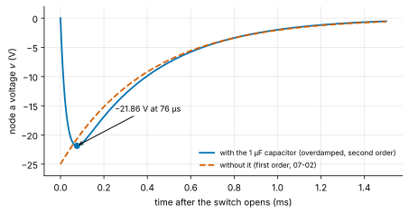
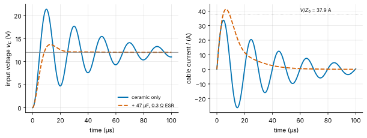
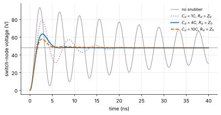

<!-- status: reviewed -->
# 07-03 · Second-Order RLC Transients

| | |
|---|---|
| **Course** | [07 · Circuit Analysis II (Transient and AC)](../README.md) |
| **University equivalent** | The "natural and step responses of RLC circuits" chapter of a sophomore Circuits course (Nilsson & Riedel, *Natural and Step Responses of RLC Circuits*; Alexander & Sadiku, *Second-Order Circuits*), with the state-variable introduction of a first course in linear circuits |
| **Prerequisites** | [07-02 First-Order RC and RL Transients](07-02-first-order-rc-rl-transients.md) (initial–final–τ method, continuity, the $t_0^+$ circuit), [07-01 Capacitors and Inductors](07-01-capacitors-and-inductors.md) (element laws, energy, real components), [02-03 Second-Order Linear ODEs](../../02-complex-numbers-des-and-linear-algebra/chapters/02-03-second-order-linear-odes.md) (characteristic equation, the three cases, step-response specifications), [02-08 Eigenvalues and Eigenvectors](../../02-complex-numbers-des-and-linear-algebra/chapters/02-08-eigenvalues-and-eigenvectors.md) (for §3.8). The facts used from each are restated where they are needed. |
| **Estimated study hours** | 10 |
| **Last verified** | 2026-11-19 |

**Learning objectives.** After this chapter you can:

1. Derive the second-order differential equation of series, parallel and general two-storage-element circuits, including the state-variable form, and read off α, $\omega_0$, ζ, $Q$ and the characteristic impedance $Z_0$.
2. Find the two initial conditions any circuit variable needs, $x(0^+)$ and $dx/dt(0^+)$, from continuity and the $t = 0^+$ circuit, and its final value from the DC circuit.
3. Solve natural and step responses in all three damping cases for any variable, and locate peaks and zero crossings.
4. Read and specify a ringing waveform (overshoot, peak time, ringing frequency, settling, $Q$), and state when the standard formulas apply.
5. Design damping with a series resistance, a parallel resistance or an RC damper (snubber), and explain why circuits of resistors and capacitors alone cannot ring.
6. Recognize ringing in hardware (hot-plug overshoot, switch-node and gate-loop ringing, probe artifacts), estimate it, and evaluate claims about it.

## 1. Big picture

Put a capacitor and an inductor in the same circuit and something new can happen: energy can slosh back and forth between them. The capacitor charges, its voltage pushes current into the inductor, the inductor's current overshoots and charges the capacitor the other way, and the cycle repeats until resistance has turned the energy into heat. That is **ringing**, and 07-02's first-order circuits can never do it. Every real circuit has some inductance and some capacitance, wanted or not, so second-order behavior is everywhere a fast edge meets a wire.

- **Power integrity:** a processor's supply is an inductance (package, board, regulator) feeding a capacitance (decoupling, on-die). A load step makes the rail droop and ring ([02-03](../../02-complex-numbers-des-and-linear-algebra/chapters/02-03-second-order-linear-odes.md) Example 02-03.5, [22](../../22-power-electronics-and-energy-conversion/README.md)).
- **Power conversion:** a switching converter's transistor sees its own output capacitance in a loop with a few nanohenries of layout inductance. Every edge rings, at hundreds of megahertz, and the overshoot sets the transistor's voltage rating ([22-06](../../22-power-electronics-and-energy-conversion/chapters/22-06-converter-losses-and-wide-bandgap.md)).
- **Hot-plugging:** plug a supply cable into a board whose input capacitors are low-loss ceramics, and the input can briefly reach nearly twice the supply voltage (§3.7, Example 07-03.3).
- **Filters and oscillators:** an LC filter is a second-order circuit designed to have a chosen ζ ([07-08](07-08-filters-and-resonance.md)); an oscillator is one whose damping has been driven to zero by an amplifier ([12-09](../../12-electronics-2/chapters/12-09-oscillators.md)).
- **Measurement:** a scope probe's ground lead and the probe's capacitance form a tank that rings on fast edges, so some of the ringing on a screen is made by the measurement itself (§9).

## 2. Intuition first

### A spring and a mass

A capacitor stores energy in its voltage, the way a spring stores energy in its stretch: $\tfrac12Cv^2$ against $\tfrac12k_sx^2$. An inductor stores energy in its current, the way a moving mass stores energy in its velocity: $\tfrac12Li^2$ against $\tfrac12mu^2$. Connect a charged capacitor to an inductor and you have released a stretched spring with a mass on it. The capacitor drives current into the inductor (the spring accelerates the mass); when the capacitor is empty, the inductor's current is at its maximum and keeps flowing (the mass coasts through the rest position); it charges the capacitor the other way (compresses the spring); and the exchange repeats. A resistor is friction: it takes a little energy on every swing.

Two numbers describe the motion, as [02-03](../../02-complex-numbers-des-and-linear-algebra/chapters/02-03-second-order-linear-odes.md) showed: how fast the energy sloshes (the natural frequency $\omega_0 = 1/\sqrt{LC}$) and how much friction there is compared with that speed (the damping ratio ζ). This chapter leans on a third number, which 02-03 met in passing: the **characteristic impedance** $Z_0 = \sqrt{L/C}$, the ratio of peak voltage to peak current while the energy sloshes. A resistor damps the tank when it is comparable to $Z_0$, in the way §3.4 makes precise.

### Series and parallel are mirror images

In a **series** RLC the same current flows through all three elements, and a large series resistance damps the ringing (it is friction on the shared current). In a **parallel** RLC the same voltage appears across all three, and a *small* parallel resistance damps it (it drains the shared voltage). A large parallel resistor barely loads the tank, so a parallel tank with a large resistor rings longest. Swapping series for parallel swaps the roles of $L$ and $C$, of current and voltage, and of $R$ and $1/R$: the **duality** first met in 06-05.

### An analogy from business: hiring against a backlog

A firm hires engineers in proportion to its project backlog. The backlog is the capacitor: it fills with orders and empties as engineers work. The hiring pipeline is the inductor: offers in flight and onboarding give it momentum, so hires keep arriving for months after the decision to hire. When the backlog is large the firm accelerates hiring; by the time the backlog is cleared, the pipeline is still delivering people, so the firm overshoots into overstaffing; it then freezes hiring, attrition shrinks the team, the backlog rebuilds, and the cycle repeats. The damping is how quickly the firm corrects: a firm that watches the pipeline itself (the rate of change), not just the backlog, damps the cycle, which is the role of the resistor in §3.10's damping networks.

*Where the analogy breaks:* a circuit conserves energy exactly, and only its resistors remove it; a firm has no conserved quantity. A hiring pipeline is closer to a fixed delay than to an integrator, and delays make oscillation worse than an inductor would. And managers can look ahead, which no capacitor can.

## 3. Theory

### 3.1 What carries over

> **Recap — second-order equations** ([02-03](../../02-complex-numbers-des-and-linear-algebra/chapters/02-03-second-order-linear-odes.md)).
>
> - **Standard form:** $\ddot{x} + 2\alpha\dot{x} + \omega_0^2x = \omega_0^2X_\infty$, with neper frequency α (1/s), undamped natural frequency $\omega_0$ (rad/s), damping ratio $\zeta = \alpha/\omega_0$ and quality factor $Q = 1/(2\zeta)$. Dots mean $d/dt$.
> - **Characteristic equation:** trying $e^{st}$ in the homogeneous equation gives $s^2 + 2\alpha s + \omega_0^2 = 0$, so $s_{1,2} = -\alpha \pm \sqrt{\alpha^2 - \omega_0^2}$.
> - **Three cases** of the natural (homogeneous) response:
>   - overdamped (ζ > 1): two real roots, $A_1e^{s_1t} + A_2e^{s_2t}$;
>   - critically damped (ζ = 1): a repeated root $-\alpha$, $(B_1 + B_2t)e^{-\alpha t}$;
>   - underdamped (ζ < 1): $e^{-\alpha t}(B_1\cos\omega_dt + B_2\sin\omega_dt)$ with the damped frequency $\omega_d = \sqrt{\omega_0^2 - \alpha^2}$.
> - **Step response from rest,** for an all-pole system (no zeros), underdamped: overshoot $\text{OS} = e^{-\pi\zeta/\sqrt{1 - \zeta^2}}$ at the peak time $t_p = \pi/\omega_d$, settling to ±2% in about $4/(\zeta\omega_0)$. Critical damping is the boundary between ringing and creeping, not the fastest way to settle (Example 02-03.3).

> **Recap — continuity and the $t_0^+$ circuit** ([07-02 §3.5–3.6](07-02-first-order-rc-rl-transients.md#36-the-procedure)). In a circuit whose currents and voltages stay finite, $v_C(t_0^+) = v_C(t_0^-)$ and $i_L(t_0^+) = i_L(t_0^-)$. Other variables at $t_0^+$ come from the $t_0^+$ circuit, in which each capacitor is replaced by a voltage source $v_C(t_0^+)$ and each inductor by a current source $i_L(t_0^+)$. Final values come from the DC circuit, with capacitors open and inductors shorted.

What is new here is the circuit side: turning a schematic into the equation, finding the **two** initial conditions a second-order equation needs, and handling circuits that are not a plain series or parallel loop.

### 3.2 The source-free series RLC

A capacitor charged to $V_0$ is connected at $t = 0$ in a loop with $R$ and $L$ (Figure 1, left). Take the loop current $i$ clockwise, entering the + terminal of each element (passive sign convention). KVL around the loop:

$$
Ri + L\frac{di}{dt} + v_C = 0, \qquad i = C\frac{dv_C}{dt}.
$$

Substituting the second into the first gives one equation in $v_C$:

$$
LC\frac{d^2v_C}{dt^2} + RC\frac{dv_C}{dt} + v_C = 0 \quad\Longrightarrow\quad \frac{d^2v_C}{dt^2} + \frac{R}{L}\frac{dv_C}{dt} + \frac{1}{LC}v_C = 0 .
$$

Differentiating the KVL equation instead, and replacing $dv_C/dt$ by $i/C$, gives the same equation for $i$: $\ddot{i} + (R/L)\dot{i} + i/(LC) = 0$. **Every variable in the circuit obeys the same homogeneous equation**, because each is a linear combination of $v_C$, $i$ and their derivatives. Comparing with the standard form:

$$
\boxed{\,\alpha = \frac{R}{2L}, \qquad \omega_0 = \frac{1}{\sqrt{LC}}\,} \qquad \text{(series RLC)}.
$$

**Units:** $R/L$ is (V/A)/(V·s/A) = 1/s; $LC$ is (V·s/A)(A·s/V) = s², so $1/\sqrt{LC}$ is 1/s ✓.

*Figure 1. Left: the series RLC, one current $i$ through all three elements. Right: the parallel RLC, one voltage $v$ across all three.*

### 3.3 The source-free parallel RLC

Now put $R$, $L$ and $C$ in parallel, sharing the voltage $v$ (Figure 1, right), with the inductor current $i_L$ referenced downward. KCL at the top node, all currents leaving:

$$
\frac{v}{R} + i_L + C\frac{dv}{dt} = 0, \qquad v = L\frac{di_L}{dt}.
$$

Differentiate the KCL equation and replace $di_L/dt$ by $v/L$:

$$
C\frac{d^2v}{dt^2} + \frac{1}{R}\frac{dv}{dt} + \frac{v}{L} = 0 \quad\Longrightarrow\quad \frac{d^2v}{dt^2} + \frac{1}{RC}\frac{dv}{dt} + \frac{1}{LC}v = 0 ,
$$

so

$$
\boxed{\,\alpha = \frac{1}{2RC}, \qquad \omega_0 = \frac{1}{\sqrt{LC}}\,} \qquad \text{(parallel RLC)}.
$$

The natural frequency is the same as in series: it belongs to the $L$–$C$ pair, whatever the resistor does. Only the damping differs. The two derivations are duals, line for line: KVL ↔ KCL, $i$ ↔ $v$, $L$ ↔ $C$, $R$ ↔ $1/R$.

### 3.4 Characteristic impedance, damping and Q

In a lossless tank the energy moves between $\tfrac12Cv^2$ and $\tfrac12Li^2$, so when all of it is in the capacitor ($v = V_{pk}$, $i = 0$) and later all in the inductor ($v = 0$, $i = I_{pk}$),

$$
\tfrac12CV_{pk}^2 = \tfrac12LI_{pk}^2 \quad\Longrightarrow\quad \frac{V_{pk}}{I_{pk}} = \sqrt{\frac{L}{C}} \equiv Z_0 .
$$

$Z_0$, in ohms, is the tank's **characteristic impedance**: the voltage-to-current ratio of the energy that is sloshing. A 1 V swing in a 0.1 Ω tank means 10 A of circulating current; in a 100 Ω tank, 10 mA. With $\omega_0 = 1/\sqrt{LC}$, the two damping ratios become

$$
\zeta_{series} = \frac{\alpha}{\omega_0} = \frac{R}{2L}\sqrt{LC} = \frac{R}{2Z_0}, \qquad \zeta_{parallel} = \frac{1}{2RC}\sqrt{LC} = \frac{Z_0}{2R},
$$

and $Q = 1/(2\zeta)$ is $Z_0/R$ in series and $R/Z_0$ in parallel. So a resistor damps a tank according to how it compares with $Z_0$:

| | Light damping (rings) | Critical damping | Heavy damping (creeps) |
|---|---|---|---|
| Series $R$ | $R \ll 2Z_0$ | $R = 2Z_0$ | $R \gg 2Z_0$ |
| Parallel $R$ | $R \gg Z_0/2$ | $R = Z_0/2$ | $R \ll Z_0/2$ |

This is the single most useful fact for reasoning about ringing in hardware. To know whether a parasitic resistance will tame a parasitic tank, compare it with $\sqrt{L/C}$.

### 3.5 Initial conditions for any variable

A second-order equation needs **two** initial conditions: the value and the slope. Continuity gives the values of $v_C$ and $i_L$ directly. The slopes come from the element laws applied in the $t_0^+$ circuit:

$$
\frac{dv_C}{dt}\bigg|_{0^+} = \frac{i_C(0^+)}{C}, \qquad \frac{di_L}{dt}\bigg|_{0^+} = \frac{v_L(0^+)}{L} .
$$

So the procedure is:

1. **Before the switching event:** usually DC steady state. Find $v_C(0^-)$ and $i_L(0^-)$ with $C$ open and $L$ shorted.
2. **Continuity:** $v_C(0^+) = v_C(0^-)$ and $i_L(0^+) = i_L(0^-)$.
3. **The $0^+$ circuit:** replace $C$ by a voltage source $v_C(0^+)$ and $L$ by a current source $i_L(0^+)$; solve this resistive circuit for $i_C(0^+)$ and $v_L(0^+)$, and for any other variable's value at $0^+$.
4. **Slopes of the state variables:** $i_C(0^+)/C$ and $v_L(0^+)/L$.
5. **Slope of any other variable $x$:** write $x$ in terms of $v_C$, $i_L$ and the (constant) sources, using the resistive circuit, then differentiate. The sources drop out, leaving a combination of the two slopes in step 4.

For example, in a series RLC driven by a constant $V_S$, the resistor voltage is $v_R = Ri_L$, so $\dot v_R(0^+) = R\,v_L(0^+)/L$, with $v_L(0^+) = V_S - Ri_L(0^+) - v_C(0^+)$ from KVL in the $0^+$ circuit.

### 3.6 Step response: the second-order master formulas

With constant sources after $t = 0$, any variable $x$ settles to a constant $x(\infty)$, found from the DC circuit. The deviation $x - x(\infty)$ obeys the homogeneous equation, so

$$
x(t) = x(\infty) + x_n(t),
$$

where $x_n$ is the natural response of §3.1. Its two constants come from the deviation at $0^+$, $D = x(0^+) - x(\infty)$, and the slope $\dot x(0^+)$ (the constant $x(\infty)$ has zero slope). Matching $x_n(0) = D$ and $\dot x_n(0) = \dot x(0^+)$ for each form:

- **Overdamped:** $A_1 + A_2 = D$ and $s_1A_1 + s_2A_2 = \dot x(0^+)$, so
  $$
  A_1 = \frac{\dot x(0^+) - s_2D}{s_1 - s_2}, \qquad A_2 = \frac{s_1D - \dot x(0^+)}{s_1 - s_2} .
  $$

- **Critically damped:** $B_1 = D$ and $-\alpha B_1 + B_2 = \dot x(0^+)$, so $x_n = \big[D + (\dot x(0^+) + \alpha D)\,t\big]e^{-\alpha t}$.
- **Underdamped:** $B_1 = D$ and $-\alpha B_1 + \omega_dB_2 = \dot x(0^+)$, so
  $$
  \boxed{\,x(t) = x(\infty) + e^{-\alpha t}\left(D\cos\omega_dt + \frac{\dot x(0^+) + \alpha D}{\omega_d}\sin\omega_dt\right)\,}
  $$

These play the role of 07-02's initial–final–τ formula. They need three conditions, the same as there: a linear circuit, constant sources after the switching event, and two storage elements (or a set that reduces to two).

**Where the peaks are.** Differentiating the underdamped formula and collecting terms (the $\alpha^2 + \omega_d^2 = \omega_0^2$ identity tidies it):

$$
\dot x(t) = e^{-\alpha t}\left(\dot x(0^+)\cos\omega_dt - \frac{\alpha\,\dot x(0^+) + \omega_0^2D}{\omega_d}\sin\omega_dt\right).
$$

The extremes of $x$ are the zeros of this bracket: $\tan\omega_dt = \omega_d\,\dot x(0^+)/\big(\alpha\,\dot x(0^+) + \omega_0^2D\big)$, repeating every half period $\pi/\omega_d$. Starting from rest ($\dot x(0^+) = 0$), the first one is at $\omega_dt = \pi$, the $t_p$ of 02-03.

> **Math refresher — choosing the right arctangent.** $\tan\theta = y/x$ has a solution in every half-turn. The first positive time is $\theta/\omega_d$ with θ the smallest positive angle whose tangent has the required value: if the ratio is positive, θ lies in $(0, \pi/2)$; if negative, in $(\pi/2, \pi)$, that is $\theta = \pi - \arctan\lvert\text{ratio}\rvert$. Check the sign of $\dot x$ just after $0^+$ to confirm whether the first extreme is a maximum or a minimum.

### 3.7 The series RLC step response, variable by variable

Apply a step $V$ to a series RLC at rest ($v_C(0) = 0$, $i(0) = 0$). The $0^+$ circuit has the capacitor as a 0 V source and the inductor as a 0 A source, so no current flows, $v_R(0^+) = 0$, and the whole step appears across the inductor: $v_L(0^+) = V$. The final values are $v_C(\infty) = V$ (capacitor open) and $i(\infty) = 0$. For the underdamped case:

- **Capacitor voltage:** $D = -V$, $\dot v_C(0^+) = i(0^+)/C = 0$, so
  $$
  v_C(t) = V\left[1 - e^{-\alpha t}\left(\cos\omega_dt + \frac{\alpha}{\omega_d}\sin\omega_dt\right)\right].
  $$
  This is 02-03's all-pole step response: overshoot $\text{OS} = e^{-\pi\zeta/\sqrt{1 - \zeta^2}}$ at $t_p = \pi/\omega_d$.

- **Current:** $D = 0$ and $\dot i(0^+) = v_L(0^+)/L = V/L$, so $i(t) = \dfrac{V}{\omega_dL}e^{-\alpha t}\sin\omega_dt$. Its first peak is where $\tan\omega_dt = \omega_d/\alpha$, that is $\omega_dt = \arccos\zeta$ (because $\cos\theta = \alpha/\omega_0 = \zeta$ for that angle). Substituting, and using $\omega_dL\cdot\omega_0/\omega_d = \omega_0L = Z_0$:
  $$
  \boxed{\,i_{pk} = \frac{V}{Z_0}\exp\!\left(-\frac{\zeta\arccos\zeta}{\sqrt{1 - \zeta^2}}\right) \;\approx\; \frac{V}{Z_0}\ \ \text{for small } \zeta\,}
  $$

- **Inductor voltage:** $v_L = L\,di/dt = Ve^{-\alpha t}\left(\cos\omega_dt - \dfrac{\alpha}{\omega_d}\sin\omega_dt\right)$. It **jumps** to $V$ at $0^+$, then swings negative.
- **Resistor voltage:** $v_R = Ri = \dfrac{2\alpha V}{\omega_d}e^{-\alpha t}\sin\omega_dt$, using $R/L = 2\alpha$.

**KVL check:** $v_R + v_L + v_C = V$ at every instant, since the cosine terms cancel and the sine terms sum to $(2\alpha - \alpha - \alpha)V/\omega_d = 0$ ✓.

Three lessons follow.

1. **Same α and ω₀, different shapes.** All four variables decay at rate α and ring at $\omega_d$, but they start differently, so their peaks and overshoots differ. The overshoot formula belongs to $v_C$ alone here, because $v_C$ is the variable with no zeros in its transfer function (07-04 makes this precise). Applying it to $i$ or $v_L$ is a mistake.
2. **The current scale is $V/Z_0$.** A lightly damped tank hit by a step draws a peak current close to $V/Z_0$, set by the characteristic impedance, not by any resistor. Low-impedance tanks draw large surges.
3. **Up to twice the step.** As ζ → 0, OS → 1 and $v_C$ peaks at nearly $2V$: with $R = 0$, $v_C = V(1 - \cos\omega_0t)$. The energy explains it. When $v_C$ first reaches $V$, the current is at its peak $V/Z_0$, and the inductor holds $\tfrac12L(V/Z_0)^2 = \tfrac12CV^2$. That energy, plus what the source supplies meanwhile, carries the capacitor on to $2V$, where the source has delivered $Q\cdot V = 2CV\cdot V$ in total and the capacitor holds $\tfrac12C(2V)^2 = 2CV^2$ of it. Any capacitor that is switched or plugged onto a source through an inductance and little resistance can see up to twice the source voltage. That is the bound for a **linear** circuit. Class II ceramic capacitors lose much of their capacitance under DC bias (07-01), and with such nonlinear capacitors measured hot-plug peaks have exceeded twice the supply (§9).

### 3.8 General second-order circuits: state variables

Most real circuits are not a plain series or parallel loop: a filter has a source resistance *and* a load, a supply has a regulator resistance *and* decoupling capacitor ESR. The systematic method uses **state variables**, the capacitor voltages and inductor currents, which are exactly the quantities that continuity protects.

1. Choose the state variables: $v_C$ for each capacitor and $i_L$ for each inductor (two of them for a second-order circuit).
2. Replace each capacitor by a voltage source $v_C$ and each inductor by a current source $i_L$. What remains is a resistive circuit.
3. Solve it for each capacitor current $i_C$ and inductor voltage $v_L$ as linear combinations of the state variables and the sources (any method from Course 06).
4. Write the **state equations** $C\,\dot v_C = i_C$ and $L\,\dot i_L = v_L$. With $\mathbf{x} = (x_1, x_2)$ the state vector:
   $$
   \dot{\mathbf{x}} = \mathbf{A}\mathbf{x} + \mathbf{g}\,u, \qquad \mathbf{A} = \begin{pmatrix}a & b\\ c & d\end{pmatrix},
   $$

   where $u$ is the source and the vector $\mathbf{g} = (g_1, g_2)$ says how it enters each equation.

The characteristic equation follows by elimination. If $b \ne 0$, the first equation gives $x_2 = (\dot x_1 - ax_1 - g_1u)/b$; substituting into the second and multiplying by $b$:

$$
\ddot x_1 - (a + d)\,\dot x_1 + (ad - bc)\,x_1 = \text{(constant terms from } u\text{)} .
$$

So the characteristic polynomial is

$$
\boxed{\,s^2 - (\operatorname{tr}\mathbf{A})\,s + \det\mathbf{A} = 0, \qquad 2\alpha = -\operatorname{tr}\mathbf{A}, \qquad \omega_0^2 = \det\mathbf{A}\,}
$$

with $\operatorname{tr}\mathbf{A} = a + d$ and $\det\mathbf{A} = ad - bc$. (If $b = 0$ the equations are triangular and the roots are simply $a$ and $d$.) The roots $s_{1,2}$ are the **eigenvalues** of $\mathbf{A}$, as [02-09](../../02-complex-numbers-des-and-linear-algebra/chapters/02-09-systems-of-odes-and-matrix-exponential.md) showed for any linear system; the circuit's **natural frequencies** are the eigenvalues of its state matrix.

**Check on the series RLC.** With $\mathbf{x} = (v_C, i)$ and a source $V_S$: $C\dot v_C = i$ and $L\dot i = V_S - Ri - v_C$, so $\mathbf{A} = \begin{pmatrix}0 & 1/C\\ -1/L & -R/L\end{pmatrix}$, $\operatorname{tr}\mathbf{A} = -R/L$ and $\det\mathbf{A} = 1/(LC)$: α = $R/(2L)$ and $\omega_0 = 1/\sqrt{LC}$ ✓.

> **Math refresher — trace and determinant of a 2 × 2 matrix** ([02-08](../../02-complex-numbers-des-and-linear-algebra/chapters/02-08-eigenvalues-and-eigenvectors.md)). The eigenvalues $\lambda$ of $\mathbf{A}$ solve $\det(\mathbf{A} - \lambda\mathbf{I}) = (a - \lambda)(d - \lambda) - bc = 0$, that is $\lambda^2 - (a + d)\lambda + (ad - bc) = 0$. So their sum is the trace and their product the determinant. Both roots have negative real parts (the circuit is stable) exactly when $\operatorname{tr}\mathbf{A} < 0$ and $\det\mathbf{A} > 0$.

**Damping adds.** A common case is an LC filter with a series resistance $R_s$ (the inductor's winding resistance plus the source's) feeding a capacitor loaded by $R_L$ (Example 07-03.4). Its state equations give $2\alpha = R_s/L + 1/(R_LC)$ and $\omega_0^2 = (1 + R_s/R_L)/(LC)$. When $R_s \ll R_L$, $\omega_0 \approx 1/\sqrt{LC}$ and

$$
\zeta \approx \frac{R_s}{2Z_0} + \frac{Z_0}{2R_L}:
$$

the series and parallel damping ratios of §3.4 simply add. Each loss mechanism contributes its own share, and a filter whose $Z_0$ is far below its load resistance gets almost nothing from the load.

**Final values** come from $\dot{\mathbf{x}} = 0$: $\mathbf{x}(\infty) = -\mathbf{A}^{-1}\mathbf{g}\,u$, which is the same as solving the DC circuit.

### 3.9 Why resistors and capacitors alone cannot ring

07-02 §3.5 promised that two capacitors that cannot be combined make a second-order circuit. Here is the surprise: such a circuit is always **overdamped**. Take two capacitors joined through resistors, for example the two-section ladder of Example 07-03.6. Nodal analysis at the two capacitor nodes gives state equations of the form

$$
C_1\dot v_1 = -G_{11}v_1 + G_{12}v_2 + (\text{source terms}), \qquad C_2\dot v_2 = G_{12}v_1 - G_{22}v_2 ,
$$

where $G_{12} \ge 0$ is the conductance coupling the two nodes, and it appears in **both** equations because a resistor between two nodes affects both the same way (the nodal conductance matrix of 06-04 is symmetric). So $b = G_{12}/C_1$ and $c = G_{12}/C_2$, and $bc = G_{12}^2/(C_1C_2) \ge 0$. The discriminant of the characteristic equation is

$$
(\operatorname{tr}\mathbf{A})^2 - 4\det\mathbf{A} = (a + d)^2 - 4(ad - bc) = (a - d)^2 + 4bc \;\ge\; 0 ,
$$

so the roots are **real**: no ringing, ever, whatever the values. The same argument covers circuits of resistors and inductors alone. Physically, ringing needs two different kinds of storage to hand energy back and forth; two capacitors can only share charge, which flows downhill.

The conditions matter. The proof assumed the two capacitors are grounded and that their nodes are the only nodes. Neither assumption is essential: eliminating the internal resistor-only nodes (Kron reduction, the same algebra as a Thévenin equivalent) leaves a conductance matrix that is still symmetric, and a floating capacitor makes the capacitance matrix non-diagonal but still symmetric and positive definite; the Going-deeper block below shows that this still forces real roots. What the proof does need is passive resistors, whose coupling is symmetric. A dependent source breaks the symmetry ($G_{12}$ in one equation, something else in the other), and then $bc$ can be negative: active RC filters (Sallen–Key, [07-08](07-08-filters-and-resonance.md)) and RC oscillators ring with no inductor at all.

> **Going deeper — any number of capacitors.** With $n$ capacitors and a passive resistive network, the state equations are $\mathbf{C}\dot{\mathbf{v}} = -\mathbf{G}\mathbf{v} + \ldots$ with $\mathbf{C}$ symmetric and positive definite (diagonal when every capacitor is grounded) and $\mathbf{G}$ symmetric and positive semidefinite (after Kron reduction of the resistor-only nodes). Then $\mathbf{A} = -\mathbf{C}^{-1}\mathbf{G}$ is similar to $-\mathbf{C}^{-1/2}\mathbf{G}\mathbf{C}^{-1/2}$, using the symmetric square root of $\mathbf{C}$, which is symmetric, so all its eigenvalues are real and non-positive ([02-08](../../02-complex-numbers-des-and-linear-algebra/chapters/02-08-eigenvalues-and-eigenvectors.md)). An on-chip wire, modeled as a long RC ladder ([19-05](../../19-digital-vlsi-design/chapters/19-05-interconnect.md)), therefore delays and smears an edge but never rings; once a wire's inductance matters (long, wide, fast package and board traces), it can ring, and it becomes a transmission line ([24-01](../../24-high-speed-io-signal-integrity-and-photonics/chapters/24-01-signal-integrity-fundamentals.md)).

### 3.10 Damping by design

When a tank rings too much, there are four ways to add the missing resistance. Each costs something different.

1. **Series resistance** (ζ = $R/(2Z_0)$): a gate resistor in a transistor's drive loop, a small resistor in a supply line. *Cost:* $I^2R$ loss and a DC drop on every ampere the load draws, and a slower edge.
2. **Parallel resistance** (ζ = $Z_0/(2R)$): a resistor across the tank. *Cost:* it draws $V^2/R$ continuously from a DC rail. With $R$ near $Z_0$, often under 1 Ω on a supply, that is prohibitive.
3. **An RC damper (snubber):** a resistor $R_d$ in series with a capacitor $C_d$, placed across the tank capacitance $C$. The capacitor blocks DC, so nothing flows in steady state. If $C_d$ is several times $C$, its impedance at the ringing frequency is small compared with $R_d$, so the damper looks like a parallel resistance $R_d$ just when it is needed. Choosing $R_d \approx Z_0$ then gives a parallel ζ near $Z_0/(2Z_0) = 0.5$, that is $Q \approx 1$. (Snubber application notes call this "critical damping"; strictly it is about half of critical, which is what you want, as 02-03 Example 02-03.3 showed.) *Cost:* in a circuit that switches, $C_d$ is charged and discharged on every edge. Discharging it dumps its stored $\tfrac12C_dV^2$ in $R_d$; charging it from the supply through resistance loses another $\tfrac12C_dV^2$ (07-02 §3.8), whatever the resistance. So the snubber adds up to $C_dV^2$ of loss per cycle, a power $P = C_dV^2f_{sw}$. If an inductor's current, rather than the supply, charges the node, the charging half is nearly lossless and the cost falls toward $\tfrac12C_dV^2f_{sw}$; vendor notes use both forms (§9). A larger $C_d$ damps better and costs more (Example 07-03.5).
4. **A lossy capacitor as the damper:** a bulk electrolytic or polymer capacitor whose equivalent series resistance (07-01's ESR) is near $Z_0$ is an RC damper in one part. This is a standard cure for hot-plug overshoot (Problem 07-03.11, and the bench results in §9).

The approximations in item 3 are only a starting point: the damper adds a third storage element, so the circuit becomes third order. Example 07-03.5 solves it exactly with the state-variable method, and confirms the rule.

**Measuring a parasitic tank.** A ringing waveform on a scope gives its frequency $f_1 = 1/(2\pi\sqrt{LC})$ but neither $L$ nor $C$. Add a known capacitor $C_a$ across the ringing node and measure the new frequency $f_2$. Since $f \propto 1/\sqrt{C_{total}}$,

$$
\left(\frac{f_1}{f_2}\right)^2 = \frac{C + C_a}{C} \quad\Longrightarrow\quad C = \frac{C_a}{(f_1/f_2)^2 - 1}, \qquad L = \frac{1}{(2\pi f_1)^2C} .
$$

Halving the frequency means $C_a = 3C$. With $L$ and $C$ known, $Z_0 = \sqrt{L/C}$ sizes the damper (Problem 07-03.10). This is the procedure in the snubber application notes cited in §9.

### 3.11 Ringing you did not design

Every switching edge excites some parasitic tank, and §3.4 says what to expect from each: a ringing frequency $1/(2\pi\sqrt{LC})$, a peak deviation up to the size of the step, and a decay set by how the circuit's resistance compares with $Z_0$.

| Tank | $L$ comes from | $C$ comes from | Typical damping |
|---|---|---|---|
| Hot-plugged input | Cable and connector | Ceramic input capacitors | Very light: copper and ceramics have tiny resistance |
| Switch node | Power-loop layout and package | Transistor output capacitance | Light: a few tenths of an ohm against a few ohms of $Z_0$ |
| Gate drive | Driver, package and trace loop | Transistor input capacitance | Set by the gate resistor |
| Supply rail | Package, board and regulator | Decoupling and on-die capacitance | Set by capacitor ESR and regulator output resistance |
| Scope probe | Ground lead | Probe tip and input capacitance | Light, unless the probe adds damping |

Section 9 gives sourced values for several of these.

> **Going deeper — natural frequencies from impedance.** In the Laplace domain of [07-04](07-04-laplace-domain-circuit-analysis.md), an inductor is an impedance $sL$ and a capacitor $1/(sC)$. A source-free series loop can carry a current only at the complex frequencies where its total impedance is zero: $R + sL + 1/(sC) = 0$, which, multiplied by $sC$, is $LCs^2 + RCs + 1 = 0$, the characteristic equation of §3.2. A parallel tank's natural frequencies are where its total admittance vanishes. 07-04 turns this into a method that handles any circuit at once.

## 4. Worked examples

### Example 07-03.1 · Same three parts, two connections (tier A)

**Setup.** An inductor of 100 µH, a capacitor of 1 µF and a resistor of 5 Ω are available. (a) Find $Z_0$, $\omega_0$ and $f_0$. (b) Connected in series, find α, ζ, $Q$, $\omega_d$ and the roots, and classify the response. (c) Connected in parallel, do the same. (d) What resistance would make the series circuit critically damped, and what resistance would give the parallel circuit the series circuit's ζ?

**Solution.**

(a) $Z_0 = \sqrt{10^{-4}/10^{-6}} = $ **10.00 Ω**; $\omega_0 = 1/\sqrt{10^{-4}\times10^{-6}} = $ **100.0 krad/s**, so $f_0 = \omega_0/2\pi = $ **15.92 kHz**.

(b) Series: α = $R/(2L) = 5/(2\times10^{-4}) = $ **25.00 × 10³ s⁻¹**; ζ = $R/(2Z_0) = 5/20 = $ **0.2500**, underdamped; $Q = Z_0/R = $ **2.000**; $\omega_d = \sqrt{\omega_0^2 - \alpha^2} = \sqrt{10^{10} - 6.25\times10^8} = $ **96.82 krad/s**. The roots are $s = -25.00 \pm j96.82$ krad/s.

(c) Parallel: α = $1/(2RC) = 1/(2\times5\times10^{-6}) = $ **100.0 × 10³ s⁻¹** = $\omega_0$, so ζ = $Z_0/(2R) = 10/10 = $ **1.000**: critically damped, with the repeated root $s = -100.0$ krad/s. $Q = R/Z_0 = $ **0.5000**.

(d) Series critical damping needs $R = 2Z_0 = $ **20.00 Ω**. The parallel circuit has ζ = 0.25 when $Z_0/(2R) = 0.25$, so $R = 2Z_0 = $ **20.00 Ω** as well.

**Units check.** $\sqrt{\text{H/F}} = \sqrt{(\text{V·s/A})/(\text{A·s/V})} = \text{V/A} = \Omega$ ✓.
**Sanity check.** In series, 5 Ω is a quarter of the critical 20 Ω, so the tank rings; in parallel, 5 Ω equals the critical $Z_0/2$, so the response is exactly critical. In series a resistor adds friction to the shared current; in parallel it drains the shared voltage, and draining harder takes a *smaller* resistor ✓.

### Example 07-03.2 · Initial conditions and an overdamped release (tier B)

**Setup.** In Figure 2, the switch has been closed for a long time: a 10 V source drives node a through $R_1 = 10$ Ω, and from node a to ground are $L = 10$ mH, $C = 1$ µF and $R_2 = 25$ Ω in parallel. At $t = 0$ the switch opens. Find (a) $i_L(0^+)$, $v(0^+)$ and $dv/dt(0^+)$; (b) α, $\omega_0$, ζ and the roots; (c) $v(t)$; (d) the most negative voltage and when it occurs; (e) the energy dissipated in $R_2$. (f) Compare with the same circuit without the capacitor.

*Figure 2. Example 07-03.2. The inductor current $i_L$ is referenced downward; $v$ is node a's voltage.*

**Solution.**

(a) Before the switch opens, the inductor is a short circuit at DC, so $v(0^-) = 0$, no current flows in $R_2$ or $C$, and $i_L(0^-) = 10/10 = 1.000$ A. Continuity: $i_L(0^+) = $ **1.000 A** and $v(0^+) = v_C(0^+) = $ **0 V**. In the $0^+$ circuit (switch open, inductor a 1 A current source pulling current down out of node a, capacitor a 0 V source), $R_2$ carries no current, so the capacitor must supply the inductor's 1 A: $i_C(0^+) = -1$ A, and $dv/dt(0^+) = i_C(0^+)/C = $ **−1.000 × 10⁶ V/s**, that is −1 V/µs.

(b) With the switch open the circuit is a source-free parallel RLC: α = $1/(2R_2C) = 1/(5\times10^{-5}) = $ **20.00 × 10³ s⁻¹**, $\omega_0 = 1/\sqrt{10^{-2}\times10^{-6}} = $ **10.00 krad/s**, so ζ = **2.000** (equivalently $Z_0 = 100$ Ω and $Z_0/(2R_2) = 2$): overdamped. Roots: $s_{1,2} = -20\,000 \pm \sqrt{4\times10^8 - 10^8} = -20\,000 \pm 17\,321$, so $s_1 = $ **−2.679 × 10³ s⁻¹** and $s_2 = $ **−37.32 × 10³ s⁻¹** (time constants 373.2 µs and 26.79 µs).

(c) Final value $v(\infty) = 0$, so $D = 0$, and the overdamped constants of §3.6 give $A_1 = \dot v(0^+)/(s_1 - s_2) = -10^6/34\,641 = $ **−28.87 V** and $A_2 = -A_1$:

$$
v(t) = 28.87\big(e^{s_2t} - e^{s_1t}\big)\ \text{V}.
$$

(d) The minimum is where $\dot v = 0$: $s_1A_1e^{s_1t} = -s_2A_2e^{s_2t}$, so $e^{(s_1 - s_2)t} = s_2/s_1$ and $t = \ln(s_2/s_1)/(s_1 - s_2) = \ln 13.93/34\,641 = $ **76.03 µs**. There, $v = 28.87\,(e^{-2.837} - e^{-0.2037}) = $ **−21.86 V**.

(e) All of the inductor's energy ends in $R_2$ (the capacitor starts and ends empty): $\tfrac12Li_L^2 = \tfrac12(0.01)(1^2) = $ **5.000 mJ**.

(f) Without the capacitor this is 07-02's inductive kick: node a jumps instantly to $-i_LR_2 = $ **−25.00 V**. The capacitor softens the kick twice over: the voltage starts at zero and falls at a finite 1 V/µs, and it bottoms out at −21.86 V rather than −25 V, because by 76 µs part of the inductor's current has already decayed.

*Figure 3. Example 07-03.2: node a's voltage with the capacitor (overdamped second order) and without it (first order, jumping to −25 V).*

**Units check.** (A)/(F) = A/(A·s/V) = V/s ✓; $\ln$ of a ratio of rates over a rate gives seconds ✓.
**Sanity check.** $s_1s_2 = 10^8 = \omega_0^2$ and $s_1 + s_2 = -40\,000 = -2\alpha$ ✓. The response lasts several slow time constants (about 2 ms), consistent with a heavily damped release ✓.

### Example 07-03.3 · Hot-plugging into ceramic capacitors (tier B)

**Setup.** A 12 V supply is plugged into a board whose input is a 10 µF ceramic capacitor, initially uncharged. The cable and connector add $L = 1$ µH and $R = 50$ mΩ (illustrative values; §9 checks the method against a manufacturer's published bench case). Treat the plug-in as a 12 V step into a series RLC. Find (a) $Z_0$, $f_0$ and ζ; (b) the peak capacitor voltage and when it occurs; (c) the peak current and when it occurs; (d) $v_L(0^+)$; (e) how long the ringing envelope takes to fall to 2% of the step.

**Solution.**

(a) $Z_0 = \sqrt{10^{-6}/10^{-5}} = $ **0.3162 Ω**, $f_0 = 1/(2\pi\sqrt{10^{-11}}) = $ **50.33 kHz**, and ζ = $R/(2Z_0) = 0.05/0.6325 = $ **0.07906**: very lightly damped ($Q = 6.32$).

(b) $v_C$ is the all-pole variable (§3.7), so the 02-03 formulas apply. α = $R/(2L) = 25\,000$ s⁻¹ and $\omega_d = \sqrt{\omega_0^2 - \alpha^2} = 315.2$ krad/s. OS = $e^{-\pi\zeta/\sqrt{1 - \zeta^2}} = e^{-0.2492} = $ **77.95%**, so the input peaks at $12\times1.7795 = $ **21.35 V** at $t_p = \pi/\omega_d = $ **9.966 µs**.

(c) By §3.7, $i_{pk} = (V/Z_0)\exp\big(-\zeta\arccos\zeta/\sqrt{1 - \zeta^2}\big) = 37.95\times e^{-0.1183} = $ **33.71 A**, at $t = \arccos(\zeta)/\omega_d = 1.4917/315\,238 = $ **4.732 µs**.

(d) At $0^+$ no current flows yet, so the full 12 V appears across the cable inductance: $v_L(0^+) = $ **12.00 V**.

(e) The envelope $e^{-\alpha t}$ falls to 2% after $\ln 50/\alpha = 3.912/25\,000 = $ **156.5 µs**, about eight ring cycles.

*Figure 4. Example 07-03.3 (solid): the input overshoots to 21.35 V and rings for about 150 µs; the cable current peaks near V/Z₀. Dashed: the same plug-in with a 47 µF bulk capacitor whose 0.3 Ω ESR damps the tank (Problem 07-03.11).*

**Units check.** V/Ω = A; rad ÷ (rad/s) = s ✓.
**Sanity check.** Peak current is a little below $V/Z_0 = 37.9$ A, as it must be for small ζ; the peak voltage is a little below $2V = 24$ V ✓. The practical meaning: a regulator rated for 20 V absolute maximum, safely below 12 V in steady state, can be destroyed by the act of plugging it in.

### Example 07-03.4 · An LC supply filter by state variables (tier B)

**Setup.** A sensitive circuit's 5 V supply passes through an LC filter (Figure 5): $L = 4.7$ µH with $R_s = 30$ mΩ of winding and source resistance, then $C = 22$ µF to ground, with the load modeled as $R_L$ across $C$. The 5 V supply turns on abruptly with the filter at rest. (a) Write the state equations with $\mathbf{x} = (i_L, v)$ and find α, $\omega_0$ and ζ for $R_L = 10$ Ω. (b) Compare ζ with the "damping adds" approximation and identify which loss dominates. (c) Find the final output voltage and the peak output voltage. (d) Repeat ζ and the peak for a light load, $R_L = 100$ Ω.

*Figure 5. Example 07-03.4: an LC supply filter with series resistance $R_s$ and load $R_L$.*

**Solution.**

(a) Replace $L$ by a current source $i_L$ and $C$ by a voltage source $v$. KVL along the series path gives the inductor voltage, and KCL at the output gives the capacitor current:

$$
L\dot i_L = V_S - R_si_L - v, \qquad C\dot v = i_L - \frac{v}{R_L},
\qquad
\mathbf{A} = \begin{pmatrix}-R_s/L & -1/L\\ 1/C & -1/(R_LC)\end{pmatrix}.
$$

So $2\alpha = -\operatorname{tr}\mathbf{A} = R_s/L + 1/(R_LC) = 6383 + 4545 = 10\,928$ s⁻¹, α = **5464 s⁻¹**, and $\omega_0^2 = \det\mathbf{A} = (1 + R_s/R_L)/(LC)$, so $\omega_0 = $ **98.49 krad/s** ($f_0 = $ **15.68 kHz**). Then ζ = α/$\omega_0$ = **0.05548**.

(b) $Z_0 = \sqrt{L/C} = 0.4622$ Ω. Series share $R_s/(2Z_0) = $ **0.03245**; load share $Z_0/(2R_L) = $ **0.02311**; sum 0.05556, within 0.2% of the exact 0.05548. The 30 mΩ of winding resistance does more damping than the 10 Ω load.

(c) At DC the inductor is a short and the capacitor open: $v(\infty) = 5\times10/10.03 = $ **4.985 V**. The transfer from $V_S$ to $v$ has no zeros (the filter's only path to the output is through $L$ and then $C$), so with the filter starting from rest the 02-03 overshoot applies: OS = $e^{-\pi(0.05548)/\sqrt{1 - 0.05548^2}} = $ **83.98%**, and the peak is $4.985\times1.8398 = $ **9.172 V**.

(d) With $R_L = 100$ Ω the load share falls to 0.0023 and ζ = **0.03476**; the peak is **9.480 V** (OS 89.6%).

**Units check.** $R_s/L$ and $1/(R_LC)$ are both 1/s ✓.
**Sanity check.** A light load barely changes the damping because the load's share was already the smaller one; either way the 5 V rail nearly doubles at turn-on. This is why supplies ramp up slowly (soft start, [22](../../22-power-electronics-and-energy-conversion/README.md)) and why LC filters on rails are given deliberate damping (§3.10) ✓.

### Example 07-03.5 · Taming switch-node ringing with an RC snubber (tier C)

**Setup.** When the top transistor of a 48 V half bridge turns on, the bottom transistor's output capacitance $C = 250$ pF is charged through the power loop's inductance $L = 2$ nH and about $R = 0.1$ Ω of resistance (illustrative values inside the ranges §9 cites). Model the edge as a 48 V step into this series RLC. (a) Find $Z_0$, $f_0$, ζ, the peak voltage and an estimate of the time for the ringing envelope to fall to 5%. (b) An RC snubber $R_d = Z_0$, $C_d = kC$ is placed across $C$. Using the state equations with $\mathbf{x} = (i_L, v_C, v_{C_d})$, the peak voltage for $k$ = 1, 2, 4 and 10 is computed below; find the snubber power for each at a 500 kHz switching frequency. (c) Which $k$ would you choose?

**Solution.**

(a) $Z_0 = \sqrt{2\times10^{-9}/250\times10^{-12}} = \sqrt8 = $ **2.828 Ω**; $f_0 = 1/(2\pi\sqrt{5\times10^{-19}}) = $ **225.1 MHz**; ζ = $0.1/(2\times2.828) = $ **0.01768**. OS = $e^{-\pi(0.01768)} = 94.60\%$, so the node peaks at $48\times1.946 = $ **93.41 V**: nearly twice the bus voltage. The envelope falls to 5% after about $\ln 20/\alpha$ with α = $R/(2L) = 2.5\times10^7$ s⁻¹: **119.8 ns**, about 27 ring cycles.

(b) With the snubber, write KVL for the loop and KCL at the switch node and at the snubber's internal node:

$$
L\dot i_L = V - Ri_L - v_C, \qquad C\dot v_C = i_L - \frac{v_C - v_{C_d}}{R_d}, \qquad C_d\dot v_{C_d} = \frac{v_C - v_{C_d}}{R_d}.
$$

This is third order, so it is solved numerically (the lab notebook does it; ngspice confirms it). The snubber loses $C_dV^2$ per switching cycle (07-02 §3.8: charging and discharging $C_d$ through $R_d$ each dissipate $\tfrac12C_dV^2$), so $P = kCV^2f_{sw} = k\times250\text{ pF}\times(48\text{ V})^2\times500\text{ kHz} = k\times0.288$ W.

| $C_d/C$ | Peak $v_C$ | Settles within ±5% after | Snubber power |
|---|---|---|---|
| none | 93.41 V | about 120 ns | 0 |
| 1 | 79.06 V | 15.2 ns | 0.288 W |
| 2 | 70.76 V | 7.6 ns | 0.576 W |
| 4 | 63.67 V | 5.1 ns | 1.152 W |
| 10 | 57.95 V | 4.5 ns | 2.880 W |

For $k = 4$ the oscillatory pair of natural frequencies has ζ = **0.553** at **158.9 MHz**: the snubber has turned a $Q$ of 28 into a $Q$ near 1. The peak still overshoots by 33%, more than ζ = 0.55 would suggest for a two-pole system, because the third natural frequency and the snubber's own path change the shape (the 02-03 overshoot formula does not apply to this third-order circuit).

(c) Settling improves dramatically up to $k \approx 3$–4 and hardly at all beyond; the peak keeps falling slowly, but the power rises in proportion to $k$. $k = 4$ (a 1 nF, 2.8 Ω snubber, about 1.15 W) is a sensible choice, and is the usual rule of thumb ($R_d \approx Z_0$, $C_d$ three to four times the parasitic capacitance).

**Units check.** F·V²·Hz = (C/V)·V²·(1/s) = C·V/s = J/s = W ✓.
**Sanity check.** A 1.15 W snubber in a converter that might deliver a few hundred watts is acceptable; at 400 V the same design would cost about 70 times more, which is why high-voltage converters use other means (soft switching, clamps) to manage ringing ([22](../../22-power-electronics-and-energy-conversion/README.md)) ✓.

*Figure 6. Example 07-03.5: the switch node with no snubber and with $C_d$ = C, 4C and 10C ($R_d = Z_0$).*

### Example 07-03.6 · Two RC sections cannot ring (tier B)

**Setup.** A step of 1 V drives a two-section RC ladder: $R_1 = 1$ kΩ to node 1, $C_1 = 1$ µF from node 1 to ground, $R_2 = 1$ kΩ from node 1 to node 2, and $C_2 = 1$ µF from node 2 to ground, starting at rest. (a) Write the state matrix and find the roots and ζ. (b) Show that the sum of the two time constants equals $R_1(C_1 + C_2) + R_2C_2$. (c) Find the time at which $v_2$ reaches 50%, and compare it with two *buffered* sections (each τ = 1 ms, isolated by a unity-gain amplifier).

**Solution.**

(a) KCL at the two nodes:

$$
C_1\dot v_1 = \frac{V - v_1}{R_1} - \frac{v_1 - v_2}{R_2}, \qquad C_2\dot v_2 = \frac{v_1 - v_2}{R_2},
\qquad
\mathbf{A} = \begin{pmatrix}-2000 & 1000\\ 1000 & -1000\end{pmatrix}\ \text{s}^{-1}.
$$

$\operatorname{tr}\mathbf{A} = -3000$ s⁻¹ and $\det\mathbf{A} = 2\times10^6 - 10^6 = 10^6$ s⁻², so α = 1500 s⁻¹, $\omega_0 = 1000$ s⁻¹ and ζ = **1.500**. The discriminant is $(a - d)^2 + 4bc = 10^6 + 4\times10^6 = 5\times10^6 > 0$, so the roots are real: $s = (-3000 \pm 2236)/2$, that is $s_1 = $ **−382.0 s⁻¹** and $s_2 = $ **−2618 s⁻¹**.

(b) The time constants are $-1/s_1 = 2.618$ ms and $-1/s_2 = 0.3820$ ms, summing to **3.000 ms**. Algebraically, $-1/s_1 - 1/s_2 = -(s_1 + s_2)/(s_1s_2) = -\operatorname{tr}\mathbf{A}/\det\mathbf{A} = 3000/10^6$ s, and $R_1(C_1 + C_2) + R_2C_2 = 2 + 1 = 3$ ms ✓. This sum is the **Elmore delay** that 19-05 uses to estimate wire delay.

(c) $v_2$ is all-pole (from rest, $D = -1$ V and $\dot v_2(0^+) = 0$), so the overdamped step response of 02-03 applies: $v_2 = 1 + (s_2e^{s_1t} - s_1e^{s_2t})/(s_1 - s_2)$. Solving $v_2 = 0.5$ numerically gives **2.225 ms**. Two buffered sections give a critically damped response, $1 - (1 + t/\tau)e^{-t/\tau}$, which reaches 50% at **1.678 ms**. Loading the first section with the second slows the ladder by a third. The Elmore estimate $\ln2\times3\text{ ms} = 2.079$ ms is within 7% of the true 2.225 ms.

**Units check.** (1/Ω)/F = 1/(Ω·F) = 1/s ✓.
**Sanity check.** ζ = 1.5 > 1, as §3.9 guarantees for any RC ladder; $v_2$ creeps to 1 V without overshoot ✓.

<!-- answer-key -->
| ID | Quantity | Value | Unit |
|---|---|---|---|
| Ex 07-03.1a | $Z_0$ | 10.00 | Ω |
| Ex 07-03.1b | $\omega_0$ | 100.0 | krad/s |
| Ex 07-03.1c | $f_0$ | 15.92 | kHz |
| Ex 07-03.1d | series α | 25.00 | 10³ s⁻¹ |
| Ex 07-03.1e | series ζ | 0.2500 | — |
| Ex 07-03.1f | series $Q$ | 2.000 | — |
| Ex 07-03.1g | series $\omega_d$ | 96.82 | krad/s |
| Ex 07-03.1h | parallel α | 100.0 | 10³ s⁻¹ |
| Ex 07-03.1i | parallel ζ | 1.000 | — |
| Ex 07-03.1j | parallel $Q$ | 0.5000 | — |
| Ex 07-03.1k | series R for critical damping | 20.00 | Ω |
| Ex 07-03.1l | parallel R for ζ = 0.25 | 20.00 | Ω |
| Ex 07-03.2a | $i_L(0^+)$ | 1.000 | A |
| Ex 07-03.2b | $dv/dt(0^+)$ | −1.000 | 10⁶ V/s |
| Ex 07-03.2c | α | 20.00 | 10³ s⁻¹ |
| Ex 07-03.2d | $\omega_0$ | 10.00 | krad/s |
| Ex 07-03.2e | ζ | 2.000 | — |
| Ex 07-03.2f | $s_1$ | −2.679 | 10³ s⁻¹ |
| Ex 07-03.2g | $s_2$ | −37.32 | 10³ s⁻¹ |
| Ex 07-03.2h | $A_1$ | −28.87 | V |
| Ex 07-03.2i | time of the minimum | 76.03 | µs |
| Ex 07-03.2j | minimum voltage | −21.86 | V |
| Ex 07-03.2k | energy dissipated in $R_2$ | 5.000 | mJ |
| Ex 07-03.2l | kick without the capacitor | −25.00 | V |
| Ex 07-03.3a | $Z_0$ | 0.3162 | Ω |
| Ex 07-03.3b | $f_0$ | 50.33 | kHz |
| Ex 07-03.3c | ζ | 0.07906 | — |
| Ex 07-03.3d | overshoot | 77.95 | % |
| Ex 07-03.3e | peak capacitor voltage | 21.35 | V |
| Ex 07-03.3f | time of the voltage peak | 9.966 | µs |
| Ex 07-03.3g | peak current | 33.71 | A |
| Ex 07-03.3h | time of the current peak | 4.732 | µs |
| Ex 07-03.3i | $v_L(0^+)$ | 12.00 | V |
| Ex 07-03.3j | envelope to 2 % | 156.5 | µs |
| Ex 07-03.4a | α, 10 Ω load | 5464 | s⁻¹ |
| Ex 07-03.4b | $\omega_0$, 10 Ω load | 98.49 | krad/s |
| Ex 07-03.4c | $f_0$, 10 Ω load | 15.68 | kHz |
| Ex 07-03.4d | ζ, 10 Ω load | 0.05548 | — |
| Ex 07-03.4e | series share of ζ | 0.03245 | — |
| Ex 07-03.4f | load share of ζ, 10 Ω | 0.02311 | — |
| Ex 07-03.4g | final output voltage | 4.985 | V |
| Ex 07-03.4h | overshoot, 10 Ω load | 83.98 | % |
| Ex 07-03.4i | peak output, 10 Ω load | 9.172 | V |
| Ex 07-03.4j | ζ, 100 Ω load | 0.03476 | — |
| Ex 07-03.4k | peak output, 100 Ω load | 9.480 | V |
| Ex 07-03.5a | $Z_0$ | 2.828 | Ω |
| Ex 07-03.5b | $f_0$ | 225.1 | MHz |
| Ex 07-03.5c | ζ without snubber | 0.01768 | — |
| Ex 07-03.5d | peak without snubber | 93.41 | V |
| Ex 07-03.5e | envelope to 5 % without snubber | 119.8 | ns |
| Ex 07-03.5f | peak, $C_d = C$ | 79.06 | V |
| Ex 07-03.5g | peak, $C_d = 2C$ | 70.76 | V |
| Ex 07-03.5h | peak, $C_d = 4C$ | 63.67 | V |
| Ex 07-03.5i | peak, $C_d = 10C$ | 57.95 | V |
| Ex 07-03.5j | settling to ±5 %, $C_d = C$ | 15.2 | ns |
| Ex 07-03.5k | settling to ±5 %, $C_d = 2C$ | 7.6 | ns |
| Ex 07-03.5l | settling to ±5 %, $C_d = 4C$ | 5.1 | ns |
| Ex 07-03.5m | settling to ±5 %, $C_d = 10C$ | 4.5 | ns |
| Ex 07-03.5n | snubber power per unit $k$ | 0.288 | W |
| Ex 07-03.5o | snubber power, $C_d = 4C$ | 1.152 | W |
| Ex 07-03.5p | ζ of the ringing pair, $C_d = 4C$ | 0.553 | — |
| Ex 07-03.5q | ringing frequency, $C_d = 4C$ | 158.9 | MHz |
| Ex 07-03.6a | ζ | 1.500 | — |
| Ex 07-03.6b | $s_1$ | −382.0 | s⁻¹ |
| Ex 07-03.6c | $s_2$ | −2618 | s⁻¹ |
| Ex 07-03.6d | sum of time constants | 3.000 | ms |
| Ex 07-03.6e | 50 % time, loaded ladder | 2.225 | ms |
| Ex 07-03.6f | 50 % time, buffered sections | 1.678 | ms |
| Ex 07-03.6g | Elmore estimate of the 50 % time | 2.079 | ms |

*Every value in this table is recomputed by [verify_07_03.py](../verify/verify_07_03.py), most by integrating the circuit's state equations numerically; the circuit results are also confirmed by ngspice netlists in [labs/07-03-lab](../labs/07-03-lab/README.md).*

## 5. Simulate it

The lab is in [labs/07-03-lab/](../labs/07-03-lab/README.md).

**Notebook** (`07-03-rlc.ipynb`):

1. Sweep the series resistance of one tank through all three damping cases and watch the roots move.
2. Plot every variable of a series RLC step response and confirm that only $v_C$ obeys the overshoot formula.
3. Build any circuit's state matrix and simulate it (Examples 07-03.4 to 07-03.6).
4. Design the hot-plug damper of Problem 07-03.11 and the switch-node snubber of Example 07-03.5.

**ngspice netlists** confirm Examples 07-03.2 to 07-03.6 and Problems 07-03.4, 07-03.6, 07-03.7, 07-03.8, 07-03.11, 07-03.12, 07-03.13, 07-03.14 and 07-03.16; `python tools/run_spice.py 07-03` checks them all.

**Guided exercise (predict, then run).** In the hot-plug cell, double the cable length (so $L$ = 2 µH, $R$ = 0.1 Ω). **Before running,** predict $Z_0$, ζ, the peak voltage and the peak current. Hint: work out first how $Z_0 = \sqrt{L/C}$ and ζ = $R/(2Z_0)$ scale when $L$ and $R$ both double. Then run it and compare (the lab handout's answer key has the values).

## 6. Engineering tradeoffs

| Knob | Improves | Costs | Typical decision owner |
|---|---|---|---|
| Larger series (gate) resistance | Less overshoot and ringing on the gate or line | Slower edges, more switching loss, $I^2R$ loss | Power-stage or board designer |
| RC snubber across a ringing switch | Lower peak voltage, fast settling, less EMI | $C_dV^2f$ loss, board area, heat | Power-electronics designer |
| Lower loop inductance (tight layout, better package) | Higher $f_0$, lower $Z_0$ and less energy in the ring | Layout effort, more expensive packages, sometimes harder cooling | Layout engineer, package team |
| Lossy bulk capacitor across a ceramic bank | Damps hot-plug and rail resonances with no DC loss | Board area, height, cost; lifetime limits of electrolytics | Board designer |
| Target ζ of a filter or loop (0.5–0.8 vs 1) | Faster settling with slight overshoot | Overshoot that downstream parts must tolerate | System or control designer |
| Soft start (ramped turn-on) | Removes turn-on overshoot of LC filters | Slower power-up; sequencing logic | Power or system architect |
| Probe with a short ground spring instead of a long lead | Shows the circuit's ringing, not the probe's | Less convenient probing; needs pads designed in | Validation engineer |

## 7. Numbers to know

| Quantity | Value | Note |
|---|---|---|
| Overshoot of an all-pole step response | 72.9% (ζ = 0.1), 44.4% (0.25), 16.3% (0.5), 4.3% (0.707), 0 (ζ ≥ 1) | $e^{-\pi\zeta/\sqrt{1 - \zeta^2}}$ |
| Peak of a linear series RLC step, $v_C$ | at most $2V$ | Lossless limit |
| Peak current of a lightly damped series RLC step | about $V/Z_0$ | §3.7 |
| Damping resistor | $R \approx Z_0 = \sqrt{L/C}$; critical damping at $2Z_0$ (series) or $Z_0/2$ (parallel) | §3.4, §3.10 |
| RC snubber capacitor | 2–4 × the parasitic capacitance, 3× near optimal | Todd (Unitrode, 1993), [R-113](../../../reference/research-log.md#r-113--rc-snubbers-and-gate-drive-damping) **[Established]** |
| Hot-plug peaks, bench | 30 V supply, 0.5 µH, 1 µF ceramic: 54 V (onsemi); 24 V through 6 ft of 24-gauge pair into 4.7 µF: 50 V and 26 A (LT3684 datasheet) | [R-112](../../../reference/research-log.md#r-112--hot-plug-overshoot-with-ceramic-input-capacitors) **[Established]** |
| Short cable | 12 in of 18 AWG with the supply: about 500 nH and 120 mΩ | onsemi AND90059, [R-112](../../../reference/research-log.md#r-112--hot-plug-overshoot-with-ceramic-input-capacitors) **[Established]** |
| Probe ground lead | about 150 nH for a 6-inch lead (Tektronix); about 20 nH per inch (Teledyne LeCroy); ground spring 10–20 nH | [R-114](../../../reference/research-log.md#r-114--oscilloscope-probe-ground-lead-ringing) **[Industry estimate]** |
| Probe ringing with a 6-inch lead and about 11 pF | about 125–140 MHz | [R-114](../../../reference/research-log.md#r-114--oscilloscope-probe-ground-lead-ringing) |
| GaN power-loop inductance | about 0.4 nH (EPC, optimized layout) to about 2.5 nH (TI layout example) | [R-115](../../../reference/research-log.md#r-115--gan-power-loop-inductance-switching-speed-and-output-capacitance) **[Industry estimate]** |
| GaN output capacitance | EPC2045: 295 pF typ at 50 V; LMG342xR030: 170 pF typ at 400 V | Datasheets, [R-115](../../../reference/research-log.md#r-115--gan-power-loop-inductance-switching-speed-and-output-capacitance) **[Established]** |
| GaN switching speed | 60 V/ns (EPC2045 buck example); 20–150 V/ns adjustable (LMG342xR030) | [R-115](../../../reference/research-log.md#r-115--gan-power-loop-inductance-switching-speed-and-output-capacitance) |
| Decoupling capacitor ESL | 0.5–1 nH (TI, mid-frequency capacitors) | [R-116](../../../reference/research-log.md#r-116--pdn-target-impedance-in-vendor-practice) **[Established]** |

<!-- answer-key -->
| ID | Quantity | Value | Unit |
|---|---|---|---|
| N 07-03.a | overshoot at ζ = 0.1 | 72.9 | % |
| N 07-03.b | overshoot at ζ = 0.25 | 44.4 | % |
| N 07-03.c | overshoot at ζ = 0.5 | 16.3 | % |
| N 07-03.d | overshoot at ζ = 0.707 | 4.3 | % |
| N 07-03.e | probe ring, 150 nH and 10.8 pF | 125.0 | MHz |

## 8. Common mistakes

1. **Using only one initial condition.** A second-order response needs $x(0^+)$ *and* $\dot x(0^+)$; the slope comes from the $0^+$ circuit through $i_C/C$ or $v_L/L$.
2. **Mixing up series and parallel damping.** α is $R/(2L)$ in series and $1/(2RC)$ in parallel; a *larger* parallel resistor means *less* damping.
3. **Applying the overshoot formula to the wrong variable.** It holds for an all-pole variable responding to a step from rest (the capacitor voltage of a series RLC, the inductor current of a parallel RLC); currents, inductor voltages and variables with zeros have different peaks (§3.7, Problem 07-03.8).
4. **Forgetting that every variable shares α and ω₀.** The roots belong to the circuit, not to the variable you happen to solve for; only the constants change.
5. **Expecting an RC circuit to ring.** Passive RC and RL circuits are always overdamped; ringing on an "RC" net means there is inductance (or an active element) you have not modeled.
6. **Taking the measured ringing at face value.** A long probe ground lead forms its own tank; check with a short ground spring before redesigning the circuit.
7. **Sizing a snubber without counting its power.** $C_dV^2f_{sw}$ is dissipated whatever $R_d$ is.
8. **Choosing the wrong arctangent branch** when locating a peak (§3.6 refresher).

## 9. Practitioner lens

### State of the art (as of Nov 2026)

- **Hot-plug overshoot is a documented field failure, and vendors publish the RLC model.**
  - Linear Technology's datasheets warn that a ceramic input capacitor and the supply lead's inductance form "an under damped tank circuit" that "can ring to twice the nominal input voltage". The LT3684 datasheet shows a 24 V supply on six feet of 24-gauge twisted pair ringing a 4.7 µF input to 50 V with a 26 A current peak, cured by 0.7 Ω in series with the input ([R-112](../../../reference/research-log.md#r-112--hot-plug-overshoot-with-ceramic-input-capacitors)) **[Established]**.
  - LT engineer Goran Perica measured a 24 V laptop adapter driving a 10 µF ceramic input to 57.2 V. He found that Y5V ceramics, which lose most of their capacitance under bias, pushed the peak to three times the input: the linear 2× bound is not a worst case for real ceramics. Of the fixes he compared, a 47 µF aluminum electrolytic with 0.44 Ω of ESR gave the lowest peak, 25 V from 24 V (EDN, 2001, the magazine version of LT Application Note 88) **[Established]**. The article gives the adapter's inductance only as a range, 1–10 µH, so with the 22 µF ceramic the tank's $Z_0 = \sqrt{L/C}$ lies between **0.2132 Ω** and **0.6742 Ω** (our arithmetic). The winning 0.44 Ω falls inside that range: §3.10's lossy-capacitor damper, with its ESR of the order of $Z_0$.
  - onsemi's eFuse note AND90059 (2021) models a hot plug as exactly this chapter's series RLC and tabulates 27 cases at 30 V; TI's SLUAAL8 (2023) gives the damping condition as total series resistance above $2\sqrt{L/C}$ and recommends a 2 Ω, 2.2 µF RC snubber at the input ([R-112](../../../reference/research-log.md#r-112--hot-plug-overshoot-with-ceramic-input-capacitors)) **[Established]**.
  - **Check the method against the bench.** onsemi's case 1 is 30 V, 0.1 Ω, 0.5 µH and 1 µF. §3.4 and §3.7 give $Z_0 = 0.7071$ Ω, ζ = 0.07071, a peak of **54.01 V** and a peak current of **38.15 A**; onsemi reports 54 V and 38 A. Its case 7 (5 µH) gives **57.96 V** and **12.96 A** against the table's 58 V and 13 A.
- **Fast switches ring with their layout.** EPC reports that cutting a GaN buck's power-loop inductance from about 1.6 nH to 0.4 nH reduced switch-node overshoot from 100% to 30% of a 12 V input, and that raising it from 0.4 nH to 2.9 nH cost over 4% efficiency ([R-115](../../../reference/research-log.md#r-115--gan-power-loop-inductance-switching-speed-and-output-capacitance)) **[Industry estimate]** (one vendor's boards). TI's 600 V GaN datasheet estimates loop inductance from the ringing frequency, $L = 1/(4\pi^2f^2C)$, exactly §3.10's method, and quotes about 2.5 nH for its layout example; with its 170 pF typical output capacitance that rings near **244 MHz** (our arithmetic) **[Established]** (for the datasheet values).
- **Snubber design is a 30-year-old recipe.** Todd's 1993 Unitrode seminar paper sets the snubber resistor equal to $\sqrt{L/C}$ of the parasitic tank and the capacitor at two to four times the switch's output capacitance, with three times "near optimum", found by adding capacitance until the ringing frequency halves. His example (2 µH of leakage inductance with 330 pF) gives $Z_0$ = **77.85 Ω**, and its 1000 pF snubber at 400 V and 100 kHz dissipates **16.0 W**. TI's SLVA255 (2006) applies the same procedure to a boost converter: 217 MHz ringing, halved by 300 pF, so 100 pF and 5.4 nH, and a 7.3 Ω resistor rounded to 10 Ω ([R-113](../../../reference/research-log.md#r-113--rc-snubbers-and-gate-drive-damping)) **[Established]**.
  - **[Contested] wording and formulas.** Both notes call the result "critically damped"; strictly, $R_d = Z_0$ with $C_d = 3$–$4C$ gives ζ ≈ 0.5 (Example 07-03.5). Todd counts the snubber loss as $fCV^2$, SLVA255 as $\tfrac12CV^2f$; §3.10 shows that both are right for different charging conditions.
- **Gate drive uses the same rule.** TI's gate-drive guide models the driver, gate resistance, source inductance and input capacitance as a series RLC and gives the optimum external gate resistor as $2\sqrt{L_S/C_{ISS}}$ minus the driver and internal gate resistances: critical damping by §3.4 ([R-113](../../../reference/research-log.md#r-113--rc-snubbers-and-gate-drive-damping)) **[Established]**. Its $L_S$ is the inductance that resonates with $C_{ISS}$ in the gate-drive loop, which in practice is estimated from the observed ringing frequency (Problem 07-03.12).
- **The probe is a tank too.** Tektronix's probe primer explains that the ground lead's inductance and the probe's input capacitance form a series resonant circuit, and that an 11 pF probe with a 6-inch ground lead rings at about 140 MHz, which on a 100 MHz scope "may not be seen at all" but on a 200 MHz one "will be apparent". Its advice: if the ringing frequency changes when the ground lead is shortened, the ringing is the probe's ([R-114](../../../reference/research-log.md#r-114--oscilloscope-probe-ground-lead-ringing)) **[Established]**.

<!-- answer-key -->
| ID | Quantity | Value | Unit |
|---|---|---|---|
| PL 07-03.a | $Z_0$ for 1 µH and 22 µF | 0.2132 | Ω |
| PL 07-03.a2 | $Z_0$ for 10 µH and 22 µF | 0.6742 | Ω |
| PL 07-03.b | onsemi case 1: $Z_0$ | 0.7071 | Ω |
| PL 07-03.c | onsemi case 1: ζ | 0.07071 | — |
| PL 07-03.d | onsemi case 1: peak voltage | 54.01 | V |
| PL 07-03.e | onsemi case 1: peak current | 38.15 | A |
| PL 07-03.f | onsemi case 7: peak voltage | 57.96 | V |
| PL 07-03.g | onsemi case 7: peak current | 12.96 | A |
| PL 07-03.h | ring with 2.5 nH and 170 pF | 244 | MHz |
| PL 07-03.i | Todd's tank $Z_0$ | 77.85 | Ω |
| PL 07-03.j | Todd's snubber power | 16.0 | W |

### Why it matters commercially

- **Voltage ratings cost money.** Every overshoot volt must be covered by the transistor's or regulator's rating. A part rated for 2× the bus is larger, slower and costlier than one rated for 1.3×, so layout and damping that cut overshoot buy cheaper silicon or more margin.
- **GaN's value depends on the layout.** A wide-bandgap transistor's speed advantage is real only if the loop inductance is low enough to keep the ringing tolerable; otherwise the edge must be slowed with gate resistance or the energy burned in snubbers, giving back efficiency (EPC's 4%). Reference designs and layout support are part of what a GaN vendor sells.
- **Hot-plug failures are field returns.** They occur at the customer's outlet, not on the test bench, so they show up as warranty costs and reputation damage. The cure (an electrolytic, an RC damper, a TVS) costs cents if it is designed in.
- **Measurement artifacts cost engineering time.** Teams that chase "ringing" created by a probe's ground lead lose days; teams that know §3.11's table check the probe first.

### Marketing vs Reality

- **"Our GaN switch slews at 100+ V/ns."** *Reality:* the faster the edge, the harder it excites the power-loop tank. The usable edge rate is set by the layout's loop inductance, the snubbing and the gate resistance chosen to tame the overshoot. *Sanity check:* ask for the measured switch-node overshoot in the reference layout, and how it was probed.
- **"All-ceramic input capacitors: no wear-out, higher reliability."** *Reality:* true for wear-out, but low-ESR ceramics remove the damping an electrolytic used to provide, and hot-plugging can then ring the input to about twice the supply, or more with Y5V-type dielectrics. *Sanity check:* ask for hot-plug test results with the longest specified cable and the highest supply voltage.
- **"Clean edges, no ringing" (a scope screenshot).** *Reality:* a 100 MHz scope cannot show 200 MHz ringing, and a long ground lead adds its own. *Sanity check:* ask for the scope and probe bandwidth, the grounding method (spring or tip-and-barrel), and whether the ringing frequency was checked against the ground-lead length.
- **"Critically damped snubber."** *Reality:* usually a snubber with $R \approx Z_0$, giving ζ ≈ 0.5 and some overshoot, which is the right engineering choice. *Sanity check:* ask for the measured peak and the snubber's loss.

### Questions for engineering leaders

1. **"What is the worst-case switch-node overshoot, and what margin does it leave to the device rating?"**
   - *Strong:* a measured peak with a stated probing method and bandwidth, the loop inductance inferred from the ringing frequency, and the margin across temperature and load.
   - *Evasive:* "simulation shows no overshoot" or "the device is rated well above the bus".
2. **"Have you hot-plug tested the product with the longest cable and the worst supply?"**
   - *Strong:* a test matrix (cable lengths, supplies, temperatures), measured peaks, and the damping network chosen.
   - *Evasive:* "we use a regulator rated at twice the input".
3. **"How much of your efficiency budget goes into snubbers and gate resistance?"**
   - *Strong:* a loss breakdown with $C_dV^2f$ per snubber and the switching-loss cost of slower edges, with layout changes considered first.
   - *Evasive:* the efficiency number with no breakdown.
4. **"What damping do your LC filters and power rails have at light load, and how do you prevent turn-on overshoot?"**
   - *Strong:* an estimated ζ, a damping network or lossy capacitor, and soft-start.
   - *Evasive:* "the load damps it" (Example 07-03.4 shows why it often does not).
5. **"How do you choose gate resistance?"**
   - *Strong:* from the gate loop's inductance and input capacitance (critical damping as a starting point), then tuned for overshoot, EMI and switching loss on hardware.
   - *Evasive:* "we use the value from the evaluation board".

## 10. Concept check

**Q1.** A series RLC and a parallel RLC use the same $L$ and $C$. Which property do they share, and which differs?

Answer

They share $\omega_0 = 1/\sqrt{LC}$ and $Z_0 = \sqrt{L/C}$, which belong to the L–C pair. The damping differs: α = $R/(2L)$ in series and $1/(2RC)$ in parallel, so the same resistor can make one circuit ring and the other critically damped (Example 07-03.1).

**Q2.** Why does a second-order transient need $\dot x(0^+)$ as well as $x(0^+)$, and where does it come from?

Answer

The natural response has two free constants, so two conditions are needed. Continuity gives the values of $v_C$ and $i_L$; their slopes are $i_C(0^+)/C$ and $v_L(0^+)/L$, found from the $0^+$ circuit, and the slopes of other variables follow by differentiating their expressions in terms of $v_C$ and $i_L$.

**Q3.** A 12 V adapter is plugged into a board with only ceramic input capacitors. Roughly how high can the input voltage go, and why?

Answer

Up to nearly 24 V. The cable inductance and the capacitors form a lightly damped series RLC; the step response of the capacitor voltage overshoots by almost 100% when ζ is small, because the energy in the cable inductance carries the capacitor past the supply voltage.

**Q4.** What is the characteristic impedance of a tank, and why is it the right yardstick for damping resistors?

Answer

$Z_0 = \sqrt{L/C}$, the ratio of peak voltage to peak current while the energy sloshes between $C$ and $L$. A series resistor damps the tank in proportion to $R/Z_0$ (ζ = $R/2Z_0$) and a parallel resistor in proportion to $Z_0/R$ (ζ = $Z_0/2R$).

**Q5.** Two RC low-pass sections are cascaded without a buffer. Can the output overshoot a step?

Answer

No. For any passive RC network the state matrix has real eigenvalues (§3.9), so the response is a sum of decaying exponentials, overdamped, with no ringing; with only two capacitors, the discriminant $(a - d)^2 + 4bc$ is never negative.

**Q6.** An RC snubber across a ringing switch damps it well. Why not make the snubber capacitor ten times larger still?

Answer

Beyond about three to four times the parasitic capacitance the damping barely improves, while the snubber's loss, $C_dV^2f_{sw}$, keeps rising in proportion to $C_d$ (Example 07-03.5).

**Q7.** In a series RLC step response, which variable jumps at $t = 0^+$, and to what value?

Answer

The inductor voltage jumps to the full step $V$, because the current (and so $v_R$) and the capacitor voltage are both still zero. The capacitor voltage and the current start smoothly.

**Q8.** Adding a 300 pF capacitor across a node halves its ringing frequency. What was the node's capacitance?

Answer

100 pF. Halving $f$ means quadrupling the total capacitance, so $C + 300 = 4C$.

Now work the full problem set: [07-03 problems](../problems/07-03-problems.md) (worked solutions in [07-03 solutions](../solutions/07-03-solutions.md)).

## 11. Key terms

[Second-order circuit](../../../reference/glossary.md#second-order-circuit) ·
[Characteristic equation](../../../reference/glossary.md#characteristic-equation) ·
[Neper frequency](../../../reference/glossary.md#neper-frequency) ·
[Natural frequency](../../../reference/glossary.md#natural-frequency) ·
[Damping ratio](../../../reference/glossary.md#damping-ratio) ·
[Quality factor](../../../reference/glossary.md#quality-factor) ·
[Characteristic impedance](../../../reference/glossary.md#characteristic-impedance) ·
[Damped natural frequency](../../../reference/glossary.md#damped-natural-frequency) ·
[Overdamped](../../../reference/glossary.md#overdamped) ·
[Critically damped](../../../reference/glossary.md#critically-damped) ·
[Underdamped](../../../reference/glossary.md#underdamped) ·
[State variable](../../../reference/glossary.md#state-variable) ·
[State equations](../../../reference/glossary.md#state-equations) ·
[Ringing](../../../reference/glossary.md#ringing) ·
[Snubber](../../../reference/glossary.md#snubber) ·
[Hot-plug overshoot](../../../reference/glossary.md#hot-plug-overshoot) ·
[Elmore delay](../../../reference/glossary.md#elmore-delay)

## 12. Connections

- **Builds on:** [07-02](07-02-first-order-rc-rl-transients.md) (continuity, the $0^+$ circuit, the ½CV² loss), [07-01](07-01-capacitors-and-inductors.md) (element laws, ESR and ESL), [02-03](../../02-complex-numbers-des-and-linear-algebra/chapters/02-03-second-order-linear-odes.md) (the mathematics of second-order equations), [02-08](../../02-complex-numbers-des-and-linear-algebra/chapters/02-08-eigenvalues-and-eigenvectors.md) and [02-09](../../02-complex-numbers-des-and-linear-algebra/chapters/02-09-systems-of-odes-and-matrix-exponential.md) (eigenvalues, systems of ODEs), [06-04](../../06-circuit-analysis-1-dc/chapters/06-04-nodal-analysis.md) (nodal analysis and its symmetric matrix).
- **Next:** [07-04 Laplace-Domain Circuit Analysis](07-04-laplace-domain-circuit-analysis.md): the same natural frequencies as poles of a transfer function, found directly from impedances, for circuits of any order.
- **Used later in:**
  - [07-07](07-07-frequency-response-and-bode-plots.md) and [07-08](07-08-filters-and-resonance.md): resonance, $Q$ and bandwidth in the frequency domain.
  - [12-09](../../12-electronics-2/chapters/12-09-oscillators.md): oscillators as tanks with negative resistance.
  - [15-03](../../15-control-systems/chapters/15-03-time-response.md): second-order time-response specifications in control.
  - [19-05](../../19-digital-vlsi-design/chapters/19-05-interconnect.md): RC ladders and the Elmore delay.
  - [22-06](../../22-power-electronics-and-energy-conversion/chapters/22-06-converter-losses-and-wide-bandgap.md): switch-node ringing and snubbers.
  - [24-01](../../24-high-speed-io-signal-integrity-and-photonics/chapters/24-01-signal-integrity-fundamentals.md): when interconnect inductance turns ringing into transmission-line behavior.

## 13. Further study

- **Nilsson & Riedel, *Electric Circuits*:** the chapter on natural and step responses of RLC circuits (parallel and series RLC, the three cases, initial conditions), with many drill problems.
- **Alexander & Sadiku, *Fundamentals of Electric Circuits*:** the "Second-Order Circuits" chapter, including general second-order circuits, duality and op-amp second-order circuits.
- **Agarwal & Lang, *Foundations of Analog and Digital Electronic Circuits*:** the second-order transients chapter (the MIT 6.002 text), which motivates RLC behavior through digital-circuit parasitics.
- **MIT OpenCourseWare 6.002 *Circuits and Electronics*:** the lectures on second-order systems and their energy picture.

## 14. Sources

1. Research log [R-112](../../../reference/research-log.md#r-112--hot-plug-overshoot-with-ceramic-input-capacitors): hot-plug overshoot. G. Perica, *EDN*, 10 May 2001 (the magazine version of LT Application Note 88); Linear Technology LT3684 datasheet, Rev A; onsemi AND90059/D, Rev 1 (Aug 2021); TI SLUAAL8 (May 2023).
2. Research log [R-113](../../../reference/research-log.md#r-113--rc-snubbers-and-gate-drive-damping): RC snubbers and gate-drive damping. P. C. Todd, "Snubber Circuits: Theory, Design and Application", Unitrode SEM-900 (1993), TI SLUP100; J. Falin, TI SLVA255 (Sep 2006); L. Balogh, TI SLUA618A (2017, rev. 2018).
3. Research log [R-114](../../../reference/research-log.md#r-114--oscilloscope-probe-ground-lead-ringing): probe ground-lead ringing. Tektronix *ABCs of Probes* (60W-6053-17, Jun 2024); Tektronix P6136 instruction manual; Teledyne LeCroy, "Passive Probe Ground Lead Effects" (Jun 2013); Keysight 3124-1574.EN (Aug 2024).
4. Research log [R-115](../../../reference/research-log.md#r-115--gan-power-loop-inductance-switching-speed-and-output-capacitance): GaN power-loop inductance, switching speed and output capacitance. EPC WP009, WP010, How2AppNote 007 and layout webinar (2019–2021); EPC2045 datasheet (Feb 2025); TI LMG342xR030 datasheet SNOSDA7F (Aug 2024).
5. Research log [R-116](../../../reference/research-log.md#r-116--pdn-target-impedance-in-vendor-practice): decoupling-capacitor ESL in vendor PDN practice (TI SPRAC76H, Oct 2025).
6. Textbook alignment as listed in §13. All text, examples and problems in this chapter are original.
