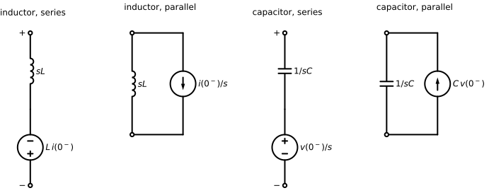
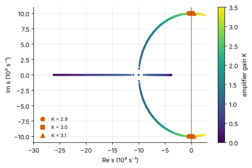

<!-- status: reviewed -->
# 07-04 · Laplace-Domain Circuit Analysis

| | |
|---|---|
| **Course** | [07 · Circuit Analysis II (Transient and AC)](../README.md) |
| **University equivalent** | The "Laplace transform in circuit analysis" chapter of a sophomore Circuits course (Nilsson & Riedel, *The Laplace Transform in Circuit Analysis*; Alexander & Sadiku, *Applications of the Laplace Transform*) |
| **Prerequisites** | [02-05 The Laplace Transform for ODEs](../../02-complex-numbers-des-and-linear-algebra/chapters/02-05-laplace-transform-for-odes.md) (transforms, partial fractions, transfer functions, initial- and final-value theorems), [07-03 Second-Order RLC Transients](07-03-second-order-rlc-transients.md) (natural frequencies, state equations), [06-04 Nodal Analysis](../../06-circuit-analysis-1-dc/chapters/06-04-nodal-analysis.md) and [06-08 Thévenin and Norton](../../06-circuit-analysis-1-dc/chapters/06-08-thevenin-and-norton.md). The facts used from each are restated where they are needed. |
| **Estimated study hours** | 12 |
| **Last verified** | 2026-11-19 |

**Learning objectives.** After this chapter you can:

1. Derive the s-domain models of resistors, inductors and capacitors, including their initial conditions in series (voltage-source) and parallel (current-source) form, and transform any switched circuit.
2. Apply impedances, dividers, nodal and mesh analysis and Thévenin–Norton equivalents in the s-domain to circuits of any order, and identify the characteristic polynomial as the determinant of the circuit equations.
3. Derive transfer functions directly from a circuit, locate their poles and zeros, and explain each zero from the circuit's structure.
4. Find impulse, step, convolution and complete responses (including the sinusoidal steady state from $H(j\omega)$ and the impulsive currents and voltages of ideal switching), and check them with the initial- and final-value theorems.
5. Decide stability from pole locations, explain why passive circuits cannot have growing natural modes while active ones can, and find the gain at which an active circuit starts to oscillate.
6. Use pole–zero reasoning in practice (output-capacitor ESR and regulator stability, pole–zero analysis in a simulator, loop measurements) and evaluate claims about it.

## 1. Big picture

07-02 and 07-03 solved circuits by writing differential equations and guessing exponentials. That works for one or two storage elements; a third-order filter, a regulator with three capacitors or an amplifier with parasitic capacitances would bury you in algebra. The Laplace transform turns every capacitor and inductor into an **impedance**, a function of the complex frequency $s$, so a dynamic circuit is analyzed with exactly the tools of Course 06 (Ohm's law, dividers, nodal analysis, Thévenin), with $R$ replaced by $Z(s)$. The answer comes out as a ratio of polynomials whose roots, the **poles** and **zeros**, tell an engineer most of what matters before any waveform is computed.

- **Filters and signal chains:** every analog filter is specified by its poles and zeros ([07-08](07-08-filters-and-resonance.md), [20](../../20-analog-and-mixed-signal-ic-design/README.md)).
- **Regulators and amplifiers:** stability is a statement about where the closed loop's poles lie; a capacitor's ESR adds a zero that some regulators depend on (§9).
- **Power integrity:** a power-delivery network is an impedance $Z(s)$ whose poles and zeros are its resonances and anti-resonances (02-05 Example 02-05.5).
- **Simulation:** circuit simulators find poles and zeros numerically from the same s-domain equations (§9), and behavioral models are written as $H(s)$.
- **Design reviews:** "where are the dominant poles, and how do they move with load and temperature?" is the first question about any feedback design.

## 2. Intuition first

### Impedance is Ohm's law for exponentials

Drive an inductor with a current $Ie^{st}$ whose complex frequency $s$ can be anything: growing, decaying, oscillating. Its voltage is $L\,d(Ie^{st})/dt = sL\cdot Ie^{st}$. The ratio of voltage to current is $sL$, a constant: for this one shape of signal the inductor behaves exactly like a resistor of value $sL$. A capacitor likewise behaves like $1/(sC)$. The Laplace transform writes *every* signal as a blend of such exponentials, which is why the whole of DC circuit analysis carries over with $R \to Z(s)$. At $s = 0$ (DC) the inductor is a short and the capacitor is open; as $s \to \infty$ (the first instant after a jump) the inductor is open and the capacitor a short: the continuity rules of 07-02, read off the impedances.

### Poles and zeros as resonances and blocks

A **pole** is a complex frequency at which the circuit can respond with no input at all: a natural mode, as in 07-03. A **zero** is a complex frequency at which the input cannot get through to the output: a series branch whose impedance goes infinite there, or a shunt branch that shorts the signal to ground. Reading a circuit for "what can ring" and "what can block" is the core skill of this chapter.

### An analogy from finance: discount rates

02-05 compared the transform with discounting a cash-flow stream at rate $s$. Push the analogy one step further: a circuit's transfer function is like a project's net present value as a function of the discount rate. Its poles are the rates at which the value blows up (the stream's own growth rates, its natural modes), and its zeros are the rates at which the inflows and outflows exactly cancel, the way an investment's internal rate of return is the rate at which NPV is zero. *Where it breaks:* discount rates are real, while circuit frequencies are complex, and the oscillating (imaginary) part carries most of the engineering meaning; a circuit also obeys energy conservation, which no cash flow does.

## 3. Theory

### 3.1 What carries over from 02-05

> **Recap — the transform toolkit** ([02-05](../../02-complex-numbers-des-and-linear-algebra/chapters/02-05-laplace-transform-for-odes.md)).
>
> - $F(s) = \int_{0^-}^{\infty}f(t)e^{-st}\,dt$. Derivative rule: $\mathcal{L}\{f'\} = sF(s) - f(0^-)$; integral rule: $\mathcal{L}\{\int_{0^-}^tf\} = F(s)/s$. Pairs used here: $\delta(t) \to 1$, $u(t) \to 1/s$, $e^{-at} \to 1/(s + a)$, $e^{-\alpha t}\cos\omega t \to (s + \alpha)/\big((s + \alpha)^2 + \omega^2\big)$, $e^{-\alpha t}\sin\omega t \to \omega/\big((s + \alpha)^2 + \omega^2\big)$.
> - Inversion by partial fractions; complex-conjugate poles are kept together as a damped cosine and sine.
> - With zero initial conditions $Y(s) = H(s)X(s)$. The poles of $H$ are the natural modes; the system is stable when all of them have negative real parts; $h(t) = \mathcal{L}^{-1}\{H\}$ is the impulse response.
> - **Initial-value theorem:** $f(0^+) = \lim_{s\to\infty}sF(s)$. **Final-value theorem:** $f(\infty) = \lim_{s\to0}sF(s)$, valid only if every pole of $sF(s)$ lies in the open left half-plane.
> - Using $0^-$ values makes the transform account for jumps and impulses at $t = 0$ by itself.

What 02-05 did with equations, this chapter does with circuits: transform the elements first, then analyze.

### 3.2 The s-domain element models

Take each element law, transform it, and draw a circuit that obeys the transformed law. Use the passive sign convention (current $I$ enters the + terminal of $V$).

**Resistor.** $v = Ri$ transforms to $V(s) = RI(s)$.

**Inductor.** $v = L\,di/dt$ transforms, by the derivative rule, to

$$
V(s) = sL\,I(s) - L\,i(0^-) .
$$

Read it as a circuit: an impedance $sL$ in series with a voltage source of value $L\,i(0^-)$, oriented so that it pushes current in the direction of $i(0^-)$. Solving for $I$ instead gives the parallel form:

$$
I(s) = \frac{V(s)}{sL} + \frac{i(0^-)}{s} ,
$$

an admittance $1/(sL)$ in parallel with a current source $i(0^-)/s$ in the direction of $i$.

**Capacitor.** $i = C\,dv/dt$ transforms to

$$
I(s) = sC\,V(s) - C\,v(0^-) ,
$$

an admittance $sC$ in parallel with a current source $C\,v(0^-)$ that pushes current out of the + terminal (it is the stored charge). Solving for $V$ gives the series form:

$$
V(s) = \frac{I(s)}{sC} + \frac{v(0^-)}{s} ,
$$

an impedance $1/(sC)$ in series with a voltage source $v(0^-)/s$, + at the + terminal.

*Figure 1. s-domain models with initial conditions, each element drawn as its impedance. Inductor: $sL$ in series with a source $L\,i(0^-)$ whose + end faces the − terminal (so it drives current in the direction of $i$), or $sL$ in parallel with a current source $i(0^-)/s$ in the direction of $i$. Capacitor: $1/(sC)$ in series with a source $v(0^-)/s$, + at the + terminal, or $1/(sC)$ in parallel with a current source $C\,v(0^-)$ pushing current out of the + terminal.*

**Checks.** Short-circuit an inductor ($V = 0$): the series form gives $I = L\,i(0^-)/(sL) = i(0^-)/s$, a current that never changes, as an ideal shorted inductor should do. Open-circuit a capacitor ($I = 0$): $V = v(0^-)/s$, a voltage that holds. The two forms of each element are source transformations of each other (06-08): $L\,i(0^-)$ divided by $sL$ is $i(0^-)/s$.

**Units.** A transformed voltage $V(s)$ has units of V·s (volts integrated over time), and a transformed current A·s. So $L\,i(0^-)$, in H·A = V·s (a flux linkage), is a transformed voltage, and $C\,v(0^-)$, in F·V = A·s (a charge), is a transformed current ✓.

**What the initial-condition sources mean.** A constant in the s-domain is an impulse in time ($\delta(t) \to 1$). So the inductor's source is a voltage impulse of area $L\,i(0^-)$ (a jolt of flux linkage that, applied to a relaxed inductor, would establish the current $i(0^-)$), and the capacitor's source is a current impulse that deposits the charge $Cv(0^-)$. The models say: a charged capacitor is an uncharged capacitor that was handed its charge at $t = 0^-$.

> **Going deeper — where the s-domain came from.** Oliver Heaviside replaced $d/dt$ by an algebraic symbol $p$ to solve the differential equations of telegraph and circuit theory, in work dated by the MacTutor history archive to 1880–1887; it got answers but was distrusted, and one of his papers was rejected by the Royal Society. T. J. I'A. Bromwich showed in a paper received by the London Mathematical Society in 1916 that Heaviside's "resistance-operator" method is equivalent to solving by complex integrals, and J. R. Carson recast it in 1922 and in his 1926 book as an integral equation "of the Laplace type". The impedance $sL$ of this section is Heaviside's $pL$ ([R-121](../../../reference/research-log.md#r-121--heavisides-operational-calculus-and-network-synthesis)).

### 3.3 Impedance, dividers and equivalents

With every element an impedance ($Z_R = R$, $Z_L = sL$, $Z_C = 1/(sC)$) or admittance ($Y = 1/Z$), the rules of Course 06 hold unchanged, because they follow from KCL, KVL and linearity alone:

- impedances in series add; admittances in parallel add;
- the voltage divider is $V_{out} = V_{in}\,Z_2/(Z_1 + Z_2)$, the current divider its dual;
- every linear two-terminal network, with its initial conditions, has a Thévenin equivalent $V_{Th}(s)$ in series with $Z_{Th}(s)$, found as in 06-08 with independent sources and initial-condition sources turned off for $Z_{Th}$.

Setting $s = j\omega$ turns these impedances into the phasor impedances of [07-05](07-05-sinusoidal-steady-state-and-impedance.md): sinusoidal steady state is the special case of exponentials that neither grow nor decay.

### 3.4 Nodal and mesh analysis in the s-domain

Nodal analysis (06-04) writes KCL at each node in terms of node voltages; in the s-domain the conductances become admittances and the initial-condition current sources join the independent sources on the right-hand side:

$$
\mathbf{Y}(s)\,\mathbf{V}(s) = \mathbf{I}_{src}(s) + \mathbf{I}_{ic}(s) .
$$

By Cramer's rule each node voltage is a ratio $\Delta_k(s)/\Delta(s)$, with $\Delta(s) = \det\mathbf{Y}(s)$. After multiplying through by the power of $s$ that clears the $1/s$ terms, $\Delta(s)$ is a polynomial, and **its roots are the circuit's natural frequencies**: the same numbers as the eigenvalues of the state matrix in 07-03 §3.8, now obtained without writing state equations. Mesh analysis gives the dual statement with $\det\mathbf{Z}(s)$.

Two consequences:

1. **Every response of the circuit has the same denominator** (apart from cancellations, below), whichever source drives it and wherever it is measured. The poles belong to the circuit; the zeros belong to the choice of input and output.
2. **The order of the circuit** is the degree of $\Delta(s)$: normally the number of capacitors plus inductors, minus one for every loop made only of capacitors (and voltage sources) and every cut-set made only of inductors (and current sources), because such loops and cut-sets tie storage elements together.

### 3.5 Transfer functions, and where zeros come from

A **transfer function** is the ratio of an output's transform to an input's, with all initial conditions zero: $H(s) = N(s)/D(s)$. When input and output are at the same port (a current into a node and the voltage at it), the ratio is a **driving-point** impedance or admittance.

**Poles** are the roots of $D(s)$, normally the natural frequencies of §3.4. A natural frequency is missing from a particular $H(s)$ when the input cannot excite that mode or the output cannot see it, for example a balanced bridge whose detector sits at the balance points.

**Zeros** are the roots of $N(s)$: complex frequencies at which no signal reaches the output. Every zero has a structural cause, and finding it is usually faster than algebra:

- **A series branch with infinite impedance.** A parallel LC tank in the signal path has $Z = sL/(1 + s^2LC)$, infinite at $s = \pm j/\sqrt{LC}$: a pair of zeros on the imaginary axis (a notch). A series capacitor has infinite impedance at $s = 0$: a zero at the origin (it blocks DC).
- **A shunt branch with zero impedance.** A series LC to ground shorts the signal at $s = \pm j/\sqrt{LC}$. A resistor in series with an inductor to ground, $R + sL$, has zero impedance at $s = -R/L$: a real zero in the left half-plane. A capacitor with series resistance (ESR, 07-01), $R_{ESR} + 1/(sC) = (1 + sR_{ESR}C)/(sC)$, is zero at $s = -1/(R_{ESR}C)$: the **ESR zero** of §9.
- **Two paths that cancel.** If the signal reaches the output by two routes with opposite signs, they cancel at some frequency. A capacitor bridging an inverting amplifier (the Miller capacitance of [10](../../10-electronics-1/README.md)) carries the input forward while the amplifier inverts it; the two cancel at $s = +g_m/C$, a zero in the **right** half-plane (Problem 07-04.11).

**What a zero does to a step response.** Write $H(s) = (1 + s/z)\,H_{ap}(s)$, where $H_{ap}$ has the same poles and no zeros, and $-z$ is the zero. Multiplying by $s$ is differentiation, so the response is

$$
y(t) = y_{ap}(t) + \frac{1}{z}\,\frac{dy_{ap}}{dt} .
$$

A left-half-plane zero ($z > 0$) *adds* a scaled derivative: the response rises faster and overshoots more, the more so the closer the zero is to the origin compared with the poles. A right-half-plane zero ($z < 0$) *subtracts* it: the response first moves the wrong way. This is why the overshoot formula of 02-03 fails for variables with zeros (Example 07-04.3).

### 3.6 Impulses: what ideal switching really does

Because the s-domain uses $0^-$ values, it handles circuits that force a jump in a capacitor voltage or an inductor current, where 07-02's continuity rule cannot apply. The transform then contains a constant term, which is an impulse.

- **Capacitors switched together** (a loop of capacitors, or a capacitor across a voltage source): the current contains an impulse whose area is the charge transferred, so charge is conserved, and the voltages jump to equal values at once. The ideal model cannot say where the lost energy goes; any real resistance dissipates it (07-01, Example 07-04.4).
- **Inductors forced into series** (a cut-set of inductors, or an inductor in series with a current source): the voltage contains an impulse, flux linkage is conserved, and the currents jump to equal values (Problem 07-04.10).

Impulses are idealizations, but their areas are physical: the charge that moves, and the flux that is conserved, are exactly what a real circuit with small resistance or inductance will do in a short time.

### 3.7 The complete response

Solving the transformed circuit with both sources and initial-condition sources gives

$$
Y(s) = \underbrace{H(s)X(s)}_{\text{zero-state: caused by the input}} + \underbrace{\frac{P_{ic}(s)}{D(s)}}_{\text{zero-input: caused by the stored energy}} ,
$$

where $P_{ic}$ collects the initial-condition terms. Both parts share the denominator $D(s)$: the stored energy and the input excite the same natural modes. Superposition (06-07) lets you compute the two parts separately, which is often simpler.

### 3.8 Stability

A circuit is **stable** when every bounded input produces a bounded output; for the circuits here that means every pole of every transfer function lies in the open left half-plane, so every natural mode decays.

**Passive circuits cannot have growing natural modes.** In a circuit of positive resistors, capacitors and inductors with no sources inside, the stored energy can only fall: its rate of change is minus the power in the resistors (the energy argument of [02-03 §3.11](../../02-complex-numbers-des-and-linear-algebra/chapters/02-03-second-order-linear-odes.md), generalized). A natural mode that grew would increase the energy, so every natural frequency has $\operatorname{Re}s \le 0$. If every mode feels some resistance, all poles are strictly in the left half-plane and the circuit is stable in the bounded-input, bounded-output sense above. A lossless part (an LC loop with no resistance) puts poles on the imaginary axis: it rings forever without growing on its own, so it is only **marginally stable**. Driven at its resonant frequency, its response grows linearly without bound (02-04's resonance), so it is not BIBO-stable.

**Active circuits can be.** A dependent source (a transistor or op-amp model) can supply energy, and can push poles into the right half-plane. That is how every oscillator works (Example 07-04.6), and it is how amplifiers fail.

**A quick test for low orders.** For a quadratic $s^2 + a_1s + a_0$, the roots' sum is $-a_1$ and their product $a_0$ (02-08's trace and determinant). Both roots have negative real parts exactly when $a_1 > 0$ and $a_0 > 0$: if the roots are real, a positive product means they have the same sign, and their sum, $-a_1$, is negative, so both are negative; if complex, their common real part is $-a_1/2$. For a cubic $s^3 + a_2s^2 + a_1s + a_0$, the condition is that all coefficients are positive **and** $a_2a_1 > a_0$; this is the third-order case of the Routh–Hurwitz criterion, derived in [15-05](../../15-control-systems/chapters/15-05-stability-routh-hurwitz.md) (Problem 07-04.13 checks it numerically).

> **Going deeper — positive-real impedances.** The driving-point impedance of any passive RLC network is a *positive-real* function: real for real $s$, with $\operatorname{Re}Z(s) \ge 0$ whenever $\operatorname{Re}s \ge 0$. Its poles and zeros all lie in the closed left half-plane, and those on the imaginary axis are simple. The converse also holds: every positive-real function can be built from R, L, C and ideal transformers, a result of network synthesis due to Brune (1931) and refined by Bott and Duffin (1949), who showed transformers are unnecessary ([R-121](../../../reference/research-log.md#r-121--heavisides-operational-calculus-and-network-synthesis)). Network synthesis is the theory behind passive filter design ([07-08](07-08-filters-and-resonance.md)).

### 3.9 Convolution and the sinusoidal steady state

The transfer function has two more readings, one in time and one in frequency, and both are used constantly later.

**Convolution.** The **impulse response** $h(t) = \mathcal{L}^{-1}\{H(s)\}$ is the zero-state response to a unit impulse. Any input can be viewed as a train of impulses: the slice of input at time λ is an impulse of area $x(\lambda)\,d\lambda$, which produces $h(t - \lambda)\,x(\lambda)\,d\lambda$ at time $t$. Linearity adds them up:

$$
y(t) = \int_0^t h(t - \lambda)\,x(\lambda)\,d\lambda \equiv (h * x)(t) ,
$$

the **convolution** of $h$ and $x$ (zero initial conditions, input starting at 0). Its transform is the product $H(s)X(s)$. To see this, write the transform of $y$ and swap the order of integration over the region $0 \le \lambda \le t$:

$$
\begin{aligned}
Y(s) &= \int_0^\infty e^{-st}\int_0^t h(t - \lambda)x(\lambda)\,d\lambda\,dt = \int_0^\infty x(\lambda)\int_\lambda^\infty e^{-st}h(t - \lambda)\,dt\,d\lambda \\
&= \int_0^\infty x(\lambda)e^{-s\lambda}\,d\lambda\int_0^\infty e^{-su}h(u)\,du = X(s)H(s) ,
\end{aligned}
$$

with $u = t - \lambda$ in the inner integral. So multiplying transforms in the s-domain is convolving in time. For an RC low-pass, $H = 1/(1 + s\tau)$ gives $h = (1/\tau)e^{-t/\tau}$, and $h * x$ is exactly the convolution form of [07-02 §3.10](07-02-first-order-rc-rl-transients.md). The s-domain does the integral for you; Problem 07-04.15 compares the two routes for a ramp. Course 11 develops convolution for signals in general ([11-03](../../11-signals-and-systems/chapters/11-03-convolution.md)).

**Sinusoidal steady state.** Drive a stable $H(s)$ with $x = \cos\omega t$ from $t = 0$. Then $X(s) = s/(s^2 + \omega^2) = \tfrac12\big[1/(s - j\omega) + 1/(s + j\omega)\big]$, and the partial fractions of $Y = HX$ contain two kinds of term:

- terms at the poles of $H$, which decay, because $H$ is stable: the **transient**;
- terms at $s = \pm j\omega$, with residues $\tfrac12H(j\omega)$ and $\tfrac12H(-j\omega) = \tfrac12H(j\omega)^*$ (a real circuit's $H$ has real coefficients).

The second pair adds to

$$
y_{ss}(t) = \tfrac12H(j\omega)e^{j\omega t} + \tfrac12H(j\omega)^*e^{-j\omega t} = \operatorname{Re}\big[H(j\omega)e^{j\omega t}\big] = \lvert H(j\omega)\rvert\cos\big(\omega t + \angle H(j\omega)\big) .
$$

**After the transient dies, a sinusoid comes out as the same sinusoid, scaled by $\lvert H(j\omega)\rvert$ and shifted by $\angle H(j\omega)$.** This is the bridge to phasors (07-05), where $s = j\omega$ from the start, and to Bode plots (07-07), which draw $\lvert H(j\omega)\rvert$ and $\angle H(j\omega)$. The transient part is what the phasor method leaves out. Its size depends on the switch-on instant and on the initial conditions, and Problem 07-04.16 computes it.

## 4. Worked examples

### Example 07-04.1 · A switched circuit, transformed (tier B)

**Setup.** Revisit Problem 07-03.7: a 12 V source feeds node a through $R_1 = 2$ Ω and $L = 0.5$ mH; $C = 50$ µF goes from node a to ground; a 4 Ω resistor across $C$ is switched out at $t = 0$, after a long time in steady state. Solve for $v_C(t)$ in the s-domain and compare with 07-03.

**Solution.** The DC state before the switch gives $i_L(0^-) = 12/6 = 2$ A and $v_C(0^-) = 8$ V. For $t > 0$ the loop is source → $R_1$ → $L$ → $C$. Use series models: the inductor is $sL$ with a source $L\,i_L(0^-) = 0.5\times10^{-3}\times2 = 10^{-3}$ V·s aiding the current; the capacitor is $1/(sC)$ with a source $8/s$ opposing it. KVL around the loop:

$$
I(s) = \frac{12/s + 10^{-3} - 8/s}{2 + 5\times10^{-4}s + 2\times10^4/s} = \frac{2(s + 4000)}{s^2 + 4000s + 4\times10^7}\ \text{A·s}.
$$

The capacitor voltage is the drop across its impedance plus its initial-condition source:

$$
V_C(s) = \frac{I(s)}{sC} + \frac{8}{s} = \frac{8(s^2 + 9000s + 6\times10^7)}{s\,(s^2 + 4000s + 4\times10^7)} .
$$

The poles are $s = 0$ and $s = -2000 \pm j6000$. Partial fractions: the residue at $s = 0$ is $8\times6\times10^7/(4\times10^7) = 12$, so

$$
V_C(s) = \frac{12}{s} - \frac{4(s - 6000)}{(s + 2000)^2 + 6000^2} = \frac{12}{s} - \frac{4(s + 2000)}{(s + 2000)^2 + 6000^2} + \frac{32\,000}{(s + 2000)^2 + 6000^2} .
$$

Inverting with the damped-cosine and damped-sine pairs:

$$
v_C(t) = 12 + e^{-2000t}\big(-4\cos6000t + 5.333\sin6000t\big)\ \text{V},
$$

the same answer 07-03 found (at 0.5 ms, **13.73 V**). **Checks:** the initial-value theorem gives \$\lim_{s\to\infty}sV_C = \$ **8 V** $= v_C(0^+)$, and the final-value theorem (poles of $sV_C$ in the left half-plane) gives **12 V** ✓.

**What the s-domain saved.** No initial slope had to be found by hand: the initial-condition sources carried both $v_C(0^-)$ and $i_L(0^-)$ into the algebra, and the slope $\dot v_C(0^+) = i_L(0^+)/C$ is implied.

**Units check.** $sC$ is in F/s = A/V, so $I(s)/(sC)$ is in (A·s)/(A/V) = V·s, the units of a transformed voltage, like $8/s$ ✓.

### Example 07-04.2 · A third-order filter by nodal analysis (tier B)

**Setup.** A low-pass filter between a 50 Ω source and a 50 Ω load (Figure 2) has $C_1 = 3.183$ nF from node 1 to ground, $L = 15.92$ µH from node 1 to node 2, and $C_2 = 3.183$ nF from node 2 to ground (values chosen for a 1 MHz corner; [07-08](07-08-filters-and-resonance.md) explains the design). (a) Find $H(s) = V_2/V_S$ by nodal analysis. (b) Find the poles. (c) Find the DC gain and the step response's overshoot and peak time.

*Figure 2. Example 07-04.2: a doubly terminated third-order LC low-pass filter; the output $V_2$ is taken at node 2.*

**Solution.**

(a) KCL at the two nodes, with $R = 50$ Ω:

$$
\frac{V_1 - V_S}{R} + sC_1V_1 + \frac{V_1 - V_2}{sL} = 0, \qquad sC_2V_2 + \frac{V_2}{R} + \frac{V_2 - V_1}{sL} = 0 .
$$

The values satisfy $RC_1 = RC_2 = 1/\omega_c$ and $L/R = 2/\omega_c$ with $\omega_c = 2\pi\times10^6$ rad/s. Multiply both equations by $R$ and write $p = s/\omega_c$, so that $sRC_1 = p$ and $R/(sL) = 1/(2p)$:

$$
(V_1 - V_S) + pV_1 + \frac{V_1 - V_2}{2p} = 0, \qquad pV_2 + V_2 + \frac{V_2 - V_1}{2p} = 0 .
$$

The second gives $V_1 = (2p^2 + 2p + 1)V_2$. Substituting into the first, $V_S = V_2\big[(2p^2 + 2p + 1)(1 + p + \tfrac{1}{2p}) - \tfrac{1}{2p}\big] = V_2\,(2p^3 + 4p^2 + 4p + 2)$, so

$$
H = \frac{V_2}{V_S} = \frac{1}{2\,(p^3 + 2p^2 + 2p + 1)} = \frac{1}{2\,(p + 1)(p^2 + p + 1)} .
$$

(b) The poles are $p = -1$ and $p = -\tfrac12 \pm j\tfrac{\sqrt3}{2}$, all on the unit circle: $s = -\omega_c$ and $s = \omega_c\,(-0.5 \pm j0.866)$. Three poles equally spaced on a circle in the left half-plane is the **Butterworth** pattern of 07-08. There are no finite zeros: the series inductor and shunt capacitors can only block at infinite frequency.

(c) DC gain: \$H(0) = \$ **0.5**, the 50 Ω divider (inductor short, capacitors open). The step response, from the partial fractions $\tfrac{1}{2p} - \tfrac{1}{2(p + 1)} - \tfrac{1}{2(p^2 + p + 1)}$, is

$$
y(\theta) = \tfrac12 - \tfrac12e^{-\theta} - \tfrac{1}{\sqrt3}\,e^{-\theta/2}\sin\!\big(\tfrac{\sqrt3}{2}\theta\big), \qquad \theta = \omega_ct .
$$

It peaks at $\theta = 4.922$ (θ is dimensionless time, not a time constant), that is \$t = \$ **0.7834 µs**, at $y = 0.5407$: an overshoot of **8.15%**. A complex pole pair with ζ = 0.5 alone would overshoot 16.3%; the real pole slows the start and halves the overshoot.

**Units check.** $RC$ and $L/R$ are in seconds; $p$ is dimensionless ✓.
**Sanity check.** $H(0) = 0.5$ and $H(p) \approx 1/(2p^3)$ for large $p$: a third-order filter falls three times as fast as an RC above its corner ✓.

### Example 07-04.3 · Where a zero comes from, and what it does (tier B)

**Setup.** Problem 07-03.8's circuit (an 11 V step through $R_1 = 100$ Ω into node a, with $C = 1$ µF to ground and $L = 10$ mH in series with $R_2 = 10$ Ω to ground) overshot to 6.066 V although its final value is 1 V and ζ = 0.524. (a) Find $H(s) = V/V_S$. (b) Locate its zero from the circuit's structure. (c) Explain the large overshoot with §3.5.

**Solution.**

(a) The shunt impedance at node a is $Z_p = \dfrac{1}{sC}\parallel(R_2 + sL)$, and the divider gives

$$
H(s) = \frac{Z_p}{R_1 + Z_p} = \frac{R_2 + sL}{R_1LCs^2 + (L + R_1R_2C)s + R_1 + R_2} = \frac{10^4\,(s + 1000)}{s^2 + 11\,000s + 1.1\times10^8} .
$$

(b) The zero is at \$s = \$ **−1000 s⁻¹**: the frequency where the shunt branch $R_2 + sL$ has zero impedance and shorts node a. The poles are $-5500 \pm j8930$ s⁻¹, and the DC gain is \$H(0) = 10/110 = \$ **0.09091**.

(c) Factor $H(s) = (1 + s/1000)\,H_{ap}(s)$, with $H_{ap}$ the same poles and DC gain but no zero. Then $v = v_{ap} + 10^{-3}\,dv_{ap}/dt$. The zero sits ten times below the poles' natural frequency (10.49 krad/s), so the derivative term is large: during the fast initial rise, $dv_{ap}/dt$ reaches thousands of volts per second, and $10^{-3}$ times that is several volts. The all-pole part alone would peak at 1.144 V (the 02-03 overshoot for ζ = 0.524); the derivative term carries the response to 6.066 V.

**Units check.** $R_1LC$ is in s², and $L + R_1R_2C$ in Ω·s, against $R_1 + R_2$ in Ω ✓.
**Sanity check.** At $s \to \infty$, $H \to 10^4/s$: at the first instant the capacitor shorts node a and the input current $V_S/R_1$ charges $C$, so $dv/dt(0^+) = 11/(100\times10^{-6}) = 1.1\times10^5$ V/s, matching 07-03 ✓.

### Example 07-04.4 · Capacitors switched together, exactly (tier B)

**Setup.** A 1 µF capacitor charged to 10 V is connected at $t = 0$ by an ideal switch and ideal wires to an uncharged 4 µF capacitor. Find the current, the final voltages and the energy before and after.

**Solution.** Use series models: the first capacitor is $1/(sC_1)$ with a $10/s$ source, the second $1/(sC_2)$. The loop current is

$$
I(s) = \frac{10/s}{1/(sC_1) + 1/(sC_2)} = 10\,\frac{C_1C_2}{C_1 + C_2} = 8\times10^{-6}\ \text{A·s},
$$

a constant: $i(t) = 8\ \mu\text{C}\times\delta(t)$, an impulse carrying **8 µC** in zero time. The first capacitor ends at \$10 - 8/1 = \$ **2.000 V** and the second at $8/4 = 2.000$ V: equal, as charge conservation requires ($10\ \mu\text{C}$ shared over 5 µF). Energy: before, \$\tfrac12(1\ \mu\text{F})(10^2) = \$ **50.00 µJ**; after, \$\tfrac12(5\ \mu\text{F})(2^2) = \$ **10.00 µJ**. The 40 µJ difference has no home in the ideal circuit; with any series resistance, however small, it is dissipated there (07-01 Problem 07-01.6), and with series inductance the charge would oscillate instead.

**Sanity check.** Charge: $1\times10 = 10$ µC before, $1\times2 + 4\times2 = 10$ µC after ✓.

### Example 07-04.5 · A capacitor's ESR zero (tier B)

**Setup.** A regulator's output node has a 10 Ω load in parallel with a 10 µF output capacitor whose ESR is $R_E$. Find the poles and zeros of the node's impedance $Z(s) = R_L\parallel\big(R_E + 1/(sC)\big)$, and its limits at $s = 0$ and $s \to \infty$, for (a) $R_E = 0.5$ Ω (a tantalum or aluminum-electrolytic value) and (b) $R_E = 5$ mΩ (a ceramic value).

**Solution.** Combine:

$$
Z(s) = \frac{R_L\,(R_E + 1/sC)}{R_L + R_E + 1/sC} = R_L\,\frac{1 + sR_EC}{1 + s(R_L + R_E)C} .
$$

One pole at $s = -1/\big((R_L + R_E)C\big)$ and one zero at $s = -1/(R_EC)$, the ESR zero of §3.5. In hertz:

| | Pole $f_p$ | Zero $f_z$ | $Z(0)$ | $Z(\infty)$ |
|---|---|---|---|---|
| (a) $R_E$ = 0.5 Ω | **1516 Hz** | **31.83 kHz** | 10 Ω | **0.4762 Ω** |
| (b) $R_E$ = 5 mΩ | **1591 Hz** | **3.183 MHz** | 10 Ω | **4.998 mΩ** |

The pole barely moves, but the zero moves by a factor of 100 with the ESR. Above the zero, the capacitor stops looking like a capacitor and looks like a resistor $R_E$: the impedance flattens instead of falling.

**Why it matters.** A regulator's control loop sees this impedance. A zero adds phase lead (07-07), and some older regulator designs relied on the ESR zero, at a frequency set by an ESR inside a specified window, to stay stable; replacing the electrolytic with a ceramic moves the zero a hundredfold higher, out of reach (§9). The same arithmetic tells a designer what the swap does before any lab test.

**Units check.** $R_EC$ is in Ω·F = s ✓.

### Example 07-04.6 · When an active circuit oscillates (tier C)

**Setup.** A Wien-bridge circuit (Figure 3) has a series RC ($R = 10$ kΩ, $C = 10$ nF) from an amplifier's output to node x, and a parallel RC (the same values) from node x to ground; the amplifier is an ideal non-inverting stage of gain $K$ from node x to the output. (a) Find the characteristic equation. (b) Find the poles for $K$ = 2.9, 3 and 3.1, and classify each case. (c) For $K = 3.1$, how long does an oscillation take to grow from 1 mV to 1 V?

*Figure 3. Example 07-04.6: the circuit's two poles as the amplifier gain K rises from 0 to 3.5. At K = 0 they are real (a passive RC circuit); they meet at K = 1, travel around a circle of radius ω₀, and cross the imaginary axis at K = 3.*

**Solution.**

(a) Let $Z_s = R + 1/(sC)$ and $Z_p = R\parallel\frac{1}{sC} = R/(1 + sRC)$. The network divides the output: $V_x = V_o\,Z_p/(Z_s + Z_p)$, and the amplifier closes the loop with $V_o = KV_x$. A nonzero solution with no input needs $KZ_p/(Z_s + Z_p) = 1$. Writing $\tau = RC$:

$$
\frac{Z_p}{Z_s + Z_p} = \frac{s\tau}{(s\tau)^2 + 3s\tau + 1}, \qquad\text{so}\qquad (s\tau)^2 + (3 - K)\,s\tau + 1 = 0 ,
$$

that is $s^2 + (3 - K)\,\omega_0s + \omega_0^2 = 0$ with \$\omega_0 = 1/RC = \$ **10.00 krad/s** (\$f_0 = \$ **1.592 kHz**).

(b) By §3.8 the quadratic is stable exactly when $3 - K > 0$.

- $K = 2.9$: $s = -500 \pm j9987$ s⁻¹ (ζ = $(3 - K)/2 = 0.05$): stable, a decaying ring.
- $K = 3$: $s = \pm j10^4$: on the imaginary axis, a sustained sinusoid at 1.592 kHz.
- $K = 3.1$: $s = +500 \pm j9987$: right half-plane, unstable, a growing sinusoid.

(c) The envelope grows as $e^{500t}$ (time constant **2.000 ms**), so 1 mV becomes 1 V after \$\ln1000/500 = \$ **13.82 ms**, about 22 cycles. In a real oscillator the amplitude then limits as the amplifier saturates or an amplitude-control element lowers $K$ back to 3 ([12-09](../../12-electronics-2/chapters/12-09-oscillators.md)).

**Units check.** $RC$ in s, so $\omega_0$ in 1/s ✓.
**Sanity check.** The Wien network alone is passive (two R, two C), and its poles are real and negative ($K = 0$ gives $s\tau = (-3 \pm\sqrt5)/2$), as 07-03 §3.9 requires of an RC circuit. Only the amplifier can make it ring or grow ✓.

<!-- answer-key -->
| ID | Quantity | Value | Unit |
|---|---|---|---|
| Ex 07-04.1a | inductor initial-condition source | 1.000 | mV·s |
| Ex 07-04.1b | residue at s = 0 | 12 | V |
| Ex 07-04.1c | $v_C(0.5\text{ ms})$ | 13.73 | V |
| Ex 07-04.1d | initial value by the IVT | 8 | V |
| Ex 07-04.1e | final value by the FVT | 12 | V |
| Ex 07-04.2a | real pole | −6.283 | Mrad/s |
| Ex 07-04.2b | complex poles, real part | −3.142 | Mrad/s |
| Ex 07-04.2c | complex poles, imaginary part | 5.441 | Mrad/s |
| Ex 07-04.2d | DC gain | 0.5 | — |
| Ex 07-04.2e | time of the peak | 0.7834 | µs |
| Ex 07-04.2f | overshoot | 8.15 | % |
| Ex 07-04.3a | zero | −1000 | s⁻¹ |
| Ex 07-04.3b | pole real part | −5500 | s⁻¹ |
| Ex 07-04.3c | pole imaginary part | 8930 | s⁻¹ |
| Ex 07-04.3d | DC gain | 0.09091 | — |
| Ex 07-04.3e | initial slope $dv/dt(0^+)$ | 1.1 | 10⁵ V/s |
| Ex 07-04.4a | charge transferred | 8 | µC |
| Ex 07-04.4b | final voltage | 2.000 | V |
| Ex 07-04.4c | energy before | 50.00 | µJ |
| Ex 07-04.4d | energy after | 10.00 | µJ |
| Ex 07-04.5a | pole, 0.5 Ω ESR | 1516 | Hz |
| Ex 07-04.5b | zero, 0.5 Ω ESR | 31.83 | kHz |
| Ex 07-04.5c | $Z(\infty)$, 0.5 Ω ESR | 0.4762 | Ω |
| Ex 07-04.5d | pole, 5 mΩ ESR | 1591 | Hz |
| Ex 07-04.5e | zero, 5 mΩ ESR | 3.183 | MHz |
| Ex 07-04.5f | $Z(\infty)$, 5 mΩ ESR | 4.998 | mΩ |
| Ex 07-04.6a | $\omega_0$ | 10.00 | krad/s |
| Ex 07-04.6b | $f_0$ | 1.592 | kHz |
| Ex 07-04.6c | pole real part, K = 2.9 | −500 | s⁻¹ |
| Ex 07-04.6d | pole imaginary part, K = 2.9 | 9987 | s⁻¹ |
| Ex 07-04.6e | growth time constant, K = 3.1 | 2.000 | ms |
| Ex 07-04.6f | time to grow 1000× | 13.82 | ms |

*Every value in this table is recomputed by [verify_07_04.py](../verify/verify_07_04.py), from symbolic s-domain algebra and independently from time-domain simulation; the circuit results are confirmed by ngspice netlists in [labs/07-04-lab](../labs/07-04-lab/README.md).*

## 5. Simulate it

The lab is in [labs/07-04-lab/](../labs/07-04-lab/README.md).

**Notebook** (`07-04-laplace.ipynb`):

1. Build a circuit's nodal matrix symbolically, read off its determinant, and compare the roots with the state-matrix eigenvalues of 07-03.
2. Transform and solve Example 07-04.1, and confirm it against a time-domain simulation.
3. Move a zero and watch the step response change (Example 07-04.3).
4. Sweep the Wien-bridge gain through 3 and watch the poles cross the axis.

**ngspice netlists** confirm Examples 07-04.1 to 07-04.3 and Problems 07-04.4, 07-04.6 and 07-04.11 in the time domain, and run ngspice's own pole–zero analysis (`.pz`) on the filter of Example 07-04.2 and the Wien bridge of Example 07-04.6; `python tools/run_spice.py 07-04` checks them all.

**Guided exercise (predict, then run).** In the zero cell, move the zero of Example 07-04.3 from −1000 s⁻¹ to −20 000 s⁻¹ (beyond the poles), keeping the poles and the DC gain. **Before running,** predict whether the overshoot rises or falls and roughly toward which value. Hint: the derivative term is now scaled by 1/20 000 instead of 1/1000.

## 6. Engineering tradeoffs

| Knob | Improves | Costs | Typical decision owner |
|---|---|---|---|
| Analyze in the s-domain instead of the time domain | Any order, initial conditions included, poles and zeros in hand | Inverse transforms by hand become tedious beyond third order; insight needs pole–zero literacy | Analog designer, system modeler |
| Low-ESR (ceramic) output capacitors | Smaller ripple, smaller transient steps, no wear-out | The ESR zero moves far out; regulators that relied on it can oscillate | Board designer with the regulator vendor's guidance |
| Higher-order filter (more poles) | Sharper roll-off | More components, more overshoot and ringing in the step response, more sensitivity | Signal-chain designer |
| A deliberate left-half-plane zero (lead network) | Faster response, more phase margin | More overshoot to a step; noise gain at high frequency | Control-loop designer |
| More amplifier gain in a loop | Accuracy, disturbance rejection | Poles move toward the right half-plane; oscillation | Analog or control designer |
| Behavioral $H(s)$ model instead of a transistor-level one | Fast system simulation | Misses nonlinearity, slewing and saturation | Verification lead |

## 7. Numbers to know

| Quantity | Value | Note |
|---|---|---|
| Inductor initial-condition source | $L\,i(0^-)$ in V·s, or $i(0^-)/s$ in parallel | §3.2 |
| Capacitor initial-condition source | $v(0^-)/s$ in series, or $C\,v(0^-)$ in A·s in parallel | §3.2 |
| ESR zero | $f_z = 1/(2\pi R_{ESR}C)$: about 30 kHz for 10 µF tantalum at 0.5 Ω, above 3 MHz for 10 µF ceramic at 5 mΩ | TI AN-1482, [R-117](../../../reference/research-log.md#r-117--ldo-stability-and-output-capacitor-esr) **[Industry estimate]** (typical ESRs) |
| Legacy LDO ESR window | TPS760xx: at least 2.2 µF with ESR 0.1–20 Ω (datasheet 1998, rev. 2001); TI's 1999 "tunnel of death" example: 0.2–9 Ω at 4.7 µF | [R-117](../../../reference/research-log.md#r-117--ldo-stability-and-output-capacitor-esr) **[Established]** |
| Typical stable ESR ranges | electrolytic-stable LDOs about 0.1–10 Ω; ceramic-stable designs from 0 Ω up to about 0.5 Ω | TI AN-1482 **[Industry estimate]** |
| Current LDOs | "Stable with 1-µF output capacitors" (TPS7A26, TPS7A25); TPS7A20: 1 µF ceramic, ESR ≤ 100 mΩ; onsemi NCP114: no minimum ESR, maximum below 2 Ω | [R-117](../../../reference/research-log.md#r-117--ldo-stability-and-output-capacitor-esr) **[Established]** |
| Phase-margin guideline | at least 45–50° | TI AN-1889, [R-119](../../../reference/research-log.md#r-119--loop-gain-measurement-by-injection) **[Industry estimate]** |
| Loop-injection resistor | 10 Ω (OMICRON Lab); 20 Ω (TI) | [R-119](../../../reference/research-log.md#r-119--loop-gain-measurement-by-injection) |
| Decompensated op-amps | OPA637 stable in gains ≥ 5 (OPA627 unity-gain stable); OPA847 stable for gains ≥ 12, gain–bandwidth 3.9 GHz typical | Datasheets, [R-120](../../../reference/research-log.md#r-120--decompensated-op-amps) **[Established]** |
| Third-order Butterworth step overshoot | 8.15% | Example 07-04.2 |

<!-- answer-key -->
| ID | Quantity | Value | Unit |
|---|---|---|---|
| N 07-04.a | ESR zero, 0.1 Ω and 2.2 µF | 723.4 | kHz |
| N 07-04.b | ESR zero, 20 Ω and 2.2 µF | 3.617 | kHz |
| N 07-04.c | ESR zero, 10 µF and 0.5 Ω | 31.83 | kHz |

## 8. Common mistakes

1. **Using $0^+$ values in the initial-condition sources.** The derivative rule uses $f(0^-)$; using $0^+$ loses any impulse at the switching instant and double-counts jumps.
2. **Getting an initial-condition source's polarity wrong.** Check with an open or short circuit: a charged capacitor left open must keep its voltage; a shorted inductor must keep its current.
3. **Forgetting the initial-condition source when finding a voltage.** In Example 07-04.1 the capacitor voltage is $I/(sC)$ *plus* $v_C(0^-)/s$.
4. **Applying the final-value theorem without checking the poles.** A lossless LC tank or an unstable circuit has no final value, whatever $\lim sF(s)$ says.
5. **Assuming the overshoot formula applies to every variable.** Zeros change overshoot; compute the step response.
6. **Expecting a passive circuit to oscillate, or trusting an active one not to.** Passive RLC circuits have poles in the closed left half-plane (lossless parts on the axis are only marginally stable); any circuit with gain must be checked.
7. **Cancelling a pole against a zero carelessly.** An exact cancellation on paper is approximate in hardware and leaves a slow residual mode (02-05).

## 9. Practitioner lens

### State of the art (as of Nov 2026)

- **Regulator stability is a pole–zero story, and it once depended on a parasitic.**
  - TI's application report SLVA115A describes three important poles in a PMOS or PNP low-dropout regulator: a dominant pole in the error amplifier, a load pole formed by the output capacitor and load (so it moves with load current), and a pole of the pass device. Using the output capacitor's ESR zero to cancel one pole's lag is "typically the simplest and least expensive method" ([R-117](../../../reference/research-log.md#r-117--ldo-stability-and-output-capacitor-esr)) **[Established]**.
  - That made stability depend on a window of ESR. The TPS760xx datasheet (1998, revised 2001) requires at least 2.2 µF with ESR between 0.1 Ω and 20 Ω; a 1999 TI review calls the published stable-ESR plot the "tunnel of death", with 0.2–9 Ω for its 4.7 µF example. TI's AN-1482 gives the same two capacitors as Example 07-04.5: about 30 kHz for a 10 µF tantalum at 0.5 Ω, above 3 MHz for a ceramic at 5 mΩ, and an illustrative loop whose phase margin rose from 11° to about 68° when the ESR zero was included **[Established]**.
  - Designs since have moved the zero inside the chip, into the error amplifier's compensation, so they tolerate ESR down to zero. TI's TPS7A26 and TPS7A25 datasheets state "Stable with 1-µF output capacitors" and assume the capacitance derates to 50%; the TPS7A20 sets a *maximum* ESR of 100 mΩ; onsemi's NCP114 has "no requirement for the minimum value" of ESR, a maximum below 2 Ω, and discourages tantalum ([R-117](../../../reference/research-log.md#r-117--ldo-stability-and-output-capacitor-esr)) **[Established]**. The window has turned around: old parts needed enough ESR, new ones need little enough.
  - **Check the vendor's arithmetic.** SLVA115A's Equation 1 prints the ESR zero for 0.1 Ω and 2.2 µF as 72.3 kHz; §3.5's formula gives **723.4 kHz**, ten times higher (our arithmetic). The physics in the note is right; one printed number is not.
- **Simulators find poles and zeros the same way you do.** ngspice's `.pz` analysis computes the poles and zeros of a voltage or transimpedance transfer function from the circuit's s-domain equations. Its manual (version 47, Aug 2026) warns that the method is "a sub-optimal numerical search" that may miss roots of large circuits or "find an excessive number" of them. Its XSPICE `s_xfer` model simulates any rational $H(s)$ directly ([R-118](../../../reference/research-log.md#r-118--pole-zero-analysis-and-s-domain-models-in-ngspice)) **[Established]**. This chapter's lab runs `.pz` (ngspice-42) on Example 07-04.2 and recovers the three Butterworth poles.
- **Loops are measured without opening them.** R. D. Middlebrook's 1975 paper made the voltage- and current-injection methods standard: a small resistor is inserted in the loop and a test signal injected across it, so the loop keeps its operating point ([R-119](../../../reference/research-log.md#r-119--loop-gain-measurement-by-injection)) **[Established]** (from the abstract). OMICRON Lab's note uses a 10 Ω injection resistor and states the method's validity conditions; its Bode 100 analyzer covers 1 Hz to 50 MHz. TI's AN-1889 does it with a signal generator, an oscilloscope and a 20 Ω resistor, and recommends a phase margin of at least 45–50° **[Industry estimate]** (for the margin).
- **Amplifiers trade stability for speed by moving poles.** TI's OPA627 is unity-gain stable; its decompensated sibling OPA637 is "stable in gains ≥ 5" and offers a higher gain–bandwidth product (the datasheet quotes 80 MHz at a gain of 10). The OPA847 is stable only for gains of +12 or more, with a 3.9 GHz gain–bandwidth product ([R-120](../../../reference/research-log.md#r-120--decompensated-op-amps)) **[Established]**. Feedback places the closed-loop poles; less feedback (higher gain) keeps them safely in the left half-plane, which is the subject of 07-07 and Course 12.

<!-- answer-key -->
| ID | Quantity | Value | Unit |
|---|---|---|---|
| PL 07-04.a | ESR zero printed in SLVA115A, corrected | 723.4 | kHz |
| PL 07-04.b | ratio of the correct to the printed value | 10.0 | — |

### Why it matters commercially

- **Capacitor choice is a stability decision.** Ceramic capacitors are small and do not wear out, but a regulator designed around an ESR zero can oscillate with them. Field oscillations show up as noise, EMI failures or intermittent resets, the most expensive kind of bug to find.
- **Regulator generations differ.** A board that swaps a legacy LDO for a pin-compatible newer one, or the reverse, may also need different output capacitors. Bills of materials carry this risk silently.
- **Simulation and measurement must agree.** Pole–zero analysis and Bode measurement are cheap compared with a respin or a recall; teams that do both catch marginal loops before customers do.

### Marketing vs Reality

- **"Stable with 1 µF ceramic."** *Reality:* stable under the datasheet's conditions, which include the capacitor's *effective* capacitance after DC-bias and temperature derating (07-01), a maximum ESR, sometimes a maximum capacitance. *Sanity check:* compute the effective capacitance of the actual part at the actual voltage and confirm it sits inside the stated window, ESR included.
- **"Ultra-high gain–bandwidth op-amp."** *Reality:* a decompensated amplifier reaches its headline speed only at gains above its stated minimum; at unity gain, or with a feedback capacitor, it may oscillate. *Sanity check:* look for "stable in gains ≥ N" before reading the bandwidth.
- **"The application note shows it is stable."** *Reality:* application notes are written by engineers and contain errors (SLVA115A's tenfold slip). *Sanity check:* recompute any number you will rely on, and prefer the datasheet's specified limits to an illustrative calculation.

### Questions for engineering leaders

1. **"Does any of your control loops depend on a parasitic, such as capacitor ESR or trace resistance, for its stability?"**
   - *Strong:* names the loops, the parasitic, its tolerance and temperature range, and shows margin at the extremes.
   - *Evasive:* "the vendor's reference design works".
2. **"How did you verify loop stability: simulation, Bode measurement or step response, and with what margins?"**
   - *Strong:* all three, with phase margin at minimum and maximum load and over temperature, and the injection method used.
   - *Evasive:* "it didn't oscillate on the bench".
3. **"What output-capacitor range does each regulator tolerate, after derating, and how is that enforced in the bill of materials?"**
   - *Strong:* effective-capacitance and ESR windows per rail, approved part lists, and a review step for substitutions.
   - *Evasive:* "we use the recommended value".
4. **"Where do the dominant poles and zeros of your critical loops sit, and what moves them?"**
   - *Strong:* a pole–zero map versus load, temperature and process, from simulation correlated with measurement.
   - *Evasive:* a single nominal Bode plot.

## 10. Concept check

**Q1.** Why does the s-domain model of an inductor carry a voltage source $L\,i(0^-)$, and what are its units?

Answer

Transforming $v = L\,di/dt$ with the derivative rule gives $V = sLI - L\,i(0^-)$; the constant term is the inductor's stored flux linkage, in V·s, the units of a transformed voltage. In time it is a voltage impulse that would establish the current $i(0^-)$ in a relaxed inductor.

**Q2.** Two transfer functions of the same circuit have different numerators. What must they share, and why?

Answer

Their denominators (apart from cancellations): the poles are the roots of the determinant of the circuit equations, the circuit's natural frequencies, which do not depend on where the input is applied or the output taken.

**Q3.** A series LC branch is connected from a signal line to ground. Where does it put zeros?

Answer

At $s = \pm j/\sqrt{LC}$, where the branch's impedance $sL + 1/(sC)$ is zero and shorts the signal: a notch at $f = 1/(2\pi\sqrt{LC})$.

**Q4.** What does a right-half-plane zero do to a step response?

Answer

It subtracts a scaled derivative of the all-pole response, so the output first moves the wrong way before heading to its final value (Problem 07-04.11).

**Q5.** Can a circuit of resistors, capacitors and inductors, with no dependent sources, have a pole in the right half-plane?

Answer

No. Its stored energy can only fall (the resistors only absorb power), so no natural mode can grow. Lossless LC loops can sit on the imaginary axis, but nothing goes beyond it. Such a loop is only marginally stable: it does not grow on its own, but a sinusoid at its resonant frequency drives it without bound.

**Q6.** In a Wien-bridge oscillator, why must the gain be slightly above 3 at start-up but exactly 3 in steady operation?

Answer

Above 3 the poles are in the right half-plane, so noise grows into an oscillation; at exactly 3 they sit on the imaginary axis and the amplitude holds. A real oscillator starts above 3 and lets amplitude limiting pull the effective gain down to 3.

**Q7.** A 1 µF capacitor at 10 V is switched across a 4 µF capacitor with ideal wires. Where does the s-domain say the missing energy goes?

Answer

Nowhere: the ideal model conserves charge (an 8 µC current impulse) but cannot account for 40 µJ. Any real resistance dissipates exactly that energy; the ideal model is telling you it is incomplete.

**Q8.** An output capacitor's ESR falls from 0.5 Ω to 5 mΩ. What happens to the ESR zero?

Answer

It moves up by the same factor, 100, from about 32 kHz to about 3.2 MHz for 10 µF, because $f_z = 1/(2\pi R_{ESR}C)$.

Now work the full problem set: [07-04 problems](../problems/07-04-problems.md) (worked solutions in [07-04 solutions](../solutions/07-04-solutions.md)).

## 11. Key terms

[Laplace transform](../../../reference/glossary.md#laplace-transform) ·
[Impedance](../../../reference/glossary.md#impedance) ·
[Initial-condition source](../../../reference/glossary.md#initial-condition-source) ·
[Transfer function](../../../reference/glossary.md#transfer-function) ·
[Driving-point impedance](../../../reference/glossary.md#driving-point-impedance) ·
[Poles and zeros](../../../reference/glossary.md#poles-and-zeros) ·
[Right-half-plane zero](../../../reference/glossary.md#right-half-plane-zero) ·
[ESR zero](../../../reference/glossary.md#esr-zero) ·
[Characteristic polynomial](../../../reference/glossary.md#characteristic-polynomial) ·
[Zero-state response](../../../reference/glossary.md#zero-state-response) ·
[Zero-input response](../../../reference/glossary.md#zero-input-response) ·
[Stability (of a circuit)](../../../reference/glossary.md#stability-of-a-circuit) ·
[Positive-real function](../../../reference/glossary.md#positive-real-function) ·
[Wien-bridge oscillator](../../../reference/glossary.md#wien-bridge-oscillator)

## 12. Connections

- **Builds on:** [02-05](../../02-complex-numbers-des-and-linear-algebra/chapters/02-05-laplace-transform-for-odes.md) (the transform), [07-03](07-03-second-order-rlc-transients.md) (natural frequencies, state equations, zeros seen in Problem 07-03.8), [07-01](07-01-capacitors-and-inductors.md) (ESR, charge sharing), [06-04](../../06-circuit-analysis-1-dc/chapters/06-04-nodal-analysis.md) and [06-08](../../06-circuit-analysis-1-dc/chapters/06-08-thevenin-and-norton.md).
- **Next:** [07-05 Sinusoidal Steady State, Phasors and Impedance](07-05-sinusoidal-steady-state-and-impedance.md): the special case $s = j\omega$.
- **Used later in:**
  - [07-07](07-07-frequency-response-and-bode-plots.md) and [07-08](07-08-filters-and-resonance.md): poles and zeros as Bode plots and filters.
  - [11](../../11-signals-and-systems/README.md): transforms, convolution and system functions in general.
  - [12-09](../../12-electronics-2/chapters/12-09-oscillators.md): oscillators.
  - [15-05](../../15-control-systems/chapters/15-05-stability-routh-hurwitz.md): Routh–Hurwitz and stability of feedback loops.
  - [22](../../22-power-electronics-and-energy-conversion/README.md): regulator and converter control loops.

## 13. Further study

- **Nilsson & Riedel, *Electric Circuits*:** the two chapters on the Laplace transform and its application in circuit analysis (s-domain models, transfer functions, the impulse in circuits).
- **Alexander & Sadiku, *Fundamentals of Electric Circuits*:** "Applications of the Laplace Transform" (circuit element models, network stability and synthesis).
- **MIT OpenCourseWare 6.003 *Signals and Systems*:** the lectures on the Laplace transform, poles and zeros.

## 14. Sources

1. Research log [R-117](../../../reference/research-log.md#r-117--ldo-stability-and-output-capacitor-esr): LDO stability and output-capacitor ESR. TI SLVA115A (2002, rev. 2020); TI TPS760xx datasheet SLVS144D (rev. 2001); B. S. Lee, TI SLVA072 (1999); TI AN-1482 SNVA167A (rev. 2013); onsemi AND8037/D (2000); TI TPS7A26 SBVS290B, TPS7A25 SBVS372C, TPS7A20 SBVS338H; onsemi NCP114/D Rev. 31 (2024).
2. Research log [R-118](../../../reference/research-log.md#r-118--pole-zero-analysis-and-s-domain-models-in-ngspice): ngspice User's Manual, version 47 (Aug 2026), `.pz` analysis and the `s_xfer` model.
3. Research log [R-119](../../../reference/research-log.md#r-119--loop-gain-measurement-by-injection): R. D. Middlebrook, "Measurement of loop gain in feedback systems," *Int. J. Electronics* 38(4):485–512, 1975; OMICRON Lab loop-gain notes (2017–2018) and Bode 100 technical data; TI AN-1889 SNVA364A (rev. 2013).
4. Research log [R-120](../../../reference/research-log.md#r-120--decompensated-op-amps): TI OPA627/OPA637 datasheet SBOS165C (rev. 2025); TI OPA847 SBOS251E and OPA842 SBOS267D.
5. Research log [R-121](../../../reference/research-log.md#r-121--heavisides-operational-calculus-and-network-synthesis): Heaviside (MacTutor history archive; ETHW); T. J. I'A. Bromwich, *Proc. London Math. Soc.* (2) 15:401–448; J. R. Carson, *Bell System Technical Journal* 1(2):43–55 (1922) and *Electric Circuit Theory and the Operational Calculus* (1926); O. Brune, *J. Math. Phys.* 10:191–236 (1931); R. Bott and R. J. Duffin, *J. Appl. Phys.* 20:816 (1949).
6. Textbook alignment as listed in §13. All text, examples and problems in this chapter are original.
