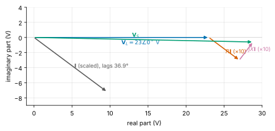

<!-- status: verified -->
# 07-05 · Sinusoidal Steady State, Phasors and Impedance

| | |
|---|---|
| **Course** | [07 · Circuit Analysis II (Transient and AC)](../README.md) |
| **University equivalent** | The "sinusoidal steady-state analysis" chapter of a sophomore Circuits course (Nilsson & Riedel, *Sinusoidal Steady-State Analysis*; Alexander & Sadiku, *Sinusoids and Phasors* and *Sinusoidal Steady-State Analysis*) |
| **Prerequisites** | [02-01 Complex Numbers, Euler's Formula and Phasors](../../02-complex-numbers-des-and-linear-algebra/chapters/02-01-complex-numbers-euler-and-phasors.md) (phasors, $j\omega$ calculus, the impedance table), [07-04 Laplace-Domain Circuit Analysis](07-04-laplace-domain-circuit-analysis.md) (impedances in $s$, stability), [06-04 Nodal Analysis](../../06-circuit-analysis-1-dc/chapters/06-04-nodal-analysis.md), [06-08 Thévenin and Norton](../../06-circuit-analysis-1-dc/chapters/06-08-thevenin-and-norton.md), [06-10 The Ideal Op-Amp](../../06-circuit-analysis-1-dc/chapters/06-10-ideal-op-amp.md). The facts used from each are restated where they are needed. |
| **Estimated study hours** | 10 |
| **Last verified** | 2026-11-19 |

**Learning objectives.** After this chapter you can:

1. Compute impedances and admittances of networks at a given frequency, convert between rectangular and polar forms, and interpret resistance, reactance, conductance, susceptance, $Q$ and dissipation factor.
2. Convert a series R–X combination to its parallel equivalent at one frequency and back, and explain why an LCR meter reports different values in series and parallel modes.
3. Solve AC circuits in the phasor domain with KVL, KCL, nodal and mesh analysis, Thévenin and Norton equivalents and superposition, including circuits driven at several frequencies.
4. Draw and read phasor diagrams, and derive the voltage-drop approximation for a line feeding a load.
5. Analyze AC bridges and op-amp circuits with impedances, including the balance conditions of a bridge and the all-pass phase shifter.
6. State when phasor analysis applies and when it does not, and relate impedance measurements in practice (LCR meters, impedance analyzers, bioimpedance, battery impedance) to this chapter.

## 1. Big picture

Most of the electrical world runs on sinusoids. The power grid delivers 50 or 60 Hz; audio, radio and every communication channel are built from sinusoids; and any periodic signal is a sum of them ([11](../../11-signals-and-systems/README.md)). For a linear circuit driven by a sinusoid, once the transient of 07-02 to 07-04 has died away, every voltage and current is a sinusoid at the same frequency, differing only in amplitude and phase. The **phasor** captures exactly those two numbers, and with impedances, every DC technique of Course 06 works again, in complex arithmetic. This chapter turns 02-01's mathematics into a working method for circuits.

- **Power systems:** voltage drop on lines, power-factor correction and three-phase analysis are phasor calculations ([07-06](07-06-ac-power-and-power-factor.md), [07-11](07-11-three-phase-circuits.md)).
- **Measurement:** LCR meters and impedance analyzers measure $Z$ at a chosen frequency; how they report it (series or parallel model) is §3.3 (§9).
- **Sensing:** bioimpedance in wearables and impedance spectroscopy of battery cells measure a body's or a cell's $Z(j\omega)$ (§9).
- **Simulation:** SPICE's AC analysis solves the circuit's complex nodal equations at each frequency, exactly the method of §3.4.
- **Filters and amplifiers:** frequency response ([07-07](07-07-frequency-response-and-bode-plots.md)) is this chapter repeated across frequency.

## 2. Intuition first

### Impedance is resistance with a timing offset

A resistor's current rises and falls in step with its voltage. An inductor's current lags its voltage by a quarter cycle: the voltage is what *changes* the current, so the current peaks a quarter cycle after the voltage has done its pushing. A capacitor's current leads its voltage by a quarter cycle: current must flow *before* the voltage can build. Impedance packs both facts, size and timing, into one complex number: its magnitude is the ratio of amplitudes, and its angle is how far the voltage leads the current.

### Adding sinusoids is adding arrows

Two sinusoids at the same frequency always add to a third sinusoid at that frequency, but their amplitudes do not simply add: a 3 V and a 4 V sinusoid a quarter cycle apart add to 5 V, not 7 V. Represent each by an arrow whose length is its amplitude and whose angle is its phase, and the sum is the arrow sum: Pythagoras, here. KVL around a loop becomes "the arrows close into a polygon", which is a **phasor diagram**.

### An analogy from finance: seasonal revenue streams

Two product lines each have seasonal revenue that repeats every year: one peaks in March, the other in June. The company's combined revenue also repeats yearly, but its peak is smaller than the sum of the two peaks and falls somewhere between March and June, because the peaks do not line up. Each stream is a phasor (size of the swing, month of the peak), and the total is their vector sum. *Where it breaks:* the analogy only works for streams with the same period; add a quarterly stream to an annual one and no single "peak month" describes the total. Phasors have the same limit: they add only at a single frequency (§3.4).

## 3. Theory

### 3.1 What carries over

> **Recap — phasors and impedance** ([02-01](../../02-complex-numbers-des-and-linear-algebra/chapters/02-01-complex-numbers-euler-and-phasors.md) §3.9–3.12).
>
> - A sinusoid $v(t) = V_m\cos(\omega t + \phi)$ has the **peak-amplitude** phasor $\mathbf{V} = V_m\angle\phi$, with $v(t) = \operatorname{Re}\{\mathbf{V}e^{j\omega t}\}$. Two same-frequency sinusoids are equal at all times exactly when their phasors are equal.
> - Differentiation is multiplication by $j\omega$; integration is division by $j\omega$.
> - Element laws become $\mathbf{V} = Z\mathbf{I}$ with $Z_R = R$, $Z_L = j\omega L$, $Z_C = 1/(j\omega C) = -j/(\omega C)$.
> - Phasors give the **steady state** only, and only for linear circuits at a single frequency.

> **Recap — the s-domain** ([07-04](07-04-laplace-domain-circuit-analysis.md)). The impedances of 07-04, $sL$ and $1/(sC)$, become the phasor impedances when $s = j\omega$. The steady state exists only if the circuit is stable (all poles in the left half-plane, 07-04 §3.8); otherwise the "transient" never dies and the phasor solution, though it can be computed, describes nothing that will be seen.

This chapter's notation: bold capitals for phasors ($\mathbf{V}$, $\mathbf{I}$), $Z$ and $Y$ for impedance and admittance, angles in degrees in examples.

### 3.2 Impedance and admittance

At a given frequency, any two-terminal linear network has an **impedance** $Z = \mathbf{V}/\mathbf{I}$ and an **admittance** $Y = 1/Z = \mathbf{I}/\mathbf{V}$, written

$$
Z = R + jX, \qquad Y = G + jB ,
$$

where $R$ is the **resistance**, $X$ the **reactance**, $G$ the **conductance** and $B$ the **susceptance**. All four are real numbers; $R$ and $X$ are in ohms, $G$ and $B$ in siemens. Reactance is positive for an inductor ($X_L = \omega L$) and negative for a capacitor ($X_C = -1/(\omega C)$). In polar form, $Z = \lvert Z\rvert\angle\theta$: the voltage has amplitude $\lvert Z\rvert$ times the current's and leads it by θ (a negative θ means it lags).

**Converting.** Since $Y = 1/(R + jX) = (R - jX)/(R^2 + X^2)$,

$$
G = \frac{R}{R^2 + X^2}, \qquad B = \frac{-X}{R^2 + X^2} .
$$

So $G \ne 1/R$ unless $X = 0$: conductance is not the reciprocal of resistance in an AC network. And an inductive impedance ($X > 0$) has negative susceptance, a capacitive one positive susceptance.

**Rules.** Impedances in series add; admittances in parallel add; the voltage and current dividers hold with impedances. Every one follows from KVL and KCL, which hold for phasors because they are linear relations among sinusoids of one frequency (02-01's uniqueness lemma).

**Quality factor and dissipation factor of a component.** A real inductor or capacitor is a reactance with some loss. Modeled as a series $R + jX$, its quality factor at that frequency is

$$
Q = \frac{\lvert X\rvert}{R}, \qquad D = \frac{1}{Q} = \frac{R}{\lvert X\rvert} = \tan\delta ,
$$

where $D$, the **dissipation factor** used on capacitor datasheets, is the tangent of the **loss angle** δ by which the impedance angle falls short of ±90°. A capacitor with ESR $R$ has $D = \omega CR$: losses matter more at higher frequency.

**Impedance depends on frequency.** $Z(j\omega)$ is a different complex number at every frequency. An equivalent circuit built from one measurement (a resistor and a capacitor that reproduce $Z$ at 1 kHz) is valid at that frequency only, unless it is the circuit's true structure.

### 3.3 Series and parallel equivalents at one frequency

At one frequency, a series combination $R_s + jX_s$ and a parallel combination of $R_p$ and $jX_p$ can have exactly the same impedance. Equate admittances: the parallel form has $Y = 1/R_p + 1/(jX_p) = 1/R_p - j/X_p$, and the series form has $Y = (R_s - jX_s)/(R_s^2 + X_s^2)$. Matching real and imaginary parts:

$$
R_p = \frac{R_s^2 + X_s^2}{R_s} = R_s\,(1 + Q^2), \qquad X_p = \frac{R_s^2 + X_s^2}{X_s} = X_s\Big(1 + \frac{1}{Q^2}\Big),
$$

with $Q = \lvert X_s\rvert/R_s$, the same $Q$ in both forms. For high $Q$, $X_p \approx X_s$ while $R_p \approx Q^2R_s$ is huge: a small series resistance is equivalent to a large parallel one. For a capacitor, $X_p = -1/(\omega C_p)$ and $X_s = -1/(\omega C_s)$ give

$$
C_p = \frac{C_s}{1 + D^2} .
$$

**Why an LCR meter has two modes.** An LCR meter measures one complex number $Z$ at its test frequency. To report "capacitance", it must assume a two-element model, series ($C_s$, $R_s$) or parallel ($C_p$, $R_p$), and the two give different capacitances whenever $D$ is not small (Example 07-05.1 shows 10.08 µF against 7.19 µF for one part). Neither is "wrong": they are two descriptions of one measured $Z$. The usual guidance is to choose the model that matches the part's dominant loss, series for low-impedance parts (large capacitors, small inductors, where the series resistance dominates) and parallel for high-impedance ones (§9).

### 3.4 Phasor circuit analysis

Every DC method of Course 06 applies with phasors and impedances, because each rests only on KCL, KVL, the element laws and linearity:

1. **Transform:** sources to phasors (all at the *same* frequency), elements to impedances.
2. **Solve** with any method: series–parallel reduction and dividers, nodal analysis ($\mathbf{Y}\mathbf{V} = \mathbf{I}$, now with complex entries), mesh analysis, Thévenin and Norton equivalents, source transformation, superposition.
3. **Return to time** with $v(t) = \lvert\mathbf{V}\rvert\cos(\omega t + \angle\mathbf{V})$.

The only new skill is complex arithmetic, which a calculator or a few lines of Python handles; set up the equations by hand and solve them with care for signs.

**Several frequencies.** If sources run at different frequencies (including DC, where $\omega = 0$: capacitors open, inductors short), phasors cannot be combined across them. Use superposition: solve the circuit once per frequency with only that frequency's sources active, convert each result to a time function, and add **in time**. Adding phasors of different frequencies is meaningless, because their rotating arrows turn at different rates.

> **Going deeper — what SPICE's AC analysis does.** An AC sweep ([07-04 §9](07-04-laplace-domain-circuit-analysis.md#9-practitioner-lens)) builds the circuit's modified nodal equations of 06-04 with each element's admittance at $j\omega$ (a capacitor stamps $j\omega C$, an inductor $1/(j\omega L)$, a nonlinear device its small-signal linearization at the DC operating point) and solves the complex linear system at each frequency of the sweep. The results are phasors. That is why an AC analysis says nothing about clipping or slew limits: it is this section, automated.

### 3.5 Phasor diagrams

A phasor diagram draws the phasors of a circuit as arrows in the complex plane. KVL around a loop says the voltage arrows, placed head to tail, close; KCL at a node says the current arrows close. Conventions: draw the quantity common to the elements as the reference at 0°, the current in a series circuit and the voltage in a parallel one.

**Reading a series RL.** With $\mathbf{I}$ as reference, $\mathbf{V}_R = R\mathbf{I}$ lies along it and $\mathbf{V}_L = j\omega L\mathbf{I}$ points 90° ahead; their sum is the source voltage, the hypotenuse. The diagram shows at a glance that $\lvert\mathbf{V}_R\rvert + \lvert\mathbf{V}_L\rvert$ exceeds $\lvert\mathbf{V}_S\rvert$: element voltages measured with a meter do not add up to the source.

**Voltage drop along a line.** A source feeds a load through a line of impedance $R + jX$. Take the load voltage $\mathbf{V}_L$ as reference ($\angle0$) and let the load current lag it by θ (an inductive load): $\mathbf{I} = I\angle{-\theta}$. Then

$$
\mathbf{V}_S = \mathbf{V}_L + (R + jX)\,I(\cos\theta - j\sin\theta) = \underbrace{V_L + I(R\cos\theta + X\sin\theta)}_{\text{in phase with }\mathbf{V}_L} + j\,I(X\cos\theta - R\sin\theta) .
$$

When the line drop is small compared with $V_L$, the quadrature term barely changes the magnitude ($\lvert\mathbf{V}_S\rvert \approx$ the in-phase part, because the quadrature part enters only in second order), so

$$
\lvert\mathbf{V}_S\rvert - V_L \approx I\,(R\cos\theta + X\sin\theta) .
$$

The line's reactance contributes to the drop only through the reactive part of the current ($\sin\theta$): this is why power engineers care about the load's phase (07-06) and why voltage on long lines depends on reactive current.

### 3.6 AC bridges

A bridge has four arms, $Z_1$ to $Z_4$, with a source across one diagonal and a detector across the other (06-03's Wheatstone bridge). Balance, zero detector voltage, requires the two dividers to give equal phasors: $Z_1/(Z_1 + Z_3) = Z_2/(Z_2 + Z_4)$, which simplifies to

$$
Z_1Z_4 = Z_2Z_3 .
$$

This is **one complex equation, so two real conditions**: magnitudes and angles must both match. An AC bridge therefore needs two adjustable elements, and balance tells you two things about an unknown, such as its inductance and its series resistance (Example 07-05.5). Some bridges balance at every frequency; others only at one, which makes them frequency meters or filters (the Wien bridge of 07-04 is one). Modern LCR meters replace the hand-balanced bridge with an automatically balancing circuit and a vector voltmeter, but they still measure the same complex ratio.

### 3.7 Op-amp circuits with impedances

The ideal op-amp rules of 06-10 hold for phasors. An inverting stage with input impedance $Z_i$ and feedback impedance $Z_f$ has gain $-Z_f/Z_i$; a non-inverting stage has $1 + Z_f/Z_g$. With $Z_i = R$ and $Z_f = 1/(j\omega C)$ this is the integrator of 07-01, gain $-1/(j\omega RC)$: magnitude $1/(\omega RC)$ and a phase of +90° (the −1 adds 180° to the −90° of $1/j$).

**The all-pass phase shifter.** An op-amp drives its output from both inputs: equal resistors $R_1$ from the input to the inverting terminal and from the output to it, and an RC low-pass ($R$ in series, $C$ to ground) from the input to the non-inverting terminal. The non-inverting input sees $\mathbf{V}_+ = \mathbf{V}_{in}/(1 + j\omega RC)$, and the stage gives $\mathbf{V}_{out} = 2\mathbf{V}_+ - \mathbf{V}_{in}$ (gain +2 from the + input, −1 from the − input). So

$$
H(j\omega) = \frac{2}{1 + j\omega RC} - 1 = \frac{1 - j\omega RC}{1 + j\omega RC}, \qquad \lvert H\rvert = 1, \qquad \angle H = -2\arctan(\omega RC) .
$$

Every frequency passes with unchanged amplitude, but delayed by a different phase: 0° at DC, −90° at $\omega = 1/(RC)$, approaching −180° at high frequency. Such circuits generate quadrature signals and correct phase in signal chains; Example 07-05.6 shows they also change a waveform's shape without changing its spectrum's magnitudes.

### 3.8 What phasor analysis cannot do

- **Transients:** the start-up, the response to a switch, ringing (07-02 to 07-04).
- **Unstable circuits:** no steady state exists (07-04 §3.8).
- **Nonlinear elements:** a diode or a saturating core creates harmonics; phasors at one frequency cannot represent them (SPICE linearizes at an operating point, which is valid only for small signals).
- **Power:** the product of two sinusoids is not a sinusoid at the same frequency, so $p = vi$ is not "$\mathbf{V}\mathbf{I}$" (02-01; 07-06 builds the right tools).

## 4. Worked examples

### Example 07-05.1 · A real capacitor, two ways (tier A)

**Setup.** A 10 µF capacitor has 0.1 Ω of ESR and 2 nH of ESL in series (07-01's model, leakage ignored). At 1 kHz and at 100 kHz find (a) $Z$ in both forms, (b) the dissipation factor $D$, (c) the series capacitance $C_s$ an LCR meter in series mode would report (from the reactance), and (d) the parallel-mode values $C_p$ and $R_p$.

**Solution.**

(a) At 1 kHz, $\omega = 6283$ rad/s: $X = \omega L - 1/(\omega C) = 1.257\times10^{-5} - 15.915 = -15.92$ Ω, so $Z = 0.1 - j15.92$ Ω $= $ **15.92 Ω ∠ −89.64°**. At 100 kHz: $X = 1.257\times10^{-3} - 0.1592 = -0.1579$ Ω, so $Z = 0.1 - j0.1579$ Ω $= $ **0.1869 Ω ∠ −57.65°**.

(b) $D = R/\lvert X\rvert$: **0.006283** at 1 kHz (essentially $\omega CR$, the ESL being negligible) and **0.6333** at 100 kHz.

(c) A series-mode meter reports $C_s = -1/(\omega X)$: **10.00 µF** at 1 kHz but **10.08 µF** at 100 kHz, where the ESL has started to cancel part of the capacitive reactance.

(d) $Y = 1/Z$ gives $C_p = B/\omega$ and $R_p = 1/G$: at 1 kHz, $C_p$ = **10.00 µF** and $R_p$ = **2533 Ω**; at 100 kHz, $C_p$ = **7.194 µF** and $R_p$ = **0.3493 Ω**. (Check with §3.3: $C_p = C_s/(1 + D^2) = 10.08/1.401 = 7.194$ µF ✓.)

**Units check.** $\omega L$ and $1/(\omega C)$ in Ω; $C = -1/(\omega X)$ in F ✓.
**Sanity check.** At 1 kHz, $D \ll 1$, so both modes agree. At 100 kHz the same part reads 10.08 µF or 7.19 µF depending on a menu setting: the measurement is one complex number, and the "capacitance" depends on the model you ask it to fit. For a large, low-impedance capacitor, the series model is the physically right one ✓.

### Example 07-05.2 · Nodal analysis with two sources (tier B)

**Setup.** At 1 kHz, a source $\mathbf{V}_S = 10\angle0°$ V drives node 1 through $R_1$ = 1 kΩ; node 1 has $C$ = 100 nF to ground; an inductor $L$ = 100 mH joins node 1 to node 2; node 2 has $R_2$ = 2 kΩ to ground and receives a current source $\mathbf{I}_S = 10\angle{-90°}$ mA. Find $\mathbf{V}_1$, $\mathbf{V}_2$ and $v_2(t)$.

**Solution.** Impedances at $\omega = 6283$ rad/s: $Z_C = -j1591.5$ Ω (admittance $j628.3$ µS) and $Z_L = j628.3$ Ω (admittance $-j1591.5$ µS). KCL, currents leaving each node:

$$
\Big(\frac{1}{R_1} + j\omega C + \frac{1}{j\omega L}\Big)\mathbf{V}_1 - \frac{1}{j\omega L}\mathbf{V}_2 = \frac{\mathbf{V}_S}{R_1}, \qquad -\frac{1}{j\omega L}\mathbf{V}_1 + \Big(\frac{1}{j\omega L} + \frac{1}{R_2}\Big)\mathbf{V}_2 = \mathbf{I}_S .
$$

In numbers (admittances in mS, currents in mA):

$$
\begin{pmatrix}1 - j0.9632 & j1.5915\\ j1.5915 & 0.5 - j1.5915\end{pmatrix}\begin{pmatrix}\mathbf{V}_1\\ \mathbf{V}_2\end{pmatrix} = \begin{pmatrix}10\\ -j10\end{pmatrix} .
$$

Solving (Cramer's rule or a complex linear solver): $\mathbf{V}_1 = 2.539 - j7.102$ V $=$ **7.542 V ∠ −70.33°** and $\mathbf{V}_2 = 5.999 - j8.986$ V $=$ **10.80 V ∠ −56.28°**. So $v_2(t) = 10.80\cos(2\pi\cdot1000\,t - 56.28°)$ V.

**Units check.** mS × V = mA on every row ✓.
**Sanity check.** $\lvert\mathbf{V}_2\rvert$ exceeds the 10 V source: the current source pushes 10 mA into node 2, and the inductor–capacitor combination is near a resonance at $1/(2\pi\sqrt{LC})$ = **1.592 kHz**, so voltages larger than the source are plausible. The ngspice netlist in the lab confirms both phasors ✓.

### Example 07-05.3 · A Thévenin equivalent at one frequency (tier B)

**Setup.** At 10 kHz, a source $10\angle0°$ V feeds $R_1$ = 1 kΩ to node a, which has $C$ = 10 nF to ground; from node a, $R_2$ = 500 Ω leads to the output terminals. (a) Find the Thévenin equivalent at the output. (b) Find the voltage across a 1 kΩ load, and check it by nodal analysis.

**Solution.**

(a) $Z_C = 1/(j\omega C) = -j1591.5$ Ω. Open-circuit voltage: the divider $\mathbf{V}_{Th} = 10\,Z_C/(R_1 + Z_C) = 7.170 - j4.505$ V $=$ **8.467 V ∠ −32.14°** (no current in $R_2$). Thévenin impedance, source shorted: $Z_{Th} = R_2 + R_1\parallel Z_C = 500 + (716.96 - j450.48) = $ **1217 − j450.5 Ω** ($1298\angle{-20.31°}$ Ω).

(b) $\mathbf{V}_L = \mathbf{V}_{Th}\,R_L/(Z_{Th} + R_L) = 3.502 - j1.320$ V $=$ **3.743 V ∠ −20.66°**. Nodal analysis at node a and the output node gives the same phasor (the lab's notebook does it in two lines).

**Units check.** All impedances in Ω; the divider ratio is dimensionless ✓.
**Sanity check.** The equivalent is valid at 10 kHz only: at another frequency $Z_C$, and therefore both $\mathbf{V}_{Th}$ and $Z_{Th}$, change. A Thévenin equivalent of an AC network is a frequency-by-frequency statement ✓.

### Example 07-05.4 · A phasor diagram and the voltage-drop rule (tier B)

**Setup.** A load of impedance $Z_L = 18.4 + j13.8$ Ω is fed through a line of $0.5 + j0.3$ Ω, and its voltage is $23\angle0°$ V. (a) Find the current. (b) Find the source voltage and the drop as a percentage of the load voltage. (c) Compare with the approximation of §3.5.

**Solution.**

(a) $\mathbf{I} = 23/(18.4 + j13.8) = 0.8 - j0.6$ A $=$ **1.000 A ∠ −36.87°**: the load is inductive, so the current lags by θ = 36.87° ($\cos\theta = 0.8$, $\sin\theta = 0.6$).

(b) $\mathbf{V}_S = 23 + (0.8 - j0.6)(0.5 + j0.3) = 23 + (0.58 - j0.06) = 23.58 - j0.06$ V, so $\lvert\mathbf{V}_S\rvert = $ **23.58 V** at an angle of −0.146°. The drop is $0.580/23 = $ **2.522%** of the load voltage.

(c) The approximation gives $I(R\cos\theta + X\sin\theta) = 1\times(0.5\times0.8 + 0.3\times0.6) = $ **0.580 V**, matching the exact 0.5801 V to within 0.1 mV: the quadrature component (−0.06 V) changes the magnitude only in second order.

*Figure 1. Example 07-05.4 with the load voltage as reference (line drops exaggerated tenfold for visibility): the line's resistive drop is parallel to the current, its reactive drop 90° ahead of it, and together they close the triangle from the load voltage to the source voltage.*

**Units check.** A × Ω = V ✓.
**Sanity check.** Of the 0.58 V drop, 0.40 V comes from $R\cos\theta$ and 0.18 V from $X\sin\theta$. A purely resistive load ($\theta = 0$) would see only $IR = 0.5$ V of drop from 1 A, so the reactive current makes the line's reactance count ✓.

### Example 07-05.5 · Measuring an inductor with a Maxwell bridge (tier B)

**Setup.** A Maxwell bridge has arm 1 the unknown inductor ($R_x + j\omega L_x$), arms 2 and 3 resistors $R_2 = R_3$ = 1 kΩ, and arm 4 a resistor $R_4$ in parallel with a capacitor $C_4$. The bridge balances at $Z_1Z_4 = Z_2Z_3$. (a) Derive the balance conditions. (b) The unknown is in fact 50 mH with 20 Ω of winding resistance. What $C_4$ and $R_4$ balance the bridge? (c) Does the balance depend on frequency?

**Solution.**

(a) $Z_4 = 1/(1/R_4 + j\omega C_4)$, so $Z_1Z_4 = Z_2Z_3$ becomes $Z_1 = R_2R_3\,(1/R_4 + j\omega C_4)$:

$$
R_x + j\omega L_x = \frac{R_2R_3}{R_4} + j\omega R_2R_3C_4 .
$$

Equating real and imaginary parts gives two conditions: $R_x = R_2R_3/R_4$ and $L_x = R_2R_3C_4$.

(b) $C_4 = L_x/(R_2R_3) = 0.05/10^6 = $ **50.00 nF** and $R_4 = R_2R_3/R_x = 10^6/20 = $ **50.00 kΩ**.

(c) No: ω cancels from both conditions, so the bridge balances at every frequency. That makes it convenient (the source frequency need not be stable) and is one reason this particular arrangement measures inductors with a capacitor standard, which is easier to make precise than an inductor standard.

**Units check.** Ω²·F = Ω·(Ω·F) = Ω·s = H ✓.
**Sanity check.** The inductor's $Q$ at 1 kHz is $\omega L/R = 314.2/20 = $ **15.71**; arm 4's matching $Q$ is $\omega C_4R_4 = 6283\times50\times10^{-9}\times5\times10^4 = 15.71$ ✓: at balance the two arms have equal phase angles.

### Example 07-05.6 · An all-pass filter changes a waveform's shape (tier C)

**Setup.** The all-pass phase shifter of §3.7 has $R$ = 10 kΩ and $C$ chosen for a −90° shift at 1 kHz. (a) Find $C$ and the phase shift at 3 kHz, 100 Hz and 10 kHz. (b) The input is $\cos(2\pi\cdot1000\,t) + \tfrac13\cos(2\pi\cdot3000\,t)$ V, the first two terms of a square wave. Write the output and compare its peak with the input's. (c) Find the time delay of each component.

**Solution.**

(a) $\omega RC = 1$ at 1 kHz gives $C = 1/(2\pi\times1000\times10^4) = $ **15.92 nF**. The phase $-2\arctan(\omega RC)$ with $\omega RC = f/1\text{ kHz}$: at 3 kHz **−143.13°**, at 100 Hz **−11.42°**, at 10 kHz **−168.58°**.

(b) Each frequency is treated separately (§3.4) and added in time:

$$
v_{out}(t) = \cos(2\pi\cdot1000\,t - 90°) + \tfrac13\cos(2\pi\cdot3000\,t - 143.13°)\ \text{V}.
$$

Both amplitudes are unchanged, yet the waveform is different: the input peaks at $1 + \tfrac13 = $ **1.333 V** (both cosines peak together at $t = 0$), while the output's components no longer line up, and its peak, found numerically, is **1.134 V**.

(c) A phase lag φ at frequency $f$ is a time delay $\varphi/(360°\,f)$: the 1 kHz component is delayed **0.2500 ms** and the 3 kHz component only **132.5 µs**. Different frequencies arrive at different times, so the shape changes.

**Units check.** degrees ÷ (degrees × Hz) = s ✓.
**Sanity check.** $\lvert H\rvert = 1$ at all frequencies, so the RMS value of the waveform is unchanged ($\sqrt{(1^2 + (1/3)^2)/2}$ = **0.7454 V** for both), while the peak changes. Phase matters for waveforms even when it does not matter for power or for a spectrum analyzer's display ✓.

<!-- answer-key -->
| ID | Quantity | Value | Unit |
|---|---|---|---|
| Ex 07-05.1a | $\lvert Z\rvert$ at 1 kHz | 15.92 | Ω |
| Ex 07-05.1b | angle at 1 kHz | −89.64 | ° |
| Ex 07-05.1c | $\lvert Z\rvert$ at 100 kHz | 0.1869 | Ω |
| Ex 07-05.1d | angle at 100 kHz | −57.65 | ° |
| Ex 07-05.1e | D at 1 kHz | 0.006283 | — |
| Ex 07-05.1f | D at 100 kHz | 0.6333 | — |
| Ex 07-05.1g | $C_s$ at 1 kHz | 10.00 | µF |
| Ex 07-05.1h | $C_s$ at 100 kHz | 10.08 | µF |
| Ex 07-05.1i | $C_p$ at 1 kHz | 10.00 | µF |
| Ex 07-05.1j | $R_p$ at 1 kHz | 2533 | Ω |
| Ex 07-05.1k | $C_p$ at 100 kHz | 7.194 | µF |
| Ex 07-05.1l | $R_p$ at 100 kHz | 0.3493 | Ω |
| Ex 07-05.2a | $\lvert\mathbf{V}_1\rvert$ | 7.542 | V |
| Ex 07-05.2b | angle of $\mathbf{V}_1$ | −70.33 | ° |
| Ex 07-05.2c | $\lvert\mathbf{V}_2\rvert$ | 10.80 | V |
| Ex 07-05.2d | angle of $\mathbf{V}_2$ | −56.28 | ° |
| Ex 07-05.2e | LC resonance | 1.592 | kHz |
| Ex 07-05.3a | $\lvert\mathbf{V}_{Th}\rvert$ | 8.467 | V |
| Ex 07-05.3b | angle of $\mathbf{V}_{Th}$ | −32.14 | ° |
| Ex 07-05.3c | $Z_{Th}$ real part | 1217 | Ω |
| Ex 07-05.3d | $Z_{Th}$ imaginary part | −450.5 | Ω |
| Ex 07-05.3e | $\lvert\mathbf{V}_L\rvert$ | 3.743 | V |
| Ex 07-05.3f | angle of $\mathbf{V}_L$ | −20.66 | ° |
| Ex 07-05.4a | $\lvert\mathbf{I}\rvert$ | 1.000 | A |
| Ex 07-05.4b | angle of $\mathbf{I}$ | −36.87 | ° |
| Ex 07-05.4c | $\lvert\mathbf{V}_S\rvert$ | 23.58 | V |
| Ex 07-05.4d | drop | 2.522 | % |
| Ex 07-05.4e | approximate drop | 0.580 | V |
| Ex 07-05.5a | $C_4$ | 50.00 | nF |
| Ex 07-05.5b | $R_4$ | 50.00 | kΩ |
| Ex 07-05.5c | inductor Q at 1 kHz | 15.71 | — |
| Ex 07-05.6a | C for −90° at 1 kHz | 15.92 | nF |
| Ex 07-05.6b | phase at 3 kHz | −143.13 | ° |
| Ex 07-05.6c | phase at 100 Hz | −11.42 | ° |
| Ex 07-05.6d | phase at 10 kHz | −168.58 | ° |
| Ex 07-05.6e | input peak | 1.333 | V |
| Ex 07-05.6f | output peak | 1.134 | V |
| Ex 07-05.6g | delay at 1 kHz | 0.2500 | ms |
| Ex 07-05.6h | delay at 3 kHz | 132.5 | µs |
| Ex 07-05.6i | RMS value, input and output | 0.7454 | V |

*Every value in this table is recomputed by [verify_07_05.py](../verify/verify_07_05.py), which solves each circuit's complex nodal equations and checks steady states against time-domain simulation; ngspice AC analyses in [labs/07-05-lab](../labs/07-05-lab/README.md) confirm the circuit results.*

## 5. Simulate it

The lab is in [labs/07-05-lab/](../labs/07-05-lab/README.md).

**Notebook** (`07-05-phasors.ipynb`):

1. Run a circuit into steady state in the time domain and compare amplitude and phase with the phasor solution.
2. Sweep a real capacitor's impedance and plot $C_s$, $C_p$ and $D$ against frequency, as an LCR meter would report them.
3. Build an interactive phasor diagram of the line and load of Example 07-05.4.
4. Pass a square wave through the all-pass filter and watch its shape change while its spectrum's magnitudes do not.

**ngspice netlists** run AC analyses (`.ac`) on Examples 07-05.2, 07-05.3 and 07-05.6 and print magnitudes and phases; `python tools/run_spice.py 07-05` checks them.

**Guided exercise (predict, then run).** In the capacitor cell, raise the ESL from 2 nH to 20 nH. **Before running,** predict what happens to $C_s$ at 100 kHz and where the self-resonance moves. Hint: the self-resonance falls by $\sqrt{10}$, and the series-mode capacitance near it is inflated more.

## 6. Engineering tradeoffs

| Knob | Improves | Costs | Typical decision owner |
|---|---|---|---|
| LCR-meter test frequency near the circuit's operating frequency | A measurement that reflects how the part behaves in use | Values differ from the datasheet's 1 kHz or 120 Hz figures | Test or component engineer |
| Series versus parallel measurement model | A physically meaningful single number | The other model's value is different, not wrong; mixing them in a database corrupts comparisons | Component engineer |
| Higher component Q | Lower loss, sharper filters and resonances | Cost, size; higher-Q circuits are more sensitive and ring longer | Analog or RF designer |
| Lower line reactance (bigger conductors, closer spacing) | Smaller voltage drop with reactive loads | Copper, cost, sometimes capacitance and insulation issues | Power or board designer |
| Phase equalization (all-pass sections) | Waveform fidelity with flat amplitude response | Added delay, components, power | Signal-chain designer |
| Simulating with AC analysis instead of transient | Fast, exact steady state across frequency | No nonlinearity, slewing or start-up behavior | Designer and verification engineer |

## 7. Numbers to know

| Quantity | Value | Note |
|---|---|---|
| Reactance of 1 µF | 3.183 kΩ at 50 Hz, 159.2 Ω at 1 kHz, 0.1592 Ω at 1 MHz | $1/(\omega C)$: falls tenfold per decade of frequency |
| Reactance of 1 µH | 6.283 Ω at 1 MHz, 628.3 Ω at 100 MHz | $\omega L$: rises tenfold per decade |
| Series ↔ parallel conversion | $R_p = R_s(1 + Q^2)$; $C_p = C_s/(1 + D^2)$ | §3.3 |
| Magnitude error ↔ phase error | a relative error $\varepsilon$ in a phasor turns it by at most $\varepsilon$ rad: 0.05% ↔ 0.029° | §9 |
| Bench LCR meters and impedance analyzers | "basic" accuracy 0.05–0.08% in $\lvert Z\rvert$ and 0.03–0.05° in phase, from millihertz to megahertz | R&S LCX, Hioki IM3570, Zurich Instruments MFIA; [R-123](../../../reference/research-log.md#r-123--impedance-measurement-instruments) **[Established]** |
| Body-composition bioimpedance | single frequency most commonly 50 kHz; multifrequency e.g. 5–250 kHz; about 1 kΩ to measure on a wrist device | TI SBAA562; [R-124](../../../reference/research-log.md#r-124--bioimpedance-in-wearables) **[Established]** |
| Battery-cell impedance spectroscopy in a BMS IC | 0.01 Hz to 3.5 kHz; 1% accuracy specified at 200 µΩ with 1 A excitation (a 200 µV response) | TI BQ79826Z-Q1; [R-125](../../../reference/research-log.md#r-125--battery-impedance-spectroscopy-in-bms-ics) **[Established]** |
| Battery production impedance test | 1 kHz, "a long-standing industry standard" | NXP white paper; [R-125](../../../reference/research-log.md#r-125--battery-impedance-spectroscopy-in-bms-ics) **[Established]** |

<!-- answer-key -->
| ID | Quantity | Value | Unit |
|---|---|---|---|
| N 07-05.a | reactance of 1 µF at 50 Hz | 3.183 | kΩ |
| N 07-05.b | reactance of 1 µF at 1 kHz | 159.2 | Ω |
| N 07-05.c | reactance of 1 µF at 1 MHz | 0.1592 | Ω |
| N 07-05.d | reactance of 1 µH at 1 MHz | 6.283 | Ω |
| N 07-05.e | reactance of 1 µH at 100 MHz | 628.3 | Ω |

## 8. Common mistakes

1. **Adding phasors of different frequencies.** Superpose in time, one frequency at a time.
2. **Taking $G = 1/R$ in an AC network.** Conductance is $R/(R^2 + X^2)$; it equals $1/R$ only when $X = 0$.
3. **Mixing peak and RMS phasors.** This curriculum's phasors are peak values; RMS appears only in power (07-06). A meter's "AC volts" reading is RMS.
4. **Using an equivalent circuit at a different frequency.** A series or parallel equivalent reproduces $Z$ at one frequency only.
5. **Comparing an LCR meter's series and parallel readings as if they were the same quantity.** They are two models of one complex measurement.
6. **Expecting element voltages to add as magnitudes.** In a series RLC, $\lvert\mathbf{V}_R\rvert + \lvert\mathbf{V}_L\rvert + \lvert\mathbf{V}_C\rvert$ can far exceed the source.
7. **Applying phasors to an unstable or nonlinear circuit.** There is no steady state, or there are harmonics.
8. **Angle slips:** forgetting that $1/j = -j$, or quoting an angle from $\arctan(y/x)$ in the wrong quadrant.

## 9. Practitioner lens

### State of the art (as of Nov 2026)

- **A bench impedance meter measures a phasor ratio.** An LCR meter or impedance analyzer drives a sinusoid, measures the voltage and current phasors and reports $\mathbf{V}/\mathbf{I}$, in whichever series or parallel model (§3.3) the user selects. Current instruments span millihertz to megahertz ([R-123](../../../reference/research-log.md#r-123--impedance-measurement-instruments)) **[Established]**:
  - The Rohde & Schwarz LCX covers DC and 4 Hz to 300 kHz (LCX100) or 500 kHz (LCX200, extendable to 1 MHz or 10 MHz by option). It quotes a "basic accuracy" of 0.05% in $\lvert Z\rvert$ and 0.03° in phase (data sheet v04.00, Dec 2025).
  - Hioki's IM3570 impedance analyzer covers 4 Hz to 5 MHz at ±0.08% and ±0.05° (datasheet dated Mar 2022).
  - Zurich Instruments' MFIA is built on a digital lock-in amplifier, which is the phasor extraction of §5's notebook done in hardware. It covers 1 mHz to 500 kHz, or 5 MHz with an upgrade, with 0.05% specified in a "core area" of 1 Ω to 1 MΩ. Outside that area accuracy is reduced; the vendor's web page and its leaflet give different ranges for that outer zone (10 mΩ–1 GΩ against 20 mΩ–50 GΩ) **[Contested]**.
- **The magnitude and phase specifications are one specification.** Write the measured impedance as $Z(1 + \delta)$, with $\delta$ a small complex error of size $\varepsilon$. Then $\lvert Z(1 + \delta)\rvert \approx \lvert Z\rvert(1 + \operatorname{Re}\delta)$ and $\angle Z(1 + \delta) \approx \angle Z + \operatorname{Im}\delta$. A relative error $\varepsilon$ can therefore move the magnitude by up to $\varepsilon$ and the angle by up to $\varepsilon$ radians.
  - Rohde & Schwarz writes this rule into its data sheet. Its 0.05% corresponds to **0.029°**, which matches its 0.03° phase floor.
  - Hioki's 0.08% corresponds to **0.046°**, against its quoted 0.05° (our check).
- **Fixture residuals set the usable range, by the series–parallel reasoning of §3.3.** The LCX data sheet adds two terms, in percent, to the basic figure: $100\,Z_m/Z_o$ and $100\,Z_s/Z_m$. Here $Z_m$ is the impedance being measured, $Z_o$ is the residual the fixture shows when open (stray capacitance and leakage, in parallel with the unknown) and $Z_s$ is the residual when shorted (lead resistance and inductance, in series with it). A parallel residual matters against a large impedance; a series residual matters against a small one.
  - From 5 to 10 MHz the LCX200's table gives $Z_o$ = 1 MΩ and $Z_s$ = 30 mΩ. The open residual alone adds **1.0%** to a 10 kΩ measurement, and the short residual adds **30%** to a 0.1 Ω one.
  - At 1 kHz and below ($Z_o$ = 2 GΩ, $Z_s$ = 1 mΩ), the same 0.1 Ω part picks up **1.0%**.
  - Setting the derivative of $Z_m/Z_o + Z_s/Z_m$ to zero shows the residual terms are smallest at $Z_m = \sqrt{Z_oZ_s}$, where they total $200\sqrt{Z_s/Z_o}$ percent. That is **173 Ω** and **0.035%** at 5–10 MHz, and **1.414 kΩ** and **0.00014%** at or below 1 kHz.
  - *Finance analogy:* this is the economic-order-quantity calculation, a linear cost against an inverse cost with the optimum at the geometric mean. It breaks down in that these terms are worst-case error bounds that add, not expected costs.
  - The data sheet's own examples (1 kΩ at 1 MHz or 3 Ω at 1 kHz: 0.2%) show that the headline 0.05% holds only in the middle of the frequency–impedance plane. All of these figures assume open/short correction, and further multipliers apply for signal level, speed, cable length and temperature.
- **The choice of model follows from the same reasoning.** A large capacitor or small inductor has a low impedance, so its series resistance is a sizable fraction of $\lvert X\rvert$ while any shunt leakage is negligible beside it. Its series-model values stay nearly constant with frequency, so series mode reports it best. A small capacitor or large inductor has a high impedance, so shunt loss dominates and parallel mode reports it best. Zurich Instruments states the matching condition in its specification: accuracy is "valid if parameter is the dominant value of the circuit representation".
- **Wearable bioimpedance measures a body's $Z(j\omega)$** ([R-124](../../../reference/research-log.md#r-124--bioimpedance-in-wearables)). Texas Instruments' application brief for its AFE4500 front end describes a phasor measurement (SBAA562, Nov 2022) **[Established]**:
  - It injects a sinusoidal current through one pair of electrodes and senses voltage on another pair. This is the four-terminal method of [06-11](../../06-circuit-analysis-1-dc/chapters/06-11-practical-dc-circuits-and-measurement.md), which keeps the electrode contact impedance out of the result.
  - It synthesizes the sine digitally and I/Q-demodulates the response "to recover the amplitude and phase of the impedance".
  - Single-frequency analysis runs "most commonly" at 50 kHz, and multifrequency analysis over e.g. 5–250 kHz. The body impedance to be measured on a wrist device is about 1 kΩ.
  - "The biggest challenge" is that small electrodes have contact impedances similar to or larger than the body's.
  - TI's datasheet and product page for the part returned "not found" in Nov 2026, so its availability was not confirmed.
  - Analog Devices' MAX30009 front end drives 16 Hz to 806 kHz and supports impedance spectroscopy from 1 kHz to 806 kHz **[Industry estimate]** (datasheet Rev 1 (Feb 2022) read only through a third-party copy; secondary sources quote other upper limits).
  - Why measure at several frequencies? Problem 07-05.13 shows the physics. At low frequency the cell membranes' capacitance blocks current, so only extracellular fluid conducts. At high frequency the membranes are shorted and both paths conduct.
- **Samsung's watches put this on the wrist.** Since Galaxy Watch4 (2021), Samsung watches estimate body composition with a sensor on the back of the watch while two fingertips of the other hand rest on the side keys, a reading taking about 15 s. Samsung describes its "BioActive Sensor" as optical heart rate, ECG and bioimpedance in one chipset. Its support page claims "98% correlation" to dual-energy X-ray absorptiometry (DXA), the clinical reference **[Established]** (as Samsung's statement; see Marketing vs Reality). In May 2026 Samsung and Massachusetts General Hospital announced a 100-adult study using Galaxy Watch8 bioimpedance, checked against DXA, to track muscle loss during GLP-1 weight-loss therapy **[Established]** (press release; no results yet). The pages opened do not state the excitation frequency.
- **Battery impedance spectroscopy is moving into the battery-management IC** ([R-125](../../../reference/research-log.md#r-125--battery-impedance-spectroscopy-in-bms-ics)) **[Established]**. A cell's impedance across frequency separates its ohmic, charge-transfer and diffusion behavior, which carry information about health and internal temperature.
  - TI's BQ79826Z-Q1 automotive 26-cell monitor (production data, revised Sep 2026) integrates an "EIS engine" that measures from 0.01 Hz to 3.5 kHz. TI specifies 1% accuracy with 1 A of excitation on 200 µΩ. Its white paper says the engine can excite up to five frequencies at once.
  - NXP announced a three-chip EIS chipset on 29 Oct 2025: a BMA7418 cell controller, a BMA6402 gateway and a BMA8420 junction-box controller, with on-chip discrete Fourier transforms and nanosecond-level synchronization. The cell controller extracts "one selectable frequency" per measurement.
  - NXP's white paper places EIS between millihertz and kilohertz. It calls 1 kHz "a long-standing industry standard" for short-circuit detection in manufacturing and 1–10 Hz "the usual control frequency of classic BMS". It warns that measurements below 0.1 Hz take long enough to risk drift and noise.
  - *Units check (our arithmetic, not a vendor statement).* 1 A on 200 µΩ is a **200 µV** response, riding on a cell at several volts DC, and it must be measured in phase with the current. A timing skew $\Delta t$ between the current and voltage samples appears as a phase error $360°\,f\,\Delta t$, so 1° at 3.5 kHz is a skew of only **0.794 µs**. TI's pack-level BQ79881-Q1 (advance information) specifies device-to-device synchronization under 5 µs. A full 5 µs skew, if not corrected, would be 1° at **556 Hz** and **6.3°** at 3.5 kHz. That is why synchronization is a headline specification.
- **SPICE's AC analysis is this chapter's method.** The ngspice manual (v47, Aug 2026) states that the analysis linearizes nonlinear devices at the DC operating point, that "all L and C devices get their imaginary value that depends on the actual frequency step", and that node voltages are complex. With a single AC source of value 1 at zero phase, each output equals the transfer function to that node ([R-126](../../../reference/research-log.md#r-126--spice-ac-analysis)) **[Established]**. This repository's CI runs ngspice 42; the behavior is long-standing.

<!-- answer-key -->
| ID | Quantity | Value | Unit |
|---|---|---|---|
| PL 07-05.a | phase error equivalent to a 0.05% phasor error | 0.029 | ° |
| PL 07-05.b | phase error equivalent to a 0.08% phasor error | 0.046 | ° |
| PL 07-05.c | open-residual term, 10 kΩ at 5–10 MHz | 1.0 | % |
| PL 07-05.d | short-residual term, 0.1 Ω at 5–10 MHz | 30 | % |
| PL 07-05.e | short-residual term, 0.1 Ω at or below 1 kHz | 1.0 | % |
| PL 07-05.f | impedance with the smallest residual terms, 5–10 MHz | 173 | Ω |
| PL 07-05.g | impedance with the smallest residual terms, at or below 1 kHz | 1.414 | kΩ |
| PL 07-05.h | residual terms at that impedance, 5–10 MHz | 0.035 | % |
| PL 07-05.i | residual terms at that impedance, at or below 1 kHz | 0.00014 | % |
| PL 07-05.j | cell response to 1 A on 200 µΩ | 200 | µV |
| PL 07-05.k | timing skew giving 1° at 3.5 kHz | 0.794 | µs |
| PL 07-05.l | frequency at which a 5 µs skew gives 1° | 556 | Hz |
| PL 07-05.m | phase error of a 5 µs skew at 3.5 kHz | 6.3 | ° |

### Why it matters commercially

- **Impedance sensing is a growing analog-IC socket in the learner's coverage areas.** Wearables use bioimpedance front ends (TI, ADI), and Samsung builds bioimpedance into the same sensor chipset as optical heart rate and ECG, so a watch gains a body-composition feature with little new hardware. Electric vehicles and grid storage are adding impedance spectroscopy to the battery-monitor IC (TI, NXP), where it promises state-of-health and internal-temperature estimates without extra sensors on every cell.
- **The physics is a commodity; the differentiation is not.** Every vendor computes $\mathbf{V}/\mathbf{I}$. What separates products is tolerance of contact impedance, current-voltage synchronization across a pack, safe low-current excitation, on-chip signal processing, and the calibration and algorithms that map $Z(j\omega)$ to body composition or battery state. That last layer often belongs to the device maker, not the chip vendor.
- **Precision instruments are a niche market.** Zurich Instruments listed the MFIA at CHF 12,710 ex-works (web page, Nov 2026; the variant and region were not stated) **[Industry estimate]**. Bench impedance analyzers matter more as the reference that validates high-volume sensors than as revenue.

### Marketing vs Reality

- **"0.05% basic accuracy."** *Reality:* that is the best point of the frequency–impedance plane, after open/short correction. The same data sheet's examples are 0.1–0.2% elsewhere, before its multipliers. *Sanity check:* ask for the accuracy at your impedance and frequency, with your fixture and cable.
- **"98% correlation to DXA."** *Reality:* correlation measures whether two methods move together, not whether they agree. An independent study of two smartwatch models (Bennett et al., *Am. J. Clin. Nutr.*, 2022) found **[Established]** (from the abstract):
  - 75 of 109 recruits completed the protocol.
  - For fat-free mass, the watches matched a laboratory eight-electrode analyzer (Lin's concordance coefficient 0.97).
  - Both the watches and the lab analyzer differed significantly from DXA, with systematic biases that could be corrected.
  - The watches' repeatability was 1.3% (coefficient of variation) against DXA's 0.7%, so more repeat readings are needed to see the same change.

  *Finance analogy:* two return series can correlate at 0.98 and still differ in level, as an index fund does from its index by its fee. The analogy breaks down because a calibration offset can be measured and removed, while poor precision can only be averaged down. *Sanity check:* ask for bias and limits of agreement (the Bland–Altman method for comparing two measurement methods) and for repeatability, not correlation.
- **"The capacitor measures 10 µF."** *Reality:* at what frequency, and in series or parallel mode? Example 07-05.1's capacitor is 10.08 µF or 7.194 µF at 100 kHz depending on the mode. *Sanity check:* compare parts only at the same frequency, mode and signal level.
- **"Lab-grade impedance spectroscopy in the vehicle."** *Reality:* the vehicle measures a few chosen frequencies (one per DFT on NXP's cell controller, up to five at once on TI's), not a full laboratory sweep. Frequencies below 0.1 Hz take long acquisitions that drift. *Sanity check:* ask which frequencies, how long each takes, and the accuracy at the cell's real impedance.

### Questions for engineering leaders

1. **"What is your impedance accuracy at the operating point that matters, meaning this impedance, this frequency and this fixture, and how did you establish it?"**
   - *Strong:* an accuracy map across frequency and impedance, residual compensation, a traceable reference, measured repeatability.
   - *Evasive:* the headline basic accuracy.
2. **"How does your bioimpedance measurement hold up when electrode contact impedance is several times the body's, and how did you validate it?"**
   - *Strong:* a four-electrode front end that monitors contact impedance, bias and limits of agreement against DXA, repeatability, a diverse validation population.
   - *Evasive:* "98% correlation".
3. **"Which frequencies does your battery monitor measure in the vehicle, with what excitation, and how do you keep current and voltage in phase across the pack?"**
   - *Strong:* frequencies tied to the cell physics (high frequencies, around the 1 kHz production test, for the ohmic part; the lowest frequencies for diffusion), a synchronization budget converted to phase error at the top frequency, calibration.
   - *Evasive:* "full EIS on chip".
4. **"What does impedance tell you that voltage, current and temperature do not, and what decision does it change?"**
   - *Strong:* a specific estimate (state of health, internal temperature, an early fault signature), with validation data and a false-alarm rate.
   - *Evasive:* "more data for the AI model".

## 10. Concept check

**Q1.** A network has $Z = 30 + j40$ Ω at some frequency. What are its conductance and susceptance?

Answer

$Y = (30 - j40)/2500 = 12 - j16$ mS: $G$ = 12 mS (not 1/30 S) and $B$ = −16 mS (negative, because the network is inductive).

**Q2.** Why does an AC bridge need two adjustable elements?

Answer

Its balance condition $Z_1Z_4 = Z_2Z_3$ is one complex equation, that is two real equations (magnitude and angle, or real and imaginary parts), so two independent adjustments are needed to satisfy both.

**Q3.** An LCR meter reads a capacitor as 4.7 µF in series mode and 4.2 µF in parallel mode. Is it broken?

Answer

No. One complex impedance is being fitted to two different models; they differ by the factor $1 + D^2$, here about 1.12, so $D \approx 0.34$: a lossy part at that frequency.

**Q4.** A circuit has a 5 V DC source and a 2 V sinusoidal source at 1 kHz. How do you find a node voltage?

Answer

Superposition: solve the DC circuit (capacitors open, inductors shorted) with only the DC source, solve the phasor circuit at 1 kHz with only the AC source, convert the phasor result to a time function, and add the two in time.

**Q5.** In the voltage-drop rule $I(R\cos\theta + X\sin\theta)$, why does the line's reactance matter only through $\sin\theta$?

Answer

The reactive drop $jX\mathbf{I}$ is 90° ahead of the current. Only its component along the load voltage changes the magnitude to first order, and that component is $XI\sin\theta$: zero for an in-phase (resistive) load current.

**Q6.** An all-pass filter has $\lvert H\rvert = 1$ at all frequencies. Can it change a waveform?

Answer

Yes. It delays different frequencies by different times, so the components of a non-sinusoidal waveform shift relative to each other and the shape changes, even though each amplitude, and the RMS value, is unchanged.

**Q7.** What does a SPICE AC analysis compute, and what does it ignore?

Answer

The phasors of the circuit, linearized at its DC operating point, at each frequency of the sweep (the complex nodal equations of §3.4). It ignores nonlinearity, clipping, slewing and transients.

**Q8.** Why does a Maxwell bridge balance at every frequency?

Answer

Both balance conditions, $R_x = R_2R_3/R_4$ and $L_x = R_2R_3C_4$, are free of ω: the inductor's $j\omega L_x$ is matched by arm 4's $j\omega C_4$, and the frequency cancels.

Now work the full problem set: [07-05 problems](../problems/07-05-problems.md) (worked solutions in [07-05 solutions](../solutions/07-05-solutions.md)).

## 11. Key terms

[Phasor](../../../reference/glossary.md#phasor) ·
[Impedance](../../../reference/glossary.md#impedance) ·
[Admittance](../../../reference/glossary.md#admittance) ·
[Reactance](../../../reference/glossary.md#reactance) ·
[Susceptance](../../../reference/glossary.md#susceptance) ·
[Dissipation factor](../../../reference/glossary.md#dissipation-factor) ·
[Series–parallel equivalent](../../../reference/glossary.md#series-parallel-equivalent) ·
[Phasor diagram](../../../reference/glossary.md#phasor-diagram) ·
[AC bridge](../../../reference/glossary.md#ac-bridge) ·
[All-pass filter](../../../reference/glossary.md#all-pass-filter) ·
[AC analysis (SPICE)](../../../reference/glossary.md#ac-analysis-spice) ·
[LCR meter](../../../reference/glossary.md#lcr-meter)

## 12. Connections

- **Builds on:** [02-01](../../02-complex-numbers-des-and-linear-algebra/chapters/02-01-complex-numbers-euler-and-phasors.md) (phasors and impedance), [02-04](../../02-complex-numbers-des-and-linear-algebra/chapters/02-04-forced-response-and-resonance.md) (forced response, resonance), [07-04](07-04-laplace-domain-circuit-analysis.md) ($s = j\omega$), [06-03](../../06-circuit-analysis-1-dc/chapters/06-03-kirchhoffs-laws.md) (bridges), [06-04](../../06-circuit-analysis-1-dc/chapters/06-04-nodal-analysis.md), [06-08](../../06-circuit-analysis-1-dc/chapters/06-08-thevenin-and-norton.md), [06-10](../../06-circuit-analysis-1-dc/chapters/06-10-ideal-op-amp.md).
- **Next:** [07-06 AC Power and Power Factor](07-06-ac-power-and-power-factor.md): what happens when voltage and current phasors are multiplied.
- **Used later in:**
  - [07-07](07-07-frequency-response-and-bode-plots.md) and [07-08](07-08-filters-and-resonance.md): this chapter swept across frequency.
  - [07-09](07-09-mutual-inductance-and-transformers.md), [07-10](07-10-two-port-networks.md) and [07-11](07-11-three-phase-circuits.md): coupled coils, two-ports and three-phase systems in phasors.
  - [10](../../10-electronics-1/README.md) and [12](../../12-electronics-2/README.md): small-signal amplifier analysis.
  - [13-08](../../13-electromagnetics/chapters/13-08-transmission-lines-sinusoidal-steady-state.md): transmission lines and impedance matching.

## 13. Further study

- **Nilsson & Riedel, *Electric Circuits*:** the chapter on sinusoidal steady-state analysis (phasors, impedance, phasor diagrams, the circuit techniques in the phasor domain).
- **Alexander & Sadiku, *Fundamentals of Electric Circuits*:** "Sinusoids and Phasors" (including AC bridges) and "Sinusoidal Steady-State Analysis".
- **MIT OpenCourseWare 6.002 *Circuits and Electronics*:** the lectures on sinusoidal steady state and impedance.

## 14. Sources

1. Research log [R-123](../../../reference/research-log.md#r-123--impedance-measurement-instruments): Rohde & Schwarz, *R&S LCX LCR Meter* data sheet PD 3609.8309.32 v04.00 (Dec 2025); Hioki, *Impedance Analyzer IM3570* datasheet (Mar 2022); Zurich Instruments, MFIA web page (Nov 2026) and product specification (Feb 2023).
2. Research log [R-124](../../../reference/research-log.md#r-124--bioimpedance-in-wearables): TI application brief SBAA562 (Nov 2022) and product overview SBAT016 (Oct 2023); ADI MAX30009 datasheet Rev 1 (Feb 2022, via a third-party copy); Samsung support pages and Samsung Mobile Press release (28 May 2026); J. P. Bennett et al., "Next-generation smart watches to estimate whole-body composition using bioimpedance analysis," *Am. J. Clin. Nutr.* 116(5):1418–1429, 2022, doi:10.1093/ajcn/nqac200.
3. Research log [R-125](../../../reference/research-log.md#r-125--battery-impedance-spectroscopy-in-bms-ics): TI BQ79826Z-Q1 datasheet SLVSJC3A (Sep 2026), BQ79881-Q1 SLVSJV2 (Sep 2025, advance information), white paper STDA020A (Jun 2026), application note SPVA053 (Apr 2026); NXP press release (29 Oct 2025), BMA7418 short data sheet Rev 1.0 (Jun 2026) and EIS white paper (2025).
4. Research log [R-126](../../../reference/research-log.md#r-126--spice-ac-analysis): H. Vogt et al., *Ngspice User's Manual*, version 47 (Aug 2026), §1.2.2 and §11.3.1.
5. Textbook alignment as listed in §13. All text, examples and problems in this chapter are original.
