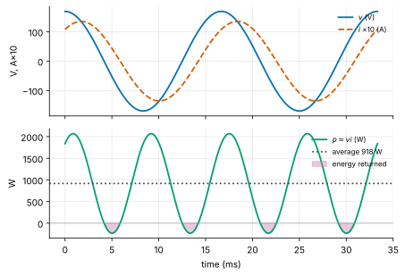
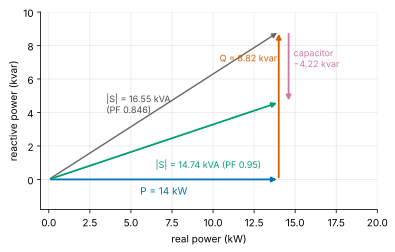
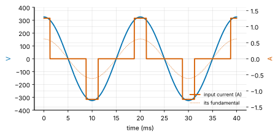

<!-- status: reviewed -->
# 07-06 · AC Power and Power Factor

| | |
|---|---|
| **Course** | [07 · Circuit Analysis II (Transient and AC)](../README.md) |
| **University equivalent** | The "sinusoidal steady-state power calculations" chapter of a sophomore Circuits course (Nilsson & Riedel, *Sinusoidal Steady-State Power Calculations*; Alexander & Sadiku, *AC Power Analysis*) |
| **Prerequisites** | [07-05 Sinusoidal Steady State, Phasors and Impedance](07-05-sinusoidal-steady-state-and-impedance.md), [06-01 Charge, Current, Voltage, Power](../../06-circuit-analysis-1-dc/chapters/06-01-charge-current-voltage-power.md) (power, Tellegen's theorem), [06-09 Maximum Power Transfer](../../06-circuit-analysis-1-dc/chapters/06-09-maximum-power-transfer.md), [01-05 Integrals](../../01-calculus-for-engineers/chapters/01-05-integrals.md) (averages). The facts used from each are restated where they are needed. |
| **Estimated study hours** | 8 |
| **Last verified** | 2026-11-19 |

**Learning objectives.** After this chapter you can:

1. Derive the instantaneous and average power of a sinusoidal load, and explain why reactive elements absorb no average power.
2. Compute RMS values of sinusoidal and non-sinusoidal waveforms, including sums of harmonics, and use crest factor.
3. Compute complex, real, reactive and apparent power from phasors, and use the conservation of complex power to check a circuit.
4. Define power factor for sinusoidal and distorted currents (displacement and distortion), and size capacitors for power-factor correction.
5. Derive the conditions for maximum average power transfer to a complex load, with and without a reactive part.
6. Explain why utilities, standards and power-supply specifications regulate power factor and harmonics, and evaluate claims about them.

## 1. Big picture

A wall socket, a data-center power shelf and a phone charger all deliver energy through sinusoidal voltages. Phasors (07-05) describe the voltages and currents, but power is their **product**, and the product of two sinusoids is not a sinusoid at the same frequency (02-01). This chapter builds the right bookkeeping: the **average** power that does work, the **reactive** power that sloshes back and forth without doing any, and the **power factor** that measures how well a load uses the current it draws. The stakes are concrete: every ampere of current that does no work still heats wires and fills the rating of transformers and generators, so utilities charge for poor power factor, standards limit harmonic currents, and server power supplies are certified on it.

- **Utilities and industry:** commercial tariffs adjust the demand charge when the power factor falls below a threshold (§9).
- **Power supplies:** PC, TV and server supplies above modest power levels use active power-factor correction to meet harmonic standards and efficiency programs (§9).
- **Data centers:** at rack power levels in the tens of kilowatts, the difference between watts and volt-amperes sizes breakers, cables and distribution equipment ([07-11](07-11-three-phase-circuits.md), [22-12](../../22-power-electronics-and-energy-conversion/chapters/22-12-power-systems-fundamentals.md)).
- **RF and antennas:** maximum power transfer to a complex load is conjugate matching, the basis of impedance-matching networks ([13-08](../../13-electromagnetics/chapters/13-08-transmission-lines-sinusoidal-steady-state.md)).

## 2. Intuition first

### Power that comes back

Push a child on a swing: on some parts of the swing you push and the swing gains energy, on others the swing pushes back on your hands. Over a full cycle a lossless swing takes no net energy, though energy moves back and forth twice per cycle. An inductor or capacitor on an AC supply does the same: it absorbs energy for a quarter cycle and returns it the next. **Reactive power** measures the size of that exchange, and its average is zero. Only resistance turns energy into heat or work: that is **real** (or active) power.

### Why the utility cares about energy that comes back

The returning energy still travels through the wires as current, and wires heat with $I^2R$ whatever the current is doing. A factory whose machines draw large reactive currents makes the utility's lines and transformers carry current that delivers no energy. **Power factor**, the fraction of the apparent power $V_{rms}I_{rms}$ that is real power, measures how efficiently a load uses its current.

### An analogy from finance: gross versus net flows

A bank's payments desk might move \$100 million a day through its accounts while the net settlement is \$10 million. The net is what changes anyone's wealth, but the gross flows still cost fees, liquidity and operational capacity. Real power is the net flow; apparent power is the gross flow the infrastructure must carry; power factor is net over gross. *Where it breaks:* a payments gross flow can have any pattern, while AC reactive power is a precise, periodic exchange at twice the line frequency that a capacitor placed next to the load can supply locally, removing it from the lines entirely (§3.6); there is no equally simple netting device in payments.

## 3. Theory

### 3.1 What carries over

> **Recap — phasors and impedance** ([07-05](07-05-sinusoidal-steady-state-and-impedance.md)). A sinusoid $V_m\cos(\omega t + \phi)$ has the peak phasor $\mathbf{V} = V_m\angle\phi$; $\mathbf{V} = Z\mathbf{I}$ with $Z = R + jX$. Phasors add and scale, but **products of sinusoids are not phasors** (02-01 Problem 02-01.17).

> **Recap — power and Tellegen's theorem** ([06-01](../../06-circuit-analysis-1-dc/chapters/06-01-charge-current-voltage-power.md)). The instantaneous power absorbed by an element is $p = vi$ (passive sign convention). In any circuit obeying KCL and KVL, the powers absorbed by all elements sum to zero at every instant (Tellegen's theorem).

**Notation.** In this chapter, phasors labeled "rms" ($\mathbf{V}_{rms} = \mathbf{V}/\sqrt2$) appear alongside the peak phasors used elsewhere; the power formulas are tidier in RMS form, and power engineers and meters always quote RMS (the curriculum's [notation](../../../reference/notation.md) reserves RMS phasors for exactly this use).

### 3.2 Instantaneous and average power

Let $v = V_m\cos(\omega t + \theta_v)$ and $i = I_m\cos(\omega t + \theta_i)$, and write $\theta = \theta_v - \theta_i$ for the angle by which voltage leads current (the impedance angle). With the identity $\cos A\cos B = \tfrac12[\cos(A - B) + \cos(A + B)]$:

$$
p(t) = vi = \frac{V_mI_m}{2}\cos\theta + \frac{V_mI_m}{2}\cos(2\omega t + \theta_v + \theta_i) .
$$

The power has a constant part and a part at **twice** the line frequency. Averaging over a period kills the double-frequency term, so the **average (real) power** is

$$
\boxed{\,P = \frac{V_mI_m}{2}\cos\theta\,}\quad\text{(watts).}
$$

**Special cases.** A resistor ($\theta = 0$) absorbs $P = V_mI_m/2$, and its power never goes negative. An ideal inductor or capacitor ($\theta = \pm90°$) absorbs $P = 0$: its power swings symmetrically positive and negative. A general load ($0 < \lvert\theta\rvert < 90°$) absorbs positive average power, but its instantaneous power goes negative for part of each cycle, when it returns stored energy to the source (Example 07-06.1).

### 3.3 RMS values

The **root-mean-square** (effective) value of a periodic waveform is the DC value that would deliver the same average power to a resistor:

$$
X_{rms} = \sqrt{\frac{1}{T}\int_0^Tx^2\,dt}\, .
$$

For a sinusoid, $\overline{\cos^2} = \tfrac12$, so $X_{rms} = X_m/\sqrt2$. The mains voltage "230 V" or "120 V" is an RMS value; its peak is $\sqrt2$ times larger (325 V or 170 V). In RMS terms the average power becomes

$$
P = V_{rms}I_{rms}\cos\theta .
$$

**Non-sinusoidal waveforms.** For a sum of sinusoids at different frequencies (harmonics of one fundamental), the cross terms average to zero over a period, because $\overline{\cos(m\omega t)\cos(n\omega t)} = 0$ for $m \ne n$. So **RMS values add in quadrature**:

$$
X_{rms}^2 = X_{0}^2 + X_{1,rms}^2 + X_{2,rms}^2 + \cdots ,
$$

with $X_0$ any DC part. Other common cases, from the definition: a square wave of amplitude $\pm A$ has RMS $A$; a triangle or sawtooth of peak $A$ (symmetric about zero, or from 0 to $A$ respectively) has RMS $A/\sqrt3$; a half-wave rectified sine of peak $A$ has RMS $A/2$.

**Crest factor** is peak over RMS: $\sqrt2 = 1.414$ for a sinusoid, $\sqrt3$ for a triangle. Meters that compute true RMS must handle the crest factor of the signal. A cheaper "average-responding" meter measures the average of the rectified signal and multiplies it by the sinusoid's **form factor**, RMS/average $= (V_m/\sqrt2)/(2V_m/\pi) = \pi/(2\sqrt2) = $ **1.111**. It therefore reads any other waveform wrongly: a square wave, whose RMS equals its rectified average, reads **11.1%** high.

### 3.4 Complex power

Define the **complex power** absorbed by a load as

$$
\boxed{\,S = \mathbf{V}_{rms}\mathbf{I}_{rms}^{*} = \tfrac12\mathbf{V}\mathbf{I}^{*} = P + jQ\,}
$$

where * is the complex conjugate. Writing $\mathbf{V}_{rms} = V_{rms}\angle\theta_v$ and $\mathbf{I}_{rms} = I_{rms}\angle\theta_i$, $S = V_{rms}I_{rms}\angle(\theta_v - \theta_i) = V_{rms}I_{rms}(\cos\theta + j\sin\theta)$. So:

- **Real power** $P = \operatorname{Re}S = V_{rms}I_{rms}\cos\theta$, in watts (W): the average power of §3.2.
- **Reactive power** $Q = \operatorname{Im}S = V_{rms}I_{rms}\sin\theta$, in volt-amperes reactive (var): the amplitude of the energy exchange. $Q > 0$ for inductive loads (current lags), $Q < 0$ for capacitive loads (current leads).
- **Apparent power** $\lvert S\rvert = V_{rms}I_{rms}$, in volt-amperes (VA): what the wires and transformers must carry.

**Why $Q$ is the amplitude of the energy exchange.** Take the current as the reference, $i = I_m\cos\omega t$, so $v = V_m\cos(\omega t + \theta)$. The product formula of §3.2 gives $p = \tfrac12V_mI_m[\cos\theta + \cos(2\omega t + \theta)]$. Expanding $\cos(2\omega t + \theta) = \cos2\omega t\cos\theta - \sin2\omega t\sin\theta$ splits it into two parts:

$$
p(t) = \underbrace{P\,(1 + \cos2\omega t)}_{\text{never negative, average }P} \;-\; \underbrace{Q\sin2\omega t}_{\text{average zero}} .
$$

The first term is the power that flows one way only and is consumed. The second surges into the load and back out again at twice the line frequency, with amplitude $Q$: reactive power is the peak rate of that back-and-forth exchange. For an inductor, $Q_L = \omega LI_{rms}^2 = 2\omega\overline{W}_L$, where $\overline{W}_L = \tfrac12LI_{rms}^2$ is its average stored energy. For a capacitor, $Q_C = -\omega CV_{rms}^2 = -2\omega\overline{W}_C$. So for any load, $Q = 2\omega(\overline{W}_L - \overline{W}_C)$: positive when magnetic storage dominates, negative when electric storage does. This is the physical anchor for the sign convention.

With $\mathbf{V}_{rms} = Z\mathbf{I}_{rms}$: $S = Z\lvert\mathbf{I}_{rms}\rvert^2 = (R + jX)I_{rms}^2$, so $P = I_{rms}^2R$ and $Q = I_{rms}^2X$: resistance absorbs real power, reactance reactive power. The **power triangle** draws $P$, $Q$ and $\lvert S\rvert$ as the sides of a right triangle with angle θ.

**Why the conjugate.** $\mathbf{V}\mathbf{I}$ would have angle $\theta_v + \theta_i$, which depends on the arbitrary time origin; $\mathbf{V}\mathbf{I}^*$ has angle $\theta_v - \theta_i$, which does not. The real part of $\tfrac12\mathbf{V}\mathbf{I}^*$ is exactly the average power of §3.2.

**Conservation of complex power.** Tellegen's theorem (06-01) holds for any set of currents and voltages that satisfy KCL and KVL on the same network, including the phasors $\mathbf{V}$ and the conjugated phasors $\mathbf{I}^*$ (conjugation preserves KCL, because it is linear over real coefficients). So **the complex powers of all elements in a circuit sum to zero**: real power balances, and so does reactive power separately. The sources supply exactly the $P$ the resistors absorb and exactly the $Q$ the reactances absorb (Problem 07-06.4). This is a powerful check on any AC calculation.

### 3.5 Power factor

The **power factor** is the ratio of real to apparent power:

$$
\text{PF} = \frac{P}{\lvert S\rvert} .
$$

For sinusoidal voltage and current, $\text{PF} = \cos\theta$, the **displacement** power factor, described as **lagging** (inductive load, current behind voltage) or **leading** (capacitive). For a given real power $P$ at voltage $V_{rms}$, the current is

$$
I_{rms} = \frac{P}{V_{rms}\,\text{PF}} ,
$$

so the line loss $I_{rms}^2R_{line} = P^2R_{line}/(V_{rms}^2\,\text{PF}^2)$ grows as $1/\text{PF}^2$. A load at PF 0.7 needs 43% more current than at unity and causes about twice the line loss, for the same useful power. Generators, transformers and cables are rated in VA (they care about current and voltage, not the angle between them), which is why poor power factor costs capacity as well as energy.

### 3.6 Power-factor correction

Most industrial loads (motors, transformers, fluorescent ballasts) are inductive: they draw lagging current. A capacitor connected in parallel with the load supplies leading current, which cancels part of the load's lagging reactive current; the load's voltage and real power are unchanged, but the source supplies less reactive power. To raise the power factor from $\text{PF}_1$ (angle $\theta_1$) to $\text{PF}_2$ (angle $\theta_2$) at constant $P$:

$$
Q_C = Q_1 - Q_2 = P(\tan\theta_1 - \tan\theta_2) .
$$

A capacitor at RMS voltage $V_{rms}$ and angular frequency ω absorbs $Q = -\omega CV_{rms}^2$ (from $S = V_{rms}^2/Z^* = V_{rms}^2\cdot(-j\omega C)$), so the required capacitance is

$$
\boxed{\,C = \frac{P(\tan\theta_1 - \tan\theta_2)}{\omega V_{rms}^2}\,}
$$

Engineers usually correct to about 0.95 rather than to exactly 1: the last few percent need disproportionately large capacitors ($\tan\theta$ changes slowly near zero), and over-correcting to a leading power factor is as bad as lagging, and can raise the voltage at light load (Problem 07-06.6).

### 3.7 Power factor with distorted currents

Many modern loads draw **non-sinusoidal** current from a sinusoidal voltage. A rectifier feeding a capacitor (the input of a simple power supply) draws current only in short pulses near the voltage peaks, when the line voltage exceeds the capacitor's. Expand such a current into harmonics: $i = \sum_k\sqrt2I_k\cos(k\omega t + \phi_k)$. With a sinusoidal voltage at the fundamental frequency, only the fundamental current carries average power (the other products average to zero, as in §3.3):

$$
P = V_{rms}I_{1}\cos\phi_1, \qquad \lvert S\rvert = V_{rms}I_{rms}, \qquad I_{rms} = \sqrt{I_1^2 + I_2^2 + I_3^2 + \cdots} .
$$

So the **true power factor** factors into a displacement part and a distortion part:

$$
\boxed{\,\text{PF} = \frac{P}{V_{rms}I_{rms}} = \underbrace{\cos\phi_1}_{\text{displacement}}\times\underbrace{\frac{I_1}{I_{rms}}}_{\text{distortion}} = \frac{\cos\phi_1}{\sqrt{1 + \text{THD}^2}}\,}
$$

with the **total harmonic distortion** $\text{THD} = \sqrt{I_2^2 + I_3^2 + \cdots}/I_1$. A pulsed current exactly in phase with the voltage can therefore have a poor power factor without any phase shift at all (Example 07-06.5), and no capacitor fixes it: the cure is to shape the current, with an **active power-factor-correction** stage (a boost converter controlled to draw sinusoidal current, Course 22), or with passive filtering. In a three-phase system, the triplen harmonic currents (3rd, 9th, 15th, …) add in the neutral wire while the others cancel ([07-11](07-11-three-phase-circuits.md)).

> **Going deeper — reactive power with distortion.** For non-sinusoidal waveforms, $P^2 + Q^2$ no longer equals $\lvert S\rvert^2$: the remainder, sometimes called distortion power $D$ with $\lvert S\rvert^2 = P^2 + Q^2 + D^2$, accounts for the harmonic currents that carry no power. Definitions of reactive power for distorted waveforms differ between standards (IEEE Std 1459 is the reference for the debate), and meters do not all agree; when a number is quoted, ask which definition it uses.

### 3.8 Maximum average power transfer

A source with Thévenin equivalent $\mathbf{V}_{Th}$ (peak) and $Z_{Th} = R_{Th} + jX_{Th}$ drives a load $Z_L = R_L + jX_L$. The current is $\mathbf{I} = \mathbf{V}_{Th}/(Z_{Th} + Z_L)$, and the load's average power is

$$
P_L = \tfrac12\lvert\mathbf{I}\rvert^2R_L = \frac{\lvert\mathbf{V}_{Th}\rvert^2}{2}\,\frac{R_L}{(R_{Th} + R_L)^2 + (X_{Th} + X_L)^2} .
$$

- **Choosing $X_L$:** $X_L$ appears only in the denominator's second term, which is smallest (zero) when $X_L = -X_{Th}$: cancel the source's reactance.
- **Then choosing $R_L$:** the remaining expression $R_L/(R_{Th} + R_L)^2$ is the DC problem of 06-09, maximized at $R_L = R_{Th}$.

So the maximum is reached with the **conjugate match** $Z_L = Z_{Th}^*$, giving

$$
\boxed{\,P_{max} = \frac{\lvert\mathbf{V}_{Th}\rvert^2}{8R_{Th}} = \frac{V_{Th,rms}^2}{4R_{Th}}\,}
$$

If the load must be purely resistive ($X_L = 0$), its power is $P_L = \tfrac12\lvert\mathbf{V}_{Th}\rvert^2R_L/[(R_{Th} + R_L)^2 + X_{Th}^2]$. Setting $dP_L/dR_L = 0$ makes the numerator of the derivative vanish: $(R_{Th} + R_L)^2 + X_{Th}^2 - 2R_L(R_{Th} + R_L) = 0$, that is $R_{Th}^2 + X_{Th}^2 - R_L^2 = 0$. So $R_L = \sqrt{R_{Th}^2 + X_{Th}^2} = \lvert Z_{Th}\rvert$, with less power than the conjugate match (Example 07-06.4). As in 06-09, a matched source wastes as much power as it delivers (50% efficiency): conjugate matching is for signals (antennas, RF amplifier stages, sensors), not for power delivery, where the source impedance is kept far below the load's.

## 4. Worked examples

### Example 07-06.1 · Power in an RL load on the mains (tier A)

**Setup.** A 120 V (RMS), 60 Hz supply feeds a load of 10 Ω in series with 20 mH. Find (a) the impedance, (b) the current (RMS), (c) $P$, $Q$, $\lvert S\rvert$ and the power factor, and (d) the largest and smallest values of the instantaneous power.

**Solution.**

(a) $\omega = $ **377.0 rad/s**, so $X = \omega L = $ **7.540 Ω** and $Z = 10 + j7.540$ Ω $= $ **12.52 Ω ∠ 37.02°**.

(b) $I_{rms} = 120/12.52 = $ **9.582 A**, lagging the voltage by 37.02°.

(c) $S = \mathbf{V}_{rms}\mathbf{I}_{rms}^* = 120\times9.582\angle37.02° = 918.1 + j692.2$ VA: $P$ = **918.1 W**, $Q$ = **692.2 var**, $\lvert S\rvert$ = **1150 VA**, and PF $= \cos37.02° = $ **0.7985** lagging. Check: $I_{rms}^2R = 9.582^2\times10 = 918.1$ W ✓ and $I_{rms}^2X = 692.2$ var ✓.

(d) $p(t) = P + \lvert S\rvert\cos(2\omega t + \ldots)$ swings between $P + \lvert S\rvert = $ **2068 W** and $P - \lvert S\rvert = $ **−231.7 W**. For about 21% of each cycle the load returns energy to the supply: its inductor giving back what it stored.

*Figure 1. Example 07-06.1: the power oscillates at twice the line frequency around its average of 918 W and dips below zero when the inductor returns energy.*

**Units check.** V × A = W (or VA, var) ✓.
**Sanity check.** $P^2 + Q^2 = 918.1^2 + 692.2^2 = 1150^2$ ✓.

### Example 07-06.2 · RMS of non-sinusoidal waveforms (tier A)

**Setup.** Find the RMS value and crest factor of (a) a triangle wave of peak 1 V, symmetric about zero, and (b) a current $i = 10\cos\omega t + 3\cos3\omega t$ A. For (b), also find the THD.

**Solution.**

(a) Over a quarter period the triangle rises linearly from 0 to $A$, so its mean square is $\frac{1}{T/4}\int_0^{T/4}\big(4At/T\big)^2dt = A^2/3$: RMS $= A/\sqrt3 = $ **0.5774 V**, crest factor $\sqrt3 = $ **1.732**.

(b) The components are at different frequencies, so their RMS values add in quadrature: $I_{rms} = \sqrt{(10^2 + 3^2)/2} = $ **7.382 A**. The peak occurs at $\omega t = 0$, where both cosines are 1: **13.00 A**, so the crest factor is $13/7.382 = $ **1.761**, above a sinusoid's 1.414. THD $= 3/10 = $ **30.0%**.

**Units check.** A² averaged, then square-rooted, gives A ✓.
**Sanity check.** A pure sinusoid of the same 10 A fundamental would have an RMS of **7.071 A**; the third harmonic adds only **0.311 A**, because quadrature sums are dominated by the largest term ✓.

### Example 07-06.3 · A small business corrects its power factor (tier B)

**Setup.** A business is supplied at 230 V (RMS), 50 Hz. Its loads are a 10 kW motor group at power factor 0.75 lagging and 4 kW of resistive heating. (a) Find the total complex power, the power factor and the current. (b) Size a capacitor bank that raises the power factor to 0.95 lagging, in kvar and µF. (c) Find the new current and the ratio of line losses after and before. (d) Under a tariff that bills demand as measured kW × 0.90 / PF when PF is below 0.90 (§9), what demand is billed before and after?

**Solution.**

(a) Motor: $Q = P\tan\theta = 10\tan(\arccos0.75) = 8.819$ kvar. Heating: $Q = 0$. Total $S = 14 + j8.819$ kVA, $\lvert S\rvert = $ **16.55 kVA**, PF $= 14/16.55 = $ **0.8461** lagging, $I = 16\,546/230 = $ **71.94 A**.

(b) $Q_C = P(\tan\theta_1 - \tan\theta_2) = 14\big(0.6299 - 0.3287\big) = $ **4.218 kvar**, so $C = Q_C/(\omega V^2) = 4218/(314.16\times230^2) = $ **253.8 µF**.

(c) $I = P/(V\times0.95) = $ **64.07 A**, and the line losses scale as $I^2$: $(64.07/71.94)^2 = $ **0.7933**, a 21% cut for the same useful power.

(d) Before: $14\times0.90/0.8461 = $ **14.89 kW** billed. After: PF ≥ 0.90, so the measured **14.00 kW**. The capacitor removes a **6.4%** demand surcharge.

*Figure 2. Example 07-06.3: the capacitor removes 4.22 kvar of reactive power, shrinking the apparent power at constant real power.*

**Units check.** W/(rad/s × V²) = (V·A)/(V²/s) = A·s/V = F ✓.
**Sanity check.** Correcting all the way to unity would need $Q_C = $ **8.819 kvar**, more than twice as much, to cut the current only from 64.07 A to **60.87 A**: diminishing returns ✓.

### Example 07-06.4 · Matching a complex source (tier B)

**Setup.** A source has $\mathbf{V}_{Th} = 10\angle0°$ V (peak) and $Z_{Th} = 50 + j30$ Ω. (a) Find the load for maximum power and that power. (b) If the load must be a resistor, which value is best, and what power does it receive?

**Solution.**

(a) Conjugate match: $Z_L = $ **50 − j30 Ω**, with $P_{max} = \lvert\mathbf{V}_{Th}\rvert^2/(8R_{Th}) = 100/400 = $ **0.2500 W**.

(b) $R_L = \lvert Z_{Th}\rvert = \sqrt{50^2 + 30^2} = $ **58.31 Ω**. Then $\lvert\mathbf{I}\rvert = 10/\lvert108.31 + j30\rvert = 0.08898$ A and $P_L = \tfrac12(0.08898)^2(58.31) = $ **0.2308 W**: **92.3%** of the conjugate-matched maximum.

**Units check.** V²/Ω = W ✓.
**Sanity check.** With no reactance in the source ($X_{Th} = 0$), both answers would reduce to 06-09's $R_L = R_{Th}$ ✓.

### Example 07-06.5 · Power factor without phase shift (tier C)

**Setup.** A rectifier-capacitor power supply on a 230 V (RMS), 50 Hz line draws 100 W. Model its current as rectangular pulses 2.5 ms wide, centered on each voltage peak (positive pulses at the positive peaks, negative at the negative peaks), so the current's fundamental is exactly in phase with the voltage. Find (a) the pulse height, (b) the RMS current and apparent power, (c) the power factor, the distortion factor and the THD, and (d) the third harmonic as a fraction of the fundamental.

**Solution.**

(a) Only the fundamental carries power (§3.7), and it is in phase, so $P = V_{rms}I_1$ and $I_1 = 100/230 = $ **0.4348 A** (RMS). The fundamental of alternating rectangular pulses of height $I_p$ and width $W$ centered on the cosine's peaks has peak amplitude $a_1 = \frac{4I_p}{\pi}\sin\frac{\omega W}{2}$. To see this, use the Fourier coefficient of [01-06 §3.3](../../01-calculus-for-engineers/chapters/01-06-techniques-of-integration.md), $a_1 = \frac2T\int_Ti\cos\omega t\,dt$. The positive pulse, centered on $t = 0$, contributes $\frac2TI_p\int_{-W/2}^{W/2}\cos\omega t\,dt = \frac{4I_p}{\omega T}\sin\frac{\omega W}{2}$. The negative pulse, centered on $T/2$, contributes the same, because there both $i$ and $\cos\omega t$ change sign. With $\omega T = 2\pi$ the total is $\frac{8I_p}{2\pi}\sin\frac{\omega W}{2}$, as stated, and the same integral with $\cos3\omega t$ gives part (d). with $\omega W/2 = 2\pi\times50\times1.25\times10^{-3} = 0.3927$ rad, $I_p = \dfrac{\pi\sqrt2\,I_1}{4\sin0.3927} = $ **1.262 A**.

(b) The current is $\pm I_p$ for a fraction $d = 2W/T = 0.25$ of the time and zero otherwise, so $I_{rms} = I_p\sqrt{d} = $ **0.6310 A**, and $\lvert S\rvert = 230\times0.6310 = $ **145.1 VA**.

(c) PF $= 100/145.1 = $ **0.6891**. The displacement factor is 1 (no phase shift), so all of it is distortion: $I_1/I_{rms} = 0.6891$, and $\text{THD} = \sqrt{1/0.6891^2 - 1} = $ **105.2%**.

(d) The third harmonic's amplitude is $\frac{4I_p}{3\pi}\sin\frac{3\omega W}{2}$, which is **80.47%** of the fundamental.

*Figure 3. Example 07-06.5: current flows only near the voltage peaks; its fundamental is in phase with the voltage, yet the power factor is 0.69.*

**Units check.** V × A = VA ✓.
**Sanity check.** A capacitor across this load would add a leading displacement and make the power factor *worse*; only shaping the current helps. With active power-factor correction drawing sinusoidal current, the same 100 W would need only 0.4348 A RMS instead of 0.6310 A ✓.

### Example 07-06.6 · A data-center power supply (tier B)

**Setup.** A server power supply delivers 2 kW (DC) at 94% efficiency from a 230 V (RMS) line. Find its input power, apparent power and RMS input current at a power factor of 0.95, and again at 0.70. How many such supplies fit on a 32 A (RMS) branch circuit at each power factor?

**Solution.** Input power $P_{in} = 2000/0.94 = $ **2128 W** in both cases. At PF 0.95: $\lvert S\rvert = 2128/0.95 = $ **2240 VA** and $I = 2240/230 = $ **9.738 A**. At PF 0.70: $\lvert S\rvert = $ **3040 VA** and $I = $ **13.22 A**. A 32 A circuit carries $\lfloor32/9.738\rfloor = $ **3** supplies at PF 0.95 but only $\lfloor32/13.22\rfloor = $ **2** at 0.70: one supply fewer for the same useful power. Many electrical codes also limit continuous loads to 80% of the breaker rating (07-11 §9). At 25.6 A the counts fall to **2** and **1**.

**Units check.** W ÷ (dimensionless) = VA; VA ÷ V = A ✓.
**Sanity check.** The real power, and so the energy bill at the meter, is the same in both cases; what the poor power factor costs is distribution capacity, which in a data center is often the binding constraint ✓.

<!-- answer-key -->
| ID | Quantity | Value | Unit |
|---|---|---|---|
| Th 07-06.a | sinusoid form factor | 1.111 | — |
| Th 07-06.b | square-wave reading error of an average-responding meter | 11.1 | % |
| Ex 07-06.1a | $\lvert Z\rvert$ | 12.52 | Ω |
| Ex 07-06.1b | impedance angle | 37.02 | ° |
| Ex 07-06.1c | $I_{rms}$ | 9.582 | A |
| Ex 07-06.1d | P | 918.1 | W |
| Ex 07-06.1e | Q | 692.2 | var |
| Ex 07-06.1f | $\lvert S\rvert$ | 1150 | VA |
| Ex 07-06.1g | power factor | 0.7985 | — |
| Ex 07-06.1h | maximum instantaneous power | 2068 | W |
| Ex 07-06.1i | minimum instantaneous power | −231.7 | W |
| Ex 07-06.1j | fraction of the cycle with p < 0 | 21 | % |
| Ex 07-06.1k | ω | 377.0 | rad/s |
| Ex 07-06.1l | reactance | 7.540 | Ω |
| Ex 07-06.2a | triangle RMS | 0.5774 | V |
| Ex 07-06.2b | triangle crest factor | 1.732 | — |
| Ex 07-06.2c | RMS of the two-tone current | 7.382 | A |
| Ex 07-06.2d | peak of the two-tone current | 13.00 | A |
| Ex 07-06.2e | its crest factor | 1.761 | — |
| Ex 07-06.2f | THD | 30.0 | % |
| Ex 07-06.2g | RMS of the fundamental alone | 7.071 | A |
| Ex 07-06.2h | increase from the third harmonic | 0.311 | A |
| Ex 07-06.3a | $\lvert S\rvert$ before | 16.55 | kVA |
| Ex 07-06.3b | PF before | 0.8461 | — |
| Ex 07-06.3c | current before | 71.94 | A |
| Ex 07-06.3d | capacitor kvar | 4.218 | kvar |
| Ex 07-06.3e | capacitance | 253.8 | µF |
| Ex 07-06.3f | current after | 64.07 | A |
| Ex 07-06.3g | loss ratio after/before | 0.7933 | — |
| Ex 07-06.3h | billed demand before | 14.89 | kW |
| Ex 07-06.3i | billed demand after | 14.00 | kW |
| Ex 07-06.3j | kvar to reach unity PF | 8.819 | kvar |
| Ex 07-06.3k | current at unity PF | 60.87 | A |
| Ex 07-06.3l | demand surcharge removed | 6.4 | % |
| Ex 07-06.3m | sum of the apparent-power magnitudes | 17.33 | kVA |
| Ex 07-06.4a | $P_{max}$ | 0.2500 | W |
| Ex 07-06.4b | best resistive load | 58.31 | Ω |
| Ex 07-06.4c | power to it | 0.2308 | W |
| Ex 07-06.4d | fraction of $P_{max}$ | 92.3 | % |
| Ex 07-06.5a | fundamental RMS current | 0.4348 | A |
| Ex 07-06.5b | pulse height | 1.262 | A |
| Ex 07-06.5c | RMS current | 0.6310 | A |
| Ex 07-06.5d | apparent power | 145.1 | VA |
| Ex 07-06.5e | power factor | 0.6891 | — |
| Ex 07-06.5f | THD | 105.2 | % |
| Ex 07-06.5g | third harmonic relative to the fundamental | 80.47 | % |
| Ex 07-06.6a | input power | 2128 | W |
| Ex 07-06.6b | apparent power at PF 0.95 | 2240 | VA |
| Ex 07-06.6c | current at PF 0.95 | 9.738 | A |
| Ex 07-06.6d | apparent power at PF 0.70 | 3040 | VA |
| Ex 07-06.6e | current at PF 0.70 | 13.22 | A |
| Ex 07-06.6f | supplies per 32 A at PF 0.95 | 3 | — |
| Ex 07-06.6g | supplies per 32 A at PF 0.70 | 2 | — |
| Ex 07-06.6h | supplies at 80% (25.6 A), PF 0.95 | 2 | — |
| Ex 07-06.6i | supplies at 80% (25.6 A), PF 0.70 | 1 | — |

*Every value in this table is recomputed by [verify_07_06.py](../verify/verify_07_06.py), most by numerical integration of $v(t)i(t)$ over a period rather than by the phasor formulas; ngspice confirms Examples 07-06.1 and 07-06.3 in [labs/07-06-lab](../labs/07-06-lab/README.md).*

## 5. Simulate it

The lab is in [labs/07-06-lab/](../labs/07-06-lab/README.md).

**Notebook** (`07-06-power.ipynb`):

1. Plot $v$, $i$ and $p$ for loads from resistive to purely reactive, and watch the average move while the oscillation stays.
2. Compute RMS values numerically and confirm the quadrature rule for harmonics.
3. Size a power-factor-correction capacitor and check conservation of complex power element by element.
4. Change the rectifier pulse width of Example 07-06.5 and map power factor against THD.

**ngspice netlists** measure average power, RMS current and the effect of a correction capacitor in transient simulations of Examples 07-06.1 and 07-06.3; `python tools/run_spice.py 07-06` checks them.

**Guided exercise (predict, then run).** In the rectifier cell, widen the pulses from 2.5 ms to 5 ms at the same 100 W. **Before running,** predict whether the power factor rises or falls, and why. Hint: wider pulses are closer to a sinusoid.

## 6. Engineering tradeoffs

| Knob | Improves | Costs | Typical decision owner |
|---|---|---|---|
| Correct PF to 0.95 rather than 1.0 | Captures most of the current reduction | A little residual reactive current | Facility or power engineer |
| Capacitor banks for PF correction | Lower current, losses and demand charges | Capital cost; resonance with harmonic currents; switching transients; over-correction at light load | Facility engineer, utility |
| Active PFC in a power supply | PF near 1, low harmonics, compliance | An extra converter stage: cost, area, some efficiency, EMI design | Power-supply designer |
| Higher distribution voltage | Less current and $I^2R$ loss for the same power | Insulation, safety, equipment cost | Data-center or system architect |
| Conjugate matching | Maximum power to the load | 50% efficiency; narrow bandwidth of the match | RF or sensor designer |
| Oversizing transformers and cables | Headroom for poor PF and harmonics | Capital cost and space | Electrical engineer |

## 7. Numbers to know

| Quantity | Value | Note |
|---|---|---|
| RMS of a sinusoid | peak/√2 (230 V RMS = 325 V peak; 120 V = 170 V) | |
| Crest factor | 1.414 (sine), 1.732 (triangle), 1 (square) | |
| Line loss versus PF | ∝ 1/PF²: PF 0.7 roughly doubles loss versus unity | §3.5 |
| PF correction | $Q_C = P(\tan\theta_1 - \tan\theta_2)$ | §3.6 |
| True PF with distortion | $\cos\phi_1/\sqrt{1 + \text{THD}^2}$ | §3.7 |
| Harmonic standard scope | IEC 61000-3-2: equipment ≤ 16 A per phase on public low-voltage networks; edition 5.0 (2018) with amendments 2020 and 2024 | [R-122](../../../reference/research-log.md#r-122--power-factor-harmonics-and-utility-tariffs) **[Established]** |
| Class D threshold | PCs, monitors, TVs from 75 W input; harmonics to the 39th | onsemi PFC handbook, [R-122](../../../reference/research-log.md#r-122--power-factor-harmonics-and-utility-tariffs) **[Industry estimate]** |
| 80 PLUS PF floors (115 V internal) | PF ≥ 0.90 (Standard to Gold), ≥ 0.95 (Platinum and up); Titanium and Ruby at 20% load | [R-122](../../../reference/research-log.md#r-122--power-factor-harmonics-and-utility-tariffs) **[Established]** |
| 80 PLUS data-center Ruby | 90/91/95/96.5/92% efficiency at 5/10/20/50/100% load; PF ≥ 0.96 from 20% load | [R-122](../../../reference/research-log.md#r-122--power-factor-harmonics-and-utility-tariffs) **[Established]** |
| Utility PF thresholds | 0.90 common (Austin Energy, Minnesota Power); 0.95 (City of Dover, DE) | [R-122](../../../reference/research-log.md#r-122--power-factor-harmonics-and-utility-tariffs) **[Established]**, utility-specific |

## 8. Common mistakes

1. **Using peak values in RMS formulas** (or the reverse): $P = V_{rms}I_{rms}\cos\theta = \tfrac12V_mI_m\cos\theta$.
2. **Forgetting the conjugate** in $S = \mathbf{V}_{rms}\mathbf{I}_{rms}^*$; the product without it depends on the time origin.
3. **Adding apparent powers.** Complex powers add; their magnitudes do not (in Example 07-06.3 the total is 16.55 kVA, not the 13.33 + 4 = **17.33 kVA** that adding the motor's and the heater's apparent powers would give).
4. **Sign of Q.** Inductive loads absorb positive Q; capacitors absorb negative Q (they supply reactive power).
5. **Assuming PF = cos θ for distorted currents.** It is only the displacement part; distortion lowers the true PF further.
6. **Adding a capacitor to a rectifier's poor power factor.** Distortion is not a phase shift; current shaping is the cure.
7. **Over-correcting.** A leading power factor is still a poor power factor, and can raise voltages at light load.
8. **Using conjugate matching for power delivery.** It caps efficiency at 50%.

## 9. Practitioner lens

### State of the art (as of Nov 2026)

- **Harmonic limits drive power-factor correction in consumer electronics.** IEC 61000-3-2 sets harmonic current limits for equipment with input current up to 16 A per phase on public low-voltage networks; the current text is edition 5.0 (2018) consolidated with amendments of 2020 and 2024, and the standard notes that its limits "have not yet been considered" for systems below 220 V line-to-neutral ([R-122](../../../reference/research-log.md#r-122--power-factor-harmonics-and-utility-tariffs)) **[Established]**. onsemi's power-factor-correction handbook states that the Class D limits, for personal computers, televisions and monitors, apply from 75 W of input power and cover harmonics up to the 39th, which is why such supplies carry PFC stages **[Established]** (from a manufacturer's handbook; the standard's clause itself was not read). In 120 V markets, PFC requirements arrive through efficiency programs and customer specifications rather than this standard (our inference from its scope).
- **Efficiency programs specify power factor.** The 80 PLUS program, administered by CLEAResult, certifies power supplies on efficiency at several load points and on a minimum "true power factor", which its test protocol (revision 6.7.3, Jul 2025) defines as $P/S$ "including the effect of both displacement and distortion". For 115 V internal supplies the summary table requires PF ≥ 0.90 for Standard to Gold and PF ≥ 0.95 for Platinum and above, with Titanium and the new Ruby tier tested at 20% load, where PF is hardest to hold. For redundant data-center supplies, Ruby requires 90/91/95/96.5/92% efficiency at 5/10/20/50/100% load and PF ≥ 0.96 from 20% load up ([R-122](../../../reference/research-log.md#r-122--power-factor-harmonics-and-utility-tariffs)) **[Established]**. *Caveat:* the program's web page gives PF ≥ 0.95 for Bronze to Gold in its per-tier text but 0.90 in its table; this chapter follows the table **[Contested]**.
- **Utilities bill for poor power factor.** Austin Energy and Minnesota Power adjust a commercial customer's billed demand when PF falls below 0.90, as billed kW = measured kW × 0.90 / PF; Minnesota Power's example turns 100 kW at PF 0.70 into **128.6 kW** (129 kW as published), and Austin Energy's turns 13.5 kW at PF 0.87 into **14.0 kW**. The City of Dover, Delaware, uses 0.95, so its example of 250 kW at PF 0.85 bills as **279.4 kW** ([R-122](../../../reference/research-log.md#r-122--power-factor-harmonics-and-utility-tariffs)) **[Established]** (from the utilities' customer pages; thresholds vary by utility and change).

<!-- answer-key -->
| ID | Quantity | Value | Unit |
|---|---|---|---|
| PL 07-06.a | Minnesota Power example, billed demand | 128.6 | kW |
| PL 07-06.b | Austin Energy example, billed demand (13.5 kW at PF 0.87) | 14.0 | kW |
| PL 07-06.c | City of Dover example, billed demand (250 kW at PF 0.85) | 279.4 | kW |

### Why it matters commercially

- **Data-center capacity is current-limited.** A facility's breakers, busways and transformers are rated in amperes and VA; supplies with high power factor let more real compute fit on the same electrical infrastructure (Example 07-06.6). Efficiency and power factor at light load matter because in an N+N redundant arrangement each supply carries at most half of what it could, so supplies spend their lives at or below 50% load.
- **PFC is a semiconductor market.** Active PFC stages use controllers, MOSFETs or GaN/SiC switches and boost diodes. The highest efficiency tiers leave little room for loss in the PFC stage, which is where the bridgeless topologies and wide-bandgap switches of Course 22 come in ([22](../../22-power-electronics-and-energy-conversion/README.md)).
- **Industrial customers buy correction equipment** to avoid demand surcharges; the payback is a simple calculation like Example 07-06.3.

### Marketing vs Reality

- **"Power factor 0.99."** *Reality:* at what load and line voltage? PFC stages lose power factor at light load, which is why the top 80 PLUS tiers test at 20% load. *Sanity check:* ask for PF across the load range, at the actual line voltage.
- **"Saves energy by improving power factor."** *Reality:* correcting power factor at a load reduces current and the *distribution* losses upstream, and may remove a demand surcharge, but it does not reduce the real power the load uses. *Sanity check:* separate savings on the energy (kWh) bill from savings on demand charges and upstream losses.
- **"True RMS" claims.** *Reality:* a meter must sample fast enough and handle the waveform's crest factor; a peaky rectifier current with a crest factor of 2 or more can exceed a cheap meter's rating. *Sanity check:* look for the crest-factor and bandwidth specifications.

### Questions for engineering leaders

1. **"What is your supplies' power factor and THD at 10%, 20% and 50% load, at both 115 V and 230 V?"**
   - *Strong:* curves across load and line, measured to the certification protocol.
   - *Evasive:* a single "PF > 0.99" figure.
2. **"How much of your data center's electrical capacity is lost to power factor and harmonics?"**
   - *Strong:* measured kW/kVA at the switchboard, neutral-current measurements, and transformer derating for harmonics.
   - *Evasive:* "the supplies are 80 PLUS certified".
3. **"How did you size your power-factor-correction capacitors, and how do you avoid resonance with harmonic currents and over-correction at light load?"**
   - *Strong:* an analysis of harmonic resonance, detuned (filtered) capacitor banks, automatic switching by steps.
   - *Evasive:* "we installed the vendor's recommended bank".
4. **"Which PFC topology does your next supply use, and what does it buy in efficiency at light load?"**
   - *Strong:* topology, switch technology, measured efficiency and PF at 10–20% load against the target tier.
   - *Evasive:* "GaN makes it more efficient".

## 10. Concept check

**Q1.** Why does an ideal inductor on an AC supply absorb no average power?

Answer

Its current lags its voltage by 90°, so $P = V_{rms}I_{rms}\cos90° = 0$: the instantaneous power swings equally positive and negative at twice the line frequency as the inductor stores and returns energy.

**Q2.** What is the RMS value of $5 + 4\cos\omega t$ V?

Answer

DC and AC parts add in quadrature: $\sqrt{5^2 + 4^2/2} = \sqrt{33} = 5.74$ V.

**Q3.** Why does complex power use the conjugate of the current?

Answer

So that its angle is $\theta_v - \theta_i$, independent of the time origin, and its real part equals the average power; $\mathbf{V}\mathbf{I}$ would carry the meaningless sum of angles.

**Q4.** A load draws 10 kW at PF 0.8 lagging. How much reactive power must a capacitor supply to reach unity power factor?

Answer

$Q = P\tan\theta = 10\times0.75 = 7.5$ kvar.

**Q5.** A power supply's input current is in phase with the voltage, yet its power factor is 0.7. How?

Answer

The current is distorted (pulses near the voltage peaks). Only the fundamental carries power, while all harmonics add to the RMS current: PF = displacement (1) × distortion ($I_1/I_{rms}$ = 0.7).

**Q6.** Why is conjugate matching wrong for delivering mains power to a heater?

Answer

It maximizes the power delivered for a *given* source impedance, at 50% efficiency: half the power would be lost in the source. Power systems make the source impedance much smaller than the load's and accept less than "maximum" power in exchange for high efficiency.

**Q7.** Why do the higher 80 PLUS tiers test power factor at 20% load?

Answer

Power factor of PFC stages degrades at light load, and supplies, especially redundant data-center ones, spend much of their time lightly loaded; testing there forces good behavior where it is hardest.

**Q8.** In a circuit with two sources and several loads, how can you check an AC power calculation?

Answer

Sum the complex powers absorbed by every element, sources included: by conservation of complex power the total must be zero, real and reactive parts separately.

Now work the full problem set: [07-06 problems](../problems/07-06-problems.md) (worked solutions in [07-06 solutions](../solutions/07-06-solutions.md)).

## 11. Key terms

[Average (real) power](../../../reference/glossary.md#average-real-power) ·
[RMS value](../../../reference/glossary.md#rms-value) ·
[Crest factor](../../../reference/glossary.md#crest-factor) ·
[Complex power](../../../reference/glossary.md#complex-power) ·
[Reactive power](../../../reference/glossary.md#reactive-power) ·
[Apparent power](../../../reference/glossary.md#apparent-power) ·
[Power factor](../../../reference/glossary.md#power-factor) ·
[Power-factor correction](../../../reference/glossary.md#power-factor-correction) ·
[Total harmonic distortion (THD)](../../../reference/glossary.md#total-harmonic-distortion-thd) ·
[Conjugate matching](../../../reference/glossary.md#conjugate-matching)

## 12. Connections

- **Builds on:** [07-05](07-05-sinusoidal-steady-state-and-impedance.md) (phasors and impedance), [06-01](../../06-circuit-analysis-1-dc/chapters/06-01-charge-current-voltage-power.md) (power and Tellegen's theorem), [06-09](../../06-circuit-analysis-1-dc/chapters/06-09-maximum-power-transfer.md) (maximum power transfer), [02-01](../../02-complex-numbers-des-and-linear-algebra/chapters/02-01-complex-numbers-euler-and-phasors.md) (products of sinusoids).
- **Next:** [07-07 Frequency Response and Bode Plots](07-07-frequency-response-and-bode-plots.md).
- **Used later in:**
  - [07-09](07-09-mutual-inductance-and-transformers.md) and [07-11](07-11-three-phase-circuits.md): transformers and three-phase power.
  - [11](../../11-signals-and-systems/README.md): Fourier series behind the harmonic analysis of §3.7.
  - [22](../../22-power-electronics-and-energy-conversion/README.md): active PFC converters.
  - [22-12](../../22-power-electronics-and-energy-conversion/chapters/22-12-power-systems-fundamentals.md): power flow, reactive power and voltage control.

## 13. Further study

- **Nilsson & Riedel, *Electric Circuits*:** "Sinusoidal Steady-State Power Calculations" (average and reactive power, complex power, maximum power transfer).
- **Alexander & Sadiku, *Fundamentals of Electric Circuits*:** "AC Power Analysis" (including power-factor correction and power measurement).
- **onsemi, *Power Factor Correction (PFC) Handbook* (HBD853/D):** a practical introduction to why and how power supplies correct power factor.

## 14. Sources

1. Research log [R-122](../../../reference/research-log.md#r-122--power-factor-harmonics-and-utility-tariffs): IEC 61000-3-2:2018 scope and amendments (IEC preview and webstore); onsemi HBD853/D Rev. 5 (2014); 80 PLUS program pages and Generalized Test Protocol Rev. 6.7.3 (EPRI, CLEAResult, 2025); Austin Energy, Minnesota Power and City of Dover power-factor pages.
2. Textbook alignment as listed in §13. All text, examples and problems in this chapter are original.
