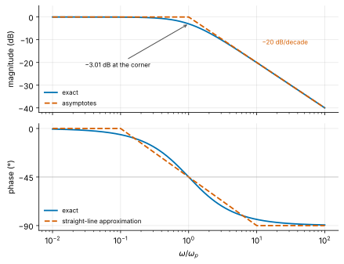
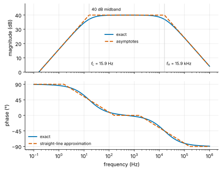

<!-- status: reviewed -->
# 07-07 · Frequency Response and Bode Plots

| | |
|---|---|
| **Course** | [07 · Circuit Analysis II (Transient and AC)](../README.md) |
| **University equivalent** | The "frequency response" chapter of a sophomore Circuits II course (Nilsson & Riedel, *Introduction to Frequency Selective Circuits* and its Bode-diagram appendix; Alexander & Sadiku, *Frequency Response*) |
| **Prerequisites** | [07-04 Laplace-Domain Circuit Analysis](07-04-laplace-domain-circuit-analysis.md) (transfer functions, poles and zeros, stability), [07-05 Sinusoidal Steady State](07-05-sinusoidal-steady-state-and-impedance.md) (phasors and impedance), [02-04 Forced Response and Resonance](../../02-complex-numbers-des-and-linear-algebra/chapters/02-04-forced-response-and-resonance.md) (the second-order response curve, $Q$ and bandwidth), [06-10 The Ideal Op-Amp](../../06-circuit-analysis-1-dc/chapters/06-10-ideal-op-amp.md), [01-01 Functions, Models and Units](../../01-calculus-for-engineers/chapters/01-01-functions-models-and-units.md) (logarithms). The facts used from each are restated where they are needed. |
| **Estimated study hours** | 10 |
| **Last verified** | 2026-11-19 |

**Learning objectives.** After this chapter you can:

1. Convert between ratios, decibels and nepers for power and root-power quantities, use reference levels (dBm, dBV, dBu), and explain when a voltage gain in decibels differs from the power gain.
2. Find $H(j\omega)$ from a circuit or from $H(s)$, and write it in Bode form with its gain constant, poles and zeros.
3. Sketch asymptotic Bode magnitude and phase plots for real and complex poles and zeros and their products, and apply the standard corrections.
4. Read a transfer function from a measured Bode plot, and tell minimum-phase from non-minimum-phase responses (right-half-plane zeros, delay) using the slope–phase relation.
5. Compute bandwidth, relate it to rise time and to cascaded stages, and apply the gain–bandwidth product to op-amp amplifiers.
6. Read datasheet frequency-response specifications (open-loop gain and phase, gain–bandwidth product, phase margin, oscilloscope bandwidth and rise time) and test the claims made with them.

## 1. Big picture

Chapter 07-05 solved a circuit at one frequency. This chapter solves it at all frequencies at once. The **frequency response** $H(j\omega)$ says how much a circuit amplifies or attenuates a sinusoid, and how much it shifts its phase, as a function of frequency. Because any signal is a sum of sinusoids ([11](../../11-signals-and-systems/README.md)), the frequency response describes what the circuit does to every signal. Hendrik Bode's insight, from Bell Labs in the late 1930s (§9), was to plot it on logarithmic axes. On those axes each pole and zero becomes a straight-line segment, and a complicated response can be sketched by hand in a minute and read back just as fast. Engineers still specify, measure and argue about circuits in that language.

- **Amplifiers:** bandwidth and the gain–bandwidth product decide how fast an amplifier is and what it costs in power ([10-05](../../10-electronics-1/chapters/10-05-amplifier-fundamentals.md), [12](../../12-electronics-2/README.md)).
- **Feedback loops:** voltage regulators, phase-locked loops and op-amps are stable only if their loop gain has enough phase margin, a Bode-plot quantity ([12-06](../../12-electronics-2/chapters/12-06-stability-and-compensation.md), [15-07](../../15-control-systems/chapters/15-07-frequency-domain-design.md)).
- **Filters and channels:** a filter is specified by its Bode plot ([07-08](07-08-filters-and-resonance.md)), and a high-speed serial link by its channel loss in decibels at the signaling frequency.
- **Instruments:** an oscilloscope's bandwidth and rise time, an audio analyzer's flatness and a probe's loading are frequency-response specifications.
- **Spec sheets and due diligence:** almost every analog datasheet has a gain-and-phase plot, and reading one skeptically is a core skill (§9).

## 2. Intuition first

**Why logarithms.** A chain of stages multiplies gains. Logarithms turn products into sums, so on a logarithmic (decibel) scale the stages simply add. Frequency also spans many orders of magnitude, from hertz to gigahertz, so a logarithmic frequency axis gives each decade the same width. On those two log scales the response of a single pole, $1/(1 + j\omega/\omega_p)$, looks like two straight lines: flat at low frequency, and falling at a fixed slope at high frequency, meeting at a "corner". Figure 1 shows the true curve hugging those lines.

*Figure 1. A single real pole. The magnitude (top) follows two straight asymptotes, meeting at the corner frequency, where the true curve is 3 dB below them. The phase (bottom) falls from 0° to −90°, passing −45° at the corner.*

**An analogy from finance.** On a log-price chart, a constant growth rate is a straight line, and a change in growth rate is a kink. A Bode magnitude plot is the same idea: each pole is a point where the curve's "growth rate" (its slope) drops by 20 dB per decade, and each zero is a point where it rises by 20 dB per decade. Adding decibels along a signal chain is like adding log returns over consecutive periods. *Where the analogy breaks:* a price chart has no second panel, whereas the frequency response also has a phase. For the large class of "minimum-phase" circuits the phase is fixed by the magnitude curve (§3.6), something with no counterpart in a price series.

**What the phase means physically.** A low-pass RC circuit's output lags its input because the capacitor takes time to charge. At low frequency the lag is a negligible fraction of the period. At high frequency the capacitor's impedance is small, so the resistor sets the current, which is then nearly in phase with the input. The capacitor's voltage, the output, always lags its own current by 90°, so the output lags the input by almost 90°. More poles mean more lag: two poles approach −180°. That growing lag is what makes feedback loops unstable when too much gain survives to high frequency, the central concern of Bode's own work.

## 3. Theory

### 3.1 The frequency response, three ways

The **frequency response** of a linear circuit from an input $x$ to an output $y$ is the complex function $H(j\omega) = \mathbf{Y}/\mathbf{X}$, the ratio of output and input phasors at angular frequency $\omega$ (rad/s). Three routes lead to it, and they agree:

1. **Phasors (07-05).** Replace each element by its impedance at $j\omega$ and solve for the ratio of phasors.
2. **The transfer function (07-04).** Evaluate $H(s)$ on the imaginary axis, $s = j\omega$.
3. **Steady-state response.** If the circuit is stable (all poles in the left half-plane, 07-04 §3.8) and the input is $x(t) = X\cos(\omega t)$, then once the transient has decayed the output is

$$
y(t) = \lvert H(j\omega)\rvert\, X \cos\big(\omega t + \angle H(j\omega)\big).
$$

The **magnitude** $\lvert H\rvert$ is the gain and the **angle** $\angle H$ is the phase shift. The stability condition matters: an unstable circuit has no steady state, and its "frequency response" describes nothing that can be observed, even though the formula can still be evaluated. Frequencies are quoted either as $\omega$ in rad/s or as $f = \omega/2\pi$ in Hz; this chapter labels which.

**Cascades multiply.** If stage 1's output drives stage 2 without being loaded by it (a buffer between them, or a stage-2 input impedance much larger than stage 1's output impedance), the overall response is the product $H = H_1H_2$. Magnitudes multiply and phases add. Without buffering, compute the combination as one circuit: the stages interact.

### 3.2 Decibels and nepers

> **Math refresher — logarithms.** $\lg x = \log_{10}x$ and $\ln x = \log_e x$. $\lg(ab) = \lg a + \lg b$, $\lg(a^n) = n\lg a$ and $\lg(1/a) = -\lg a$. Useful values: $\lg 2 = 0.30103$, $\lg 3 = 0.47712$, $\lg 10 = 1$, and $\ln 10 = 2.302585$, so $\lg x = \ln x/\ln 10$.

**Power ratios.** The **decibel** expresses a ratio of two powers $P_2/P_1$ as

$$
G_{\text{dB}} = 10\lg\frac{P_2}{P_1} .
$$

A factor of 2 in power is 3.01 dB, a factor of 10 is 10 dB and a factor of 1000 is 30 dB. Gains in decibels add along a chain; a loss is a negative gain.

**Root-power (field) quantities.** Voltage, current and field strength are "root-power" quantities: power is proportional to their square. If two voltages appear across equal resistances $R$, then $P = V_{rms}^2/R$ and

$$
10\lg\frac{P_2}{P_1} = 10\lg\frac{V_2^2/R}{V_1^2/R} = 20\lg\frac{V_2}{V_1}.
$$

So voltage and current ratios use **20 lg**. The factor 20 is not a different unit: it is the same decibel, applied to a quantity whose square is a power. A voltage ratio of 2 is 6.02 dB, $\sqrt2$ is 3.01 dB, 10 is 20 dB and $1/\sqrt2$ is −3.01 dB.

**When voltage gain and power gain differ.** The derivation above assumed equal resistances. An amplifier with input resistance $R_{in}$ driving a load $R_L$ has power gain

$$
\frac{P_{out}}{P_{in}} = \frac{V_{out}^2/R_L}{V_{in}^2/R_{in}}
\quad\Longrightarrow\quad
G_{P,\text{dB}} = 20\lg\frac{V_{out}}{V_{in}} + 10\lg\frac{R_{in}}{R_L}.
$$

The two gains differ by $10\lg(R_{in}/R_L)$. In a matched 50 Ω RF system they coincide, which is why RF engineers use "gain in dB" without qualification. In an op-amp circuit with a 10 kΩ input and a 100 Ω load, they differ by 20 dB (Example 07-07.1). When someone quotes "gain in dB", ask which.

**Reference levels.** A level in decibels relative to a stated reference turns a ratio into an absolute quantity. The suffix names the reference:

| Unit | Reference | Example |
|---|---|---|
| dBm | 1 mW | 0 dBm = 1 mW; 30 dBm = 1 W; −30 dBm = 1 µW |
| dBW | 1 W | 0 dBW = 30 dBm |
| dBV | 1 V (RMS) | −60 dBV = 1 mV |
| dBu | 0.7746 V (RMS), the voltage that delivers 1 mW into 600 Ω: $\sqrt{10^{-3}\times600}$ | +4 dBu = 1.228 V |
| dBc | the carrier (the wanted signal) | a spur at −60 dBc is $10^{-6}$ of the carrier's power |
| dBFS | an ADC's full scale | |

A level such as dBm is a power level; dBV is a voltage level. The two can be converted only through a resistance: 1 V RMS across 50 Ω is 20 mW, or 13.01 dBm.

**The neper.** The **neper** (Np) is the natural-logarithm counterpart. An amplitude ratio $F_2/F_1$ is $\ln(F_2/F_1)$ nepers, and a power ratio is $\tfrac12\ln(P_2/P_1)$ Np, the ½ playing the role of 20 versus 10. Comparing $20\lg x = (20/\ln 10)\ln x$ gives

$$
1\ \text{Np} = \frac{20}{\ln 10}\ \text{dB} = 8.686\ \text{dB}, \qquad 1\ \text{dB} = 0.1151\ \text{Np}.
$$

Nepers are natural in theory because $\ln H = \ln\lvert H\rvert + j\angle H$ puts the log-magnitude (in nepers) and the phase (in radians) in one complex number. Bode wrote his gain–phase theorems in nepers and radians (§3.6, §9). Neither unit is an SI unit; both are accepted for use with the SI, with the reference value always stated (§9).

### 3.3 Bode form and logarithmic frequency

A transfer function from 07-04 is a ratio of polynomials in $s$. Factor the numerator and denominator into first-order factors (real roots) and second-order factors (complex-conjugate pairs), and normalize each factor so that it equals 1 at low frequency. With $s = j\omega$ this gives the **Bode form**

$$
H(j\omega) = K\,(j\omega)^{m}\,
\frac{\prod_i\big(1 + j\omega/\omega_{z,i}\big)\prod_k\Big(1 + 2\zeta_k\dfrac{j\omega}{\omega_k} + \Big(\dfrac{j\omega}{\omega_k}\Big)^2\Big)}
{\prod_i\big(1 + j\omega/\omega_{p,i}\big)\prod_k\Big(1 + 2\zeta_k\dfrac{j\omega}{\omega_k} + \Big(\dfrac{j\omega}{\omega_k}\Big)^2\Big)},
$$

where $m$ is the net number of zeros at the origin (negative for poles at the origin), $\omega_z$ and $\omega_p$ are the magnitudes of real zeros and poles, and $\omega_k$, $\zeta_k$ describe complex pairs as in 02-03 and 07-03. The form has two virtues. Each factor is 1 (0 dB, 0°) well below its own corner frequency, so each one's effect starts at a visible place. And because

$$
20\lg\lvert H\rvert = 20\lg\lvert K\rvert + \sum 20\lg\lvert\text{numerator factors}\rvert - \sum 20\lg\lvert\text{denominator factors}\rvert,
\qquad
\angle H = \angle K + \sum\angle(\text{num.}) - \sum\angle(\text{den.}),
$$

the magnitude in decibels and the phase are both *sums* of contributions from individual factors. Sketch each factor, then add.

**Logarithmic frequency.** A **decade** is a factor of 10 in frequency and an **octave** a factor of 2. A slope of 20 dB per decade is $20\lg 2 = 6.02$ dB per octave, the "6 dB per octave" of audio engineers.

### 3.4 The building blocks

**(a) A constant $K$.** Magnitude $20\lg\lvert K\rvert$ dB at every frequency. Phase 0° if $K > 0$ and ±180° if $K < 0$ (an inverting amplifier).

**(b) A zero or pole at the origin.** $H = j\omega$ has $20\lg\lvert H\rvert = 20\lg\omega$: a straight line of slope +20 dB/decade crossing 0 dB at $\omega$ = 1 rad/s, with constant phase +90°. A pole at the origin, $1/(j\omega)$ (an integrator), is the mirror image: −20 dB/decade and −90°.

**(c) A real left-half-plane pole**, $H = 1/(1 + j\omega/\omega_p)$. Write $x = \omega/\omega_p$. Then

$$
20\lg\lvert H\rvert = -10\lg(1 + x^2), \qquad \angle H = -\arctan x .
$$

For $x \ll 1$, $1 + x^2 \approx 1$ and the magnitude is about 0 dB. For $x \gg 1$, $1 + x^2 \approx x^2$ and the magnitude is about $-20\lg x$: a line of slope −20 dB/decade through 0 dB at $x = 1$. These two **asymptotes** meet at the **corner frequency** $\omega_p$. The true curve departs from them most at the corner:

| $\omega/\omega_p$ | 0.1 | 0.5 | 1 | 2 | 10 |
|---|---|---|---|---|---|
| exact magnitude (dB) | −0.04 | −0.97 | −3.01 | −6.99 | −20.04 |
| error versus asymptote (dB) | −0.04 | −0.97 | −3.01 | −0.97 | −0.04 |
| exact phase | −5.71° | −26.57° | −45° | −63.43° | −84.29° |

The magnitude error is $-10\lg(1 + x^2)$ below the corner and $-10\lg(1 + 1/x^2)$ above it: −3 dB at the corner, about −1 dB one octave away, negligible one decade away. The phase is usually drawn as three straight segments: 0° up to $\omega_p/10$, then falling 45° per decade through −45° at $\omega_p$, then −90° from $10\omega_p$. Its largest error is 5.71°, at $\omega_p/10$ and $10\omega_p$. (The true phase falls faster than the straight line near the corner: its slope there is $(\ln 10)/2$ rad, or 65.96°, per decade.)

**Group delay.** The phase also measures time. For a narrowband signal centered on $\omega$, the envelope is delayed by the **group delay**

$$
\tau_g(\omega) = -\frac{d\angle H}{d\omega}.
$$

(Expand the phase to first order around $\omega$: a phase that falls linearly with frequency at slope $-\tau$ is exactly a time delay $\tau$, because $e^{-j\omega\tau}$ is the transform of a delay.) For a single pole, $\tau_g = (1/\omega_p)/(1 + x^2)$, which at low frequency equals the time constant $1/\omega_p$ of 07-02. Filters with uneven group delay distort pulses even when their magnitude is flat (07-05's all-pass sections correct this).

**(d) A real left-half-plane zero**, $H = 1 + j\omega/\omega_z$, is the mirror image of the pole: asymptotes 0 dB and +20 dB/decade, +3.01 dB at the corner, phase rising from 0° to +90°.

**(e) A complex-conjugate pole pair**,

$$
H = \frac{1}{1 + 2\zeta\,\dfrac{j\omega}{\omega_0} + \Big(\dfrac{j\omega}{\omega_0}\Big)^2} = \frac{1}{1 - r^2 + j2\zeta r}, \qquad r = \frac{\omega}{\omega_0},\ 0 < \zeta < 1 .
$$

This is the second-order low-pass of 02-04 §3.4, now drawn on Bode axes. For $r \ll 1$ it is 0 dB. For $r \gg 1$, $\lvert H\rvert \approx 1/r^2$: an asymptote of slope **−40 dB/decade** through 0 dB at $\omega_0$, twice a single pole's slope. At the corner, $H(j\omega_0) = 1/(j2\zeta)$ exactly, so

$$
\lvert H(j\omega_0)\rvert = \frac{1}{2\zeta} = Q \quad\Longrightarrow\quad \text{error at the corner} = 20\lg Q\ \text{dB}.
$$

The asymptotes ignore damping entirely, so the correction near $\omega_0$ is essential. For $Q$ = 5 (ζ = 0.1) the curve sits 13.98 dB *above* the asymptotes at $\omega_0$. For ζ = 0.5 the error at the corner is zero. For ζ = 0.707 the curve is 3.01 dB below. From 02-04, the peak of a lightly damped pair is $1/(2\zeta\sqrt{1-\zeta^2})$, at $\omega_0\sqrt{1 - 2\zeta^2}$, and exists only for ζ < 0.707.

The phase is $-\arctan\big(2\zeta r/(1 - r^2)\big)$, taken continuously from 0° to −180°. It passes **−90° exactly at $\omega_0$ for every ζ**. How sharply it turns depends on ζ: differentiating at $r = 1$ gives a slope of $1/\zeta$ radians per unit of $r$, or $(\ln 10)/\zeta$ rad per decade. Light damping makes the phase drop almost as a step. For ζ = 1 the pair becomes two coincident real poles, and the slope, 131.9° per decade, is twice a single pole's, as it must be.

**(f) Complex zeros** mirror complex poles: +40 dB/decade, phase to +180°, and a *dip* of depth $20\lg(2\zeta)$ at $\omega_0$. With ζ → 0 the dip becomes a **notch**, a frequency the circuit rejects completely (07-08).

**(g) Right-half-plane zeros and delay: non-minimum phase.** A zero at $s = +\omega_z$ gives the factor $1 - j\omega/\omega_z$. Its magnitude, $\sqrt{1 + (\omega/\omega_z)^2}$, is identical to a left-half-plane zero's: +20 dB/decade above $\omega_z$. But its phase is $-\arctan(\omega/\omega_z)$, falling to **−90°** instead of rising to +90°. It adds gain like a zero and lag like a pole, the worst of both for a feedback loop. 07-04 found such a zero in a transistor amplifier, where the gate-to-drain capacitance feeds the input forward around the inverting transistor (Problem 07-04.11), and it also appears in boost converters ([22](../../22-power-electronics-and-energy-conversion/README.md)).

Two relatives behave the same way:

- **The all-pass section** of 07-05, $(1 - s/a)/(1 + s/a)$: flat 0 dB, with phase falling from 0° to −180°.
- **A pure delay** $T$: $H = e^{-j\omega T}$, so $\lvert H\rvert = 1$ (0 dB) and $\angle H = -\omega T$ rad. On a logarithmic frequency axis the delay's phase falls ever faster: a 1 ns delay costs 3.6° at 10 MHz and 36° at 100 MHz.

### 3.5 Sketching a composite Bode plot

1. Put $H$ in Bode form; list the corner frequencies in increasing order, and the gain constant $K$ and any poles or zeros at the origin.
2. **Low-frequency asymptote:** $K(j\omega)^m$, a line of slope $20m$ dB/decade (flat if $m = 0$) at level $20\lg\lvert K\rvert$ when $m = 0$, or passing $20\lg\lvert K\rvert$ at $\omega$ = 1 rad/s.
3. **Walk up in frequency.** At each corner the slope changes: −20 dB/decade for a real pole, +20 for a real zero, ∓40 for a complex pair.
4. **Correct:** about 3 dB at each isolated real corner, $20\lg Q$ at each complex pair, and more where corners are closer than about a decade apart.
5. **Phase:** sum the straight-line phase of each factor, or better, compute the exact phase at a few frequencies. The phase is easier to get exactly than to sketch well.
6. **Check:** the magnitude at very low and very high frequency, and the phase at both ends ($90°$ times the net slope in units of 20 dB/decade for a minimum-phase circuit, §3.6).

Example 07-07.2 works the procedure through on an amplifier.

### 3.6 Minimum phase and Bode's gain–phase relation

A stable transfer function with no zeros in the right half-plane and no delay is called **minimum-phase**. Bode showed that for such a function the phase is *determined* by the magnitude curve. You cannot shape them independently. The usable form of his result is a rule of thumb:

> If the magnitude falls at a steady slope of $n \times 20$ dB/decade over a band extending roughly a decade on each side of $\omega$, then the phase at $\omega$ is close to $n \times (-90°)$.

The factors of §3.4 obey it. A single pole (−20 dB/decade) heads to −90°, a complex pair (−40) to −180°, and $(j\omega)^m$ has exactly $m \times 90°$ at every frequency. What the rule adds is that the phase at a given frequency depends mostly on the magnitude slope *near* that frequency, weighted most heavily within a decade or so.

The consequence shapes every feedback design. A loop gain that falls steeply, say at −40 dB/decade, near the frequency where it crosses 0 dB has a phase near −180° there, so the loop is close to oscillating (§3.9). To be stable, a loop must roll off gently, near −20 dB/decade, around its crossover. Bode priced this in 1940: "roughly one octave for each ten db of feedback" of extra bandwidth over which the loop must be controlled (§9).

The rule also detects non-minimum-phase behavior. If a measured phase lags much more than the magnitude slope predicts, the circuit has a right-half-plane zero or a delay. Example 07-07.4 shows two circuits with identical magnitude plots whose phases differ by almost 180° at high frequency.

> **Going deeper — Bode's gain–phase integral.** Let $A(u) = \ln\lvert H\rvert$ in nepers, as a function of $u = \ln(\omega/\omega_0)$. For a minimum-phase $H$, Bode's relation is
>
> $$
> \angle H(j\omega_0) = \frac{1}{\pi}\int_{-\infty}^{\infty}\frac{dA}{du}\,\ln\coth\frac{\lvert u\rvert}{2}\,du .
> $$
>
> The weight $\ln\coth(\lvert u\rvert/2)$ is sharply peaked at $u = 0$ (the frequency of interest) and falls off over about a decade, which is the rule of thumb above. Its total area is $\int_{-\infty}^{\infty}\ln\coth(\lvert u\rvert/2)\,du = \pi^2/2$. So if the slope $dA/du$ is a constant $k$ (nepers per neper, i.e. $20k$ dB/decade), the phase is exactly $k\pi/2$: −90° for $k = -1$. Bode stated it as a constant slope of $6k$ dB per octave corresponding to a constant phase of $k\pi/2$ radians. The relation comes from applying Cauchy's integral theorem to $\ln H(s)$, which is analytic in the right half-plane only when $H$ has no poles *or zeros* there. That is why right-half-plane zeros break it. The verify script and lab notebook evaluate the integral numerically for Example 07-07.4.

### 3.7 Bandwidth and rise time

**Bandwidth** is the width of the band of frequencies a circuit passes. By the usual convention it is measured to the **−3 dB points**, where $\lvert H\rvert$ has fallen to $1/\sqrt2 = 70.7\%$ of its passband value and the output power to half. For a low-pass response the bandwidth is the −3 dB frequency itself. For a band-pass it is $f_2 - f_1$, and 02-04 showed that for a second-order band-pass this equals $f_0/Q$ exactly. Other conventions exist (−1 dB, −0.1 dB "flatness", noise bandwidth in 03-06), so a bandwidth figure should always state its criterion.

**Rise time of a single pole.** A unit step into $1/(1 + s\tau)$ gives $y(t) = 1 - e^{-t/\tau}$ (07-02). The output reaches 10% at $t_{10} = \tau\ln(1/0.9)$ and 90% at $t_{90} = \tau\ln 10$, so the **10–90% rise time** is

$$
t_r = t_{90} - t_{10} = \tau\ln\frac{10}{1/0.9} = \tau\ln 9 = 2.197\,\tau .
$$

With $f_{3\text{dB}} = 1/(2\pi\tau)$,

$$
t_r \cdot f_{3\text{dB}} = \frac{\ln 9}{2\pi} = 0.350 .
$$

This is the origin of the engineer's rule $t_r \approx 0.35/\text{BW}$. The constant depends on the shape of the roll-off: about 0.34 for a Gaussian-shaped response and about 0.45 for a "brick-wall" response that is flat to a sharp cutoff (§9 shows the instrument industry disagreeing about which applies). Faster edges need more bandwidth in direct proportion: a 1 ns edge needs about 350 MHz of single-pole bandwidth.

**Cascaded stages.** Put $n$ identical, buffered single-pole stages in cascade, each with corner $f_c$. The overall magnitude is $\big(1 + (f/f_c)^2\big)^{-n/2}$. Setting it to $1/\sqrt2$ gives $(1 + (f/f_c)^2)^n = 2$, so

$$
\text{BW}_n = f_c\sqrt{2^{1/n} - 1} .
$$

Two stages shrink the bandwidth to 0.644 $f_c$, three to 0.510 $f_c$ and four to 0.435 $f_c$. Each extra stage adds gain but takes bandwidth.

> **Going deeper — why rise times add "in quadrature".** Instrument makers combine rise times as $t_{r,\text{system}} \approx \sqrt{t_{r,1}^2 + t_{r,2}^2 + \dots}$. The reason is probabilistic. If a stage's step response never overshoots, its impulse response $h(t)$ is non-negative with unit area: it is a probability density. Cascading stages convolves impulse responses, and the convolution of densities is the density of a *sum of independent random variables* ([03-04](../../03-probability-statistics-and-random-variables/chapters/03-04-joint-distributions-and-clt.md)). So the means add (the Elmore delays of 07-03 add), and so do the variances. For Gaussian-shaped responses the rise time is proportional to the standard deviation ($t_r = 2.563\,\sigma$), so rise times add exactly in quadrature. For other shapes the rule is only approximate: for two single-pole stages it underestimates the true rise time by up to 7.5% (when the two are equal; 5.8% in Example 07-07.6). By the central limit theorem, a long cascade tends toward a Gaussian shape, where the rule becomes exact.

### 3.8 The gain–bandwidth product of a feedback amplifier

A real op-amp's open-loop gain is not infinite (06-10's ideal) but a frequency response. For most general-purpose op-amps, a dominant-pole model describes it well up to near the frequency where the gain falls to 1:

$$
A(j\omega) = \frac{A_0}{1 + j\omega/\omega_a},
$$

where $A_0$ is the DC open-loop gain (130 dB typical for the op-amp of §9) and $\omega_a$ the dominant pole; for that op-amp, $f_a = \omega_a/2\pi$ is only about 3 Hz. Above $\omega_a$, $\lvert A\rvert \approx A_0\omega_a/\omega$, falling at −20 dB/decade to reach 1 at the **unity-gain frequency** $\omega_t = A_0\omega_a$. The product $A_0\omega_a$, in hertz $f_t = A_0f_a$, is the **gain–bandwidth product** (GBW).

**Closed loop.** In a non-inverting amplifier, a fraction $\beta = R_g/(R_g + R_f)$ of the output is fed back (06-10). With finite $A$, the output is $A(\mathbf{V}_{in} - \beta\mathbf{V}_{out})$, so

$$
H = \frac{A}{1 + A\beta}
= \frac{A_0}{(1 + A_0\beta) + j\omega/\omega_a}
= \frac{A_0/(1 + A_0\beta)}{1 + j\omega/\big[\omega_a(1 + A_0\beta)\big]} .
$$

The closed loop is again a single pole, with DC gain $A_0/(1 + A_0\beta) \approx 1/\beta$ (the ideal result) and bandwidth $\omega_a(1 + A_0\beta)$. Multiply them:

$$
\frac{A_0}{1 + A_0\beta}\times\omega_a(1 + A_0\beta) = A_0\omega_a = \omega_t .
$$

**Closed-loop gain × closed-loop bandwidth = GBW**, whatever the gain. A 10 MHz op-amp gives 1 MHz of bandwidth at a gain of 10 and 100 kHz at a gain of 100. Two consequences matter in practice:

- **The bandwidth depends on $1/\beta$, the "noise gain", not on the signal gain.** An inverting amplifier of gain $-R_f/R_g$ has the same $\beta = R_g/(R_g + R_f)$ as a non-inverting one of gain $1 + R_f/R_g$. So an inverting gain of −100 has bandwidth $f_t/101$, not $f_t/100$. To see it, apply superposition at the inverting input: $\mathbf{V}_- = \mathbf{V}_{in}R_f/(R_g + R_f) + \mathbf{V}_{out}R_g/(R_g + R_f)$, with $\mathbf{V}_{out} = -A\mathbf{V}_-$. Solving gives $H = -\dfrac{R_f}{R_g}\cdot\dfrac{A\beta}{1 + A\beta}$, with the same $\beta = R_g/(R_g + R_f)$. With the single-pole $A$, $A\beta/(1 + A\beta) = A_0\beta/[(1 + A_0\beta) + j\omega/\omega_a]$, a pole at $\omega_a(1 + A_0\beta) \approx \beta\omega_t$: the bandwidth is $f_t/(1 + R_f/R_g)$.
- **The closed-loop bandwidth hardly depends on $A_0$.** Datasheets specify $A_0$ loosely (a typical value and a minimum perhaps 25 dB lower), but GBW sets the bandwidth. $A_0$ sets the *DC accuracy*: the gain error is $1/(1 + A_0\beta)$, a relative error of about $1/(A_0\beta)$.

**The Bode-plot picture.** Plot $\lvert A\rvert$ and the horizontal line $1/\beta$ on the same axes. The closed-loop gain follows $1/\beta$ wherever $\lvert A\rvert \gg 1/\beta$, and follows $\lvert A\rvert$ beyond the intersection. The intersection *is* the closed-loop bandwidth. The vertical distance between the curves is the **loop gain** $\lvert A\beta\rvert$ in decibels: the "excess gain" that feedback spends on accuracy.

**Where the model fails.** Real op-amps have further poles, near or above $f_t$. There the gain–bandwidth product is no longer constant, and some datasheets quote different GBW values at different gains (§9). Large signals are limited by slew rate, a nonlinear effect the Bode plot does not show ([10-05](../../10-electronics-1/chapters/10-05-amplifier-fundamentals.md), [12](../../12-electronics-2/README.md)).

### 3.9 A preview of stability margins

§3.8's closed-loop gain $H = A/(1 + A\beta)$ has its poles where $1 + T(s) = 0$, with $T = A\beta$ the **loop gain**. (The curriculum's [notation file](../../../reference/notation.md) writes the loop gain as $L$. This chapter uses $T$, the common textbook symbol, to avoid confusion with inductance.) On a Bode plot the danger is a frequency where $\lvert T\rvert = 1$ and $\angle T = -180°$. There the fed-back signal returns with equal amplitude and inverted, so $1 + T = 0$ and the circuit can sustain an oscillation with no input. The **phase margin** measures the distance from that condition:

$$
\text{PM} = 180° + \angle T(j\omega_c), \qquad \text{where } \lvert T(j\omega_c)\rvert = 1 .
$$

The frequency $\omega_c$ is the **crossover frequency**. A single-pole loop has a phase that never passes −90°, so its phase margin is at least 90°. Real loops have a second pole. Model it as

$$
T(s) = \frac{\omega_t}{s\,(1 + s/\omega_2)},
$$

an integrator with unity-gain frequency $\omega_t$ and a second pole at $\omega_2$. The closed-loop response from input to output is

$$
H = \frac{T}{1 + T} = \frac{\omega_t\omega_2}{s^2 + \omega_2s + \omega_t\omega_2} ,
$$

a second-order low-pass with $\omega_0 = \sqrt{\omega_t\omega_2}$ and $\zeta = \tfrac12\sqrt{\omega_2/\omega_t}$. Put the second pole at the unity-gain frequency ($\omega_2 = \omega_t$). Crossover occurs where $x\sqrt{1 + x^2} = 1$ with $x = \omega_c/\omega_t$, so $x^2 = (\sqrt5 - 1)/2$, $x = 0.786$, and PM $= 90° - \arctan 0.786 = 51.8°$. The closed loop has ζ = 0.5 ($Q = 1$) and peaks 1.25 dB above its DC gain. With the second pole at twice the unity-gain frequency, PM = 65.5° and ζ = 0.707: the flattest response without peaking. So for this model:

| Phase margin | Closed-loop ζ | Behavior |
|---|---|---|
| 90° (single pole) | overdamped | no peaking, slowest |
| 65.5° | 0.707 | maximally flat |
| 51.8° | 0.5 | 1.25 dB peak, about 16% step overshoot |
| small | → 0 | sharp peak, ringing, oscillation at PM = 0° |

The 16% overshoot is 02-03's $e^{-\pi\zeta/\sqrt{1-\zeta^2}}$ at ζ = 0.5. A datasheet's "phase margin 55°" therefore describes a unity-gain buffer that peaks and overshoots slightly. Capacitive loads add a further pole and erode the margin. Courses 12 and 15 develop compensation and the Nyquist criterion; here it is enough to read a phase margin and know what it implies.

## 4. Worked examples

### Example 07-07.1 · Decibel bookkeeping (tier A)

**Setup.** An amplifier with input resistance 10 kΩ receives 50 mV (RMS) and delivers 1.0 V (RMS) into a 100 Ω load. Find (a) the voltage gain in dB, (b) the power gain in dB, and explain the difference; (c) the output level in dBV and dBm and the input level in dBV and dBm; (d) the voltage gain in nepers.

**Solution.**

(a) $A_v = 1.0/0.05 = 20$, so \$20\lg 20 = \$ **26.02 dB**.

(b) $P_{in} = 0.05^2/10^4 = 0.25$ µW and $P_{out} = 1^2/100 = 10$ mW. Their ratio is 40 000, or \$10\lg 40\,000 = \$ **46.02 dB**. The difference, **20.00 dB**, is $10\lg(R_{in}/R_L) = 10\lg 100$ (§3.2): the amplifier also transforms a high impedance into a low one, and power gain counts that.

(c) Output: $20\lg(1.0/1\ \text{V}) = $ **0.00 dBV**, and $10\lg(10\ \text{mW}/1\ \text{mW}) = $ **10.00 dBm**. Input: $20\lg 0.05 = $ **−26.02 dBV** and $10\lg(0.25\ \text{µW}/1\ \text{mW}) = $ **−36.02 dBm**. The power levels differ by the power gain (10.00 − (−36.02) = 46.02 dB) and the voltage levels by the voltage gain (26.02 dB), as they must.

(d) $\ln 20 = $ **2.996 Np**. Check: 26.02 dB × 0.1151 Np/dB = 2.996 Np ✓.

**Units check.** dBV and dBm are levels; their differences are dimensionless ratios in dB.
**Sanity check.** A tenfold voltage gain is 20 dB and a doubling 6 dB; 20 = 10 × 2 gives 26 dB ✓.

### Example 07-07.2 · Sketching an AC-coupled amplifier (tier B)

**Setup.** A signal passes through a coupling capacitor $C_1$ = 100 nF into $R_1$ = 100 kΩ to ground, then through an ideal non-inverting amplifier of gain 100, then through $R_2$ = 1 kΩ into $C_2$ = 10 nF to ground, where the output is taken (the amplifier isolates the two RC sections). (a) Write $H(j\omega)$ in Bode form. (b) Sketch the asymptotic magnitude and phase. (c) Compare the asymptotes with the exact response at $f_L$, $f_L/10$, 1 kHz, $f_H$ and 100 kHz. (d) Find the exact −3 dB band.

**Solution.**

(a) The input section is a high-pass divider, $R_1/(R_1 + 1/(j\omega C_1)) = j\omega R_1C_1/(1 + j\omega R_1C_1)$, and the output section a low-pass, $1/(1 + j\omega R_2C_2)$. The amplifier isolates them (§3.1), so

$$
H(j\omega) = 100\cdot\frac{j\omega/\omega_L}{(1 + j\omega/\omega_L)(1 + j\omega/\omega_H)},
\qquad
f_L = \frac{1}{2\pi R_1C_1} = 15.92\ \text{Hz},\quad f_H = \frac{1}{2\pi R_2C_2} = 15.92\ \text{kHz}.
$$

(b) Corners at 15.92 Hz and 15.92 kHz, a zero at the origin, and $K$ = 100 (40 dB) applying in the band between the corners. Below $f_L$, the factor $j\omega/\omega_L$ dominates: a +20 dB/decade line that reaches 40 dB at $f_L$. Between the corners the zero's rise is cancelled by the first pole: flat at **40.00 dB**. Above $f_H$ the second pole takes the slope to −20 dB/decade. The phase starts at +90° (the zero at the origin), falls through +45° at $f_L$, is 0° in midband and falls through −45° at $f_H$ to −90° (Figure 2).

*Figure 2. Example 07-07.2. Asymptotes (dashed) and exact response (solid). The corners are three decades apart, so each behaves like an isolated single corner.*

(c) Exact values from $H(j\omega)$:

| Frequency | Asymptote | Exact magnitude | Exact phase |
|---|---|---|---|
| $f_L/10$ = 1.592 Hz | 20 dB | **19.96 dB** | **84.28°** |
| $f_L$ = 15.92 Hz | 40 dB | **36.99 dB** | **44.94°** |
| 1 kHz | 40 dB | **39.98 dB** | **−2.683°** |
| $f_H$ = 15.92 kHz | 40 dB | **36.99 dB** | **−44.94°** |
| 100 kHz | **24.04 dB** | **23.93 dB** | **−80.95°** |

At each corner the curve is 3.01 dB below the asymptote, as for an isolated pole. The phase is ±44.94° rather than ±45° because the other corner, three decades away, contributes 0.06°. At the geometric center, $\sqrt{f_Lf_H}$ = 503.3 Hz, the two contributions cancel and the phase is exactly 0°.

(d) Solving $\lvert H\rvert = 100/\sqrt2$ numerically gives **15.92 Hz** and **15.92 kHz**, a bandwidth of **15.90 kHz**. The corners are so far apart that each −3 dB point sits on its own corner.

**Units check.** $R_1C_1$ = 100 kΩ × 100 nF = 10 ms; $1/(2\pi\times10\ \text{ms})$ = 15.92 Hz ✓.
**Sanity check.** An audio amplifier passing about 16 Hz to 16 kHz is plausible; the DC-blocking capacitor removes offsets, and the output RC removes ultrasonic noise.

### Example 07-07.3 · The LC supply filter that amplifies (tier B)

**Setup.** Return to 07-03's LC supply filter (Example 07-03.4): $L$ = 4.7 µH with $R_s$ = 30 mΩ of series resistance, then $C$ = 22 µF across the load $R_L$ = 10 Ω. 07-03 found that it overshoots to 9.17 V at a 5 V turn-on. Now study it in frequency: (a) find $H(j\omega) = \mathbf{V}_{out}/\mathbf{V}_{in}$ in Bode form; (b) find the asymptotic and exact gain at $f_0$ and the exact peak; (c) find the attenuation at 100 kHz and 500 kHz, the latter a typical switching frequency of an upstream converter; (d) repeat the peak for $R_L$ = 100 Ω; (e) interpret.

**Solution.**

(a) The load and capacitor in parallel form $Z_p = R_L/(1 + j\omega R_LC)$, and the divider gives $H = Z_p/(R_s + j\omega L + Z_p)$. Multiply through by $(1 + j\omega R_LC)/R_L$:

$$
H(j\omega) = \frac{1}{\Big(1 + \dfrac{R_s}{R_L}\Big) + j\omega\Big(\dfrac{L}{R_L} + R_sC\Big) + (j\omega)^2LC}
= \frac{K}{1 + 2\zeta\dfrac{j\omega}{\omega_0} + \Big(\dfrac{j\omega}{\omega_0}\Big)^2},
$$

with $K = R_L/(R_L + R_s) = 0.9970$ (**−0.0260 dB**), $\omega_0^2 = (1 + R_s/R_L)/(LC)$, giving $f_0$ = **15.68 kHz**, and $2\zeta/\omega_0 = (L/R_L + R_sC)/(1 + R_s/R_L)$, giving ζ = **0.05548** and $Q = 1/(2\zeta)$ = **9.012**. These match 07-03 exactly, because the denominator here is 07-03's characteristic polynomial: the same poles govern the turn-on ringing and the frequency response.

(b) The asymptotes put the gain at $f_0$ at $20\lg K$ ≈ 0 dB. The exact gain there is $K/(2\zeta)$, which is **19.07 dB** (the correction $20\lg Q$ = **19.10 dB**). The exact peak is $K/(2\zeta\sqrt{1 - \zeta^2})$ = **9.00**, or **19.08 dB**, at $f_0\sqrt{1 - 2\zeta^2}$ = **15.63 kHz**. The phase at $f_0$ is **−90.00°**.

(c) Above $f_0$ the asymptote falls at −40 dB/decade: at 500 kHz it predicts $20\lg K - 40\lg(500/15.68)$ = **−60.18 dB**, and the exact value is **−60.17 dB**. At 100 kHz the exact attenuation is **−32.00 dB**. Far above the corner the asymptote is excellent.

(d) With $R_L$ = 100 Ω the load damps less: ζ = **0.03476**, $Q$ = **14.38**, and the peak is **23.16 dB** (×14.4) at **15.64 kHz**.

(e) The filter does its job at 500 kHz, cutting the converter's ripple a thousandfold. But near 15.6 kHz it *amplifies* by a factor of 9: a 10 mV disturbance at that frequency becomes **90.0 mV** at the output. A lightly loaded rail is worse. Any noise source near the resonance, such as a load that switches on and off at kilohertz rates, is magnified. This is why supply filters are damped (Problem 07-07.14), and why a Bode plot of a filter must include the region near its corner, where the asymptotes say nothing about the danger.

**Units check.** $L/R_L$ and $R_sC$ are seconds; $LC$ is s² ✓.
**Sanity check.** 07-03 found an 84% overshoot at turn-on for ζ = 0.055; a gain of $Q$ ≈ 9 at resonance is the frequency-domain face of the same light damping.

### Example 07-07.4 · Same magnitude, different phase (tier B)

**Setup.** Two amplifier stages have unit DC gain, a pole at $f_p$ = 1 MHz and a zero at $f_z$ = 10 MHz. In stage A the zero is in the left half-plane; in stage B it is in the right half-plane:

$$
H_A = \frac{1 + j f/f_z}{1 + j f/f_p}, \qquad H_B = \frac{1 - j f/f_z}{1 + j f/f_p} .
$$

(a) Compare their magnitudes and phases at 1, 10 and 100 MHz. (b) Which one obeys the gain–phase rule of §3.6? (c) How much phase does a 1 ns delay add at 100 MHz?

**Solution.**

(a) The magnitudes are identical, because $\lvert 1 + jx\rvert = \lvert 1 - jx\rvert$:

| Frequency | Magnitude (both) | Phase A | Phase B |
|---|---|---|---|
| 1 MHz | **−2.967 dB** | **−39.29°** | **−50.71°** |
| 10 MHz | **−17.03 dB** | **−39.29°** | **−129.29°** |
| 100 MHz | **−19.96 dB** | **−5.138°** | **−173.72°** |

(The pole contributes $-\arctan(f/f_p)$; the zero adds $+\arctan(f/f_z)$ in A and subtracts it in B.)

(b) At 100 MHz the magnitude is almost flat (the zero has cancelled the pole's slope), so the rule predicts a phase near 0°. Stage A, at −5.1°, obeys it: it is minimum-phase. Stage B lags by almost 180° with the same flat magnitude. That excess lag is the signature of a right-half-plane zero. A measured Bode plot showing it tells the engineer that no amount of magnitude shaping will remove the lag.

(c) $-360° \times f T = -360 \times 10^8 \times 10^{-9}$ = **−36.00°**. A delay is invisible on the magnitude plot and costs phase in proportion to frequency.

**Units check.** $fT$ is dimensionless (Hz × s) ✓.
**Sanity check.** The verify script evaluates Bode's integral (§3.6) on $\lvert H_A\rvert$ and recovers stage A's phase, and shows it cannot recover stage B's.

### Example 07-07.5 · How much bandwidth does gain cost? (tier B)

**Setup.** An op-amp has a typical gain–bandwidth product of 10 MHz and a typical DC open-loop gain of 130 dB, with 104 dB guaranteed minimum (the TLV9061's datasheet values, §9). Use the dominant-pole model. (a) Find the dominant pole frequency for the typical gain, and for the minimum gain assuming GBW is unchanged. (b) For a non-inverting gain of +100, find the closed-loop bandwidth and the DC gain error in both cases. (c) Find the bandwidth for an inverting gain of −100. (d) Compare one +100 stage with two +10 stages in cascade.

**Solution.**

(a) $A_0 = 10^{130/20} = 3.162\times10^6$, so \$f_a = \$ GBW/$A_0$ = **3.162 Hz**. With $A_0 = 10^{104/20} = 1.585\times10^5$, $f_a$ = **63.10 Hz**. The open-loop gain starts falling at a few hertz.

(b) $\beta$ = 1/100. Typical: bandwidth $f_a(1 + A_0\beta) = 3.162\times(1 + 31\,623)$ = **100.0 kHz**. Gain $A_0/(1 + A_0\beta)$ = 99.9968, an error of **0.0032%**. Minimum: bandwidth **100.1 kHz**, but gain 99.937, an error of **0.063%**. The bandwidth is set by GBW and barely moves. The DC accuracy is set by $A_0$ and moves twentyfold.

(c) The inverting amplifier has noise gain $1 + R_f/R_g$ = 101, so $\beta$ = 1/101 and the bandwidth is $10\ \text{MHz}/101$ = **99.01 kHz**.

(d) Each +10 stage has bandwidth 10 MHz/10 = **1.000 MHz**. Two in cascade give $1\ \text{MHz}\times\sqrt{\sqrt2 - 1}$ = **643.6 kHz** (§3.7): 6.4 times the bandwidth of the single +100 stage. The price is a second amplifier (supply current, area, noise and offset), the usual trade between stages and speed.

**Units check.** GBW in Hz divided by a dimensionless gain gives Hz ✓.
**Sanity check.** On the Bode plot, the 1/β = 40 dB line meets the −20 dB/decade open-loop line two decades below its 0 dB crossing at 10 MHz: at 100 kHz ✓.

### Example 07-07.6 · Rise time, bandwidth and the oscilloscope (tier C)

**Setup.** (a) Show that a single-pole system has $t_r f_{3\text{dB}}$ = 0.350. (b) Find the rise time of a 200 MHz oscilloscope modeled as a single pole. (c) A signal edge with a 1.00 ns single-pole rise time is displayed on that oscilloscope. Find the displayed rise time exactly and by the root-sum-square rule, and the rule's error. (d) Find the amplitude error of the single-pole oscilloscope for a sine at one fifth of its bandwidth and at its bandwidth.

**Solution.**

(a) §3.7: $t_r = \tau\ln9$ and $f_{3\text{dB}} = 1/(2\pi\tau)$, so the product is $\ln9/(2\pi)$ = **0.3497**.

(b) $t_r = 0.3497/(200\ \text{MHz})$ = **1.748 ns**.

(c) The signal source and the oscilloscope are two single poles in cascade, with $\tau_1 = 1\ \text{ns}/\ln9 = 0.4551$ ns and $\tau_2 = 1/(2\pi\times200\ \text{MHz}) = 0.7958$ ns. The step response of two distinct poles (07-04's partial fractions) is

$$
y(t) = 1 - \frac{\tau_1e^{-t/\tau_1} - \tau_2e^{-t/\tau_2}}{\tau_1 - \tau_2} .
$$

Solving $y = 0.1$ and $y = 0.9$ numerically gives a displayed rise time of **2.139 ns**. The root-sum-square rule gives $\sqrt{1.00^2 + 1.748^2}$ = **2.014 ns**, which is **5.8%** too short. The rule is exact only for Gaussian-shaped responses (§3.7, Going deeper). Either way, the displayed edge is twice as slow as the real one: a 200 MHz instrument cannot show a 1 ns edge faithfully.

(d) At $f = \text{BW}/5$, $\lvert H\rvert = 1/\sqrt{1 + 0.2^2}$ = 0.9806, an error of **1.94%**. At the bandwidth itself the amplitude is down to 70.7%, an error of **29.29%**. The −3 dB "bandwidth" is not a frequency up to which the instrument is accurate. It is where the instrument has already lost 29% of the amplitude.

**Units check.** $\tau$ in ns and $f$ in GHz give a dimensionless product ✓.
**Sanity check.** Two equal rise times in quadrature give $\sqrt2$ times one; here the slower component dominates, and the result (2.1 ns) is a little more than the slower 1.75 ns, as it must be.

<!-- answer-key -->
| ID | Quantity | Value | Unit |
|---|---|---|---|
| Ex 07-07.1a | voltage gain | 26.02 | dB |
| Ex 07-07.1b | power gain | 46.02 | dB |
| Ex 07-07.1c | difference | 20.00 | dB |
| Ex 07-07.1d | output level | 0.00 | dBV |
| Ex 07-07.1e | output power level | 10.00 | dBm |
| Ex 07-07.1f | input level | −26.02 | dBV |
| Ex 07-07.1g | input power level | −36.02 | dBm |
| Ex 07-07.1h | voltage gain | 2.996 | Np |
| Ex 07-07.2a | $f_L$ | 15.92 | Hz |
| Ex 07-07.2b | $f_H$ | 15.92 | kHz |
| Ex 07-07.2c | midband gain | 40.00 | dB |
| Ex 07-07.2d | gain at $f_L/10$ | 19.96 | dB |
| Ex 07-07.2e | phase at $f_L/10$ | 84.28 | ° |
| Ex 07-07.2f | gain at $f_L$ | 36.99 | dB |
| Ex 07-07.2g | phase at $f_L$ | 44.94 | ° |
| Ex 07-07.2h | gain at 1 kHz | 39.98 | dB |
| Ex 07-07.2i | phase at 1 kHz | −2.683 | ° |
| Ex 07-07.2j | phase at $f_H$ | −44.94 | ° |
| Ex 07-07.2k | asymptote at 100 kHz | 24.04 | dB |
| Ex 07-07.2l | gain at 100 kHz | 23.93 | dB |
| Ex 07-07.2m | phase at 100 kHz | −80.95 | ° |
| Ex 07-07.2n | geometric center | 503.3 | Hz |
| Ex 07-07.2o | lower −3 dB frequency | 15.92 | Hz |
| Ex 07-07.2p | upper −3 dB frequency | 15.92 | kHz |
| Ex 07-07.2q | bandwidth | 15.90 | kHz |
| Ex 07-07.3a | DC gain | −0.0260 | dB |
| Ex 07-07.3b | $f_0$ | 15.68 | kHz |
| Ex 07-07.3c | ζ | 0.05548 | — |
| Ex 07-07.3d | Q | 9.012 | — |
| Ex 07-07.3e | gain at $f_0$ | 19.07 | dB |
| Ex 07-07.3f | correction 20 lg Q | 19.10 | dB |
| Ex 07-07.3g | peak gain | 19.08 | dB |
| Ex 07-07.3h | peak frequency | 15.63 | kHz |
| Ex 07-07.3i | phase at $f_0$ | −90.00 | ° |
| Ex 07-07.3j | asymptotic gain at 500 kHz | −60.18 | dB |
| Ex 07-07.3k | exact gain at 500 kHz | −60.17 | dB |
| Ex 07-07.3l | gain at 100 kHz | −32.00 | dB |
| Ex 07-07.3m | peak gain, 100 Ω load | 23.16 | dB |
| Ex 07-07.3n | peak frequency, 100 Ω load | 15.64 | kHz |
| Ex 07-07.3o | 10 mV disturbance at the peak, at the output | 90.0 | mV |
| Ex 07-07.3p | peak gain as a ratio | 9.00 | — |
| Ex 07-07.3q | ζ with a 100 Ω load | 0.03476 | — |
| Ex 07-07.3r | Q with a 100 Ω load | 14.38 | — |
| Ex 07-07.4a | magnitude at 1 MHz | −2.967 | dB |
| Ex 07-07.4b | magnitude at 10 MHz | −17.03 | dB |
| Ex 07-07.4c | magnitude at 100 MHz | −19.96 | dB |
| Ex 07-07.4d | phase A at 1 MHz | −39.29 | ° |
| Ex 07-07.4e | phase B at 1 MHz | −50.71 | ° |
| Ex 07-07.4f | phase A at 10 MHz | −39.29 | ° |
| Ex 07-07.4g | phase B at 10 MHz | −129.29 | ° |
| Ex 07-07.4h | phase A at 100 MHz | −5.138 | ° |
| Ex 07-07.4i | phase B at 100 MHz | −173.72 | ° |
| Ex 07-07.4j | phase of a 1 ns delay at 100 MHz | −36.00 | ° |
| Ex 07-07.5a | dominant pole, typical | 3.162 | Hz |
| Ex 07-07.5b | dominant pole, minimum gain | 63.10 | Hz |
| Ex 07-07.5c | bandwidth at +100, typical | 100.0 | kHz |
| Ex 07-07.5d | gain error, typical | 0.0032 | % |
| Ex 07-07.5e | bandwidth at +100, minimum gain | 100.1 | kHz |
| Ex 07-07.5f | gain error, minimum gain | 0.063 | % |
| Ex 07-07.5g | bandwidth at −100 | 99.01 | kHz |
| Ex 07-07.5h | bandwidth of one +10 stage | 1.000 | MHz |
| Ex 07-07.5i | bandwidth of two +10 stages | 643.6 | kHz |
| Ex 07-07.6a | single-pole $t_rf_{3\text{dB}}$ | 0.3497 | — |
| Ex 07-07.6b | rise time of a 200 MHz single pole | 1.748 | ns |
| Ex 07-07.6c | displayed rise time, exact | 2.139 | ns |
| Ex 07-07.6d | displayed rise time, root-sum-square | 2.014 | ns |
| Ex 07-07.6e | root-sum-square error | 5.8 | % |
| Ex 07-07.6f | amplitude error at BW/5 | 1.94 | % |
| Ex 07-07.6g | amplitude error at BW | 29.29 | % |

## 5. Simulate it

The lab is in [labs/07-07-lab](../labs/07-07-lab/README.md).

1. **Notebook** (`07-07-bode.ipynb`):
   - draws Bode plots with their asymptotes for any list of poles and zeros;
   - reproduces Examples 07-07.2 to 07-07.4;
   - evaluates Bode's gain–phase integral;
   - measures rise times of single-pole, Gaussian and brick-wall responses.
2. **ngspice netlists** sweep the circuits of Examples 07-07.2, 07-07.3 and 07-07.5 with `.ac` and simulate Example 07-07.6 with `.tran`. `python tools/run_spice.py 07-07` checks every printed value against this chapter.

**Guided exercise (predict, then run).** In the op-amp netlist, the macromodel has a single pole. Add a second pole at 10 MHz (the unity-gain frequency) and run the unity-gain buffer. **Before running,** predict the phase margin, the closed-loop peaking in dB and the frequency of the peak. Hint: §3.9's model with $\omega_2 = \omega_t$.

## 6. Engineering tradeoffs

| Knob | Improves | Costs | Typical decision owner |
|---|---|---|---|
| Higher closed-loop gain per stage | Fewer stages, less power and area | Bandwidth falls in proportion (GBW constant) | Analog designer |
| More stages at lower gain each | Bandwidth (Example 07-07.5) | Power, area, noise, offset; each stage's bandwidth also shrinks the total | Analog designer |
| Faster op-amp (higher GBW) | Bandwidth, loop gain at high frequency | Supply current; often lower phase margin or stability only at higher gains | Designer, with the product's power budget |
| Steeper roll-off (more poles) | Rejection of out-of-band noise | Phase lag (gain–phase relation), group-delay distortion, stability margin in loops | Filter or loop designer |
| More phase margin | Less peaking and ringing, robustness to load and process | Lower crossover frequency, hence slower loop response | Loop designer and product owner |
| Damping a resonant filter | No amplification near resonance | Extra parts, dissipation, some loss of attenuation | Power-integrity engineer |
| Measurement bandwidth well above the signal's | Accurate amplitudes and edges | Instrument and probe cost; more noise in the measurement | Test engineer and lab manager |

## 7. Numbers to know

| Quantity | Value | Note |
|---|---|---|
| Voltage ratios | ×2 = 6.02 dB; ×√2 = 3.01 dB; ×10 = 20 dB; ×1000 = 60 dB | power ratios: half these |
| Slope of one pole | 20 dB/decade = 6.02 dB/octave | §3.3 |
| Single real pole | −3.01 dB and −45° at the corner; −0.97 dB an octave away; phase-asymptote error ≤ 5.71° | §3.4 |
| Complex pair at $\omega_0$ | $20\lg Q$ above the asymptotes; phase −90° | §3.4 |
| Neper | 1 Np = 8.686 dB; 1 dB = 0.1151 Np | §3.2 |
| dBu reference | 0.7746 V (1 mW in 600 Ω) | §3.2 |
| Rise time × bandwidth | 0.35 (single pole), 0.34 (Gaussian), 0.45 (brick-wall) | §3.7, §9 |
| Cascade of $n$ equal poles | bandwidth × 0.644, 0.510, 0.435 for $n$ = 2, 3, 4 | §3.7 |
| Gain–bandwidth product | closed-loop bandwidth = GBW / noise gain | §3.8 |
| Phase margin of a two-pole loop | 65.5° gives no peaking (ζ = 0.707); 51.8° gives 1.25 dB of peaking and about 16% overshoot | §3.9 |
| A general-purpose CMOS op-amp | TLV9061: GBW 10 MHz, phase margin 55°, slew rate 6.5 V/µs (typical); open-loop gain 130 dB typical, 104 dB minimum | [R-129](../../../reference/research-log.md#r-129--op-amp-frequency-response-specifications) **[Established]** |
| Oscilloscope bandwidth | the −3 dB frequency; "5× rule" for < 2% amplitude error | [R-130](../../../reference/research-log.md#r-130--oscilloscope-bandwidth-and-rise-time) **[Industry estimate]** for the rule |

<!-- answer-key -->
| ID | Quantity | Value | Unit |
|---|---|---|---|
| N 07-07.a | 1 V RMS across 50 Ω, as a power level | 13.01 | dBm |
| N 07-07.b | +4 dBu as a voltage | 1.228 | V |
| N 07-07.c | dBu reference voltage | 0.7746 | V |
| N 07-07.d | one neper | 8.686 | dB |
| N 07-07.e | one decibel | 0.1151 | Np |
| N 07-07.f | single-pole error one octave from the corner | −0.97 | dB |
| N 07-07.g | single-pole error one decade from the corner | −0.04 | dB |
| N 07-07.h | largest phase-asymptote error | 5.71 | ° |
| N 07-07.i | single-pole phase slope at the corner | 65.96 | °/decade |
| N 07-07.j | phase slope at $\omega_0$ for ζ = 1 | 131.9 | °/decade |
| N 07-07.k | correction at $\omega_0$ for ζ = 0.1 | 13.98 | dB |
| N 07-07.l | phase of a 1 ns delay at 10 MHz | −3.6 | ° |
| N 07-07.m | bandwidth factor, 2 equal poles | 0.644 | — |
| N 07-07.n | bandwidth factor, 3 equal poles | 0.510 | — |
| N 07-07.o | bandwidth factor, 4 equal poles | 0.435 | — |
| N 07-07.p | rise time × bandwidth, Gaussian | 0.34 | — |
| N 07-07.q | rise time × bandwidth, brick-wall | 0.45 | — |
| N 07-07.r | Gaussian rise time / σ | 2.563 | — |
| N 07-07.s | rise-time quadrature rule, largest error for two single poles | 7.5 | % |
| N 07-07.t | bandwidth for a 1 ns single-pole rise time | 350 | MHz |
| N 07-07.u | crossover ratio $\omega_c/\omega_t$, second pole at $\omega_t$ | 0.786 | — |
| N 07-07.v | phase margin, second pole at $\omega_t$ | 51.8 | ° |
| N 07-07.w | closed-loop peaking, second pole at $\omega_t$ | 1.25 | dB |
| N 07-07.x | step overshoot at ζ = 0.5 | 16 | % |
| N 07-07.y | phase margin, second pole at $2\omega_t$ | 65.5 | ° |
| N 07-07.z | ζ for a 30° phase margin | 0.27 | — |
| N 07-07.aa | peaking for a 30° phase margin | 5.7 | dB |
| N 07-07.ab | 07-03's turn-on peak of the LC filter | 9.17 | V |

## 8. Common mistakes

1. **Using 10 lg on voltages** (or 20 lg on powers). Voltage and current ratios use 20 lg; powers 10 lg.
2. **Quoting voltage gain in dB as power gain** when the input and load resistances differ.
3. **Forgetting the reference** of a level: "−20 dB" is a ratio, "−20 dBm" is a power.
4. **Trusting the asymptotes near a corner.** They are 3 dB off at a real corner and $20\lg Q$ off at a complex pair, possibly by 20 dB or more.
5. **Mixing hertz and radians per second** when locating corners. $f_c = 1/(2\pi RC)$, not $1/(RC)$.
6. **Reading phase margin from a raw phase plot**, or raw phase from a "phase margin" axis (some datasheets plot one, some the other, §9).
7. **Assuming the closed-loop bandwidth is GBW divided by the signal gain** in an inverting amplifier: it is GBW divided by the noise gain $1 + R_f/R_g$.
8. **Treating a −3 dB bandwidth as the limit of accurate measurement.** At the bandwidth, 29% of the amplitude is already gone.
9. **Assuming the phase follows the magnitude** in a circuit with a right-half-plane zero or delay.

## 9. Practitioner lens

### State of the art (as of Nov 2026)

- **Bode's plots are 86 years old and unchanged** ([R-127](../../../reference/research-log.md#r-127--bodes-gainphase-work)) **[Established]** (quotations from scanned text).
  - H. W. Bode published the gain–phase relations, the definition of phase margin and the bandwidth cost of feedback in "Relations Between Attenuation and Phase in Feedback Amplifier Design," *Bell System Technical Journal* 19(3):421–454, July 1940.
  - It opens with the designer's dilemma: feedback's benefits are lost "unless he can finally adjust the phase and attenuation characteristics around the feedback loop so the amplifier will not spontaneously burst into uncontrollable singing".
  - Its price list: "roughly one octave for each ten db of feedback in the useful band", plus "an additional allowance of an octave or so". So 30 dB of feedback needs control over at least four octaves, a band **16** times wider than the useful one. At 60 dB, seven octaves, or **128** times, is the "more than a hundred times" Bode wrote. This is the gain–phase relation of §3.6 turned into a design budget.
  - His book *Network Analysis and Feedback Amplifier Design* (Van Nostrand, 1945) grew from Bell Labs course notes written in 1938–39.
- **The decibel is defined by standards, and the reference must be stated** ([R-128](../../../reference/research-log.md#r-128--decibel-and-neper-standards)) **[Established]**.
  - NIST's SI guide (SP 811, §8.7, following IEC 60027-3) defines the field-quantity level $L_F = \ln(F/F_0)$ Np $= 20\lg(F/F_0)$ dB and the power-quantity level $L_P = \tfrac12\ln(P/P_0)$ Np $= 10\lg(P/P_0)$ dB, so the two agree when $P/P_0 = (F/F_0)^2$. It states that "one must always give the reference level".
  - The BIPM's SI Brochure (9th edition, version 4.01, June 2026) lists the neper, bel and decibel as units accepted for use with the SI, not SI units, and requires both the quantity and the reference to be specified.
  - IEC 60027-3:2002, the underlying standard, was still current on the IEC's webstore in Nov 2026.
  - A check-the-algebra note: SP 811's line for the difference of two power levels reads $\ln(P_1/P_2)$, but its own definition gives $\tfrac12\ln(P_1/P_2)$.
- **Op-amp datasheets give frequency response as typical values and plots** ([R-129](../../../reference/research-log.md#r-129--op-amp-frequency-response-specifications)) **[Established]**.
  - TI's TLV9061 (datasheet SBOS839N, revised Jul 2026) specifies, at 5 V and a gain of +1, a gain–bandwidth product of 10 MHz, a phase margin of 55° and a slew rate of 6.5 V/µs, all typical. Its open-loop gain is 130 dB typical and 104 dB minimum. Example 07-07.5 uses these values.
  - Its open-loop plot labels the right axis "Phase Margin", that is, 180° plus the phase. A flat 90° trace there is the −90° of a dominant pole.
  - Gain–bandwidth is not one number for every part. TI's OPA1612 lists 80 MHz at a gain of 100 but 40 MHz at a gain of 1, the signature of a second pole near crossover (§3.8). The OPA192 lists its 10 MHz under the symbol "GBW" but names it "unity gain bandwidth".
- **Oscilloscope bandwidth is a −3 dB point, and the rise-time constant is contested** ([R-130](../../../reference/research-log.md#r-130--oscilloscope-bandwidth-and-rise-time)).
  - Tektronix's *XYZs of Oscilloscopes* primer (2011) defines bandwidth as the frequency at which a sine "is attenuated to 70.7%" **[Established]**.
  - The primer recommends a "5 Times Rule" (bandwidth at least five times the highest frequency component), which it says gives "less than ±2% error". It relates bandwidth and rise time with a constant k "between 0.35 and 0.45", "typically" 0.35 below 1 GHz **[Industry estimate]** (vendor rules of thumb). Example 07-07.6 derived the 1.94% and the 0.35 for a single-pole response.
  - Tektronix's own 4 Series B datasheet (Apr 2025) lists "calculated rise time" for each bandwidth model, from 200 MHz (2.3 ns) to 1.5 GHz (333 ps). Those pairs imply k of **0.45** to **0.50**, even below 1 GHz **[Contested]** (against the primer). The 1.5 GHz model's 0.50 exceeds even the brick-wall value of 0.446 discussed next, so that calculated figure assumes a slower response than any filter shape explains.
  - The explanation is the shape of the roll-off (§3.7). Modern instruments correct their response digitally to be flat almost to the bandwidth and then fall steeply. That is closer to a brick-wall response (k ≈ 0.45) than to a single pole (0.35). A calculated rise time therefore encodes the maker's assumed k: compare instruments by measured step response, not by the calculated figure.

<!-- answer-key -->
| ID | Quantity | Value | Unit |
|---|---|---|---|
| PL 07-07.a | band ratio for 30 dB of feedback (four octaves) | 16 | — |
| PL 07-07.b | band ratio for 60 dB of feedback (seven octaves) | 128 | — |
| PL 07-07.c | implied k, 200 MHz model | 0.46 | — |
| PL 07-07.d | implied k, 1 GHz model | 0.45 | — |
| PL 07-07.e | implied k, 1.5 GHz model | 0.50 | — |

### Why it matters commercially

- **Bandwidth is bought with power.** Course 12 shows that an op-amp's gain–bandwidth product is set by a transistor's transconductance divided by a compensation capacitance, and transconductance costs bias current. Every MHz in a battery-powered wearable or an always-on sensor is a power decision, and the closed-loop bandwidth a product needs (§3.8) sets the op-amp it must buy.
- **Stability margins are schedule risk.** A regulator, a phase-locked loop or a SerDes adaptation loop with too little phase margin rings or oscillates across process, temperature and load. Such problems are found late and are expensive to fix in silicon. Loop-gain measurement (07-04 §9) and Bode plots are how teams catch them before customers do.
- **Instrument bandwidth is a product tier.** Test-equipment makers sell bandwidth as a model or option upgrade (07-05 §9's LCR meter extends from 500 kHz to 10 MHz by software option). Whether a lab needs the upgrade follows from §3.7's rise-time arithmetic.

### Marketing vs Reality

- **"10 MHz gain–bandwidth."** *Reality:* typical, at one supply, gain and load. The closed-loop bandwidth is GBW divided by the noise gain, and parts with a second pole near crossover quote different GBW at different gains (OPA1612: 80 MHz at a gain of 100, 40 MHz at a gain of 1). *Sanity check:* ask for the open-loop gain and phase plot and read the closed-loop bandwidth from the $1/\beta$ intersection yourself.
- **"Phase margin 55°."** *Reality:* typical, at unity gain with a light load. Phase margin falls as load capacitance adds a pole. The TLV9061 datasheet plots "Phase Margin vs Capacitive Load" for that reason. *Sanity check:* ask for the margin at your load and gain, across corners.
- **"200 MHz oscilloscope."** *Reality:* at 200 MHz a single-pole instrument shows 70.7% of the amplitude, and its rise time depends on an assumed constant (0.35 or 0.45). *Sanity check:* use five times the signal's highest frequency, and check rise time against a known fast edge.
- **"Flat frequency response."** *Reality:* meaningless without a tolerance and a band, such as "±0.5 dB from 20 Hz to 20 kHz". *Sanity check:* ask for the plot and the criterion.

### Questions for engineering leaders

1. **"What are the closed-loop bandwidth and phase margin of your critical loops across process, voltage, temperature and load, and were they measured or only simulated?"**
   - *Strong:* corner simulations plus loop-gain measurements on silicon, margins stated at worst case, with the load capacitance specified.
   - *Evasive:* a single nominal Bode plot.
2. **"Where are the right-half-plane zeros and delays in your control loop, and how do they limit your crossover frequency?"**
   - *Strong:* names them (a boost converter's right-half-plane zero, a digital controller's sampling and computation delay) and shows crossover kept well below them.
   - *Evasive:* "we add more phase lead".
3. **"What bandwidth does your measurement chain have relative to the signal's fastest edge, and how do you remove the probe and fixture from the result?"**
   - *Strong:* system bandwidth at least five times the signal's, probes included, with de-embedding or a calibration edge.
   - *Evasive:* "our scopes are 1 GHz".
4. **"What did the last factor of two in bandwidth cost in power and area, and does the product need it?"**
   - *Strong:* a trade study tied to a system requirement (settling time, data rate, ripple rejection).
   - *Evasive:* "faster is better".

## 10. Concept check

**Q1.** Why are voltage ratios converted with 20 lg rather than 10 lg, and when does a voltage gain in dB equal the power gain in dB?

Answer

Power is proportional to the square of a voltage across a given resistance, and $10\lg(V^2) = 20\lg V$. The two coincide only when the input and output resistances are equal, as in a matched 50 Ω system (§3.2).

**Q2.** What are the asymptotes of a single real pole, and how far is the true curve from them at the corner and one octave away?

Answer

0 dB below the corner and −20 dB/decade above, meeting at the corner. The true curve is 3.01 dB below at the corner and 0.97 dB below one octave away (§3.4).

**Q3.** A complex pole pair has ζ = 0.05. How far above the asymptotes is the response at $\omega_0$?

Answer

$20\lg Q = 20\lg(1/(2\times0.05)) = 20$ dB (§3.4).

**Q4.** A measured magnitude plot is flat from 1 MHz to 100 MHz, yet the phase falls from −10° to −170° over that band. What does that tell you?

Answer

The circuit is not minimum-phase. A flat magnitude would give near-zero phase by Bode's relation, so there is a right-half-plane zero, an all-pass section or a delay (§3.6, Example 07-07.4).

**Q5.** An op-amp has GBW = 20 MHz. What bandwidth does an inverting amplifier of gain −4 have?

Answer

The noise gain is 1 + 4 = 5, so 20 MHz/5 = 4 MHz (§3.8).

**Q6.** Why does a 100 MHz oscilloscope misreport the amplitude of a 100 MHz sine, and by how much for a single-pole response?

Answer

The bandwidth is defined as the frequency where the response is already down 3 dB: a single-pole instrument shows 70.7% of the amplitude, a 29% error (Example 07-07.6).

**Q7.** A loop has a phase margin of 30°. Will the closed loop peak? Will it oscillate?

Answer

For the two-pole model of §3.9, a margin of 30° gives ζ = 0.27 and a peak of 5.7 dB with visible ringing, but it does not oscillate: oscillation needs a margin of 0°. In practice 30° is too little, because parts and loads vary.

**Q8.** Why does Bode's gain–phase relation imply that a stable loop must cross 0 dB at a gentle slope?

Answer

A steep slope near crossover means a phase near −180° there, leaving no phase margin. A slope near −20 dB/decade gives a phase near −90°, and margin to spare (§3.6, §3.9).

Problem set: [07-07 problems](../problems/07-07-problems.md) · Solutions: [07-07 solutions](../solutions/07-07-solutions.md)

## 11. Key terms

[Frequency response](../../../reference/glossary.md#frequency-response) ·
[Decibel](../../../reference/glossary.md#decibel) ·
[dBm](../../../reference/glossary.md#dbm) ·
[Neper](../../../reference/glossary.md#neper) ·
[Bode plot](../../../reference/glossary.md#bode-plot) ·
[Corner frequency](../../../reference/glossary.md#corner-frequency) ·
[Asymptote](../../../reference/glossary.md#asymptote) ·
[Group delay](../../../reference/glossary.md#group-delay) ·
[Minimum-phase system](../../../reference/glossary.md#minimum-phase-system) ·
[Right-half-plane zero](../../../reference/glossary.md#right-half-plane-zero) ·
[Rise time](../../../reference/glossary.md#rise-time) ·
[Gain–bandwidth product](../../../reference/glossary.md#gain-bandwidth-product-gbw) ·
[Loop gain](../../../reference/glossary.md#loop-gain) ·
[Phase margin](../../../reference/glossary.md#phase-margin)

## 12. Connections

- **Builds on:** [07-04](07-04-laplace-domain-circuit-analysis.md) (transfer functions, poles, zeros and stability), [07-05](07-05-sinusoidal-steady-state-and-impedance.md) (phasors and impedance; the all-pass section), [02-04](../../02-complex-numbers-des-and-linear-algebra/chapters/02-04-forced-response-and-resonance.md) (second-order response, $Q$ and bandwidth), [07-03](07-03-second-order-rlc-transients.md) (the LC filter's ringing; Elmore delay), [06-10](../../06-circuit-analysis-1-dc/chapters/06-10-ideal-op-amp.md) (op-amp feedback), [03-04](../../03-probability-statistics-and-random-variables/chapters/03-04-joint-distributions-and-clt.md) (sums of independent variables).
- **Next:** [07-08 Filters and Resonance](07-08-filters-and-resonance.md): designing the frequency response on purpose.
- **Used later in:**
  - [10-05](../../10-electronics-1/chapters/10-05-amplifier-fundamentals.md) and [12](../../12-electronics-2/README.md): amplifier bandwidth, Miller effect, compensation ([12-06](../../12-electronics-2/chapters/12-06-stability-and-compensation.md)).
  - [11](../../11-signals-and-systems/README.md): the Fourier transform, of which $H(j\omega)$ is the system's view.
  - [15-07](../../15-control-systems/chapters/15-07-frequency-domain-design.md): loop shaping, Nyquist and stability margins.
  - [13-08](../../13-electromagnetics/chapters/13-08-transmission-lines-sinusoidal-steady-state.md): channel loss in dB on transmission lines.

## 13. Further study

- **Nilsson & Riedel, *Electric Circuits*:** "Introduction to Frequency Selective Circuits" and the appendix on Bode diagrams.
- **Alexander & Sadiku, *Fundamentals of Electric Circuits*:** "Frequency Response" (transfer functions, the decibel scale, Bode plots, resonance).
- **MIT OpenCourseWare 6.002 *Circuits and Electronics*:** the lectures on frequency response and filters.
- **H. W. Bode, *Network Analysis and Feedback Amplifier Design* (1945):** the source, for the mathematically inclined (§9).

## 14. Sources

1. Research log [R-127](../../../reference/research-log.md#r-127--bodes-gainphase-work): H. W. Bode, "Relations Between Attenuation and Phase in Feedback Amplifier Design," *Bell System Technical Journal* 19(3):421–454, July 1940, doi:10.1002/j.1538-7305.1940.tb00839.x; H. W. Bode, *Network Analysis and Feedback Amplifier Design*, D. Van Nostrand, 1945.
2. Research log [R-128](../../../reference/research-log.md#r-128--decibel-and-neper-standards): NIST SP 811 (2008) §8.7; BIPM SI Brochure, 9th edition, V4.01 (June 2026), Table 8; NIST SP 330 (2019); IEC 60027-3:2002.
3. Research log [R-129](../../../reference/research-log.md#r-129--op-amp-frequency-response-specifications): TI datasheets SBOS839N (TLV9061, Jul 2026), SBOS450C (OPA1612, 2014) and SBOS620E (OPA192, 2015).
4. Research log [R-130](../../../reference/research-log.md#r-130--oscilloscope-bandwidth-and-rise-time): Tektronix, *XYZs of Oscilloscopes* primer 03W-8605-6 (2011); Tektronix, *4 Series B MSO Datasheet* 48W-74016-7 (Apr 2025).
5. Textbook alignment as listed in §13. All text, examples and problems in this chapter are original.
