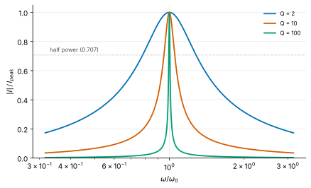
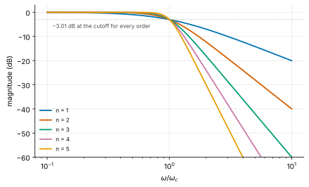
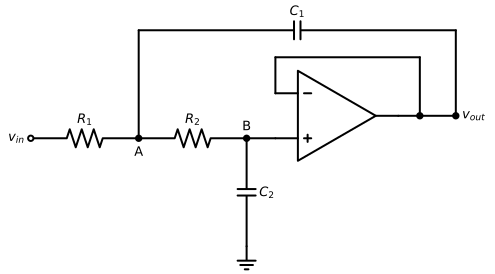

<!-- status: verified -->
# 07-08 · Filters and Resonance

| | |
|---|---|
| **Course** | [07 · Circuit Analysis II (Transient and AC)](../README.md) |
| **University equivalent** | The filter chapters of a sophomore Circuits II course (Nilsson & Riedel, *Introduction to Frequency Selective Circuits* and *Active Filter Circuits*; Alexander & Sadiku, *Frequency Response*: resonance, passive and active filters, scaling) |
| **Prerequisites** | [07-07 Frequency Response and Bode Plots](07-07-frequency-response-and-bode-plots.md) (Bode form, complex poles, gain–bandwidth), [07-05 Sinusoidal Steady State](07-05-sinusoidal-steady-state-and-impedance.md) (impedance, series–parallel equivalents), [02-04 Forced Response and Resonance](../../02-complex-numbers-des-and-linear-algebra/chapters/02-04-forced-response-and-resonance.md) (the band-pass curve and $Q$), [07-03 Second-Order RLC Transients](07-03-second-order-rlc-transients.md) (ζ, $Z_0$, ringing), [06-10 The Ideal Op-Amp](../../06-circuit-analysis-1-dc/chapters/06-10-ideal-op-amp.md). The facts used from each are restated where they are needed. |
| **Estimated study hours** | 10 |
| **Last verified** | 2026-11-19 |

**Learning objectives.** After this chapter you can:

1. Classify filters (low-pass, high-pass, band-pass, band-stop, all-pass) from their transfer functions, and state a filter specification: passband, stopband, cutoff, attenuation and order.
2. Analyze series and parallel resonant circuits: resonant frequency, $Q$ from element values, from bandwidth, from stored energy and from ringing, voltage and current magnification, and loaded versus unloaded $Q$.
3. Design first- and second-order passive filters to a cutoff and $Q$, and use normalized prototypes with impedance and frequency scaling.
4. Derive the Butterworth response, find the order a specification needs, and split it into first- and second-order sections with the right $Q$ values.
5. Analyze and design active filters, including the Sallen–Key low-pass in its unity-gain and equal-component forms, with their sensitivity to component values and to the op-amp's gain–bandwidth product.
6. Explain how resonator $Q$ limits a filter's insertion loss and selectivity, and use that to compare RC, LC, crystal and acoustic filter technologies.

## 1. Big picture

A **filter** passes the frequencies you want and rejects the ones you do not. It is the frequency response of 07-07 designed on purpose. The core building block is resonance: a circuit with stored energy in two forms, magnetic and electric, which trades energy back and forth at one natural frequency and responds strongly there and weakly elsewhere. How sharply it discriminates is measured by one number, the quality factor $Q$. This chapter shows how to build resonators and filters from R, L, C and op-amps, how to specify them, and why the best filters in a phone are not made of inductors and capacitors at all.

- **Every radio:** a phone has a filter for each band it supports, and filters are a large share of its RF front-end cost (§9). Their selectivity comes from resonators with very high $Q$.
- **Every data converter:** an analog-to-digital converter needs an anti-aliasing low-pass filter in front of it ([11-10](../../11-signals-and-systems/chapters/11-10-sampling-aliasing-reconstruction.md)), usually an active filter like this chapter's Sallen–Key.
- **Every power supply:** LC filters remove switching ripple, and their resonance must be damped (07-07 Example 07-07.3).
- **Every clock:** a quartz crystal is a mechanical resonator with a $Q$ in the tens of thousands or more, which is why it keeps time ([12](../../12-electronics-2/README.md)).
- **Sensors and wearables:** active filters band-limit biopotential and audio signals before conversion, at microwatts of power.

## 2. Intuition first

**A swing and a push.** 02-04 introduced resonance with a playground swing: push at its natural frequency and small pushes build large swings; push at any other frequency and the pushes fight the motion. A series RLC circuit is the same system. The inductor's current is the swing's velocity, the capacitor's charge its displacement, and the resistor its friction. At resonance the inductor's and capacitor's reactances cancel exactly, so the source sees only the resistor and drives the largest current.

**What Q measures.** $Q$ compares the energy sloshing between L and C with the energy the resistor removes. A high-$Q$ circuit stores much more energy than it loses each cycle. That has three faces, which this chapter shows are the same number: it rings for many cycles after a kick (07-03), it responds over a narrow band (02-04), and at resonance the voltage across L or C is $Q$ times the source voltage (07-05).

**An analogy from finance.** Think of a resonator as an option whose payoff is concentrated at one strike price. A low-$Q$ resonator is a wide, shallow payoff profile; a high-$Q$ resonator is a narrow, tall spike. Selectivity, like a narrow payoff, is valuable but must be paid for: in a circuit the currency is low loss (high $Q$ components), which costs size, materials or exotic technology. *Where the analogy breaks:* option payoffs are designed contracts with no physical constraint, while a filter's shape is bounded by physics: a passive circuit cannot amplify power, and steep transitions require many resonators (high order) with growing loss and phase distortion.

## 3. Theory

### 3.1 Filter types and specifications

An ideal low-pass filter would pass everything below a cutoff frequency unchanged and remove everything above it. No real circuit can do that, and a specification says how close it must come:

- **Passband:** the band to be passed, from DC to the **passband edge** $f_p$, within a stated variation (for example ±0.5 dB, or −3 dB at the edge).
- **Stopband:** the band to be rejected, beyond the **stopband edge** $f_s$, with at least a stated **attenuation** $A_s$ (for example 60 dB).
- **Transition band:** between $f_p$ and $f_s$. The narrower it is, the more poles the filter needs.
- **Order:** the number of poles. Far above the cutoff, an $n$th-order low-pass falls at $n\times20$ dB/decade (07-07).

There are five common types, and every one can be built from **second-order sections** ("biquads") with the same denominator $s^2 + (\omega_0/Q)s + \omega_0^2$, which places a pair of poles at natural frequency $\omega_0$ with quality factor $Q$ (so $\zeta = 1/(2Q)$, 07-03). Only the numerator changes:

| Type | Second-order $H(s)$ | Passes | Rejects |
|---|---|---|---|
| Low-pass | $\dfrac{K\omega_0^2}{s^2 + (\omega_0/Q)s + \omega_0^2}$ | below $\omega_0$ | above |
| High-pass | $\dfrac{Ks^2}{s^2 + (\omega_0/Q)s + \omega_0^2}$ | above $\omega_0$ | below |
| Band-pass | $\dfrac{K(\omega_0/Q)s}{s^2 + (\omega_0/Q)s + \omega_0^2}$ | near $\omega_0$ | both sides |
| Band-stop (notch) | $\dfrac{K(s^2 + \omega_0^2)}{s^2 + (\omega_0/Q)s + \omega_0^2}$ | both sides | near $\omega_0$ |
| All-pass | $\dfrac{K(s^2 - (\omega_0/Q)s + \omega_0^2)}{s^2 + (\omega_0/Q)s + \omega_0^2}$ | everything (flat) | nothing; shifts phase |

Each is easy to check at the extremes. For example the band-pass is 0 at $s = 0$ and at $s \to \infty$, and exactly $K$ at $s = j\omega_0$, where $s^2 + \omega_0^2 = 0$ and the denominator reduces to $j\omega_0^2/Q$. The notch's numerator vanishes at $s = j\omega_0$, so the response there is exactly zero.

### 3.2 Series resonance

A series RLC driven by a voltage source has impedance

$$
Z(j\omega) = R + j\Big(\omega L - \frac{1}{\omega C}\Big) .
$$

The reactance vanishes at the **resonant frequency**

$$
\omega_0 = \frac{1}{\sqrt{LC}},
$$

where $Z = R$, its minimum, so the current $\mathbf{I} = \mathbf{V}/Z$ peaks at $\mathbf{V}/R$, in phase with the source. Below $\omega_0$ the capacitor's reactance dominates (the circuit is capacitive and the current leads); above it, the inductor's does (inductive, current lags).

**Quality factor.** Define the **characteristic impedance** $Z_0 = \sqrt{L/C}$, the reactance of either L or C at resonance ($\omega_0L = 1/(\omega_0C) = Z_0$, as 07-03 showed). The quality factor of the series circuit is

$$
Q = \frac{\omega_0L}{R} = \frac{1}{\omega_0RC} = \frac{Z_0}{R} .
$$

**Bandwidth.** The power delivered, $\tfrac12\lvert\mathbf{I}\rvert^2R$, falls to half its peak where $\lvert Z\rvert = \sqrt2R$, that is, where the reactance equals $\pm R$. Write $\omega L - 1/(\omega C) = \pm R$, multiply by $\omega/L$, and use $1/(LC) = \omega_0^2$ and $R/L = \omega_0/Q$:

$$
\omega^2 \mp \frac{\omega_0}{Q}\,\omega - \omega_0^2 = 0
\quad\Longrightarrow\quad
\omega_{1,2} = \omega_0\left(\sqrt{1 + \frac{1}{4Q^2}} \mp \frac{1}{2Q}\right).
$$

So, exactly,

$$
\omega_2 - \omega_1 = \frac{\omega_0}{Q}, \qquad \omega_1\omega_2 = \omega_0^2 .
$$

The **bandwidth is $\omega_0/Q$**, and the band is centered geometrically on $\omega_0$. This is 02-04 §3.5's result, now derived from the circuit. For $Q \gtrsim 10$ the band is very nearly symmetric, $\omega_0 \pm \omega_0/(2Q)$.

*Figure 1. The current of a series RLC relative to its peak, against frequency. Higher $Q$ gives a narrower response; each curve crosses 0.707 at $\omega_0(\sqrt{1 + 1/(4Q^2)} \mp 1/(2Q))$.*

**Voltage magnification.** At resonance $\mathbf{I} = \mathbf{V}/R$, so the inductor's voltage has magnitude $\omega_0L\lvert\mathbf{V}\rvert/R = Q\lvert\mathbf{V}\rvert$, and so does the capacitor's, in antiphase. A 1 V source can put 100 V across the capacitor of a $Q$ = 100 circuit, which is why component voltage ratings matter in resonant circuits (Example 07-08.1, Problem 07-08.5).

### 3.3 Parallel resonance

A parallel RLC driven by a current source is the dual. Its admittance is

$$
Y(j\omega) = \frac{1}{R} + j\Big(\omega C - \frac{1}{\omega L}\Big),
$$

with the same $\omega_0 = 1/\sqrt{LC}$, where the susceptance vanishes. Now the *impedance* peaks, at $Z = R$, so a current source develops its largest voltage there. Every result of §3.2 carries over with R, L, C and V, I exchanged by duality:

$$
Q = \frac{R}{\omega_0L} = \omega_0RC = \frac{R}{Z_0}, \qquad \text{bandwidth } \frac{\omega_0}{Q}, \qquad \lvert\mathbf{I}_L\rvert = \lvert\mathbf{I}_C\rvert = Q\lvert\mathbf{I}\rvert \text{ at } \omega_0 .
$$

Notice the inversion: a series circuit has *high* $Q$ when R is *small* (little series loss), while a parallel circuit has high $Q$ when R is *large* (little shunt loss). Both are "high $Q$ = low loss".

### 3.4 Real resonators: unloaded and loaded Q

A real inductor has winding resistance $r$ in series, so a practical "parallel" tank is an inductor with its $r$, in parallel with C. 07-05 §3.3 converted a series R–X pair to its parallel equivalent at one frequency: with the coil's own $Q_c = \omega L/r$,

$$
R_p = r\,(1 + Q_c^2) \approx Q_c^2r = Q_c\,\omega L, \qquad L_p = L\Big(1 + \frac{1}{Q_c^2}\Big) \approx L .
$$

So a coil with $Q_c$ = 80 behaves near resonance like an ideal inductor shunted by $R_p = 80\,\omega L$. Its own losses set the **unloaded $Q$**, $Q_u = R_p/(\omega_0L_p) \approx Q_c$, the best the resonator can do.

In use, the tank is also loaded by whatever drives it (a transistor's output resistance) and whatever it drives (the next stage's input). All these resistances appear in parallel with $R_p$:

$$
R_{total} = R_p\parallel R_{source}\parallel R_{load}, \qquad Q_L = \frac{R_{total}}{\omega_0L_p} .
$$

The **loaded $Q$** $Q_L$ is always below $Q_u$, so the bandwidth $\omega_0/Q_L$ is wider than the coil alone would give. Power divides among the parallel conductances in proportion to their values (each gets $\tfrac12V^2G$ with the same $V$), so a fraction $R_{total}/R_p = Q_L/Q_u$ of the power ends up as heat in the resonator itself. That fraction is the root of **insertion loss**, §3.9.

### 3.5 One Q, four meanings

For a second-order resonator, the following are all the same number (exactly for the energy and pole definitions, and to an accuracy that improves as $Q$ grows for the others):

| View | Formula | Where it was derived |
|---|---|---|
| Pole location | $\zeta = 1/(2Q)$; poles at $-\dfrac{\omega_0}{2Q} \pm j\omega_0\sqrt{1 - \dfrac{1}{4Q^2}}$ | 07-03, 07-04 |
| Bandwidth | $Q = \omega_0/(\omega_2 - \omega_1)$ (exact for the band-pass response) | §3.2, 02-04 |
| Energy | $Q = 2\pi\,\dfrac{\text{energy stored}}{\text{energy lost per cycle}}$ (at resonance) | below |
| Ringing | the envelope decays as $e^{-\omega_0t/(2Q)}$: by a factor $e$ in $Q/\pi$ cycles (approximately, for high $Q$) | 07-03 |

**The energy definition, derived for the series circuit.** At resonance the current is $i = I_m\cos\omega_0t$. The total stored energy is constant: $w = \tfrac12Li^2 + \tfrac12Cv_C^2 = \tfrac12LI_m^2$, because when the current is at its peak the capacitor voltage is zero and the energy simply moves between them. The resistor dissipates $\tfrac12I_m^2R$ on average, so per cycle $T_0 = 2\pi/\omega_0$ it loses $\tfrac12I_m^2R\,T_0$. Then

$$
2\pi\,\frac{\tfrac12LI_m^2}{\tfrac12I_m^2R\cdot2\pi/\omega_0} = \frac{\omega_0L}{R} = Q . \;✓
$$

The energy form generalizes to any resonator, mechanical, acoustic or electromagnetic, which is why quartz and acoustic filters are compared by the same $Q$ (§3.9).

### 3.6 Passive filter design and scaling

**First order.** An RC divider (series R, shunt C) is a low-pass with corner $1/(2\pi RC)$; swapping R and C gives a high-pass. These are 07-02's and 07-07's single poles.

**Second order.** A series RLC with the output across C is a low-pass with the 07-07 §3.4 complex-pole response, $\omega_0 = 1/\sqrt{LC}$ and $Q = Z_0/R$, where R includes the source resistance. The output across R is the band-pass of 02-04, and across the series LC combination a notch.

**Doubly terminated filters.** Filters between a source resistance and a load resistance (50 Ω in RF systems) are designed from tabulated **normalized prototypes**: element values for a 1 Ω source and load and a 1 rad/s cutoff. The second-order Butterworth prototype is a series inductor $L = \sqrt2$ H and a shunt capacitor $C = \sqrt2$ F. Its transfer function (Example 07-08.3) is

$$
H(s) = \frac{1}{2}\cdot\frac{1}{s^2 + \sqrt2\,s + 1},
$$

where the ½ is the divider between equal source and load resistances, not a filter loss.

**Scaling.** A prototype becomes a real design by two scalings that leave the *shape* of the response unchanged:

- **Impedance scaling** by $k_z$: multiply every R and L by $k_z$ and divide every C by $k_z$. Every impedance ($R$, $sL$, $1/(sC)$) is multiplied by $k_z$, so every voltage ratio is unchanged.
- **Frequency scaling** by $k_f$: divide every L and C by $k_f$. Then $j(k_f\omega)(L/k_f) = j\omega L$: the impedances at frequency $k_f\omega$ equal the old impedances at $\omega$, so the response is shifted up the frequency axis by $k_f$.

Together: $R' = k_zR$, $L' = k_zL/k_f$, $C' = C/(k_zk_f)$.

### 3.7 The Butterworth response

Among all $n$th-order low-pass responses with no zeros, the **Butterworth** response is the one that is as flat as possible at DC. It is defined by its magnitude:

$$
\lvert H(j\omega)\rvert^2 = \frac{1}{1 + (\omega/\omega_c)^{2n}} .
$$

At $\omega_c$ it is $1/\sqrt2$ (−3.01 dB) for every $n$. Far above $\omega_c$ it falls at $n\times20$ dB/decade. Figure 2 shows orders 1 to 5. Expanding for small $x = \omega/\omega_c$, $\lvert H\rvert^2 = 1 - x^{2n} + x^{4n} - \cdots$: the first $2n - 1$ derivatives vanish at DC, which is the meaning of **maximally flat**. Stephen Butterworth published the idea in 1930 (§9).

*Figure 2. Butterworth low-pass magnitudes. All pass −3.01 dB at the cutoff; higher orders are flatter below it and steeper above it.*

**Order from a specification.** If the response must be down at least $A_s$ dB at $\omega_s$, then $10\lg\big(1 + (\omega_s/\omega_c)^{2n}\big) \ge A_s$, so

$$
n \ge \frac{\lg\big(10^{A_s/10} - 1\big)}{2\lg(\omega_s/\omega_c)},
$$

rounded up to an integer.

**Poles on a circle.** On the imaginary axis $\lvert H\rvert^2 = H(s)H(-s)$ with $s^2 = -\omega^2$, so

$$
H(s)H(-s) = \frac{1}{1 + \big(-s^2/\omega_c^2\big)^n} .
$$

Its poles satisfy $(-s^2)^n = -\omega_c^{2n}$: $2n$ points equally spaced on a circle of radius $\omega_c$. The stable filter $H(s)$ takes the $n$ in the left half-plane,

$$
s_k = \omega_c\big(-\sin\alpha_k + j\cos\alpha_k\big), \qquad \alpha_k = \frac{(2k - 1)\pi}{2n},\quad k = 1, \dots, n .
$$

Each conjugate pair has natural frequency $\omega_c$ (every pole is on the circle) and real part $-\omega_c\sin\alpha_k = -\omega_0/(2Q)$, so

$$
Q_k = \frac{1}{2\sin\alpha_k} .
$$

An odd order adds one real pole at $-\omega_c$. A Butterworth filter is therefore a cascade of sections all tuned to $\omega_c$, with these $Q$ values:

| Order | Sections |
|---|---|
| 2 | $Q$ = 0.7071 |
| 3 | real pole; $Q$ = 1.000 |
| 4 | $Q$ = 0.5412 and 1.307 |
| 5 | real pole; $Q$ = 0.6180 and 1.618 |

The highest-$Q$ section is the hardest to build accurately: its peak, $20\lg Q$ above the asymptotes at $\omega_c$ (07-07), must be cancelled by the low-$Q$ sections' droop to give a flat total.

> **Going deeper — other families.** The Butterworth response trades steepness for flatness. A **Chebyshev** response allows a specified ripple in the passband and in exchange falls faster in the transition band for the same order. An **elliptic** (Cauer) response adds zeros on the imaginary axis (notches in the stopband) for the steepest transition of all. A **Bessel** response gives up steepness to keep the group delay (07-07 §3.4) nearly constant, so pulses pass without ringing. All are built from the same biquad sections with different $\omega_0$ and $Q$ values, taken from published tables or design software.

### 3.8 Active filters

Below about a megahertz, inductors for useful filters become large, lossy and expensive. **Active filters** replace them with op-amps, resistors and capacitors. They bring three advantages: no inductors, gain if wanted, and a low-impedance output, so sections can be cascaded without loading one another (07-07 §3.1).

**First-order sections.** An inverting amplifier with $R_f\parallel C_f$ in the feedback path has $H = -(R_f/R_i)/(1 + sR_fC_f)$: a low-pass with gain $-R_f/R_i$ and corner $1/(2\pi R_fC_f)$. An RC divider followed by a voltage follower is the simplest first-order section.

**The Sallen–Key low-pass.** The most widely used second-order active section, published by R. P. Sallen and E. L. Key in 1955 (§9), uses one op-amp as a non-inverting amplifier of gain $K$ (a follower when $K$ = 1). The input passes through $R_1$ to node A and through $R_2$ to node B, the op-amp's non-inverting input. $C_2$ goes from B to ground, and $C_1$ from A to the output (Figure 3).

*Figure 3. The Sallen–Key low-pass: two RC sections, with $C_1$ returning feedback from the output to the middle node.*

KCL at node B gives $(\mathbf{V}_A - \mathbf{V}_B)/R_2 = sC_2\mathbf{V}_B$, so $\mathbf{V}_A = \mathbf{V}_B(1 + sR_2C_2)$. KCL at node A, with $\mathbf{V}_{out} = K\mathbf{V}_B$:

$$
\frac{\mathbf{V}_{in} - \mathbf{V}_A}{R_1} = sC_2\mathbf{V}_B + sC_1(\mathbf{V}_A - K\mathbf{V}_B).
$$

Substitute for $\mathbf{V}_A$, multiply by $R_1$ and collect:

$$
\mathbf{V}_{in} = \mathbf{V}_B\big[1 + s\big(R_1C_2 + R_2C_2 + (1 - K)R_1C_1\big) + s^2R_1R_2C_1C_2\big],
$$

so

$$
H(s) = \frac{K}{1 + s\big(R_1C_2 + R_2C_2 + (1 - K)R_1C_1\big) + s^2R_1R_2C_1C_2} ,
\qquad
\omega_0 = \frac{1}{\sqrt{R_1R_2C_1C_2}},
\qquad
\frac{1}{Q} = \omega_0\big(R_1C_2 + R_2C_2 + (1 - K)R_1C_1\big).
$$

Two standard designs follow:

- **Unity gain** ($K$ = 1, a follower): $Q = \sqrt{R_1R_2C_1C_2}/\big((R_1 + R_2)C_2\big)$. With equal resistors, $Q = \tfrac12\sqrt{C_1/C_2}$, so **the capacitor ratio sets $Q$**: $C_1/C_2 = 4Q^2$, which is 2 for a Butterworth section. Gain and $Q$ are insensitive to the op-amp's gain-setting resistors, because there are none.
- **Equal components** ($R_1 = R_2 = R$, $C_1 = C_2 = C$): $\omega_0 = 1/(RC)$ and $1/Q = 3 - K$, so **the gain sets $Q$**: $K = 3 - 1/Q$, which is $3 - \sqrt2 = 1.586$ for a Butterworth section. At $K$ = 3 the damping vanishes and the circuit oscillates. Because $Q = 1/(3 - K)$, a small error in $K$ is magnified near $K$ = 3: the relative sensitivity $(dQ/Q)/(dK/K) = KQ$, which is 1.12 for a Butterworth section but 8 for a $Q$ = 3 section.

**Sensitivity in the unity-gain design.** With $Q = \tfrac12\sqrt{C_1/C_2}$, a 10% error in $C_1$ changes $Q$ by about 5% and $\omega_0$ by about 5% (Example 07-08.5). Filters therefore use stable, tight-tolerance capacitors (§9).

**The op-amp's limits.** The derivation assumed the op-amp delivers exactly $K$ at every frequency. A real op-amp's gain falls with frequency (07-07 §3.8), so the section's $Q$ and $\omega_0$ drift if the gain–bandwidth product is not far above the filter's frequencies. Its output impedance also rises with frequency, and through $C_1$ the input then leaks directly to the output, limiting the stopband attenuation of a Sallen–Key low-pass at high frequency (§9).

### 3.9 Resonator Q sets insertion loss

Why are phone filters built from acoustic resonators rather than inductors and capacitors? The answer follows from §3.4.

Put one parallel resonator between a source and a load, each of resistance $R$, and compare the output at resonance with the output without the resonator. The source sees $R_{p}\parallel R$, and the load voltage is

$$
\mathbf{V}_{L} = \mathbf{V}_S\,\frac{R_p\parallel R}{R + R_p\parallel R} .
$$

Without the resonator ($R_p \to \infty$) this is $\mathbf{V}_S/2$. The ratio simplifies to $2R_p/(2R_p + R)$. The loaded and unloaded $Q$ values are $Q_L = (R_p\parallel R/2)/Z_0$ (the source and load together present $R/2$) and $Q_u = R_p/Z_0$, so $Q_L/Q_u = R/(2R_p + R)$, and

$$
\frac{\lvert\mathbf{V}_L\rvert}{\lvert\mathbf{V}_S\rvert/2} = 1 - \frac{Q_L}{Q_u}
\quad\Longrightarrow\quad
\text{insertion loss} = -20\lg\Big(1 - \frac{Q_L}{Q_u}\Big)\ \text{dB}.
$$

The **loaded $Q$** is set by the job: a filter passing a band $B$ around $f_0$ needs $Q_L \approx f_0/B$. The **unloaded $Q$** is set by the technology. Insertion loss stays small only if $Q_u \gg Q_L$. A filter passing a 20 MHz band at 2 GHz needs $Q_L$ ≈ 100. Resonators with $Q_u$ = 200 would lose 6.02 dB per resonator, three-quarters of the power. With $Q_u$ = 2000 the loss is 0.45 dB. A real filter uses several resonators in a ladder, and the losses add. This is the engineering reason behind the acoustic-resonator industry of §9: at gigahertz frequencies, small inductors cannot reach the $Q$ that phone filters need, and acoustic resonators can.

## 4. Worked examples

### Example 07-08.1 · A series resonant circuit (tier A)

**Setup.** A series RLC has $R$ = 10 Ω, $L$ = 100 µH and $C$ = 100 pF, driven by a 10 mV (peak) source. Find (a) $f_0$, $Z_0$, $Q$ and the bandwidth; (b) the exact half-power frequencies; (c) the current and the inductor and capacitor voltages at resonance; (d) $Q$ from the stored energy and the energy lost per cycle.

**Solution.**

(a) $\omega_0 = 1/\sqrt{10^{-4}\times10^{-10}} = 10^7$ rad/s, so $f_0$ = **1.592 MHz**. $Z_0 = \sqrt{10^{-4}/10^{-10}}$ = **1000 Ω**, $Q = Z_0/R$ = **100**, bandwidth $f_0/Q$ = **15.92 kHz**.

(b) $f_{1,2} = f_0\big(\sqrt{1 + 1/(4Q^2)} \mp 1/(2Q)\big)$ = **1.5836 MHz** and **1.5995 MHz**. Their difference is 15.92 kHz and their product $f_0^2$, as §3.2 requires.

(c) At resonance $Z = R$, so $I = 10\ \text{mV}/10\ \Omega$ = **1.000 mA**, and $\lvert V_L\rvert = \lvert V_C\rvert = I Z_0$ = **1.000 V**: $Q$ = 100 times the source.

(d) Stored energy $\tfrac12LI_m^2 = \tfrac12\times10^{-4}\times10^{-6}$ = **50.0 pJ**. Average power $\tfrac12I_m^2R$ = 5 nW, times one period $1/f_0$ = 628.3 ns, gives **3.142 pJ** per cycle. Then $2\pi\times50.0/3.142$ = **100.0** ✓.

**Units check.** $\sqrt{\text{H}/\text{F}} = \sqrt{\Omega\text{s}/(\text{s}/\Omega)} = \Omega$ ✓.
**Sanity check.** A 1.6 MHz resonator with a 16 kHz bandwidth is the classic AM-radio tuned circuit: it selects one station's channel.

### Example 07-08.2 · A tuned amplifier's loaded Q (tier B)

**Setup.** An intermediate-frequency amplifier uses a parallel tank at 10.7 MHz: a 1 µH coil with $Q_c$ = 80 at that frequency, in parallel with a capacitor. A transistor with 20 kΩ of output resistance drives it, and the next stage loads it with 10 kΩ. Find (a) the coil's series resistance and parallel-equivalent $R_p$ and $L_p$; (b) the capacitance for resonance at 10.7 MHz; (c) the loaded $Q$ and bandwidth, against the coil's own; (d) where the power goes.

**Solution.**

(a) $\omega_0L = 2\pi\times10.7\ \text{MHz}\times1\ \text{µH}$ = 67.23 Ω, so $r = 67.23/80$ = **0.8404 Ω**. By §3.4, $R_p = r(1 + Q_c^2)$ = **5379 Ω** and $L_p = L(1 + 1/80^2)$ = 1.000156 µH.

(b) Resonance of the parallel equivalent: $C = 1/(\omega_0^2L_p)$ = **221.2 pF**.

(c) $R_{total} = 5379 \parallel 20\,000 \parallel 10\,000$ = **2977 Ω**, so $Q_L = 2977/67.24$ = **44.3** and the bandwidth is $10.7\ \text{MHz}/44.28$ = **241.7 kHz**. The coil alone would give $10.7\ \text{MHz}/80$ = **133.8 kHz**. Loading has nearly doubled the bandwidth.

(d) Power divides in proportion to conductance: $2977/5379$ = **55.3%** heats the coil, $2977/20\,000$ = **14.9%** the transistor's output resistance, and $2977/10\,000$ = **29.8%** reaches the next stage. More than half the signal power is lost in the resonator because its $Q_u$ is not much above the $Q_L$ the circuit needs.

**Units check.** All resistances in ohms; $Q$ dimensionless ✓.
**Sanity check.** $Q_L/Q_u = 44.3/80 = 0.553$, the same fraction as the coil's share of the power (§3.4) ✓.

### Example 07-08.3 · A 50 Ω Butterworth low-pass from a prototype (tier B)

**Setup.** Design a second-order Butterworth low-pass for a 50 Ω system (50 Ω source, 50 Ω load) with its −3 dB point at 10 MHz, from the prototype $L = C = \sqrt2$. Verify its transfer function and find the response at DC, 10 MHz, 30 MHz and 100 MHz.

**Solution.**

*Prototype check.* With a source $R_S$, series $L$, and $C$ in parallel with the load $R_L$: $Z_p = R_L/(1 + sR_LC)$ and $H = Z_p/(R_S + sL + Z_p)$, so

$$
H(s) = \frac{R_L}{R_S + R_L + s(L + R_SR_LC) + s^2LR_LC} .
$$

With $R_S = R_L = 1$ and $L = C = \sqrt2$, the denominator is $2 + 2\sqrt2\,s + 2s^2$, so $H = \tfrac12/(s^2 + \sqrt2\,s + 1)$: a Butterworth pair ($Q$ = 0.7071, $\omega_0$ = 1) times the ½ of the terminations ✓.

*Scaling.* $k_z$ = 50 and $k_f = 2\pi\times10$ MHz: $L = \sqrt2\times50/(2\pi\times10^7)$ = **1.125 µH** and $C = \sqrt2/(50\times2\pi\times10^7)$ = **450.2 pF**.

*Response.*

| Frequency | Gain | Relative to DC | Phase |
|---|---|---|---|
| DC | **−6.02 dB** | 0 dB | 0° |
| 10 MHz | **−9.03 dB** | **−3.01 dB** | **−90.00°** |
| 30 MHz | **−25.16 dB** | **−19.14 dB** | **−152.06°** |
| 100 MHz | **−46.02 dB** | **−40.00 dB** | **−171.87°** |

The response is −3.01 dB at the cutoff, and a decade above it is 40 dB down: second order, −40 dB/decade ✓.

**Units check.** $R/\omega$ is Ω·s = H; $1/(R\omega)$ is s/Ω = F ✓.
**Sanity check.** The −6.02 dB at DC is the source–load divider: a matched filter delivers half the source's open-circuit voltage, which is the maximum power transfer of 06-09, not a loss.

### Example 07-08.4 · How many poles? (tier B)

**Setup.** A sensor channel must pass up to 20 kHz (Butterworth, −3 dB at 20 kHz) and attenuate interference at 100 kHz by at least 40 dB. Find the order and the sections, and the attenuation achieved at 100 kHz.

**Solution.** $\omega_s/\omega_c$ = 5, so

$$
n \ge \frac{\lg(10^{4} - 1)}{2\lg5} = \frac{4.000}{1.398} = 2.861 ,
$$

and the order is **3**. The sections (§3.7) are one real pole at 20 kHz and one pair at 20 kHz with $Q$ = **1.000**. The attenuation at 100 kHz is $10\lg(1 + 5^6)$ = **41.94 dB**, which meets the 40 dB requirement with 1.94 dB to spare. A second-order filter would give only $10\lg(1 + 5^4)$ = **27.97 dB**.

**Units check.** Only frequency ratios appear ✓.
**Sanity check.** Each order adds about 14 dB at a frequency five times the cutoff ($20\lg5$ = 14 dB per pole): 2 poles ≈ 28 dB, 3 poles ≈ 42 dB ✓.

### Example 07-08.5 · A unity-gain Sallen–Key Butterworth section (tier B)

**Setup.** Design a unity-gain Sallen–Key Butterworth low-pass at 1 kHz with equal resistors and $C_2$ = 10 nF. (a) Find $C_1$ and the exact resistance. (b) With the nearest standard (E96) resistor, 11.3 kΩ, find $f_0$ and the gain at 1 kHz. (c) If $C_1$ is 10% low or 10% high (a poorly chosen capacitor dielectric), how do $Q$ and $f_0$ change? (d) What gain would the equal-component design need?

**Solution.**

(a) $Q = \tfrac12\sqrt{C_1/C_2} = 0.7071$ requires $C_1/C_2 = 2$: $C_1$ = **20 nF**. Then $R = 1/\big(2\pi f_0\sqrt{C_1C_2}\big) = 1/(2\pi\times1000\times14.14\ \text{nF})$ = **11.25 kΩ**.

(b) With 11.3 kΩ, $f_0 = 1/(2\pi\times11.3\ \text{k}\Omega\times14.14\ \text{nF})$ = **995.9 Hz**, and $Q$ is still exactly 0.7071 (equal resistors). The gain at 1 kHz is **−3.046 dB**, a negligible shift.

(c) $C_1$ = 18 nF: $Q = \tfrac12\sqrt{1.8}$ = **0.6708** (−5.1%) and $f_0$ = **1049.8 Hz** (+5.4%). $C_1$ = 22 nF: $Q$ = **0.7416** (+4.9%) and $f_0$ = **949.6 Hz** (−4.7%). Each 10% capacitor error moves both $Q$ and the cutoff by about 5%, because both depend on $\sqrt{C_1}$.

(d) Equal components need $K = 3 - \sqrt2$ = **1.586**, a non-inverting gain with $R_f/R_g$ = **0.586**, which also amplifies the signal by **4.005 dB**.

**Units check.** $1/(\Omega\cdot\text{F})$ = 1/s ✓.
**Sanity check.** For a Butterworth response the capacitor in the feedback path is the larger one: it supplies the extra peaking that the two cascaded RC sections alone (each damped) cannot.

### Example 07-08.6 · Why phone filters use acoustic resonators (tier C)

**Setup.** A band filter at 2 GHz must pass a 20 MHz-wide channel. (a) What loaded $Q$ does each resonator need? (b) Find the insertion loss of one resonator for unloaded $Q$ values of 200, 1000 and 2000. (c) What does this imply for a ladder filter of several resonators?

**Solution.**

(a) $Q_L \approx f_0/B = 2000/20$ = **100**.

(b) $-20\lg(1 - Q_L/Q_u)$ (§3.9): **6.02 dB** for $Q_u$ = 200, **0.92 dB** for 1000, **0.45 dB** for 2000.

(c) Losses add along a ladder. Four resonators with $Q_u$ = 200 would lose about **24 dB**, wasting nearly all of a transmitter's power and a receiver's sensitivity. With $Q_u$ = 2000 the same four lose under 2 dB. Selectivity at gigahertz frequencies is therefore a question of resonator $Q$, which is why the industry builds filters from acoustic resonators whose $Q$ is far above what chip inductors reach (§9).

**Units check.** Ratios of $Q$ values are dimensionless ✓.
**Sanity check.** As $Q_u \to \infty$ the loss tends to 0 dB, and as $Q_u \to Q_L$ it diverges: a resonator cannot be loaded to a higher $Q$ than its own.

<!-- answer-key -->
| ID | Quantity | Value | Unit |
|---|---|---|---|
| Ex 07-08.1a | $f_0$ | 1.592 | MHz |
| Ex 07-08.1b | $Z_0$ | 1000 | Ω |
| Ex 07-08.1c | Q | 100 | — |
| Ex 07-08.1d | bandwidth | 15.92 | kHz |
| Ex 07-08.1e | lower half-power frequency | 1.5836 | MHz |
| Ex 07-08.1f | upper half-power frequency | 1.5995 | MHz |
| Ex 07-08.1g | current at resonance | 1.000 | mA |
| Ex 07-08.1h | inductor and capacitor voltage | 1.000 | V |
| Ex 07-08.1i | stored energy | 50.0 | pJ |
| Ex 07-08.1j | energy lost per cycle | 3.142 | pJ |
| Ex 07-08.1k | Q from energy | 100.0 | — |
| Ex 07-08.2a | coil series resistance | 0.8404 | Ω |
| Ex 07-08.2b | $R_p$ | 5379 | Ω |
| Ex 07-08.2c | capacitance | 221.2 | pF |
| Ex 07-08.2d | total parallel resistance | 2977 | Ω |
| Ex 07-08.2e | loaded Q | 44.3 | — |
| Ex 07-08.2f | loaded bandwidth | 241.7 | kHz |
| Ex 07-08.2g | coil-only bandwidth | 133.8 | kHz |
| Ex 07-08.2h | share of power in the coil | 55.3 | % |
| Ex 07-08.2i | share in the source resistance | 14.9 | % |
| Ex 07-08.2j | share delivered to the load | 29.8 | % |
| Ex 07-08.3a | L | 1.125 | µH |
| Ex 07-08.3b | C | 450.2 | pF |
| Ex 07-08.3c | gain at DC | −6.02 | dB |
| Ex 07-08.3d | gain at 10 MHz | −9.03 | dB |
| Ex 07-08.3e | relative gain at 10 MHz | −3.01 | dB |
| Ex 07-08.3f | phase at 10 MHz | −90.00 | ° |
| Ex 07-08.3g | gain at 30 MHz | −25.16 | dB |
| Ex 07-08.3h | relative gain at 30 MHz | −19.14 | dB |
| Ex 07-08.3i | phase at 30 MHz | −152.06 | ° |
| Ex 07-08.3j | gain at 100 MHz | −46.02 | dB |
| Ex 07-08.3k | relative gain at 100 MHz | −40.00 | dB |
| Ex 07-08.3l | phase at 100 MHz | −171.87 | ° |
| Ex 07-08.4a | minimum order (unrounded) | 2.861 | — |
| Ex 07-08.4b | order | 3 | — |
| Ex 07-08.4c | Q of the pair | 1.000 | — |
| Ex 07-08.4d | attenuation at 100 kHz | 41.94 | dB |
| Ex 07-08.4e | second-order attenuation at 100 kHz | 27.97 | dB |
| Ex 07-08.5a | $C_1$ | 20 | nF |
| Ex 07-08.5b | exact resistance | 11.25 | kΩ |
| Ex 07-08.5c | $f_0$ with 11.3 kΩ | 995.9 | Hz |
| Ex 07-08.5d | gain at 1 kHz | −3.046 | dB |
| Ex 07-08.5e | Q with $C_1$ 10% low | 0.6708 | — |
| Ex 07-08.5f | $f_0$ with $C_1$ 10% low | 1049.8 | Hz |
| Ex 07-08.5g | Q with $C_1$ 10% high | 0.7416 | — |
| Ex 07-08.5h | $f_0$ with $C_1$ 10% high | 949.6 | Hz |
| Ex 07-08.5i | equal-component gain | 1.586 | — |
| Ex 07-08.5j | $R_f/R_g$ | 0.586 | — |
| Ex 07-08.5k | equal-component gain | 4.005 | dB |
| Ex 07-08.6a | loaded Q needed | 100 | — |
| Ex 07-08.6b | loss, $Q_u$ = 200 | 6.02 | dB |
| Ex 07-08.6c | loss, $Q_u$ = 1000 | 0.92 | dB |
| Ex 07-08.6d | loss, $Q_u$ = 2000 | 0.45 | dB |
| Ex 07-08.6e | four resonators, $Q_u$ = 200 | 24 | dB |

## 5. Simulate it

The lab is in [labs/07-08-lab](../labs/07-08-lab/README.md).

1. **Notebook** (`07-08-filters.ipynb`):
   - sweeps series and parallel resonators and measures $Q$ four ways;
   - designs Butterworth filters of any order and plots their sections;
   - simulates the Sallen–Key section with component tolerances (a Monte Carlo of $Q$ and $f_0$);
   - shows the insertion-loss law.
2. **ngspice netlists** confirm Examples 07-08.1 to 07-08.3 and 07-08.5 with `.ac` sweeps; `python tools/run_spice.py 07-08` checks them.

**Guided exercise (predict, then run).** In the Sallen–Key netlist, replace the ideal op-amp (a voltage-controlled source) with the single-pole macromodel of 07-07 at a gain–bandwidth product of 100 kHz, one hundred times the filter's cutoff. **Before running,** predict whether the gain at 1 kHz moves by more or less than 0.1 dB. Then try 10 kHz.

## 6. Engineering tradeoffs

| Knob | Improves | Costs | Typical decision owner |
|---|---|---|---|
| Higher filter order | Steeper transition, more stopband attenuation | More components, power and area; more group-delay variation; tighter tolerances for high-$Q$ sections | Signal-chain or system designer |
| Butterworth vs Chebyshev vs Bessel | Flatness, steepness or pulse fidelity, one at a time | The other two | Signal-chain designer |
| Passive LC instead of active | No op-amp noise, power or bandwidth limit; handles large signals and RF | Inductor size and cost at low frequency; no gain; source and load set the response | RF or power designer |
| Unity-gain vs equal-component Sallen–Key | Unity gain: low sensitivity, no gain resistors; equal components: one capacitor value | Unity gain: capacitor ratio up to $4Q^2$; equal components: high $Q$ sensitivity near $K$ = 3 | Analog designer |
| Tight-tolerance, stable capacitors (C0G) | Accurate, stable $f_0$ and $Q$ | Larger and costlier per farad than high-permittivity types | Component engineer |
| Higher-$Q$ resonators (acoustic, crystal) | Low insertion loss, sharp selectivity | Fixed frequency, special processes, cost, temperature drift to manage | RF front-end architect |
| Higher op-amp gain–bandwidth | Accurate active filters at higher frequencies | Supply current | Analog designer with the power budget |

## 7. Numbers to know

| Quantity | Value | Note |
|---|---|---|
| Series RLC | $\omega_0 = 1/\sqrt{LC}$; $Q = Z_0/R$; bandwidth $f_0/Q$ | §3.2 |
| Parallel RLC | $Q = R/Z_0$ | §3.3 |
| Butterworth section Q | 0.7071 (n = 2); 1.000 (n = 3); 0.5412, 1.307 (n = 4); 0.6180, 1.618 (n = 5) | §3.7 |
| Attenuation per pole at five times the cutoff | about 14 dB | $20\lg5$ |
| Equal-component Sallen–Key Q sensitivity | $KQ$: 1.12 for a Butterworth section, 8 for $Q$ = 3 | §3.8 |
| One resonator's insertion loss | $-20\lg(1 - Q_L/Q_u)$ | §3.9 |
| Quartz crystal | maximum $Q\cdot f$ ≈ 16 million (f in MHz) for AT-cut; $Q$ ~ $10^6$ in a 5 MHz frequency standard | [R-133](../../../reference/research-log.md#r-133--resonator-q-by-technology) **[Established]** |
| SAW resonator, 433.92 MHz | $Q_u$ = 9000; $Q_L$ = 1458 in 50 Ω | [R-133](../../../reference/research-log.md#r-133--resonator-q-by-technology) **[Established]** |
| BAW/FBAR and advanced SAW | $f\cdot Q$ ≈ $5\times10^{12}$ Hz: about 2500 at 2 GHz | [R-133](../../../reference/research-log.md#r-133--resonator-q-by-technology) **[Established, a literature summary]** |
| 0603 chip inductor, 27 nH | $Q$ ≥ 40 at 250 MHz; 75 typical at 900 MHz | [R-133](../../../reference/research-log.md#r-133--resonator-q-by-technology) **[Established]** |
| On-chip spiral inductor, 10 nH | "record" $Q$ ≈ 13 at about 1 GHz (2004) | [R-133](../../../reference/research-log.md#r-133--resonator-q-by-technology) **[Established; dated]** |
| Op-amp gain–bandwidth for an active filter | about 100 × gain × $Q$ × cutoff (rules of thumb) | [R-132](../../../reference/research-log.md#r-132--active-filter-practice) **[Industry estimate]** |
| Anti-alias attenuation for 12 bits | 1 LSB: 72.2 dB; ½ LSB: 78.3 dB | $20\lg2^{12}$, $20\lg2^{13}$ |

<!-- answer-key -->
| ID | Quantity | Value | Unit |
|---|---|---|---|
| N 07-08.a | Q sensitivity, Butterworth equal-component section | 1.12 | — |
| N 07-08.b | Q sensitivity, Q = 3 section | 8 | — |
| N 07-08.c | Butterworth Q, n = 2 | 0.7071 | — |
| N 07-08.d | Butterworth Q, n = 3 | 1.000 | — |
| N 07-08.e | Butterworth lower Q, n = 4 | 0.5412 | — |
| N 07-08.f | Butterworth higher Q, n = 4 | 1.307 | — |
| N 07-08.g | Butterworth lower Q, n = 5 | 0.6180 | — |
| N 07-08.h | Butterworth higher Q, n = 5 | 1.618 | — |
| N 07-08.i | attenuation per pole at 5× cutoff | 14 | dB |
| N 07-08.j | 1 LSB of 12 bits | 72.2 | dB |
| N 07-08.k | ½ LSB of 12 bits | 78.3 | dB |

## 8. Common mistakes

1. **Mixing series and parallel $Q$ formulas.** Series: $Q = Z_0/R$ (small R is good); parallel: $Q = R/Z_0$ (large R is good).
2. **Quoting a resonator's unloaded $Q$ as the circuit's bandwidth.** Source and load lower the $Q$; the circuit's bandwidth is $f_0/Q_L$.
3. **Forgetting voltage magnification.** At resonance, L and C in a series circuit see $Q$ times the source voltage; check their ratings.
4. **Scaling only one element type.** Impedance scaling multiplies R and L but divides C; frequency scaling divides both L and C.
5. **Building a Butterworth filter from identical sections.** A fourth-order Butterworth filter is not two second-order Butterworth sections in cascade: its sections need $Q$ = 0.541 and 1.307.
6. **Treating the 6 dB of a doubly terminated filter as loss.** It is the source–load divider.
7. **Choosing filter capacitors by capacitance alone.** High-permittivity ceramics change value with voltage and temperature (07-01), detuning $Q$ and $f_0$.
8. **Assuming an active filter's stopband continues forever.** The op-amp's finite bandwidth and rising output impedance limit attenuation at high frequency.

## 9. Practitioner lens

### State of the art (as of Nov 2026)

- **The two designs in this chapter are 96 and 71 years old** ([R-131](../../../reference/research-log.md#r-131--original-filter-papers)) **[Established]**.
  - S. Butterworth of the Admiralty Research Laboratory published "On the Theory of Filter Amplifiers" in *Experimental Wireless & The Wireless Engineer* (vol. 7, no. 85, pp. 536–541, Oct 1930). It opens: "An ideal electrical filter should not only completely reject the unwanted frequencies but should also have uniform sensitivity for the wanted frequencies". He sought a filter factor $F = (1 + x^m)^{-1/2}$, §3.7's response with $m = 2n$, and separated his sections with vacuum tubes: the buffered cascade of §3.8.
  - R. P. Sallen and E. L. Key of MIT Lincoln Laboratory published "A Practical Method of Designing RC Active Filters" in *IRE Transactions on Circuit Theory* (vol. CT-2, no. 1, pp. 74–85, Mar 1955). The bibliographic record was confirmed; the paper itself was not opened.
- **Active-filter practice, from Texas Instruments' application notes** ([R-132](../../../reference/research-log.md#r-132--active-filter-practice)).
  - TI's 2023 revision of *Active Low-Pass Filter Design* (SLOA049D) says the multiple-feedback topology "is generally preferred because the MFB has better sensitivity to component variations and better high-frequency behavior", while "the unity-gain Sallen-Key inherently has the best gain accuracy" **[Established]**.
  - Its capacitor advice is short: "Use C0G (NP0) dielectrics" and 1% tolerance parts. The 2002 analysis note (SLOA024B) adds "X7R is OK in a pinch" **[Established]**.
  - The same 2002 note quantifies §3.8's sensitivity warning. An equal-component section with $K$ = 2.9 has a nominal $Q$ of 10, but "worst case analysis with 1% resistors results in Q=16". Our check: with $R_f/R_g$ = 1.9 off by 1% in each resistor, $K$ = 2.938 and $Q$ = **16.2** **[Established]**.
  - It also explains the Sallen–Key low-pass's high-frequency leak. Far above cutoff the capacitors short the signal path, and the output becomes a divider of the op-amp's output impedance against $R_1$: $V_o/V_i \approx Z_o/R_1$. That ratio *rises* at 20 dB/decade as the op-amp's loop gain falls **[Established]**.
  - SLOA049D's fix is a passive RC after the op-amp, 100 Ω and 47 nF, which it says puts a pole "at about 40 kHz". Those values give **33.9 kHz** **[Contested: check the arithmetic]**.
- **How fast must the op-amp be?** TI's rules of thumb disagree in detail but agree on a factor of about 100 **[Industry estimate]**.
  - Kugelstadt (TI, *Op Amps for Everyone*, 2002) asks for open-loop gain "100 times (40 dB above) the peak gain (Q) of a filter section" for 1% gain error, and for a first-order section $f_T = 100\cdot\text{Gain}\cdot f_c$.
  - Baker (TI *Analog Applications Journal*, 2015) uses $f_{GBW} = 100\times Q\times G\times f_C$. For Problem 07-08.14's third-order 10 kHz filter ($Q$ = 1, $G$ = 1) that gives **1.0 MHz**, against the 670 kHz that the problem's exact calculation needs for 0.01 dB.
  - Applied to the same filter, the two rules give answers about 10% apart. Treat "100×" as a margin, not a law.
- **Anti-aliasing filters are sized in LSBs** ([R-132](../../../reference/research-log.md#r-132--active-filter-practice)) **[Established]**.
  - *Op Amps for Everyone* (ch. 13) notes that sampling at the Nyquist rate "usually [needs] a steep transition 10th or higher order filter", while oversampling can "drastically reduce" the required steepness.
  - Out-of-band signals must be attenuated below 1 LSB of the converter, which is **72.2 dB** for 12 bits. The same section also says "≤ ½ LSB" (**78.3 dB**) **[Contested within the source]**.
  - In the passband, Baker gives the error of 1 LSB at 12 bits as $20\lg(4095/4096)$ = **−2.12 mdB**: a passband flat to a few thousandths of a decibel, which no Butterworth filter is near its cutoff.
- **Resonator Q by technology, the quantity §3.9 shows decides insertion loss** ([R-133](../../../reference/research-log.md#r-133--resonator-q-by-technology)):
  - *Quartz.* Vig's tutorial (U.S. Army, 2004) gives $Q_{max} = 1/(2\pi f\tau)$, with the maximum $Q\cdot f$ about 16 million (f in MHz) for AT-cut crystals. That is about **3.2 million** at 5 MHz, and a quartz frequency standard is listed at $Q$ ~ $10^6$ **[Established]**.
  - *SAW at hundreds of megahertz.* RFM's 433.92 MHz resonator (datasheet rev. 2022) lists unloaded $Q$ 9000 and 50 Ω loaded $Q$ 1458, with motional $R$ = 19.4 Ω and $L$ = 63.8 µH. Our check: $\omega L/R$ = **8966** and $\omega L/(R + 100\ \Omega)$ = **1457**. §3.9's law (which holds for a series resonator by the same algebra) then predicts **1.54 dB** of loss **[Established]**.
  - *SAW and BAW at gigahertz.* A 2008 trade article by TriQuint's acoustic R&D director called "Q-values above 2000 at 2GHz" the state of the art for FBAR and BAW resonators **[Industry estimate; dated]**. A 2019 IEEE Ultrasonics Symposium paper summarizes FBAR, SMR-BAW and advanced SAW at $f\cdot Q$ ≈ $5\times10^{12}$ Hz: about **2500** at 2 GHz and **1000** at 5 GHz **[Established, as that paper's summary of the literature]**. Research SAW resonators reported at the same 2019 symposium reached $Q$ 3113 and 3504 near 1.9 GHz (Murata) and above 5000 at 1 GHz (Qorvo) **[Established; research results, not products]**.
  - *Inductors.* A 27 nH 0603 wire-wound chip inductor is specified at $Q$ ≥ 40 at 250 MHz and 75 typical at 900 MHz (Würth, 2004). An on-chip spiral on silicon reached a "record quality factor of ∼13 for a 10-nH inductor" at about 1 GHz (Burghartz et al., *IEEE Trans. Electron Devices*, 2004) **[Established; dated]**. No current figure for modern on-chip inductors was opened, but by §3.9 neither inductor class can build a phone band filter with a loaded $Q$ near 100.
- **The bands set the requirements** ([R-134](../../../reference/research-log.md#r-134--rf-filters-and-bands)) **[Established]**.
  - 3GPP's NR specification (TS 38.101-1, V19.7.0, Oct 2026) defines band n77 as 3300–4200 MHz (restricted in the USA to 3450–3550 and 3700–3980 MHz), n78 as 3300–3800 MHz and n79 as 4400–5000 MHz.
  - The FCC opened 5.925–7.125 GHz to unlicensed use in 2020 (FCC 20-51), 1200 MHz of spectrum.
  - The fractional bandwidths are wide: about **24%** for n77 and **18.4%** for the 6 GHz band. Wide bands with sharp edges need both high resonator $Q$ for steep skirts and low loss, and strong resonator coupling for width. The 2019 research resonators above report fractional bandwidths of about 4% and a coupling $k^2$ of 8.8%.
- **The industry** ([R-134](../../../reference/research-log.md#r-134--rf-filters-and-bands)):
  - Resonant Inc.'s 2021 annual report states that the iPhone 13 (model A2481) supports 24 FDD-LTE and 8 TDD-LTE bands plus 5G, and that "each band requires a filter, either as an individual filter, a duplexer or a multiplexer" **[Established as the filing's statement]**.
  - It cites Mobile Experts for filters being "more than half of the cost" of the RF front end, and Navian for 45.5 billion mobile filters in 2019 rising to an estimated 72.0 billion in 2024 **[Industry estimate]**.
  - Broadcom's FY2025 10-K says it builds its FBAR filters "in our internal fabrication facilities" **[Established]**.
  - Skyworks and Qorvo announced a combination on 28 Oct 2025 ($22 billion enterprise value, $7.7 billion combined revenue) and completed it on 5 Oct 2026 **[Established]**.
  - Yole puts the 2024 mobile RF front-end market at $15.4 billion **[Industry estimate: search excerpt only]**.

<!-- answer-key -->
| ID | Quantity | Value | Unit |
|---|---|---|---|
| PL 07-08.a | worst-case Q, K = 2.9 with 1% resistors | 16.2 | — |
| PL 07-08.b | pole of 100 Ω and 47 nF | 33.9 | kHz |
| PL 07-08.c | Baker's rule for Problem 07-08.14 | 1.0 | MHz |
| PL 07-08.d | 1 LSB error at 12 bits | −2.12 | mdB |
| PL 07-08.e | quartz maximum Q at 5 MHz | 3.2 | million |
| PL 07-08.f | SAW unloaded Q from its model | 8966 | — |
| PL 07-08.g | SAW loaded Q from its model | 1457 | — |
| PL 07-08.h | SAW insertion loss by §3.9 | 1.54 | dB |
| PL 07-08.i | Q at 2 GHz from f·Q | 2500 | — |
| PL 07-08.j | Q at 5 GHz from f·Q | 1000 | — |
| PL 07-08.k | n77 fractional bandwidth | 24 | % |
| PL 07-08.l | 6 GHz band fractional bandwidth | 18.4 | % |
| PL 07-08.m | second-order Butterworth loss at half the cutoff | 0.26 | dB |

### Why it matters commercially

- **Resonator Q is a moat.** §3.9 turns a materials and process advantage (higher $Q_u$) directly into lower insertion loss, which phone makers buy as battery life and receiver sensitivity. Broadcom's choice to make FBAR filters in its own fabs, and the Skyworks–Qorvo combination, are business decisions resting on that physics.
- **Every band is a socket.** Filters scale with the number of bands a radio supports. A business plan that assumes a filter count should state its source; no verified per-phone count was found for this chapter.
- **The signal chain trades analog order against sample rate.** An anti-aliasing filter of high order is costly in parts, power and calibration; oversampling the ADC and filtering digitally moves cost into silicon. That trade between the analog and digital parts of a product is often an architecture decision with commercial consequences ([11-10](../../11-signals-and-systems/chapters/11-10-sampling-aliasing-reconstruction.md)).
- **Op-amp selection is a power decision.** The factor-of-100 rules mean a 1 MHz active filter wants an amplifier near 100 MHz, with the supply current that implies (07-07 §9).

### Marketing vs Reality

- **"Q above 3000."** *Reality:* at what frequency (compare $f\cdot Q$), loaded or unloaded, over what temperature range, and is it a research device or a production part? The 2019 figures above are research results. *Sanity check:* ask for unloaded $Q$, $f\cdot Q$ and the temperature coefficient together.
- **"A fourth-order Butterworth has a slight rise before cutoff."** TI's 2015 note says a +38 mdB rise is "fundamental" to its fourth-order Butterworth filter. *Reality:* an ideal Butterworth response never rises: $\lvert H\rvert^2 = 1/(1 + x^{2n})$ falls monotonically (§3.7). A rise comes from component values or the op-amp, not from the response family **[Contested]**. *Sanity check:* compare a measured or simulated response with the ideal formula.
- **"A 10 MHz op-amp is plenty for a 1 MHz filter."** *Reality:* the rules of thumb ask for about 100 × gain × $Q$ × cutoff. *Sanity check:* simulate the filter with the op-amp's macromodel, not an ideal amplifier (Problem 07-08.14).
- **"Flat passband."** *Reality:* a Butterworth filter is −3 dB at its cutoff, and a second-order one is already **0.26 dB** down at half the cutoff; a 12-bit system asks for a few thousandths of a decibel. *Sanity check:* state flatness in the system's own units (LSBs or dB) over a stated band.

### Questions for engineering leaders

1. **"Which resonator technology covers each band, and what are its unloaded Q, f·Q and temperature drift at the band edges?"**
   - *Strong:* per-band tables, insertion-loss budgets that follow from $Q_L/Q_u$, data over temperature.
   - *Evasive:* "best-in-class Q".
2. **"How did you size the anti-aliasing filter against the ADC's sample rate and resolution?"**
   - *Strong:* attenuation target in LSBs at the first alias band, the order and topology chosen, and why oversampling was or was not used.
   - *Evasive:* "a fourth-order Butterworth, as usual".
3. **"What do tolerance and temperature do to your filter's cutoff and Q?"**
   - *Strong:* a Monte Carlo over component tolerances, C0G capacitors in the critical positions, measured spreads.
   - *Evasive:* a nominal simulation.
4. **"What op-amp bandwidth does each section need, and what does the stopband look like above 10 MHz?"**
   - *Strong:* GBW chosen from gain, $Q$ and cutoff with margin; output-impedance feedthrough measured; an output RC where needed.
   - *Evasive:* "the op-amp is unity-gain stable".

## 10. Concept check

**Q1.** At resonance, why does a series RLC draw its largest current, and what limits it?

Answer

The inductor's and capacitor's reactances cancel, so the source sees only R; the current $\mathbf{V}/R$ is limited by the resistance alone, which is why the circuit's loss sets its selectivity (§3.2).

**Q2.** A parallel tank's resistor is doubled. What happens to its $Q$ and bandwidth?

Answer

$Q = R/Z_0$ doubles and the bandwidth $\omega_0/Q$ halves: a larger shunt resistance means less loss (§3.3).

**Q3.** A resonator rings at 10 MHz and its amplitude falls by a factor $e$ in about 30 cycles. Estimate its $Q$.

Answer

The envelope falls by $e$ in $Q/\pi$ cycles, so $Q \approx 30\pi \approx 94$ (§3.5).

**Q4.** Why is the bandwidth of a loaded tank wider than that of the coil alone?

Answer

The source and load resistances appear in parallel with the coil's equivalent $R_p$, lowering the total shunt resistance and hence $Q_L = R_{total}/(\omega_0L)$ (§3.4).

**Q5.** A fourth-order Butterworth filter: what are the $Q$ values of its sections, and why are they not both 0.707?

Answer

0.541 and 1.307. The poles lie on a circle at angles set by the order; the high-$Q$ pair's peak compensates the low-$Q$ pair's droop, so the product is maximally flat (§3.7).

**Q6.** In a unity-gain Sallen–Key section with equal resistors, what sets $Q$?

Answer

The capacitor ratio: $Q = \tfrac12\sqrt{C_1/C_2}$ (§3.8).

**Q7.** Why can't a 2 GHz phone filter with a 20 MHz passband be built from chip inductors with $Q_u$ ≈ 50?

Answer

It needs a loaded $Q$ of about 100, higher than the resonator's own $Q_u$; a resonator cannot be loaded to a higher $Q$ than it has, and even approaching it costs heavy insertion loss (§3.9).

Problem set: [07-08 problems](../problems/07-08-problems.md) · Solutions: [07-08 solutions](../solutions/07-08-solutions.md)

## 11. Key terms

[Resonance](../../../reference/glossary.md#resonance) ·
[Quality factor](../../../reference/glossary.md#quality-factor) ·
[Characteristic impedance](../../../reference/glossary.md#characteristic-impedance) ·
[Half-power bandwidth](../../../reference/glossary.md#half-power-bandwidth) ·
[Loaded Q](../../../reference/glossary.md#loaded-q) ·
[Insertion loss](../../../reference/glossary.md#insertion-loss) ·
[Butterworth response](../../../reference/glossary.md#butterworth-response) ·
[Biquad](../../../reference/glossary.md#biquad) ·
[Sallen–Key filter](../../../reference/glossary.md#sallen-key-filter) ·
[Notch filter](../../../reference/glossary.md#notch-filter) ·
[Impedance and frequency scaling](../../../reference/glossary.md#impedance-and-frequency-scaling)

## 12. Connections

- **Builds on:** [07-07](07-07-frequency-response-and-bode-plots.md) (Bode form, complex poles, gain–bandwidth), [07-05](07-05-sinusoidal-steady-state-and-impedance.md) (impedance and series–parallel equivalents), [02-04](../../02-complex-numbers-des-and-linear-algebra/chapters/02-04-forced-response-and-resonance.md) (the band-pass curve), [07-03](07-03-second-order-rlc-transients.md) (ζ, $Z_0$ and ringing), [06-10](../../06-circuit-analysis-1-dc/chapters/06-10-ideal-op-amp.md) (op-amp circuits), [06-09](../../06-circuit-analysis-1-dc/chapters/06-09-maximum-power-transfer.md) (matched terminations).
- **Next:** [07-09 Mutual Inductance and Transformers](07-09-mutual-inductance-and-transformers.md): coupled coils, which also tune and match resonant circuits.
- **Used later in:**
  - [11-10](../../11-signals-and-systems/chapters/11-10-sampling-aliasing-reconstruction.md) and [11-11](../../11-signals-and-systems/chapters/11-11-modulation-and-filtering-applications.md): anti-aliasing and reconstruction filters, filtering in communication systems.
  - [12](../../12-electronics-2/README.md): oscillators and crystal references, active-filter circuits at the transistor level.
  - [13-08](../../13-electromagnetics/chapters/13-08-transmission-lines-sinusoidal-steady-state.md): distributed resonators and matching networks.

## 13. Further study

- **Nilsson & Riedel, *Electric Circuits*:** "Introduction to Frequency Selective Circuits" and "Active Filter Circuits" (including Butterworth filters and scaling).
- **Alexander & Sadiku, *Fundamentals of Electric Circuits*:** "Frequency Response" (series and parallel resonance, passive and active filters, scaling).
- **MIT OpenCourseWare 6.002 *Circuits and Electronics*:** lectures on resonance and filters.

## 14. Sources

1. Research log [R-131](../../../reference/research-log.md#r-131--original-filter-papers): S. Butterworth, "On the Theory of Filter Amplifiers," *Experimental Wireless & The Wireless Engineer* 7(85):536–541, Oct 1930; R. P. Sallen and E. L. Key, "A Practical Method of Designing RC Active Filters," *IRE Trans. Circuit Theory* CT-2(1):74–85, Mar 1955, doi:10.1109/TCT.1955.6500159.
2. Research log [R-132](../../../reference/research-log.md#r-132--active-filter-practice): TI SLOA024B (2002), SLOA049D (2023), *Op Amps for Everyone* SLOD006B chs. 13 and 16 (2002), SLYT626 (2015).
3. Research log [R-133](../../../reference/research-log.md#r-133--resonator-q-by-technology): J. R. Vig, quartz tutorial SLCET-TR-88-1 (2004); RFM RO3101A-20 datasheet (2022); IEEE IUS 2019 digests (Murata, Qorvo, TI); R. Aigner, *Microwave Journal* (2008); J. N. Burghartz et al., *IEEE Trans. Electron Devices* 51(3):460–466 (2004); Würth 744761127A specification (2004).
4. Research log [R-134](../../../reference/research-log.md#r-134--rf-filters-and-bands): Resonant Inc. 10-K (FY2021); Broadcom 10-K (FY2025); Skyworks 8-K releases (28 Oct 2025, 5 Oct 2026); Yole (search excerpt); ETSI TS 138 101-1 V19.7.0 (Oct 2026); FCC 20-51 (2020) and 47 CFR 15.403.
5. Textbook alignment as listed in §13. All text, examples and problems in this chapter are original.
