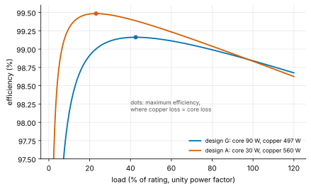

<!-- status: verified -->
# 07-09 · Mutual Inductance and Transformers

| | |
|---|---|
| **Course** | [07 · Circuit Analysis II (Transient and AC)](../README.md) |
| **University equivalent** | The "magnetically coupled circuits" chapter of a sophomore Circuits II course (Nilsson & Riedel, *Sinusoidal Steady-State Analysis*: the transformer and the ideal transformer; Alexander & Sadiku, *Magnetically Coupled Circuits*), with the transformer equivalent circuit and tests of an introductory energy-conversion course |
| **Prerequisites** | [04-07 Faraday, Lenz and Inductance](../../04-physics-for-ee/chapters/04-07-faraday-lenz-and-inductance.md) (flux linkage, mutual inductance in physics), [07-01 Capacitors and Inductors](07-01-capacitors-and-inductors.md) (inductor law and energy), [07-05 Sinusoidal Steady State](07-05-sinusoidal-steady-state-and-impedance.md) (phasors, mesh analysis, the voltage-drop approximation), [06-09 Maximum Power Transfer](../../06-circuit-analysis-1-dc/chapters/06-09-maximum-power-transfer.md), [07-06 AC Power](07-06-ac-power-and-power-factor.md). The facts used from each are restated where they are needed. |
| **Estimated study hours** | 8 |
| **Last verified** | 2026-11-19 |

**Learning objectives.** After this chapter you can:

1. Write the voltage–current equations of coupled coils with the dot convention, in the time and phasor domains, with correct signs.
2. Compute the energy stored in coupled coils and prove that the coupling coefficient cannot exceed 1.
3. Analyze circuits with coupled coils by mesh analysis, reflected impedance and the T-equivalent.
4. Apply the ideal transformer's voltage, current and impedance relations, including impedance matching.
5. Build a practical transformer's equivalent circuit from open- and short-circuit tests, and compute its efficiency, its load for maximum efficiency and its voltage regulation.
6. Explain how frequency, core material and coupling shape real products: distribution transformers and their efficiency standards, high-frequency charger transformers and wireless charging.

## 1. Big picture

When two coils share magnetic flux, a changing current in one induces a voltage in the other. That **mutual inductance** is how a transformer works: it changes voltage and current levels with almost no loss, isolates circuits electrically, and matches impedances. The power grid exists in its present form because transformers make high-voltage transmission practical (07-06 showed why higher voltage cuts line loss). Every mains-powered device converts voltage through a transformer, usually now a small high-frequency one inside a switching converter. Coupled coils also carry power and data without wires, in phone chargers, NFC payment cards and implanted medical devices. Unwanted mutual inductance appears as crosstalk between traces and wires.

- **Grid and data centers:** distribution transformers step medium voltage down to building voltage; their losses are regulated (§9) and their efficiency curve is §3.9's subject.
- **Power supplies:** a phone charger's flyback converter stores energy in a coupled inductor and steps 300 V down to 5–20 V ([22](../../22-power-electronics-and-energy-conversion/README.md)).
- **Wireless power and NFC:** loosely coupled coils, tuned to resonance, transfer watts across millimeters to centimeters.
- **Signal isolation and matching:** isolation transformers in Ethernet ports, baluns and RF matching transformers.
- **Parasitics:** coupled package and board traces cause crosstalk and ground bounce in high-speed digital systems ([13](../../13-electromagnetics/README.md)).

## 2. Intuition first

**Shared flux.** Picture two coils wound on the same iron ring. Current in coil 1 sets up magnetic flux in the ring; that flux also threads coil 2. While the current changes, the changing flux induces a voltage in coil 2 (Faraday's law, 04-07). Nothing connects the coils electrically: energy crosses through the magnetic field. If every line of flux from coil 1 passes through coil 2, the coupling is perfect; if some leaks away into the air, the coupling is partial.

**Why turns ratio sets voltage.** In a perfectly coupled pair, both coils see the same flux $\Phi$. Each turn develops $d\Phi/dt$, so a coil with $N$ turns develops $N\,d\Phi/dt$. The voltages are therefore in the ratio of the turns. The currents go the other way: power in equals power out, so if the voltage steps up by 10, the current steps down by 10.

**An analogy from finance.** A transformer is like a currency exchange at a fixed rate with no fee: you can change volts into amperes, but the value (power) is conserved. An impedance seen through it is rescaled by the *square* of the exchange rate, much as a price per unit and the number of units both change when you convert, so a ratio of the two (volts per ampere) changes twice. *Where the analogy breaks:* a real transformer does charge a fee (copper and core losses, a percent or less in a good one), it only works for changing quantities (no DC exchange), and its "rate" is fixed by construction, not by a market.

## 3. Theory

### 3.1 Mutual inductance

07-01 described one inductor by its **flux linkage** $\lambda = Li$ and its law $v = d\lambda/dt = L\,di/dt$. With two coils, each coil's flux linkage has two parts, its own and the one caused by the other coil's current:

$$
\lambda_1 = L_1i_1 + M_{12}i_2, \qquad \lambda_2 = M_{21}i_1 + L_2i_2 .
$$

$L_1$ and $L_2$ are the **self-inductances** and $M_{12}$, $M_{21}$ the **mutual inductances** (henries). Energy conservation (§3.3) requires $M_{12} = M_{21} = M$: the coupling is reciprocal. Differentiating:

$$
v_1 = L_1\frac{di_1}{dt} + M\frac{di_2}{dt}, \qquad v_2 = M\frac{di_1}{dt} + L_2\frac{di_2}{dt} .
$$

These hold with both voltages and currents in the passive sign convention and with the coils wound so that the two currents' fluxes *aid* each other. If the winding sense of one coil is reversed, the fluxes oppose and $M$ enters with a minus sign.

The **coupling coefficient** is

$$
k = \frac{M}{\sqrt{L_1L_2}}, \qquad 0 \le k \le 1 .
$$

Coils on a closed high-permeability core reach $k$ close to 1; air-cored coils a few millimeters apart may have $k$ of a few tenths or less.

### 3.2 The dot convention

A schematic cannot show winding directions, so a **dot** marks one terminal of each coil. The rule:

> A current entering the dotted terminal of one coil induces a voltage in the other coil that is positive at *its* dotted terminal.

In practice, for each coil write $v = L\,di/dt$ for its own current, then add the mutual term:

- $+M\,di_{other}/dt$ if both currents enter (or both leave) their dotted terminals;
- $-M\,di_{other}/dt$ if one enters its dot and the other leaves its dot.

Here each coil's voltage is taken with its + reference at the terminal where its own current enters (the passive sign convention). In phasor form, $d/dt$ becomes $j\omega$ (07-05):

$$
\mathbf{V}_1 = j\omega L_1\mathbf{I}_1 \pm j\omega M\mathbf{I}_2, \qquad \mathbf{V}_2 = \pm j\omega M\mathbf{I}_1 + j\omega L_2\mathbf{I}_2 .
$$

### 3.3 Stored energy, and why k cannot exceed 1

With both currents entering dotted terminals, the power into the pair is $p = v_1i_1 + v_2i_2$. Substituting the equations of §3.1:

$$
p = L_1i_1\frac{di_1}{dt} + L_2i_2\frac{di_2}{dt} + M\Big(i_1\frac{di_2}{dt} + i_2\frac{di_1}{dt}\Big) = \frac{d}{dt}\Big(\tfrac12L_1i_1^2 + \tfrac12L_2i_2^2 + Mi_1i_2\Big).
$$

The last step uses $d(i_1i_2)/dt = i_1\,di_2/dt + i_2\,di_1/dt$, which works only because the same $M$ appears in both equations; this is why reciprocity is required. So the stored energy is

$$
w = \tfrac12L_1i_1^2 + \tfrac12L_2i_2^2 \pm Mi_1i_2 ,
$$

with the sign + when the fluxes aid and − when they oppose. A passive pair of coils cannot store negative energy for any currents. Hold $i_1$ fixed and minimize $w$ over $i_2$ (take the − sign, the worst case): $dw/di_2 = L_2i_2 - Mi_1 = 0$ at $i_2 = Mi_1/L_2$, giving

$$
w_{min} = \tfrac12i_1^2\Big(L_1 - \frac{M^2}{L_2}\Big) \ge 0
\quad\Longrightarrow\quad
M^2 \le L_1L_2
\quad\Longrightarrow\quad
k \le 1 .
$$

Equality, $k = 1$, means the coils can be driven so that their fields cancel completely and no energy is stored: every flux line links both coils.

### 3.4 Circuits with coupled coils

**Mesh analysis.** Write KVL around each mesh as in 07-05, adding a mutual term $\pm j\omega M\mathbf{I}_{other}$ wherever a mesh passes through a coupled coil. For the common case of a source driving coil 1 through $R_1$ and coil 2 feeding a load $Z_L$, define $\mathbf{I}_2$ as the current *leaving* coil 2's dotted terminal toward the load (the natural direction for a transformer). Then $\mathbf{I}_2$ leaves its dot while $\mathbf{I}_1$ enters, so the mutual terms are negative:

$$
\mathbf{V}_s = (R_1 + j\omega L_1)\mathbf{I}_1 - j\omega M\mathbf{I}_2, \qquad 0 = -j\omega M\mathbf{I}_1 + (Z_L + j\omega L_2)\mathbf{I}_2 .
$$

**Reflected impedance.** Solve the second equation for $\mathbf{I}_2 = j\omega M\mathbf{I}_1/Z_{22}$, where $Z_{22} = Z_L + j\omega L_2$, and substitute into the first:

$$
Z_{in} = \frac{\mathbf{V}_s}{\mathbf{I}_1} - R_1 = j\omega L_1 + \frac{(\omega M)^2}{Z_{22}} .
$$

The secondary circuit appears in the primary as the **reflected impedance** $(\omega M)^2/Z_{22}$. Its real part is positive (the load absorbs power through the coupling), and its reactive part has the *opposite* sign to $Z_{22}$'s: an inductive secondary reflects as capacitive. A shorted secondary ($Z_L = 0$) reflects $\omega^2M^2/(j\omega L_2) = -j\omega M^2/L_2$, so the primary sees $j\omega L_1(1 - k^2)$: shorting one coil of a tightly coupled pair nearly shorts the other, which is how transformers are short-circuit tested (§3.8).

**The T-equivalent.** When the two coils share a common terminal (or can be redrawn so), the coupled pair with aiding dots is equivalent to three uncoupled inductors in a T: $L_1 - M$ and $L_2 - M$ in the series arms and $M$ in the shunt leg. Check: the voltage across coil 1 with both currents entering is $j\omega(L_1 - M)\mathbf{I}_1 + j\omega M(\mathbf{I}_1 + \mathbf{I}_2) = j\omega L_1\mathbf{I}_1 + j\omega M\mathbf{I}_2$ ✓. An arm may come out negative ($L_1 < M$); that is fine mathematically but means the T is a model, not something to build.

### 3.5 The ideal transformer

Make three idealizations of a pair of coils on a common core: perfect coupling ($k$ = 1), no losses, and infinite self-inductance (an infinitely permeable core, so it needs no current to magnetize it). With the same flux $\Phi$ in every turn,

$$
v_1 = N_1\frac{d\Phi}{dt}, \quad v_2 = N_2\frac{d\Phi}{dt}
\quad\Longrightarrow\quad
\frac{\mathbf{V}_2}{\mathbf{V}_1} = \frac{N_2}{N_1},
$$

with both voltages positive at the dotted terminals. An infinitely permeable core has zero reluctance, so the net magnetomotive force must vanish: with $\mathbf{I}_1$ entering the primary dot and $\mathbf{I}_2$ leaving the secondary dot, $N_1\mathbf{I}_1 = N_2\mathbf{I}_2$, so

$$
\frac{\mathbf{I}_2}{\mathbf{I}_1} = \frac{N_1}{N_2}, \qquad \mathbf{V}_1\mathbf{I}_1^* = \mathbf{V}_2\mathbf{I}_2^* .
$$

Complex power passes through unchanged (07-06): the ideal transformer neither stores nor dissipates energy. Unlike coupled coils, it works down to any frequency above DC in the model, but never at DC: a constant voltage would require a flux growing without bound.

**Impedance reflection.** A load $Z_L = \mathbf{V}_2/\mathbf{I}_2$ on the secondary appears at the primary as

$$
Z_{in} = \frac{\mathbf{V}_1}{\mathbf{I}_1} = \frac{(N_1/N_2)\mathbf{V}_2}{(N_2/N_1)\mathbf{I}_2} = \Big(\frac{N_1}{N_2}\Big)^2Z_L .
$$

A 10:1 step-down transformer makes a 12 Ω load look like 1200 Ω. Equivalently, a source and its impedance can be moved across the transformer: voltages scale by the turns ratio and impedances by its square.

**Matching.** 06-09 showed a source delivers maximum power into a load equal to its own resistance (or conjugate, 07-06). A transformer with $(N_1/N_2)^2 = R_s/R_L$ makes any resistive load look like $R_s$ (Example 07-09.3). That is how audio amplifiers once drove 8 Ω speakers from high-impedance tubes, and how RF circuits match antennas today.

### 3.6 From coupled coils to the practical transformer

Real transformers fall short of the ideal in four ways, each represented by an element in the **equivalent circuit**:

1. **Winding resistance** $R_1$, $R_2$: copper loss, $I^2R$, growing with load.
2. **Leakage inductance** $L_{\ell1}$, $L_{\ell2}$: flux of one winding that does not link the other ($k < 1$). It appears in series and causes a voltage drop with load.
3. **Magnetizing inductance** $L_m$: the finite inductance of the core. Even with no load, the primary draws a magnetizing current $\mathbf{V}_1/(j\omega L_m)$ to set up the flux.
4. **Core loss** $R_c$: hysteresis and eddy-current loss in the core, roughly constant at a fixed voltage and frequency, modeled as a resistor across the magnetizing branch.

The model puts an ideal transformer between these elements: series $R_1 + j\omega L_{\ell1}$ on the primary, the shunt branch $R_c\parallel j\omega L_m$, then the ideal $N_1{:}N_2$ transformer, then series $R_2 + j\omega L_{\ell2}$ (Figure 1).

*Figure 1. The practical transformer: winding resistances and leakage inductances in series, the magnetizing inductance and core-loss resistance in shunt, and an ideal transformer.*
 For calculations it is convenient to **refer** everything to one side with the impedance rule of §3.5 ($R_2' = (N_1/N_2)^2R_2$ and so on) and lump the series elements into $R_{eq} = R_1 + R_2'$ and $X_{eq} = X_{\ell1} + X_{\ell2}'$.

> **Going deeper — leakage from the coupling coefficient.** For coupled coils with $L_1$, $L_2$ and $k$, choose the ideal ratio $N_1/N_2 = \sqrt{L_1/L_2}$. Then the coupled pair is exactly equivalent to a magnetizing inductance $kL_1$ across the primary, a leakage $(1 - k)L_1$ in series with it, and a leakage $(1 - k)L_2$ on the secondary (one of several equivalent splits). As $k \to 1$ the leakage vanishes; as $L_1 \to \infty$ the magnetizing current does. The ideal transformer is the double limit.

### 3.7 Measuring the model: open- and short-circuit tests

Two tests at rated frequency give the equivalent circuit without opening the transformer:

- **Open-circuit test:** rated voltage on the low-voltage side, other side open. The current is only the magnetizing and core-loss current, so the series drops are negligible. The power read is the core loss, $P_{oc}$; then $R_c = V^2/P_{oc}$ and, from the reactive power $Q_{oc} = \sqrt{(VI)^2 - P_{oc}^2}$, $X_m = V^2/Q_{oc}$.
- **Short-circuit test:** the low-voltage side shorted, and a reduced voltage applied to the other side until rated current flows. The voltage needed is small (a few percent of rated), so the magnetizing branch draws almost nothing and the power read is the full-load copper loss, $P_{sc}$. Then $R_{eq} = P_{sc}/I^2$, $Z_{eq} = V_{sc}/I$ and $X_{eq} = \sqrt{Z_{eq}^2 - R_{eq}^2}$.

### 3.8 Efficiency, and the load where it peaks

At a fraction $x$ of rated load (apparent power $xS$) and power factor PF, the output is $xS\cdot\text{PF}$, the core loss is roughly constant at $P_{core}$, and the copper loss scales with current squared: $x^2P_{cu}$, where $P_{cu}$ is the full-load copper loss. So

$$
\eta(x) = \frac{xS\,\text{PF}}{xS\,\text{PF} + P_{core} + x^2P_{cu}} .
$$

Maximize by minimizing the loss per unit output, $P_{core}/x + xP_{cu}$: setting its derivative $-P_{core}/x^2 + P_{cu}$ to zero gives

$$
x^* = \sqrt{\frac{P_{core}}{P_{cu}}}, \qquad \text{at which copper loss} = \text{core loss}.
$$

A transformer is most efficient at the load where its variable loss equals its fixed loss, a result that applies to any device with fixed and square-law losses. Figure 2 shows the curve for the two designs of Examples 07-09.4 and 07-09.5.

*Figure 2. Efficiency against load. The low-core-loss design peaks at a lighter load and is more efficient over most of the range.*

 Designers place $x^*$ where the transformer spends most of its time. A distribution transformer serving homes averages well below its rating, so it should have low core loss even at the cost of more copper loss. That is the physics behind the amorphous-core requirements of §9 (Example 07-09.5).

**Voltage regulation.** Under load the series impedance drops voltage. The approximation of 07-05 §3.5 gives the drop referred to the primary as $\Delta V \approx I(R_{eq}\cos\theta + X_{eq}\sin\theta)$ for a load current lagging by θ, and the **regulation** is $\Delta V/V_{rated}$.

### 3.9 Frequency and size

For a sinusoidal flux $\Phi = \Phi_m\sin\omega t$ in a core of cross-section $A$ with peak flux density $B_m = \Phi_m/A$, each winding's RMS voltage is

$$
V_{rms} = \frac{\omega N\Phi_m}{\sqrt2} = \frac{2\pi}{\sqrt2}\,fNAB_m = 4.443\,fNAB_m .
$$

This is the **transformer equation**, usually quoted with the constant rounded to 4.44. For a given voltage, the product $NA$ must scale as $1/(fB_m)$. Core materials limit $B_m$ (saturation, and losses that rise with frequency), so raising the frequency is what lets transformers shrink. At 50 Hz a 230 V winding on a 1 cm² core at 0.2 T would need about 52 000 turns; at 100 kHz it needs 26 (Example 07-09.6). That scaling, and the losses that set its limits, is why switching power supplies run at tens to hundreds of kilohertz and why fast GaN switches allow smaller chargers (§9).

## 4. Worked examples

### Example 07-09.1 · Dots and signs (tier A)

**Setup.** Coupled coils have $L_1$ = 10 mH, $L_2$ = 40 mH and $k$ = 0.5. At an instant, $i_1$ = 2 A and rising at 100 A/s, and $i_2$ = 1 A and falling at 50 A/s; both currents enter their dotted terminals. (a) Find $M$, $v_1$ and $v_2$. (b) Repeat with coil 2's dot moved to its other terminal. (c) Find the stored energy in both cases.

**Solution.**

(a) $M = 0.5\sqrt{10\times40}$ mH = **10 mH**. Both currents enter dots, so the mutual terms are positive: $v_1 = 0.01\times100 + 0.01\times(-50)$ = **0.50 V** and $v_2 = 0.01\times100 + 0.04\times(-50)$ = **−1.00 V**.

(b) Now one current enters its dot and the other leaves: $v_1 = 1.0 - (-0.5)$ = **1.50 V** and $v_2 = -1.0 + (-2.0)$ = **−3.00 V**.

(c) Aiding: $w = \tfrac12(0.01)(4) + \tfrac12(0.04)(1) + 0.01\times2\times1$ = **60.0 mJ**. Opposing: $0.02 + 0.02 - 0.02$ = **20.0 mJ**. Both are positive, as §3.3 requires.

**Units check.** H × A/s = V; H × A² = J ✓.
**Sanity check.** Reversing a dot changes only the sign of the mutual terms; each self term is unchanged.

### Example 07-09.2 · Mesh analysis and reflected impedance (tier B)

**Setup.** A 10 V (peak), 1 kHz source with $R_1$ = 10 Ω drives the coils of Example 07-09.1 ($L_1$ = 10 mH, $L_2$ = 40 mH, $M$ = 10 mH); coil 2 feeds $R_L$ = 100 Ω. Find (a) the reflected impedance and the input impedance seen past $R_1$, (b) $\mathbf{I}_1$ and $\mathbf{I}_2$, and (c) the power delivered by the source and to the load.

**Solution.**

(a) $\omega$ = 6283 rad/s, $\omega M$ = 62.83 Ω and $Z_{22} = 100 + j251.3$ Ω. The reflected impedance is $(62.83)^2/(100 + j251.3)$ = **5.396 − j13.56 Ω**: resistive (the load's power) and capacitive (the opposite sign of the inductive secondary). The input impedance past $R_1$ is $j62.83 + 5.396 - j13.56$ = **5.396 + j49.27 Ω**.

(b) $\mathbf{I}_1 = 10/(15.396 + j49.27)$ = **0.1937 A ∠ −72.65°**, and $\mathbf{I}_2 = j\omega M\mathbf{I}_1/Z_{22}$ = **0.04500 A ∠ −50.95°**.

(c) The source delivers $\tfrac12\operatorname{Re}(\mathbf{V}\mathbf{I}_1^*)$ = **0.2889 W**. The load receives $\tfrac12(0.04500)^2\times100$ = **0.1012 W**, which equals the power absorbed by the reflected resistance, $\tfrac12(0.1937)^2\times5.396$ ✓. The rest, 0.1876 W, heats $R_1$.

**Units check.** $(\omega M)^2/Z$ is Ω²/Ω = Ω ✓.
**Sanity check.** With $k$ = 0.5 most of coil 1's flux misses coil 2, so the primary looks mostly like its own inductance plus a small reflected load.

### Example 07-09.3 · Matching a speaker (tier B)

**Setup.** An amplifier stage behaves as a 10 V (RMS) source with 200 Ω of internal resistance. It drives an 8 Ω speaker. (a) Find the power to the speaker connected directly. (b) Find the turns ratio for maximum power and the power then delivered. (c) How much more power is that?

**Solution.**

(a) $P = (10/208)^2\times8$ = **18.49 mW**.

(b) Match $(N_1/N_2)^2\times8 = 200$: $N_1/N_2$ = **5**. The source then sees 200 Ω and delivers $V^2/(4R_s) = 100/800$ = **125.0 mW**, all of which reaches the speaker through the ideal transformer.

(c) $125.0/18.49$ = **6.76 times** more power.

**Units check.** V²/Ω = W ✓.
**Sanity check.** Matching caps the efficiency at 50%: 125 mW to the load and 125 mW in the source's own resistance, as 06-09 found.

### Example 07-09.4 · A distribution transformer from its test data (tier B)

**Setup.** A 50 kVA, 7200/240 V, 60 Hz single-phase transformer is tested. Open-circuit (240 V applied to the low-voltage side): 1.00 A and 90 W. Short-circuit (low-voltage side shorted, rated current in the high-voltage side): 180 V and 497 W. (These are illustrative values chosen so that the unit just meets the 2029 US efficiency level of §9.) Find (a) the rated currents, (b) $R_c$ and $X_m$ (low-voltage side), (c) $R_{eq}$ and $X_{eq}$ (high-voltage side), (d) the efficiency at 50% load and unity power factor, the load for maximum efficiency and that efficiency, and (e) the voltage regulation at full load with power factor 0.8 lagging.

**Solution.**

(a) $I_{HV} = 50\,000/7200$ = **6.944 A**; $I_{LV} = 50\,000/240$ = **208.3 A**.

(b) $R_c = 240^2/90$ = **640.0 Ω**. $S_{oc}$ = 240 VA, so $Q_{oc} = \sqrt{240^2 - 90^2}$ = 222.5 var and $X_m = 240^2/222.5$ = **258.9 Ω**.

(c) $R_{eq} = 497/6.944^2$ = **10.31 Ω**; $Z_{eq} = 180/6.944$ = 25.92 Ω; $X_{eq} = \sqrt{25.92^2 - 10.31^2}$ = **23.78 Ω**. The short-circuit voltage is only **2.5%** of rated, confirming that the magnetizing branch is negligible in that test.

(d) At 50% load: output 25 kW, losses $90 + 0.25\times497$ = **214.25 W**, η = **99.15%**. Maximum efficiency at $x^* = \sqrt{90/497}$ = **0.4255** (42.6% load), where η = **99.16%**. At full load η = **98.84%**.

(e) $\Delta V \approx 6.944(10.31\times0.8 + 23.78\times0.6)$ = **156.4 V**, a regulation of **2.17%** (the exact phasor calculation gives 2.18%).

**Units check.** V²/W = Ω; W/A² = Ω ✓.
**Sanity check.** Maximum efficiency below half load suits a transformer that runs lightly loaded most of the day.

### Example 07-09.5 · Core loss versus copper loss over a year (tier C)

**Setup.** Two 50 kVA designs serve the same load. Design G (grain-oriented steel) has 90 W core loss and 497 W full-load copper loss (Example 07-09.4). Design A (amorphous core) has 30 W core loss but, with a larger core window, 560 W full-load copper loss. The daily load is 70% of rating for 8 hours and 20% for 16 hours. Find the average loss and the annual energy lost by each.

**Solution.** Copper loss follows the *mean square* of the load fraction: $\overline{x^2} = (8\times0.7^2 + 16\times0.2^2)/24$ = **0.1900** (against a mean load of 36.7%). Average losses:

- G: $90 + 0.19\times497$ = **184.4 W**, or $184.4\times8760$ h = **1616 kWh** per year.
- A: $30 + 0.19\times560$ = **136.4 W**, or **1195 kWh** per year.

The amorphous design loses **26.0%** less energy despite its higher copper loss, because its core loss is paid all 8760 hours of the year while copper loss is paid in proportion to the square of a modest load.

**Units check.** W × h = Wh ✓.
**Sanity check.** Design A wins at light load; at full load it would lose $30 + 560$ = **590 W** against G's **587 W**. The answer depends on the load profile, which is why regulators specify efficiency at a stated part load (§9).

### Example 07-09.6 · Why frequency shrinks transformers (tier C)

**Setup.** (a) A winding must support 230 V (RMS) on a core of 1 cm² cross-section without exceeding a peak flux density of 0.2 T (an assumed limit). How many turns are needed at 50 Hz and at 100 kHz? (b) At a fixed number of turns, how does the required core area scale with frequency?

**Solution.**

(a) $N = V/(4.443\,fAB_m)$: at 50 Hz, $230/(4.443\times50\times10^{-4}\times0.2)$ = **51 800 turns**, impractical; at 100 kHz, **25.9 turns**, a handful of windings.

(b) $A = V/(4.443\,fNB_m)$ scales as $1/f$: 2000 times the frequency allows 1/2000 of the core area for the same turns.

**Units check.** $f\,N\,A\,B$ = s⁻¹ × m² × T = V (1 T = 1 V·s/m²) ✓.
**Sanity check.** Mains transformers are heavy and switching-supply transformers small, exactly as the equation predicts; the limits at high frequency are core loss and winding AC resistance, which rise with frequency (§6).

<!-- answer-key -->
| ID | Quantity | Value | Unit |
|---|---|---|---|
| Ex 07-09.1a | M | 10 | mH |
| Ex 07-09.1b | $v_1$, aiding | 0.50 | V |
| Ex 07-09.1c | $v_2$, aiding | −1.00 | V |
| Ex 07-09.1d | $v_1$, reversed dot | 1.50 | V |
| Ex 07-09.1e | $v_2$, reversed dot | −3.00 | V |
| Ex 07-09.1f | energy, aiding | 60.0 | mJ |
| Ex 07-09.1g | energy, opposing | 20.0 | mJ |
| Ex 07-09.2a | reflected resistance | 5.396 | Ω |
| Ex 07-09.2b | reflected reactance | −13.56 | Ω |
| Ex 07-09.2c | input reactance past $R_1$ | 49.27 | Ω |
| Ex 07-09.2d | $I_1$ | 0.1937 | A |
| Ex 07-09.2e | its angle | −72.65 | ° |
| Ex 07-09.2f | $I_2$ | 0.04500 | A |
| Ex 07-09.2g | its angle | −50.95 | ° |
| Ex 07-09.2h | source power | 0.2889 | W |
| Ex 07-09.2i | load power | 0.1012 | W |
| Ex 07-09.2j | power in $R_1$ | 0.1876 | W |
| Ex 07-09.3a | direct power | 18.49 | mW |
| Ex 07-09.3b | turns ratio | 5 | — |
| Ex 07-09.3c | matched power | 125.0 | mW |
| Ex 07-09.3d | improvement | 6.76 | — |
| Ex 07-09.4a | high-voltage rated current | 6.944 | A |
| Ex 07-09.4b | low-voltage rated current | 208.3 | A |
| Ex 07-09.4c | $R_c$ | 640.0 | Ω |
| Ex 07-09.4d | $X_m$ | 258.9 | Ω |
| Ex 07-09.4e | $R_{eq}$ | 10.31 | Ω |
| Ex 07-09.4f | $X_{eq}$ | 23.78 | Ω |
| Ex 07-09.4o | short-circuit voltage as a share of rated | 2.5 | % |
| Ex 07-09.4g | losses at 50% load | 214.25 | W |
| Ex 07-09.4h | efficiency at 50% load | 99.15 | % |
| Ex 07-09.4i | load fraction for maximum efficiency | 0.4255 | — |
| Ex 07-09.4j | maximum efficiency | 99.16 | % |
| Ex 07-09.4k | efficiency at full load | 98.84 | % |
| Ex 07-09.4l | voltage drop at full load, PF 0.8 | 156.4 | V |
| Ex 07-09.4m | regulation (approximate) | 2.17 | % |
| Ex 07-09.4n | regulation (exact) | 2.18 | % |
| Ex 07-09.5a | mean square load | 0.1900 | — |
| Ex 07-09.5b | average loss, design G | 184.4 | W |
| Ex 07-09.5c | annual loss, design G | 1616 | kWh |
| Ex 07-09.5d | average loss, design A | 136.4 | W |
| Ex 07-09.5e | annual loss, design A | 1195 | kWh |
| Ex 07-09.5f | reduction | 26.0 | % |
| Ex 07-09.5g | full-load loss, design A | 590 | W |
| Ex 07-09.5h | full-load loss, design G | 587 | W |
| Ex 07-09.6a | turns at 50 Hz | 51800 | — |
| Ex 07-09.6b | turns at 100 kHz | 25.9 | — |

## 5. Simulate it

The lab is in [labs/07-09-lab](../labs/07-09-lab/README.md).

1. **Notebook** (`07-09-transformers.ipynb`):
   - solves coupled-coil circuits for any $k$ and shows the reflected impedance;
   - sweeps a transformer's efficiency against load;
   - simulates a loosely coupled wireless link with and without resonant tuning.
2. **ngspice netlists** confirm Examples 07-09.2 to 07-09.4 using ngspice's coupled-inductor element (`K`); `python tools/run_spice.py 07-09` checks them.

**Guided exercise (predict, then run).** In the Example 07-09.2 netlist, change $k$ from 0.5 to 0.99. **Before running,** predict whether the load power rises or falls, and roughly how the input impedance changes. Hint: with tight coupling the pair behaves more like an ideal 1:2 transformer ($\sqrt{L_2/L_1}$ = 2), so the 100 Ω load reflects as about a quarter of itself, in parallel with the primary's own 62.8 Ω of reactance.

## 6. Engineering tradeoffs

| Knob | Improves | Costs | Typical decision owner |
|---|---|---|---|
| Tighter coupling (shared core, interleaved windings) | Lower leakage, better regulation, higher efficiency | Higher interwinding capacitance (noise coupling), harder insulation and isolation | Magnetics designer |
| Higher operating frequency | Smaller core and fewer turns (§3.9) | Core loss and winding AC resistance rise; switching loss in the converter; EMI | Power-supply architect |
| Low-loss core (amorphous, better steel grades) | Lower no-load loss, which dominates at light load | Cost, size, brittleness, inrush current (§9) | Utility or transformer manufacturer, under regulation |
| More copper (thicker windings) | Lower load loss | Size, weight, cost | Transformer designer |
| Air gap in the core | Stores energy (flyback), avoids saturation with DC | Higher magnetizing current, more leakage and fringing loss | Power-supply designer |
| Resonant tuning of loosely coupled coils | Usable power transfer at low $k$ (wireless charging) | Sensitivity to alignment and frequency; tuning components | Wireless-power system designer |

## 7. Numbers to know

| Quantity | Value | Note |
|---|---|---|
| Coupling coefficient | $0 \le k = M/\sqrt{L_1L_2} \le 1$ | §3.3 |
| Ideal transformer | $V_2/V_1 = N_2/N_1$; $I_2/I_1 = N_1/N_2$; $Z_{in} = (N_1/N_2)^2Z_L$ | §3.5 |
| Transformer equation | $V_{rms} = 4.443\,fNAB_m$ | §3.9 |
| Maximum efficiency | where copper loss = core loss: $x^* = \sqrt{P_{core}/P_{cu}}$ | §3.8 |
| US distribution-transformer efficiency, 50 kVA single-phase liquid-immersed (at 50% load) | 99.11% (from 2016); 99.15% (compliance from 23 Apr 2029) | [R-135](../../../reference/research-log.md#r-135--distribution-transformer-efficiency-standards) **[Established; under review, §9]** |
| Same, 167 kVA | 99.33% → 99.46% | [R-135](../../../reference/research-log.md#r-135--distribution-transformer-efficiency-standards) **[Established]** |
| Same, low-voltage dry-type three-phase 75 kVA (at 35% load) | 98.60% → 98.88% | [R-135](../../../reference/research-log.md#r-135--distribution-transformer-efficiency-standards) **[Established]** |
| Qi wireless charging | 5 W (v1.0, 2010); 15 W (v1.2, 2015); Magnetic Power Profile at 360 kHz (v2.0, 2023); 25 W (v2.2, 2025) | [R-136](../../../reference/research-log.md#r-136--qi-wireless-charging-versions) **[Established]** |
| GaN charger switching frequency | about 180 kHz at full load (a 65 W GaN reference design) versus "around 100KHz" for silicon | [R-137](../../../reference/research-log.md#r-137--high-frequency-charger-transformers) **[Industry estimate: vendor claim]** |

## 8. Common mistakes

1. **Getting the mutual sign wrong.** Decide for each coil whether the other current enters or leaves its dot, and write the sign before writing anything else.
2. **Scaling impedance by the turns ratio instead of its square.**
3. **Expecting a transformer to pass DC.** A constant voltage would need an ever-growing flux; the core saturates and the winding becomes a short.
4. **Treating coupled coils with $k < 1$ as an ideal transformer.** Leakage and magnetizing inductance change voltages and currents, especially with heavy or light loads.
5. **Reading the short-circuit test as core loss** (or the open-circuit test as copper loss): each test isolates the other loss.
6. **Comparing efficiencies at different loads.** A transformer's efficiency peaks where copper loss equals core loss; a single figure means nothing without its load point.
7. **Assuming a 99.11% to 99.15% change is negligible.** It is about a 4.5% cut in losses, multiplied across millions of units (§9).

## 9. Practitioner lens

### State of the art (as of Nov 2026)

- **Distribution-transformer losses are regulated** ([R-135](../../../reference/research-log.md#r-135--distribution-transformer-efficiency-standards)) **[Established]**.
  - The US Department of Energy's final rule of 22 Apr 2024 (89 FR 29834) raises the minimum efficiency of distribution transformers, with compliance required from 23 Apr 2029. Efficiency is specified at 50% load for liquid-immersed units and 35% for low-voltage dry-type units, the part-load points where they spend their lives (§3.8).
  - A 50 kVA single-phase liquid-immersed unit goes from 99.11% to 99.15%. At 25 kW that cuts losses from **224.5 W** to **214.3 W**, **4.53%** less.
  - A 167 kVA unit goes from 99.33% to 99.46%, a 19.5% cut in losses (Problem 07-09.10).
  - A 75 kVA three-phase dry-type unit goes from 98.60% to 98.88% at 35% load, cutting losses from **372.7 W** to **297.3 W** (**20.2%**).
  - Example 07-09.4's transformer was built to meet the 50 kVA level exactly.
- **The rule is in practice a core-material decision.** DOE set single-phase units above 100 kVA and three-phase units from 15 to under 500 kVA at a level "expected to predominantly be met via use of amorphous cores", and said that beyond a certain loss reduction amorphous cores become "by far the most cost effective approach … due to the significant reduction in no-load losses". That is Example 07-09.5's arithmetic at fleet scale. DOE estimated about 48 000 t of amorphous alloy demand against about 45 000 t of stated capacity (**107%**). It also recorded industry concerns about inrush current and brittleness **[Established]**.
- **And it is under review.** On 15 Jun 2026 DOE requested information (91 FR 35903) on how the 2024 standards interact with national-security supply constraints for transformers and core steel, following a Presidential determination of 20 Apr 2026. As of 19 Nov 2026 the Federal Register shows no later rule changing the 2029 levels **[Established; perishable, re-check before relying on it]**.
- **Wireless charging is loosely coupled coils, tuned** ([R-136](../../../reference/research-log.md#r-136--qi-wireless-charging-versions)) **[Established]**.
  - The Wireless Power Consortium's history of the Qi specification records 5 W in version 1.0 (Jul 2010) and up to 15 W in 1.2 (Oct 2015).
  - Version 2.0 (Apr 2023) introduced a Magnetic Power Profile with magnets to align the coils and a 360 kHz operating frequency, the frequency of Problem 07-09.12.
  - Version 2.2 (Apr 2025) supports up to 25 W, and version 2.3 (Dec 2025) adds gain-change reporting.
  - The same page also calls version 2.2.1 "the current version", so which version is current is **[Contested]** on the publisher's own page.
  - Problem 07-09.12 shows why alignment magnets matter: link efficiency holds up while $k$ is a few tenths and collapses as $k$ approaches the coils' own losses.
- **Faster switches shrink charger transformers** ([R-137](../../../reference/research-log.md#r-137--high-frequency-charger-transformers)).
  - A GaN Systems (now Infineon) 65 W quasi-resonant flyback reference design reaches "approximately 180KHz" at full load, and its manual says silicon designs are limited to "around 100KHz". Its transformer turns ratio of 7.5 with a 20 V output reflects **150 V** onto the primary **[Industry estimate: vendor claims]**.
  - For the OPPO 50W Mini charger (2020), Navitas's launch text described replacing a 50 kHz wire-wound transformer "with over 20mm height" by "a new high-speed 800kHz, 8mm planar transformer", **16** times the frequency. A Navitas technical article on the same product says "~400 kHz", **8** times **[Contested between the two vendor texts]**.
  - Either way the direction is §3.9's: $NA \propto 1/f$, limited in practice by core and winding losses that rise with frequency.

<!-- answer-key -->
| ID | Quantity | Value | Unit |
|---|---|---|---|
| PL 07-09.a | 50 kVA losses at 25 kW, 2016 level | 224.5 | W |
| PL 07-09.b | 50 kVA losses at 25 kW, 2029 level | 214.3 | W |
| PL 07-09.c | cut in losses | 4.53 | % |
| PL 07-09.d | 75 kVA dry-type losses, 2016 level | 372.7 | W |
| PL 07-09.e | 75 kVA dry-type losses, 2029 level | 297.3 | W |
| PL 07-09.f | cut in losses | 20.2 | % |
| PL 07-09.g | amorphous demand as a share of capacity | 107 | % |
| PL 07-09.h | reflected primary voltage, ratio 7.5 at 20 V | 150 | V |
| PL 07-09.i | frequency ratio, 800 kHz over 50 kHz | 16 | — |
| PL 07-09.j | frequency ratio, 400 kHz over 50 kHz | 8 | — |

### Why it matters commercially

- **Transformer steel is a strategic material.** A regulation that pushes the market to amorphous cores moves demand onto a small set of alloy suppliers; DOE's own estimate put that demand at about the stated capacity. For utilities, data centers and transformer makers, standards, supply and lead times are linked decisions.
- **Data centers buy transformers by the hundreds.** Every rack's power passes through at least one transformer stage; a fraction of a percent of efficiency is real money at multi-megawatt scale (07-06, 07-11).
- **Magnetics are where power supplies get smaller.** GaN and SiC switches are valuable partly because they let the transformer and inductors shrink (§3.9); the switch and the magnetics are designed together ([22](../../22-power-electronics-and-energy-conversion/README.md)).
- **Wireless charging is a standards business.** Interoperability (Qi) decides which coils, controllers and magnets sell; profile changes such as the 360 kHz MPP create design-in windows.

### Marketing vs Reality

- **"99.5% efficient transformer."** *Reality:* at what load and power factor? Efficiency peaks where copper loss equals core loss and falls on either side. *Sanity check:* ask for core loss and full-load copper loss separately, and compute efficiency at your load profile (Example 07-09.5).
- **"16× faster switching means a 16× smaller transformer."** *Reality:* $NA \propto 1/(fB_m)$, but core loss forces a lower $B_m$ at high frequency, winding AC resistance rises, and insulation and creepage distances do not shrink. *Sanity check:* ask for the loss breakdown and the temperature rise at full load.
- **"Up to 25 W wireless charging."** *Reality:* power and efficiency depend on coil alignment and coupling (Problem 07-09.12) and on thermal limits in the phone. *Sanity check:* ask for efficiency and power at stated misalignment and temperature.
- **"Amorphous cores: lower losses."** *Reality:* lower no-load losses, the dominant loss at light load, with possible penalties in size, brittleness and inrush. *Sanity check:* compare total energy over the actual load profile, not full-load efficiency.

### Questions for engineering leaders

1. **"What are your transformer's core loss and full-load copper loss, and at what load does its efficiency peak?"**
   - *Strong:* the two losses, the peak-efficiency load, and how it matches the expected load profile.
   - *Evasive:* a single efficiency figure.
2. **"How do the 2029 efficiency levels and core-steel supply affect your transformer bill of materials and lead times?"**
   - *Strong:* core-material plan by kVA class, supplier qualification, contingency for the review DOE opened in 2026.
   - *Evasive:* "our supplier handles compliance".
3. **"Why did you choose this switching frequency for the charger, and what limits going higher?"**
   - *Strong:* the trade between magnetics size, core and winding loss, switching loss and EMI, with measured loss breakdowns.
   - *Evasive:* "GaN lets us go faster".
4. **"What coupling coefficient does your wireless charger see in practice, and what is the efficiency at the worst alignment you support?"**
   - *Strong:* measured $k$ over the alignment range, efficiency and thermal data at the edges.
   - *Evasive:* peak efficiency only.

## 10. Concept check

**Q1.** Two coils have $L_1$ = 4 mH and $L_2$ = 9 mH. What is the largest possible mutual inductance, and why?

Answer

$M_{max} = \sqrt{L_1L_2}$ = 6 mH ($k$ = 1). A larger $M$ would let the pair store negative energy for some currents (§3.3).

**Q2.** A coil's current enters its dot; the other coil's current leaves its dot. What sign does the mutual term take?

Answer

Negative: $v = L\,di/dt - M\,di_{other}/dt$ for each coil (§3.2).

**Q3.** A 1:4 step-up transformer drives a 1 kΩ load. What resistance does the source see?

Answer

$(N_1/N_2)^2R_L = (1/4)^2\times1000$ = 62.5 Ω (§3.5).

**Q4.** Why does an inductive secondary load reflect into the primary as a capacitive reactance?

Answer

The reflected impedance is $(\omega M)^2/Z_{22}$; dividing by a complex number with positive imaginary part produces a negative imaginary part (§3.4).

**Q5.** What does each transformer test measure, and why does each ignore the other loss?

Answer

The open-circuit test draws only magnetizing current, so copper loss is negligible and the power is core loss. The short-circuit test needs only a few percent of rated voltage, so the core is barely magnetized and the power is copper loss (§3.7).

**Q6.** At what load is a transformer most efficient, and why does that favor low core loss for distribution transformers?

Answer

Where copper loss equals core loss, $x^* = \sqrt{P_{core}/P_{cu}}$. Distribution transformers run lightly loaded most of the time, so their constant core loss is paid around the clock while copper loss is small; lowering core loss saves the most energy (§3.8).

**Q7.** Why do switching power supplies use small transformers?

Answer

$V = 4.443\,fNAB_m$: at tens or hundreds of kilohertz the same voltage needs far fewer turns and far less core area than at 50 or 60 Hz (§3.9).

Problem set: [07-09 problems](../problems/07-09-problems.md) · Solutions: [07-09 solutions](../solutions/07-09-solutions.md)

## 11. Key terms

[Mutual inductance](../../../reference/glossary.md#mutual-inductance) ·
[Coupling coefficient](../../../reference/glossary.md#coupling-coefficient) ·
[Dot convention](../../../reference/glossary.md#dot-convention) ·
[Reflected impedance](../../../reference/glossary.md#reflected-impedance) ·
[Ideal transformer](../../../reference/glossary.md#ideal-transformer) ·
[Turns ratio](../../../reference/glossary.md#turns-ratio) ·
[Leakage inductance](../../../reference/glossary.md#leakage-inductance) ·
[Magnetizing inductance](../../../reference/glossary.md#magnetizing-inductance) ·
[Core loss](../../../reference/glossary.md#core-loss) ·
[Voltage regulation](../../../reference/glossary.md#voltage-regulation)

## 12. Connections

- **Builds on:** [04-07](../../04-physics-for-ee/chapters/04-07-faraday-lenz-and-inductance.md) (Faraday's law, mutual inductance in physics), [07-01](07-01-capacitors-and-inductors.md) (inductors and energy), [07-05](07-05-sinusoidal-steady-state-and-impedance.md) (phasors, mesh analysis, voltage drop), [06-09](../../06-circuit-analysis-1-dc/chapters/06-09-maximum-power-transfer.md) (matching), [07-06](07-06-ac-power-and-power-factor.md) (complex power).
- **Next:** [07-10 Two-Port Networks](07-10-two-port-networks.md): describing any four-terminal network, including transformers, by its parameters.
- **Used later in:**
  - [22](../../22-power-electronics-and-energy-conversion/README.md): flyback and forward converters, magnetics design, power systems ([22-12](../../22-power-electronics-and-energy-conversion/chapters/22-12-power-systems-fundamentals.md)).
  - [13](../../13-electromagnetics/README.md): inductance and coupling from field theory; crosstalk.
  - [07-11](07-11-three-phase-circuits.md): three-phase transformer connections.

## 13. Further study

- **Nilsson & Riedel, *Electric Circuits*:** the sections on the linear and ideal transformer in "Sinusoidal Steady-State Analysis".
- **Alexander & Sadiku, *Fundamentals of Electric Circuits*:** "Magnetically Coupled Circuits".
- **MIT OpenCourseWare 6.061 *Introduction to Electric Power Systems*:** transformer equivalent circuits and tests.

## 14. Sources

1. Research log [R-135](../../../reference/research-log.md#r-135--distribution-transformer-efficiency-standards): US DOE, "Energy Conservation Standards for Distribution Transformers," final rule, 89 FR 29834 (22 Apr 2024), amending 10 CFR 431.196; DOE request for information, 91 FR 35903 (15 Jun 2026).
2. Research log [R-136](../../../reference/research-log.md#r-136--qi-wireless-charging-versions): Wireless Power Consortium, "History of the Qi Specifications" (read Nov 2026); see also [R-082](../../../reference/research-log.md#r-082--inductive-power-transfer-power-inductors-and-integrated-magnetics).
3. Research log [R-137](../../../reference/research-log.md#r-137--high-frequency-charger-transformers): GaN Systems/Infineon GS-EVB-CHG-65WQR-GS1 manual (2020); *Semiconductor Today* (24 Jul 2020) and a Navitas technical article on the OPPO 50W Mini.
4. Textbook alignment as listed in §13. All text, examples and problems in this chapter are original.
