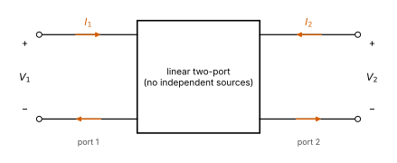
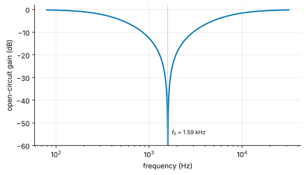

<!-- status: verified -->
# 07-10 · Two-Port Networks

| | |
|---|---|
| **Course** | [07 · Circuit Analysis II (Transient and AC)](../README.md) |
| **University equivalent** | The "two-port circuits" chapter of a sophomore Circuits II course (Nilsson & Riedel, *Two-Port Circuits*; Alexander & Sadiku, *Two-Port Networks*), with an introduction to scattering parameters from a first microwave course |
| **Prerequisites** | [07-05 Sinusoidal Steady State](07-05-sinusoidal-steady-state-and-impedance.md) (impedance, nodal and mesh analysis), [07-09 Mutual Inductance and Transformers](07-09-mutual-inductance-and-transformers.md) (the ideal transformer, reflected impedance), [06-08 Thévenin and Norton](../../06-circuit-analysis-1-dc/chapters/06-08-thevenin-and-norton.md), [06-06 Dependent Sources](../../06-circuit-analysis-1-dc/chapters/06-06-dependent-sources.md), [02-06 Vectors, Matrices and Linear Systems](../../02-complex-numbers-des-and-linear-algebra/chapters/02-06-vectors-matrices-and-linear-systems.md) (matrix inverse and product). The facts used from each are restated where they are needed. |
| **Estimated study hours** | 7 |
| **Last verified** | 2026-11-19 |

**Learning objectives.** After this chapter you can:

1. Define a two-port and write its z, y, h and ABCD (transmission) parameter equations, stating each parameter's meaning and the open- or short-circuit test that measures it.
2. Find the parameters of a network, such as T and Π networks, a transformer or a transistor's small-signal model, from test conditions or circuit equations.
3. Convert between parameter sets, and recognize when a set does not exist.
4. Combine two-ports in series, parallel and cascade, and state when the combination rules are valid.
5. Compute the input impedance, output impedance and gain of a terminated two-port, and test a network for reciprocity and symmetry.
6. Explain scattering parameters, compute them for simple networks, and read insertion loss, return loss and reflection coefficient as engineers use them.

## 1. Big picture

Many circuits have an input and an output and some complicated network in between: an amplifier, a filter, a cable, a package, a transformer. A **two-port** description treats the inside as a black box and characterizes it by four numbers at each frequency, the relationships between the voltages and currents at its two terminal pairs. Once you have those four numbers, you can predict what the box does with any source and any load, combine boxes without opening them, and measure them without knowing their insides. This is how datasheets describe transistors and RF components, how simulators exchange models, and how high-speed links are specified.

- **Transistors and amplifiers:** small-signal models are two-ports; datasheets have long given transistor h-parameters (§9), and amplifier design in Courses 10 and 12 uses y- and h-parameter thinking.
- **Filters and matching networks:** a ladder of L's and C's is a cascade of simple two-ports; ABCD matrices multiply ([07-08](07-08-filters-and-resonance.md), [13](../../13-electromagnetics/README.md)).
- **High-speed links:** a package, a board trace, a connector and a cable are each characterized by S-parameters, and a channel's loss budget is stated in decibels of $S_{21}$ (§9).
- **Measurement and model exchange:** vector network analyzers measure S-parameters, and simulators exchange them as Touchstone files (§9).

## 2. Intuition first

**A black box with two pairs of terminals.** Imagine a sealed box with an input connector and an output connector. You may apply signals and measure voltages and currents at the two connectors, but you may not look inside. If the box is linear, its behavior is fully captured by how the two port voltages depend on the two port currents (or any other choice of two "inputs" and two "outputs"). That is four complex numbers per frequency, a 2 × 2 matrix.

**Different matrices for different jobs.** Which two quantities you treat as inputs is a matter of convenience. Treat the currents as inputs and you get impedances (z-parameters), natural for networks measured with open circuits. Treat the voltages as inputs and you get admittances (y-parameters), natural for transistors. Treat the output quantities as inputs and you get the transmission (ABCD) matrix, natural for chains, because chained boxes multiply. At radio frequencies, opens and shorts are hard to make and can make transistors oscillate, so engineers measure waves going in and out instead: scattering (S) parameters.

**An analogy from finance.** A two-port is like a fund described by its exposures instead of its holdings. You do not need the positions inside; a small set of sensitivities tells you how the fund responds to any market move, and combining funds means combining sensitivities. *Where the analogy breaks:* a fund's exposures change with time and market level, while a linear two-port's parameters are exact at each frequency for any signal size within the linear range. And unlike portfolio exposures, two-port parameters combine by simple addition only under conditions (§3.7).

## 3. Theory

### 3.1 Two-ports and the port condition

A **port** is a pair of terminals at which the current entering one terminal equals the current leaving the other. A **two-port** has two such pairs. By convention, the voltages $\mathbf{V}_1$ and $\mathbf{V}_2$ are measured across each port (+ at the upper terminal) and the currents $\mathbf{I}_1$ and $\mathbf{I}_2$ flow *into* the upper terminal of each port. The network inside must be linear and contain no independent sources (dependent sources are allowed). Everything here is in the phasor domain at one frequency (07-05), or in the $s$ domain (07-04).

*Figure 1. The conventions: each port's current enters its upper terminal and leaves its lower one; each port's voltage is + at the upper terminal.*

With four port variables and a linear network, any two can be written in terms of the other two. The four common choices:

| Set | Independent (inputs) | Dependent (outputs) | Natural for |
|---|---|---|---|
| z (impedance) | $\mathbf{I}_1$, $\mathbf{I}_2$ | $\mathbf{V}_1$, $\mathbf{V}_2$ | series connections; open-circuit measurements |
| y (admittance) | $\mathbf{V}_1$, $\mathbf{V}_2$ | $\mathbf{I}_1$, $\mathbf{I}_2$ | parallel connections; transistors at high frequency |
| h (hybrid) | $\mathbf{I}_1$, $\mathbf{V}_2$ | $\mathbf{V}_1$, $\mathbf{I}_2$ | bipolar transistors at low frequency |
| ABCD (transmission) | $\mathbf{V}_2$, $-\mathbf{I}_2$ | $\mathbf{V}_1$, $\mathbf{I}_1$ | cascades (chains) |

### 3.2 Impedance (z) parameters

$$
\mathbf{V}_1 = z_{11}\mathbf{I}_1 + z_{12}\mathbf{I}_2, \qquad \mathbf{V}_2 = z_{21}\mathbf{I}_1 + z_{22}\mathbf{I}_2 .
$$

Each parameter is measured by driving one port with a current and leaving the other **open** ($\mathbf{I} = 0$):

$$
z_{11} = \frac{\mathbf{V}_1}{\mathbf{I}_1}\bigg|_{\mathbf{I}_2 = 0}, \quad z_{21} = \frac{\mathbf{V}_2}{\mathbf{I}_1}\bigg|_{\mathbf{I}_2 = 0}, \quad z_{12} = \frac{\mathbf{V}_1}{\mathbf{I}_2}\bigg|_{\mathbf{I}_1 = 0}, \quad z_{22} = \frac{\mathbf{V}_2}{\mathbf{I}_2}\bigg|_{\mathbf{I}_1 = 0} .
$$

$z_{11}$ and $z_{22}$ are open-circuit input and output impedances; $z_{21}$ and $z_{12}$ are **transfer impedances**.

**The T network.** Series arms $Z_a$ (port 1 side) and $Z_b$ (port 2 side) and a shunt $Z_c$ to the common terminal. With port 2 open, $\mathbf{I}_1$ flows through $Z_a$ and $Z_c$, so $z_{11} = Z_a + Z_c$, and the open port 2 sees the voltage across $Z_c$, so $z_{21} = Z_c$. By symmetry of the argument, $z_{22} = Z_b + Z_c$ and $z_{12} = Z_c$:

$$
\mathbf{z}_T = \begin{bmatrix} Z_a + Z_c & Z_c \\ Z_c & Z_b + Z_c \end{bmatrix}.
$$

Conversely, any network with $z_{12} = z_{21}$ has a T equivalent with $Z_c = z_{12}$, $Z_a = z_{11} - z_{12}$ and $Z_b = z_{22} - z_{12}$. 07-09's T-equivalent of coupled coils is this result with $Z = j\omega L$.

### 3.3 Admittance (y) parameters

$$
\mathbf{I}_1 = y_{11}\mathbf{V}_1 + y_{12}\mathbf{V}_2, \qquad \mathbf{I}_2 = y_{21}\mathbf{V}_1 + y_{22}\mathbf{V}_2,
$$

measured with the other port **shorted** ($\mathbf{V} = 0$): $y_{11} = \mathbf{I}_1/\mathbf{V}_1\big|_{\mathbf{V}_2 = 0}$ and so on. In matrix form $\mathbf{I} = \mathbf{y}\mathbf{V}$ and $\mathbf{V} = \mathbf{z}\mathbf{I}$, so

$$
\mathbf{y} = \mathbf{z}^{-1},
$$

whenever the inverse exists.

**The Π network.** Shunt admittances $Y_a$ (at port 1) and $Y_b$ (at port 2) and a series admittance $Y_c$ between the ports. With port 2 shorted, port 1 sees $Y_a$ and $Y_c$ in parallel, so $y_{11} = Y_a + Y_c$; the current into port 2 is the current through $Y_c$ flowing back toward port 2's short, $\mathbf{I}_2 = -Y_c\mathbf{V}_1$, so $y_{21} = -Y_c$. Similarly:

$$
\mathbf{y}_\Pi = \begin{bmatrix} Y_a + Y_c & -Y_c \\ -Y_c & Y_b + Y_c \end{bmatrix}.
$$

**Transistors.** The hybrid-π small-signal model of Course 10 (an input resistance $r_\pi$, a transconductance $g_m$ from input voltage to output current, an output resistance $r_o$) is naturally a y-parameter model: $y_{11} = 1/r_\pi$, $y_{21} = g_m$, $y_{22} = 1/r_o$, and $y_{12} = 0$ until a feedback capacitance is added (Problem 07-10.10).

### 3.4 Hybrid (h) parameters

$$
\mathbf{V}_1 = h_{11}\mathbf{I}_1 + h_{12}\mathbf{V}_2, \qquad \mathbf{I}_2 = h_{21}\mathbf{I}_1 + h_{22}\mathbf{V}_2 .
$$

The parameters mix units: $h_{11}$ is the input impedance with the output shorted (Ω), $h_{12}$ the reverse voltage ratio with the input open (dimensionless), $h_{21}$ the forward current gain with the output shorted (dimensionless), and $h_{22}$ the output admittance with the input open (S). For a bipolar transistor in the common-emitter connection these are written $h_{ie}$, $h_{re}$, $h_{fe}$ and $h_{oe}$; $h_{fe}$ is the small-signal current gain β (10-02). They suit bipolar transistors because the base is driven by a current and the collector behaves like a current source: both "inputs" ($\mathbf{I}_1$ and $\mathbf{V}_2$) are easy to set at low frequency.

### 3.5 Transmission (ABCD) parameters

$$
\mathbf{V}_1 = A\mathbf{V}_2 + B(-\mathbf{I}_2), \qquad \mathbf{I}_1 = C\mathbf{V}_2 + D(-\mathbf{I}_2).
$$

The minus sign makes $-\mathbf{I}_2$ the current flowing *out* of port 2 into whatever follows. That is the point of this set: the output quantities of one two-port, $(\mathbf{V}_2, -\mathbf{I}_2)$, are exactly the input quantities $(\mathbf{V}_1, \mathbf{I}_1)$ of the next one in a chain. So for a cascade,

$$
\begin{bmatrix}\mathbf{V}_1\\\mathbf{I}_1\end{bmatrix} = \mathbf{T}_1\begin{bmatrix}\mathbf{V}_2\\-\mathbf{I}_2\end{bmatrix} = \mathbf{T}_1\mathbf{T}_2\begin{bmatrix}\mathbf{V}_3\\-\mathbf{I}_3\end{bmatrix},
\qquad
\mathbf{T}_{cascade} = \mathbf{T}_1\mathbf{T}_2\cdots ,
$$

in order from input to output. Matrix multiplication (02-06) does the bookkeeping that loading otherwise forces you to do by hand.

The building blocks, each found from the definitions:

| Element | ABCD matrix |
|---|---|
| Series impedance $Z$ | $\begin{bmatrix}1 & Z\\0 & 1\end{bmatrix}$ |
| Shunt admittance $Y$ | $\begin{bmatrix}1 & 0\\Y & 1\end{bmatrix}$ |
| Ideal transformer $N_1{:}N_2$, $n = N_1/N_2$ | $\begin{bmatrix}n & 0\\0 & 1/n\end{bmatrix}$ |

For the series impedance: the same current flows through, $\mathbf{I}_1 = -\mathbf{I}_2$, so $C = 0$ and $D = 1$; and $\mathbf{V}_1 = \mathbf{V}_2 + Z(-\mathbf{I}_2)$, so $A = 1$ and $B = Z$. The ideal transformer's entries are 07-09's relations $\mathbf{V}_1 = n\mathbf{V}_2$ and $\mathbf{I}_1 = (1/n)(-\mathbf{I}_2)$. The open-circuit voltage gain of any two-port is $\mathbf{V}_2/\mathbf{V}_1\big|_{\mathbf{I}_2 = 0} = 1/A$.

### 3.6 Conversions, and when a set does not exist

Each set can be computed from any other by algebra. As an example, derive ABCD from z. Solve the second z equation for $\mathbf{I}_1$:

$$
\mathbf{I}_1 = \frac{1}{z_{21}}\mathbf{V}_2 + \frac{z_{22}}{z_{21}}(-\mathbf{I}_2)
\quad\Longrightarrow\quad
C = \frac{1}{z_{21}}, \quad D = \frac{z_{22}}{z_{21}} .
$$

Substitute into the first: $\mathbf{V}_1 = z_{11}\mathbf{I}_1 + z_{12}\mathbf{I}_2 = \dfrac{z_{11}}{z_{21}}\mathbf{V}_2 + \Big(\dfrac{z_{11}z_{22}}{z_{21}} - z_{12}\Big)(-\mathbf{I}_2)$, so

$$
A = \frac{z_{11}}{z_{21}}, \qquad B = \frac{\Delta_z}{z_{21}}, \qquad \Delta_z = z_{11}z_{22} - z_{12}z_{21} .
$$

The same method gives the other conversions. The ones used most:

| From z | Formula |
|---|---|
| y | $\mathbf{y} = \mathbf{z}^{-1}$: $y_{11} = z_{22}/\Delta_z$, $y_{12} = -z_{12}/\Delta_z$, $y_{21} = -z_{21}/\Delta_z$, $y_{22} = z_{11}/\Delta_z$ |
| h | $h_{11} = \Delta_z/z_{22}$, $h_{12} = z_{12}/z_{22}$, $h_{21} = -z_{21}/z_{22}$, $h_{22} = 1/z_{22}$ |
| ABCD | $A = z_{11}/z_{21}$, $B = \Delta_z/z_{21}$, $C = 1/z_{21}$, $D = z_{22}/z_{21}$ |

**When a set does not exist.** A set exists only if its defining tests make sense:

- A **series impedance** has no z-parameters. With both ports open no current can flow, so the open-circuit voltages are not determined; algebraically, its z-matrix would be singular.
- A **shunt admittance** has no y-parameters, for the dual reason.
- An **ideal transformer** has neither: with one port open, no current flows in either winding; with one port shorted, the other is shorted too. It does have h- and ABCD parameters.
- A network with $z_{21} = 0$, one with no forward transmission at all, has no ABCD parameters.

### 3.7 Reciprocity, symmetry and interconnections

**Reciprocity.** A network built from resistors, capacitors, inductors and transformers (including coupled coils) satisfies the **reciprocity theorem**: a current source at port 1 produces at open port 2 the same voltage that the same source at port 2 produces at open port 1. In z-parameters, $z_{12} = z_{21}$. Translating through the conversions:

$$
z_{12} = z_{21} \;\Longleftrightarrow\; y_{12} = y_{21} \;\Longleftrightarrow\; h_{12} = -h_{21} \;\Longleftrightarrow\; AD - BC = 1 .
$$

The last follows from the conversion table: $AD - BC = (z_{11}z_{22} - \Delta_z)/z_{21}^2 = z_{12}/z_{21}$. Dependent sources (transistors, op-amps) generally break reciprocity: an amplifier passes signals forward far better than backward. Networks with magnetized ferrites (isolators, circulators) are also non-reciprocal. A reciprocal two-port is described by only three independent numbers.

**Symmetry.** A network that looks the same from either port has $z_{11} = z_{22}$, or equivalently $A = D$. The T network of Example 07-10.1 is reciprocal but not symmetric.

**Interconnections.** For two two-ports $N_a$ and $N_b$:

| Connection | Ports | Parameters that add (or multiply) |
|---|---|---|
| Series–series | both input ports in series, both output ports in series | $\mathbf{z} = \mathbf{z}_a + \mathbf{z}_b$ |
| Parallel–parallel | both input ports in parallel, both output ports in parallel | $\mathbf{y} = \mathbf{y}_a + \mathbf{y}_b$ |
| Series–parallel | inputs in series, outputs in parallel | $\mathbf{h} = \mathbf{h}_a + \mathbf{h}_b$ |
| Cascade | output of $N_a$ to input of $N_b$ | $\mathbf{T} = \mathbf{T}_a\mathbf{T}_b$ |

The addition rules hold only if each sub-network still satisfies the port condition after connection: the current into each port's upper terminal must still equal the current out of its lower terminal. Connecting two three-terminal networks that share a common ground in series–series can route current through the ground connection and violate it; an ideal 1:1 isolating transformer at one port restores it. Parallel–parallel connections of common-ground networks, and cascades, are always valid. Problem 07-10.8's twin-T notch is a parallel–parallel connection (Figure 2).

*Figure 2. A twin-T network: a low-pass T and a high-pass T in parallel. Adding their y-parameters gives a transfer admittance that vanishes at $f_0 = 1/(2\pi RC)$, a perfect notch.*

### 3.8 Terminated two-ports

Put a source $\mathbf{V}_s$ with impedance $Z_s$ at port 1 and a load $Z_L$ at port 2. With $\mathbf{V}_2 = -Z_L\mathbf{I}_2$ in the ABCD equations, $\mathbf{V}_1 = (AZ_L + B)(-\mathbf{I}_2)$ and $\mathbf{I}_1 = (CZ_L + D)(-\mathbf{I}_2)$. So

$$
Z_{in} = \frac{AZ_L + B}{CZ_L + D}, \qquad \frac{\mathbf{V}_2}{\mathbf{V}_1} = \frac{Z_L}{AZ_L + B}, \qquad \frac{\mathbf{V}_2}{\mathbf{V}_s} = \frac{Z_L}{AZ_L + B + Z_s(CZ_L + D)} ,
$$

and, looking back into port 2 with the source replaced by $Z_s$,

$$
Z_{out} = \frac{DZ_s + B}{CZ_s + A} .
$$

In z-parameters the same results read $Z_{in} = z_{11} - z_{12}z_{21}/(z_{22} + Z_L)$: the open-circuit input impedance, corrected by the load's influence fed back through $z_{12}$. For a unilateral network ($z_{12} = 0$, or $h_{12} = 0$) the input impedance does not depend on the load at all, which is the ideal behind amplifier stages that isolate what follows from what precedes.

### 3.9 Scattering (S) parameters

At high frequencies the open and short circuits that z-, y- and h-parameters require are hard to make: a short has inductance, an open has capacitance, and an active device presented with them may oscillate. High-frequency engineers instead terminate every port in a **reference impedance** $Z_0$, usually 50 Ω, and describe the network by **waves**. At each port define

$$
a = \frac{\mathbf{V} + Z_0\mathbf{I}}{2\sqrt{Z_0}}, \qquad b = \frac{\mathbf{V} - Z_0\mathbf{I}}{2\sqrt{Z_0}} ,
$$

the incident and reflected waves (in units of √W). Expanding $\lvert a\rvert^2 - \lvert b\rvert^2 = \operatorname{Re}(\mathbf{V}\mathbf{I}^*)$, so with peak phasors the net power into the port is $\tfrac12(\lvert a\rvert^2 - \lvert b\rvert^2)$: incident power minus reflected power. The **scattering matrix** relates them:

$$
\begin{bmatrix}b_1\\b_2\end{bmatrix} = \begin{bmatrix}S_{11} & S_{12}\\S_{21} & S_{22}\end{bmatrix}\begin{bmatrix}a_1\\a_2\end{bmatrix} .
$$

With port 2 terminated in $Z_0$ (so $a_2 = 0$), $S_{11} = b_1/a_1$ is the input **reflection coefficient** and $S_{21} = b_2/a_1$ the forward **transmission coefficient**.

**One port.** For a single impedance $Z$, $\mathbf{V} = Z\mathbf{I}$ gives

$$
\Gamma = S_{11} = \frac{Z - Z_0}{Z + Z_0} .
$$

A matched load ($Z = Z_0$) reflects nothing; a short gives $-1$ and an open $+1$.

**A series impedance between two $Z_0$ ports.** Drive port 1 with port 2 terminated in $Z_0$. The input impedance is $Z + Z_0$, so $S_{11} = (Z + Z_0 - Z_0)/(Z + Z_0 + Z_0) = Z/(Z + 2Z_0)$. The voltage across the termination is $\mathbf{V}_2 = \mathbf{V}_1Z_0/(Z + Z_0)$; using $a_1 = \mathbf{V}_1(1 + Z_0/Z_{in})/(2\sqrt{Z_0})$ and $b_2 = \mathbf{V}_2/\sqrt{Z_0}$ (since $\mathbf{V}_2 = -Z_0\mathbf{I}_2$) gives $S_{21} = 2Z_0/(Z + 2Z_0)$.

**Properties.**

- *Reciprocity* becomes $S_{12} = S_{21}$.
- A *lossless* network conserves power, $\lvert S_{11}\rvert^2 + \lvert S_{21}\rvert^2 = 1$ (and the same for port 2); a lossy one has a sum below 1, the shortfall being the fraction absorbed.
- *Engineers' units:* **insertion loss** $= -20\lg\lvert S_{21}\rvert$ and **return loss** $= -20\lg\lvert S_{11}\rvert$, both positive dB numbers for a passive network. A 20 dB return loss means 1% of the incident power is reflected.

S-parameters convert to and from the other sets by algebra. For ABCD, with $\Delta = A + B/Z_0 + CZ_0 + D$:

$$
S_{11} = \frac{A + B/Z_0 - CZ_0 - D}{\Delta}, \quad S_{21} = \frac{2}{\Delta}, \quad S_{12} = \frac{2(AD - BC)}{\Delta}, \quad S_{22} = \frac{-A + B/Z_0 - CZ_0 + D}{\Delta} .
$$

Check with the series impedance ($A = D = 1$, $B = Z$, $C = 0$): $\Delta = 2 + Z/Z_0$ and $S_{21} = 2Z_0/(2Z_0 + Z)$ ✓. Vector network analyzers measure S-parameters directly, and circuit simulators exchange them as Touchstone files (§9).

> **Going deeper — why waves.** At high frequency a "voltage at a port" depends on where along the connecting line you measure it, because the line is a significant fraction of a wavelength ([13-07](../../13-electromagnetics/chapters/13-07-transmission-lines-time-domain.md)). The waves $a$ and $b$ travel along a line of characteristic impedance $Z_0$ unchanged except for delay, so S-parameters measured at one reference plane can be moved to another by multiplying by phase factors ("de-embedding"). That is why they are the language of RF and high-speed digital design.

## 4. Worked examples

### Example 07-10.1 · T to Π through the parameters (tier A)

**Setup.** A T network has $Z_a$ = 10 Ω, $Z_b$ = 20 Ω and $Z_c$ = 30 Ω. Find its z-parameters, its y-parameters and the equivalent Π network.

**Solution.** From §3.2, $\mathbf{z} = \begin{bmatrix}40 & 30\\30 & 50\end{bmatrix}$ Ω, with $\Delta_z = 40\times50 - 30^2$ = **1100 Ω²**. Inverting (§3.6):

$$
\mathbf{y} = \frac{1}{1100}\begin{bmatrix}50 & -30\\-30 & 40\end{bmatrix} = \begin{bmatrix}0.04545 & -0.02727\\-0.02727 & 0.03636\end{bmatrix}\ \text{S}.
$$

Matching to §3.3's Π form: $Y_c = -y_{12}$, a series resistance of **36.67 Ω**; $Y_a = y_{11} + y_{12}$ = 0.01818 S, **55.00 Ω** at port 1; $Y_b = y_{22} + y_{12}$ = 0.009091 S, **110.0 Ω** at port 2. These are 06-03's T-to-Π (Y–Δ) formulas, recovered without memorizing them: for example $R_c = (10\times20 + 20\times30 + 30\times10)/30 = 1100/30$ ✓.

**Units check.** z in Ω, y in S, $\Delta_z$ in Ω² ✓.
**Sanity check.** Both networks are reciprocal ($z_{12} = z_{21}$, $y_{12} = y_{21}$); neither is symmetric.

### Example 07-10.2 · A transistor amplifier in h-parameters (tier B)

**Setup.** A bipolar transistor's low-frequency small-signal model has $r_\pi$ = 2.5 kΩ, $g_m$ = 40 mS and $r_o$ = 50 kΩ, with no internal feedback. (a) Find its h-parameters. (b) It drives a 5 kΩ load. Find the voltage gain, the current gain and the input impedance. (c) A 1 kΩ source drives it. Find the gain from the source and the output impedance.

**Solution.**

(a) With the output shorted, $\mathbf{V}_1 = r_\pi\mathbf{I}_1$ and $\mathbf{I}_2 = g_m\mathbf{V}_1 = g_mr_\pi\mathbf{I}_1$: $h_{11}$ = **2500 Ω** and $h_{21} = g_mr_\pi$ = **100** (this is β). With the input open, nothing couples back: $h_{12}$ = 0, and the output admittance is $h_{22} = 1/r_o$ = **20 µS**.

(b) With a load, $\mathbf{V}_2 = -Z_L\mathbf{I}_2$. Substituting into the second h equation gives the current gain in the port convention, $A_i = \mathbf{I}_2/\mathbf{I}_1 = h_{21}/(1 + h_{22}Z_L)$ = **90.91**: part of the collector current now flows through $r_o$ instead of the load. Substituting into the first equation, the voltage gain is $\mathbf{V}_2/\mathbf{V}_1 = -h_{21}Z_L/(h_{11} + \Delta_hZ_L)$ with $\Delta_h = h_{11}h_{22} - h_{12}h_{21}$ = 0.05: $-100\times5000/(2500 + 250)$ = **−181.8**. That equals $-g_m(r_o\parallel R_L)$ = $-0.04\times4545$ ✓. Because $h_{12}$ = 0, the input impedance is just $h_{11}$ = **2500 Ω**, whatever the load.

(c) The source divides with the input: gain $-181.8\times2500/3500$ = **−129.9**. The output impedance, with $h_{12}$ = 0, is $1/h_{22}$ = **50.0 kΩ**: the transistor's output looks like a current source with $r_o$ in parallel.

**Units check.** $h_{21}$ dimensionless, $h_{22}Z_L$ dimensionless ✓.
**Sanity check.** A common-emitter stage with a 5 kΩ load and $g_m$ = 40 mS should have a gain near $-g_mR_L$ = −200, reduced slightly by $r_o$ ✓.

### Example 07-10.3 · What loading costs, by ABCD (tier B)

**Setup.** Two identical RC low-pass sections ($R$ = 1 kΩ in series, then $C$ = 100 nF in shunt) are connected in cascade with no buffer. Find the open-circuit voltage gain at $f = 1/(2\pi RC)$, and compare with two buffered sections.

**Solution.** Each section is a series impedance followed by a shunt admittance:

$$
\mathbf{T} = \begin{bmatrix}1 & R\\0 & 1\end{bmatrix}\begin{bmatrix}1 & 0\\j\omega C & 1\end{bmatrix} = \begin{bmatrix}1 + j\omega RC & R\\j\omega C & 1\end{bmatrix}.
$$

At $\omega RC = 1$ ($f$ = **1.592 kHz**), $\mathbf{T} = \begin{bmatrix}1 + j & R\\j/R & 1\end{bmatrix}$. One section alone has gain $1/A = 1/(1 + j)$, magnitude **0.7071**. The cascade has $A_{total} = A_1A_2 + B_1C_2 = (1 + j)^2 + R(j/R) = 2j + j = 3j$, so its open-circuit gain is $1/(3j)$: magnitude **0.3333** (**−9.54 dB**), phase **−90.00°**. Two buffered sections would give $0.7071^2$ = 0.5 (**−6.02 dB**). Loading costs **3.52 dB**, the $B_1C_2$ term: the second section's input current flowing through the first section's resistor.

**Units check.** $B$ in Ω times $C$ in S is dimensionless, like $A$ ✓.
**Sanity check.** 07-07 §3.1 warned that cascaded responses multiply only when buffered; the ABCD product shows exactly how much they do not.

### Example 07-10.4 · A terminated network, two ways (tier B)

**Setup.** Example 07-10.1's T network is driven at port 1 and loaded with 100 Ω at port 2. (a) Find the input impedance and the voltage gain $\mathbf{V}_2/\mathbf{V}_1$ from the z-parameters. (b) Repeat from the ABCD parameters. (c) Find the output impedance when the source has 50 Ω.

**Solution.**

(a) $Z_{in} = z_{11} - z_{12}z_{21}/(z_{22} + Z_L) = 40 - 900/150$ = **34.00 Ω**. The voltage gain follows from the two z equations with $\mathbf{V}_2 = -Z_L\mathbf{I}_2$: $\mathbf{V}_2/\mathbf{V}_1 = z_{21}Z_L/\big(z_{11}(z_{22} + Z_L) - z_{12}z_{21}\big) = 3000/5100$ = **0.5882**.

(b) From §3.6: $A = 40/30$ = **1.333**, $B = 1100/30$ = **36.67 Ω**, $C = 1/30$ = **0.03333 S**, $D = 50/30$ = **1.667**, and $AD - BC = 2.222 - 1.222 = 1$ (reciprocal ✓). Then $Z_{in} = (1.333\times100 + 36.67)/(0.03333\times100 + 1.667) = 170/5$ = 34.00 Ω ✓ and $\mathbf{V}_2/\mathbf{V}_1 = 100/170$ = 0.5882 ✓.

(c) $Z_{out} = (DZ_s + B)/(CZ_s + A) = (83.33 + 36.67)/(1.667 + 1.333)$ = **40.00 Ω**. Check by inspection: from port 2, $Z_b$ = 20 Ω in series with $Z_c \parallel (Z_a + Z_s) = 30\parallel60$ = 20 Ω ✓.

**Units check.** $AZ_L + B$ in Ω, $CZ_L + D$ dimensionless ✓.
**Sanity check.** A resistive divider cannot have gain above 1 ✓.

### Example 07-10.5 · Reciprocity as a test (tier B)

**Setup.** (a) Find the ABCD matrix of an ideal 3:1 step-down transformer followed by a series 2 Ω resistor, and the input impedance with a 100 Ω load. Is the combination reciprocal? (b) An amplifier has 10 kΩ input resistance, 100 Ω output resistance and an open-circuit voltage gain of 20 (a voltage-controlled source). Find its z- and ABCD parameters and test reciprocity. (c) With a 1 kΩ source and a 1 kΩ load, find the overall voltage gain.

**Solution.**

(a) $\mathbf{T} = \begin{bmatrix}3 & 0\\0 & 1/3\end{bmatrix}\begin{bmatrix}1 & 2\\0 & 1\end{bmatrix} = \begin{bmatrix}3 & 6\\0 & 1/3\end{bmatrix}$. $Z_{in} = (3\times100 + 6)/(1/3)$ = **918 Ω**, which is $3^2(2 + 100)$: the impedance-reflection rule of 07-09. The determinant is $3\times\tfrac13 - 0$ = **1**: reciprocal, as transformers and resistors must be.

(b) $\mathbf{V}_1 = 10^4\mathbf{I}_1$ and $\mathbf{V}_2 = 20\mathbf{V}_1 + 100\mathbf{I}_2 = 2\times10^5\mathbf{I}_1 + 100\mathbf{I}_2$. So $z_{11}$ = 10 kΩ, $z_{12}$ = 0, $z_{21}$ = **200 kΩ** and $z_{22}$ = 100 Ω. Since $z_{12} \ne z_{21}$ it is not reciprocal. In ABCD: $A = 10^4/(2\times10^5)$ = **0.05**, $B = \Delta_z/z_{21} = 10^6/(2\times10^5)$ = **5 Ω**, $C$ = **5 µS** and $D$ = **0.0005**, with $AD - BC = z_{12}/z_{21}$ = **0**, far from 1.

(c) $\mathbf{V}_2/\mathbf{V}_s = Z_L/\big(AZ_L + B + Z_s(CZ_L + D)\big) = 1000/(50 + 5 + 5.5)$ = **16.53**, which agrees with dividing the source at the input and the output: $20\times(10/11)\times(1000/1100)$ ✓.

**Units check.** $Z_s(CZ_L + D)$ is in Ω, like $AZ_L + B$ ✓.
**Sanity check.** An amplifier that passed signals backward as well as forward would be useless; its determinant of zero says it passes none backward.

### Example 07-10.6 · S-parameters of two simple networks (tier C)

**Setup.** In a 50 Ω system: (a) a 25 Ω resistor in series between the ports; (b) a 1 pF capacitor from the signal line to ground, at 1 GHz. Find $S_{11}$ and $S_{21}$, the insertion and return losses, and check power conservation.

**Solution.**

(a) $S_{11} = 25/(25 + 100)$ = **0.2000** and $S_{21} = 100/125$ = **0.8000**. Insertion loss $-20\lg0.8$ = **1.94 dB**; return loss $-20\lg0.2$ = **13.98 dB**. Power: $\lvert S_{11}\rvert^2 + \lvert S_{21}\rvert^2 = 0.04 + 0.64 = 0.68$, so **32.0%** of the incident power is absorbed by the resistor.

(b) $Y = j\omega C = j6.283$ mS, $YZ_0 = j0.3142$. For a shunt admittance (ABCD $A = D = 1$, $B = 0$, $C = Y$), $\Delta = 2 + YZ_0$, $S_{21} = 2/\Delta$ and $S_{11} = -YZ_0/\Delta$:

- $S_{21}$ = **0.9879 ∠ −8.93°**: insertion loss **0.106 dB**;
- $S_{11}$ = **0.1552 ∠ −98.93°**: return loss **16.18 dB**;
- $\lvert S_{11}\rvert^2 + \lvert S_{21}\rvert^2$ = **1.000**: a capacitor absorbs no power, so whatever is not transmitted is reflected.

**Units check.** $YZ_0$ dimensionless ✓.
**Sanity check.** 1 pF looks like 159 Ω at 1 GHz, large against 25 Ω (half of 50 Ω) in parallel, so it disturbs the line only slightly; at 10 GHz it would reflect much more. This is why a pad capacitance of a picofarad matters in a multi-gigabit link.

<!-- answer-key -->
| ID | Quantity | Value | Unit |
|---|---|---|---|
| Ex 07-10.1a | $\Delta_z$ | 1100 | Ω² |
| Ex 07-10.1b | $y_{11}$ | 0.04545 | S |
| Ex 07-10.1c | $y_{12}$ | −0.02727 | S |
| Ex 07-10.1d | $y_{22}$ | 0.03636 | S |
| Ex 07-10.1e | Π series resistance | 36.67 | Ω |
| Ex 07-10.1f | Π shunt resistance at port 1 | 55.00 | Ω |
| Ex 07-10.1g | Π shunt resistance at port 2 | 110.0 | Ω |
| Ex 07-10.2a | $h_{11}$ | 2500 | Ω |
| Ex 07-10.2b | $h_{21}$ | 100 | — |
| Ex 07-10.2c | $h_{22}$ | 20 | µS |
| Ex 07-10.2d | current gain | 90.91 | — |
| Ex 07-10.2e | voltage gain | −181.8 | — |
| Ex 07-10.2f | input impedance | 2500 | Ω |
| Ex 07-10.2g | gain from the source | −129.9 | — |
| Ex 07-10.2h | output impedance | 50.0 | kΩ |
| Ex 07-10.3a | frequency | 1.592 | kHz |
| Ex 07-10.3b | one section's gain | 0.7071 | — |
| Ex 07-10.3c | unbuffered cascade gain | 0.3333 | — |
| Ex 07-10.3d | in dB | −9.54 | dB |
| Ex 07-10.3e | its phase | −90.00 | ° |
| Ex 07-10.3f | buffered cascade gain | −6.02 | dB |
| Ex 07-10.3g | cost of loading | 3.52 | dB |
| Ex 07-10.4a | input impedance | 34.00 | Ω |
| Ex 07-10.4b | voltage gain | 0.5882 | — |
| Ex 07-10.4c | A | 1.333 | — |
| Ex 07-10.4d | B | 36.67 | Ω |
| Ex 07-10.4e | C | 0.03333 | S |
| Ex 07-10.4f | D | 1.667 | — |
| Ex 07-10.4g | output impedance | 40.00 | Ω |
| Ex 07-10.5a | input impedance | 918 | Ω |
| Ex 07-10.5b | determinant, transformer and resistor | 1 | — |
| Ex 07-10.5c | $z_{21}$ of the amplifier | 200 | kΩ |
| Ex 07-10.5d | A | 0.05 | — |
| Ex 07-10.5e | B | 5 | Ω |
| Ex 07-10.5f | C | 5 | µS |
| Ex 07-10.5g | D | 0.0005 | — |
| Ex 07-10.5h | determinant, amplifier | 0 | — |
| Ex 07-10.5i | overall voltage gain | 16.53 | — |
| Ex 07-10.6a | $S_{11}$, series 25 Ω | 0.2000 | — |
| Ex 07-10.6b | $S_{21}$, series 25 Ω | 0.8000 | — |
| Ex 07-10.6c | insertion loss | 1.94 | dB |
| Ex 07-10.6d | return loss | 13.98 | dB |
| Ex 07-10.6e | power absorbed | 32.0 | % |
| Ex 07-10.6f | $\lvert S_{21}\rvert$, 1 pF at 1 GHz | 0.9879 | — |
| Ex 07-10.6g | its angle | −8.93 | ° |
| Ex 07-10.6h | insertion loss | 0.106 | dB |
| Ex 07-10.6i | $\lvert S_{11}\rvert$ | 0.1552 | — |
| Ex 07-10.6j | its angle | −98.93 | ° |
| Ex 07-10.6k | return loss | 16.18 | dB |
| Ex 07-10.6l | power sum | 1.000 | — |

## 5. Simulate it

The lab is in [labs/07-10-lab](../labs/07-10-lab/README.md).

1. **Notebook** (`07-10-two-ports.ipynb`):
   - measures z-, y- and h-parameters of a circuit by applying the open- and short-circuit tests numerically;
   - converts between all the sets;
   - cascades ABCD matrices to build a filter;
   - computes S-parameters and checks reciprocity and losslessness.
2. **ngspice netlists** measure Example 07-10.1's parameters with open- and short-circuited ports, Example 07-10.3's loading, and Example 07-10.6's S-parameters in 50 Ω; `python tools/run_spice.py 07-10` checks them.

**Guided exercise (predict, then run).** In the S-parameter netlist, change the shunt capacitor's frequency from 1 GHz to 10 GHz. **Before running,** predict $\lvert S_{21}\rvert$ and $\lvert S_{11}\rvert$. Hint: $YZ_0$ becomes $j3.142$; use the formulas of Example 07-10.6.

## 6. Engineering tradeoffs

| Knob | Improves | Costs | Typical decision owner |
|---|---|---|---|
| Choice of parameter set | Easy measurement (S at RF; h at low frequency) and easy algebra (ABCD for chains) | Conversion effort; some sets do not exist for some networks | Design or test engineer |
| Buffering between stages | Stages compose by simple multiplication; no loading | Power, area, noise, a buffer's own bandwidth | Signal-chain designer |
| Reference impedance (50 Ω versus other values) | Compatibility with instruments, cables and standards | Mismatch to devices whose natural impedance differs | System architect, by industry convention |
| Measuring S-parameters to higher frequency | Captures resonances and loss that limit fast links | Instrument cost, calibration and fixture de-embedding effort | Signal-integrity and test engineers |
| Unilateral (isolating) stages | Input impedance independent of load; stable cascades | Power and gain spent on isolation | Amplifier designer |

## 7. Numbers to know

| Quantity | Value | Note |
|---|---|---|
| Reciprocity | $z_{12} = z_{21}$; $h_{12} = -h_{21}$; $AD - BC = 1$; $S_{12} = S_{21}$ | §3.7 |
| Cascade | ABCD matrices multiply; matched insertion losses add in dB | §3.5, §9 |
| Return loss | 10 dB: 10% of the power reflected; 20 dB: 1% | §3.9 |
| Reference impedance | 50 Ω for most RF and test equipment | §3.9 |
| 2N3904 h-parameters (1 mA, 10 V, 1 kHz) | $h_{ie}$ 1–10 kΩ; $h_{re}$ (0.5–8)×10⁻⁴; $h_{fe}$ 100–400; $h_{oe}$ 1–40 µS | [R-138](../../../reference/research-log.md#r-138--transistor-h-parameters-in-datasheets) **[Established]** |
| Flagship vector network analyzers | 10 MHz to 67 GHz (R&S ZNA, Keysight PNA-X), to 110–120 GHz in extended systems; system dynamic range above 129–131 dB at a few GHz | [R-140](../../../reference/research-log.md#r-140--vector-network-analyzers) **[Established]** |
| 100 Gb/s per lane backplane (IEEE 802.3ck objective) | insertion loss ≤ 28 dB at 26.56 GHz | [R-141](../../../reference/research-log.md#r-141--serdes-channel-loss-budgets) **[Established]** |
| 200 Gb/s per lane backplane (IEEE P802.3dj objective) | die-to-die insertion loss ≤ 40 dB at 53.125 GHz | [R-141](../../../reference/research-log.md#r-141--serdes-channel-loss-budgets) **[Established]** |
| PCIe 6.0 channel | pad-to-pad loss < 32 dB at 16 GHz (36 dB for PCIe 5.0) | [R-141](../../../reference/research-log.md#r-141--serdes-channel-loss-budgets) **[Industry estimate]** (work-group slides on a draft) |

<!-- answer-key -->
| ID | Quantity | Value | Unit |
|---|---|---|---|
| N 07-10.a | power reflected at 10 dB return loss | 10 | % |
| N 07-10.b | power reflected at 20 dB return loss | 1 | % |

## 8. Common mistakes

1. **Getting the sign of $\mathbf{I}_2$ wrong.** Port currents flow *into* the network; ABCD uses $-\mathbf{I}_2$, the current flowing out.
2. **Multiplying ABCD matrices in the wrong order.** The cascade is $\mathbf{T}_1\mathbf{T}_2$, input stage first.
3. **Asking for z-parameters of a series element** or y-parameters of a shunt element: they do not exist.
4. **Adding z- or y-parameters of interconnected networks without checking the port condition.**
5. **Treating $h_{12}$ and $h_{21}$ as equal for a reciprocal network.** Reciprocity gives $h_{12} = -h_{21}$.
6. **Reading S-parameters without the reference impedance.** $S_{11}$ = 0 means matched *to $Z_0$*; with a different reference the numbers change.
7. **Calling a negative dB number "loss".** Insertion and return loss are positive; $S_{21}$ in dB is negative for a passive network.

## 9. Practitioner lens

### State of the art (as of Nov 2026)

- **Transistor datasheets still speak h-parameters** ([R-138](../../../reference/research-log.md#r-138--transistor-h-parameters-in-datasheets)) **[Established]**.
  - onsemi's 2N3904 datasheet (2N3903/D, Rev. 9, Aug 2021) specifies, at $I_C$ = 1.0 mA, $V_{CE}$ = 10 V and 1 kHz: input impedance $h_{ie}$ 1.0–10 kΩ, voltage feedback ratio $h_{re}$ (0.5–8.0)×10⁻⁴, small-signal current gain $h_{fe}$ 100–400 and output admittance $h_{oe}$ 1.0–40 µmhos (µS).
  - The spreads are wide: a factor of 4 in $h_{fe}$ and 10 in $h_{ie}$. Circuits must be designed to work across them, which is why Course 10 uses negative feedback to make gain depend on resistors rather than on $h_{fe}$.
  - The numbers agree with physics. At 1 mA, $g_m = I_C/V_T$ = **38.92 mS** (with $V_T$ = 25.69 mV at 25 °C), so $h_{ie} \approx h_{fe}/g_m$ = **2.569 kΩ** for $h_{fe}$ = 100, inside the specified range.
  - Diodes Inc.'s MMBT3904 datasheet (Mar 2025) gives the same limits but labels the small-signal gain "hFE", the symbol usually reserved for the DC gain.
- **Why S-parameters, in the instrument maker's words** ([R-139](../../../reference/research-log.md#r-139--s-parameter-definitions-and-passivity)) **[Established]**.
  - Keysight's *S-Parameter Design* (AN 154, 2020 edition of a long-standing seminar) explains that at high frequencies "equipment is not readily available to measure total voltage and total current", that "short and open circuits are difficult to achieve over a broad band of frequencies", and that active devices "very often will not be short or open circuit stable". So "the logical variables to use at these frequencies are traveling waves".
  - It defines reciprocity as $S_{12} = S_{21}$ and losslessness as a unitary scattering matrix.
  - A check-the-source note: the 2020 edition's equations in two figures contain subscript and sign typos that the 2000 edition of the same document does not. §3.9's definitions follow the standard form, with the factor ½ for peak phasors.
- **Network analyzers measure S-parameters to tens of gigahertz** ([R-140](../../../reference/research-log.md#r-140--vector-network-analyzers)) **[Established]**.
  - Rohde & Schwarz's ZNA (specifications v24.00, Apr 2026) covers 10 MHz to 26.5, 43.5, 50 or 67 GHz. Its headline dynamic range is ">129 dB (specification, without options)" from 1 to 16 GHz, an amplitude ratio of about **2.8 million**, falling above 40 GHz.
  - Keysight's PNA-X family reaches 67 GHz, and its N5290A/N5291A systems 110 and 120 GHz. The N5247B specifies 131 dB of system dynamic range from 1 to 26.5 GHz and 117 dB at 64–67 GHz, at a 10 Hz IF bandwidth.
  - Keysight distinguishes *specifications* (warranted) from *typical* values (not warranted). The headline numbers above are the warranted ones.
- **High-speed links are specified in decibels of $S_{21}$ at the Nyquist frequency** ([R-141](../../../reference/research-log.md#r-141--serdes-channel-loss-budgets)).
  - IEEE 802.3ck (100 Gb/s per lane) adopted the objective of "an insertion loss ≤ 28 dB at 26.56 GHz" for backplanes (2018). The frequency is half the 53.125 GBd PAM4 symbol rate, $106.25/2/2$ = **26.5625 GHz**. 28 dB is an $\lvert S_{21}\rvert$ of **0.0398**: about **0.16%** of the power arrives **[Established]**.
  - That 28 dB excludes the chip packages. A 2019 task-force contribution put the bump-to-bump loss at about **36 dB** with 4 dB per package **[Established]** (as the contribution's figures).
  - A 2019 baseline for cables built the 28.5 dB channel as "2*6.875 (Host PCB and via's) + 2*1.6 (conn) + 11.55 (cable and wire termination)". That is a cascade in which matched sections' losses simply add in decibels, the dB form of multiplying their $S_{21}$ values (exact only when each section is matched; reflections add ripple) **[Established]** (as the proposal's figures).
  - IEEE P802.3dj (200 Gb/s per lane) adopted "a die-to-die insertion loss <= 40 dB at 53.125 GHz" (approved by the working group in May 2023), an $\lvert S_{21}\rvert$ of **0.01**. Its proposers explained the number as a "COMPROMISE": SerDes builders wanted 36–37 dB and system builders 42–45 dB **[Established]**. As of Nov 2026 the draft had conditional approval to go to sponsor ballot (Feb 2026); final approval was not confirmed.
  - For PCI Express 6.0 (64 GT/s PAM4, a 32 GBd symbol rate and **16 GHz** Nyquist), the PCI-SIG electrical work group's co-chair presented a pad-to-pad budget of "< 32 dB at 16 GHz" against 36 dB for PCIe 5.0. It is split as root complex 8.0, add-in card 8.5 and system 15.5 dB, which sum to **32.0 dB** **[Industry estimate]** (slides on draft revision 0.9; the specification is members-only).
  - The same author put PCB loss at 16 GHz at about 1 dB/in and cable at about 0.1875 dB/in. The 15.5 dB system share is therefore about **15.5 in** of board, or about **83 in** of cable **[Industry estimate]**.
- **Measured S-parameters must be passive to be usable.** Triverio et al. (*IEEE Trans. Advanced Packaging*, 2007) state the condition: a scattering matrix is passive if and only if it is causal, conjugate-symmetric in frequency, and $I - S^HS$ is nonnegative-definite at every frequency, so that no singular value exceeds 1. Their example of badly calibrated measurements violates it, and such data can make a simulator generate energy **[Established]**.

<!-- answer-key -->
| ID | Quantity | Value | Unit |
|---|---|---|---|
| PL 07-10.a | $g_m$ at 1 mA, 25 °C | 38.92 | mS |
| PL 07-10.b | $h_{ie}$ for $h_{fe}$ = 100 | 2.569 | kΩ |
| PL 07-10.c | 129 dB as an amplitude ratio | 2.8 | million |
| PL 07-10.d | 802.3ck Nyquist frequency | 26.5625 | GHz |
| PL 07-10.e | 28 dB as $\lvert S_{21}\rvert$ | 0.0398 | — |
| PL 07-10.f | power arriving through 28 dB | 0.16 | % |
| PL 07-10.g | bump-to-bump loss with two 4 dB packages | 36 | dB |
| PL 07-10.h | cable channel budget sum | 28.5 | dB |
| PL 07-10.i | 40 dB as $\lvert S_{21}\rvert$ | 0.01 | — |
| PL 07-10.j | PCIe 6.0 Nyquist frequency | 16 | GHz |
| PL 07-10.k | PCIe 6.0 budget sum | 32.0 | dB |
| PL 07-10.l | PCB length for 15.5 dB | 15.5 | in |
| PL 07-10.m | cable length for 15.5 dB | 83 | in |

### Why it matters commercially

- **Channel loss budgets create product categories.** When a link's channel exceeds its budget, designers add retimers, redrivers or active cables, or move from board traces to cables (5–10× lower loss per inch at 16 GHz, by the PCI-SIG figures above). Each step of the per-lane data rate halves the time per symbol and raises the Nyquist frequency, so loss budgets tighten and these products' markets grow.
- **S-parameters are the currency of interoperability.** Package, connector, cable and board vendors exchange Touchstone files ([R-139](../../../reference/research-log.md#r-139--s-parameter-definitions-and-passivity)), and compliance tests are defined on them.
- **Test equipment tracks the standards.** Each new lane rate pushes analyzer bandwidth and dynamic range; a 200 Gb/s-per-lane design needs characterization well beyond 53 GHz.

### Marketing vs Reality

- **"Our channel meets 28 dB."** *Reality:* at which reference plane: ball-to-ball, bump-to-bump, pad-to-pad or die-to-die? The same link is 28 dB at one plane and about 36 dB at another. *Sanity check:* ask for the plane and whether packages are included.
- **"hFE = 300."** *Reality:* DC or small-signal, at what current, voltage and frequency? Datasheets use the same symbol for both, and the specified range spans a factor of four. *Sanity check:* design for the minimum, or use feedback.
- **"170 dB dynamic range."** *Reality:* R&S's headline is ">129 dB (specification, without options), 147 dB (typ., with options), up to 170 dB (maximum attainable range…)". The warranted figure is the first. *Sanity check:* separate specified from typical and maximum, and check the frequency band and IF bandwidth.
- **"Measured S-parameters attached."** *Reality:* measurements can be non-passive or non-causal after poor calibration or de-embedding, and simulations using them can blow up. *Sanity check:* check passivity (no singular value above 1) and reciprocity before use.

### Questions for engineering leaders

1. **"What is the channel's insertion loss at Nyquist, at which reference plane, and what margin does that leave against the standard's budget?"**
   - *Strong:* a loss budget by segment (package, board, connector, cable) at a stated plane, with margin and the equalization assumed.
   - *Evasive:* "it passes compliance".
2. **"How do you validate S-parameter models from suppliers?"**
   - *Strong:* passivity, causality and reciprocity checks, correlation with measurement.
   - *Evasive:* "we use what the supplier sends".
3. **"Where do retimers or cables go in your next-generation design, and why?"**
   - *Strong:* a loss-budget argument per link with cost and power.
   - *Evasive:* "we'll see in layout".
4. **"What measurement bandwidth and dynamic range does your lab have relative to your fastest link?"**
   - *Strong:* VNA coverage well above Nyquist, calibration and de-embedding procedures.
   - *Evasive:* "we rely on simulation".

## 10. Concept check

**Q1.** Which two quantities are independent in the h-parameter set, and why does that suit a bipolar transistor?

Answer

$\mathbf{I}_1$ and $\mathbf{V}_2$. The base is driven by a current and the collector acts like a current source whose output current depends weakly on its voltage; both are easy to set and measure at low frequency (§3.4).

**Q2.** Why does a series impedance have no z-parameters?

Answer

With both ports open no current can flow through it, so the open-circuit voltages are not determined by the currents; its z-matrix would be singular (§3.6).

**Q3.** Why does the ABCD set use $-\mathbf{I}_2$?

Answer

So that the output pair $(\mathbf{V}_2, -\mathbf{I}_2)$ of one stage is exactly the input pair $(\mathbf{V}_1, \mathbf{I}_1)$ of the next, making a cascade a matrix product (§3.5).

**Q4.** A two-port has $AD - BC$ = 0.3. What can you conclude?

Answer

It is not reciprocal (reciprocal networks have $AD - BC$ = 1), so it contains dependent sources or non-reciprocal materials, like an amplifier (§3.7).

**Q5.** Two common-ground networks are connected input-to-input and output-to-output. Which parameters add, and is the rule safe?

Answer

That is a parallel–parallel connection: y-parameters add, and for common-ground networks the port condition holds, so the rule is safe (§3.7).

**Q6.** Why are S-parameters used instead of z- or y-parameters at gigahertz frequencies?

Answer

Good opens and shorts are hard to make at high frequency, and active devices may oscillate with them; S-parameters are measured with every port terminated in the reference impedance, usually 50 Ω (§3.9).

**Q7.** A passive network has $\lvert S_{11}\rvert^2 + \lvert S_{21}\rvert^2$ = 0.9. What does that mean?

Answer

10% of the incident power is absorbed (lost) in the network; a lossless network would have a sum of exactly 1 (§3.9).

Problem set: [07-10 problems](../problems/07-10-problems.md) · Solutions: [07-10 solutions](../solutions/07-10-solutions.md)

## 11. Key terms

[Two-port network](../../../reference/glossary.md#two-port-network) ·
[z-parameters](../../../reference/glossary.md#z-parameters) ·
[y-parameters](../../../reference/glossary.md#y-parameters) ·
[h-parameters](../../../reference/glossary.md#h-parameters) ·
[ABCD parameters](../../../reference/glossary.md#abcd-parameters) ·
[Reciprocity](../../../reference/glossary.md#reciprocity) ·
[S-parameters](../../../reference/glossary.md#s-parameters) ·
[Reflection coefficient](../../../reference/glossary.md#reflection-coefficient) ·
[Insertion loss](../../../reference/glossary.md#insertion-loss) ·
[Return loss](../../../reference/glossary.md#return-loss)

## 12. Connections

- **Builds on:** [07-05](07-05-sinusoidal-steady-state-and-impedance.md) (impedance and nodal analysis), [07-09](07-09-mutual-inductance-and-transformers.md) (ideal transformer, T-equivalent), [06-06](../../06-circuit-analysis-1-dc/chapters/06-06-dependent-sources.md) (dependent sources), [06-08](../../06-circuit-analysis-1-dc/chapters/06-08-thevenin-and-norton.md) (equivalent circuits), [02-06](../../02-complex-numbers-des-and-linear-algebra/chapters/02-06-vectors-matrices-and-linear-systems.md) (matrices).
- **Next:** [07-11 Three-Phase Circuits](07-11-three-phase-circuits.md).
- **Used later in:**
  - [10](../../10-electronics-1/README.md) and [12](../../12-electronics-2/README.md): small-signal transistor models, feedback analysis with two-ports, the Miller effect (Problem 07-10.10).
  - [13-07](../../13-electromagnetics/chapters/13-07-transmission-lines-time-domain.md) and [13-08](../../13-electromagnetics/chapters/13-08-transmission-lines-sinusoidal-steady-state.md): transmission lines as two-ports, reflection coefficient and matching.
  - [14-11](../../14-computer-organization-and-architecture/chapters/14-11-io-buses-and-interconnect.md): high-speed links and channel loss.

## 13. Further study

- **Nilsson & Riedel, *Electric Circuits*:** "Two-Port Circuits".
- **Alexander & Sadiku, *Fundamentals of Electric Circuits*:** "Two-Port Networks".
- **D. M. Pozar, *Microwave Engineering*:** the chapter on microwave network analysis (S-parameters, ABCD, conversions).

## 14. Sources

1. Research log [R-138](../../../reference/research-log.md#r-138--transistor-h-parameters-in-datasheets): onsemi 2N3903/D Rev. 9 (Aug 2021); Diodes Inc. MMBT3904 DS30036 Rev. 27-2 (Mar 2025).
2. Research log [R-139](../../../reference/research-log.md#r-139--s-parameter-definitions-and-passivity): Keysight, *S-Parameter Design*, AN 154, 5952-1087 (2020); F. Caspers, "RF engineering basic concepts: S-parameters," arXiv:1201.2346; P. Triverio et al., "Stability, Causality, and Passivity in Electrical Interconnect Models," *IEEE Trans. Advanced Packaging* 30(4), 2007; IBIS Open Forum, Touchstone 2.0 and 2.1 specifications.
3. Research log [R-140](../../../reference/research-log.md#r-140--vector-network-analyzers): Rohde & Schwarz, R&S ZNA specifications PD 5215.4652.22 v24.00 (Apr 2026); Keysight PNA-X configuration guide 5992-1465EN (Jan 2026) and N5247B specifications (Aug 2025).
4. Research log [R-141](../../../reference/research-log.md#r-141--serdes-channel-loss-budgets): IEEE 802.3ck objectives (2018) and task-force contributions (Ghiasi, DiMinico, 2019); IEEE P802.3dj objectives (2024) and Mellitz et al. (2023); M. Mazumder, SNIA SDC presentations (2021, 2024).
5. Textbook alignment as listed in §13. All text, examples and problems in this chapter are original.
