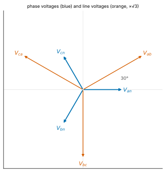
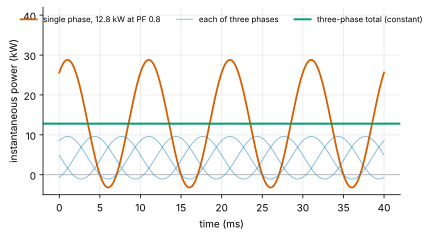

<!-- status: verified -->
# 07-11 · Three-Phase Circuits

| | |
|---|---|
| **Course** | [07 · Circuit Analysis II (Transient and AC)](../README.md) |
| **University equivalent** | The "balanced three-phase circuits" chapter of a sophomore Circuits II course (Nilsson & Riedel, *Balanced Three-Phase Circuits*; Alexander & Sadiku, *Three-Phase Circuits*) |
| **Prerequisites** | [07-05 Sinusoidal Steady State](07-05-sinusoidal-steady-state-and-impedance.md) (phasors, phasor diagrams, the voltage-drop approximation), [07-06 AC Power](07-06-ac-power-and-power-factor.md) (complex power, power-factor correction, harmonics), [06-03 Kirchhoff's Laws](../../06-circuit-analysis-1-dc/chapters/06-03-kirchhoffs-laws.md) (Y–Δ conversion). The facts used from each are restated where they are needed. |
| **Estimated study hours** | 5 |
| **Last verified** | 2026-11-19 |

**Learning objectives.** After this chapter you can:

1. Describe a balanced three-phase source, its phase sequence, and the relation between line and phase voltages in Y and Δ connections.
2. Analyze balanced Y and Δ loads, including line impedance, with the per-phase equivalent.
3. Compute three-phase complex power, show that the instantaneous power of a balanced system is constant, and correct the power factor with Y- or Δ-connected capacitors.
4. Compute the neutral current of an unbalanced four-wire load, and explain why triplen harmonics add in the neutral.
5. Measure three-phase power with the two-wattmeter method.
6. Relate standard distribution voltages (230/400 V, 120/208 V, 277/480 V, 240/415 V) to data-center power design, and check vendors' three-phase arithmetic.

## 1. Big picture

Almost all electric power is generated, transmitted and distributed as **three-phase** AC: three sinusoidal voltages of equal amplitude, 120° apart. Large loads, motors, data centers and factories connect to all three phases; homes usually take one phase and the neutral. Three phases are not an accident of history. A balanced three-phase system delivers *constant* instantaneous power (single-phase power pulses at twice the line frequency, 07-06), needs less conductor for the same power, and creates the rotating magnetic field that runs induction motors ([22-11](../../22-power-electronics-and-energy-conversion/chapters/22-11-electric-machines.md)). Because a balanced system is symmetric, it can be analyzed one phase at a time, which makes this a short chapter.

- **Generation and transmission:** every utility generator and transmission line is three-phase ([22-12](../../22-power-electronics-and-energy-conversion/chapters/22-12-power-systems-fundamentals.md)).
- **Data centers:** rack power arrives as three-phase, and the choice of distribution voltage (208 V or 415 V in North America) sets currents, copper and conversion losses (§9).
- **Motors and drives:** fans, pumps, compressors and electric vehicles run three-phase machines, often fed by inverters that synthesize three-phase power from DC ([22](../../22-power-electronics-and-energy-conversion/README.md)).
- **Power electronics:** three-phase rectifiers and active front ends draw power from the grid with low ripple.

## 2. Intuition first

**Three people pushing a merry-go-round.** One person pushing in pulses gives a jerky ride. Three people spaced evenly around the ride, each pushing in turn with a sinusoidal effort, give a smooth one: as one person's push fades, the next one's grows. Three-phase power is the same: each phase's power pulses at twice the line frequency, but the three pulses are spaced so that their sum is constant (§3.5). A generator driven by a steady turbine sees a steady load torque; a motor delivers smooth torque.

**Why the currents cancel.** Three equal phasors 120° apart form a closed triangle: they sum to zero. So with a balanced load the three line currents also sum to zero, and the return (neutral) conductor carries nothing. Three wires can carry three circuits' worth of power with no return wire at all.

**An analogy from finance.** A balanced three-phase system is like a portfolio of three assets whose returns are perfectly offsetting: each fluctuates, but the total is constant. *Where the analogy breaks:* the cancellation here is exact and engineered (120° by construction of the generator), not statistical; and unbalance or harmonics break it in specific, predictable ways (§3.6), such as triplen harmonics that *add* rather than cancel in the neutral.

## 3. Theory

### 3.1 Balanced three-phase voltages

A **balanced** three-phase source produces three sinusoids of equal amplitude and frequency, displaced by 120°. In **positive sequence** (abc), phase $b$ lags $a$ by 120° and $c$ lags $b$ by 120°. With RMS phase voltage $V_p$:

$$
\mathbf{V}_{an} = V_p\angle0°, \qquad \mathbf{V}_{bn} = V_p\angle{-120°}, \qquad \mathbf{V}_{cn} = V_p\angle{+120°} .
$$

(Three-phase practice quotes RMS phasors, so this chapter does too.) Figure 1 shows the three phase voltages and the line voltages formed from them. Let $\alpha = 1\angle{-120°}$. Then the three are $V_p(1, \alpha, \alpha^2)$, and since $1 + \alpha + \alpha^2 = 0$ (three unit vectors 120° apart close a triangle; algebraically, the sum of the cube roots of unity),

$$
\mathbf{V}_{an} + \mathbf{V}_{bn} + \mathbf{V}_{cn} = 0 .
$$

**Line voltages.** In a **Y (wye, star)** connection the three sources share a common neutral point $n$; the voltage between two lines is a difference of phase voltages:

$$
\mathbf{V}_{ab} = \mathbf{V}_{an} - \mathbf{V}_{bn} = V_p\big(1 - \alpha\big) = V_p\Big(\tfrac32 + j\tfrac{\sqrt3}{2}\Big) = \sqrt3\,V_p\angle30° .
$$

So **line-to-line voltage is $\sqrt3$ times the line-to-neutral voltage, leading it by 30°**: $V_L = \sqrt3V_p$.

*Figure 1. Phase voltages (blue) 120° apart, and line voltages (orange), each $\sqrt3$ times longer and leading by 30°.*
 A 230 V phase voltage gives 398 V between lines, which is why European systems are labeled 230/400 V; 120 V gives 208 V (120/208 V), and 277 V gives 480 V (277/480 V).

In a **Δ (delta)** connection the sources are connected end to end in a loop; each source sits between two lines, so the line voltage *is* the source voltage, and there is no neutral.

### 3.2 Balanced Y loads and the per-phase equivalent

Connect a balanced Y load, $Z$ in each phase, to a balanced Y source. If the neutrals are joined, each phase is a separate circuit: $\mathbf{I}_a = \mathbf{V}_{an}/Z$, and $\mathbf{I}_b$, $\mathbf{I}_c$ are the same current shifted by −120° and +120°. The neutral current is $\mathbf{I}_a + \mathbf{I}_b + \mathbf{I}_c = (\mathbf{V}_{an}/Z)(1 + \alpha + \alpha^2) = 0$. Since no current flows in the neutral, removing it changes nothing: the two neutral points are at the same voltage even without a wire.

That gives the **per-phase equivalent**: analyze phase $a$ alone, as a single-phase circuit from the source's phase voltage through the line impedance to the load's phase impedance, and get phases $b$ and $c$ by shifting the results by ∓120°. Every technique of 07-05 applies. In a Y connection the line current equals the phase current.

### 3.3 Δ loads

In a Δ load, each impedance $Z_\Delta$ connects two lines and sees the line voltage: the **phase current** is $\mathbf{I}_{AB} = \mathbf{V}_{AB}/Z_\Delta$. Each line current is the difference of two phase currents, for example $\mathbf{I}_a = \mathbf{I}_{AB} - \mathbf{I}_{CA}$. By the same algebra as §3.1, that difference is

$$
\mathbf{I}_a = \sqrt3\,\mathbf{I}_{AB}\angle{-30°}: \qquad I_L = \sqrt3I_p .
$$

**Δ–Y equivalence.** A balanced Δ of $Z_\Delta$ draws the same line currents as a balanced Y of

$$
Z_Y = \frac{Z_\Delta}{3},
$$

the balanced case of the Y–Δ transformation of 06-03 (each Y arm is the product of two adjacent Δ impedances over their sum, $Z_\Delta^2/3Z_\Delta$). So a Δ load is converted to Y and analyzed per phase like any other (Example 07-11.2).

### 3.4 Three-phase power

Each phase absorbs complex power $\mathbf{V}_p\mathbf{I}_p^*$ (RMS phasors, 07-06), and the three are equal in a balanced system. The total is $S = 3V_pI_p\angle\theta$, where θ is the load impedance angle. In terms of line quantities, a Y load has $V_p = V_L/\sqrt3$ and $I_p = I_L$, and a Δ load has $V_p = V_L$ and $I_p = I_L/\sqrt3$; either way,

$$
\lvert S\rvert = \sqrt3\,V_LI_L, \qquad P = \sqrt3\,V_LI_L\cos\theta, \qquad Q = \sqrt3\,V_LI_L\sin\theta .
$$

The power factor is $\cos\theta$, the *phase* impedance angle, not the angle between a line voltage and a line current (which differ by 30°).

**Constant instantaneous power.** With peak values $V_m$ and $I_m$ per phase, the instantaneous power of phase $k$ (shifted by $k\times120°$) is

$$
p_k = V_mI_m\cos(\omega t - k\phi_0)\cos(\omega t - k\phi_0 - \theta) = \frac{V_mI_m}{2}\big[\cos\theta + \cos(2\omega t - 2k\phi_0 - \theta)\big],
\qquad \phi_0 = 120° .
$$

Summing over $k$ = 0, 1, 2: the double-frequency terms are three equal phasors at angles 0°, −240° and −480° (that is, 0°, 120°, 240°), which sum to zero. So

$$
p(t) = p_a + p_b + p_c = \frac32V_mI_m\cos\theta = P,
$$

constant in time (Figure 2). A single-phase load's power swings between $P(1 \pm 1/\cos\theta)$, in 07-06's notation; a balanced three-phase load's does not swing at all.

*Figure 2. A single-phase 12.8 kW load at power factor 0.8 swings from −3.2 to 28.8 kW at twice the line frequency; three phases of a third of the power each sum to a constant 12.8 kW.*

**Conductor economy.** Compare delivering power $P$ over a given distance with the same maximum voltage $V_L$ between any two conductors and the same total line loss. Single phase uses two wires carrying $I_1 = P/V_L$ (unity power factor), losing $2I_1^2R_1$. Three phase uses three wires carrying $I_3 = P/(\sqrt3V_L)$, losing $3I_3^2R_3 = P^2R_3/V_L^2$. Equal losses require $R_3 = 2R_1$: each three-phase conductor needs half the cross-section, and the three together use $3\times\tfrac12/2$ = **75%** of the copper.

### 3.5 Unbalanced loads and the neutral

Real four-wire loads are rarely balanced: a building's single-phase loads are spread over the three phases as evenly as practical. With the neutral connected, each phase still sees its own phase voltage, the line currents are computed one phase at a time, and the neutral carries their phasor sum, which is no longer zero (Example 07-11.4). If the neutral were broken, the load's star point would float to a voltage that rebalances the currents, and the phase voltages across lightly loaded phases would rise, which can damage equipment.

**Triplen harmonics.** Nonlinear loads such as switch-mode supplies draw harmonic currents (07-06). The third harmonic of phase $b$ is shifted by $3\times(-120°) = -360°$, the same as phase $a$'s; so are the third harmonics of phase $c$ and all harmonics of order $3k$ (the "triplens"). Instead of cancelling, they **add** in the neutral: with a third-harmonic current $I_3$ in each phase, the neutral carries $3I_3$. In buildings full of single-phase switch-mode loads, such as offices and data halls, the neutral can carry more current than any phase conductor, which is why their neutrals are oversized or why they use supplies with power-factor correction (07-06).

### 3.6 Measuring three-phase power

Any three-wire system's power can be measured with **two wattmeters**: wattmeter 1 measures line $a$'s current and the voltage from $a$ to $b$... more precisely, the two current coils go in lines $a$ and $c$, and both voltage coils return to line $b$. Then $W_1 + W_2 = \operatorname{Re}(\mathbf{V}_{ab}\mathbf{I}_a^* + \mathbf{V}_{cb}\mathbf{I}_c^*)$, which equals the total power because $\mathbf{I}_b = -(\mathbf{I}_a + \mathbf{I}_c)$ (KCL, no neutral):

$$
P_{total} = \operatorname{Re}(\mathbf{V}_{an}\mathbf{I}_a^* + \mathbf{V}_{bn}\mathbf{I}_b^* + \mathbf{V}_{cn}\mathbf{I}_c^*) = \operatorname{Re}\big((\mathbf{V}_{an} - \mathbf{V}_{bn})\mathbf{I}_a^* + (\mathbf{V}_{cn} - \mathbf{V}_{bn})\mathbf{I}_c^*\big) = W_1 + W_2 .
$$

This holds for balanced or unbalanced loads, Y or Δ. For a balanced load with impedance angle θ, $W_1 = V_LI_L\cos(30° + \theta)$ and $W_2 = V_LI_L\cos(30° - \theta)$, so the readings also give the reactive power, $Q = \sqrt3(W_2 - W_1)$. At power factor 0.5 one reading falls to zero; below it, that reading goes negative.

### 3.7 Power-factor correction in three phases

The total corrective reactive power is found as in 07-06, $Q_C = P(\tan\theta_1 - \tan\theta_2)$, and split equally over three capacitors. Connected in **Δ**, each sees the line voltage; in **Y**, the phase voltage, $\sqrt3$ times smaller. Since $Q = \omega CV^2$, a Y-connected capacitor needs **three times** the capacitance of a Δ-connected one for the same reactive power, at a lower voltage rating. Δ capacitors are smaller but must withstand the full line voltage (Example 07-11.6).

## 4. Worked examples

### Example 07-11.1 · A balanced Y load (tier A)

**Setup.** A balanced Y load of $Z = 8 + j6$ Ω per phase is connected to a 400 V (line-to-line), 50 Hz, positive-sequence supply. Find the phase voltage, the line currents, $\mathbf{V}_{ab}$ and the total complex power.

**Solution.** $V_p = 400/\sqrt3$ = **230.9 V**. Take $\mathbf{V}_{an} = 230.9\angle0°$ V. Then $\mathbf{I}_a = 230.9/(10\angle36.87°)$ = **23.09 A ∠ −36.87°**, with $\mathbf{I}_b$ and $\mathbf{I}_c$ shifted by ∓120°. $\mathbf{V}_{ab} = \sqrt3\times230.9\angle30°$ = **400.0 V ∠ 30.00°**. Total power: $S = 3\times230.9\times23.09\angle36.87°$ = **16.00 kVA**, $P$ = **12.80 kW**, $Q$ = **9.60 kvar**, power factor **0.800** lagging. Check: $\sqrt3\times400\times23.09\times0.8$ = 12.80 kW ✓.

**Units check.** V × A = VA ✓.
**Sanity check.** $\lvert Z\rvert$ = 10 Ω and 230.9 V give 23.09 A per phase; three phases at 8 Ω × 23.09² = 4.27 kW each make 12.80 kW ✓.

### Example 07-11.2 · The same impedances in Δ (tier B)

**Setup.** The same three impedances ($8 + j6$ Ω) are reconnected in Δ on the same supply. Find the phase and line currents, the total power, and the equivalent Y impedance.

**Solution.** Each impedance now sees 400 V: $I_p = 400/10$ = **40.00 A**, and the line current is $I_L = \sqrt3\times40$ = **69.28 A**. Taking $\mathbf{V}_{an}$ at 0°, $\mathbf{V}_{AB}$ is at 30°, so the phase current $\mathbf{I}_{AB} = \mathbf{V}_{AB}/Z_\Delta$ is at $30° - 36.87° = -6.87°$, and the line current lags it by 30°, at −36.87°: in phase with Example 07-11.1's current, and **−66.87°** from $\mathbf{V}_{AB}$. Total power $3\times40^2\times8$ = **38.40 kW**, three times the Y connection's. The equivalent Y is $Z_\Delta/3 = 2.667 + j2$ Ω, which draws $230.9/3.333$ = 69.28 A ✓.

**Units check.** A² × Ω = W ✓.
**Sanity check.** Each Δ impedance sees $\sqrt3$ times the voltage of a Y impedance, so it draws $\sqrt3$ times the current and $3$ times the power. Reconnecting a motor's windings from Y to Δ is in fact how "star–delta" starters limit the starting current to a third.

### Example 07-11.3 · Line impedance and voltage drop (tier B)

**Setup.** Example 07-11.1's load is fed through a line of $0.1 + j0.2$ Ω per phase from a 400 V source. Find the line current, the load's line voltage, the line loss and the load power.

**Solution.** Per phase: $\mathbf{I}_a = 230.9/(8.1 + j6.2)$ = **22.64 A ∠ −37.43°**. The load phase voltage is $\lvert\mathbf{I}_aZ\rvert$ = 226.4 V, a line voltage of **392.1 V** (a **1.97%** drop). Line loss $3\times22.64^2\times0.1$ = **153.8 W**; load power $3\times22.64^2\times8$ = **12.30 kW**.

**Units check.** Per-phase impedances in Ω, phase voltage in V ✓.
**Sanity check.** 07-05's drop approximation per phase, $I(R\cos\theta + X\sin\theta) = 22.64(0.1\times0.8 + 0.2\times0.6)$ = 4.5 V, matches the 230.9 − 226.4 V found exactly ✓.

### Example 07-11.4 · An unbalanced four-wire load, and harmonics (tier B)

**Setup.** A 230/400 V four-wire supply feeds resistive single-phase loads of 10 Ω (phase $a$), 20 Ω ($b$) and 40 Ω ($c$). (a) Find the neutral current. (b) If instead each phase drew equal 23 A fundamental currents plus 10 A of third harmonic, what would the neutral carry?

**Solution.**

(a) $\mathbf{I}_a$ = 23.0 A ∠ 0°, $\mathbf{I}_b$ = 11.5 A ∠ −120°, $\mathbf{I}_c$ = 5.75 A ∠ 120°. Their sum is $\mathbf{I}_n$ = **15.21 A ∠ −19.11°**: a large share of the heaviest phase current returns through the neutral.

(b) The balanced fundamentals cancel exactly (**0 A**), but the third harmonics are in phase in all three lines and add: **30 A** in the neutral, more than the 23 A fundamental in any phase.

**Units check.** Amperes add as phasors ✓.
**Sanity check.** With all three loads equal the neutral current would vanish; unequal loads leave a remainder.

### Example 07-11.5 · 208 V or 415 V for a data-center rack? (tier B)

**Setup.** A rack is fed by a three-phase 30 A circuit. (a) Find the full and 80%-continuous power at 208 V and at 415 V (line-to-line, unity power factor). (b) What line current does 17.3 kW need at each voltage? (c) For the same power through the same cable, by what factor do the copper losses differ?

**Solution.**

(a) $\sqrt3\times208\times30$ = **10.81 kW** (80%: **8.65 kW**); $\sqrt3\times415\times30$ = **21.56 kW** (80%: **17.25 kW**). The line-to-neutral voltages are 120.1 V and **239.6 V**: a 415 V system serves 240 V equipment line to neutral.

(b) $17\,300/(\sqrt3\times415)$ = **24.07 A**; $17\,300/(\sqrt3\times208)$ = **48.02 A**.

(c) Loss scales as $I^2 \propto 1/V^2$: $(415/208)^2$ = **3.98** times more loss at 208 V for the same power and cable, the 07-06 lesson in three phases.

**Units check.** V × A = W at unity power factor ✓.
**Sanity check.** Twice the voltage, half the current, a quarter of the loss ✓.

### Example 07-11.6 · Two wattmeters and power-factor correction (tier C)

**Setup.** For Example 07-11.1's load: (a) predict the two wattmeter readings and recover $P$ and $Q$. (b) Find the total capacitive reactive power needed for a power factor of 0.95 lagging, and the capacitance per phase if the capacitors are connected in Δ and in Y. (c) Find the new line current.

**Solution.**

(a) $W_1 = 400\times23.09\cos(30° + 36.87°)$ = **3629 W** and $W_2 = 400\times23.09\cos(30° - 36.87°)$ = **9171 W**. Then $W_1 + W_2$ = 12.80 kW ✓ and $\sqrt3(W_2 - W_1)$ = 9.60 kvar ✓.

(b) $Q_C = 12\,800(0.75 - 0.3287)$ = **5393 var**, 1798 var per capacitor. Δ: $C = 1798/(314.16\times400^2)$ = **35.76 µF** per phase; Y: $1798/(314.16\times230.9^2)$ = **107.3 µF**, three times as much at $1/\sqrt3$ of the voltage.

(c) $I_L = 12\,800/(\sqrt3\times400\times0.95)$ = **19.45 A**, down from 23.09 A.

**Units check.** var/(rad/s × V²) = F ✓.
**Sanity check.** The readings are unequal because the load is reactive; at unity power factor both would equal $P/2$.

<!-- answer-key -->
| ID | Quantity | Value | Unit |
|---|---|---|---|
| Ex 07-11.1a | phase voltage | 230.9 | V |
| Ex 07-11.1b | line current | 23.09 | A |
| Ex 07-11.1c | its angle | −36.87 | ° |
| Ex 07-11.1d | line voltage $V_{ab}$ | 400.0 | V |
| Ex 07-11.1e | its angle | 30.00 | ° |
| Ex 07-11.1f | apparent power | 16.00 | kVA |
| Ex 07-11.1g | real power | 12.80 | kW |
| Ex 07-11.1h | reactive power | 9.60 | kvar |
| Ex 07-11.1i | power factor | 0.800 | — |
| Ex 07-11.2a | phase current | 40.00 | A |
| Ex 07-11.2b | line current | 69.28 | A |
| Ex 07-11.2c | line current angle relative to $V_{AB}$ | −66.87 | ° |
| Ex 07-11.2d | total power | 38.40 | kW |
| Ex 07-11.3a | line current | 22.64 | A |
| Ex 07-11.3b | its angle | −37.43 | ° |
| Ex 07-11.3c | load line voltage | 392.1 | V |
| Ex 07-11.3d | voltage drop | 1.97 | % |
| Ex 07-11.3e | line loss | 153.8 | W |
| Ex 07-11.3f | load power | 12.30 | kW |
| Ex 07-11.4a | neutral current | 15.21 | A |
| Ex 07-11.4b | its angle | −19.11 | ° |
| Ex 07-11.4c | neutral, balanced fundamentals | 0 | A |
| Ex 07-11.4d | neutral, third harmonics | 30 | A |
| Ex 07-11.5a | 208 V, 30 A | 10.81 | kW |
| Ex 07-11.5b | 208 V, 80% | 8.65 | kW |
| Ex 07-11.5c | 415 V, 30 A | 21.56 | kW |
| Ex 07-11.5d | 415 V, 80% | 17.25 | kW |
| Ex 07-11.5e | 415 V line-to-neutral | 239.6 | V |
| Ex 07-11.5f | current for 17.3 kW at 415 V | 24.07 | A |
| Ex 07-11.5g | current for 17.3 kW at 208 V | 48.02 | A |
| Ex 07-11.5h | loss ratio | 3.98 | — |
| Ex 07-11.6a | $W_1$ | 3629 | W |
| Ex 07-11.6b | $W_2$ | 9171 | W |
| Ex 07-11.6c | capacitive reactive power | 5393 | var |
| Ex 07-11.6d | Δ capacitance per phase | 35.76 | µF |
| Ex 07-11.6e | Y capacitance per phase | 107.3 | µF |
| Ex 07-11.6f | new line current | 19.45 | A |

## 5. Simulate it

The lab is in [labs/07-11-lab](../labs/07-11-lab/README.md).

1. **Notebook** (`07-11-three-phase.ipynb`):
   - draws the phasor diagrams of Y and Δ systems;
   - shows the three phase powers summing to a constant;
   - computes neutral currents for unbalanced and harmonic loads;
   - simulates the two-wattmeter method.
2. **ngspice netlists** simulate Examples 07-11.1 to 07-11.4 and 07-11.6 in the time domain and with `.ac`, measuring line currents, total power, the neutral current and the wattmeter readings; `python tools/run_spice.py 07-11` checks them.

**Guided exercise (predict, then run).** In the unbalanced-load netlist, remove the neutral wire. **Before running,** predict which phase's load voltage rises above 230 V. Hint: the star point moves toward the most heavily loaded phase.

## 6. Engineering tradeoffs

| Knob | Improves | Costs | Typical decision owner |
|---|---|---|---|
| Higher distribution voltage (415/240 V instead of 208/120 V) | Less current and copper loss, fewer transformer stages (§9) | Higher touch and arc-flash hazard; equipment must accept 240 V | Data-center electrical designer |
| Four-wire (with neutral) versus three-wire | Serves single-phase loads | Neutral conductor; neutral overload from triplen harmonics | Electrical engineer |
| Load balancing across phases | Lower neutral current, lower loss, less voltage unbalance | Planning and monitoring effort as loads change | Facility operator |
| Δ versus Y capacitor banks | Δ: one third of the capacitance | Δ: full line-voltage rating | Power engineer |
| Oversized neutral or harmonic filtering | Safe neutral current with nonlinear loads | Copper or filter cost | Electrical designer |

## 7. Numbers to know

| Quantity | Value | Note |
|---|---|---|
| Line versus phase (Y) | $V_L = \sqrt3V_p$, line voltage leads by 30° | §3.1 |
| Line versus phase (Δ) | $I_L = \sqrt3I_p$, line current lags by 30° | §3.3 |
| Three-phase power | $P = \sqrt3V_LI_L\cos\theta$ | §3.4 |
| Copper for the same power and loss | 75% of single phase | §3.4 |
| Triplen harmonics | add in the neutral: $3I_3$ | §3.5 |
| Standard low-voltage systems | 230/400 V and 400/690 V (IEC 60038 Ed. 7.0, 2009); 120/208 V and 277/480 V in North America | [R-014](../../../reference/research-log.md#r-014--nominal-mains-voltages), [R-142](../../../reference/research-log.md#r-142--three-phase-distribution-voltages) **[Established]** |
| North American data-center alternative | 240/415 V via an autotransformer instead of a 480–208 V PDU transformer | [R-142](../../../reference/research-log.md#r-142--three-phase-distribution-voltages) **[Industry estimate]** |

<!-- answer-key -->
| ID | Quantity | Value | Unit |
|---|---|---|---|
| N 07-11.a | three-phase copper as a share of single phase | 75 | % |
| N 07-11.b | line voltage for a 230 V phase voltage | 398 | V |

## 8. Common mistakes

1. **Using the line voltage in a per-phase Y calculation.** The per-phase circuit uses $V_L/\sqrt3$.
2. **Using the angle between line voltage and line current as θ.** The power factor is the cosine of the *phase* impedance angle.
3. **Forgetting the $\sqrt3$ in $P = \sqrt3V_LI_L\cos\theta$**, or adding it when working per phase.
4. **Assuming the neutral current is always zero.** Only for balanced loads without triplen harmonics.
5. **Converting Δ to Y as $Z_Y = Z_\Delta$** (it is $Z_\Delta/3$).
6. **Sizing Y and Δ capacitors alike.** A Y capacitor needs three times the capacitance at $1/\sqrt3$ of the voltage.
7. **Trusting a vendor's three-phase table without recomputing it** (§9).

## 9. Practitioner lens

### State of the art (as of Nov 2026)

- **Standard voltages** ([R-014](../../../reference/research-log.md#r-014--nominal-mains-voltages), [R-142](../../../reference/research-log.md#r-142--three-phase-distribution-voltages)) **[Established]**. IEC 60038 (edition 7.0, 2009) lists the standard low-voltage AC systems. That edition completed the transition to 230/400 V and 400/690 V and added 230 V (50 Hz) and 230/400 V (60 Hz). The pairs are $\sqrt3$ apart after rounding: 400/√3 = **230.9 V** and 690/√3 = **398.4 V**. North America uses 120/208 V and 277/480 V (480/√3 = **277.1 V**).
- **Data-center distribution in North America** ([R-142](../../../reference/research-log.md#r-142--three-phase-distribution-voltages)) **[Industry estimate]** (vendor white paper).
  - A 2022 Legrand/Server Technology white paper describes the usual path: 277/480 V to the building, stepped down by a power-distribution-unit (PDU) transformer to 208/120 V.
  - The alternative is 240/415 V, obtained with an autotransformer and no PDU transformer. The paper reports UPS makers' claim that eliminating the PDU transformer gains about 2% in efficiency, and a further 0.2–0.3% from running servers at 240 V rather than 208 V (one supply's figures: 92.8% at 208 V, 93.1% at 240 V).
  - Example 07-11.5 shows the underlying physics: half the current and a quarter of the copper loss for the same power.
- **Japan's two frequencies** ([R-006](../../../reference/research-log.md#r-006--power-grid-frequencies), [R-142](../../../reference/research-log.md#r-142--three-phase-distribution-voltages)) **[Established]**. Tokyo adopted a 50 Hz AEG generator in 1895 and Osaka a 60 Hz GE generator in 1897, leaving eastern and western Japan on different frequencies. The first large tie between them, the 300 MW Sakuma frequency converter (1965), was dedicated as an IEEE Milestone on 13 Oct 2026. The current total converter capacity was not verified for this chapter.

<!-- answer-key -->
| ID | Quantity | Value | Unit |
|---|---|---|---|
| PL 07-11.a | 400/√3 | 230.9 | V |
| PL 07-11.b | 690/√3 | 398.4 | V |
| PL 07-11.c | 480/√3 | 277.1 | V |
| PL 07-11.d | 208 V three-phase, 30 A, 80% (correct value) | 8.6 | kW |
| PL 07-11.e | 208 V three-phase, 60 A, full (correct value) | 21.6 | kW |
| PL 07-11.f | 415 V three-phase, 30 A, full | 21.6 | kW |
| PL 07-11.g | 208 V single-phase, 30 A, full | 6.2 | kW |

### Why it matters commercially

- **Data-center power is a three-phase design problem.** Rack densities for AI clusters push per-rack power far beyond what 208 V circuits deliver efficiently; higher distribution voltages, and eventually DC distribution (07-06 §9's 380/800 V DC 80 PLUS category, [22-10](../../22-power-electronics-and-energy-conversion/chapters/22-10-datacenter-power-delivery.md)), cut current and conversion stages.
- **Power-supply makers design to the voltage.** A supply rated for 200–240 V input runs more efficiently at 240 V than at 208 V, and the facility's choice of 415 V or 208 V distribution decides which it sees.
- **Harmonics are a facility cost.** Triplen currents from thousands of single-phase supplies heat neutrals and transformers; PFC in every supply (07-06) is partly a three-phase infrastructure decision.

### Marketing vs Reality

- **A vendor table of rack power by voltage.** The Legrand/Server Technology paper's Table 2 lists three-phase 208 V at 30 A as 10.8 kW for both its full and its 80%-continuous rating. The continuous figure should be **8.6 kW**. It lists 208 V at 60 A as 17.3 kW in both columns, where the full rating is **21.6 kW** **[Contested]** (arithmetic errors in the source). Its 415 V and single-phase rows are correct. *Sanity check:* recompute every row with $\sqrt3V_LI_L$ and the 80% factor.
- **"2% more efficient at 415 V."** *Reality:* the gain comes from removing a transformer stage and from server supplies running at a better input voltage; it depends on the transformer's loading and the supplies' efficiency curves (07-09 §3.8). *Sanity check:* ask for measured loss at the facility's real load profile.
- **"Balanced load."** *Reality:* single-phase loads drift out of balance as racks change, and nonlinear loads add triplen currents even when balanced. *Sanity check:* ask for measured neutral current and per-phase loading.

### Questions for engineering leaders

1. **"Why 208 V or 415 V distribution for this hall, and what does the choice do to losses, copper and arc-flash risk?"**
   - *Strong:* a loss and capital comparison at the expected load, with safety design.
   - *Evasive:* "it's what we always use".
2. **"What are your measured neutral currents, and how are neutrals sized for harmonic loads?"**
   - *Strong:* measurements, harmonic spectra, oversized neutrals or K-rated transformers where needed.
   - *Evasive:* "the load is balanced".
3. **"How do you keep the phases balanced as racks are added?"**
   - *Strong:* per-phase monitoring and a placement process.
   - *Evasive:* none.
4. **"How does your power-supply efficiency vary between 208 V and 240 V input, at the loads your racks actually run?"**
   - *Strong:* efficiency curves at both voltages and several loads.
   - *Evasive:* a single headline efficiency.

## 10. Concept check

**Q1.** Why is line voltage $\sqrt3$ times phase voltage in a Y system?

Answer

It is the difference of two phase voltages 120° apart: $V_p\lvert1 - 1\angle{-120°}\rvert = V_p\sqrt3$ (§3.1).

**Q2.** Why can a balanced Y load's neutral wire be removed without effect?

Answer

The three line currents are equal phasors 120° apart and sum to zero, so the neutral carries no current (§3.2).

**Q3.** A balanced Δ load has 30 Ω per phase. What Y load is equivalent?

Answer

10 Ω per phase: $Z_Y = Z_\Delta/3$ (§3.3).

**Q4.** Why is a balanced three-phase load's instantaneous power constant?

Answer

Each phase's power has a double-frequency term, and the three are spaced 240° apart (equivalently 120°), so they sum to zero, leaving the constant $P$ (§3.4).

**Q5.** Why can the neutral current exceed the phase currents in a building full of switch-mode supplies?

Answer

Third-harmonic (triplen) currents are in phase in all three lines and add in the neutral, giving three times each phase's third-harmonic current (§3.5).

**Q6.** Two wattmeters read 5 kW and 5 kW on a balanced load. What is the power factor?

Answer

Unity: equal readings mean $Q = \sqrt3(W_2 - W_1) = 0$ (§3.6).

Problem set: [07-11 problems](../problems/07-11-problems.md) · Solutions: [07-11 solutions](../solutions/07-11-solutions.md)

## 11. Key terms

[Three-phase system](../../../reference/glossary.md#three-phase-system) ·
[Phase sequence](../../../reference/glossary.md#phase-sequence) ·
[Line and phase quantities](../../../reference/glossary.md#line-and-phase-quantities) ·
[Wye (Y) connection](../../../reference/glossary.md#wye-y-connection) ·
[Delta (Δ) connection](../../../reference/glossary.md#delta-connection) ·
[Per-phase equivalent](../../../reference/glossary.md#per-phase-equivalent) ·
[Neutral current](../../../reference/glossary.md#neutral-current) ·
[Triplen harmonics](../../../reference/glossary.md#triplen-harmonics) ·
[Two-wattmeter method](../../../reference/glossary.md#two-wattmeter-method)

## 12. Connections

- **Builds on:** [07-05](07-05-sinusoidal-steady-state-and-impedance.md) (phasors, phasor diagrams, voltage drop), [07-06](07-06-ac-power-and-power-factor.md) (complex power, PF correction, harmonics), [06-03](../../06-circuit-analysis-1-dc/chapters/06-03-kirchhoffs-laws.md) (Y–Δ), [07-09](07-09-mutual-inductance-and-transformers.md) (transformers).
- **Next:** this is Course 07's last chapter. Course 08 ([Digital Logic Design](../../08-digital-logic-design/README.md)) begins Term 2's digital half.
- **Used later in:**
  - [22-11](../../22-power-electronics-and-energy-conversion/chapters/22-11-electric-machines.md): rotating fields and three-phase machines.
  - [22-12](../../22-power-electronics-and-energy-conversion/chapters/22-12-power-systems-fundamentals.md): power systems, per-unit analysis, symmetrical components for unbalanced faults.
  - [22-10](../../22-power-electronics-and-energy-conversion/chapters/22-10-datacenter-power-delivery.md): data-center power delivery.

## 13. Further study

- **Nilsson & Riedel, *Electric Circuits*:** "Balanced Three-Phase Circuits".
- **Alexander & Sadiku, *Fundamentals of Electric Circuits*:** "Three-Phase Circuits" (including power measurement and residential wiring).
- **MIT OpenCourseWare 6.061 *Introduction to Electric Power Systems*:** the lectures on three-phase systems.

## 14. Sources

1. Research log [R-142](../../../reference/research-log.md#r-142--three-phase-distribution-voltages): IEC 60038:2009 (Ed. 7.0) preview; Legrand/Server Technology, *Power Efficiency Gains by Deploying 415 VAC Power Distribution in Data Centers* (2022); IEEE History Center, "Milestones: Sakuma Frequency Converter Station, 1965" (dedicated 13 Oct 2026).
2. Research log [R-014](../../../reference/research-log.md#r-014--nominal-mains-voltages) and [R-006](../../../reference/research-log.md#r-006--power-grid-frequencies) (mains voltages and grid frequencies, Course 00).
3. Textbook alignment as listed in §13. All text, examples and problems in this chapter are original.
