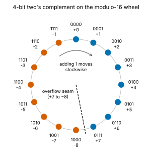
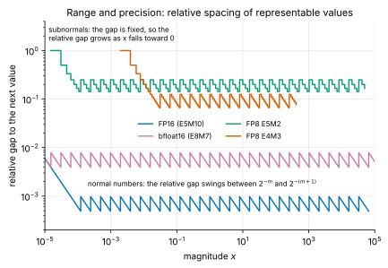

<!-- status: verified -->
# 08-01 · Number Systems and Codes

| | |
|---|---|
| **Course** | [08 · Digital Logic Design](../README.md) |
| **University equivalent** | The opening "number systems and codes" chapter of a sophomore digital-design course (Harris & Harris, *Digital Design and Computer Architecture*, ch. 1; Mano & Ciletti, *Digital Design*, ch. 1), plus the error-detecting-code material of an introductory coding course |
| **Prerequisites** | [05-07 Bit Manipulation](../../05-programming-for-engineers/chapters/05-07-bit-manipulation.md) (bits, hex, two's complement in C, fixed point), [05-02 NumPy and Vectorization](../../05-programming-for-engineers/chapters/05-02-numpy-and-vectorization.md) (§3.6, the IEEE 754 binary64 format), [03-01 Probability in EE Language](../../03-probability-statistics-and-random-variables/chapters/03-01-probability-in-ee-language.md) (bit-error probabilities) |
| **Estimated study hours** | 8 |
| **Last verified** | 2026-11-19 |

**Learning objectives.** After this chapter you can:

1. Convert integers and fractions between bases 2, 8, 10 and 16, prove why the conversion algorithms work, and explain why a fraction such as 0.1 has no finite binary form.
2. Derive two's complement from arithmetic modulo $2^n$, and use it for negation, sign extension, addition and subtraction, detecting overflow with both the sign rule and the carry rule.
3. Size fixed-point formats and accumulators: range, resolution, the width of a product and of a sum of $N$ terms, rounding and saturation.
4. Read a floating-point format as hardware fields, and compute the range and precision of FP32, FP16, bfloat16 and the 8-bit formats used for AI.
5. Use and convert the standard codes: BCD, Gray code and UTF-8.
6. Design and analyze error-detecting and error-correcting codes: parity, Hamming distance, Hamming SEC-DED codes and CRCs.

## 1. Big picture

A digital system stores and moves only bits; everything it means, it means by convention. The same eight bits 1111 1011 are 251 as an unsigned byte, −5 in two's complement, −0.039 in a signed fixed-point format, and a printable character in another context. This chapter is about those conventions, the **number systems** and **codes**, and about the hardware consequences of choosing them: how many wires a value needs, what an adder must do, when a result silently wraps around, and how a few extra bits let a receiver detect or even repair corrupted data. Course 05 met many of these ideas from the software side ([05-07](../../05-programming-for-engineers/chapters/05-07-bit-manipulation.md)); here they are the starting point of hardware design.

- **Every datapath has a width.** A 16-bit audio sample, a 32-bit address, an 8-bit AI weight: the format fixes the range, the resolution and the cost in wires, gates and energy.
- **Two's complement is why one adder does all integer arithmetic.** The same circuit adds signed and unsigned numbers and subtracts, which is why every processor uses it.
- **AI hardware lives on narrow formats.** Moving from 32-bit to 8-bit or 4-bit numbers multiplies the arithmetic per watt and per byte of memory bandwidth, at a cost in precision that the formats of §3.6 are designed to contain (§9).
- **Every link and memory protects its bits.** Ethernet frames carry a CRC, server memory carries Hamming-style ECC, and a disk or flash controller corrects thousands of bit errors per second without the user noticing.

## 2. Intuition first

**The odometer.** A car's five-digit odometer counts 99 998, 99 999, 00 000: it works **modulo** $10^5$. Run it backward from 00 000 and it shows 99 999, which behaves exactly like −1: add 1 and you get 00 000 again. Two's complement is this odometer in binary. An $n$-bit register counts modulo $2^n$, and the patterns just "below" zero, the ones with a leading 1, are used for the negative numbers. Addition is then the ordinary adder; no special circuit for signs is needed.



*Figure 1. The 16 patterns of a 4-bit register on a modulo-16 wheel. Adding moves clockwise; the patterns with a leading 1 (orange) are read as −8 to −1. Overflow is a sum that crosses the seam between +7 and −8.*

**Money in cents.** A bank stores \$12.34 as the integer 1234 with an agreed scale of 1/100. That is **fixed point**: integers with an implied binary or decimal point. Multiply two such amounts and the scale multiplies too (1/100 × 1/100 = 1/10 000), so the result must be rescaled, exactly as hardware does with fixed-point products (§3.5). *Where the analogy breaks:* banks scale by powers of ten, so 0.10 is exact. Hardware scales by powers of two, and 0.1 has no finite binary form, which is why a binary fixed-point or floating-point "0.1" is always slightly off (§3.1).

**Codes as insurance.** Adding a parity bit is like adding a check digit to a credit-card number: a little redundancy that catches most typing errors. More redundancy buys more protection: Hamming codes can not only detect but *correct* an error, in the way a few duplicated facts in a contract let you reconstruct a smudged clause. *Where it breaks:* a code protects against the errors it was designed for (random single-bit flips, bursts of limited length), and can be fooled by others. No code is insurance against everything.

## 3. Theory

### 3.1 Positional number systems and conversion

In base $b$ (the **radix**), the digit string $d_{n-1}\dots d_1d_0.d_{-1}d_{-2}\dots$ means

$$
N = \sum_i d_i\,b^i, \qquad 0 \le d_i \le b - 1 .
$$

Digital systems use base 2 (**binary**, digits called **bits**), and write long binary numbers in base 16 (**hexadecimal**, digits 0–9 and A–F) or occasionally base 8 (**octal**). Because $16 = 2^4$, each hex digit stands for exactly four bits, so converting between binary and hex is just regrouping: 1010 1101₂ = AD₁₆. An $n$-bit unsigned number ranges from 0 to $2^n - 1$, and $N$ distinct values need $\lceil\log_2N\rceil$ bits.

**Integer conversion by repeated division.** To convert an integer $N$ to base $b$, divide by $b$: the remainder is the lowest digit $d_0$, because $N = b\,(d_{n-1}b^{n-2} + \dots + d_1) + d_0$ and $0 \le d_0 < b$. The quotient holds the remaining digits, so repeating the division produces $d_1, d_2, \dots$ until the quotient is 0. For 173: 173 = 2·86 + **1**, 86 = 2·43 + **0**, 43 = 2·21 + **1**, 21 = 2·10 + **1**, 10 = 2·5 + **0**, 5 = 2·2 + **1**, 2 = 2·1 + **0**, 1 = 2·0 + **1**; reading the remainders from last to first, 173 = 1010 1101₂ = AD₁₆.

**Fraction conversion by repeated multiplication.** For a fraction $F = d_{-1}b^{-1} + d_{-2}b^{-2} + \dots$, multiplying by $b$ gives $bF = d_{-1} + (d_{-2}b^{-1} + \dots)$: the integer part is the first digit, and the fractional part holds the rest. Repeat on the fractional part. For 0.6875: ×2 = **1**.375, ×2 = **0**.75, ×2 = **1**.5, ×2 = **1**.0, so 0.6875 = 0.1011₂ exactly.

**Why 0.1 never ends.** A fraction has a finite binary form only if its denominator, in lowest terms, is a power of 2. 0.1 = 1/10 has the factor 5, so the multiplication never reaches 0: 0.1 = 0.0001 1001 1001 1001…₂, with the pattern 1001 repeating forever (Example 08-01.1). Every binary format must round it. This is the root of the familiar fact that `0.1 + 0.2 != 0.3` in floating point (05-02), and of the rule that money is never stored in binary floating point.

### 3.2 Unsigned addition and carries

Binary addition works column by column, as in decimal: each column adds two bits and an incoming carry, producing a sum bit and a carry out. A one-column adder (a **full adder**, 08-04) computes

$$
s_i = a_i \oplus b_i \oplus c_i, \qquad c_{i+1} = a_ib_i + a_ic_i + b_ic_i ,
$$

where ⊕ is exclusive OR and $c_{i+1}$ is 1 when at least two of the three inputs are 1. For unsigned $n$-bit numbers, the result is correct only if it fits in $n$ bits; a carry out of the top column, $c_n = 1$, signals **unsigned overflow**. The hardware keeps the low $n$ bits, which is the true sum minus $2^n$: arithmetic **modulo** $2^n$.

### 3.3 Signed numbers and two's complement

Three conventions for signed integers have been used:

- **Sign–magnitude:** the top bit is the sign, the rest the magnitude. Natural for people, but it has two zeros (+0 and −0) and needs separate add and subtract circuits.
- **Ones' complement:** −x is formed by inverting every bit. It also has two zeros, and its addition needs an "end-around carry".
- **Two's complement:** the scheme every modern processor uses.

**Two's complement from modular arithmetic.** An $n$-bit register computes modulo $2^n$ anyway (§3.2), so represent −x by the pattern that behaves like −x under that arithmetic: the number that gives 0 (mod $2^n$) when added to x, namely $2^n - x$. Then:

- **Negation** is $2^n - x = (2^n - 1 - x) + 1$. And $2^n - 1 - x$ is just x with every bit inverted, because $2^n - 1$ is all ones and subtracting from all ones never borrows. So **−x = invert all bits, then add 1**.
- **Range.** Patterns with top bit 0 are the non-negative numbers 0 to $2^{n-1} - 1$; patterns with top bit 1 are the negative numbers $-2^{n-1}$ to −1. The range is asymmetric: an 8-bit two's-complement number runs from −128 to +127, and negating −128 gives −128 again.
- **Weights.** Equivalently, the top bit carries weight $-2^{n-1}$ instead of $+2^{n-1}$:

$$
x = -b_{n-1}2^{n-1} + \sum_{i=0}^{n-2}b_i2^i .
$$

For 1111 1011: $-128 + 64 + 32 + 16 + 8 + 2 + 1 = -5$ ✓.

**Sign extension.** To widen an $n$-bit two's-complement number to $m > n$ bits, copy its sign bit into all the new upper positions. The weight formula proves it: if the sign bit is 1, the new top bit has weight $-2^{m-1}$ and the copies below it add $2^{m-2} + \dots + 2^{n-1} = 2^{m-1} - 2^{n-1}$, so together they contribute $-2^{n-1}$, the same as the old sign bit did. So −5 = FB₁₆ in 8 bits is FFFB₁₆ in 16 bits. Unsigned numbers are widened with zeros (**zero extension**); confusing the two is a classic hardware bug.

### 3.4 Addition, subtraction and overflow

Because two's complement is arithmetic modulo $2^n$, **the unsigned adder adds signed numbers correctly**, as long as the true result fits. Subtraction needs no new circuit either: $a - b = a + (\bar b + 1)$, so invert $b$ and feed a carry-in of 1 into the adder (08-04 builds this adder–subtractor).

**Signed overflow.** The result is wrong when the true sum lies outside $[-2^{n-1}, 2^{n-1} - 1]$. Two equivalent tests detect it:

- **The sign rule:** overflow occurs exactly when the two operands have the same sign and the result's sign differs. (Operands of opposite sign can never overflow: the sum lies between them.)
- **The carry rule:** overflow $V = c_n \oplus c_{n-1}$, the carry into the top column XOR the carry out of it.

To see why the carry rule works, consider the top column with operand bits $a$ and $b$ and incoming carry $c_{n-1}$:

- if $a = b = 0$ (both non-negative), the sum bit is $c_{n-1}$ and $c_n = 0$, so overflow (a result with sign 1) happens exactly when $c_{n-1} = 1$, that is when $c_n \ne c_{n-1}$;
- if $a = b = 1$ (both negative), $c_n = 1$ and the sum bit is $c_{n-1}$, so overflow (sign 0) happens when $c_{n-1} = 0$, again when $c_n \ne c_{n-1}$;
- if $a \ne b$, the sum bit is $\bar c_{n-1}$ and $c_n = c_{n-1}$, and there is never overflow.

In every case, overflow ⇔ $c_n \ne c_{n-1}$. The carry rule needs one XOR gate on two wires the adder already has, which is why processors compute their overflow flag this way. Note that $c_n$ alone (the unsigned overflow of §3.2) says nothing about signed overflow: −1 + −1 produces $c_n = 1$ and the correct −2.

**Saturation.** Wrapping is the right behavior for addresses and counters, but disastrous for signals: an audio sample that overflows from +32 767 to −32 768 produces a loud click. Signal-processing datapaths therefore **saturate**: on overflow, they output the largest or smallest representable value instead. Saturation costs a comparator and a multiplexer (08-04).

### 3.5 Fixed point and accumulator width

A **fixed-point** number is an integer with an implied scale $2^{-f}$. In the common **Q** notation, a signed **Q$m$.$f$** number has $m$ integer bits (including the sign) and $f$ fractional bits, $m + f$ bits in all. Its resolution, the value of one **LSB** (least significant bit), is $2^{-f}$, and its range is $-2^{m-1}$ to $2^{m-1} - 2^{-f}$. 05-07 §3.6 used the Q15 format (Q1.15) in software; the hardware rules are the same, and two of them set datapath widths. Conventions differ between vendors: some documents count only the fractional bits ("Q15") or leave the sign bit out of $m$ (writing Q0.15 for the same 16-bit format), so check a datasheet's definition before trusting its Q numbers.

**Product width.** Multiplying an $a$-bit by a $b$-bit two's-complement number needs $a + b$ bits, and the fractional bits add: Q$m_1$.$f_1$ × Q$m_2$.$f_2$ is Q$(m_1 + m_2)$.$(f_1 + f_2)$. The extra integer bit is needed for exactly one case, the product of the two most negative values: in 8 bits, (−128) × (−128) = +16 384 = $2^{14}$, which needs 16 bits as a signed number, while every other product fits in 15.

**Accumulator width.** Adding $N$ numbers can grow the magnitude by a factor of $N$, so the sum needs about $\lceil\log_2N\rceil$ extra bits (**guard bits**) beyond one term's width. A dot product of 1024 int8 × int8 products, the core of a neural-network layer, therefore needs a 16 + 10 = 26-bit accumulator to be overflow-free in every case (Example 08-01.3). AI accelerators commonly use 32-bit accumulators for int8 arithmetic for this reason; [08-09](08-09-arithmetic-circuits.md) §3.9 compares the energy of the multiply and the add in such a multiply–accumulate (MAC) unit.

**Rounding and quantization error.** Dropping the low bits of a result (**truncation**) always rounds toward −∞ in two's complement, a bias of about half an LSB on average. **Rounding to nearest** adds half an LSB before truncating ("round half up"). That removes the average bias except on exact ties, values exactly halfway between two outputs, which always round up and leave a small positive bias. **Round half to even** (convergent rounding) sends each tie to the neighbor whose last bit is 0, so ties go up and down equally often and no bias remains; it is the default rounding of IEEE 754 floating point (§3.6) and is common in DSP hardware. With fine enough quantization, the rounding error behaves like a uniform random variable on $[-\tfrac12, \tfrac12]$ LSB, with RMS value $\text{LSB}/\sqrt{12}$ (03-02's uniform distribution; [16-10](../../16-digital-signal-processing/chapters/16-10-quantization-and-fixed-point.md) builds on this).

### 3.6 Floating-point formats as hardware fields

Fixed point has a fixed resolution; when values span many orders of magnitude, **floating point** keeps a roughly constant *relative* resolution instead. A binary floating-point format with $e$ exponent bits and $m$ fraction (mantissa) bits stores three fields: a sign $s$, a biased exponent $E$ and a fraction $F$. For normal numbers,

$$
x = (-1)^s \times 1.F_2 \times 2^{E - \text{bias}}, \qquad \text{bias} = 2^{e-1} - 1 ,
$$

where $1.F_2$ is the significand, with an implicit leading 1 that is not stored. In the IEEE 754 formats:

- the all-zeros exponent encodes zero and **subnormal** numbers ($0.F \times 2^{1 - \text{bias}}$), which fill the gap below the smallest normal number gradually;
- the all-ones exponent encodes infinity ($F = 0$) and NaN, "not a number" ($F \ne 0$);
- the largest finite value is therefore $(2 - 2^{-m})\times2^{2^e - 2 - \text{bias}}$, the smallest normal value $2^{1 - \text{bias}}$, and the smallest subnormal $2^{1 - \text{bias} - m}$.

The **machine epsilon** $2^{-m}$, the gap between 1 and the next larger number, sets the relative precision: a value is stored to within half that gap, a relative error of at most $2^{-(m+1)}$, about $(m + 1)\log_{10}2$ significant decimal digits.

**Choosing the field widths** is a tradeoff between range (exponent bits) and precision (fraction bits), at a fixed total width:

| Format | Bits (sign, exponent, fraction) | Largest finite | Smallest normal | Machine epsilon | ≈ decimal digits |
|---|---|---|---|---|---|
| FP32 (IEEE binary32) | 1, 8, 23 | 3.403 × 10³⁸ | 1.175 × 10⁻³⁸ | 1.192 × 10⁻⁷ | 7.2 |
| FP16 (IEEE binary16) | 1, 5, 10 | 65 504 | 6.104 × 10⁻⁵ | 9.766 × 10⁻⁴ | 3.3 |
| bfloat16 | 1, 8, 7 | 3.390 × 10³⁸ | 1.175 × 10⁻³⁸ | 7.813 × 10⁻³ | 2.4 |
| FP8 E5M2 | 1, 5, 2 | 57 344 | 6.104 × 10⁻⁵ | 0.25 | 0.9 |
| FP8 E4M3 | 1, 4, 3 | 448 | 0.01563 | 0.125 | 1.2 |

Three design choices stand out:

- **bfloat16** keeps FP32's 8-bit exponent and so its range, and gives up precision. Converting FP32 to bfloat16 is just rounding away the low 16 bits, and training rarely overflows. That is why it displaced FP16 for training.
- **E5M2** follows the IEEE pattern (it is FP16 with the low 8 bits removed), keeping range for gradients.
- **E4M3** spends the all-ones exponent on ordinary numbers instead of infinity, keeping a single NaN code (exponent and mantissa all ones, one for each sign). Its largest value is $1.75 \times 2^8 = 448$ rather than the 240 the IEEE pattern would allow, which matters at only 8 bits.



*Figure 2. The relative gap between neighboring values, computed from every bit pattern of each format. Across the normal range it swings between $2^{-(m+1)}$ and $2^{-m}$, so the fraction width $m$ sets the precision; the exponent width sets how far the band extends. Below the smallest normal number, the subnormals keep a fixed absolute gap, so the relative gap grows.*

**Shared scales.** Narrow formats run out of range quickly, so AI formats increasingly attach one **scale factor** to a block of values: each block of, say, 32 numbers shares one 8-bit power-of-two exponent, and each element stores only a few bits. This **block floating point** idea gives each block its own range at a small cost in bits (§9 describes the industry formats). The arithmetic inside the block is then nearly fixed point, which is cheap in hardware.

### 3.7 Codes: BCD, Gray and UTF-8

A **code** maps symbols to bit patterns. Three codes appear throughout hardware.

**BCD (binary-coded decimal)** stores each decimal digit in four bits (8421 weights), so 97 is 1001 0111. It wastes 6 of the 16 patterns per digit, but displays, financial hardware and some instruments use it because conversion to decimal is trivial. Adding BCD digits with a binary adder needs a correction: if a digit sum exceeds 9, or produces a carry, add 6 to skip the six unused patterns (Example 08-01.5).

**Gray code** orders the $2^n$ patterns so that consecutive values differ in exactly one bit. The standard **reflected binary** Gray code is built recursively: list the $(n-1)$-bit code, then the same list in reverse order, and prefix the first half with 0 and the second with 1. For 3 bits, 000, 001, 011, 010, 110, 111, 101, 100. The conversion from binary is one XOR per bit:

$$
g_i = b_i \oplus b_{i+1}\quad(\text{with } b_n = 0), \qquad \text{that is}\quad G = B \oplus (B \gg 1) ,
$$

and the inverse runs from the top: $b_{n-1} = g_{n-1}$, then $b_i = g_i \oplus b_{i+1}$, so each binary bit is the XOR of all Gray bits at or above it. To see why consecutive values differ in one bit, note that incrementing $B$ flips a run of trailing ones and the 0 above them; in $G = B \oplus (B \gg 1)$ the flips in adjacent positions cancel in pairs, leaving exactly one changed bit. Gray code matters wherever a multi-bit value is sampled while it changes:

- a rotary encoder's disk whose binary count goes 0111 → 1000 would, for an instant, read anything from 0000 to 1111, since four sensors never switch at exactly the same moment; in Gray code only one bit is in transit, so the reading is either the old value or the new one;
- the same property makes Gray-coded read and write pointers the standard way to pass a FIFO's positions between clock domains; the fill count is then computed from the two pointers ([08-10](08-10-timing-metastability-cdc.md)).

**Text: ASCII and UTF-8.** ASCII assigns the 128 basic Latin characters, digits and controls to 7-bit codes ('A' = 41₁₆). Unicode extends the assignment to over a million **code points**, and **UTF-8** stores them in 1 to 4 bytes, using the top bits of each byte to show how the code point is split:

- 0xxxxxxx: one byte, identical to ASCII (U+0000 to U+007F);
- 110xxxxx 10xxxxxx: two bytes (to U+07FF);
- 1110xxxx 10xxxxxx 10xxxxxx: three bytes (to U+FFFF);
- 11110xxx and three continuation bytes: four bytes (to U+10FFFF).

So 'é' (U+00E9) is C3 A9, '€' (U+20AC) is E2 82 AC, and the emoji U+1F600 is F0 9F 98 80. The design is self-synchronizing: a receiver that starts mid-stream can find the next character boundary, because continuation bytes always begin with 10.

### 3.8 Error detection and correction

Bits flip: from noise on a link ([03-01](../../03-probability-statistics-and-random-variables/chapters/03-01-probability-in-ee-language.md)), from alpha particles and cosmic-ray neutrons in memory, from worn flash cells. A code adds **redundant** bits so that a corrupted word is recognizable, and sometimes repairable.

**Parity.** Append one bit so that the total number of 1s is even (**even parity**). Any single flipped bit makes the count odd, so it is detected; but two flips restore an even count and pass unnoticed. Parity detects every odd number of errors and no even number. With independent bit errors of probability $p$, an $n$-bit parity-protected word ($n$ counting the parity bit) escapes detection mostly through double errors, with probability about $\binom{n}{2}p^2$. For a byte plus its parity bit, $n = 9$, and $p = 10^{-6}$ that is $3.6\times10^{-11}$.

**Hamming distance.** The **distance** between two code words is the number of bit positions in which they differ, and a code's **minimum distance** $d_{min}$ is the smallest distance between any two of its words. A code with minimum distance $d_{min}$:

- detects every pattern of up to $d_{min} - 1$ errors, since that many flips cannot turn one valid word into another;
- corrects every pattern of up to $t = \lfloor(d_{min} - 1)/2\rfloor$ errors, by choosing the nearest valid word, since spheres of radius $t$ around the code words do not overlap.

Parity has $d_{min} = 2$: it detects one error and corrects none.

**The Hamming(7,4) code.** Number the bit positions of a 7-bit word 1 to 7, put check bits at the power-of-two positions 1, 2 and 4, and data bits $d_1$–$d_4$ at positions 3, 5, 6 and 7. Each check bit makes even the parity of the positions whose binary index includes its own bit:

$$
p_1 = d_1 \oplus d_2 \oplus d_4\ (\text{positions }1,3,5,7), \quad p_2 = d_1 \oplus d_3 \oplus d_4\ (2,3,6,7), \quad p_4 = d_2 \oplus d_3 \oplus d_4\ (4,5,6,7).
$$

The receiver recomputes the three parities over the received word. If bit $k$ flipped, exactly the checks whose groups contain position $k$ fail, that is, the checks corresponding to the 1s in the binary representation of $k$. So the three results, read as a binary number $s_4s_2s_1$ called the **syndrome**, *equal the position of the error*; a syndrome of 0 means no single error. Flip that bit back and the word is corrected. This code has $d_{min} = 3$: it corrects one error (**SEC**, single error correcting).

**SEC-DED.** Two errors give a nonzero syndrome that points at the wrong bit, so "correcting" them makes things worse. Adding one overall parity bit raises $d_{min}$ to 4. Here is why. The XOR of two code words is again a code word (every check is an XOR, so it is preserved), and their distance is the number of 1s in that XOR, its **weight**: $d_{min}$ is the smallest weight of a nonzero code word. Hamming code words have weight at least 3, and the overall parity bit makes every weight even, so a weight-3 word gains a fourth 1 and the minimum becomes 4. The extended code separates the cases:

- syndrome ≠ 0 and the overall parity fails: one error, correct it;
- syndrome ≠ 0 and the overall parity passes: two errors, report them as uncorrectable;
- syndrome = 0 and the overall parity fails: the overall parity bit itself flipped.

This **SEC-DED** (single error correcting, double error detecting) scheme protects server memory. For $k$ data bits a SEC code needs the smallest $r$ check bits with $2^r \ge k + r + 1$ (each nonzero syndrome must name one of the $k + r$ positions), plus one bit for DED. For 64 data bits, $r = 7$, so 8 check bits make a **(72,64)** code, an overhead of 12.5%: this is why server memory modules of the DDR4 generation and earlier are 72 bits wide. DDR5 modules split into two independent 32-bit subchannels with their own check bits (§9).

**Cyclic redundancy checks.** Links and storage need to detect **bursts**, runs of adjacent corrupted bits, which parity handles poorly. A **CRC** treats the message bits as the coefficients of a polynomial over the two-element field, where addition is XOR and there are no carries. With an agreed **generator polynomial** $g(x)$ of degree $r$:

- the sender appends $r$ zeros to the message $M(x)$ (computing $M(x)x^r$), divides by $g(x)$ in this arithmetic and transmits the $r$-bit **remainder** after the message, so that the whole transmitted word is divisible by $g(x)$;
- the receiver divides what it receives by $g(x)$; a nonzero remainder means an error.

> **Math refresher — arithmetic mod 2 and polynomial division.** In the two-element field GF(2) the only numbers are 0 and 1, with $1 + 1 = 0$: addition is XOR, and subtraction is the same as addition. A bit string is the list of coefficients of a polynomial, highest power first: 1101 is $x^3 + x^2 + 1$. Polynomials over GF(2) add by XOR-ing coefficients and multiply as usual, with coefficients reduced mod 2. Long division works as in school, but each step XORs the divisor under the current leading 1 instead of subtracting, and nothing ever borrows. Dividing $A(x)$ by $g(x)$ of degree $r$ leaves a remainder of degree below $r$, an $r$-bit string, with $A(x) = Q(x)g(x) + R(x)$.

If the transmitted word is $T(x)$ (a multiple of $g$) and the channel flips the bits marked by an error pattern $E(x)$, the receiver sees $T(x) + E(x)$, whose remainder is the remainder of $E(x)$ alone. So an error pattern $E(x)$ escapes detection only if $g(x)$ divides $E(x)$. With a well-chosen $g(x)$ of degree $r$, a CRC detects every single-bit error, every error burst of length $r$ or less, and every odd number of errors if $x + 1$ is a factor of $g(x)$.

> **Going deeper — why those three guarantees hold.** Take $g(x)$ of degree $r \ge 1$ with a constant term of 1 (every practical CRC polynomial has one).
>
> - *Single errors.* $E(x) = x^i$. If $g$ divided $x^i$, every factor of $g$ would be a power of $x$, so $g$ would have no constant term. It has one, so $g \nmid x^i$.
> - *Bursts of length at most $r$.* Such an error is $E(x) = x^iB(x)$, where $B(x)$ has a constant term of 1 and degree below $r$ (the burst's first and last flipped bits). Since $g$ has no factor $x$, $g \mid x^iB$ would require $g \mid B$, impossible for a nonzero $B$ of lower degree than $g$.
> - *Odd numbers of errors.* Evaluate at $x = 1$: $E(1)$ is the number of flipped bits mod 2, so $E(1) = 1$ for an odd count. If $(x + 1) \mid g$ and $g \mid E$, then $E(1) = 0$, a contradiction.
 The division is a shift register with XOR feedback taps, a few dozen gates for a 32-bit CRC ([08-07](08-07-registers-counters-shift-registers.md) builds the related LFSR). Example 08-01.7 works a 3-bit CRC by hand; Ethernet uses a 32-bit one (§9).

Codes for communication links go much further than these: convolutional, Reed–Solomon, LDPC and polar codes approach Shannon's limits ([17-08](../../17-communication-systems/chapters/17-08-channel-coding.md)). Hamming codes and CRCs remain the workhorses inside chips, because they are cheap and fast enough to sit in every memory and every link.

## 4. Worked examples

### Example 08-01.1 · Converting 173.6875 and 0.1 (tier A)

**Setup.** (a) Convert 173.6875 to binary and hexadecimal. (b) Convert 0.1 to binary. (c) Store 0.1 with 8 fractional bits, rounding to nearest. What value is stored, and what is the relative error?

**Solution.**

(a) The integer part by repeated division (§3.1) is 1010 1101₂. The fraction by repeated multiplication is .1011₂. So 173.6875 = 1010 1101.1011₂, and grouping by fours, **AD.B₁₆**.

(b) Repeated multiplication: 0.1 × 2 = **0**.2, 0.2 × 2 = **0**.4, 0.4 × 2 = **0**.8, 0.8 × 2 = **1**.6, 0.6 × 2 = **1**.2, 0.2 × 2 = **0**.4, and the fractional part 0.2 has appeared before, so the digits 0011 repeat: 0.1 = 0.0 0011 0011 0011…₂ = 0.0001 1001 1001…₂.

(c) With 8 fractional bits the resolution is $2^{-8}$, and 0.1 × 256 = 25.6 rounds to **26**, so the stored value is 26/256 = **0.1015625**, a relative error of **+1.5625%**.

**Units check.** Pure numbers.
**Sanity check.** 0.1 lies between 25/256 = 0.0977 and 26/256 = 0.1016, and is closer to the second ✓.

### Example 08-01.2 · Overflow in 8-bit two's complement (tier A)

**Setup.** In 8-bit two's complement: (a) compute 100 + 50 and −100 + (−50), with the carries into and out of the top column; (b) sign-extend −5 to 16 bits; (c) explain why −1 + −1 has a carry out but no overflow.

**Solution.**

(a) 100 = 0110 0100 and 50 = 0011 0010. Their sum is 1001 0110: the top bit is 1, so it reads as $-128 + 22 = $ **−106**. The carry into the top column is $c_7 = 1$ and the carry out is $c_8 = 0$, so $V = c_8 \oplus c_7 = 1$: overflow, since the true sum 150 exceeds +127. By the sign rule, two positive operands gave a negative result.

−100 = 1001 1100 and −50 = 1100 1110. Their sum is (1)0110 1010, which keeps the low 8 bits 0110 1010 = **+106**, with $c_7 = 0$ and $c_8 = 1$: again $V = 1$, since −150 is below −128.

(b) −5 = 1111 1011 = FB₁₆. Copying the sign bit into eight new upper bits gives **FFFB₁₆** = 1111 1111 1111 1011, still −5 (§3.3).

(c) −1 = 1111 1111. Adding it to itself gives (1)1111 1110: $c_8 = 1$, but every column also carried, so $c_7 = 1$ and $V = 0$. The kept result 1111 1110 = −2 is correct. The carry out flags unsigned overflow (255 + 255 does not fit), not signed overflow.

**Sanity check.** 150 − 256 = −106 and −150 + 256 = 106: the wrapped results differ from the true ones by exactly $2^8$, as modular arithmetic requires ✓.

### Example 08-01.3 · Sizing a MAC accumulator (tier B)

**Setup.** A neural-network accelerator computes dot products of 1024 terms, each the product of a signed 8-bit weight and a signed 8-bit activation. (a) What is the range of one product, and how many bits does it need? (b) How many bits does the accumulator need to be overflow-free for every possible input? (c) The design uses a 32-bit accumulator. How many terms could it sum in the worst case?

**Solution.**

(a) Each factor lies in [−128, 127]. The largest product is (−128) × (−128) = **16 384** = $2^{14}$; the most negative is (−128) × 127 = **−16 256**. As a signed number, 16 384 needs **16** bits (15-bit two's complement stops at 16 383): the one extra bit exists for the single corner case of §3.5.

(b) The sum of 1024 such products can reach 1024 × 16 384 = **16 777 216** = $2^{24}$, which needs **26** bits signed (25 bits stop at $2^{24} - 1$). This is 16 bits for the product plus $\log_2 1024 = 10$ guard bits.

(c) A 32-bit signed accumulator holds up to $2^{31} - 1$, so in the worst case it can sum $\lfloor(2^{31} - 1)/2^{14}\rfloor = $ **131 071** terms, far more than any layer needs, which is why 32-bit int8 accumulators never overflow in practice.

**Sanity check.** Real weights and activations rarely sit at −128 together, so typical sums are far smaller; but hardware must be correct for every input, and the worst case sets the width ✓.

### Example 08-01.4 · How precise are the narrow formats? (tier B)

**Setup.** Store 0.1 in FP32, FP16, bfloat16, E4M3 and E5M2, rounding to nearest. Find each stored value and its relative error, and compare with the format's precision $2^{-(m+1)}$.

**Solution.** 0.1 lies in the binade $[2^{-4}, 2^{-3})$, so the spacing between neighbors is $2^{-4-m}$, and each format rounds $0.1/2^{-4-m}$ to the nearest integer:

| Format | $m$ | Stored value | Relative error | Bound $2^{-(m+1)}$ |
|---|---|---|---|---|
| FP32 | 23 | **0.10000000149** | **+1.490 × 10⁻⁶ %** | 5.96 × 10⁻⁶ % |
| FP16 | 10 | **0.0999755859** | **−0.02441%** | 0.0488% |
| bfloat16 | 7 | **0.1000976563** | **+0.09766%** | 0.391% |
| E4M3 | 3 | **0.1015625** | **+1.5625%** | 6.25% |
| E5M2 | 2 | **0.09375** | **−6.25%** | 12.5% |

Every error is within the bound: half the spacing, relative to the smallest value in the binade, $2^{-(m+1)}$. In 8-bit floating point, a stored weight carries only one or two significant decimal digits. That is enough for inference, where each output sums many products and individual errors average out, but not for the accumulation itself, which is why the running sums are kept in a much wider format, often FP32. How wide an accelerator really keeps its sums is worth asking: some implementations keep fewer accumulator bits than the format they report.

**Sanity check.** Each stored value is a whole number of its format's spacing near 0.1, $2^{-4-m}$, and lies within half a spacing of 0.1 ✓. E4M3's 0.1015625 happens to equal the 8-bit fixed-point value of Example 08-01.1: its spacing, $2^{-7}$, is twice the fixed-point word's, but 0.1 rounds up to 13/128 = 26/256 in both.

### Example 08-01.5 · Gray code and BCD (tier A)

**Setup.** (a) Convert binary 1011 to Gray code and back. (b) A 4-bit binary encoder disk moves from 7 to 8. Which bits change, and what could a careless reader see? What changes in Gray code? (c) Add the BCD numbers 59 and 38.

**Solution.**

(a) $G = B \oplus (B \gg 1) = 1011 \oplus 0101 = $ **1110**. Back: $b_3 = g_3 = 1$, $b_2 = g_2 \oplus b_3 = 1 \oplus 1 = 0$, $b_1 = g_1 \oplus b_2 = 1$, $b_0 = g_0 \oplus b_1 = 0 \oplus 1 = 1$, giving 1011 ✓.

(b) 0111 → 1000 changes **all 4** bits. While the sensors switch at slightly different moments, any combination can be read, from 0000 to 1111. In Gray code, 7 = 0100 and 8 = 1100 differ in **1** bit, so a reading taken mid-transition is either 7 or 8.

(c) 59 = 0101 1001 and 38 = 0011 1000. The low digits give 1001 + 1000 = 1 0001 (17, with a carry). The sum exceeds 9, so add 6: 10001 + 0110 = 1 0111, a digit **7** and a carry. The high digits give 0101 + 0011 + 1 = 1001 = **9**, with no correction needed. The result is 1001 0111 = **97** ✓.

### Example 08-01.6 · Hamming SEC-DED in action (tier B)

**Setup.** (a) Encode the data $d_1d_2d_3d_4$ = 1011 with Hamming(7,4) and add an overall parity bit. (b) Bit 6 flips in transit. Compute the syndrome and correct the word. (c) Bits 6 and 7 both flip. What does the decoder conclude? (d) How many check bits does a SEC-DED code need for 64 data bits?

**Solution.**

(a) $p_1 = d_1 \oplus d_2 \oplus d_4 = 1 \oplus 0 \oplus 1 = 0$; $p_2 = d_1 \oplus d_3 \oplus d_4 = 1$; $p_4 = d_2 \oplus d_3 \oplus d_4 = 0$. Positions 1–7 hold $p_1p_2d_1p_4d_2d_3d_4$ = **0110011**. It has four 1s, so the overall parity bit is 0.

(b) The received word is 0110001. Rechecking: positions 1, 3, 5, 7 hold 0, 1, 0, 1, even, so $s_1 = 0$; positions 2, 3, 6, 7 hold 1, 1, 0, 1, odd, so $s_2 = 1$; positions 4, 5, 6, 7 hold 0, 0, 0, 1, odd, so $s_4 = 1$. The syndrome $s_4s_2s_1$ = 110 = **6**, and the overall parity fails: one error, at position 6. Flipping it back restores 0110011.

(c) Received 0110000: $s_1$ = parity of 0, 1, 0, 0 = 1; $s_2$ = parity of 1, 1, 0, 0 = 0; $s_4$ = parity of 0, 0, 0, 0 = 0. The syndrome is 001, pointing at position 1, but the overall parity passes (two flips leave it even). The SEC-DED decoder therefore reports an **uncorrectable double error** instead of "correcting" bit 1, which would have created a third error.

(d) The smallest $r$ with $2^r \ge 64 + r + 1$ is **7**, and DED adds one: **8** check bits, a (72,64) code with a rate of **0.8889**.

### Example 08-01.7 · A CRC by hand (tier B)

**Setup.** Use the generator $g(x) = x^3 + x + 1$ (bits 1011). (a) Compute the CRC of the message 1101. (b) Show that the receiver's check of the transmitted word gives remainder 0. (c) Show that every single-bit error in the 7-bit word gives a different nonzero remainder.

**Solution.**

(a) Append three zeros, 1101 000, and divide by 1011 using XOR instead of subtraction, aligning the divisor under each leading 1:

```text
1101000
1011        XOR under x^6:  0110000
 1011       XOR under x^5:  0011100
  1011      XOR under x^4:  0001010
   1011     XOR under x^3:  0000001
```

The remainder is the last three bits, **001**, so the transmitted word is 1101 001.

(b) Dividing 1101001 by 1011 the same way leaves **000**: the word is a multiple of $g(x)$.

(c) An error in the coefficient of $x^i$ leaves the remainder of $x^i$ divided by $g(x)$. For $i$ = 6 down to 0 (left to right in the word), these are 101, 111, 110, 011, 100, 010 and 001: seven different nonzero values. This $g(x)$ generates a cyclic form of the Hamming(7,4) code, so the remainder can even locate, and correct, a single error.

<!-- answer-key -->
| ID | Quantity | Value | Unit |
|---|---|---|---|
| Ex 08-01.1a | 173.6875 × 16, the pattern ADB₁₆, as an integer | 2779 | — |
| Ex 08-01.1b | 0.1 × 256, rounded | 26 | — |
| Ex 08-01.1c | stored value | 0.1015625 | — |
| Ex 08-01.1d | relative error | 1.5625 | % |
| Ex 08-01.2a | 100 + 50 in 8 bits | −106 | — |
| Ex 08-01.2b | −100 − 50 in 8 bits | 106 | — |
| Ex 08-01.2c | −5 sign-extended to 16 bits, FFFB₁₆, as an unsigned integer | 65531 | — |
| Ex 08-01.3a | largest int8 product | 16384 | — |
| Ex 08-01.3b | most negative int8 product | −16256 | — |
| Ex 08-01.3c | bits for one product | 16 | bits |
| Ex 08-01.3d | largest sum of 1024 products | 16777216 | — |
| Ex 08-01.3e | accumulator width | 26 | bits |
| Ex 08-01.3f | terms a 32-bit accumulator can sum | 131071 | — |
| Ex 08-01.4a | 0.1 in FP32 | 0.10000000149 | — |
| Ex 08-01.4b | FP32 relative error | 1.490e-6 | % |
| Ex 08-01.4c | 0.1 in FP16 | 0.0999755859 | — |
| Ex 08-01.4d | FP16 relative error | −0.02441 | % |
| Ex 08-01.4e | 0.1 in bfloat16 | 0.1000976563 | — |
| Ex 08-01.4f | bfloat16 relative error | 0.09766 | % |
| Ex 08-01.4g | 0.1 in E4M3 | 0.1015625 | — |
| Ex 08-01.4h | E4M3 relative error | 1.5625 | % |
| Ex 08-01.4i | 0.1 in E5M2 | 0.09375 | — |
| Ex 08-01.4j | E5M2 relative error | −6.25 | % |
| Ex 08-01.4k | FP32 bound | 5.96e-6 | % |
| Ex 08-01.4l | FP16 bound | 0.0488 | % |
| Ex 08-01.4m | bfloat16 bound | 0.391 | % |
| Ex 08-01.4n | E4M3 bound | 6.25 | % |
| Ex 08-01.4o | E5M2 bound | 12.5 | % |
| Ex 08-01.5a | Gray code of 1011, 1110₂, as an integer | 14 | — |
| Ex 08-01.5b | bits changing, binary 7 → 8 | 4 | — |
| Ex 08-01.5c | bits changing, Gray 7 → 8 | 1 | — |
| Ex 08-01.5d | BCD 59 + 38 | 97 | — |
| Ex 08-01.6a | Hamming(7,4) code word for 1011, 0110011₂ (position 1 first), as an integer | 51 | — |
| Ex 08-01.6b | syndrome for an error in bit 6 | 6 | — |
| Ex 08-01.6c | syndrome for errors in bits 6 and 7 | 1 | — |
| Ex 08-01.6d | SEC-DED check bits for 64 data bits | 8 | — |
| Ex 08-01.6e | (72,64) code rate | 0.8889 | — |
| Ex 08-01.7a | CRC of 1101 with x³ + x + 1, 001₂, as an integer | 1 | — |
| Ex 08-01.7b | receiver's remainder, as an integer | 0 | — |
| Th 08-01.a | FP32 largest finite | 3.403e38 | — |
| Th 08-01.b | FP16 largest finite | 65504 | — |
| Th 08-01.c | bfloat16 largest finite | 3.390e38 | — |
| Th 08-01.d | E5M2 largest finite | 57344 | — |
| Th 08-01.e | E4M3 largest finite | 448 | — |
| Th 08-01.f | FP16 smallest normal | 6.104e-5 | — |
| Th 08-01.g | E4M3 smallest normal | 0.01563 | — |
| Th 08-01.h | bfloat16 machine epsilon | 7.813e-3 | — |
| Th 08-01.i | parity escape probability, 9 bits at 10⁻⁶ | 3.6e-11 | — |

*Every value in this table is recomputed by [verify_08_01.py](../verify/verify_08_01.py) by an independent route: conversions with exact rational arithmetic, two's-complement sums by bit-level simulation of a ripple adder, the float formats by enumerating every bit pattern of each format, the codes by matrix arithmetic over GF(2) and brute-force error injection. The Verilog lab checks the Gray and Hamming circuits exhaustively.*

## 5. Simulate it

The lab is in [labs/08-01-lab/](../labs/08-01-lab/README.md).

**Notebook** (`08-01-number-systems.ipynb`):

1. Convert numbers between bases, and watch 0.1 refuse to terminate.
2. Draw the two's-complement "odometer" wheel and test the overflow rules on every pair of 4-bit numbers.
3. Enumerate every value of the FP8 formats and plot their spacing against FP16 and bfloat16.
4. Simulate a noisy channel: compare the undetected-error rates of parity, Hamming SEC-DED and a CRC.

**Verilog** (`gray.v`, `hamming74.v`, `codes_tb.v`): a binary-to-Gray converter and its inverse, and a Hamming(7,4) encoder with a single-error-correcting decoder. The self-checking testbench runs every input and every single-bit error, and prints `TEST PASSED`; `python tools/run_hdl.py` runs it under Icarus Verilog.

**Guided exercise (predict, then run).** In the noisy-channel simulation, the bit-error probability is raised from $10^{-3}$ to $10^{-2}$. **Before running,** predict by what factor each code's rate of undetected (or miscorrected) words rises. Hint: which error count does each code first fail on, and how does its probability scale with $p$?

## 6. Engineering tradeoffs

| Knob | Improves | Costs | Typical decision owner |
|---|---|---|---|
| Wider integer or fixed-point word | Range and resolution; fewer overflow and saturation events | Area, energy and memory bandwidth grow roughly in proportion; multipliers grow with the square of the width | Architect and datapath designer |
| Guard bits in accumulators | Overflow-free sums | Wider adders and registers | Datapath designer |
| Saturation instead of wrap-around | Graceful signal clipping | A comparator and multiplexer; extra delay on the critical path | DSP designer |
| More exponent bits (range) versus more fraction bits (precision) | Fewer overflows and underflows, or smaller rounding error | The other one, at a fixed total width | Number-format and AI-hardware architect |
| Narrower formats (FP8, FP4, int4) | Arithmetic per watt, per mm² and per byte of memory | Accuracy loss that must be managed with scaling and careful training | AI architect, with ML researchers |
| Stronger error-correcting codes | Reliability, tolerance of denser and noisier storage or links | Check bits (capacity), encoder and decoder logic, latency | Memory, storage and link architects |
| Gray code for multi-bit crossings | Safe sampling of changing values | Conversion logic; only sequential changes are safe | Logic designer |

## 7. Numbers to know

| Quantity | Value | Note |
|---|---|---|
| Powers of two | $2^{10}$ = 1024 ≈ 10³; $2^{16}$ = 65 536; $2^{32}$ ≈ 4.295 × 10⁹; $2^{64}$ ≈ 1.845 × 10¹⁹ | "kibi" (Ki) = 1024, so 4 GiB = $2^{32}$ bytes |
| Bits to decimal digits | $\log_{10}2$ = 0.3010: $n$ bits carry about $0.3n$ digits; 10 bits ≈ 3 digits | §3.1 |
| Two's-complement ranges | 8-bit −128 to 127; 16-bit −32 768 to 32 767; 32-bit to 2 147 483 647 ≈ 2.147 × 10⁹ | §3.3 |
| Widths that grow | product of $n$- and $m$-bit signed numbers: $n + m$ bits; sum of $N$ terms: $\lceil\log_2 N\rceil$ guard bits | §3.5 |
| Float precision | FP32 ≈ 7.2 digits, FP16 ≈ 3.3, bfloat16 ≈ 2.4, E4M3 ≈ 1.2 | §3.6 table |
| Check-bit overheads | byte parity 1 bit in 9 (11.1%); (72,64) SEC-DED 12.5%; DDR5 on-die SEC (136,128) 6.25%; Ethernet CRC-32 on a 1500-byte payload 0.267% | §3.8, §9 |
| Block-scaled 4-bit formats | MXFP4 4.25 bits per element (32-element blocks); NVFP4 4.5 bits per value (16-value blocks) | [R-143](../../../reference/research-log.md#r-143--block-scaled-ai-number-formats) **[Established]** |
| Unicode | code space U+0000 to U+10FFFF = 1 114 112 code points; Unicode 17.0 (Sep 2025) assigns 159 801 characters, about 14.3% of the space | [R-146](../../../reference/research-log.md#r-146--unicode-releases) **[Established]** |

<!-- answer-key -->
| ID | Quantity | Value | Unit |
|---|---|---|---|
| N 08-01.a | $2^{32}$ | 4.295e9 | — |
| N 08-01.b | $2^{64}$ | 1.845e19 | — |
| N 08-01.c | $\log_{10}2$ | 0.3010 | — |
| N 08-01.d | largest 32-bit two's-complement value | 2147483647 | — |
| N 08-01.e | byte-parity overhead, 1 bit in 9 | 11.1 | % |
| N 08-01.f | (72,64) SEC-DED overhead | 12.5 | % |
| N 08-01.g | Ethernet CRC-32 overhead on a 1500-byte payload | 0.267 | % |
| N 08-01.h | Unicode code points, U+0000 to U+10FFFF | 1114112 | — |
| N 08-01.i | share of the code space assigned in Unicode 17.0 | 14.3 | % |

## 8. Common mistakes

1. **Sign-extending an unsigned number, or zero-extending a signed one.** Widening −5 with zeros gives +251. Know the type of every bus.
2. **Using the carry out as the signed overflow flag.** The carry flags unsigned overflow; signed overflow is $c_n \oplus c_{n-1}$ (Example 08-01.2).
3. **Forgetting the extra product bit.** (−128) × (−128) needs 16 bits; a 15-bit product register wraps it to −16 384.
4. **Truncating instead of rounding without noticing the bias.** Truncation rounds two's-complement values toward −∞; repeated many times, the bias accumulates.
5. **Assuming a decimal fraction is exact in binary.** 0.1, 0.2 and 0.3 are not; compare floating-point results with a tolerance.
6. **Reading "FP8" as one format.** E4M3 and E5M2 differ in range by a factor of 128 and in precision by a factor of 2, and vendors' scaling schemes differ again (§9).
7. **Trusting a SEC code with two errors.** Without the DED bit, a double error is silently "corrected" into a third.
8. **Thinking a CRC corrects errors, or that it is cryptographic.** It detects accidental errors; anyone can compute a matching CRC for altered data.

## 9. Practitioner lens

### State of the art (as of Nov 2026)

- **AI hardware competes on number formats** ([R-056](../../../reference/research-log.md#r-056--low-precision-floating-point-formats), [R-143](../../../reference/research-log.md#r-143--block-scaled-ai-number-formats)).
  - **FP8.** NVIDIA, Arm and Intel proposed E4M3 and E5M2 together in September 2022. The Open Compute Project (OCP) published them as the OFP8 specification, revision 1.0, in June 2023, with the maxima of §3.6: 448 for E4M3 and 57 344 for E5M2 **[Established]**.
  - **Microscaling (MX).** The OCP MX specification v1.0 (September 2023), backed by AMD, Arm, Intel, Meta, Microsoft, NVIDIA and Qualcomm, defines MXFP8, MXFP6, MXFP4 and MXINT8. Each block of 32 elements shares one 8-bit power-of-two scale (a format called E8M0), so MXFP4 costs $4 + 8/32$ = **4.25** bits per element **[Established]** (the block size and scale format were read from secondary documentation, as the specification itself could not be opened).
  - **NVFP4.** NVIDIA's 4-bit format for its Blackwell GPUs (described in a June 2025 technical blog) stores each value as E2M1 and gives every 16 values an E4M3 scale, with a second FP32 scale per tensor: $4 + 8/16$ = **4.5** bits per value. The finer blocks and the non-power-of-two scale buy accuracy for a quarter of a bit **[Established]**. NVIDIA reports an accuracy loss of "1% or less" against FP8 on its chosen benchmarks **[Industry estimate]** (vendor claim).
  - **How coarse is 4-bit?** E2M1 (bias 1) has the magnitudes 0, 0.5, 1, 1.5, 2, 3, 4 and 6: **15** distinct values with sign, the largest **6**. Everything else is done by the block scales, which is why scaling schemes, not element formats, are where vendors differ.
  - **Standards.** IEEE 754-2019 remains the floating-point standard, with a revision project (P754) open ([R-087](../../../reference/research-log.md#r-087--python-releases-floating-point-and-developer-usage)). IEEE P3109 is defining machine-learning formats and has published interim reports, but no ratified standard as of Nov 2026 **[Established]** (that the project exists; its final content is open).
- **Memory carries ECC at two levels** ([R-144](../../../reference/research-log.md#r-144--dram-error-correction)).
  - **DDR4 and earlier** server modules are 72 bits wide for (72,64) SEC-DED, as §3.8 derived. **DDR5** modules have two independent subchannels of 32 data bits, each with 4 or 8 check bits on an ECC module, for 72 or 80 data lines in all **[Established]** (the module organization defined by JEDEC's DDR5 standard, as summarized in the DDR5 article cited in R-144). SEC-DED on 32 data bits needs only 7 check bits ($2^6 = 64 \ge 32 + 6 + 1$, plus one for DED), so a subchannel with 8 check bits has spare capacity, which platforms can spend on stronger codes, such as codes that survive the failure of a whole DRAM chip. The 8-check-bit layout costs 25% instead of 12.5%.
  - DDR5 adds **on-die ECC** inside each DRAM chip: a single-error-correcting Hamming code with 128 data bits and 8 check bits, a (136,128) code costing **6.25%** of the array **[Established]**. Eight check bits is the minimum: $2^7$ = 128 < 128 + 7 + 1, but $2^8$ = 256 ≥ 137. It is invisible to the host, it has no double-error detection, and a double error can be miscorrected into a triple. It exists because ever-smaller DRAM cells fail more often; it complements, and does not replace, the system-level ECC of server modules.
  - JEDEC's JESD79-5C update (April 2024) extended DDR5 to 8800 MT/s and added per-row activation counting against Rowhammer attacks **[Established]**.
- **Every Ethernet frame ends in a CRC-32** ([R-145](../../../reference/research-log.md#r-145--ethernet-crc-32)).
  - The frame check sequence uses the degree-32 generator $x^{32} + x^{26} + x^{23} + x^{22} + x^{16} + x^{12} + x^{11} + x^{10} + x^{8} + x^{7} + x^{5} + x^{4} + x^{2} + x + 1$ (written 04C11DB7₁₆, the coefficients below $x^{32}$) **[Established]**.
  - Koopman's exhaustive study of 32-bit CRCs (IEEE DSN, 2002) found that at a 1500-byte payload this polynomial has Hamming distance 4: it detects every error of up to 3 bits but not every 4-bit error, and other polynomials do better at those lengths **[Established]** (read from search excerpts; the paper could not be opened).
  - Against completely random corruption, a 32-bit CRC lets through about $2^{-32}$ = **2.328 × 10⁻¹⁰** of corrupted frames: the chance that a random remainder happens to be zero.
- **Text is Unicode, stored as UTF-8** ([R-146](../../../reference/research-log.md#r-146--unicode-releases)). Unicode 17.0 (9 September 2025) assigns 159 801 characters **[Established]**. Press reports say Unicode 18.0 shipped in September 2026, but they give a different total from Unicode's own beta page (172 808 against 172 848), so the final count is **[Contested]** until checked against Unicode's release page.

<!-- answer-key -->
| ID | Quantity | Value | Unit |
|---|---|---|---|
| PL 08-01.a | MXFP4 bits per element | 4.25 | bit |
| PL 08-01.b | NVFP4 bits per value | 4.5 | bit |
| PL 08-01.c | largest E2M1 value | 6 | — |
| PL 08-01.d | distinct E2M1 values, with sign | 15 | — |
| PL 08-01.e | minimum SEC check bits for 128 data bits | 8 | — |
| PL 08-01.f | DDR5 on-die ECC overhead | 6.25 | % |
| PL 08-01.g | CRC-32 escape fraction for random corruption | 2.328e-10 | — |
| PL 08-01.h | HGX B200 FP4 per GPU, sparse | 18 | PFLOPS |
| PL 08-01.i | HGX B200 FP4 per GPU, dense | 9 | PFLOPS |

### Why it matters commercially

- **A narrower format is a cheaper chip, on paper.** Halving the bits per value roughly halves the memory and bandwidth per parameter, and a multiplier's area grows with the square of its width (§6), so each step from FP16 to FP8 to FP4 multiplies a datasheet's peak throughput. What the customer gets depends on whether models keep their accuracy at that width, which depends on scaling schemes and software support. Format support is therefore a competitive lever for accelerator vendors and a diligence item for anyone valuing one.
- **Industry formats are negotiated.** FP8 and MX were standardized through OCP by groups of competitors, while NVFP4 is one vendor's format. Whether a format becomes a multi-vendor standard decides whether software written for one chip runs on another.
- **ECC is capacity paid for.** A DDR4 server module stores 9 bits for every 8 of data; a DDR5 module with 8 check bits per 32-bit subchannel stores 10 for every 8; and DDR5's on-die ECC spends another 6.25% of every array. Those overheads are part of memory pricing, and of why server and consumer memory differ.

### Marketing vs Reality

- **"18 PFLOPS of FP4 per GPU."** *Reality:* NVIDIA's HGX B200 page lists FP4 at "144 PFLOPS | 72 PFLOPS" for eight GPUs, footnoted as sparse and dense, with dense half of sparse: **18** against **9** PFLOPS per GPU ([R-147](../../../reference/research-log.md#r-147--accelerator-throughput-specifications)). The sparse figure assumes weights with structured zeros that most models do not have, and launch-event headlines quoted yet another figure (up to 20) **[Contested]** (which configuration each figure refers to). *Sanity check:* ask for dense throughput, in the format your model will actually use, and for sustained utilization on a named workload.
- **"DDR5 has ECC built in."** *Reality:* on-die ECC corrects single-bit errors inside the chip, silently. It cannot flag double errors and never reports to the system. A machine without side-band ECC modules has no end-to-end memory protection. *Sanity check:* ask whether the modules are side-band ECC modules, with extra DRAM chips for check bits, and whether the platform logs corrected errors.
- **"No accuracy loss at 4 bits."** *Reality:* the vendor's own claim is "1% or less" against FP8 on selected benchmarks, with two-level scaling and a calibration recipe. Results vary by model and task. *Sanity check:* ask which models and benchmarks, against which baseline, and whether the model was retrained for the format.
- **"Protected by a CRC."** *Reality:* a CRC detects accidental errors only (anyone can recompute it for altered data), and its guarantees depend on message length: Ethernet's CRC-32 guarantees detection of every error of up to 3 bits at full frame length, not more. *Sanity check:* ask for the Hamming distance at the actual message length and what end-to-end check sits above the link.

### Questions for engineering leaders

1. **"Which number formats does the datapath support natively, and in what precision does it accumulate?"**
   - *Strong:* names element formats, block sizes and scale formats, states the accumulator width (e.g. FP32 accumulation of FP8 products) and the cost of converting between formats.
   - *Evasive:* "we support FP4", with no word on scaling or accumulation.
2. **"What accuracy do models lose going from FP8 to FP4, and with what recipe?"**
   - *Strong:* per-model evaluation tables, the calibration or retraining method, and the cases where FP4 fails.
   - *Evasive:* "negligible", or a single favorable benchmark.
3. **"Is that throughput figure dense or sparse, and at which format?"**
   - *Strong:* dense figures for each format, plus measured utilization on real workloads.
   - *Evasive:* quotes only the sparse peak in the narrowest format.
4. **"What protects memory end to end?"**
   - *Strong:* on-die ECC plus side-band SEC-DED or stronger codes, scrubbing, and error logs reviewed in the field.
   - *Evasive:* "DDR5 has ECC."
5. **"What residual error rate do your links have, and what catches what the link CRC misses?"**
   - *Strong:* a bit-error-rate target, forward error correction where used, the CRC's Hamming distance at the frame length, and an end-to-end checksum in software.
   - *Evasive:* "the link has a CRC."

## 10. Concept check

**Q1.** Why can one adder circuit add both signed and unsigned numbers?

<details>
<summary>Answer</summary>

Both are arithmetic modulo $2^n$ on the same bit patterns. Two's complement assigns the patterns with a leading 1 to the negative numbers that behave correctly under that arithmetic, so the adder's output bits are right in both interpretations. Only the overflow test differs: the carry out for unsigned, $c_n \oplus c_{n-1}$ for signed.

</details>

**Q2.** An 8-bit register holds 1000 0000. What is its value as unsigned, as two's complement, and after negation in two's complement?

<details>
<summary>Answer</summary>

128 unsigned; −128 in two's complement; negating gives 0111 1111 + 1 = 1000 0000 again, so −(−128) overflows back to −128, the asymmetric range at work.

</details>

**Q3.** Why does bfloat16 suit neural-network training better than FP16, although it is less precise?

<details>
<summary>Answer</summary>

It keeps FP32's 8-bit exponent and so its full range, which prevents overflow and underflow of gradients and activations without loss scaling; and converting from FP32 is just rounding away 16 bits. FP16's extra precision helps less than its narrow range hurts.

</details>

**Q4.** Why are FIFO pointers passed between clock domains in Gray code?

<details>
<summary>Answer</summary>

Successive pointer values differ in one bit, so if the receiving clock samples the pointer while it changes, it captures either the old or the new value, never a mixture of bits that could be far from both.

</details>

**Q5.** A code has minimum distance 4. How many errors can it detect, and how many can it correct?

<details>
<summary>Answer</summary>

It detects up to 3 errors, or corrects 1 error and simultaneously detects 2 (SEC-DED). It cannot correct 2, since $\lfloor(4 - 1)/2\rfloor = 1$.

</details>

**Q6.** Why were server memory modules 72 bits wide through DDR4, and what changed in DDR5?

<details>
<summary>Answer</summary>

To store 64 data bits plus the 8 check bits of a (72,64) SEC-DED code: 7 bits locate any single error among 71 positions, and the eighth detects double errors. DDR5 modules split into two 32-bit subchannels, each with 4 or 8 check bits (72 or 80 lines in all); with 8 check bits per 32 data bits, more than SEC-DED needs, platforms can use stronger codes.

</details>

**Q7.** What kind of errors is a CRC especially good at detecting, and why does that suit links?

<details>
<summary>Answer</summary>

Bursts: a CRC of degree $r$ detects every burst of length $r$ or less, and almost all longer ones. Noise on a link tends to corrupt runs of adjacent bits rather than isolated ones, and the shift-register implementation runs at line rate with a few gates.

</details>

Practice: [Problem set 08-01](../problems/08-01-problems.md).

## 11. Key terms

[Two's complement](../../../reference/glossary.md#twos-complement) ·
[Sign extension](../../../reference/glossary.md#sign-extension) ·
[Integer overflow](../../../reference/glossary.md#integer-overflow) ·
[Saturation arithmetic](../../../reference/glossary.md#saturation-arithmetic) ·
[Fixed-point arithmetic](../../../reference/glossary.md#fixed-point-arithmetic) ·
[Guard bits](../../../reference/glossary.md#guard-bits) ·
[Floating-point number](../../../reference/glossary.md#floating-point-number) ·
[bfloat16](../../../reference/glossary.md#bfloat16) ·
[FP8](../../../reference/glossary.md#fp8) ·
[Block floating point](../../../reference/glossary.md#block-floating-point) ·
[Binary-coded decimal (BCD)](../../../reference/glossary.md#binary-coded-decimal-bcd) ·
[Gray code](../../../reference/glossary.md#gray-code) ·
[UTF-8](../../../reference/glossary.md#utf-8) ·
[Parity bit](../../../reference/glossary.md#parity-bit) ·
[Hamming distance](../../../reference/glossary.md#hamming-distance) ·
[Hamming code](../../../reference/glossary.md#hamming-code) ·
[SEC-DED](../../../reference/glossary.md#sec-ded) ·
[Cyclic redundancy check (CRC)](../../../reference/glossary.md#cyclic-redundancy-check-crc)

## 12. Connections

- **Builds on:** [05-07](../../05-programming-for-engineers/chapters/05-07-bit-manipulation.md) (bits, two's complement and fixed point in C), [05-02](../../05-programming-for-engineers/chapters/05-02-numpy-and-vectorization.md) (IEEE 754 binary64), [03-01](../../03-probability-statistics-and-random-variables/chapters/03-01-probability-in-ee-language.md) (bit-error probabilities).
- **Next:** [08-02](08-02-boolean-algebra-and-gates.md) turns these bit patterns into logic: Boolean algebra and gates.
- **Used later:**
  - [08-04](08-04-combinational-building-blocks.md) builds the adder, subtractor and overflow logic of §3.4;
  - [08-07](08-07-registers-counters-shift-registers.md) builds the shift registers behind CRCs;
  - [08-09](08-09-arithmetic-circuits.md) builds fast adders and multipliers for these formats;
  - [08-10](08-10-timing-metastability-cdc.md) uses Gray-coded FIFO pointers;
  - [14-04](../../14-computer-organization-and-architecture/chapters/14-04-computer-arithmetic-and-number-formats.md) and [14-14](../../14-computer-organization-and-architecture/chapters/14-14-ai-accelerators.md) develop number formats for processors and AI accelerators;
  - [16-10](../../16-digital-signal-processing/chapters/16-10-quantization-and-fixed-point.md) treats quantization noise in signal processing;
  - [17-08](../../17-communication-systems/chapters/17-08-channel-coding.md) develops channel coding;
  - [23-04](../../23-memory-and-storage-technology/chapters/23-04-dram-interfaces.md) covers memory ECC.

## 13. Further study

- **Harris & Harris, *Digital Design and Computer Architecture* (RISC-V Edition):** ch. 1 (number systems, two's complement) and ch. 5 (number representations, fixed and floating point).
- **Mano & Ciletti, *Digital Design*:** ch. 1 (number systems, complements, codes, error detection).
- **MIT OCW 6.004 *Computation Structures*:** the opening lectures on information, encoding and binary representation.
- **S. Lin and D. J. Costello, *Error Control Coding*:** the chapters on linear block codes and cyclic codes, for the full theory of Hamming codes and CRCs.

## 14. Sources

1. Research log [R-056](../../../reference/research-log.md#r-056--low-precision-floating-point-formats): OCP, *8-bit Floating Point Specification (OFP8)*, revision 1.0 (June 2023); P. Micikevicius et al., "FP8 Formats for Deep Learning," arXiv:2209.05433 (2022); Google Cloud blog on bfloat16 (2019); IEEE P3109 working group.
2. Research log [R-087](../../../reference/research-log.md#r-087--python-releases-floating-point-and-developer-usage): IEEE Std 754-2019, *IEEE Standard for Floating-Point Arithmetic*.
3. Research log [R-143](../../../reference/research-log.md#r-143--block-scaled-ai-number-formats): OCP, *Microscaling Formats (MX) Specification* v1.0 (September 2023) and its announcement (October 2023); NVIDIA Technical Blog, "Introducing NVFP4 for Efficient and Accurate Low-precision Inference" (June 2025).
4. Research log [R-144](../../../reference/research-log.md#r-144--dram-error-correction): Micron, *DDR5 New Features* white paper; Synopsys technical bulletins on DDR5 and DDR ECC; JEDEC JESD79-5C announcement (April 2024).
5. Research log [R-145](../../../reference/research-log.md#r-145--ethernet-crc-32): IEEE 802.3 frame check sequence, as documented in Intel's Triple-Speed Ethernet IP user guide; P. Koopman, "32-Bit Cyclic Redundancy Codes for Internet Applications," Proc. IEEE DSN (2002).
6. Research log [R-146](../../../reference/research-log.md#r-146--unicode-releases): Unicode Consortium, Unicode 17.0.0 release (September 2025) and Unicode 18.0 beta (2026).
7. Research log [R-147](../../../reference/research-log.md#r-147--accelerator-throughput-specifications): NVIDIA HGX platform and DGX B200 specifications.
8. Textbook alignment as listed in §13. All text, examples and problems in this chapter are original.
