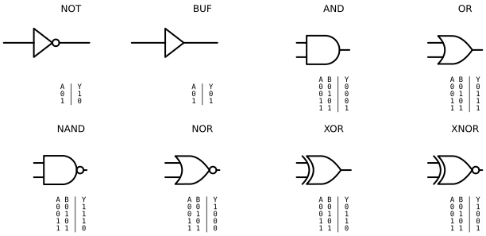
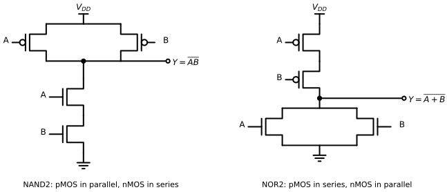

<!-- status: verified -->
# 08-02 · Boolean Algebra and Logic Gates

| | |
|---|---|
| **Course** | [08 · Digital Logic Design](../README.md) |
| **University equivalent** | The Boolean-algebra and logic-gate chapter of a sophomore digital-design course (Harris & Harris, *Digital Design and Computer Architecture*, §§1.5–1.7 and 2.1–2.5; Mano & Ciletti, *Digital Design*, ch. 2), with the switch-level CMOS gate material of §1.7 |
| **Prerequisites** | [08-01 Number Systems and Codes](08-01-number-systems-and-codes.md) (bits, XOR, parity), [05-07 Bit Manipulation](../../05-programming-for-engineers/chapters/05-07-bit-manipulation.md) (the bitwise operators `&`, `\|`, `^`, `~`), [03-01 Probability in EE Language](../../03-probability-statistics-and-random-variables/chapters/03-01-probability-in-ee-language.md) (events as sets: union, intersection, complement) |
| **Estimated study hours** | 8 |
| **Last verified** | 2026-11-19 |

**Learning objectives.** After this chapter you can:

1. State the axioms of Boolean algebra and prove its theorems (absorption, combining, consensus, De Morgan) both algebraically and by perfect induction.
2. Move between truth tables, canonical sum-of-products and product-of-sums forms, simplified expressions and gate schematics, and encode a truth table as the integer that programs an FPGA lookup table.
3. Apply De Morgan's laws and bubble pushing to build any function from NAND gates alone or NOR gates alone, and prove that each of them is functionally complete.
4. Decompose a function with the Shannon expansion, and explain how it underlies multiplexers and equivalence checking.
5. Design static CMOS gates as complementary networks of transistor switches, and compare implementations of one function by transistor count and number of stages.

---

## 1. Big picture

Every digital chip, from a hearing-aid controller to a 208-billion-transistor AI accelerator, computes with a handful of operations on 1s and 0s. In 1854 George Boole turned logical reasoning into algebra; in 1938 Claude Shannon's master's thesis showed that the same algebra describes networks of relay switches. That observation is why a circuit can be designed by writing equations, simplified by manipulating them, and checked by proving two equations equal. This chapter teaches the algebra and the gates that implement it, down to the transistor switches inside a CMOS gate.

- **Logic synthesis is applied Boolean algebra.** When an engineer writes `assign y = a & b | c;`, a synthesis tool rewrites it with the theorems of §3.3, maps it onto the gates of a cell library and proves the result equivalent to the original (§3.5).
- **NAND and NOR are the workhorses.** Static CMOS makes inverting gates naturally, so libraries are built around NAND, NOR, inverters and compound AND-OR-INVERT gates (§3.8).
- **Truth tables are hardware.** An FPGA's lookup table *is* a stored truth table; programming it means writing the integer of §3.4 into a small memory ([08-11](08-11-memories-and-programmable-logic.md)).
- **Cost is counted in gates and transistors.** Area, delay and power estimates start from transistor counts and logic levels, the metrics of §3.9.

## 2. Intuition first

**Switches in series and parallel.** Wire two switches in series between a battery and a lamp: the lamp lights only if switch A *and* switch B are closed. Wire them in parallel: it lights if A *or* B is closed. That is the whole of Shannon's insight, and in a CMOS chip the switches are transistors. The algebra of series and parallel connections is Boolean algebra, with AND for series, OR for parallel and NOT for a switch that is open when its control is on.

**Conditions in a contract.** A loan agreement says the lender may accelerate if "the leverage ratio exceeds 4.0× *or* interest coverage falls below 2.0×, *and* the breach is not cured within 30 days". A lawyer reading that clause is evaluating a Boolean expression, and De Morgan's law is the familiar rule for negating it: the borrower is safe if leverage is *not* above 4.0× *and* coverage is *not* below 2.0×, *or* the breach is cured. Negation swaps every AND with OR and negates every condition. *Where the analogy breaks:* legal language is ambiguous about grouping ("A or B and C"), and courts resolve it with context. Boolean algebra fixes precedence by rule (NOT, then AND, then OR) and has no context at all, which is exactly why hardware description languages need parentheses where English needs judges.

**Two values, no in-between.** A logic signal is a voltage, and voltages are continuous. A gate treats anything near the supply as 1 and anything near ground as 0, and restores its output to a clean rail. This **restoring** behavior is what lets a billion gates be chained without noise accumulating, and it is the physical fact that makes two-valued algebra a faithful model. Course 19 studies the voltage ranges (noise margins) that make it work ([19-01](../../19-digital-vlsi-design/chapters/19-01-cmos-inverter-static.md)).

## 3. Theory

### 3.1 Variables, operations and truth tables

A **Boolean variable** takes one of two values, 0 (FALSE) or 1 (TRUE). Three operations are basic:

| Operation | Notation | Result is 1 when | Gate |
|---|---|---|---|
| NOT (complement) | $\overline{A}$ | $A = 0$ | inverter |
| AND (product) | $A \cdot B$ or $AB$ | both $A$ and $B$ are 1 | AND |
| OR (sum) | $A + B$ | at least one of $A$, $B$ is 1 | OR |

The notation borrows from arithmetic because AND behaves like multiplication of 0s and 1s, and OR like addition that saturates at 1 ($1 + 1 = 1$). **Precedence** follows the same convention: NOT binds tightest, then AND, then OR, so $A + B\overline{C}$ means $A + (B \cdot \overline{C})$. (In Verilog the operators are `~`, `&` and `|`, and the bitwise XOR of 08-01 is `^`.)

A **truth table** lists the output for every combination of inputs. With $n$ inputs there are $2^n$ rows. This chapter orders rows by reading the inputs as a binary number, with $A$ the most significant bit: for three inputs, row $i = 4A + 2B + C$, from row 0 (000) to row 7 (111).

**How many functions are there?** A function of $n$ inputs is a choice of 0 or 1 in each of $2^n$ rows, so there are

$$
N_{\text{functions}}(n) = 2^{2^n}
$$

of them: 4 functions of one variable, 16 of two, 256 of three, 65 536 of four, and about $1.845 \times 10^{19}$ of six. That last number matters to FPGA designers: a six-input lookup table can implement every one of them, because it stores all 64 rows (§3.4).

### 3.2 The axioms, and duality

Boolean algebra can be built from a small set of axioms, as Euclid built geometry. For a set $\{0, 1\}$ with operations $+$, $\cdot$ and $\overline{\phantom{A}}$, a standard choice (Huntington's postulates, 1904) is:

| Axiom | Form | Dual form |
|---|---|---|
| A1 Identity | $A + 0 = A$ | $A \cdot 1 = A$ |
| A2 Commutativity | $A + B = B + A$ | $A \cdot B = B \cdot A$ |
| A3 Distributivity | $A \cdot (B + C) = AB + AC$ | $A + BC = (A + B)(A + C)$ |
| A4 Complement | $A + \overline{A} = 1$ | $A \cdot \overline{A} = 0$ |

Two features differ from school algebra:

- **OR distributes over AND.** $A + BC = (A + B)(A + C)$ has no counterpart for numbers ($2 + 3 \times 4 \ne 5 \times 6$), but it holds here. Check it in the row $A = 1$: both sides are 1. In the rows with $A = 0$: both sides reduce to $BC$.
- **There are no inverses.** You cannot "subtract" or "divide": $A + B = A + C$ does not imply $B = C$ (take $A = 1$). Equations are simplified only by the theorems below, never by cancelling.

**Duality.** Every axiom comes in a pair related by swapping $+$ with $\cdot$ and 0 with 1, leaving variables (and their complements) alone. Because the axioms are closed under this swap, so is every theorem proved from them: **the dual of any theorem is a theorem.** This halves the work of the next section. (Duality is a statement about identities, not functions: the dual of the *expression* $A + B$ is $A \cdot B$, which is a different function.)

### 3.3 Theorems and how to prove them

There are two ways to prove a Boolean identity:

- **Perfect induction:** evaluate both sides on every row of the truth table. With two values per variable this is a complete proof, and it is mechanical: for $n$ variables, $2^n$ rows.
- **Algebra:** derive one side from the other using axioms and proven theorems. This is how simplification is done by hand, and it scales to expressions with too many variables to tabulate.

The theorems a designer uses daily, each with its dual:

| Theorem | Form | Dual form |
|---|---|---|
| T1 Null element | $A + 1 = 1$ | $A \cdot 0 = 0$ |
| T2 Idempotence | $A + A = A$ | $A \cdot A = A$ |
| T3 Involution | $\overline{\overline{A}} = A$ | (self-dual) |
| T4 Associativity | $(A + B) + C = A + (B + C)$ | $(AB)C = A(BC)$ |
| T5 Absorption | $A + AB = A$ | $A(A + B) = A$ |
| T6 Combining | $AB + A\overline{B} = A$ | $(A + B)(A + \overline{B}) = A$ |
| T7 Redundant literal | $A + \overline{A}B = A + B$ | $A(\overline{A} + B) = AB$ |
| T8 Consensus | $AB + \overline{A}C + BC = AB + \overline{A}C$ | $(A + B)(\overline{A} + C)(B + C) = (A + B)(\overline{A} + C)$ |
| T9 De Morgan | $\overline{A + B} = \overline{A}\,\overline{B}$ | $\overline{AB} = \overline{A} + \overline{B}$ |

**Proofs from the axioms.** The proofs show how the axioms are used; each step names its rule.

- **T2:** $A + A = (A + A)\cdot 1 = (A + A)(A + \overline{A}) = A + A\overline{A} = A + 0 = A$, using A1, A4, the dual distributive law A3 and A4 again.
- **T1:** $A + 1 = A + (A + \overline{A}) = (A + A) + \overline{A} = A + \overline{A} = 1$, using A4, associativity and T2.
- **T5:** $A + AB = A\cdot 1 + AB = A(1 + B) = A \cdot 1 = A$, using A1, A3, T1 and A1.
- **T6:** $AB + A\overline{B} = A(B + \overline{B}) = A \cdot 1 = A$. This is the engine of logic minimization: two products that differ in one variable merge, and the variable disappears ([08-03](08-03-logic-minimization.md)).
- **T7:** $A + \overline{A}B = (A + \overline{A})(A + B) = 1\cdot(A + B) = A + B$, by the dual distributive law.
- **T8:** multiply the redundant term by $1 = A + \overline{A}$, expand, and absorb:

$$
\begin{aligned}
AB + \overline{A}C + BC &= AB + \overline{A}C + BC(A + \overline{A}) \\
&= AB + ABC + \overline{A}C + \overline{A}BC \\
&= AB(1 + C) + \overline{A}C(1 + B) = AB + \overline{A}C .
\end{aligned}
$$

The term $BC$ is the **consensus** of $AB$ and $\overline{A}C$: whenever $BC = 1$, one of the other two terms is already 1, whichever value $A$ takes. Removing consensus terms simplifies logic; *adding* them back is the cure for the glitches called hazards ([08-04](08-04-combinational-building-blocks.md)).

**De Morgan's theorem (T9)** is proved fastest by perfect induction:

| $A$ | $B$ | $A + B$ | $\overline{A + B}$ | $\overline{A}$ | $\overline{B}$ | $\overline{A}\,\overline{B}$ |
|---|---|---|---|---|---|---|
| 0 | 0 | 0 | **1** | 1 | 1 | **1** |
| 0 | 1 | 1 | **0** | 1 | 0 | **0** |
| 1 | 0 | 1 | **0** | 0 | 1 | **0** |
| 1 | 1 | 1 | **0** | 0 | 0 | **0** |

The two bold columns agree in all four rows, so the identity holds; its dual follows by duality. Both extend to any number of variables, $\overline{A + B + C + \cdots} = \overline{A}\,\overline{B}\,\overline{C}\cdots$, and to whole expressions: **to complement an expression, swap AND with OR, swap 0 with 1, and complement every literal**, keeping the original grouping with parentheses. For example,

$$
\overline{\overline{A}B + C\overline{D}} = (A + \overline{B})(\overline{C} + D) .
$$

> **Math refresher — Boolean algebra is the algebra of sets.** Read a variable as a set of possible "worlds" (the rows where it is 1), AND as intersection, OR as union and NOT as the complement. Then T5 says $X \cup (X \cap Y) = X$, and De Morgan says the complement of a union is the intersection of the complements, the rule a Venn diagram makes obvious. Probability uses the same algebra ([03-01](../../03-probability-statistics-and-random-variables/chapters/03-01-probability-in-ee-language.md)): $P(\overline{A \cup B}) = P(\overline{A} \cap \overline{B})$.

> **Going deeper — when the algebra stops being Boolean.** Hardware simulators use four values, 0, 1, X (unknown) and Z (undriven), so that an uninitialized register shows up as X rather than as an arbitrary 0 or 1. In four-valued logic the complement axiom fails: with $A = X$, $A + \overline{A}$ evaluates to X, not 1. A simulator therefore cannot apply T6 or T7 blindly, and two designs that are Boolean-equivalent can simulate differently when X values are present (X-pessimism and X-optimism, [08-05](08-05-verilog-and-testbenches.md)). The theorems of this section are exact for real gates driven by real 0s and 1s.

### 3.4 From truth table to expression: canonical forms

Any truth table can be written as an expression in two standard ways.

**Minterms and sum of products.** A **literal** is a variable or its complement. A **minterm** is a product containing every variable exactly once, as a literal chosen so that it is 1 in exactly one row: for row $i$ of a three-input table, $m_i$ uses $A$ where the row has a 1 and $\overline{A}$ where it has a 0. So $m_5 = A\overline{B}C$ is 1 only in row 101. ORing the minterms of the rows where the output is 1 gives the **canonical sum of products (SOP)**:

$$
Y = \sum m(i_1, i_2, \ldots) = m_{i_1} + m_{i_2} + \cdots .
$$

*Why it works:* in any row, at most one minterm is 1. If the row is listed, that minterm makes $Y = 1$; if not, every listed minterm is 0. So the expression reproduces the table exactly.

**Maxterms and product of sums.** Dually, a **maxterm** $M_i$ is a sum containing every variable once, chosen to be 0 in exactly row $i$: $M_5 = \overline{A} + B + \overline{C}$ (the complement of $m_5$, by De Morgan). ANDing the maxterms of the rows where the output is 0 gives the **canonical product of sums (POS)**, $Y = \prod M(\ldots)$, which is 0 exactly in those rows.

**Converting between them.** The rows not in the SOP list are exactly the rows in the POS list. The complement $\overline{Y}$ has the minterms that $Y$ lacks.

**Example: the majority function.** $Y = 1$ when at least two of $A$, $B$, $C$ are 1, rows 3, 5, 6 and 7:

$$
Y = \sum m(3, 5, 6, 7) = \overline{A}BC + A\overline{B}C + AB\overline{C} + ABC = \prod M(0, 1, 2, 4) .
$$

The canonical forms are correct but rarely cheapest: this SOP has 12 literals, and Example 08-02.2 reduces it to $AB + BC + AC$, with 6. Each two-level form maps directly onto gates: SOP onto a layer of AND gates feeding one OR, POS onto ORs feeding one AND.

**The truth table as an integer.** Read the output column as a binary number, with row $i$'s output as bit $i$. The majority function's outputs, rows 7 down to 0, are 1110 1000₂ = E8₁₆ = 232. FPGA tools write exactly this number into a three-input lookup table to make it a majority gate, and a six-input table takes a 64-bit number. Two functions are equal if and only if their integers are equal, which makes this a compact way to compare them.

### 3.5 The Shannon expansion and equivalence

Any function can be split on one variable:

$$
F(A, B, C, \ldots) = \overline{A}\cdot F(0, B, C, \ldots) + A \cdot F(1, B, C, \ldots) .
$$

*Proof by perfect induction on $A$:* if $A = 0$ the right side is $1\cdot F(0, \ldots) + 0 = F(0, \ldots)$, the left side's value; if $A = 1$ it is $F(1, \ldots)$. The two **cofactors** $F(0, \ldots)$ and $F(1, \ldots)$ are functions of one fewer variable. Three consequences run through the rest of the course:

- **A multiplexer is a Shannon expansion.** The 2:1 mux $Y = \overline{S}D_0 + SD_1$ selects $D_0$ or $D_1$; feeding it the two cofactors of $F$ with $S = A$ computes $F$. Repeating the split on every variable builds any function from multiplexers, which is how an FPGA lookup table reads its stored bits ([08-04](08-04-combinational-building-blocks.md), [08-11](08-11-memories-and-programmable-logic.md)).
- **Decision diagrams.** Splitting recursively, and sharing identical cofactors, gives a binary decision diagram (BDD), a canonical graph of the function used by verification tools.
- **Equivalence checking.** Two circuits are equivalent if their outputs agree on every input. For a block with $n$ inputs, perfect induction takes $2^n$ simulations: fine for 20 inputs ($2^{20}$ ≈ 1.05 million), hopeless for 64 ($1.845 \times 10^{19}$, about 585 years at a billion vectors per second). Commercial and open-source equivalence checkers instead prove equality symbolically, with BDDs or with satisfiability (SAT) solvers that search for a single input on which the circuits differ and prove that none exists. Every synthesized netlist on a modern chip is checked against its source this way ([19-13](../../19-digital-vlsi-design/chapters/19-13-verification-methods.md)).

### 3.6 Logic gates

A **gate** is a circuit that computes one Boolean function. The standard set, with their schematic shapes in Figure 1:

| Gate | Function | Output is 1 when | Notes |
|---|---|---|---|
| Buffer | $Y = A$ | $A = 1$ | restores and strengthens a signal |
| NOT | $Y = \overline{A}$ | $A = 0$ | the inverter; the bubble means "complement" |
| AND | $Y = AB$ | all inputs are 1 | |
| OR | $Y = A + B$ | any input is 1 | |
| NAND | $Y = \overline{AB}$ | any input is 0 | AND followed by NOT |
| NOR | $Y = \overline{A + B}$ | all inputs are 0 | OR followed by NOT |
| XOR | $Y = A \oplus B = \overline{A}B + A\overline{B}$ | the inputs differ | odd parity of its inputs (08-01) |
| XNOR | $Y = \overline{A \oplus B}$ | the inputs are equal | the 1-bit equality comparator |

*Figure 1. The standard gate symbols with their truth tables. A bubble on an input or output means complement.*

**Multi-input gates.** AND, OR and XOR are associative (T4, and the same proof for XOR), so a three-input AND is unambiguous and can be built from two-input ANDs in any grouping. A multi-input XOR outputs 1 when an *odd* number of inputs are 1: it is the parity generator of 08-01. **NAND and NOR are not associative:** $\overline{\overline{AB}\,C} = AB + \overline{C}$, which differs from $\overline{A\,\overline{BC}} = \overline{A} + BC$: with $A = 1$ and $B = C = 0$, the first is 1 and the second 0. A three-input NAND means $\overline{ABC}$, and it cannot be built by chaining two-input NANDs without an inverter.

**Which two-input functions matter?** Of the 16 functions of two inputs, 2 are constants and 4 depend on only one input ($A$, $\overline{A}$, $B$, $\overline{B}$), leaving 10 that depend on both. Eight of those are AND or OR with a bubble on the output or on one input: AND, NAND, OR, NOR, $\overline{A}B$, $A\overline{B}$, $\overline{A} + B$ and $A + \overline{B}$. The remaining two are XOR and XNOR. So the gate set above, with bubbles, covers every two-input function.

### 3.7 Universal gates and bubble pushing

A set of gates is **functionally complete** if every Boolean function can be built from it.

**{AND, OR, NOT} is complete.** Every truth table has a canonical SOP (§3.4), which uses only AND, OR and NOT. (A table with no 1s is the constant 0, which is $A\overline{A}$.)

**NAND alone is complete.** It suffices to build NOT, AND and OR from NANDs:

- NOT: $\overline{A \cdot A} = \overline{A}$ (tie the inputs together, T2);
- AND: invert a NAND, $\overline{\overline{AB}} = AB$;
- OR: NAND the complements, $\overline{\overline{A}\cdot\overline{B}} = A + B$ (De Morgan).

By duality, **NOR alone is complete**: NOT is $\overline{A + A}$, OR is an inverted NOR, and AND is $\overline{\overline{A} + \overline{B}}$. NAND and NOR are the only two-input functions that are complete on their own (Problem 08-02.6 counts them). Not every set is complete: AND and OR alone cannot make a NOT, because a circuit of ANDs and ORs is **monotone**, its output can never fall when an input rises (Problem 08-02.15).

**Two-level NAND-NAND logic.** Any SOP maps onto NANDs with no extra inverters:

$$
AB + CD = \overline{\overline{AB + CD}} = \overline{\overline{AB}\cdot\overline{CD}} ,
$$

so a first layer of NANDs computes $\overline{AB}$ and $\overline{CD}$, and a second NAND combines them. **The AND-OR circuit and the NAND-NAND circuit compute the same function.** Dually, any POS maps onto NOR-NOR.

**Bubble pushing.** De Morgan's law has a graphical form: an AND gate with an inverted output is the same as an OR gate with inverted inputs ($\overline{AB} = \overline{A} + \overline{B}$), and an OR with an inverted output is an AND with inverted inputs. So a NAND gate can be drawn either as an AND with an output bubble or as an OR with input bubbles. Designers redraw circuits so that bubbles meet in pairs on each wire, where they cancel (T3), and read the function off the bubble-free result. The NAND-NAND circuit, redrawn with the second NAND as an OR with input bubbles, shows two bubble pairs cancelling and leaves plain AND-OR logic.

### 3.8 Gates from transistors: static CMOS

Chapter [09-11](../../09-semiconductor-devices/chapters/09-11-cmos-and-scaling.md) and Course 19 treat the transistor physics. Here a transistor is a voltage-controlled switch with three terminals, a **gate** that controls it and two others that it connects or disconnects:

- an **nMOS** transistor is ON (conducting) when its gate is 1 and OFF when its gate is 0; it passes 0s well, so it is used to pull outputs down to ground;
- a **pMOS** transistor is ON when its gate is 0; it passes 1s well and pulls outputs up to the supply.

**The complementary structure.** A static CMOS gate connects its output to the supply through a **pull-up network** (PUN) of pMOS transistors and to ground through a **pull-down network** (PDN) of nMOS transistors. For every input combination, exactly one network conducts:

- if both conducted, current would flow from supply to ground (a short, and an undefined output);
- if neither conducted, the output would float.

When this holds, the output is always firmly at a rail and no current flows once the output has settled. That near-zero static power is why CMOS displaced every earlier logic family.

**Series and parallel are AND and OR.** Switches in series conduct when all are ON (AND); in parallel, when any is ON (OR). Suppose the PDN conducts when a function $G$ of the inputs is 1. Then the output is 0 exactly when $G = 1$, so the gate computes $Y = \overline{G}$. The PUN must conduct when $G = 0$, that is, when $\overline{G} = 1$. Its pMOS switches conduct on complemented inputs, so De Morgan dictates its shape: **the PUN is the dual of the PDN, with every series connection made parallel and every parallel connection made series.**

- **Inverter:** PDN one nMOS (conducts when $A = 1$), PUN one pMOS. $Y = \overline{A}$, 2 transistors.
- **NAND2:** PDN two nMOS in series (conducts when $AB = 1$), PUN two pMOS in parallel. $Y = \overline{AB}$, 4 transistors.
- **NOR2:** PDN two nMOS in parallel, PUN two pMOS in series. $Y = \overline{A + B}$, 4 transistors.

*Figure 2. Static CMOS NAND2 (left) and NOR2 (right). Each pull-up network is the series-parallel dual of its pull-down network.*

**Every single static CMOS gate is inverting.** The PDN can only pull *down* when its inputs are 1, so a rising input can only make the output fall. A non-inverting function such as AND therefore costs a NAND plus an inverter, 6 transistors against the NAND's 4, and an extra stage of delay. This is why digital designers think in NANDs and NORs, and why bubble pushing is a daily skill.

**Compound gates.** Any series-parallel PDN gives a valid gate. An **AND-OR-INVERT** (AOI) gate computes $\overline{AB + CD}$ (AOI22) with two series pairs in parallel in the PDN and the dual in the PUN: 8 transistors and one stage, against three NAND2s (12 transistors, two stages) for the non-inverted $AB + CD$. The general count: a static CMOS gate with $k$ input literals in its PDN expression uses $2k$ transistors.

**Why NAND is preferred to NOR.** In a NAND the slow pMOS devices sit in parallel and the fast nMOS in series; in a NOR it is the reverse. Holes move more slowly than electrons in silicon, so a pMOS conducts roughly half as well as an nMOS of the same size, or worse, and a series stack of them is slower still. Real libraries respond by making pMOS devices wider, by preferring NAND structures, and by limiting stacks to about four transistors (§9 shows the sizes in an open-source library). The resulting delay and sizing rules are the subject of [19-04](../../19-digital-vlsi-design/chapters/19-04-sizing-and-logical-effort.md).

### 3.9 Counting cost and delay

Before any detailed timing analysis, designers compare implementations with four counts:

- **Literals** in the expression: a rough measure of wiring and gate inputs, and the quantity two-level minimization reduces ([08-03](08-03-logic-minimization.md)).
- **Gates**, often normalized to **gate equivalents** (GE): a block's area divided by the area of a two-input NAND in the same library. A "1 million gate" ASIC block means about a million NAND2 areas, not a million gates of any kind.
- **Transistors:** $2k$ for a static CMOS gate with $k$ inputs; 2 more per inverter.
- **Logic levels** (stages) on the longest path from an input to the output: each inverting stage adds roughly one gate delay, so the level count is a first estimate of speed. It is refined into real delays with the RC models of [19-02](../../19-digital-vlsi-design/chapters/19-02-cmos-inverter-dynamic.md) and the timing analysis of [08-10](08-10-timing-metastability-cdc.md).

These counts often disagree about the best design, which is the subject of §6: Example 08-02.4 builds one function three ways, each best by a different count.

## 4. Worked examples

### Example 08-02.1 · Proving the consensus theorem two ways (tier A)

**Setup.** Prove $AB + \overline{A}C + BC = AB + \overline{A}C$ (a) by perfect induction and (b) by explaining which rows the term $BC$ could affect.

**Solution.** (a) Tabulate both sides on all $2^3$ = **8** rows:

| $A$ | $B$ | $C$ | $AB$ | $\overline{A}C$ | $BC$ | left side | right side |
|---|---|---|---|---|---|---|---|
| 0 | 0 | 0 | 0 | 0 | 0 | 0 | 0 |
| 0 | 0 | 1 | 0 | 1 | 0 | 1 | 1 |
| 0 | 1 | 0 | 0 | 0 | 0 | 0 | 0 |
| 0 | 1 | 1 | 0 | 1 | 1 | 1 | 1 |
| 1 | 0 | 0 | 0 | 0 | 0 | 0 | 0 |
| 1 | 0 | 1 | 0 | 0 | 0 | 0 | 0 |
| 1 | 1 | 0 | 1 | 0 | 0 | 1 | 1 |
| 1 | 1 | 1 | 1 | 0 | 1 | 1 | 1 |

The last two columns agree in every row, so the identity holds.

(b) $BC$ is 1 in only **2** rows, 011 and 111. In row 011, $\overline{A}C = 1$; in row 111, $AB = 1$. So in every row where $BC$ could make the left side 1, the right side is already 1, and dropping $BC$ changes nothing.

**Sanity check.** The algebraic proof in §3.3 multiplied $BC$ by $A + \overline{A}$: its two pieces $ABC$ and $\overline{A}BC$ are exactly rows 111 and 011, absorbed by $AB$ and $\overline{A}C$ respectively ✓.

### Example 08-02.2 · Canonical forms of the majority function (tier A)

**Setup.** For the three-input majority function $Y$ (1 when at least two inputs are 1): (a) list its minterms; (b) count the literals in its canonical SOP; (c) simplify it algebraically and count the literals again; (d) give the lookup-table integer; (e) find a minimal POS.

**Solution.** (a) Rows 011, 101, 110 and 111 have two or more 1s: $Y = \sum m(3, 5, 6, 7)$, **4** minterms.

(b) Four minterms of 3 literals each: **12** literals.

(c) The minterm $ABC$ can combine with each of the other three (they differ from it in one variable), but it can only be used once, unless we copy it. Idempotence (T2) allows exactly that: $ABC = ABC + ABC + ABC$. Then pair each copy with one neighbor and apply T6:

$$
\begin{aligned}
Y &= (\overline{A}BC + ABC) + (A\overline{B}C + ABC) + (AB\overline{C} + ABC) \\
&= BC + AC + AB ,
\end{aligned}
$$

**6** literals.

(d) Outputs in rows 7 to 0: 1, 1, 1, 0, 1, 0, 0, 0. As bits 7 to 0, 1110 1000₂ = E8₁₆ = **232**.

(e) The zeros are rows 0, 1, 2 and 4: $Y = \prod M(0, 1, 2, 4)$. Applying the dual of the same trick (copy $M_0 = A + B + C$ three times and use the dual of T6) gives $Y = (A + B)(A + C)(B + C)$, again **6** literals.

**Sanity check.** Majority is **self-dual**: swapping AND with OR in $AB + BC + AC$ gives $(A + B)(B + C)(A + C)$, the same function. That is a known property of majority (it outputs the complement when all inputs are complemented) ✓. And $AB + BC + AC$ is 1 on row 101 through $AC$, as required ✓.

### Example 08-02.3 · Complementing with De Morgan (tier B)

**Setup.** Let $F = \overline{A}B + C\overline{D}$, a function of four inputs. (a) How many rows of its truth table have $F = 1$? (b) How many have $\overline{F} = 1$? (c) Write $\overline{F}$ in product-of-sums form and count its literals. (d) Multiply it out to a sum of products and count literals.

**Solution.** (a) $\overline{A}B$ is 1 when $A = 0$ and $B = 1$, whatever $C$ and $D$ are: 4 rows. $C\overline{D}$ is 1 in 4 rows. They overlap in one row ($A = 0$, $B = 1$, $C = 1$, $D = 0$), so by inclusion–exclusion $F$ is 1 in $4 + 4 - 1$ = **7** rows.

(b) $16 - 7$ = **9** rows.

(c) Apply the complement rule (swap AND and OR, complement each literal):

$$
\overline{F} = \overline{\overline{A}B}\cdot\overline{C\overline{D}} = (A + \overline{B})(\overline{C} + D) ,
$$

**4** literals.

(d) Distributing, $\overline{F} = A\overline{C} + AD + \overline{B}\,\overline{C} + \overline{B}D$: four products, **8** literals. No product is redundant; for instance $AD$ alone covers the row 1001, where none of the other three products is 1.

**Sanity check.** $(A + \overline{B})$ is 1 in 12 of the 16 rows and $(\overline{C} + D)$ in 12; independent variables, so their AND is 1 in $16 \times \tfrac{12}{16}\times\tfrac{12}{16} = 9$ rows ✓, matching (b). The POS form is half the size of the SOP form here, which is why both forms are worth knowing.

### Example 08-02.4 · One function, three circuits (tier B)

**Setup.** Implement $Y = AB + CD$ in static CMOS three ways and compare transistor counts and inverting stages on the longest path: (a) AND gates feeding an OR gate, each built as the inverting gate plus an inverter; (b) NAND-NAND; (c) an AOI22 gate followed by an inverter.

**Solution.** (a) An AND2 is a NAND2 (4 transistors) plus an inverter (2): 6. An OR2 is a NOR2 plus an inverter: 6. Two ANDs and one OR: $3 \times 6$ = **18** transistors. The path is NAND → inverter → NOR → inverter: **4** stages.

(b) Three NAND2 gates (§3.7): $3 \times 4$ = **12** transistors, **2** stages.

(c) AOI22 computes $\overline{AB + CD}$ with 8 transistors (4 input literals), and the inverter restores $Y$: **10** transistors, **2** stages.

**Sanity check.** Circuits (a) and (b) contain the same NANDs; (a) adds an inverter after each NAND and then undoes both with a NOR, which is the NAND-NAND circuit with two pairs of bubbles left in. Removing them saves 6 transistors and 2 stages ✓. Circuit (c) is smallest, but its pMOS stacks are two deep and its output inverter adds a stage that a downstream gate could absorb (if the next gate wants $\overline{Y}$, the AOI22 alone does the job in one stage with 8 transistors). Which is "best" depends on what drives it and what it drives (§6).

### Example 08-02.5 · XOR from NAND gates (tier B)

**Setup.** Show that four NAND2 gates compute $A \oplus B$ in the arrangement $M = \overline{AB}$, $P = \overline{AM}$, $Q = \overline{BM}$, $Y = \overline{PQ}$. Count (a) gates, (b) transistors, (c) NAND levels on the longest path; and (d) count the transistors of a static CMOS XOR built as an AOI22 computing $\overline{AB + \overline{A}\,\overline{B}}$ with two input inverters.

**Solution.** Simplify gate by gate, using De Morgan and T7:

$$
P = \overline{A\,M} = \overline{A} + \overline{M} = \overline{A} + AB = \overline{A} + B , \qquad Q = \overline{B\,M} = \overline{B} + A ,
$$

the second by the same steps with $A$ and $B$ exchanged. Then

$$
Y = \overline{PQ} = \overline{P} + \overline{Q} = A\overline{B} + \overline{A}B = A \oplus B ,
$$

since $\overline{P} = \overline{\overline{A} + B} = A\overline{B}$ and $\overline{Q} = \overline{A}B$.

(a) **4** gates; (b) $4 \times 4$ = **16** transistors; (c) the path $A \to M \to P \to Y$ passes **3** NANDs.

(d) $\overline{AB + \overline{A}\,\overline{B}}$ is 1 when $A$ and $B$ differ, so it is XOR. The AOI22 needs 8 transistors and the inverters for $\overline{A}$ and $\overline{B}$ need 4: **12**.

**Sanity check.** Row by row: $AB$ = 00 gives $M = 1$, $P = Q = 1$, $Y = 0$ ✓; 01 gives $M = 1$, $P = 1$, $Q = 0$, $Y = 1$ ✓; 11 gives $M = 0$, $P = Q = 1$, $Y = 0$ ✓. XOR is the most expensive two-input function in CMOS, which is why adders, built mostly of XORs, receive so much circuit-design attention ([08-09](08-09-arithmetic-circuits.md)).

### Example 08-02.6 · Designing a CMOS compound gate (tier B)

**Setup.** Design a single static CMOS gate for $Y = \overline{A(B + C)}$. Give (a) its transistor count; (b) the number of input rows with $Y = 0$ and (c) with $Y = 1$, checking that the two networks never conduct together; (d) the tallest series stack in each network.

**Solution.** The PDN must conduct when $A(B + C) = 1$: an nMOS on $A$ **in series** with the parallel pair of nMOS on $B$ and $C$. The PUN is its dual: a pMOS on $A$ **in parallel** with the series pair of pMOS on $B$ and $C$. It conducts when $\overline{A} + \overline{B}\,\overline{C} = 1$, which by De Morgan is $\overline{A(B + C)}$ ✓.

(a) Three literals in the PDN, so $2 \times 3$ = **6** transistors.

(b) The PDN conducts when $A = 1$ and at least one of $B$, $C$ is 1: rows 101, 110, 111, so **3** rows with $Y = 0$.

(c) The PUN conducts when $A = 0$ (rows 000 to 011, four rows) or when $B = C = 0$ (rows 000 and 100), that is, in rows 000, 001, 010, 011 and 100: **5** rows with $Y = 1$. The two sets are disjoint and together cover all 8 rows, so exactly one network conducts in every row ✓.

(d) Both networks have a tallest stack of **2** transistors: $A$ then ($B$ ∥ $C$) in the PDN, and the series $B$–$C$ pair in the PUN.

**Sanity check.** This is an OR-AND-INVERT gate, OAI21. Built from simple gates it would be an OR2 (6 transistors), a NAND2 (4) and two stages; the compound gate does it in one stage with 6 ✓.

### Example 08-02.7 · Counting functions, and the Shannon expansion (tier C)

**Setup.** (a) How many Boolean functions of two inputs are there, and (b) how many depend on both inputs? (c) How many functions of four inputs are there, and (d) of six? (e) How many bits must a six-input lookup table store? (f) Express the majority function through its Shannon expansion on $A$, and say what hardware that suggests.

**Solution.** (a) $2^{2^2}$ = **16**. (b) Subtract the 2 constants and the 4 functions of one input: **10** (§3.6). (c) $2^{2^4} = 2^{16}$ = **65 536**. (d) $2^{2^6} = 2^{64}$ ≈ **1.845 × 10¹⁹**. (e) One bit per row: $2^6$ = **64**.

(f) The cofactors of $Y = AB + BC + AC$ are $Y(A = 0) = BC$ and $Y(A = 1) = B + C$ (with $A = 1$: $B + BC + C = B + C$ by absorption). So

$$
Y = \overline{A}\cdot BC + A\cdot(B + C) ,
$$

a 2:1 multiplexer selected by $A$, choosing between an AND gate and an OR gate.

**Sanity check.** Row 101: $A = 1$ selects $B + C = 1$ ✓. Row 011: $A = 0$ selects $BC = 1$ ✓. Row 100: $A = 1$ selects $B + C = 0$ ✓. The count in (d) explains why FPGAs use lookup tables rather than fixed gates: a 64-bit memory can be any of $1.8 \times 10^{19}$ functions, chosen at configuration time.

### Answer key

<!-- answer-key -->
| ID | Quantity | Value | Unit |
|---|---|---|---|
| Ex 08-02.1a | truth-table rows checked | 8 | — |
| Ex 08-02.1b | rows where $BC = 1$ | 2 | — |
| Ex 08-02.2a | minterms of majority | 4 | — |
| Ex 08-02.2b | literals, canonical SOP | 12 | — |
| Ex 08-02.2c | literals, minimal SOP | 6 | — |
| Ex 08-02.2d | majority lookup-table integer | 232 | — |
| Ex 08-02.2e | literals, minimal POS | 6 | — |
| Ex 08-02.3a | rows with $F = 1$ | 7 | — |
| Ex 08-02.3b | rows with $\overline{F} = 1$ | 9 | — |
| Ex 08-02.3c | literals of $\overline{F}$ in POS form | 4 | — |
| Ex 08-02.3d | literals of $\overline{F}$ in SOP form | 8 | — |
| Ex 08-02.4a | transistors, AND-OR | 18 | — |
| Ex 08-02.4b | transistors, NAND-NAND | 12 | — |
| Ex 08-02.4c | transistors, AOI22 + inverter | 10 | — |
| Ex 08-02.4d | stages, AND-OR | 4 | — |
| Ex 08-02.4e | stages, NAND-NAND | 2 | — |
| Ex 08-02.4f | stages, AOI22 + inverter | 2 | — |
| Ex 08-02.5a | NAND gates in the XOR | 4 | — |
| Ex 08-02.5b | transistors, NAND XOR | 16 | — |
| Ex 08-02.5c | NAND levels, longest path | 3 | — |
| Ex 08-02.5d | transistors, AOI22 XOR with input inverters | 12 | — |
| Ex 08-02.6a | transistors, OAI21 | 6 | — |
| Ex 08-02.6b | rows with $Y = 0$ | 3 | — |
| Ex 08-02.6c | rows with $Y = 1$ | 5 | — |
| Ex 08-02.6d | tallest series stack | 2 | — |
| Ex 08-02.7a | functions of two inputs | 16 | — |
| Ex 08-02.7b | two-input functions depending on both inputs | 10 | — |
| Ex 08-02.7c | functions of four inputs | 65536 | — |
| Ex 08-02.7d | functions of six inputs | 1.845e19 | — |
| Ex 08-02.7e | bits in a six-input lookup table | 64 | — |
| Th 08-02.a | functions of three inputs | 256 | — |
| Th 08-02.b | rows for a 20-input exhaustive check | 1048576 | — |
| Th 08-02.c | years to check 64 inputs at 10⁹ vectors per second | 585 | yr |
| Th 08-02.d | transistors, AOI22 | 8 | — |

## 5. Simulate it

The lab is in [labs/08-02-lab/](../labs/08-02-lab/README.md).

**Notebook** (`08-02-boolean-algebra.ipynb`):

1. Build a tiny truth-table engine and prove every theorem of §3.3 by perfect induction.
2. Turn any truth table into canonical SOP and POS forms and lookup-table integers, and count all functions of two and three inputs by their properties.
3. Convert expressions to NAND-only form and check them exhaustively.
4. Simulate CMOS gates as networks of switches: verify that the pull-up and pull-down networks are complementary, and count transistors.

**Verilog** (`gates.v`, `gates_tb.v`): the majority function written three ways (behavioral, NAND-only and as a multiplexer), the four-NAND XOR, and NAND2 and OAI21 gates built from `nmos` and `pmos` switch primitives, all checked exhaustively against reference expressions by a testbench that prints `TEST PASSED`.

**ngspice** (`nand2_cmos.cir`): a transistor-level CMOS NAND2 with simple device models, evaluated at all four input combinations.

**Guided exercise (predict, then run).** In the ngspice NAND2, **before running**, predict the output voltage for each input pair and the current drawn from the 1.8 V supply once the output has settled. Then run it. Why is the settled supply current essentially zero in every state, and what does that imply about where a CMOS chip's power goes?

## 6. Engineering tradeoffs

| Knob | Improves | Costs | Typical decision owner |
|---|---|---|---|
| Two-level (SOP or POS) logic | Fewest stages; regular, easy to synthesize | Many literals for functions such as parity; wide gates with tall transistor stacks | Logic designer, synthesis tool |
| Multi-level logic (factored expressions) | Fewer literals and transistors | More stages, so more delay | Synthesis tool, guided by timing constraints |
| Compound gates (AOI, OAI) | Fewer transistors and stages than separate gates | Taller stacks, slower edges, larger cell libraries | Library designer |
| NAND-based rather than NOR-based structures | Faster pull-up (pMOS in parallel) | Bubble pushing; sometimes an extra inverter | Circuit designer |
| More inputs per gate (fan-in) | Fewer gates and levels | Delay grows quickly with stack height; stacks rarely exceed about 4 | Circuit designer |
| Lookup tables (FPGA) instead of fixed gates | Any function, reprogrammable after manufacture | Much more area, delay and power per function than custom gates ([08-11](08-11-memories-and-programmable-logic.md) quantifies the gap) | Architect choosing FPGA or ASIC |

## 7. Numbers to know

| Quantity | Value | Note |
|---|---|---|
| Functions of $n$ inputs | $2^{2^n}$: 16 for 2, 256 for 3, 65 536 for 4, ≈ 1.845 × 10¹⁹ for 6 | §3.1 |
| Truth-table rows | $2^n$; a 6-input lookup table stores 64 bits | §3.4 |
| Static CMOS transistor counts | inverter 2; NAND2 and NOR2 4; AND2 and OR2 6; $k$-input NAND or NOR $2k$; AOI22 8; static XOR2 12 | §3.8 |
| Series stack height | rarely more than about 4 transistors | §3.8, [19-04](../../19-digital-vlsi-design/chapters/19-04-sizing-and-logical-effort.md) |
| Exhaustive checking at 10⁹ vectors per second | 20 inputs: about a millisecond; 40 inputs: about 18 minutes; 64 inputs: about 585 years | §3.5 |
| SKY130 high-density cells (130 nm open PDK) | inverter 2 transistors, NAND2 4, NOR2 4, D flip-flop 24; nMOS 0.65 µm and pMOS 1.0 µm wide at 0.15 µm length | [R-148](../../../reference/research-log.md#r-148--standard-cell-library-structure-sky130) **[Established]** |
| Large-chip transistor counts | NVIDIA B200: 208 billion on two dies (2024); Apple M4: 28 billion (2024) | [R-149](../../../reference/research-log.md#r-149--chip-transistor-counts) **[Established]** (vendor-disclosed) |

<!-- answer-key -->
| ID | Quantity | Value | Unit |
|---|---|---|---|
| N 08-02.a | exhaustive check of 20 inputs at 10⁹ per second | 1.05 | ms |
| N 08-02.b | exhaustive check of 40 inputs at 10⁹ per second | 18.3 | min |

## 8. Common mistakes

1. **Cancelling as in ordinary algebra.** $A + B = A + C$ does not imply $B = C$, and $AB = AC$ does not imply $B = C$. Use the theorems, or perfect induction.
2. **Getting precedence or bar length wrong.** $A + BC$ is $A + (BC)$. And $\overline{AB}$ (NAND) is not $\overline{A}\,\overline{B}$, which by De Morgan is $\overline{A + B}$ (NOR). Write the bar over exactly what it covers.
3. **Complementing without swapping operators.** $\overline{AB + C}$ is $(\overline{A} + \overline{B})\overline{C}$, not $\overline{A}\,\overline{B} + \overline{C}$. Keep the grouping in parentheses when applying De Morgan.
4. **Chaining NANDs as if they were associative.** A three-input NAND is not two two-input NANDs in a row (§3.6).
5. **Forgetting that CMOS gates invert.** An AND gate in a CMOS library is a NAND plus an inverter, with an extra stage of delay.
6. **Drawing a PUN identical to the PDN.** The pull-up network is the series-parallel *dual*; copying the PDN's structure gives a short circuit in some input states and a floating output in others.
7. **Trusting an expression that "looks equivalent".** Prove it: tabulate both sides, or let a tool check equivalence. Most logic bugs are rows nobody checked.

## 9. Practitioner lens

### State of the art (as of Nov 2026)

- **A real standard-cell library at transistor level** ([R-148](../../../reference/research-log.md#r-148--standard-cell-library-structure-sky130)) **[Established]**. SkyWater's SKY130 high-density library (sky130_fd_sc_hd), released with Google as an open-source 130 nm process design kit, publishes every cell's transistor netlist:
  - the inverter `inv_1` is one nMOS 0.65 µm wide and one pMOS 1.0 µm wide, both 0.15 µm long: 2 transistors;
  - `nand2_1` has two parallel pMOS and two series nMOS (4 transistors), and `nor2_1` two series pMOS and two parallel nMOS (4);
  - the pMOS devices are **1.54×** as wide as the nMOS (1.0 / 0.65), partly compensating for slower holes, and the NOR2's *series* pMOS are no wider than the NAND2's *parallel* ones. The library accepts a slower NOR rise rather than spend area to equalize it, a reason synthesis tools prefer NAND-based mappings;
  - drive strengths come as separate cells: `nand2_2` has 8 transistors, twice the NAND2's count, to drive about twice the load, and the library offers inverters from `_1` to `_16`;
  - the basic D flip-flop `dfxtp_1` has **24** transistors, as many as **6** NAND2s ([08-06](08-06-latches-and-flip-flops.md)).
- **The open PDK is a teaching and prototyping platform.** Google's `skywater-pdk` repository still describes its content as an "experimental preview / alpha release"; its last commit is from May 2023, and maintained packaging continues in the open_pdks project **[Established]** (from the repositories' own text and history).
- **Transistor counts keep climbing** ([R-149](../../../reference/research-log.md#r-149--chip-transistor-counts)). NVIDIA's Blackwell B200 GPU (announced March 2024) has 208 billion transistors on two reticle-limit dies joined by a 10 TB/s link, about **104** billion per die. Apple's M4 (May 2024) has 28 billion on a second-generation 3 nm process **[Established]** (vendor-disclosed figures, from search excerpts of the announcements and coverage).

<!-- answer-key -->
| ID | Quantity | Value | Unit |
|---|---|---|---|
| PL 08-02.a | SKY130 pMOS-to-nMOS width ratio | 1.54 | — |
| PL 08-02.b | dfxtp_1 flip-flop in NAND2 equivalents by transistor count | 6 | — |
| PL 08-02.c | B200 transistors per die | 104 | billion |
| PL 08-02.d | B200 transistors over M4 transistors | 7.4 | — |
| PL 08-02.e | B200 transistors divided by 4 (NAND2s if all were logic) | 52 | billion |

### Why it matters commercially

- **Cell libraries are a product.** Every ASIC is built from a foundry's or IP vendor's standard cells, and the number of functions, drive strengths and threshold-voltage flavors in a library sets how well synthesis can trade speed against power. Library quality is part of what a foundry sells.
- **Gate counts price IP.** Design IP is often quoted and compared in gate equivalents, so the definition (NAND2 area in a named library) matters when comparing offers.
- **Transistor count is not performance.** The headline count includes memory, I/O and analog circuitry. A 6-transistor SRAM cell stores one bit; large caches can make up a large share of a chip's transistors, so "transistors ÷ 4" (52 billion NAND2s for B200) is an upper bound on logic gates, not an estimate.

### Marketing vs Reality

- **"208 billion transistors."** *Reality:* it is two dies in one package, so the per-die count (about 104 billion) is the like-for-like comparison with single-die chips. *Sanity check:* ask for transistors per die, die area, and how much of it is SRAM.
- **"A 10-million-gate design."** *Reality:* gate equivalents are an area unit tied to one library's NAND2, and FPGA vendors have used still other "gate" and "logic cell" units. *Sanity check:* ask which library or device family, and convert to the same unit before comparing.
- **"Open-source PDK, ready for production."** *Reality:* the SKY130 PDK's own repository calls it an experimental preview. Open PDKs are excellent for education and shuttles; production tape-outs depend on foundry support and qualification. *Sanity check:* ask what the foundry warrants and what the design's yield and reliability data are based on.
- **"Our tool optimized the logic, so it's correct."** *Reality:* synthesis transforms are checked by formal equivalence, not trusted. *Sanity check:* ask whether every netlist is equivalence-checked against the RTL, and how waived differences are reviewed.

### Questions for engineering leaders

1. **"How large is the design in gate equivalents, in which library, and how much of the die is logic versus SRAM, I/O and analog?"**
   - *Strong:* gives a GE count with the reference library, and an area breakdown by block type.
   - *Evasive:* quotes only a transistor count.
2. **"How do you know the synthesized netlist matches the RTL?"**
   - *Strong:* formal equivalence checking at every handoff (RTL to gates, gates to placed netlist, after every manual change), with a sign-off rule for waivers.
   - *Evasive:* "we ran the regression tests."
3. **"Which standard-cell libraries do you use, and how many drive strengths and threshold-voltage flavors?"**
   - *Strong:* names the libraries and explains how multi-threshold cells trade leakage against speed in their flow.
   - *Evasive:* "whatever the foundry gives us."
4. **"Where does the chip's power go?"**
   - *Strong:* splits dynamic switching power from leakage, by block, measured or from sign-off analysis.
   - *Evasive:* gives a single TDP figure.

## 10. Concept check

**Q1.** Why can a Boolean identity be proved by checking finitely many cases, when an algebraic identity over the real numbers cannot?

Answer

Each variable takes only two values, so an expression in $n$ variables has only $2^n$ input combinations. Checking them all (perfect induction) covers every case. Real variables take infinitely many values, so a table can never be complete.

**Q2.** Write the dual of $A + \overline{A}B = A + B$, and say why it must also be true.

Answer

$A(\overline{A} + B) = AB$. Every axiom's dual is an axiom, so applying the dual of each step of a proof proves the dual theorem.

**Q3.** Complement $\overline{A}B + AC$ using De Morgan.

Answer

$(A + \overline{B})(\overline{A} + \overline{C})$. Swap AND and OR, complement each literal, keep the grouping. (Multiplied out it is $A\overline{C} + \overline{A}\,\overline{B}$, after dropping the consensus term $\overline{B}\,\overline{C}$.)

**Q4.** A function of three inputs is 1 in rows 1, 2 and 4. Write its canonical SOP, its canonical POS and its lookup-table integer.

Answer

$\sum m(1, 2, 4) = \overline{A}\,\overline{B}C + \overline{A}B\overline{C} + A\overline{B}\,\overline{C}$; $\prod M(0, 3, 5, 6, 7)$; bits 1, 2 and 4 set: $2 + 4 + 16 = 22$.

**Q5.** Why is NAND alone enough to build any circuit?

Answer

It builds NOT (tie the inputs together), AND (NAND then NOT) and OR (NAND of the complements, by De Morgan). Those three build every canonical SOP, and every function has one.

**Q6.** Why does a single static CMOS gate always invert?

Answer

Its output is pulled down by nMOS transistors that turn on when their inputs are 1, and pulled up by pMOS transistors that turn on when their inputs are 0. So raising an input can only strengthen the pull-down and weaken the pull-up: the output can only fall. A non-inverting function needs a second stage.

**Q7.** How many transistors does a static CMOS NOR3 need, and why is it slower than a NAND3 of the same size?

Answer

Six ($2 \times 3$). Its pull-up network is three pMOS in series, and pMOS conduct roughly half as well as nMOS; a NAND3 puts its three-high stack in the faster nMOS network and its pMOS in parallel.

**Q8.** Two circuits with 64 inputs each are claimed to be equivalent. Why not simulate them on every input, and what do tools do instead?

Answer

$2^{64} \approx 1.8 \times 10^{19}$ vectors would take centuries even at a billion per second. Equivalence checkers prove equality symbolically, with decision diagrams or SAT solvers that search for a distinguishing input and prove none exists.

Practice problems: [problems/08-02-problems.md](../problems/08-02-problems.md) · Solutions: [solutions/08-02-solutions.md](../solutions/08-02-solutions.md)

## 11. Key terms

[Boolean algebra](../../../reference/glossary.md#boolean-algebra) ·
[Truth table](../../../reference/glossary.md#truth-table) ·
[Perfect induction](../../../reference/glossary.md#perfect-induction) ·
[Duality principle](../../../reference/glossary.md#duality-principle) ·
[De Morgan's theorem](../../../reference/glossary.md#de-morgans-theorem) ·
[Consensus theorem](../../../reference/glossary.md#consensus-theorem) ·
[Minterm](../../../reference/glossary.md#minterm) ·
[Maxterm](../../../reference/glossary.md#maxterm) ·
[Sum of products (SOP)](../../../reference/glossary.md#sum-of-products-sop) ·
[Product of sums (POS)](../../../reference/glossary.md#product-of-sums-pos) ·
[Shannon expansion](../../../reference/glossary.md#shannon-expansion) ·
[Functional completeness](../../../reference/glossary.md#functional-completeness) ·
[NAND gate](../../../reference/glossary.md#nand-gate) ·
[Bubble pushing](../../../reference/glossary.md#bubble-pushing) ·
[Static CMOS](../../../reference/glossary.md#static-cmos) ·
[Pull-up and pull-down networks](../../../reference/glossary.md#pull-up-and-pull-down-networks) ·
[AND-OR-INVERT (AOI) gate](../../../reference/glossary.md#and-or-invert-aoi-gate) ·
[Gate equivalent (GE)](../../../reference/glossary.md#gate-equivalent-ge)

## 12. Connections

- **Builds on:** [08-01](08-01-number-systems-and-codes.md) (bits, XOR and parity), [05-07](../../05-programming-for-engineers/chapters/05-07-bit-manipulation.md) (bitwise operators in C), [03-01](../../03-probability-statistics-and-random-variables/chapters/03-01-probability-in-ee-language.md) (the same algebra on events).
- **Next:** [08-03](08-03-logic-minimization.md) minimizes two-level logic systematically with Karnaugh maps, and shows how synthesis tools do it at scale.
- **Used later:**
  - [08-04](08-04-combinational-building-blocks.md) builds multiplexers, decoders and adders from these gates, and cures hazards with consensus terms;
  - [08-05](08-05-verilog-and-testbenches.md) writes the same logic in Verilog, including four-valued simulation;
  - [08-11](08-11-memories-and-programmable-logic.md) shows lookup tables implementing truth tables directly;
  - [09-11](../../09-semiconductor-devices/chapters/09-11-cmos-and-scaling.md) and [19-01](../../19-digital-vlsi-design/chapters/19-01-cmos-inverter-static.md) to [19-04](../../19-digital-vlsi-design/chapters/19-04-sizing-and-logical-effort.md) turn the switch model of §3.8 into real voltages, delays and transistor sizes;
  - [19-13](../../19-digital-vlsi-design/chapters/19-13-verification-methods.md) covers formal equivalence checking.

## 13. Further study

- **Harris & Harris, *Digital Design and Computer Architecture* (RISC-V Edition):** §§1.5–1.7 (logic gates, beneath the digital abstraction, CMOS transistors) and §§2.1–2.5 (Boolean equations, Boolean algebra, from logic to gates).
- **Mano & Ciletti, *Digital Design*:** ch. 2 (Boolean algebra and logic gates).
- **Weste & Harris, *CMOS VLSI Design*:** ch. 1 (MOS transistors as switches, CMOS logic, compound gates).
- **MIT OCW 6.004 *Computation Structures*:** the lectures on the digital abstraction, CMOS technology and combinational logic.
- **C. E. Shannon, "A Symbolic Analysis of Relay and Switching Circuits" (1938):** the master's thesis that founded switching theory; short and readable.

## 14. Sources

1. Research log [R-148](../../../reference/research-log.md#r-148--standard-cell-library-structure-sky130): SkyWater/Google SKY130 high-density standard-cell library netlists (google/skywater-pdk-libs-sky130_fd_sc_hd, commit ac7fb61, Nov 2020); google/skywater-pdk README; open_pdks.
2. Research log [R-149](../../../reference/research-log.md#r-149--chip-transistor-counts): NVIDIA, "NVIDIA Blackwell Platform Arrives to Power a New Era of Computing" (18 Mar 2024) and coverage; Apple Newsroom, "Apple introduces M4 chip" (7 May 2024).
3. Textbook alignment as listed in §13. All text, examples and problems in this chapter are original.
