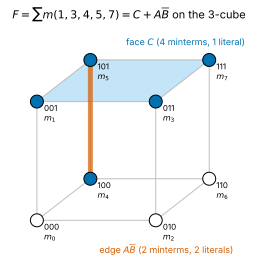
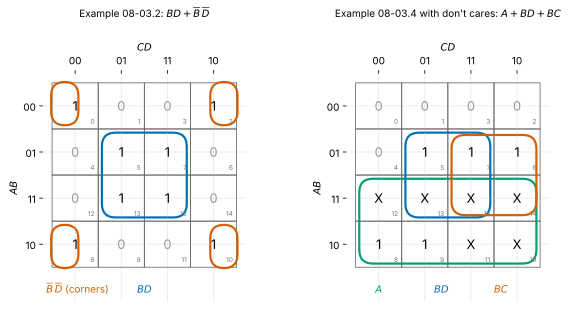

<!-- status: reviewed -->
# 08-03 · Logic Minimization: K-Maps and Beyond

| | |
|---|---|
| **Course** | [08 · Digital Logic Design](../README.md) |
| **University equivalent** | The logic-minimization chapter of a sophomore digital-design course (Harris & Harris, *Digital Design and Computer Architecture*, §§2.7–2.8; Mano & Ciletti, *Digital Design*, ch. 3), with the tabular method and an introduction to logic synthesis |
| **Prerequisites** | [08-02 Boolean Algebra and Logic Gates](08-02-boolean-algebra-and-gates.md) (theorems, canonical forms, cost metrics), [08-01 Number Systems and Codes](08-01-number-systems-and-codes.md) (Gray code, Hamming distance) |
| **Estimated study hours** | 8 |
| **Last verified** | 2026-11-19 |

**Learning objectives.** After this chapter you can:

1. Draw Karnaugh maps of two to five variables and read minimal sum-of-products and product-of-sums expressions from them.
2. Use don't-care conditions to simplify logic further, and state what the resulting circuit does on the don't-care inputs.
3. Define implicants, prime implicants and essential prime implicants, prove that a minimal sum of products uses only prime implicants, and choose a minimum cover when the choice is not forced.
4. Carry out the Quine–McCluskey method with Petrick's method on small functions, and explain why exact minimization does not scale.
5. Explain how synthesis tools minimize multi-level logic (factoring, and-inverter graphs, technology mapping) and the area–delay tradeoff they navigate.

---

## 1. Big picture

Chapter 08-02 showed that every truth table has a canonical sum of products, and that it is usually wasteful: the majority function's 12-literal canonical form shrinks to 6 literals. Minimization finds the cheapest equivalent expression. For a handful of variables an engineer can do it by eye on a **Karnaugh map**; for real designs, synthesis software does it with algorithms whose ideas this chapter derives. Two-level minimization is also where the vocabulary of logic synthesis (implicants, primes, covers, don't cares) comes from, and that vocabulary is used daily by the people who build and buy EDA tools.

- **Smaller logic is cheaper, faster and lower-power**: fewer literals mean fewer transistors, less wiring capacitance and fewer gates switching.
- **Don't cares are free optimization.** Input combinations that never occur (BCD codes above 9, illegal states of a state machine) let the designer pick whichever output makes the logic smallest.
- **Exact minimization is hard.** Choosing the cheapest set of terms is a set-covering problem, so production tools use heuristics: the Espresso minimizer for two-level logic and graph-rewriting engines such as Berkeley's ABC for multi-level logic.
- **EDA is a business.** The software that minimizes, maps and verifies logic is sold by a small number of companies, with revenues measured in billions of dollars (§9).

## 2. Intuition first

**Merging neighbors.** The combining theorem of 08-02, $AB + A\overline{B} = A$, says that two product terms that differ in exactly one variable merge into one term without that variable. Minimization is the systematic hunt for such merges: two minterms merge into a 2-cell term, two of those into a 4-cell term, and so on. Each merge deletes one literal from the term.

**A map that puts neighbors side by side.** Merges are easy to see if every pair of minterms that differ in one bit are drawn next to each other. A Karnaugh map does this by labelling its rows and columns in Gray code (08-01), so that moving one cell in any direction changes exactly one variable, including wrapping from the right edge to the left and from the bottom to the top. On such a map, a mergeable group is simply a rectangle of 1, 2, 4 or 8 cells.

**An analogy: consolidating a portfolio of positions.** Imagine a book of trades where each position is described by four attributes. Two positions that are identical except in one attribute can be booked as a single position with that attribute "any". Consolidating as far as possible, then picking the fewest consolidated positions that still cover every original trade, is exactly the two-step logic of minimization: find the largest blocks (prime implicants), then choose a cheapest cover. *Where the analogy breaks:* trades have quantities and netting; Boolean terms only cover or do not cover, and covering a cell twice costs nothing extra.

## 3. Theory

### 3.1 The cost to minimize

A **two-level** implementation is a sum of products (AND gates feeding an OR gate, or NAND-NAND) or a product of sums. Its cost is measured, in order of importance for most textbook problems:

1. the number of product terms (each is one first-level gate);
2. the number of literals (each is one gate input, two transistors in static CMOS).

A **minimal SOP** has the fewest terms and, among those, the fewest literals. (Some treatments minimize literals first; for every example in this chapter both orders give the same answer, and the verify script checks literal-minimality by exhaustive search.)

### 3.2 Cubes and implicants

Picture the $2^n$ input rows as the corners of an $n$-dimensional cube, each corner labeled with its bit pattern. Two corners joined by an edge differ in one bit: Hamming distance 1 (08-01). A product term with $k$ of the $n$ variables fixes $k$ coordinates and leaves $n - k$ free, so it is 1 on a **subcube** of

$$
2^{\,n-k}
$$

corners. In four variables, $\overline{B}D$ ($k = 2$) covers 4 minterms, a single literal such as $A$ covers 8, and a minterm ($k = 4$) covers 1. There are $3^n$ product terms in $n$ variables, since each variable appears true, complemented or not at all: 81 in four variables.

An **implicant** of $F$ is a product term that is 1 only where $F$ is 1 (its subcube lies inside the on-set). Every minterm of $F$ is an implicant. A **prime implicant** is an implicant that cannot be enlarged: removing any one of its literals would make it cover a 0 of $F$. In map language, a prime implicant is a maximal rectangle of 1s.

*Figure 1. The function of Example 08-03.1 on the 3-cube. Filled corners are its minterms. The term $C$ is a face (4 corners, 1 literal) and $A\overline{B}$ an edge (2 corners, 2 literals); both are prime implicants, since neither can grow without taking in an empty corner.*

### 3.3 Karnaugh maps

A **Karnaugh map** (K-map) is the truth table rearranged as a grid whose row and column labels follow Gray code. For four variables, rows are labeled by $AB$ and columns by $CD$, both in the order 00, 01, 11, 10. The cell in row $AB$ and column $CD$ holds the output for minterm $8A + 4B + 2C + D$:

| $AB$ \ $CD$ | 00 | 01 | 11 | 10 |
|---|---|---|---|---|
| **00** | $m_0$ | $m_1$ | $m_3$ | $m_2$ |
| **01** | $m_4$ | $m_5$ | $m_7$ | $m_6$ |
| **11** | $m_{12}$ | $m_{13}$ | $m_{15}$ | $m_{14}$ |
| **10** | $m_8$ | $m_9$ | $m_{11}$ | $m_{10}$ |

Because consecutive labels differ in one bit, **cells that touch horizontally or vertically are logically adjacent**, and so are cells on opposite edges of the same row or column: the map wraps around like a torus. (Three-variable maps use rows $A$ = 0, 1 and columns $BC$ = 00, 01, 11, 10; two-variable maps are 2 × 2.)

**Reading a minimal SOP from a map:**

1. Circle groups of 1s that are rectangles of 1, 2, 4, 8 or 16 cells (powers of two), including groups that wrap around edges and the four corners.
2. Make every group as large as possible: a group of $2^j$ cells eliminates $j$ variables. A group that cannot be enlarged is a prime implicant.
3. Use as few groups as possible to cover every 1. Groups may overlap.
4. Write each group as the product of the variables that are constant across it: true if constant 1, complemented if constant 0.

**Why rectangles of $2^j$ cells?** A group corresponds to a subcube only if it is closed under flipping the free variables. With Gray-coded labels, flipping one free variable moves to the adjacent row or column, so a valid group is a rectangle whose side lengths are powers of two. A 3-cell L-shape, or a 6-cell rectangle, does not correspond to a single product term.

*Figure 2. Groups on four-variable maps. Left: the four corners form one group through the wrap-around (Example 08-03.2). Right: don't cares (X) let the groups grow (Example 08-03.4).*

**Product of sums from the zeros.** Group the 0s instead. Each group of 0s is a sum term (a maxterm with variables removed), written with the *complemented* sense: a variable constant at 0 across the group appears true in the sum, and one constant at 1 appears complemented. Equivalently, minimize $\overline{F}$ as an SOP from the 0s, then apply De Morgan. Whichever of SOP and POS is cheaper depends on the function (Example 08-03.5).

### 3.4 Prime implicants, essential prime implicants and covers

**Theorem.** Some minimal SOP of $F$ uses only prime implicants.

*Proof.* Take any minimal SOP. If one of its terms $t$ is not prime, it is contained in a larger implicant $p$ (remove literals from $t$ until it is prime). Replace $t$ by $p$: the new expression still covers every 1 of $F$ (since $p$ covers at least what $t$ did) and covers no 0 (since $p$ is an implicant). It has the same number of terms and fewer literals, contradicting minimality unless $t$ was already prime. ∎

So minimization splits into two steps: **generate** all prime implicants, then **select** a cheapest subset covering every minterm (a **cover**).

**Essential prime implicants.** A prime implicant is **essential** if it covers some minterm that no other prime implicant covers. Every cover must include it. The selection procedure is therefore:

1. Include every essential prime implicant.
2. Remove the minterms they cover.
3. Choose among the remaining primes to cover what is left, as cheaply as possible.

Step 3 can still involve a real choice. In a **cyclic** function, no prime is essential and several covers tie (Example 08-03.3). In general, step 3 is the **set-cover problem**, which is NP-hard: no known algorithm solves every instance in time that grows only polynomially with its size. For a handful of remaining primes it is easy by enumeration; Petrick's method (§3.6) organizes the enumeration algebraically.

### 3.5 Don't cares

Sometimes certain input combinations never occur, or their output does not matter. A BCD digit uses only the codes 0 to 9, so a circuit reading one never sees 10 to 15. Such entries are **don't cares**, written X (or d) in the truth table and the map, and listed separately: $F = \sum m(\ldots) + \sum d(\ldots)$.

**Using them.** Each X may be treated as 1 or as 0, whichever helps. In practice: include X cells in groups when that makes a group larger, but never circle a group made only of X cells, since there is nothing to cover there. The prime implicants are computed with the X cells counted as 1s, and the cover need only include the true 1s.

**The catch.** Once the logic is built, every X has *some* definite value, decided by the groups that happen to cover it. If the "impossible" input ever does occur (at power-up, after a glitch, after a radiation upset, or because a later design change makes it reachable), the circuit outputs whatever the minimization chose. Safety-critical designs often specify the don't-care outputs explicitly instead (for example "illegal state → go to reset"), trading some area for predictable behavior. The Verilog lab measures what each implementation does on the codes 10 to 15.

### 3.6 The Quine–McCluskey method and Petrick's method

**Five variables.** Draw two four-variable maps side by side, one for $E = 0$ and one for $E = 1$ (with $E$ the least significant variable). Cells in the same position in the two maps differ only in $E$, so they are adjacent: a group may span both maps if it has the same shape and position in each, and then $E$ drops out of its term. Groups confined to one map keep $E$ or $\overline{E}$.

Karnaugh maps work up to about five or six variables, beyond which adjacency is hard to see. The **Quine–McCluskey** (QM) method does the same two steps by tabulation, and is the ancestor of all algorithmic minimizers.

**Generating primes.**

1. List the minterms (and don't cares) in binary, grouped by the number of 1s they contain. Only terms in neighboring groups can differ in exactly one bit.
2. Compare every term in group $k$ with every term in group $k + 1$. If two differ in exactly one bit, write the merged term with a dash in that position (0–01 merged with 0–11 gives 0––1, for instance), and tick both parents.
3. Repeat on the merged terms (dashes must be in the same positions to merge) until nothing merges.
4. The terms never ticked are the prime implicants.

**Selecting a cover.** Draw the **prime implicant chart**: a row per prime, a column per minterm (not don't cares), a mark where the prime covers the minterm. A column with a single mark identifies an essential prime. After taking the essentials, the remaining chart is reduced by **dominance** (drop a row that covers a subset of another row's columns at no lower cost; drop a column that is a superset of another column's rows, since covering the smaller column covers it too).

**Petrick's method** finishes the job exactly. For each remaining minterm, write the sum of the primes that cover it; AND these sums together; multiply out into a sum of products using $X + XY = X$; each product term is a set of primes forming a cover; pick the cheapest. Example 08-03.6 carries out every step.

**Why it does not scale.** The number of prime implicants can grow exponentially with $n$, and the covering step is NP-hard. Exact methods are fine for tens of inputs at most. The **Espresso** minimizer, developed at IBM and UC Berkeley from 1979 and published in 1984, replaced exact enumeration with heuristic loops (expand terms into primes, make the cover irredundant, reduce terms, repeat) that find near-minimal covers for functions far beyond exact reach ([R-150](../../../reference/research-log.md#r-150--logic-synthesis-tools)).

### 3.7 Beyond two levels: how synthesis tools minimize

Real logic is not built in two levels. A function such as

$$
F = AD + AE + BD + BE + CD + CE
$$

has a minimal SOP of 6 terms and 12 literals, yet it **factors** as $F = (A + B + C)(D + E)$, with 5 literals. Factored, multi-level forms are usually far smaller than any two-level form, at the price of more levels of logic and therefore more delay (Example 08-03.7). Modern synthesis works in four broad stages:

1. **Elaboration.** The RTL (Verilog or VHDL) is turned into a generic network of logic operations, adders, multiplexers and registers ([08-05](08-05-verilog-and-testbenches.md)).
2. **Technology-independent optimization.** The combinational logic is represented as an **and-inverter graph** (AIG): a network of two-input AND nodes with optional inversions on the edges, which can express any function (AND plus NOT is complete, 08-02). The tool rewrites small subgraphs into smaller equivalent ones, balances the graph to reduce depth, and merges equivalent nodes, checking equivalence with SAT solvers as it goes. The open-source ABC system from UC Berkeley is built on this representation ([R-150](../../../reference/research-log.md#r-150--logic-synthesis-tools)).
3. **Technology mapping.** The optimized graph is covered with cells from the target library (NAND2, AOI22, flip-flops…) for an ASIC, or with $K$-input lookup tables for an FPGA, choosing covers that minimize area subject to timing constraints.
4. **Timing-driven refinement.** Critical paths are restructured, gates resized and buffers inserted until the timing constraints are met ([08-10](08-10-timing-metastability-cdc.md), [19-10](../../19-digital-vlsi-design/chapters/19-10-synthesis-and-sta.md)).

The open-source Yosys framework runs this flow, calling ABC for stages 2 and 3; Synopsys, Cadence and Siemens sell the commercial equivalents. The K-map remains the best way to understand what these tools do, and the right tool for the handful of small functions (decoders, control signals, state-machine next-state logic) a designer still minimizes by hand.

> **Going deeper — two-level minimization in PLAs.** A programmable logic array (PLA) implements several SOPs at once with a shared AND plane and an OR plane. There, minimizing the *total* number of distinct product terms across all outputs matters more than each output's own minimum, and terms shared between outputs are worth keeping even if one output alone would not need them. Espresso was designed for exactly this multiple-output problem ([08-11](08-11-memories-and-programmable-logic.md)).

## 4. Worked examples

### Example 08-03.1 · A three-variable map (tier A)

**Setup.** Minimize $F(A, B, C) = \sum m(1, 3, 4, 5, 7)$.

**Solution.** The map, rows $A$, columns $BC$ in Gray order:

| $A$ \ $BC$ | 00 | 01 | 11 | 10 |
|---|---|---|---|---|
| **0** | 0 | 1 | 1 | 0 |
| **1** | 1 | 1 | 1 | 0 |

- The four cells of columns 01 and 11 ($C = 1$ throughout) form a rectangle of 4: the term $C$, covering $m_1$, $m_3$, $m_5$, $m_7$.
- The remaining 1, $m_4$ (row 1, column 00), pairs with its neighbor $m_5$ (row 1, column 01): $A = 1$ and $B = 0$ are constant, so the term is $A\overline{B}$.

$F = C + A\overline{B}$: **2** terms, **3** literals, against 15 literals in the canonical form.

**Sanity check.** Row 100: $C = 0$, $A\overline{B} = 1$ ✓. Row 110 ($m_6$, a 0): $C = 0$ and $A\overline{B} = 0$ ✓. Both terms are essential: $m_1$ is covered only by $C$, and $m_4$ only by $A\overline{B}$.

### Example 08-03.2 · Wrapping around the corners (tier B)

**Setup.** Minimize $F(A, B, C, D) = \sum m(0, 2, 5, 7, 8, 10, 13, 15)$.

**Solution.** Fill the four-variable map:

| $AB$ \ $CD$ | 00 | 01 | 11 | 10 |
|---|---|---|---|---|
| **00** | 1 | 0 | 0 | 1 |
| **01** | 0 | 1 | 1 | 0 |
| **11** | 0 | 1 | 1 | 0 |
| **10** | 1 | 0 | 0 | 1 |

- The center block ($m_5$, $m_7$, $m_{13}$, $m_{15}$) has $B = 1$ and $D = 1$ constant: $BD$.
- The four corners ($m_0$, $m_2$, $m_8$, $m_{10}$) are mutually adjacent through the wrap-around: across the top and bottom edges $A$ changes, across the left and right edges $C$ changes, and $B = 0$, $D = 0$ throughout. The term is $\overline{B}\,\overline{D}$.

$F = BD + \overline{B}\,\overline{D}$: **2** terms, **4** literals. This is $\overline{B \oplus D}$, the XNOR of $B$ and $D$: $A$ and $C$ do not matter at all.

**Sanity check.** Row 1010 ($m_{10}$): $B = 0$, $D = 0$, so $\overline{B}\,\overline{D} = 1$ ✓. Row 0001 ($m_1$, a 0): $B = 0$, $D = 1$, both terms 0 ✓. Without the wrap-around, the corners would look like four isolated 1s and the answer would have four 4-literal terms.

### Example 08-03.3 · A cyclic function (tier B)

**Setup.** For $F(A, B, C) = \sum m(0, 1, 2, 5, 6, 7)$: (a) find all prime implicants; (b) find the essential ones; (c) find every minimal SOP and its literal count.

**Solution.** The map:

| $A$ \ $BC$ | 00 | 01 | 11 | 10 |
|---|---|---|---|---|
| **0** | 1 | 1 | 0 | 1 |
| **1** | 0 | 1 | 1 | 1 |

(a) No group of 4 fits (the 0s at $m_3$ and $m_4$ break every candidate). Every adjacent pair of 1s is a prime: $\overline{A}\,\overline{B}$ ($m_0$, $m_1$), $\overline{A}\,\overline{C}$ ($m_0$, $m_2$, through the wrap), $\overline{B}C$ ($m_1$, $m_5$), $B\overline{C}$ ($m_2$, $m_6$), $AC$ ($m_5$, $m_7$), $AB$ ($m_6$, $m_7$): **6** prime implicants, arranged in a ring in which each minterm is covered by exactly two primes.

(b) Every minterm is covered by two primes, so **0** are essential.

(c) Six minterms, each prime covering two: at least 3 primes are needed, and 3 suffice only if they share no minterm. Going around the ring, take every other prime: $\overline{A}\,\overline{B} + B\overline{C} + AC$, or the other three, $\overline{A}\,\overline{C} + \overline{B}C + AB$. **2** minimal solutions, each with **6** literals.

**Sanity check.** Both solutions agree on all 8 rows (the verify script tabulates them), as they must. Cyclic charts are where simple "take the essentials" procedures stall and a real choice has to be made.

### Example 08-03.4 · Don't cares from BCD (tier B)

**Setup.** A circuit reads one BCD digit $ABCD$ (0 to 9) and outputs 1 when the digit is 5 or more. (a) Minimize it treating codes 10 to 15 as 0s. (b) Minimize it with codes 10 to 15 as don't cares. (c) What does the circuit from (b) output for the illegal codes?

**Solution.** The on-set is $\sum m(5, 6, 7, 8, 9)$ and the don't-care set is $\sum d(10, \ldots, 15)$.

| $AB$ \ $CD$ | 00 | 01 | 11 | 10 |
|---|---|---|---|---|
| **00** | 0 | 0 | 0 | 0 |
| **01** | 0 | 1 | 1 | 1 |
| **11** | X | X | X | X |
| **10** | 1 | 1 | X | X |

(a) With the X cells as 0s: $m_5$, $m_7$ pair as $\overline{A}BD$; $m_6$, $m_7$ as $\overline{A}BC$; $m_8$, $m_9$ as $A\overline{B}\,\overline{C}$. $F = \overline{A}BD + \overline{A}BC + A\overline{B}\,\overline{C}$: 3 terms, **9** literals.

(b) With the X cells free: the bottom two rows (all 1 or X) form the group $A$; $m_5$, $m_7$, $m_{13}$, $m_{15}$ form $BD$; $m_6$, $m_7$, $m_{14}$, $m_{15}$ form $BC$. $F = A + BD + BC$: 3 terms, **5** literals.

(c) Every illegal code has $A = 1$, so the circuit outputs **1** for all **6** of them. That is harmless here (a "digit" of 10 to 15 is certainly not less than 5), but it was decided by the minimization, not by the designer.

**Sanity check.** Digit 4 (0100): $A = 0$, $BD = 0$, $BC = 0$ → 0 ✓. Digit 9 (1001): $A = 1$ → 1 ✓. The don't cares cut the literal count from 9 to 5.

### Example 08-03.5 · When the product of sums is cheaper (tier B)

**Setup.** $F(A, B, C, D) = \sum m(5, 6, 7, 9, 10, 11, 13, 14, 15)$. Find (a) a minimal SOP and (b) a minimal POS, and count literals.

**Solution.** The map:

| $AB$ \ $CD$ | 00 | 01 | 11 | 10 |
|---|---|---|---|---|
| **00** | 0 | 0 | 0 | 0 |
| **01** | 0 | 1 | 1 | 1 |
| **11** | 0 | 1 | 1 | 1 |
| **10** | 0 | 1 | 1 | 1 |

(a) The 1s are the 3 × 3 block away from the top row and left column. A 3 × 3 block is not a power-of-two rectangle, so cover it with four overlapping 2 × 2 groups: $BD$ (rows 01, 11; columns 01, 11), $BC$ (rows 01, 11; columns 11, 10), $AD$ (rows 11, 10; columns 01, 11), $AC$ (rows 11, 10; columns 11, 10). $F = AC + AD + BC + BD$: 4 terms, **8** literals.

(b) The 0s are the top row ($A = 0$, $B = 0$: the group $\overline{A}\,\overline{B}$ of $\overline{F}$) and the left column ($C = 0$, $D = 0$: $\overline{C}\,\overline{D}$). So $\overline{F} = \overline{A}\,\overline{B} + \overline{C}\,\overline{D}$, and by De Morgan $F = (A + B)(C + D)$: 2 terms, **4** literals.

**Sanity check.** Multiplying out $(A + B)(C + D)$ gives exactly the four products of (a) ✓. The POS is half the size: always try both when the 0s are fewer or more clustered than the 1s.

### Example 08-03.6 · Quine–McCluskey and Petrick, step by step (tier C)

**Setup.** Minimize $F(A, B, C, D) = \sum m(0, 4, 5, 7, 8, 9, 13, 15)$ by the Quine–McCluskey method: (a) count the prime implicants; (b) find the essential ones; (c) finish with Petrick's method and give the minimal cost.

**Solution.** **Step 1: group minterms by their number of 1s.**

| Group (1s) | Minterms |
|---|---|
| 0 | 0 (0000) |
| 1 | 4 (0100), 8 (1000) |
| 2 | 5 (0101), 9 (1001) |
| 3 | 7 (0111), 13 (1101) |
| 4 | 15 (1111) |

**Step 2: merge neighbors that differ in one bit** (– marks the eliminated variable):

- groups 0–1: (0, 4) 0–00; (0, 8) –000;
- groups 1–2: (4, 5) 010–; (8, 9) 100–;
- groups 2–3: (5, 7) 01–1; (5, 13) –101; (9, 13) 1–01;
- groups 3–4: (7, 15) –111; (13, 15) 11–1.

Every minterm is ticked. **Step 3: merge the pairs.** Two pairs merge only if their dashes align and they differ in one more bit: 01–1 (5, 7) with 11–1 (13, 15) gives –1–1 (5, 7, 13, 15), and –101 with –111 gives the same term. Nothing else merges.

The unticked terms are the prime implicants: 0–00 ($\overline{A}\,\overline{C}\,\overline{D}$), –000 ($\overline{B}\,\overline{C}\,\overline{D}$), 010– ($\overline{A}B\overline{C}$), 100– ($A\overline{B}\,\overline{C}$), 1–01 ($A\overline{C}D$) and –1–1 ($BD$): (a) **6** prime implicants.

**Step 4: the chart.**

| Prime | 0 | 4 | 5 | 7 | 8 | 9 | 13 | 15 |
|---|---|---|---|---|---|---|---|---|
| $P_1 = \overline{A}\,\overline{C}\,\overline{D}$ | × | × | | | | | | |
| $P_2 = \overline{B}\,\overline{C}\,\overline{D}$ | × | | | | × | | | |
| $P_3 = \overline{A}B\overline{C}$ | | × | × | | | | | |
| $P_4 = A\overline{B}\,\overline{C}$ | | | | | × | × | | |
| $P_5 = A\overline{C}D$ | | | | | | × | × | |
| $P_6 = BD$ | | | × | × | | | × | × |

Columns 7 and 15 each have a single mark, in row $P_6$: (b) **1** essential prime, $BD$. It also covers 5 and 13.

**Step 5: Petrick's method on what remains** (minterms 0, 4, 8, 9):

$$
(P_1 + P_2)(P_1 + P_3)(P_2 + P_4)(P_4 + P_5) .
$$

Multiply the first two factors: $(P_1 + P_2)(P_1 + P_3) = P_1 + P_2P_3$ (by the dual distributive law). The last two: $(P_2 + P_4)(P_4 + P_5) = P_4 + P_2P_5$. Then

$$
(P_1 + P_2P_3)(P_4 + P_2P_5) = P_1P_4 + P_1P_2P_5 + P_2P_3P_4 + P_2P_3P_5 .
$$

Every product is a valid cover. $P_1P_4$ uses two 3-literal primes (6 literals); the others use three primes (9 literals). So the minimal SOP is

$$
F = BD + \overline{A}\,\overline{C}\,\overline{D} + A\overline{B}\,\overline{C} ,
$$

with 3 terms and (c) **8** literals, and it is the **only** minimum.

**Sanity check.** Row 0000: $\overline{A}\,\overline{C}\,\overline{D} = 1$ ✓. Row 1001: $A\overline{B}\,\overline{C} = 1$ ✓. Row 1100 ($m_{12}$, a 0): $BD = 0$, $\overline{A}\,\overline{C}\,\overline{D} = 0$, $A\overline{B}\,\overline{C} = 0$ ✓. A K-map gives the same answer once you see that $m_0$ and $m_4$ pair vertically and $m_8$ and $m_9$ horizontally.

### Example 08-03.7 · Two levels against many (tier C)

**Setup.** $F = AD + AE + BD + BE + CD + CE$. (a) Count the literals of this SOP (which is minimal) and of the factored form $(A + B + C)(D + E)$. (b) Count transistors for the SOP as NAND-NAND (six NAND2s and a six-input NAND) and for the factored form as an OAI32 gate (computing $\overline{(A + B + C)(D + E)}$) followed by an inverter. (c) Compare the tallest series transistor stacks.

**Solution.** (a) SOP: 6 terms of 2 literals, **12** literals. Factored: **5** literals.

(b) NAND-NAND: six NAND2s ($6 \times 4 = 24$) and a NAND6 ($2 \times 6 = 12$): **36** transistors. OAI32: one transistor pair per literal, $2 \times 5 = 10$, plus the inverter's 2: **12** transistors.

(c) The NAND6 has a **6**-high nMOS stack, far beyond the practical limit of about 4 (08-02 §3.8), so in practice it would be split into more levels. The OAI32's pull-down is $(A \| B \| C)$ in series with $(D \| E)$, **2** high, and its pull-up is the series chain $A$–$B$–$C$ in parallel with $D$–$E$, **3** high.

**Sanity check.** Multiplying out $(A + B + C)(D + E)$ gives the six products of $F$ ✓. The factored form is three times smaller here, which is why synthesis tools work with multi-level networks. Both implementations have two stages, but stage count is a poor guide to delay: the NAND6's 6-high stack and the OAI32's 3-high pMOS chain are both slow, and comparing them properly needs the logical-effort method of [19-04](../../19-digital-vlsi-design/chapters/19-04-sizing-and-logical-effort.md).

### Answer key

<!-- answer-key -->
| ID | Quantity | Value | Unit |
|---|---|---|---|
| Ex 08-03.1a | terms, minimal SOP | 2 | — |
| Ex 08-03.1b | literals, minimal SOP | 3 | — |
| Ex 08-03.1c | literals, canonical SOP | 15 | — |
| Ex 08-03.2a | terms, minimal SOP | 2 | — |
| Ex 08-03.2b | literals, minimal SOP | 4 | — |
| Ex 08-03.3a | prime implicants | 6 | — |
| Ex 08-03.3b | essential prime implicants | 0 | — |
| Ex 08-03.3c | literals, minimal SOP | 6 | — |
| Ex 08-03.3d | number of minimal solutions | 2 | — |
| Ex 08-03.4a | literals without don't cares | 9 | — |
| Ex 08-03.4b | literals with don't cares | 5 | — |
| Ex 08-03.4c | illegal codes giving output 1 | 6 | — |
| Ex 08-03.5a | literals, minimal SOP | 8 | — |
| Ex 08-03.5b | literals, minimal POS | 4 | — |
| Ex 08-03.6a | prime implicants | 6 | — |
| Ex 08-03.6b | essential prime implicants | 1 | — |
| Ex 08-03.6c | literals, minimal SOP | 8 | — |
| Ex 08-03.6d | number of minimal solutions | 1 | — |
| Ex 08-03.7a | literals, SOP | 12 | — |
| Ex 08-03.7b | literals, factored | 5 | — |
| Ex 08-03.7c | transistors, NAND-NAND | 36 | — |
| Ex 08-03.7d | transistors, OAI32 + inverter | 12 | — |
| Ex 08-03.7f | NAND6 nMOS stack height | 6 | — |
| Ex 08-03.7g | OAI32 pull-down stack height | 2 | — |
| Ex 08-03.7e | tallest stack in the OAI32 | 3 | — |
| Th 08-03.a | product terms in four variables | 81 | — |
| Th 08-03.b | minterms covered by a 2-literal term in four variables | 4 | — |

## 5. Simulate it

The lab is in [labs/08-03-lab/](../labs/08-03-lab/README.md).

**Notebook** (`08-03-logic-minimization.ipynb`):

1. Draw Karnaugh maps automatically, with the Gray-code ordering and wrap-around.
2. Implement Quine–McCluskey: generate prime implicants by tabulation, build the chart, find essentials, and finish with Petrick's method.
3. Check every result against brute force over all $3^n$ product terms, and time both as $n$ grows.
4. Measure the payoff of don't cares over every three-variable function with don't cares.

**Verilog** (`bcd_ge5.v`, `bcd_ge5_tb.v`): Example 08-03.4 built three ways (canonical SOP, minimized without don't cares, minimized with them). The testbench proves all three agree on the legal codes 0 to 9, prints what each outputs on the illegal codes 10 to 15, and prints `TEST PASSED`.

**Guided exercise (predict, then run).** The notebook enumerates every three-variable function in which each row is 1, 0 or don't care: $3^8$ = 6561 of them. **Before running,** predict whether using the don't cares cuts the average minimal literal count by about 15%, 40% or 70% compared with treating them as 0s. Then run it, and explain the result in terms of group sizes.

## 6. Engineering tradeoffs

| Knob | Improves | Costs | Typical decision owner |
|---|---|---|---|
| Exact two-level minimization (QM, Petrick) | Guaranteed minimum | Run time explodes beyond a few tens of inputs | Tool developer; designer for tiny blocks |
| Heuristic minimization (Espresso-style) | Near-minimal results for large functions, fast | No guarantee of optimality | Synthesis tool |
| Exploiting don't cares | Smaller, faster logic | Unspecified behavior on "impossible" inputs | Logic designer, with the system architect |
| Multi-level factoring | Far fewer literals and transistors | More levels, so potentially more delay | Synthesis tool under timing constraints |
| Choosing SOP or POS | Whichever is cheaper for the function | Analysis effort; matching the gate library | Logic designer, synthesis tool |
| Sharing terms across outputs | Fewer total terms in multi-output logic | Some outputs individually larger than their own minimum | PLA and logic designer |

## 7. Numbers to know

| Quantity | Value | Note |
|---|---|---|
| Minterms covered by a term with $k$ of $n$ literals | $2^{n-k}$ | §3.2 |
| Product terms in $n$ variables | $3^n$ (81 for four) | §3.2 |
| Practical K-map limit | 4 variables comfortably, 5–6 with effort | §3.6 |
| Practical limit of exact minimization | tens of inputs; heuristics beyond | §3.6 |
| Espresso | Brayton, Hachtel, McMullen and Sangiovanni-Vincentelli, 1984 (work from 1979 at IBM and UC Berkeley) | [R-150](../../../reference/research-log.md#r-150--logic-synthesis-tools) **[Established]** |
| EDA revenue (FY2025) | Synopsys $7.054 B; Cadence $5.297 B | [R-151](../../../reference/research-log.md#r-151--eda-industry-revenue-and-structure) **[Established]** (company reports) |
| EDA industry revenue, Q2 2026 | $5.71 B in the quarter, +12.2% year on year | [R-151](../../../reference/research-log.md#r-151--eda-industry-revenue-and-structure) **[Industry estimate]** (ESD Alliance survey) |

## 8. Common mistakes

1. **Labeling the map in binary order.** Columns 00, 01, 10, 11 put non-adjacent minterms side by side and hide real adjacencies. Always 00, 01, 11, 10.
2. **Forgetting the wrap-around.** The left and right edges are adjacent, and so are the top and bottom; the four corners of a four-variable map form one group (Example 08-03.2).
3. **Circling groups of 3 or 6.** Only rectangles of 1, 2, 4, 8 or 16 cells are product terms.
4. **Groups that are too small.** A pair that could be part of a quad leaves an unnecessary literal in the result; every group should be a prime implicant.
5. **Too many groups.** A group whose 1s are all covered by other groups is redundant (a consensus term); remove it.
6. **Circling don't cares for their own sake.** A group made only of X cells adds a term and covers nothing that needs covering.
7. **Assuming the don't-care outputs are "undefined" in hardware.** They are defined, by whatever groups covered them (Example 08-03.4c).
8. **Writing the POS with the wrong literal sense.** A group of 0s where $A = 1$ contributes $\overline{A}$ to the sum term.

## 9. Practitioner lens

### State of the art (as of Nov 2026)

- **Open-source synthesis is real and maintained** ([R-150](../../../reference/research-log.md#r-150--logic-synthesis-tools)) **[Established]** (from the repositories' own text).
  - **ABC**, "System for Sequential Logic Synthesis and Formal Verification", is maintained at UC Berkeley (Alan Mishchenko) and was updated as recently as 18 Nov 2026. It represents logic as and-inverter graphs and is described in Brayton and Mishchenko, "ABC: An Academic Industrial-Strength Verification Tool" (CAV 2010).
  - **Yosys** is an ISC-licensed RTL synthesis framework with "extensive Verilog-2005 support"; it now uses the slang and sv-elab libraries for SystemVerilog and supports "an (informally defined) synthesizable subset of SystemVerilog in version IEEE 1800-2017 or IEEE 1800-2023". It ships ABC in its source tree and maps to a cell library with `abc -liberty`.
  - **Espresso**, the two-level minimizer of Brayton, Hachtel, McMullen and Sangiovanni-Vincentelli (1984), is still the reference heuristic for two-level minimization.
- **Commercial EDA is concentrated and growing** ([R-151](../../../reference/research-log.md#r-151--eda-industry-revenue-and-structure)).
  - Synopsys reported FY2025 revenue of **$7.054 B**, up about **15.1**% from $6.127 B. That includes $756.6 M from Ansys, whose acquisition closed on 17 Jul 2025 **[Established]** (company release); without it, revenue was **$6.297 B**, up only about **2.8**%: most of the headline growth was bought.
  - Cadence reported FY2025 revenue of **$5.297 B**, up **14.1**% from $4.641 B **[Established]** (company release). Together the two reported **$12.351 B**.
  - SEMI's ESD Alliance put industry revenue for Q2 2026 at **$5,710.8 M**, up 12.2% from Q2 2025 **[Industry estimate]** (aggregated survey).
  - Market-share estimates for the "Big Three" (Synopsys, Cadence, Siemens EDA) range from about 74% to about 90% of industry revenue. The low end is one 2024 estimate, Synopsys 31%, Cadence 30% and Siemens 13%, measured against a total that includes semiconductor IP and other categories; the high end counts EDA software alone **[Contested]** (methods differ: what the denominator includes, whether Ansys is counted, and Siemens does not report EDA revenue separately).
  - These excerpts were cross-checked across sources but the company and SEMI pages could not be opened from the build environment (open issue 32).

<!-- answer-key -->
| ID | Quantity | Value | Unit |
|---|---|---|---|
| PL 08-03.a | Synopsys plus Cadence FY2025 revenue | 12.351 | $B |
| PL 08-03.b | Synopsys FY2025 growth | 15.1 | % |
| PL 08-03.c | Cadence FY2025 growth | 14.1 | % |
| PL 08-03.d | Synopsys FY2025 revenue excluding Ansys | 6.297 | $B |
| PL 08-03.e | ESD Alliance Q2 2026 revenue, annualized | 22.8 | $B |
| PL 08-03.f | Synopsys FY2025 growth excluding Ansys | 2.8 | % |

### Why it matters commercially

- **EDA is a toll on every chip.** No modern chip can be designed without synthesis, place-and-route, timing and verification tools, so EDA revenue tracks design activity rather than unit volume. Its business model (multi-year subscription licenses, high gross margins, high switching costs) makes it a recurring-revenue franchise; quarterly industry revenue near $5.7 B, about $23 B annualized, is small next to the chips it enables.
- **Quality of results is the product.** A synthesis tool that delivers 5% less area or 5% more frequency on a large design is worth real money in die cost and product competitiveness, which is why customers benchmark tools on their own designs before buying.
- **Open source sets a floor.** Yosys, ABC and the open-source place-and-route flows are good enough for FPGAs, education and many small ASICs, though leading-edge sign-off still runs on commercial tools.

### Marketing vs Reality

- **"Our AI-driven synthesis improves PPA by X%."** *Reality:* power, performance and area gains are design-, node- and constraint-specific, and are usually reported against the vendor's own previous flow. *Sanity check:* ask for results on your designs, at your constraints, with equivalence checking passed and the same sign-off timing.
- **"The EDA market is $X billion."** *Reality:* totals depend on whether semiconductor IP, simulation software from acquisitions such as Ansys, and services are counted; the ESD Alliance's "electronic system design" figure includes IP. *Sanity check:* ask which categories are included before comparing growth rates or shares.
- **"Revenue grew 15%."** *Reality:* Synopsys's FY2025 growth was about 15.1% as reported but about 2.8% without the acquired Ansys revenue (§9 above). Reported growth mixes organic growth with acquisitions. *Sanity check:* ask for organic growth on a like-for-like basis, and which part of the business it came from.
- **"Optimal logic."** *Reality:* exact minimization is intractable for real designs, so every tool is heuristic; "optimal" means "best this tool found within its run time". *Sanity check:* ask how results vary with effort settings and run time.

### Questions for engineering leaders

1. **"How do you measure synthesis quality of results, and against what baseline?"**
   - *Strong:* reports area, timing and power on a fixed benchmark set of their own designs, under fixed constraints, across tool versions.
   - *Evasive:* "the tool's default settings are fine."
2. **"Where does your flow rely on open-source tools, and where on commercial ones?"**
   - *Strong:* gives a clear map (for example open-source for FPGA prototyping and lint, commercial for sign-off) with reasons.
   - *Evasive:* cannot say which tools touch the tape-out database.
3. **"How do you handle don't-care conditions in specifications?"**
   - *Strong:* specifies illegal-state behavior explicitly for safety-relevant logic, and checks it in verification.
   - *Evasive:* "the synthesis tool optimizes them."
4. **"What fraction of your engineering budget goes to EDA licenses, and how does it scale with headcount and tape-outs?"**
   - *Strong:* knows the number and its drivers, and the negotiation calendar.
   - *Evasive:* "procurement handles that."

## 10. Concept check

**Q1.** Why are K-map rows and columns labeled 00, 01, 11, 10 instead of 00, 01, 10, 11?

Answer

So that neighboring labels differ in exactly one bit (Gray code). Then any two touching cells, including those across the wrap-around edges, are minterms that differ in one variable and can be merged by $XY + X\overline{Y} = X$.

**Q2.** A group on a four-variable map has 4 cells. How many literals does its product term have, and why?

Answer

Two. A group of $2^j$ cells lets $j$ variables vary freely; here $j = 2$, so $4 - 2 = 2$ variables remain constant and appear as literals.

**Q3.** What is the difference between a prime implicant and an essential prime implicant?

Answer

A prime implicant is a product term that implies the function and cannot be enlarged (dropping any literal would cover a 0). An essential prime implicant is a prime that covers at least one minterm no other prime covers, so every cover must include it.

**Q4.** Why does a minimal SOP never need a non-prime implicant?

Answer

Any non-prime term can be replaced by a prime containing it: the cover still covers every 1 and no 0, with the same number of terms and fewer literals.

**Q5.** You used don't cares to simplify a decoder. What does the hardware output on a don't-care input?

Answer

A definite value: 1 if the input falls inside one of the chosen groups, 0 otherwise. It is decided by the minimization, so if the "impossible" input can ever occur, the designer should check or specify it.

**Q6.** In the Quine–McCluskey method, why compare only minterms whose numbers of 1s differ by one?

Answer

Two terms that merge differ in exactly one bit, so their counts of 1s differ by exactly one. Comparing only neighboring groups skips pairs that cannot possibly merge.

**Q7.** Why do synthesis tools not simply compute the exact minimal SOP of every block?

Answer

The number of prime implicants can grow exponentially with the number of inputs, and choosing a minimum cover is NP-hard. And two-level form is rarely the best implementation anyway: multi-level factored logic is usually much smaller, so tools optimize multi-level networks (and-inverter graphs) with heuristics.

**Q8.** When is a product of sums the better choice than a sum of products?

Answer

When the 0s of the function form fewer or larger groups than the 1s, as in Example 08-03.5, where the POS needs 4 literals against 8. Check both whenever the 0s are clustered.

Practice problems: [problems/08-03-problems.md](../problems/08-03-problems.md) · Solutions: [solutions/08-03-solutions.md](../solutions/08-03-solutions.md)

## 11. Key terms

[Karnaugh map](../../../reference/glossary.md#karnaugh-map) ·
[Implicant](../../../reference/glossary.md#implicant) ·
[Prime implicant](../../../reference/glossary.md#prime-implicant) ·
[Essential prime implicant](../../../reference/glossary.md#essential-prime-implicant) ·
[Don't-care condition](../../../reference/glossary.md#dont-care-condition) ·
[Quine–McCluskey method](../../../reference/glossary.md#quine-mccluskey-method) ·
[Petrick's method](../../../reference/glossary.md#petricks-method) ·
[Set-cover problem](../../../reference/glossary.md#set-cover-problem) ·
[Espresso](../../../reference/glossary.md#espresso) ·
[And-inverter graph (AIG)](../../../reference/glossary.md#and-inverter-graph-aig) ·
[Technology mapping](../../../reference/glossary.md#technology-mapping) ·
[Logic synthesis](../../../reference/glossary.md#logic-synthesis)

## 12. Connections

- **Builds on:** [08-02](08-02-boolean-algebra-and-gates.md) (the combining and consensus theorems, canonical forms, cost metrics), [08-01](08-01-number-systems-and-codes.md) (Gray code and Hamming distance).
- **Next:** [08-04](08-04-combinational-building-blocks.md) uses these methods to design decoders, multiplexers and adders, and explains the hazards that minimal covers can create.
- **Used later:**
  - [08-08](08-08-finite-state-machines.md) minimizes next-state and output logic, with unused state codes as don't cares;
  - [08-11](08-11-memories-and-programmable-logic.md) implements multi-output SOPs in PLAs;
  - [08-12](08-12-fpga-implementation-flow.md) runs Yosys and ABC on real designs;
  - [19-10](../../19-digital-vlsi-design/chapters/19-10-synthesis-and-sta.md) covers ASIC synthesis and timing.

## 13. Further study

- **Harris & Harris, *Digital Design and Computer Architecture* (RISC-V Edition):** §§2.7–2.8 (Karnaugh maps, don't cares, combinational building blocks).
- **Mano & Ciletti, *Digital Design*:** ch. 3 (gate-level minimization, the map method, don't-care conditions, NAND and NOR implementation).
- **G. De Micheli, *Synthesis and Optimization of Digital Circuits*:** the chapters on two-level and multi-level combinational optimization, for the algorithms behind Espresso and multi-level synthesis.
- **R. K. Brayton et al., *Logic Minimization Algorithms for VLSI Synthesis* (1984):** the Espresso book.
- **MIT OCW 6.004 *Computation Structures*:** the lectures on combinational logic synthesis.

## 14. Sources

1. Research log [R-150](../../../reference/research-log.md#r-150--logic-synthesis-tools): berkeley-abc/abc README (Nov 2026); R. Brayton and A. Mishchenko, "ABC: An Academic Industrial-Strength Verification Tool," CAV 2010, LNCS 6174; YosysHQ/yosys README (Nov 2026); R. K. Brayton, G. D. Hachtel, C. T. McMullen and A. L. Sangiovanni-Vincentelli, *Logic Minimization Algorithms for VLSI Synthesis*, Kluwer, 1984.
2. Research log [R-151](../../../reference/research-log.md#r-151--eda-industry-revenue-and-structure): Synopsys FY2025 results (10 Dec 2025) and Ansys closing (17 Jul 2025) releases; Cadence FY2025 results (Feb 2026); SEMI ESD Alliance Electronic Design Market Data, Q2 2026; TrendForce (2025), Griffin Securities (2026) and SemiAnalysis market-share estimates.
3. Textbook alignment as listed in §13. All text, examples and problems in this chapter are original.
