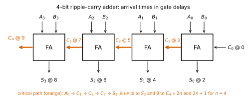
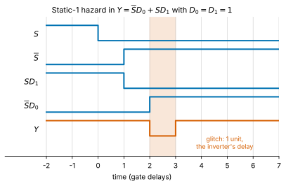

<!-- status: reviewed -->
# 08-04 · Combinational Building Blocks

| | |
|---|---|
| **Course** | [08 · Digital Logic Design](../README.md) |
| **University equivalent** | The combinational-design chapter of a sophomore digital-design course (Harris & Harris, *Digital Design and Computer Architecture*, §§2.8–2.9 and 5.2; Mano & Ciletti, *Digital Design*, ch. 4), including timing and hazards |
| **Prerequisites** | [08-03 Logic Minimization](08-03-logic-minimization.md) (maps, consensus terms), [08-02 Boolean Algebra and Logic Gates](08-02-boolean-algebra-and-gates.md) (Shannon expansion, gate costs), [08-01 Number Systems and Codes](08-01-number-systems-and-codes.md) (two's complement, overflow) |
| **Estimated study hours** | 10 |
| **Last verified** | 2026-11-19 |

**Learning objectives.** After this chapter you can:

1. Design multiplexers, decoders, encoders and priority encoders from gates, and use multiplexers and decoders to implement arbitrary functions.
2. Derive the half adder and full adder, build ripple-carry adders and add/subtract units with overflow detection, and compute their worst-case delay.
3. Build equality and magnitude comparators, for unsigned and signed numbers, from XNOR trees and subtractors.
4. Assemble an arithmetic-logic unit (ALU) from an adder, logic operations and multiplexers, and generate its zero, negative, carry and overflow flags.
5. Find static hazards in two-level logic, remove them with consensus terms, and explain why synchronous design tolerates glitches on data but not on clocks and asynchronous signals.

---

## 1. Big picture

Chapters 08-01 to 08-03 built the vocabulary: bits, Boolean algebra and minimization. Real designs are not drawn gate by gate; they are assembled from a small set of standard **building blocks**, each a few gates deep and each reused thousands of times. A processor's datapath is mostly adders, multiplexers and comparators; its control logic is mostly decoders; its interrupt logic is priority encoders. This chapter builds each block from gates, proves it correct, and measures how long it takes to compute, which introduces the timing ideas that govern every clocked design.

- **Multiplexers steer data.** Every "if" or "case" in hardware code becomes a multiplexer; register files, buses and FPGA lookup tables are multiplexers.
- **Decoders select.** Memory address decoders pick one row of millions; instruction decoders turn opcodes into control signals.
- **Adders are the workhorse of arithmetic.** Address computation, counters, DSP and the multiply-accumulate units of AI accelerators all reduce to addition, and its speed often sets a chip's clock rate ([08-09](08-09-arithmetic-circuits.md)).
- **Timing is part of correctness.** A block's output is right only after its inputs have propagated through the slowest path, and it can glitch on the way. Knowing when outputs are valid is the bridge to clocked design ([08-06](08-06-latches-and-flip-flops.md), [08-10](08-10-timing-metastability-cdc.md)).

## 2. Intuition first

**A railway switchyard.** A multiplexer is a set of points that connects one of several incoming tracks to a single outgoing track; the select signal sets the points. A demultiplexer (a decoder with an input) does the reverse: one incoming track, routed to one of several outgoing ones. A priority encoder is the dispatcher who, when several trains request the junction at once, grants it to the most important one.

**Adding with carries, as in school.** Column addition of decimal numbers adds the digits of one column plus a carry from the column to its right, writes one digit and passes a carry left. A binary full adder does exactly this for one bit column, and a ripple-carry adder is a row of them, each waiting for the carry from its neighbor. *Where the analogy breaks:* on paper you see all columns at once and can guess the carries; hardware must physically wait for each carry to travel, which is why long adders are slow and why faster adders compute the carries in parallel ([08-09](08-09-arithmetic-circuits.md)).

**Settling time.** When a block's inputs change, its outputs do not jump cleanly to the new values. Each gate responds after its own delay, so for a short time some internal signals have the new value and some the old, and the output can flicker (a **glitch**) before it settles. It is like a market after news breaks: prices overshoot and correct before settling. Synchronous design takes the sensible approach of a trader who reads the price only at the close: it samples outputs only after everything has settled ([08-06](08-06-latches-and-flip-flops.md)).

## 3. Theory

### 3.1 Delay: propagation and contamination

A gate's **propagation delay** $t_{pd}$ is the longest time from an input change until its output reaches its final value. Its **contamination delay** $t_{cd}$ is the shortest time from an input change until its output *starts* to change. Both come from charging and discharging capacitance through transistors ([19-02](../../19-digital-vlsi-design/chapters/19-02-cmos-inverter-dynamic.md)). For a block made of gates:

- its propagation delay is the sum of $t_{pd}$ along the **critical path**, the slowest path from any input to any output;
- its contamination delay is the sum of $t_{cd}$ along the **short path**, the fastest one.

Between $t_{cd}$ and $t_{pd}$ after an input change, the output is unreliable. This chapter uses a **unit-delay model**: every two-input gate has $t_{pd} = 1$ unit (inverters are absorbed into gates unless stated otherwise). It ignores the differences between gates and the effect of loading, but it captures how delay grows with the structure of a circuit, which is what matters for comparing designs. Course 19 replaces it with real delays.

### 3.2 Multiplexers

A **2:1 multiplexer** (mux) selects one of two data inputs:

$$
Y = \overline{S}\,D_0 + S\,D_1 .
$$

A $2^k$:1 mux has $k$ select lines and $2^k$ data inputs, and outputs $D_i$ when the select lines spell the number $i$. Two constructions:

- **Two-level:** one AND gate per data input, enabled by the minterm of the select lines that names it, feeding one OR gate. A 4:1 mux is $Y = \overline{S_1}\,\overline{S_0}D_0 + \overline{S_1}S_0D_1 + S_1\overline{S_0}D_2 + S_1S_0D_3$.
- **Tree:** 2:1 muxes in levels; the first level is controlled by $S_0$, the next by $S_1$, and so on. A $2^k$:1 mux needs $2^{k-1} + 2^{k-2} + \cdots + 1 = 2^k - 1$ two-input muxes, in $k$ levels.

**A multiplexer is a universal function generator.** By the Shannon expansion (08-02 §3.5), a $2^n$:1 mux with the $n$ inputs of a function on its select lines and the truth table on its data inputs computes any $n$-input function. Better, a $2^{n-1}$:1 mux suffices: use $n - 1$ variables as selects, and feed each data input with whichever of 0, 1, $x$ or $\overline{x}$ the last variable $x$ requires (Example 08-04.1). This is exactly how an FPGA lookup table works ([08-11](08-11-memories-and-programmable-logic.md)).

**Tristate buses.** A **tristate buffer** passes its input when enabled and otherwise disconnects its output (state Z, high impedance). Many tristate buffers on one wire, with exactly one enabled, form a distributed multiplexer, the classic microprocessor bus. On chips, tristate buses have largely given way to muxes, which avoid the danger of two drivers fighting or no driver at all.

### 3.3 Decoders and demultiplexers

An **$n$:$2^n$ decoder** has $n$ inputs and $2^n$ outputs, exactly one of which is 1: output $Y_i$ is the minterm $m_i$ of the inputs. With an **enable** input $E$, every output is ANDed with $E$; then the decoder doubles as a **demultiplexer**, routing the data on $E$ to the output selected by the address.

**Decoders implement functions.** A decoder generates all minterms, so ORing the right outputs gives any canonical SOP: a 3:8 decoder and two 4-input ORs make a full adder (Example 08-04.2). This is inefficient for random logic but natural when many functions of the same inputs are needed.

**Building large decoders.** A 6:64 decoder can be built from two 3:8 **predecoders** (one for the high three bits, one for the low three) and 64 two-input ANDs, each combining one output of each. Predecoding is how memory row decoders are built: it trades one huge fan-in for two small ones ([08-11](08-11-memories-and-programmable-logic.md)).

### 3.4 Encoders and priority encoders

An **encoder** does the reverse of a decoder: given a **one-hot** input (exactly one of $2^n$ lines active), it outputs the line's number in $n$ bits. For a 4:2 encoder with inputs $D_3 \ldots D_0$, $Y_1 = D_3 + D_2$ and $Y_0 = D_3 + D_1$. If two inputs are active at once, a plain encoder outputs nonsense ($D_2$ and $D_1$ together give 11, as if $D_3$ were set).

A **priority encoder** defines the answer when several inputs are active: it reports the highest-numbered one, and adds a **valid** output $V$ that is 0 when no input is active. For four inputs, $Y$ = 3 if $D_3$; else 2 if $D_2$; else 1 if $D_1$; else 0. Writing that hierarchy as logic:

$$
Y_1 = D_3 + D_2, \qquad Y_0 = D_3 + \overline{D_2}\,D_1, \qquad V = D_3 + D_2 + D_1 + D_0 .
$$

*Derivation of $Y_0$:* $Y_0 = 1$ exactly when the winner is 3 or 1. The winner is 3 when $D_3 = 1$; it is 1 when $D_3 = 0$, $D_2 = 0$ and $D_1 = 1$. So $Y_0 = D_3 + \overline{D_3}\,\overline{D_2}\,D_1 = D_3 + \overline{D_2}\,D_1$, by T7 of 08-02.

Priority encoders arbitrate interrupts (the highest-priority request wins), and as **leading-one detectors** they find the position of the most significant 1 in a word, the first step in normalizing a floating-point result (08-01 §3.6).

### 3.5 Adders

**Half adder.** Adding two bits $A + B$ gives a 2-bit result, a sum bit and a carry:

$$
S = A \oplus B, \qquad C = AB .
$$

**Full adder.** A column of a multi-bit addition also receives a carry in, $C_{in}$. The sum bit is 1 when an odd number of the three inputs are 1, and the carry out is 1 when at least two are:

$$
S = A \oplus B \oplus C_{in}, \qquad C_{out} = AB + AC_{in} + BC_{in} .
$$

$C_{out}$ is the majority function of 08-02, and $S$ is three-input parity. A cheaper form for the carry reuses the half-adder signals. Define **generate** $G = AB$ (this column produces a carry by itself) and **propagate** $P = A \oplus B$ (this column passes an incoming carry on). Then

$$
C_{out} = G + P\,C_{in}, \qquad S = P \oplus C_{in} .
$$

*Proof that the two carry forms agree:* if $A = B$, then $P = 0$ and $C_{out} = G = AB$, which equals the majority (it is $A$, since two of the three inputs agree on $A$). If $A \ne B$, then $G = 0$, $P = 1$ and $C_{out} = C_{in}$, which is again the majority, since $A$ and $B$ cancel and $C_{in}$ decides. The generate–propagate form is the basis of every fast adder in [08-09](08-09-arithmetic-circuits.md).

**Ripple-carry adder.** An $n$-bit adder chains $n$ full adders, the carry out of column $i$ feeding the carry in of column $i + 1$, with $C_0$ as the carry into the whole adder. It is small, $n$ full adders, but slow, because in the worst case a carry generated in column 0 must ripple through every column (adding 1 to 0111…1 flips every bit).

**Its delay, under the unit-delay model.** In one full adder built from the gates above, the inputs $A, B$ reach $P$ and $G$ after 1 unit; $C_{out} = G + P\,C_{in}$ adds an AND and an OR. So:

- from $A$ or $B$ to $C_{out}$: 3 units (XOR, AND, OR);
- from $C_{in}$ to $C_{out}$: 2 units (AND, OR);
- from $C_{in}$ to $S$: 1 unit (the final XOR).

The critical path to the top sum bit starts at $A_0$, reaches $C_1$ after 3 units, passes $n - 2$ more carry stages of 2 units each, and ends with one XOR:

$$
t_{\text{RCA}} = 3 + 2(n - 2) + 1 = 2n \ \text{units}, \qquad t_{C_n} = 3 + 2(n - 1) = 2n + 1 \ \text{units}.
$$

*Figure 1. A 4-bit ripple-carry adder with the unit-delay arrival time of every carry and sum bit. The critical path runs from $A_0$ through every carry to $S_3$.*

The delay grows **linearly** with the width: 8 units for 4 bits, 64 for 32 bits and 128 for 64 bits. That is why wide adders use carry-lookahead and prefix structures, whose delay grows with $\log_2 n$ instead ([08-09](08-09-arithmetic-circuits.md)).

### 3.6 Subtraction and overflow

Two's complement turns subtraction into addition (08-01 §3.4): $A - B = A + \overline{B} + 1$. An **add/subtract unit** therefore needs only one adder: XOR each bit of $B$ with a control line $\text{SUB}$, and connect $\text{SUB}$ to the carry in $C_0$:

- $\text{SUB} = 0$: the XORs pass $B$ and $C_0 = 0$, so the unit computes $A + B$;
- $\text{SUB} = 1$: the XORs invert $B$ and $C_0 = 1$ supplies the "+1", so it computes $A - B$.

**Overflow** (signed) occurs when the carry into the top column differs from the carry out of it, $V = C_n \oplus C_{n-1}$, as proved in 08-01. For unsigned numbers, $C_n$ is the carry of an addition, and in a subtraction $C_n = 0$ means a **borrow** (the unsigned result went negative).

### 3.7 Comparators

**Equality.** $A = B$ when every bit pair matches: XNOR each pair and AND the results,

$$
\text{EQ} = \prod_{i=0}^{n-1} \overline{A_i \oplus B_i} .
$$

An $n$-bit equality comparator uses $n$ XNORs and an AND tree of $n - 1$ two-input ANDs in $\lceil \log_2 n \rceil$ levels.

**Magnitude, by subtraction.** Compute $A - B$ with the add/subtract unit and read the flags:

- **Unsigned:** $A < B$ exactly when the subtraction borrows, that is, when $C_n = 0$.
- **Signed:** $A < B$ exactly when $N \oplus V = 1$, where $N$ is the sign bit of the result. *Why:* without overflow ($V = 0$) the result is the true difference, which is negative exactly when $A < B$, so the answer is $N$. With overflow ($V = 1$) the true difference does not fit, and its sign is the opposite of the sign bit that appears, so the answer is $\overline{N}$. Both cases are $N \oplus V$.

Processors compute comparisons exactly this way: a compare instruction is a subtraction that keeps only the flags.

### 3.8 The arithmetic-logic unit

An **ALU** computes one of several operations on two words, chosen by a control code. A minimal 4-bit ALU:

- an add/subtract unit (§3.6) for ADD and SUB;
- bitwise AND, OR and XOR gates on the operand pairs;
- a multiplexer, controlled by the operation code, that selects which result reaches the output;
- **status flags**: **Z** (zero: NOR of all result bits), **N** (negative: the result's top bit), **C** (carry out of the adder) and **V** (signed overflow, $C_n \oplus C_{n-1}$);
- often an SLT ("set if less than") operation that outputs 1 when $A < B$ as signed numbers, computed as $N \oplus V$ of a subtraction.

All operations compute in parallel and the multiplexer discards all but one. That wastes energy (every unit switches on every operation) but keeps the ALU fast and simple; low-power designs gate the inputs of unused units. The Verilog lab builds this ALU and tests it on every operand pair.

### 3.9 Hazards and glitches

A **hazard** is a possibility of a momentary wrong output (a **glitch**) after an input change, caused by unequal path delays.

- A **static-1 hazard**: the output should stay 1 but momentarily drops to 0.
- A **static-0 hazard**: the output should stay 0 but momentarily rises to 1.
- A **dynamic hazard**: the output should change once but changes three or more times; this occurs only in multi-level logic.

**The classic example: the multiplexer.** In $Y = \overline{S}\,D_0 + S\,D_1$ with $D_0 = D_1 = 1$, the output should stay at 1 whatever $S$ does. Suppose $S$ falls from 1 to 0, with unit delays for the inverter, the ANDs and the OR:

- at $t = 0$, $S$ falls; the term $S\,D_1$ falls at $t = 1$;
- the inverter's output $\overline{S}$ rises at $t = 1$, so $\overline{S}\,D_0$ rises at $t = 2$;
- between $t = 1$ and $t = 2$ *neither* term is 1, so the OR output falls at $t = 2$ and recovers at $t = 3$: a glitch 1 unit wide, equal to the inverter's delay.

*Figure 2. The static-1 hazard traced above, simulated with unit delays. $S$ falls at $t = 0$; $SD_1$ turns off one delay later, but $\overline{S}D_0$ turns on only after the inverter, so for one gate delay neither term holds $Y$ at 1.*

The cause is visible on the Karnaugh map: the two product terms are adjacent groups that do not overlap, and the input change crosses from one to the other. **The cure is the consensus term**: add $D_0D_1$, which covers the boundary and stays at 1 throughout. $Y = \overline{S}\,D_0 + S\,D_1 + D_0D_1$ is logically the same function (08-02 T8) and hazard-free for single-input changes. The general rule for two-level logic: **a sum of products is free of static-1 hazards for single-variable changes if every pair of adjacent 1s on the map is covered by a common product term**. Why: during a change of one input $X$ between two adjacent 1-cells, every other input is constant. A product term that contains neither $X$ nor $\overline{X}$ and covers both cells stays at 1 throughout, whatever the gate delays, and holds the OR output at 1. If no single term covers both cells, the output is held first by a term containing $X$ (or $\overline{X}$) and then by another containing the opposite literal, and with unequal delays there can be a moment when neither is 1. Including all prime implicants guarantees the condition, because the two adjacent cells form an implicant that lies inside some prime. Minimization often drops exactly those consensus terms, so a minimal cover is frequently hazardous; it is not always (a minimal cover that happens to contain every prime is hazard-free).

**Static-0 hazards are the dual.** A product of sums can glitch to 1 while it should stay 0, when an input change crosses between adjacent 0-cells covered by different sum terms. The cure is the dual consensus term: for $(A + B)(\overline{A} + C)$, add $(B + C)$ (Problem 08-04.13).

**When do glitches matter?** In a synchronous design, combinational outputs are sampled by flip-flops only at clock edges, after the inputs have settled ([08-06](08-06-latches-and-flip-flops.md)), so glitches on data paths are harmless to correctness. They matter when a signal is used *without* waiting for a clock:

- **clocks and gated clocks:** a glitch is an extra clock edge;
- **asynchronous resets and set inputs:** a glitch resets a register;
- **signals leaving the chip** to asynchronous devices (an enable strobe, a chip select);
- **signals crossing between clock domains**, which can be sampled at any moment ([08-10](08-10-timing-metastability-cdc.md)).

Glitches also cost **power**: each spurious transition charges and discharges capacitance like a real one, so deep, unbalanced logic (such as a long ripple-carry adder) can spend a noticeable part of its energy on glitches.

## 4. Worked examples

### Example 08-04.1 · A function from a 4:1 multiplexer (tier A)

**Setup.** Implement $F(A, B, C) = \sum m(1, 2, 6, 7)$ with one 4:1 multiplexer whose selects are $A$ and $B$. (a) What goes on each data input? (b) How many 2:1 multiplexers make an 8:1 multiplexer as a tree? (c) Count transistors for a 4:1 multiplexer built as NAND-NAND (four NAND3s, one NAND4, and two inverters for $\overline{S_1}$, $\overline{S_0}$).

**Solution.** (a) For each value of $AB$, read $F$ as a function of $C$ from the two rows it selects:

- $AB$ = 00 (rows 0, 1): $F$ = 0, 1, so $D_0 = C$;
- $AB$ = 01 (rows 2, 3): $F$ = 1, 0, so $D_1 = \overline{C}$;
- $AB$ = 10 (rows 4, 5): $F$ = 0, 0, so $D_2 = 0$;
- $AB$ = 11 (rows 6, 7): $F$ = 1, 1, so $D_3 = 1$.

(b) $2^3 - 1$ = **7** two-input multiplexers, in 3 levels.

(c) NAND3: $2 \times 3 = 6$ transistors each, four of them 24; NAND4: 8; two inverters: 4. Total **36**.

**Sanity check.** Row 2 (010): select 01 picks $D_1 = \overline{C} = 1$ ✓. Row 5 (101): select 10 picks $D_2 = 0$ ✓. A 4:1 mux and one inverter implement any three-input function, which is why multiplexer-based logic is a favorite of FPGA architects.

### Example 08-04.2 · A full adder from a decoder (tier A)

**Setup.** Build a full adder from a 3:8 decoder (inputs $A$, $B$, $C_{in}$) and OR gates. (a) Which decoder outputs feed $S$, and which feed $C_{out}$? (b) How many inputs does each OR gate need? (c) How many decoder outputs are used by both?

**Solution.** The decoder outputs the minterms $m_0 \ldots m_7$ of $A B C_{in}$.

(a) $S = 1$ when an odd number of inputs are 1: rows 1, 2, 4, 7, so $S = m_1 + m_2 + m_4 + m_7$. $C_{out} = 1$ when at least two are 1: rows 3, 5, 6, 7, so $C_{out} = m_3 + m_5 + m_6 + m_7$.

(b) **4** inputs each.

(c) Only $m_7$ (111) is in both lists: **1** shared output. Output $m_0$ is unused.

**Sanity check.** Row 6 (110): $1 + 1 + 0 = 2$, sum bit 0, carry 1; $m_6$ feeds $C_{out}$ only ✓.

### Example 08-04.3 · A 4-input priority encoder (tier B)

**Setup.** For the priority encoder of §3.4: (a) how many of the 16 input patterns produce $Y = 3$, $Y = 2$, $Y = 1$ and $Y = 0$ with $V = 1$? (b) How many have $V = 0$? (c) Evaluate the equations for $D_3D_2D_1D_0 = 0110$.

**Solution.** (a) $Y = 3$ whenever $D_3 = 1$, whatever the rest: $2^3$ = **8** patterns. $Y = 2$ needs $D_3 = 0$, $D_2 = 1$: $2^2$ = **4**. $Y = 1$ needs $D_3 = D_2 = 0$, $D_1 = 1$: **2**. $Y = 0$ with $V = 1$ needs only $D_0 = 1$: **1**.

(b) Only 0000: **1** pattern ($8 + 4 + 2 + 1 + 1 = 16$ ✓).

(c) $Y_1 = D_3 + D_2 = 0 + 1 = 1$; $Y_0 = D_3 + \overline{D_2}D_1 = 0 + 0 \cdot 1 = 0$; $V = 1$. So $Y = 10_2$ = **2**: $D_2$ wins over $D_1$.

**Sanity check.** The counts halve at each priority level, as they must: each lower-priority output requires one more input to be 0.

### Example 08-04.4 · Ripple-carry delay (tier B)

**Setup.** With the unit-delay full adder of §3.5, find the worst-case delay to the most significant sum bit for adders of (a) 4, (b) 32 and (c) 64 bits, and (d) the delay to the carry out of a 32-bit adder. (e) If one unit is 15 ps, what is the 64-bit sum delay?

**Solution.** From $t_{\text{RCA}} = 2n$ and $t_{C_n} = 2n + 1$:

(a) **8** units; (b) **64** units; (c) **128** units; (d) **65** units.

(e) $128 \times 15$ ps = **1920** ps = 1.92 ns. A processor clocked at 2 GHz has a 500 ps cycle, so a 64-bit ripple adder would take **3.84** cycles: hence fast adders.

**Sanity check.** For $n = 1$ the formula gives 2 units: XOR for $P$, then XOR for $S$ ✓. The verify script recomputes every case by static timing analysis of the gate netlist: it computes the arrival time of every signal as one more than the latest arrival among its gate's inputs.

### Example 08-04.5 · The add/subtract unit at work (tier B)

**Setup.** A 4-bit add/subtract unit computes (a) $5 - 7$ and (b) $6 - (-3)$. For each, give the 4-bit result (as a signed number), the carry out $C_4$ and the overflow flag $V$.

**Solution.** (a) $A$ = 0101, $B$ = 0111. With SUB = 1 the adder sees $\overline{B}$ = 1000 and $C_0 = 1$: $0101 + 1000 + 1 = 1110$, which is **−2** as a signed number. No column produced a carry out of the top: $C_4$ = **0** (unsigned: a borrow, $5 < 7$). The carries into and out of the top column are both 0, so $V$ = **0**.

(b) $A$ = 0110, $B = -3$ = 1101, $\overline{B}$ = 0010: $0110 + 0010 + 1 = 1001$, which reads as **−7**. The true answer, 9, does not fit in 4 bits. The carry into the top column is 1 and the carry out is $C_4$ = **0**, so $V$ = **1**: overflow, correctly flagged.

**Sanity check.** In (b) two positive numbers were effectively added ($6 + 3$) and the result's sign bit came out 1: the sign rule of 08-01 also flags overflow ✓.

### Example 08-04.6 · Comparing numbers by subtraction (tier B)

**Setup.** (a) Compare $A$ = 1011 and $B$ = 1101 as unsigned numbers using the subtractor. (b) Compare the same bit patterns as signed numbers. (c) How many XNOR gates and how many levels of two-input ANDs does a 32-bit equality comparator need?

**Solution.** (a) $1011 + 0010 + 1 = 1110$, with $C_4$ = **0**: a borrow, so $A < B$ (11 < 13 ✓).

(b) As signed numbers $A = -5$ and $B = -3$. The result 1110 has $N = 1$, and $V = 0$ (carry into the top column 0, out 0). $N \oplus V$ = **1**, so $A < B$ ✓ ($-5 < -3$).

(c) **32** XNORs and an AND tree of 31 gates in $\lceil \log_2 32 \rceil$ = **5** levels.

**Sanity check.** Here the unsigned and signed answers agree; for $A$ = 0111 (7) and $B$ = 1000 (8 unsigned, −8 signed) they would differ, which is why instruction sets have separate unsigned and signed comparisons.

### Example 08-04.7 · Finding and removing a hazard (tier C)

**Setup.** For the 2:1 multiplexer $Y = \overline{S}\,D_0 + S\,D_1$ with unit delays for the inverter and every gate, and $D_0 = D_1 = 1$: (a) when $S$ falls from 1 to 0, at what time does $Y$ glitch low and for how long? (b) Does a glitch occur when $S$ rises from 0 to 1? (c) Write the hazard-free form and count its literals.

**Solution.** (a) As traced in §3.9: $S\,D_1$ falls at $t = 1$, $\overline{S}\,D_0$ rises at $t = 2$, so the OR's inputs are both 0 during $1 \le t < 2$ and its output is 0 during $2 \le t < 3$. The glitch starts at $t$ = **2** and lasts **1** unit.

(b) When $S$ rises, $S\,D_1$ rises at $t = 1$ while $\overline{S}\,D_0$ falls only at $t = 2$ (it waits for the inverter): the terms overlap and the OR stays at 1. **No** glitch: the hazard appears only on the transition where the slower path turns *on*.

(c) $Y = \overline{S}\,D_0 + S\,D_1 + D_0D_1$: 3 terms, **6** literals. The term $D_0D_1$ is 1 throughout, so the OR output never drops.

**Sanity check.** The glitch width equals the difference between the two paths' delays, here the inverter's 1 unit. The lab simulates this with Verilog gate delays and detects the glitch, then shows it vanish with the consensus term.

### Answer key

<!-- answer-key -->
| ID | Quantity | Value | Unit |
|---|---|---|---|
| Ex 08-04.1a | 2:1 multiplexers in an 8:1 tree | 7 | — |
| Ex 08-04.1b | transistors, NAND-NAND 4:1 multiplexer | 36 | — |
| Ex 08-04.2a | OR inputs for the sum | 4 | — |
| Ex 08-04.2b | decoder outputs shared by sum and carry | 1 | — |
| Ex 08-04.3a | patterns giving $Y = 3$ | 8 | — |
| Ex 08-04.3b | patterns giving $Y = 2$ | 4 | — |
| Ex 08-04.3c | patterns giving $Y = 1$ | 2 | — |
| Ex 08-04.3d | patterns giving $Y = 0$ with $V = 1$ | 1 | — |
| Ex 08-04.3e | patterns with $V = 0$ | 1 | — |
| Ex 08-04.3f | output for 0110 | 2 | — |
| Ex 08-04.4a | 4-bit sum delay | 8 | units |
| Ex 08-04.4b | 32-bit sum delay | 64 | units |
| Ex 08-04.4c | 64-bit sum delay | 128 | units |
| Ex 08-04.4d | 32-bit carry-out delay | 65 | units |
| Ex 08-04.4e | 64-bit sum delay at 15 ps per unit | 1920 | ps |
| Ex 08-04.4f | the same, in 2 GHz clock cycles | 3.84 | — |
| Ex 08-04.5a | $5 - 7$, signed result | -2 | — |
| Ex 08-04.5b | $5 - 7$, carry out | 0 | — |
| Ex 08-04.5c | $5 - 7$, overflow | 0 | — |
| Ex 08-04.5d | $6 - (-3)$, signed result | -7 | — |
| Ex 08-04.5e | $6 - (-3)$, overflow | 1 | — |
| Ex 08-04.5f | $6 - (-3)$, carry out | 0 | — |
| Ex 08-04.6a | unsigned compare, carry out | 0 | — |
| Ex 08-04.6b | signed compare, $N \oplus V$ | 1 | — |
| Ex 08-04.6c | XNOR gates, 32-bit equality | 32 | — |
| Ex 08-04.6d | AND-tree levels, 32-bit equality | 5 | — |
| Ex 08-04.7a | glitch start time | 2 | units |
| Ex 08-04.7b | glitch width | 1 | units |
| Ex 08-04.7c | literals, hazard-free form | 6 | — |
| Th 08-04.a | 2:1 multiplexers in a 64:1 tree | 63 | — |
| Th 08-04.b | outputs of a 6:64 decoder | 64 | — |

## 5. Simulate it

The lab is in [labs/08-04-lab/](../labs/08-04-lab/README.md).

**Notebook** (`08-04-building-blocks.ipynb`):

1. Build multiplexers, decoders and priority encoders as Python functions of bit vectors, and check them against their specifications on every input.
2. Simulate a gate-level ripple-carry adder with unit gate delays; measure the settling time for every input transition of a 4-bit adder and find the worst case.
3. Count the glitches (output transitions beyond those needed to reach the new value) the adder produces, and see how they grow with the width.
4. Simulate the multiplexer hazard and its cure.

**Verilog** (`alu4.v`, `alu4_tb.v`, `hazard_tb.v`): a structural 4-bit ALU (full adders, add/subtract, AND, OR, XOR and set-less-than, with Z, N, C and V flags) checked against a behavioral reference on all $16 \times 16 \times 6$ operand and operation combinations; and the multiplexer of Example 08-04.7 with gate delays, whose testbench detects the glitch and its absence after the fix. Both print `TEST PASSED`.

**Guided exercise (predict, then run).** In the notebook's unit-delay simulation of a 4-bit ripple-carry adder, **before running**, predict (a) the longest settling time of any output, over every possible input change, and (b) what share of all output transitions are glitches (transitions beyond those needed to reach the new value). Then run all $2^{18}$ transitions (every pair of 9-bit inputs: two 4-bit operands and a carry in) and compare.

## 6. Engineering tradeoffs

| Knob | Improves | Costs | Typical decision owner |
|---|---|---|---|
| Ripple-carry instead of fast adders | Smallest area and energy per addition | Delay linear in width | Datapath designer, under the clock-period constraint |
| Multiplexer trees instead of two-level muxes | Small gates, regular layout | More levels of delay | Circuit designer |
| Tristate buses instead of multiplexers | Fewer wires across a board or old chip | Contention and floating-bus risk, harder testing | System or board designer; rare on chips today |
| Predecoding large decoders | Smaller fan-in, faster and smaller | An extra level of logic | Memory designer |
| Adding consensus terms against hazards | Glitch-free outputs on sensitive signals | Extra gates; more power | Designer of clock, reset and asynchronous logic |
| Computing all ALU operations in parallel | Speed and simplicity | Energy wasted on unused results | Architect; operand isolation in low-power designs |

## 7. Numbers to know

| Quantity | Value | Note |
|---|---|---|
| $2^k$:1 multiplexer tree | $2^k - 1$ two-input muxes in $k$ levels | §3.2 |
| Function with a multiplexer | any $n$-input function from a $2^{n-1}$:1 mux and an inverter | §3.2 |
| Decoder | $n$ inputs, $2^n$ one-hot outputs | §3.3 |
| Full adder | $S = A \oplus B \oplus C_{in}$; $C_{out} = G + P\,C_{in}$ | §3.5 |
| Ripple-carry adder delay | $2n$ gate delays to the top sum bit (unit-delay model) | §3.5 |
| Equality comparator | $n$ XNORs and $\lceil \log_2 n \rceil$ AND levels | §3.7 |
| 74HC151 8:1 multiplexer, 4.5 V, 50 pF load (TI SN74HC151) | data-select-to-output 30 ns typical, 50 ns maximum at 25 °C, 63 ns maximum over the commercial range | [R-152](../../../reference/research-log.md#r-152--discrete-logic-propagation-delays) **[Established]** (datasheet, read from search excerpts) |

<!-- answer-key -->
| ID | Quantity | Value | Unit |
|---|---|---|---|
| N 08-04.a | SN74HC151 maximum over typical, 25 °C | 1.67 | — |
| N 08-04.b | SN74HC151 full-range maximum over typical | 2.1 | — |

## 8. Common mistakes

1. **Swapping the select order.** In a 4:1 multiplexer, data input $D_i$ is selected when $S_1S_0$ spells $i$; reversing the select bits scrambles the function.
2. **Using a plain encoder where inputs can overlap.** Two active inputs give a wrong, plausible-looking code; use a priority encoder.
3. **Forgetting the valid output.** A priority encoder outputs 00 both for "input 0 active" and "nothing active".
4. **Reading the carry out as signed overflow**, or forgetting that in subtraction $C_n = 0$ means a borrow.
5. **Comparing signed numbers with the unsigned rule.** Signed less-than is $N \oplus V$, not $N$ alone and not $\overline{C_n}$.
6. **Assuming the critical path is the longest wire, or the most gates in the schematic.** It is the slowest *sensitizable* input-to-output path, one along which some input change can actually propagate to the output (a path whose side inputs can all be set to let the change through); compute arrival times.
7. **Minimizing away a consensus term on a clock, reset or asynchronous output.** Minimization often removes exactly the consensus terms that prevent hazards.
8. **Gating a clock with combinational logic.** Any glitch becomes an extra clock edge; use library clock-gating cells ([19-06](../../19-digital-vlsi-design/chapters/19-06-power-and-low-power-design.md)).

## 9. Practitioner lens

### State of the art (as of Nov 2026)

- **Discrete logic still ships, and its datasheets teach guardbanding** ([R-152](../../../reference/research-log.md#r-152--discrete-logic-propagation-delays)). Texas Instruments' SN74HC151 8:1 multiplexer (datasheet SCLS110F, revised Feb 2022; the part dates from 1982) specifies, at 4.5 V with a 50 pF load, a select-to-output delay of 30 ns typical, 50 ns maximum at 25 °C and 63 ns maximum over the commercial temperature range **[Established]** (datasheet values, read from search excerpts; open issue 32). The maximum is **1.67×** the typical at room temperature and **2.1×** over temperature. Other vendors' sheets for "the same" 74HC151 differ from TI's, and from their own earlier revisions, so a design must use the limits of the exact part it buys.
- **On-chip, the same blocks are thousands of times faster.** A 74HC151's tens of nanoseconds come from an older, slower process, several internal gate stages and output buffers sized to drive board loads of tens of picofarads (the datasheet's 50 pF test load). Inside a modern chip, a multiplexer drives a few femtofarads and switches in picoseconds; Example 08-04.4's 15 ps per unit is an illustrative order of magnitude, not a measured figure for any process ([19-02](../../19-digital-vlsi-design/chapters/19-02-cmos-inverter-dynamic.md)).
- **The blocks of this chapter dominate datapaths.** Adders, multiplexers and comparators make up most of the logic in processor execution units and in the multiply-accumulate arrays of AI accelerators ([08-09](08-09-arithmetic-circuits.md), [14-14](../../14-computer-organization-and-architecture/chapters/14-14-ai-accelerators.md)), which is why their delay and energy receive more design effort than any other logic.

### Why it matters commercially

- **Clock frequency is set by the slowest block.** The ripple adder of Example 08-04.4 would need about four cycles at 2 GHz; a fast adder fits in one. Architectural choices about adder widths and pipeline depth therefore show up directly in a product's clock speed and performance.
- **Standard logic remains a real business.** Glue-logic parts (multiplexers, decoders, buffers) sell in large volumes for boards and modules; the economics are those of a mature commodity, competing on price, packages, voltage range and supply reliability.
- **Glitch power is wasted battery.** In always-on wearable and IoT chips, spurious transitions in deep combinational logic are a measurable share of dynamic power, one reason low-power designs balance path delays and isolate idle units.

### Marketing vs Reality

- **"Propagation delay: 30 ns."** *Reality:* that is a typical value, at one voltage, load and temperature. The guaranteed maximum is about twice as large over temperature, and timing must close against the maximum. *Sanity check:* ask for the max over the full operating range, at your supply voltage and load.
- **"Our ALU does N operations per cycle."** *Reality:* throughput claims assume the operands are ready and the results are consumed; the critical path through the adder and bypass multiplexers sets the cycle time. *Sanity check:* ask what limits the clock period, and what the latency of one dependent operation is.
- **"Glitch-free by design."** *Reality:* a two-level SOP is hazard-free only if it includes the needed consensus terms, and synthesis tools remove them as redundant unless told not to. *Sanity check:* ask how clock, reset and asynchronous outputs are protected (registered outputs, dedicated clock-gating cells, preserved logic).

### Questions for engineering leaders

1. **"What is the critical path in this block, and how much timing margin does it have at the worst-case corner?"**
   - *Strong:* names the path (for example the carry chain through the adder into the bypass multiplexer) and quotes slack at the slow corner.
   - *Evasive:* "it meets timing at typical."
2. **"Which signals in the design are used without a clock, and how are they kept glitch-free?"**
   - *Strong:* lists resets, clock enables and outputs to asynchronous devices, and says they come straight from flip-flops or from glitch-free library cells.
   - *Evasive:* "everything is synchronous" (it never is).
3. **"How do you verify the ALU and datapath, and against what reference?"**
   - *Strong:* exhaustive or constrained-random comparison against a reference model, formal equivalence for arithmetic blocks, and coverage of flag corner cases (overflow, zero, borrow).
   - *Evasive:* "we ran the compiler test suite."

## 10. Concept check

**Q1.** How many 2:1 multiplexers make a 16:1 multiplexer, and how many levels deep is it?

Answer

$2^4 - 1 = 15$ multiplexers in 4 levels: 8, then 4, then 2, then 1.

**Q2.** How can a 4:1 multiplexer implement any function of three variables?

Answer

Put two of the variables on the selects. For each select value, the function of the remaining variable is one of 0, 1, $x$ or $\overline{x}$; feed that to the corresponding data input (Shannon expansion on the select variables).

**Q3.** What does a priority encoder add to a plain encoder, and why does it need a valid output?

Answer

It defines the output when several inputs are active (the highest-priority one wins). The valid output distinguishes "input 0 is active" from "no input is active", which otherwise both give code 0.

**Q4.** Write the full adder's carry using generate and propagate, and say what each means.

Answer

$C_{out} = G + P\,C_{in}$, with $G = AB$ (the column creates a carry on its own) and $P = A \oplus B$ (the column passes an incoming carry through).

**Q5.** Why does a ripple-carry adder's delay grow linearly with its width?

Answer

In the worst case a carry created in the lowest column must pass through every column's carry logic in turn, each adding a fixed delay (2 gate delays in the unit model), before the top sum bit is final.

**Q6.** How does one adder perform both addition and subtraction?

Answer

XOR each bit of $B$ with a SUB control and feed SUB into the carry in: with SUB = 1 the adder computes $A + \overline{B} + 1 = A - B$ in two's complement.

**Q7.** After computing $A - B$, how do you decide $A < B$ for unsigned and for signed numbers?

Answer

Unsigned: $A < B$ when there is a borrow, $C_n = 0$. Signed: $A < B$ when $N \oplus V = 1$, the result's sign corrected for overflow.

**Q8.** Why does a glitch on a data path rarely matter, while a glitch on a reset line can be disastrous?

Answer

Data paths are sampled by flip-flops only at clock edges, after the logic has settled, so a transient never gets stored. An asynchronous reset acts the moment it is asserted, so a glitch resets the register immediately.

Practice problems: [problems/08-04-problems.md](../problems/08-04-problems.md) · Solutions: [solutions/08-04-solutions.md](../solutions/08-04-solutions.md)

## 11. Key terms

[Multiplexer](../../../reference/glossary.md#multiplexer) ·
[Decoder](../../../reference/glossary.md#decoder) ·
[Priority encoder](../../../reference/glossary.md#priority-encoder) ·
[Tristate buffer](../../../reference/glossary.md#tristate-buffer) ·
[Half adder](../../../reference/glossary.md#half-adder) ·
[Full adder](../../../reference/glossary.md#full-adder) ·
[Ripple-carry adder](../../../reference/glossary.md#ripple-carry-adder) ·
[Generate and propagate](../../../reference/glossary.md#generate-and-propagate) ·
[Arithmetic-logic unit (ALU)](../../../reference/glossary.md#arithmetic-logic-unit-alu) ·
[Status flags](../../../reference/glossary.md#status-flags) ·
[Propagation delay](../../../reference/glossary.md#propagation-delay) ·
[Contamination delay](../../../reference/glossary.md#contamination-delay) ·
[Critical path](../../../reference/glossary.md#critical-path) ·
[Hazard](../../../reference/glossary.md#hazard) ·
[Glitch](../../../reference/glossary.md#glitch)

## 12. Connections

- **Builds on:** [08-03](08-03-logic-minimization.md) (maps and consensus terms), [08-02](08-02-boolean-algebra-and-gates.md) (Shannon expansion, gate costs, majority and XOR), [08-01](08-01-number-systems-and-codes.md) (two's complement, overflow, leading ones in floating point).
- **Next:** [08-05](08-05-verilog-and-testbenches.md) describes these blocks in Verilog, where most of them shrink to a line of code.
- **Used later:**
  - [08-06](08-06-latches-and-flip-flops.md) adds memory and the clock that makes glitches harmless;
  - [08-09](08-09-arithmetic-circuits.md) builds fast adders, multipliers and shifters;
  - [08-10](08-10-timing-metastability-cdc.md) turns propagation and contamination delay into setup and hold analysis;
  - [08-11](08-11-memories-and-programmable-logic.md) uses decoders for memory rows and multiplexers for lookup tables;
  - [14-05](../../14-computer-organization-and-architecture/chapters/14-05-single-cycle-datapath.md) assembles an ALU, register file and multiplexers into a processor datapath.

## 13. Further study

- **Harris & Harris, *Digital Design and Computer Architecture* (RISC-V Edition):** §2.8 (combinational building blocks), §2.9 (timing, glitches) and §5.2 (arithmetic circuits).
- **Mano & Ciletti, *Digital Design*:** ch. 4 (combinational logic: adders, subtractors, comparators, decoders, encoders, multiplexers).
- **Weste & Harris, *CMOS VLSI Design*:** the datapath chapter, for how these blocks are built and sized in real chips.
- **MIT OCW 6.004 *Computation Structures*:** the lectures on combinational building blocks and timing.

## 14. Sources

1. Research log [R-152](../../../reference/research-log.md#r-152--discrete-logic-propagation-delays): Texas Instruments, *SN54HC151, SN74HC151 8-Line to 1-Line Data Selectors/Multiplexers*, SCLS110F (Dec 1982, revised Feb 2022); Nexperia/NXP 74HC151 datasheets (several revisions); Hitachi HD74HC283 and ST M74HC283 datasheets.
2. Textbook alignment as listed in §13. All text, examples and problems in this chapter are original.
