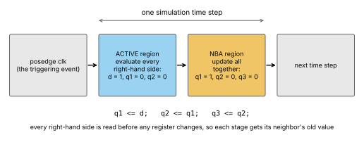
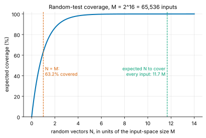

<!-- status: verified -->
# 08-05 · Introduction to Verilog/SystemVerilog and Testbenches

| | |
|---|---|
| **Course** | [08 · Digital Logic Design](../README.md) |
| **University equivalent** | The hardware-description-language chapter of a sophomore digital-design course (Harris & Harris, *Digital Design and Computer Architecture*, ch. 4; Mano & Ciletti, *Digital Design*, the Verilog sections of chs. 3–6), with an introduction to self-checking verification |
| **Prerequisites** | [08-04 Combinational Building Blocks](08-04-combinational-building-blocks.md) (the blocks described here), [08-01 Number Systems and Codes](08-01-number-systems-and-codes.md) (widths, two's complement), [05-01 Python Fundamentals](../../05-programming-for-engineers/chapters/05-01-python-fundamentals.md) (programming basics) |
| **Estimated study hours** | 12 |
| **Last verified** | 2026-11-19 |

**Learning objectives.** After this chapter you can:

1. Describe combinational and sequential hardware in Verilog with modules, ports, continuous assignments and `always` blocks, and predict the hardware synthesis will build, including unintended latches.
2. Explain Verilog's event-driven simulation semantics, and use blocking and non-blocking assignments so that simulation matches hardware.
3. Predict the results of Verilog expressions under its width, signedness and four-valued (0, 1, X, Z) rules.
4. Write self-checking testbenches with exhaustive, directed and random stimulus, a reference model and pass/fail reporting, and quantify how much of the input space a random test covers.
5. Run the open-source flow (Icarus Verilog to simulate, Verilator to lint, GTKWave to view waveforms) and name the main SystemVerilog additions.

---

## 1. Big picture

Nobody designs a modern chip by drawing gates. Designers write **hardware description languages** (HDLs), which describe what hardware does, and two kinds of tool consume them: **simulators**, which predict the behavior over time, and **synthesis tools**, which turn the description into gates (08-03 §3.7). Verilog, created in 1984 and standardized by the IEEE, merged into **SystemVerilog** in 2009, and SystemVerilog is now the dominant HDL for chip design; VHDL remains common in FPGA, aerospace and European designs. This chapter teaches enough Verilog to describe every block of this course, and enough about its simulation semantics to avoid the bugs that catch every beginner.

- **One description, two consumers.** The same code is simulated millions of times during verification and synthesized once per build. The subset of the language both agree on is the **synthesizable subset**; code outside it simulates but cannot become hardware.
- **Hardware is parallel.** Every `assign` and every `always` block runs concurrently, like every gate on a chip. The simulator fakes this parallelism with an event scheduler, and its rules explain the difference between `=` and `<=`.
- **Verification is most of the work.** A design is only as good as the evidence that it is correct. Self-checking testbenches, which compare the design against a reference model automatically, are how that evidence is produced, from student labs to billion-gate chips ([19-13](../../19-digital-vlsi-design/chapters/19-13-verification-methods.md)).
- **The open-source tools are good.** Icarus Verilog, Verilator and GTKWave, which this curriculum uses, are free and maintained, and the same habits carry over to commercial simulators.

## 2. Intuition first

**A circuit diagram written as text.** A Verilog module is a box with pins; inside, `assign y = a & b;` is a wire permanently connected to the output of an AND gate. Unlike a line in a program, it does not "run" once: it holds at every instant, like an equation. Write two `assign` statements and you have two gates working at the same time. If programming is writing a recipe (do this, then that), describing hardware is drawing a factory floor where every machine runs simultaneously.

**Snapshots at the clock edge.** Sequential logic (the registers of [08-06](08-06-latches-and-flip-flops.md)) changes only at clock edges, and every register samples its input *at the same instant*. A row of flip-flops forming a shift register works because each one captures its neighbor's *old* value. Verilog's non-blocking assignment `<=` models exactly this: all right-hand sides are read first, as if photographed at the edge, and all left-hand sides are updated afterwards. The blocking assignment `=` updates immediately, like a spreadsheet cell that recalculates as soon as you type, which is right for combinational logic and wrong for registers.

**Analogy: settlement in a market.** Think of non-blocking assignments as trades executed at the close: every order is priced at the same snapshot, then all positions update together. Blocking assignments are like continuous trading in which each trade moves the price seen by the next. *Where the analogy breaks:* markets have real simultaneity problems; a Verilog simulator has none, as long as the rules of §3.6 are followed. Break them and the simulator's arbitrary ordering decides the result, a **race condition**.

## 3. Theory

### 3.1 Two uses, one language

An HDL description is read by:

- a **simulator**, which executes it against stimulus and reports what happens over (simulated) time;
- a **synthesis** tool, which infers hardware from it: gates for expressions, flip-flops for clocked assignments, multiplexers for `if` and `case`.

Simulation can execute anything; synthesis accepts only descriptions of real hardware. The **synthesizable subset** is the part of the language with an agreed hardware meaning (§3.7). Good practice is to keep design code inside it and put everything else (delays, file I/O, printing, random stimulus) in testbenches.

**A short history.** Verilog was created at Gateway Design Automation in 1984 and standardized as IEEE 1364 in 1995, with revisions in 2001 and 2005. SystemVerilog (IEEE 1800, first published in 2005) added verification and design features, and its 2009 edition **merged** IEEE 1364-2005 into it, so "Verilog" today formally means part of SystemVerilog. The current edition is **IEEE 1800-2023** ([R-153](../../../reference/research-log.md#r-153--hdl-standards-and-open-source-tools)). This chapter uses the Verilog-2005 core, which every tool supports, and introduces SystemVerilog additions in §3.9.

### 3.2 Modules, ports, nets and variables

A **module** is a hardware block with named ports:

```verilog
module mux2 #(parameter W = 8) (       // W: a parameter, set per instance
    input  wire [W-1:0] d0, d1,         // W-bit input buses
    input  wire         s,
    output wire [W-1:0] y
);
    assign y = s ? d1 : d0;             // a continuous assignment: a W-bit 2:1 multiplexer
endmodule
```

- **Vectors** are declared `[msb:lsb]`; `d0[3]` is one bit, `d0[3:0]` a slice.
- **Nets** (`wire`) are connections driven by something: a continuous assignment or a module output. They have no memory.
- **Variables** (`reg` in Verilog, `logic` in SystemVerilog) are assigned inside `always` and `initial` blocks and hold their value between assignments. **`reg` does not mean register**: a `reg` assigned in a combinational `always` block synthesizes to plain gates.
- **Hierarchy:** a module is used by **instantiating** it, preferably with named port connections: `mux2 #(.W(4)) u1 (.d0(a), .d1(b), .s(sel), .y(out));`.

### 3.3 Describing combinational logic

**Continuous assignment.** `assign y = expression;` is re-evaluated whenever any operand changes. The operators:

| Kind | Operators | Example (4-bit `a` = 1100) |
|---|---|---|
| Bitwise | `~ & \| ^ ~^` | `~a` = 0011 |
| Reduction (one operand → 1 bit) | `& \| ^` | `&a` = 0, `\|a` = 1, `^a` = 0 |
| Logical (→ 1 bit) | `! && \|\|` | `!a` = 0 |
| Arithmetic | `+ - * / %` | |
| Relational, equality | `< <= > >= == != === !==` | |
| Shift | `<< >>` (logical), `<<< >>>` (arithmetic) | `a >> 2` = 0011 |
| Concatenation, replication | `{a, b}`, `{4{1'b1}}` | `{a, 2'b01}` = 110001 |
| Conditional | `s ? x : y` | a multiplexer |

**Procedural combinational logic.** For anything beyond one expression, use `always @(*)` (or SystemVerilog's `always_comb`), which re-runs the block whenever any signal it reads changes:

```verilog
always @(*) begin
    case (op)
        2'b00:   y = a + b;
        2'b01:   y = a - b;
        2'b10:   y = a & b;
        default: y = a | b;
    endcase
end
```

**The latch trap.** If some path through a combinational block does not assign an output, the output must *keep its previous value* on that path, and remembering requires storage: synthesis infers a **latch** ([08-06](08-06-latches-and-flip-flops.md)). `always @(*) if (en) q = d;` describes a latch, because nothing says what `q` is when `en` = 0. Unintended latches cause timing and testing problems, so every combinational block should assign every output on every path: give a `default:` in every `case`, an `else` for every `if`, or a default assignment at the top of the block. Linters (Verilator's `LATCH` warning) catch the mistake.

**Sensitivity lists.** Old Verilog listed the triggering signals by hand, `always @(a or b)`. A missing signal does not change the hardware (synthesis ignores the list) but changes the simulation, which then fails to update when the forgotten signal changes: a **simulation–synthesis mismatch** (Example 08-05.7). `@(*)` lists every signal read and removes the risk.

### 3.4 Literals, widths and signedness

**Literals** carry a width, a base and digits: `4'b1010`, `8'hFF`, `12'd100`. An unsized literal like `5` is a 32-bit **signed** integer. Underscores improve readability: `16'b1010_0000_1111_0101`.

**Widths.** Verilog sizes an expression from its operands *and its destination*: the operands of `+`, `-`, `&`, `|`, `?:` and so on are extended to the width of the widest operand or the left-hand side, whichever is larger, *before* the operation. Then the result is truncated to the destination. Two consequences:

- **Carries need room.** With 4-bit `a` and `b`, `assign s5 = a + b;` into a 5-bit `s5` keeps the carry, but into a 4-bit destination the carry is lost (Example 08-05.1).
- **Extension happens before inversion.** In `{1'b0, a} + ~b + 1`, the 32-bit literal `1` widens everything to 32 bits, so `~b` gets 28 extra leading 1s. Lab 08-04's first testbench fell into exactly this trap; the fix is to size every operand explicitly.

**Signedness.** Vectors are **unsigned** unless declared `signed`; `$signed(x)` and `$unsigned(x)` reinterpret. Extension follows the type: unsigned values are zero-extended, signed values sign-extended (08-01 §3.3). Two rules cause most bugs:

- **One unsigned operand makes the whole expression unsigned.** Comparing `signed` `x` = −5 with `8'd0` (an unsigned literal) compares 251 with 0.
- **Shifts:** `>>` always shifts in 0s; `>>>` shifts in copies of the sign bit only if the operand is signed (an arithmetic shift, dividing by 2 and rounding toward −∞).

### 3.5 Four-valued logic

A simulator models each bit as one of four values:

- **0** and **1**;
- **X**, unknown: an uninitialized variable, or a conflict between two drivers;
- **Z**, high impedance: an undriven net, such as a tristate bus with no driver enabled.

Gates propagate X pessimistically but correctly: **0 AND anything is 0** and **1 OR anything is 1**, because the unknown cannot change the result; every other combination involving X or Z gives X. So `x & 1'b0` = 0 but `x & 1'b1` = X.

Two equality operators exist:

- `==` and `!=` compare logically and return **X** if either side has an X or Z bit;
- `===` and `!==` compare all four values literally and always return 0 or 1.

**X-optimism.** An `if (cond)` treats an X condition as false and takes the `else` branch, which can hide an unknown value instead of propagating it. Testbenches must therefore compare with `!==`: `if (y != expected)` is silently false when `y` is X, so a broken design passes.

**X in synthesis.** Synthesis has no X: assigning X to a signal (`y = 'x;`) tells the tool "don't care" (08-03 §3.5), and it chooses whatever value minimizes the logic.

### 3.6 Sequential logic and the simulation scheduler

A flip-flop is described by an `always` block triggered on a clock edge ([08-06](08-06-latches-and-flip-flops.md)):

```verilog
always @(posedge clk) begin
    if (rst) q <= 4'd0;
    else     q <= q + 4'd1;      // a 4-bit counter
end
```

**How a simulator executes concurrency.** Simulated time advances in discrete steps. Within one time step, the simulator processes events in **regions**. Simplified to the two that matter here:

1. **Active region:** execute the processes that were triggered (always blocks, continuous assignments), in an order the standard leaves unspecified. A **blocking** assignment `a = b;` updates `a` immediately, so later statements, and other processes that run later in the region, see the new value.
2. **Non-blocking (NBA) region:** after the active region has nothing left to do, apply all updates scheduled by **non-blocking** assignments `a <= b;`. Their right-hand sides were evaluated earlier, in the active region, so every one of them used the values from *before* the edge.

**Why registers need `<=`.** A three-stage shift register:

```verilog
always @(posedge clk) begin   // correct: three flip-flops in a chain
    q1 <= d;
    q2 <= q1;
    q3 <= q2;
end
```

Every right-hand side is read before any register changes, so each stage captures its neighbor's old value, as real flip-flops do.



*Figure 1. One simulation time step at a clock edge. All right-hand sides of the non-blocking assignments are evaluated in the active region; the updates are applied together in the NBA region.*
 Rewrite it with `=` and the first statement changes `q1` before the second reads it: after one clock edge, `q1`, `q2` and `q3` all equal `d`. The "shift register" collapses into one stage in simulation, while synthesis may build something else again. Similarly, `a <= b; b <= a;` swaps two registers, while `a = b; b = a;` copies `b` into both (Example 08-05.4).

**Races between blocks.** If two `always @(posedge clk)` blocks use blocking assignments, and one writes a variable the other reads, the result depends on which block the simulator happens to run first. Different simulators, or the same one after an innocent edit, give different answers. The standard coding rules prevent this:

1. use **non-blocking** `<=` in clocked (sequential) blocks;
2. use **blocking** `=` in combinational blocks;
3. never mix the two kinds in one block, and never assign a variable from more than one block.

### 3.7 The synthesizable subset

Synthesis maps:

- `assign` and `always @(*)` blocks to combinational logic (and, by the latch trap, possibly to latches);
- `always @(posedge clk)` blocks to flip-flops plus the logic feeding them;
- `if` and `case` to multiplexers (priority multiplexers for `if`–`else if` chains);
- `for` loops with constant bounds, `generate` blocks and parameters to **replicated** hardware: a loop is unrolled into copies, not executed over time;
- `+`, `-`, `*`, comparisons to library arithmetic (adders, multipliers, comparators).

It ignores or rejects: `#` delays (real delays come from the cells), `$display` and other system tasks, file I/O, `real` numbers, and (for ASICs) `initial` blocks; most FPGA tools accept `initial` to set register power-up values. Code that relies on these can simulate correctly and synthesize to something different. The two most common mismatches are incomplete sensitivity lists (§3.3) and X-dependent behavior (§3.5).

### 3.8 Self-checking testbenches

A **testbench** is a non-synthesizable module that instantiates the **design under test** (DUT), drives its inputs, and checks its outputs. A self-checking testbench has four parts:

1. **Stimulus:** the input patterns. **Exhaustive** testing applies every input combination; it is complete, and feasible up to roughly 20–30 input bits ($2^{20}$ ≈ 1 million vectors). **Directed** tests target known corner cases (overflow, zero, maximum values). **Random** tests sample large input spaces, usually **constrained** to legal and interesting values.
2. **Reference model:** an independent computation of the expected output, written as simply as possible (a behavioral expression, a lookup table, or a model in another language).
3. **Checker:** compare DUT output and reference with `!==`, and count and report mismatches.
4. **Report:** a single unambiguous verdict, such as this curriculum's `TEST PASSED`, so that scripts and CI can act on it.

**Timing the stimulus.** Apply inputs, wait for them to propagate (`#1`, or a clock edge for sequential designs), then check; checking in the same time step as changing the inputs is a race. For clocked designs, drive inputs on one edge and check outputs before the next (or on the opposite edge), so the testbench never samples a value in the middle of an update.

**How much does random testing cover?** Draw $N$ random vectors uniformly from a space of $M$ possible inputs. A particular input is missed by one draw with probability $1 - 1/M$, so by all $N$ draws with probability $(1 - 1/M)^N \approx e^{-N/M}$. The expected fraction of the space covered is therefore

$$
\text{coverage}(N) = 1 - \left(1 - \frac{1}{M}\right)^{N} \approx 1 - e^{-N/M} .
$$

With $N = M$ random vectors, coverage is only $1 - 1/e$ ≈ **63.2%**. Covering *every* input by random sampling is the **coupon collector's problem**: the expected number of draws is

$$
E[N_{\text{all}}] = M\left(1 + \frac{1}{2} + \cdots + \frac{1}{M}\right) = M H_M \approx M(\ln M + 0.5772) ,
$$

where $H_M$ is the $M$-th harmonic number. *Derivation:* when $k$ distinct inputs have been seen, each new draw is new with probability $(M - k)/M$, so the expected wait for the next new one is $M/(M - k)$; summing over $k = 0, \ldots, M - 1$ gives $M \sum_{j=1}^{M} 1/j$. For a 17-bit input space ($M$ = 131 072), that is about 1.62 million random vectors, 12.4 times the 131 072 an exhaustive loop needs. 

*Figure 2. Expected coverage of $N$ random vectors on a space of $M = 2^{16}$ inputs, $1 - (1 - 1/M)^N$. Coverage passes 63% at $N = M$ and then approaches 100% slowly; the dashed line on the right marks the coupon-collector mean $M H_M$.*

**When exhaustive testing is feasible, it beats random testing; when it is not, coverage must be measured, not assumed.** Industrial flows measure **functional coverage**: whether specified scenarios (each opcode, each overflow case, each FSM transition) actually occurred.

> **Math refresher — the exponential limit.** $\left(1 - \frac{1}{M}\right)^{N} = e^{N \ln(1 - 1/M)}$, and for large $M$, $\ln(1 - 1/M) \approx -1/M$ (the first term of its Taylor series, [01-08](../../01-calculus-for-engineers/chapters/01-08-sequences-series-and-taylor.md)). So $(1 - 1/M)^N \approx e^{-N/M}$, the same limit that gives continuous compounding in finance.

### 3.9 Tools and SystemVerilog

The open-source flow used in this course:

- **Icarus Verilog** (`iverilog` compiles, `vvp` runs): an event-driven simulator covering IEEE 1364 Verilog and a growing subset of SystemVerilog. Release 13.0 was tagged in March 2026 ([R-153](../../../reference/research-log.md#r-153--hdl-standards-and-open-source-tools)).
- **Verilator:** compiles Verilog into multithreaded C++ for fast cycle-based simulation, and is an excellent **linter** (`verilator --lint-only -Wall`), catching width mismatches, latches, unused signals and more; `tools/run_hdl.py` runs it on every lab. Version 5.054 was released on 1 Nov 2026.
- **GTKWave:** a waveform viewer for VCD and FST files, which testbenches write with `$dumpfile` and `$dumpvars`. Its stable line is 3.3; version 4.0 is in pre-release.
- **cocotb:** a framework for writing testbenches in Python against a Verilog or VHDL simulator (release 2.1.0, Aug 2026), convenient for reusing Python reference models.

**SystemVerilog additions** that matter from day one:

- `logic`, a single variable type that replaces both `wire` and `reg` for most uses;
- `always_comb`, `always_ff @(posedge clk)` and `always_latch`, which state the designer's intent so tools can check it (an `always_comb` that infers a latch is an error);
- `enum` types for state machines ([08-08](08-08-finite-state-machines.md)), `struct`s and packed arrays;
- **assertions** (`assert property (@(posedge clk) req |-> ##[1:3] ack);`), which check temporal properties during simulation and formal verification;
- for verification engineers: classes, constrained randomization, functional coverage, and the UVM methodology built on them ([19-13](../../19-digital-vlsi-design/chapters/19-13-verification-methods.md)).

## 4. Worked examples

### Example 08-05.1 · Widths and operators (tier A)

**Setup.** With `wire [3:0] a = 4'b1100, b = 4'b0101;` evaluate: (a) `a + b` assigned to a 5-bit wire; (b) `a + b` assigned to a 4-bit wire; (c) `{a, b}` as an unsigned number; (d) the reductions `&a`, `|a`, `^a`; (e) `a >> 2`.

**Solution.** $a = 12$, $b = 5$.

(a) The 5-bit destination widens the addition to 5 bits: $12 + 5$ = **17** (10001).

(b) The 4-bit destination keeps only the low 4 bits: 10001 → 0001 = **1**. The carry is lost.

(c) Concatenation places `a` in the high nibble: 1100 0101 = **197**.

(d) `&a` = 1 & 1 & 0 & 0 = **0**; `|a` = **1**; `^a` = 1 ⊕ 1 ⊕ 0 ⊕ 0 = **0** (an even number of 1s).

(e) 1100 shifted right by 2, filling with 0s: 0011 = **3**.

**Sanity check.** $17 \bmod 16 = 1$ ✓, and $12 \times 16 + 5 = 197$ ✓.

### Example 08-05.2 · Signed and unsigned (tier B)

**Setup.** `reg signed [7:0] x = -8'sd5;` (a) What unsigned number does the bit pattern of `x` represent? (b) What is `x >>> 1` as a signed number? (c) What is `x >> 1`? (d) Is `x < 8'd0` true? (e) Is `x < 0` true?

**Solution.** (a) −5 in 8 bits is $256 - 5$ = **251** = 1111 1011.

(b) `>>>` on a signed operand copies the sign bit in: 1111 1101 = **−3**. (Arithmetic shift rounds toward −∞: $-5/2 = -2.5 \to -3$.)

(c) `>>` always fills with 0: 0111 1101 = **125**.

(d) `8'd0` is unsigned, so the comparison is unsigned: $251 < 0$ is false, **0**.

(e) The literal `0` is a signed 32-bit integer, so both operands are signed and `x` is sign-extended: $-5 < 0$ is true, **1**.

**Sanity check.** (d) and (e) differ only in how the zero is written. Mixing signed and unsigned operands is one of the most common sources of silent bugs in arithmetic RTL.

### Example 08-05.3 · Four-valued logic (tier B)

**Setup.** (a) With `a = 1'bx` and `b = 1'b0`, evaluate `a & b`, `a | b`, `a & 1'b1` and `a | 1'b1`. (b) Of the 16 combinations of two four-valued inputs, how many give a definite (0 or 1) result for AND? (c) For XOR? (d) What do `a == 1'bx` and `a === 1'bx` return?

**Solution.** (a) `a & 0` = **0** (0 dominates AND); `a | 0` = X; `a & 1` = X; `a | 1` = **1** (1 dominates OR).

(b) AND is definite when either input is 0 (the result is 0) or both are 1. Combinations with at least one 0: $4 + 4 - 1 = 7$; plus (1, 1): **8** of 16.

(c) XOR depends on both inputs fully, so any X or Z gives X: only the 4 combinations of 0 and 1 are definite: **4**.

(d) `a == 1'bx` returns X (logical equality with an unknown is unknown); `a === 1'bx` returns **1** (the bit patterns match literally).

**Sanity check.** OR is the dual of AND: it is definite when either input is 1 or both are 0, again 8 of 16 ✓.

### Example 08-05.4 · Blocking and non-blocking (tier B)

**Setup.** (a) In the three-stage shift register of §3.6, `d` = 1 for one clock edge and 0 afterwards. After how many edges does the 1 reach `q3` with non-blocking assignments, and with blocking ones (statements in the order shown)? (b) Registers `a` = 3 and `b` = 5. What are they after one clock edge of `a <= b; b <= a;`, and of `a = b; b = a;`?

**Solution.** (a) Non-blocking: each edge moves the 1 one stage: `q1` after edge 1, `q2` after edge 2, `q3` after edge **3**. Blocking: at edge 1, `q1 = d` makes `q1` = 1, then `q2 = q1` copies the new 1, then `q3 = q2` copies it again: `q3` = 1 after edge **1**.

(b) Non-blocking: both right-hand sides are read first (5 and 3), then both updates happen: `a` = **5**, `b` = **3**, a swap. Blocking: `a = b` makes `a` = 5, then `b = a` reads the new `a`: `a` = **5**, `b` = **5**.

**Sanity check.** The non-blocking results are what hardware does: three flip-flops delay a signal by three clock cycles, and two cross-connected flip-flops swap their contents every cycle. The lab's `semantics_tb.v` reproduces all four results in Icarus Verilog.

### Example 08-05.5 · Finding the latch (tier B)

**Setup.** A designer writes:

```verilog
always @(*) begin
    case (sel)
        2'b00: y = a;
        2'b01: y = b;
        2'b10: y = c;
    endcase
end
```

(a) For how many of the four values of `sel` is `y` not assigned? (b) What does synthesis build, and why? (c) Fix it two ways.

**Solution.** (a) **1**: `sel` = 2'b11 has no branch.

(b) For `sel` = 11, `y` must keep its previous value, so synthesis builds a **latch** enabled when `sel` ≠ 11, in front of a 3:1 multiplexer. Verilator's lint reports it.

(c) Add `default: y = 'x;` (telling synthesis the value does not matter, so it may share logic) or `default: y = a;` (a defined value). Or assign `y = a;` before the `case`, so every path assigns it. In SystemVerilog, writing `always_comb` turns the mistake into a reported error.

**Sanity check.** A combinational block is combinational only if its outputs are a function of its current inputs alone. A path that leaves `y` unassigned makes `y` depend on the past, which is the definition of memory.

### Example 08-05.6 · How much testing is enough? (tier C)

**Setup.** A block has two 8-bit inputs and a carry in. (a) How many vectors does exhaustive testing need? (b) What fraction of the input space do that many *random* vectors cover, on average? (c) How many random vectors are needed, on average, to cover every input at least once? (d) How many times more is that than exhaustive testing?

**Solution.** (a) $M = 2^{8+8+1}$ = **131 072**.

(b) $1 - (1 - 1/M)^M$ = **0.632**, so about 63% of the inputs, with 37% never tested.

(c) $M H_M$ with $H_M = \sum_{j=1}^{M} 1/j$ = 12.361: about **1.620 × 10⁶** vectors.

(d) $1.620 \times 10^6 / 131\,072$ = **12.4** times.

**Sanity check.** $\ln M + 0.5772 = 11.784 + 0.577 = 12.361$ ✓, matching the exact harmonic sum. For a 64-bit adder ($M = 2^{129}$) neither approach is possible, which is why arithmetic units are verified by directed corner cases, random testing with measured coverage, and formal methods.

### Example 08-05.7 · A simulation–synthesis mismatch (tier C)

**Setup.** `always @(a) y = a & b;` (with `b` missing from the sensitivity list) starts with `a` = `b` = 0 and `y` = 0. The inputs then step through $(a, b)$ = (1, 0), (1, 1), (0, 1), (1, 1), (1, 0). After each step, compare the simulated `y` with the synthesized AND gate. (a) In how many of the five steps do they disagree? (b) What does `always @(*)` change?

**Solution.** The simulator re-runs the block only when `a` changes; the hardware AND gate always shows $a \cdot b$.

| Step | $(a, b)$ | `a` changed? | simulated `y` | hardware `y` |
|---|---|---|---|---|
| 1 | (1, 0) | yes | 1 & 0 = 0 | 0 |
| 2 | (1, 1) | no | 0 (stale) | 1 |
| 3 | (0, 1) | yes | 0 | 0 |
| 4 | (1, 1) | yes | 1 | 1 |
| 5 | (1, 0) | no | 1 (stale) | 0 |

(a) Steps 2 and 5: **2** mismatches.

(b) `@(*)` adds every signal the block reads, including `b`, so the simulation recomputes `y` on every change and matches the hardware in all five steps.

**Sanity check.** The mismatches occur exactly when only `b` changes. This bug is dangerous because the simulation passes its tests while the silicon behaves differently; it is why linters flag incomplete sensitivity lists and why `always_comb` exists.

### Answer key

<!-- answer-key -->
| ID | Quantity | Value | Unit |
|---|---|---|---|
| Ex 08-05.1a | `a + b` into 5 bits | 17 | — |
| Ex 08-05.1b | `a + b` into 4 bits | 1 | — |
| Ex 08-05.1c | `{a, b}` | 197 | — |
| Ex 08-05.1d | AND-reduction of `a` | 0 | — |
| Ex 08-05.1e | OR-reduction of `a` | 1 | — |
| Ex 08-05.1f | XOR-reduction of `a` | 0 | — |
| Ex 08-05.1g | `a >> 2` | 3 | — |
| Ex 08-05.2a | unsigned value of `x` | 251 | — |
| Ex 08-05.2b | `x >>> 1` | -3 | — |
| Ex 08-05.2c | `x >> 1` | 125 | — |
| Ex 08-05.2d | `x < 8'd0` | 0 | — |
| Ex 08-05.2e | `x < 0` | 1 | — |
| Ex 08-05.3a | X AND 0 | 0 | — |
| Ex 08-05.3b | X OR 1 | 1 | — |
| Ex 08-05.3c | definite AND results of 16 | 8 | — |
| Ex 08-05.3d | definite XOR results of 16 | 4 | — |
| Ex 08-05.3e | `a === 1'bx` | 1 | — |
| Ex 08-05.4a | edges for the 1 to reach `q3`, non-blocking | 3 | — |
| Ex 08-05.4b | edges for the 1 to reach `q3`, blocking | 1 | — |
| Ex 08-05.4c | `a` after non-blocking swap | 5 | — |
| Ex 08-05.4d | `b` after non-blocking swap | 3 | — |
| Ex 08-05.4e | `a` after blocking | 5 | — |
| Ex 08-05.4f | `b` after blocking | 5 | — |
| Ex 08-05.5a | `sel` values with no assignment | 1 | — |
| Ex 08-05.6a | exhaustive vectors | 131072 | — |
| Ex 08-05.6b | random coverage with $N = M$ | 0.632 | — |
| Ex 08-05.6c | expected random vectors for full coverage | 1.620e6 | — |
| Ex 08-05.6d | ratio to exhaustive | 12.4 | — |
| Ex 08-05.7a | mismatching steps | 2 | — |
| Th 08-05.a | coverage $1 - 1/e$ | 63.2 | % |
| Th 08-05.b | exhaustive vectors for 20 input bits | 1048576 | — |

## 5. Simulate it

The lab is in [labs/08-05-lab/](../labs/08-05-lab/README.md).

**Notebook** (`08-05-verilog-semantics.ipynb`):

1. Model Verilog's four-valued AND, OR, XOR and NOT in Python, and regenerate the truth tables of §3.5.
2. Model blocking and non-blocking assignment as two different update rules, and replay Example 08-05.4.
3. Simulate random testing: plot coverage against the number of vectors, and compare with $1 - e^{-N/M}$ and the coupon-collector mean.
4. If Icarus Verilog is installed, compile and run the lab's testbenches from the notebook and display their output.

**Verilog** (`semantics_tb.v`, `cmp8.v`, `cmp8_tb.v`):

- `semantics_tb.v` evaluates every example of §4 in the simulator and checks each result against this chapter's answer key; it prints `TEST PASSED` only if Icarus agrees with the text.
- `cmp8.v` is an 8-bit comparator (equal, unsigned less-than and signed less-than, built from a subtractor as in 08-04 §3.7). `cmp8_tb.v` tests it three ways (directed corner cases, exhaustive over all 65 536 pairs, and a fixed-seed random run that reports its own coverage), and writes a VCD waveform file for GTKWave.

**Guided exercise (predict, then run).** `cmp8_tb.v` also runs 65 536 random vectors on the comparator's 65 536-pair input space. **Before running,** predict how many distinct input pairs the random run will hit, and how many it will miss. Then run it and compare with $M\left(1 - (1 - 1/M)^{M}\right)$.

## 6. Engineering tradeoffs

| Knob | Improves | Costs | Typical decision owner |
|---|---|---|---|
| Behavioral RTL (`+`, `case`) rather than gate-level structure | Productivity, readability; lets synthesis choose the implementation | Less direct control over structure and timing | RTL designer |
| Exhaustive testing | Complete evidence for the block | Only feasible to about 20–30 input bits | Verification engineer |
| Constrained-random testing with coverage | Reaches huge input spaces and unexpected combinations | Needs a reference model and coverage measurement; never complete | Verification lead |
| Formal verification | Proofs over all inputs and all times | Tool expertise; state-space limits on large designs | Formal specialist |
| Compiled simulation (Verilator) | Speed for long tests | Two-state (no X/Z) modeling, longer compile, less timing detail | Verification and software teams |
| Four-state event simulation (Icarus, commercial) | X and Z behavior, timing detail | Speed | Verification engineer |
| SystemVerilog (`always_ff`, `always_comb`, assertions) | Intent checked by tools, stronger verification | Uneven support in open-source tools | Team lead choosing the language level |

## 7. Numbers to know

| Quantity | Value | Note |
|---|---|---|
| Random coverage with $N = M$ vectors | $1 - 1/e$ ≈ 63.2% | §3.8 |
| Random vectors to cover everything | $M H_M \approx M(\ln M + 0.577)$ | §3.8 |
| Practical exhaustive limit | about 20–30 input bits ($10^6$ to $10^9$ vectors) | §3.8 |
| Unsized literal | 32-bit signed integer | §3.4 |
| SystemVerilog standard | IEEE 1800-2023, published 28 Feb 2024; merged Verilog (IEEE 1364-2005) in 2009 | [R-153](../../../reference/research-log.md#r-153--hdl-standards-and-open-source-tools) **[Established]** |
| Open-source tools (Nov 2026) | Icarus Verilog 13.0 (Mar 2026); Verilator 5.054 (Nov 2026); cocotb 2.1.0 (Aug 2026); GTKWave 3.3 stable, 4.0 pre-release | [R-153](../../../reference/research-log.md#r-153--hdl-standards-and-open-source-tools) **[Established]** |

## 8. Common mistakes

1. **Thinking `reg` means a register.** It is a variable; whether it becomes a flip-flop depends on how it is assigned.
2. **Using `=` in clocked blocks.** It collapses pipelines and creates races; use `<=`.
3. **Incomplete assignments in combinational blocks.** They infer latches; give every `case` a `default` and every `if` an `else`, or assign defaults first.
4. **Incomplete sensitivity lists.** Use `@(*)` or `always_comb`.
5. **Losing carries to truncation, or extending before inverting.** Size the destination for the full result and size every operand explicitly.
6. **Mixing signed and unsigned operands.** One unsigned operand makes the whole expression unsigned.
7. **Checking with `!=` in testbenches.** An X output then passes; use `!==`.
8. **Checking outputs in the same time step as changing the inputs.** Wait for them to propagate, or check at a different clock edge.
9. **Expecting `#` delays to synthesize.** They are simulation-only; real timing comes from the cells and is checked by static timing analysis.

## 9. Practitioner lens

### State of the art (as of Nov 2026)

- **One standard, freely available** ([R-153](../../../reference/research-log.md#r-153--hdl-standards-and-open-source-tools)) **[Established]**. IEEE 1800-2023 (SystemVerilog) was approved on 6 Dec 2023 and published on 28 Feb 2024, superseding 1800-2017, and Accellera sponsors free downloads through the IEEE GET program. Its 2009 predecessor merged IEEE 1364-2005 Verilog into SystemVerilog, so new Verilog features appear only in 1800 (from search excerpts of the IEEE and Accellera pages).
- **The open-source simulators are active** (from the projects' repositories) **[Established]**.
  - Icarus Verilog's release 13.0 was tagged on 1 Mar 2026, more than three years after 12.0 (26 Dec 2022). It aims to compile all of IEEE 1364 and "a (slowly growing) subset" of SystemVerilog. (This curriculum's CI installs the Ubuntu 24.04 packages, Icarus 12.0 and Verilator 5.020, and all labs run on both.)
  - Verilator releases roughly every two months: 5.050 (1 Jul 2026), 5.052 (5 Sep 2026) and 5.054 (1 Nov 2026).
  - cocotb 2.1.0 was tagged on 30 Aug 2026.
  - GTKWave's newest tag is 3.3.116 (Jul 2023); its main branch builds 4.0.0 "prealpha", which drops several legacy formats relative to the 3.3 long-term-support line.

### Why it matters commercially

- **Simulation and verification tools are a large part of EDA revenue** (08-03 §9), because verification consumes much of every chip program's engineering effort and compute.
- **Open-source tools change the cost of entry.** Startups, universities and FPGA teams can build and verify real designs without license fees, and some commercial teams use Verilator for fast system-level simulation alongside licensed sign-off simulators.
- **Language skill is a hiring signal.** Clean, synthesizable, lint-clean RTL and disciplined testbenches separate strong hardware engineers from weak ones far more than knowledge of exotic language features.

### Marketing vs Reality

- **"The fastest Verilog/SystemVerilog simulator."** *Reality:* Verilator's README makes this claim and says it is "about 100 times faster than interpreted Verilog simulators" on a single thread **[Industry estimate]** (the project's own claim, benchmark conditions unstated). Compiled two-state simulation is much faster for long cycle-based runs, but it does not model X and Z or detailed event timing. *Sanity check:* ask what was simulated, at what abstraction, with which features turned off, and against which competitor version.
- **"100% code coverage."** *Reality:* every line executed does not mean every behavior checked; a testbench with a weak checker can execute every line and still miss bugs. *Sanity check:* ask about functional coverage of specified scenarios and about the quality of the reference model.
- **"It passed simulation."** *Reality:* simulation with an incomplete sensitivity list, unchecked X values or untested corner cases passes routinely. *Sanity check:* ask whether the RTL is lint-clean, whether the netlist was equivalence-checked against the RTL, and what found the last three bugs.

### Questions for engineering leaders

1. **"How do you know a block is verified?"**
   - *Strong:* a verification plan with functional-coverage targets, reference models, closure reports, and bug-discovery rates trending toward zero.
   - *Evasive:* "the tests pass."
2. **"What runs in CI on every commit?"**
   - *Strong:* lint, unit testbenches, regression subsets, with results visible to the team.
   - *Evasive:* "we run the full regression before tape-out."
3. **"Which simulators and versions do you depend on, and how do you handle differences between them?"**
   - *Strong:* a pinned tool matrix, and code that follows rules (non-blocking for sequential logic, no races) so results do not depend on the simulator.
   - *Evasive:* "we only use vendor X."
4. **"How much of your verification uses formal methods or assertions?"**
   - *Strong:* assertions in interfaces and FSMs, formal proofs for arithmetic and protocol blocks.
   - *Evasive:* "simulation is enough."

## 10. Concept check

**Q1.** Why does `assign y = a & b;` not "run once" like a line of software?

<details><summary>Answer</summary>

It describes a permanent connection: an AND gate whose output is always the AND of its current inputs. The simulator re-evaluates it whenever `a` or `b` changes, and synthesis builds a gate.

</details>

**Q2.** What does synthesis build from `always @(*) if (en) q = d;`, and why?

<details><summary>Answer</summary>

A latch: when `en` is 0 the block does not assign `q`, so `q` must hold its previous value, which requires storage.

</details>

**Q3.** Why must clocked blocks use non-blocking assignments?

<details><summary>Answer</summary>

So that every right-hand side is evaluated with the values from before the clock edge, as real flip-flops sample simultaneously. Blocking assignments update immediately, collapsing pipelines and making results depend on statement and process order (races).

</details>

**Q4.** With 4-bit `a` = 1111, what is `a + 1` when assigned to a 4-bit wire, and to a 5-bit wire?

<details><summary>Answer</summary>

0000 in 4 bits (the carry is lost) and 10000 = 16 in 5 bits, because the destination width takes part in sizing the expression.

</details>

**Q5.** What is `1'bx & 1'b0`, and why?

<details><summary>Answer</summary>

0: whatever the unknown bit is, ANDing it with 0 gives 0, so the simulator can return a definite result.

</details>

**Q6.** Why should a testbench compare with `!==` rather than `!=`?

<details><summary>Answer</summary>

If the DUT output contains X or Z, `!=` returns X, which an `if` treats as false, so the error is silently missed. `!==` compares the four-valued bits literally and flags it.

</details>

**Q7.** How much of a space of $M$ inputs do $M$ random vectors cover, and why?

<details><summary>Answer</summary>

About 63%: each input is missed by all $M$ draws with probability $(1 - 1/M)^M \approx 1/e$.

</details>

**Q8.** Name two things in a testbench that cannot be synthesized.

<details><summary>Answer</summary>

Any two of: `#` delays, `$display` and other system tasks, file I/O, `initial` blocks used for stimulus, `real` arithmetic, random-number generation such as `$random`.

</details>

Practice problems: [problems/08-05-problems.md](../problems/08-05-problems.md) · Solutions: [solutions/08-05-solutions.md](../solutions/08-05-solutions.md)

## 11. Key terms

[Hardware description language (HDL)](../../../reference/glossary.md#hardware-description-language-hdl) ·
[Verilog](../../../reference/glossary.md#verilog) ·
[SystemVerilog](../../../reference/glossary.md#systemverilog) ·
[Synthesizable subset](../../../reference/glossary.md#synthesizable-subset) ·
[Continuous assignment](../../../reference/glossary.md#continuous-assignment) ·
[Blocking assignment](../../../reference/glossary.md#blocking-assignment) ·
[Non-blocking assignment](../../../reference/glossary.md#non-blocking-assignment) ·
[Race condition](../../../reference/glossary.md#race-condition) ·
[Latch inference](../../../reference/glossary.md#latch-inference) ·
[Four-valued logic](../../../reference/glossary.md#four-valued-logic) ·
[Testbench](../../../reference/glossary.md#testbench) ·
[Design under test (DUT)](../../../reference/glossary.md#design-under-test-dut) ·
[Functional coverage](../../../reference/glossary.md#functional-coverage) ·
[Linting](../../../reference/glossary.md#linting)

## 12. Connections

- **Builds on:** [08-04](08-04-combinational-building-blocks.md) (the blocks described here), [08-01](08-01-number-systems-and-codes.md) (widths, signedness, two's complement), [08-03](08-03-logic-minimization.md) (don't cares, synthesis), [01-08](../../01-calculus-for-engineers/chapters/01-08-sequences-series-and-taylor.md) (the exponential limit).
- **Next:** [08-06](08-06-latches-and-flip-flops.md) builds the latches and flip-flops that `always @(posedge clk)` describes.
- **Used later:**
  - [08-07](08-07-registers-counters-shift-registers.md) and [08-08](08-08-finite-state-machines.md) describe counters, shift registers and state machines in Verilog;
  - [08-12](08-12-fpga-implementation-flow.md) synthesizes Verilog onto an FPGA with Yosys and nextpnr;
  - [19-13](../../19-digital-vlsi-design/chapters/19-13-verification-methods.md) develops coverage-driven verification, UVM, assertions and formal methods.

## 13. Further study

- **Harris & Harris, *Digital Design and Computer Architecture* (RISC-V Edition):** ch. 4 (hardware description languages), with SystemVerilog and VHDL side by side.
- **S. Sutherland, S. Davidmann and P. Flake, *SystemVerilog for Design*:** the design subset of SystemVerilog.
- **C. E. Cummings, "Nonblocking Assignments in Verilog Synthesis, Coding Styles That Kill!" (SNUG 2000):** the classic paper on the coding rules of §3.6.
- **IEEE Std 1800-2023:** the language reference itself, free through the IEEE GET program; chapter 4 defines the scheduling semantics.
- **MIT OCW 6.111 *Introductory Digital Systems Laboratory*:** lectures and labs on Verilog for FPGAs.

## 14. Sources

1. Research log [R-153](../../../reference/research-log.md#r-153--hdl-standards-and-open-source-tools): IEEE SA pages for IEEE 1800-2023 and 1800-2009; Accellera press release on IEEE GET availability; steveicarus/iverilog, verilator/verilator, cocotb/cocotb and gtkwave/gtkwave repositories (tags, changelogs and READMEs, Nov 2026).
2. Textbook alignment as listed in §13. All text, examples and problems in this chapter are original.
