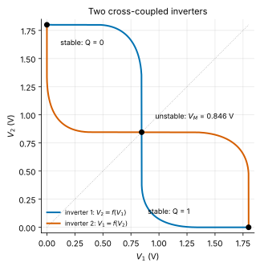
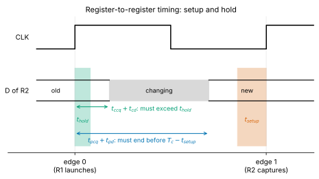

<!-- status: verified -->
# 08-06 · Latches, Flip-Flops and Sequential Timing

| | |
|---|---|
| **Course** | [08 · Digital Logic Design](../README.md) |
| **University equivalent** | The sequential-logic chapter of a sophomore digital-design course (Harris & Harris, *Digital Design and Computer Architecture*, §§3.1–3.3 and 3.5; Mano & Ciletti, *Digital Design*, ch. 5), through register-to-register timing |
| **Prerequisites** | [08-04 Combinational Building Blocks](08-04-combinational-building-blocks.md) (propagation and contamination delay, hazards), [08-05 Verilog and Testbenches](08-05-verilog-and-testbenches.md) (`always @(posedge clk)`, non-blocking assignment), [08-02 Boolean Algebra and Logic Gates](08-02-boolean-algebra-and-gates.md) (CMOS gates) |
| **Estimated study hours** | 8 |
| **Last verified** | 2026-11-19 |

**Learning objectives.** After this chapter you can:

1. Explain how feedback creates memory, show why a pair of cross-coupled inverters has two stable states and one unstable one, and analyze SR latches built from NOR and NAND gates.
2. Build a D latch and an edge-triggered master–slave D flip-flop, and contrast level-sensitive transparency with edge triggering.
3. Add enables and synchronous or asynchronous resets to registers, and describe each correctly in Verilog.
4. Define setup time, hold time and the clock-to-Q delays, derive the setup (maximum-delay) and hold (minimum-delay) constraints for a register-to-register path, and compute the maximum clock frequency and the hold slack.
5. State the rules of synchronous design and explain why they make large designs analyzable.

---

## 1. Big picture

Combinational logic computes; it does not remember. Every useful digital system, from a counter to a processor, also needs **state**: values that persist from one step of a computation to the next. This chapter builds memory from logic gates by adding feedback, refines it into the **edge-triggered flip-flop**, and derives the two timing inequalities that every synchronous chip must satisfy. Those inequalities, setup and hold, decide a chip's clock frequency and are checked billions of times by static timing tools before every tape-out ([08-10](08-10-timing-metastability-cdc.md), [19-10](../../19-digital-vlsi-design/chapters/19-10-synthesis-and-sta.md)).

- **Flip-flops are everywhere.** Every register, pipeline stage, counter and state machine is a bank of D flip-flops; a modern processor core contains hundreds of thousands of them.
- **The clock imposes discipline.** By letting state change only at clock edges, synchronous design turns a timing problem with billions of interacting paths into many independent register-to-register checks.
- **Timing overhead is real.** Each clock cycle loses the flip-flop's clock-to-Q delay and setup time, overhead that grows in relative importance as logic between registers gets shallower ([08-09](08-09-arithmetic-circuits.md), pipelining in [14-06](../../14-computer-organization-and-architecture/chapters/14-06-pipelining-and-hazards.md)).
- **Getting it wrong is silent.** A setup violation makes a chip fail at speed; a hold violation makes it fail at every speed, and cannot be fixed by slowing the clock.

## 2. Intuition first

**A ball on a hill.** Picture a ball on a surface with two valleys separated by a ridge. In either valley the ball stays put; that is a stored 0 or 1. On the very top of the ridge it could balance in principle, but the slightest disturbance sends it into one valley or the other. Two cross-coupled inverters behave exactly this way: two stable states and one unstable balance point, which [08-10](08-10-timing-metastability-cdc.md) studies as **metastability**. *Where the analogy breaks:* the ball rolls back after a small push in a valley because of gravity; in the circuit, the restoring force comes from the gain of the inverters, and that gain also makes the ridge unstable.

**A camera shutter.** A **latch** is like a window: while its clock is high it is transparent and the output follows the input; when the clock falls, it freezes the last value. A **flip-flop** is like a camera: it records the input at the instant of the rising edge and shows that photograph until the next edge, ignoring everything in between. Pipelines need cameras, not windows: with windows, a value could race through several stages during one clock pulse.

**The relay race of a clock cycle.** Between two flip-flops, a value must leave the first one (clock-to-Q delay), run through the logic between them, and arrive at the second before its setup deadline. The clock period is the length of that leg of the race. The **hold** rule is the opposite worry: the *next* value must not arrive so fast that it overwrites the current one while the second flip-flop is still capturing it.

## 3. Theory

### 3.1 Memory from feedback

Connect two inverters in a ring: the output of each drives the input of the other. Call the two nodes $Q$ and $\overline{Q}$. If $Q$ = 1, the first inverter drives $\overline{Q}$ to 0, and the second drives $Q$ to 1: consistent, so the ring stays in that state forever, with no input needed. The state $Q$ = 0 is equally self-consistent. The ring **stores one bit**.

There is a third consistent point. If the inverter's output equals its input at the **switching threshold** $V_M$ (where its transfer curve crosses the line $V_{out} = V_{in}$), then both nodes can sit at $V_M$. Whether a state is stable depends on what happens to a small disturbance. Suppose $Q$ is displaced by $\delta$ from an equilibrium. The first inverter turns that into a change of $A_1\delta$ at $\overline{Q}$, where $A_1$ is its small-signal gain $dV_{out}/dV_{in}$ at that point; the second turns it into $A_1A_2\delta$ back at $Q$. The disturbance grows if the **loop gain** $|A_1A_2| > 1$ and dies out if it is less than 1.

- At the two rail states, each inverter's output is pinned at a rail and its gain is near 0: the loop gain is far below 1, and these states are **stable**.
- At $V_M$, each inverter is in its high-gain region (a CMOS inverter's gain there is typically 10 or more): the loop gain is far above 1, and the point is **unstable**. A circuit placed there drifts exponentially to one rail or the other, with a time constant set by the gain and the node capacitance ([08-10](08-10-timing-metastability-cdc.md)).

For a CMOS inverter whose transistors are both in saturation at $V_M$ (the simple square-law model of [09-09](../../09-semiconductor-devices/chapters/09-09-long-channel-mosfet.md)), equating the nMOS and pMOS currents, $\tfrac{\beta_n}{2}(V_M - V_{Tn})^2 = \tfrac{\beta_p}{2}(V_{DD} - V_M - |V_{Tp}|)^2$, and taking square roots gives

$$
V_M = \frac{V_{DD} - |V_{Tp}| + V_{Tn}\sqrt{\beta_n/\beta_p}}{1 + \sqrt{\beta_n/\beta_p}} ,
$$

where $\beta = \mu C_{ox} W/L$ is each transistor's gain factor, in A/V². The lab's ngspice inverter (nMOS 0.65 µm and pMOS 1.0 µm wide, both 0.15 µm long, as in the SKY130 cells of 08-02) has $\beta_n$ = 1.083 mA/V² and $\beta_p$ = 0.667 mA/V², so with $V_{DD}$ = 1.8 V and $V_{Tn} = |V_{Tp}|$ = 0.45 V, $V_M$ = **0.846** V. The simulator confirms it by connecting one inverter's output to its own input: the only consistent operating point is $V_M$.



*Figure 1. The transfer curve of one inverter and the mirror image of the other cross at three points: two stable states at the rails and the unstable point $V_M$ between them.*

### 3.2 The SR latch

A ring of inverters stores a bit but offers no way to change it. Replace the inverters with NOR gates, giving each a second input:

$$
Q = \overline{R + \overline{Q}}, \qquad \overline{Q} = \overline{S + Q} .
$$

- $S = R = 0$: each NOR acts as an inverter of the other's output, the ring of §3.1: the latch **holds**.
- $S = 1$, $R = 0$: the lower NOR's output $\overline{Q}$ is forced to 0, so the upper NOR (inputs $R = 0$ and $\overline{Q} = 0$) outputs $Q$ = 1: **set**.
- $S = 0$, $R = 1$: symmetrically, $Q$ = 0: **reset**.
- $S = R = 1$: both NOR outputs are forced to 0, so $Q = \overline{Q} = 0$, breaking the rule that the outputs are complements. Worse, if $S$ and $R$ then fall together, both gates see 0, 0 and try to output 1 at the same time, and the latch ends in either state, or hangs at the metastable point for a while, depending on tiny delay differences. This input combination is **forbidden** in normal use.

The **$\overline{S}\,\overline{R}$ latch** made of NAND gates is the dual: its inputs are active-low, it holds when both are 1, and both low is forbidden (forcing both outputs to 1).

### 3.3 The D latch

The SR latch's forbidden state is avoided by deriving $S$ and $R$ from a single data input $D$, gated by a clock:

$$
S = \text{CLK}\cdot D, \qquad R = \text{CLK}\cdot\overline{D} .
$$

When CLK = 0, $S = R = 0$ and the latch holds. When CLK = 1, exactly one of $S$, $R$ is 1, so $Q$ follows $D$. This **D latch** is **transparent** while the clock is high and **opaque** while it is low: it is level-sensitive. Built from NAND gates (an inverter for $\overline{D}$ and four NAND2s), it takes $2 + 4 \times 4 = 18$ transistors. CMOS designs usually use **transmission gates** instead: a transmission gate is an nMOS and a pMOS in parallel, driven by complementary clocks, which passes a signal in either direction when on. A static latch then needs two transmission gates (4 transistors), two inverters for the storage loop (4) and a clock inverter (2): 10 transistors.

### 3.4 The edge-triggered D flip-flop

A D latch is unsuitable for building pipelines: while the clock is high, a change at $D$ passes straight through to $Q$, and if $Q$ feeds logic that feeds another transparent latch, a value can race through several stages in one clock pulse. The cure is two latches in series, clocked in opposite phases: the **master–slave flip-flop**.

- The **master** latch is transparent while CLK = 0: it follows $D$.
- The **slave** latch is transparent while CLK = 1: it shows the master's output.

When CLK rises, the master closes, freezing the value of $D$ at that instant, and the slave opens, passing that frozen value to $Q$. While CLK is high, $D$ may change freely, because the master is opaque. While CLK is low, the master follows $D$ but the slave is opaque, so $Q$ does not change. At no time is there a transparent path from $D$ to $Q$. The result is an **edge-triggered** device: $Q$ takes the value $D$ had at the rising edge, and holds it for a full cycle. Two transmission-gate latches give about 20 transistors; the open-source SKY130 library's basic flip-flop has 24 (§9).

In Verilog, a flip-flop is described by `always @(posedge clk) q <= d;` (08-05 §3.6).

### 3.5 Enables and resets

**Enable.** A register that should load only sometimes gets a 2:1 multiplexer in front of $D$: $D_{\text{eff}} = \text{EN}\cdot D + \overline{\text{EN}}\cdot Q$. When EN = 0 the flip-flop reloads its own output. (Gating the *clock* instead saves power but must be done with a dedicated clock-gating cell, never with an AND gate, because a glitch on a gated clock is an extra clock edge; 08-04 §3.9.)

```verilog
always @(posedge clk)
    if (en) q <= d;              // enable: synthesizes to a multiplexer before the flip-flop
```

**Synchronous reset.** The reset is just another input to the logic in front of $D$; it takes effect at the next clock edge:

```verilog
always @(posedge clk)
    if (rst) q <= 0; else q <= d;
```

**Asynchronous reset.** The reset acts on the flip-flop's internal latches directly and takes effect immediately, without waiting for a clock:

```verilog
always @(posedge clk or posedge rst)
    if (rst) q <= 0; else q <= d;
```

Each has costs. A synchronous reset needs a running clock and adds logic in the data path; an asynchronous reset works without a clock (useful at power-up) but its **release** is a timing event: if it is removed too close to a clock edge, flip-flops may leave reset in different cycles, or go metastable. The release must meet a **recovery time** before the next edge, like a setup time. The common practice is "assert asynchronously, release synchronously", with a reset synchronizer ([08-10](08-10-timing-metastability-cdc.md)).

### 3.6 Timing parameters of a flip-flop

Four numbers describe a flip-flop's timing, each measured from the rising clock edge:

- **Setup time** $t_{\text{setup}}$: $D$ must be stable at least this long *before* the edge.
- **Hold time** $t_{\text{hold}}$: $D$ must stay stable at least this long *after* the edge. (It can be zero or negative, meaning $D$ may change slightly before the edge.)
- **Clock-to-Q propagation delay** $t_{pcq}$: after the edge, $Q$ is final within this time.
- **Clock-to-Q contamination delay** $t_{ccq}$: after the edge, $Q$ does not begin to change before this time.

If $D$ changes inside the window from $t_{\text{setup}}$ before the edge to $t_{\text{hold}}$ after it, the master latch may close on a changing input. The flip-flop may then capture either value, or hang near the metastable point of §3.1 before resolving ([08-10](08-10-timing-metastability-cdc.md)).

*Where the numbers come from, inside a master–slave flip-flop:* the setup and hold times are those of the master latch, shifted by any delay between the external clock pin and the master's internal clock, and $t_{pcq}$ is the slave's clock-to-output delay, plus the same internal clock delay. Example 08-06.7 works this out; it explains why library flip-flops often have *negative* hold times.

### 3.7 Register-to-register timing: the setup and hold constraints

Consider two flip-flops, R1 and R2, clocked by the same clock with period $T_c$, with combinational logic between R1's $Q$ and R2's $D$ whose propagation delay is $t_{pd}$ and contamination delay $t_{cd}$ (08-04 §3.1).

**Setup (maximum-delay) constraint.** At a rising edge, R1 launches a new value. It appears at R1's output no later than $t_{pcq}$, passes the logic no later than $t_{pcq} + t_{pd}$, and must arrive at R2 at least $t_{\text{setup}}$ before the *next* edge, at time $T_c$:

$$
t_{pcq} + t_{pd} + t_{\text{setup}} \le T_c .
$$

So the minimum clock period and maximum frequency are

$$
T_{c,\min} = t_{pcq} + t_{pd} + t_{\text{setup}}, \qquad f_{\max} = \frac{1}{T_{c,\min}} .
$$

The **setup slack** is $T_c - (t_{pcq} + t_{pd} + t_{\text{setup}})$; negative slack means the path is too slow. A setup violation can always be fixed by slowing the clock, or by making the logic faster.

**Hold (minimum-delay) constraint.** At the *same* edge at which R1 launches its new value, R2 is capturing the *old* value, which must stay stable until $t_{\text{hold}}$ after the edge. The new value can reach R2's input as early as $t_{ccq} + t_{cd}$ after the edge. So it must not arrive before the hold window closes:

$$
t_{ccq} + t_{cd} \ge t_{\text{hold}} .
$$



*Figure 2. At edge 0, R1 launches a new value; R2's input keeps its old value until $t_{ccq} + t_{cd}$, which must outlast R2's hold window, and settles to the new value by $t_{pcq} + t_{pd}$, which must precede R2's setup window before edge 1.*

The **hold slack** is $t_{ccq} + t_{cd} - t_{\text{hold}}$. Notice that **$T_c$ does not appear**: a hold violation cannot be fixed by changing the clock frequency. It is a race between two events at the same edge, and it is fixed by adding delay to the short path (buffers), which costs area and must not break the setup constraint (Example 08-06.4). Real clocks also arrive at different flip-flops at slightly different times (**clock skew**); skew tightens one constraint or the other, as [08-10](08-10-timing-metastability-cdc.md) derives.

### 3.8 The synchronous design discipline

A circuit is **synchronous** when it follows these rules:

1. Every element is either a register (flip-flop) or combinational logic.
2. At least one register sits in every feedback loop: no combinational loops.
3. All registers are clocked by the same clock (or by clocks with known, analyzed relationships).
4. Register clocks come only from the clock network, never from logic; resets and enables go through the data path or through dedicated cells.
5. Signals from outside the clock domain are synchronized before use ([08-10](08-10-timing-metastability-cdc.md)).

The payoff is enormous. Under these rules, correctness reduces to two local checks per register-to-register path, the inequalities of §3.7, regardless of how the paths interact. Glitches inside the combinational logic (08-04 §3.9) are harmless, because they die out before the setup deadline. Static timing analysis can check billions of paths without simulating them. Designs that break the rules (asynchronous circuits, latch-based designs with time borrowing) exist for good reasons, but they demand far more analysis.

> **Going deeper — latches and time borrowing.** High-performance designs sometimes replace flip-flops with pairs of latches on opposite clock phases. Because a latch is transparent for half a cycle, a slow logic stage can "borrow" time from the next stage, as long as the total over two phases fits. This saves the flip-flop overhead and tolerates clock skew, at the cost of more complex timing analysis ([19-07](../../19-digital-vlsi-design/chapters/19-07-sequential-timing-and-clocking.md)).

## 4. Worked examples

### Example 08-06.1 · Driving an SR latch (tier A)

**Setup.** A NOR SR latch starts with $Q$ = 0. Its inputs $(S, R)$ then take the values (1, 0), (0, 0), (0, 1), (0, 0), (1, 1). (a) Give $Q$ after each step. (b) In how many of the five steps is $Q$ = 1? (c) In how many are $Q$ and $\overline{Q}$ both 0? (d) What happens if $S$ and $R$ then both return to 0 at the same time?

**Solution.** (a) Step 1, set: $Q$ = 1. Step 2, hold: 1. Step 3, reset: 0. Step 4, hold: 0. Step 5, both inputs 1: both NORs output 0, so $Q$ = 0 and $\overline{Q}$ = 0.

(b) Steps 1 and 2: **2** steps.

(c) Step 5 only: **1** step.

(d) Both gates now see two 0 inputs and both try to rise to 1. Whichever rises first forces the other back to 0; if they are perfectly matched, the latch can oscillate briefly or hang near the metastable point before falling into a random state. The outcome is **unpredictable**, which is why (1, 1) is forbidden.

**Sanity check.** In every step except the forbidden one, $\overline{Q}$ is the complement of $Q$ ✓.

### Example 08-06.2 · Latch or flip-flop? (tier A)

**Setup.** CLK and $D$ are sampled at eight equally spaced times $t$ = 0 to 7:

| $t$ | 0 | 1 | 2 | 3 | 4 | 5 | 6 | 7 |
|---|---|---|---|---|---|---|---|---|
| CLK | 0 | 1 | 1 | 0 | 0 | 1 | 1 | 0 |
| $D$ | 0 | 0 | 1 | 1 | 1 | 1 | 0 | 0 |

Both a positive-level D latch and a rising-edge D flip-flop start with $Q$ = 0. A rising edge occurs where CLK goes from 0 to 1 (at $t$ = 1 and 5), and the flip-flop captures $D$ at that time. (a) Give each device's $Q$ at every time. (b) How many output transitions does each make? (c) What are their final outputs?

**Solution.** (a) Latch: transparent when CLK = 1, so $Q$ = $D$ at $t$ = 1, 2, 5, 6 and holds otherwise: 0, 0, 1, 1, 1, 1, 0, 0. Flip-flop: at $t$ = 1 it captures $D$ = 0; at $t$ = 5 it captures $D$ = 1: 0, 0, 0, 0, 0, 1, 1, 1.

(b) Latch: rises at $t$ = 2 and falls at $t$ = 6: **2** transitions. Flip-flop: rises at $t$ = 5: **1** transition.

(c) Latch **0**, flip-flop **1**.

**Sanity check.** The latch's output tracked $D$'s change at $t$ = 2 in the middle of a clock pulse and its change at $t$ = 6 too; the flip-flop saw neither, only the values at the edges. That is the difference between a window and a camera.

### Example 08-06.3 · Maximum clock frequency (tier B)

**Setup.** A register-to-register path has $t_{pcq}$ = 50 ps, logic $t_{pd}$ = 300 ps and $t_{\text{setup}}$ = 40 ps. (a) Find the minimum clock period and maximum frequency. (b) What is the setup slack at a 400 ps clock period? (c) What fraction of the minimum period is flip-flop overhead?

**Solution.** (a) $T_{c,\min} = 50 + 300 + 40$ = **390** ps, so $f_{\max} = 1/390$ ps = **2.56** GHz.

(b) $400 - 390$ = **10** ps of slack.

(c) $(50 + 40)/390$ = **23.1**%: almost a quarter of every cycle is spent getting into and out of the flip-flops.

**Sanity check.** If the logic were split into two pipeline stages of 150 ps each, each stage would need $50 + 150 + 40 = 240$ ps: the throughput rises by $390/240 = 1.6\times$, not $2\times$, because the overhead is paid twice. This is the reason pipelines have diminishing returns ([14-06](../../14-computer-organization-and-architecture/chapters/14-06-pipelining-and-hazards.md)).

### Example 08-06.4 · A hold violation and its fix (tier B)

**Setup.** A short path between two flip-flops has $t_{ccq}$ = 30 ps, logic $t_{cd}$ = 10 ps, and the receiving flip-flop has $t_{\text{hold}}$ = 60 ps. (a) Find the hold slack. (b) Buffers each add 15 ps of contamination delay and 20 ps of propagation delay. How many must be inserted, and what is the new hold slack? (c) If the same path's maximum delay was 300 ps with $t_{pcq}$ = 50 ps and $t_{\text{setup}}$ = 40 ps, what is the new $f_{\max}$?

**Solution.** (a) $30 + 10 - 60$ = **−20** ps: a violation. Slowing the clock does not help, because $T_c$ is not in the inequality.

(b) We need at least 20 ps more contamination delay: $\lceil 20/15 \rceil$ = **2** buffers, giving $30 + 10 + 30 - 60$ = **+10** ps.

(c) The buffers add $2 \times 20 = 40$ ps to the long path: $T_{c,\min} = 50 + 340 + 40 = 430$ ps, $f_{\max}$ = **2.33** GHz, down from 2.56 GHz.

**Sanity check.** Fixing hold costs setup margin when, as here, the short and long paths share logic. Tools insert hold buffers only on the paths that need them, after the clock tree is built and the real skews are known.

### Example 08-06.5 · A board-level register with a real part (tier B)

**Setup.** Two TI SN74LVC74A flip-flops at 3.3 V are connected $Q$ to $D$ with a negligible wire. Their datasheet gives $t_{pcq}$ (maximum clock-to-Q) = 5.2 ns and $t_{\text{setup}}$ = 3 ns (§9). (a) What is the minimum clock period and maximum frequency? (b) If a board trace and a gate add 1 ns, what is the new maximum frequency?

**Solution.** (a) $T_{c,\min} = 5.2 + 0 + 3$ = **8.2** ns, $f_{\max}$ = **122** MHz.

(b) $5.2 + 1 + 3$ = 9.2 ns, $f_{\max}$ = **108.7** MHz.

**Sanity check.** The same register built from on-chip standard cells has a clock-to-Q near 0.3 ns and a setup near 0.1 ns (§9): the board-level part is about twenty times slower, mostly because it drives a 50 pF board load through a package instead of a few femtofarads on chip.

### Example 08-06.6 · Synchronous versus asynchronous reset (tier B)

**Setup.** A register is clocked with a 10 ns period, with rising edges at 10, 20, 30, 40 ns and so on. A reset is asserted at 23 ns and released at 37 ns. (a) When does the register's output go to 0 with a synchronous reset, and with an asynchronous one? (b) For the asynchronous reset, how much time is there between the release and the next rising edge? If the recovery time is 2 ns, is it met?

**Solution.** (a) Synchronous: the reset is first seen at the edge at **30** ns. Asynchronous: immediately, at **23** ns.

(b) The next edge after 37 ns is at 40 ns: **3** ns. A 2 ns recovery requirement is met with 1 ns to spare. Had the reset been released at 39 ns, it would have violated recovery, and different flip-flops could leave reset in different cycles.

**Sanity check.** Both kinds of reset release at an edge in effect: the synchronous one because it is sampled, the asynchronous one because its release must be timed relative to an edge.

### Example 08-06.7 · Where a flip-flop's setup and hold come from (tier C)

**Setup.** A master–slave flip-flop is built from two latches. The master latch needs its input stable 30 ps before its own clock edge (latch setup) and 10 ps after it (latch hold); the slave latch's clock-to-output delay is 50 ps. Inside the flip-flop, both latches receive the clock through a buffer that delays it by 15 ps relative to the clock pin. (a) What are the flip-flop's setup and hold times, measured at its pins? (b) Its clock-to-Q delay? (c) What would the setup be if the internal clock delay were 40 ps?

**Solution.** The latches act on the *internal* clock, which arrives 15 ps after the pin's edge.

(a) $D$ must be stable 30 ps before the internal edge, that is, $30 - 15$ = **15** ps before the pin's edge: $t_{\text{setup}}$ = 15 ps. It must stay stable 10 ps after the internal edge, $10 + 15$ = **25** ps after the pin's edge: $t_{\text{hold}}$ = 25 ps.

(b) $Q$ changes 50 ps after the internal edge: $t_{pcq} = 15 + 50$ = **65** ps.

(c) $30 - 40$ = **−10** ps: a negative setup time. $D$ may still be changing 10 ps *after* the pin's edge and be captured correctly, because the master has not closed yet.

**Sanity check.** Delaying the internal clock moves the whole capture window later: setup shrinks and hold grows by the same 15 ps, and their sum, the window's width (40 ps), is unchanged. Conversely, delaying the data inside the cell moves the window earlier, which is why library flip-flops such as the SKY130 one in §9 have *negative hold* times.

### Answer key

<!-- answer-key -->
| ID | Quantity | Value | Unit |
|---|---|---|---|
| Ex 08-06.1a | steps with $Q$ = 1 | 2 | — |
| Ex 08-06.1b | steps with both outputs 0 | 1 | — |
| Ex 08-06.2a | latch output transitions | 2 | — |
| Ex 08-06.2b | flip-flop output transitions | 1 | — |
| Ex 08-06.2c | latch final output | 0 | — |
| Ex 08-06.2d | flip-flop final output | 1 | — |
| Ex 08-06.3a | minimum clock period | 390 | ps |
| Ex 08-06.3b | maximum frequency | 2.56 | GHz |
| Ex 08-06.3c | setup slack at 400 ps | 10 | ps |
| Ex 08-06.3d | flip-flop overhead share | 23.1 | % |
| Ex 08-06.4a | hold slack | -20 | ps |
| Ex 08-06.4b | buffers needed | 2 | — |
| Ex 08-06.4c | new hold slack | 10 | ps |
| Ex 08-06.4d | new maximum frequency | 2.33 | GHz |
| Ex 08-06.5a | minimum period, SN74LVC74A | 8.2 | ns |
| Ex 08-06.5b | maximum frequency | 122 | MHz |
| Ex 08-06.5c | maximum frequency with 1 ns of wire and gate | 108.7 | MHz |
| Ex 08-06.6a | synchronous reset takes effect | 30 | ns |
| Ex 08-06.6b | asynchronous reset takes effect | 23 | ns |
| Ex 08-06.6c | release-to-edge time | 3 | ns |
| Ex 08-06.7a | flip-flop setup | 15 | ps |
| Ex 08-06.7b | flip-flop hold | 25 | ps |
| Ex 08-06.7c | flip-flop clock-to-Q | 65 | ps |
| Ex 08-06.7d | setup with 40 ps internal clock delay | -10 | ps |
| Th 08-06.a | $\beta_n$ of the lab inverter | 1.083 | mA/V² |
| Th 08-06.b | $\beta_p$ of the lab inverter | 0.667 | mA/V² |
| Th 08-06.c | switching threshold $V_M$ | 0.846 | V |
| Th 08-06.d | transistors, NAND-based D latch | 18 | — |
| Th 08-06.e | transistors, transmission-gate D latch | 10 | — |

## 5. Simulate it

The lab is in [labs/08-06-lab/](../labs/08-06-lab/README.md).

**Notebook** (`08-06-sequential-timing.ipynb`):

1. Plot an inverter's transfer curve and its mirror image (the "butterfly" of a cross-coupled pair), and locate the three equilibrium points.
2. Simulate the loop gain argument: start the pair a millivolt from $V_M$ and watch the disturbance grow.
3. Replay Example 08-06.2 for a latch and a flip-flop on random waveforms.
4. Sweep clock period and logic delay for a register-to-register path and map where setup and hold are met.

**ngspice** (`inverter_vm.cir`): an inverter with its output tied to its input settles at the switching threshold $V_M$; the netlist checks it against §3.1, and a DC sweep gives the transfer curve.

**Verilog** (`latches.v`, `latches_tb.v`): an SR latch from cross-coupled NOR gates, a gated D latch, and a master–slave flip-flop built from two D latches, all at gate level; the testbench checks them against the behavioral `always @(posedge clk)` flip-flop on random stimulus and prints `TEST PASSED`.

**Guided exercise (predict, then run).** In the notebook's two-inverter simulation, a disturbance of 1 mV from $V_M$ grows by a factor of about $e$ every time constant $\tau$. **Before running,** predict how many time constants it takes to reach a full logic level of 0.9 V. Then run it and compare with $\ln(0.9\ \text{V}/1\ \text{mV})$.

## 6. Engineering tradeoffs

| Knob | Improves | Costs | Typical decision owner |
|---|---|---|---|
| Flip-flops instead of latches | Simple, robust timing; no races through transparent stages | Clock-to-Q and setup overhead every cycle; more transistors | Architect, circuit designer |
| Latch-based design with time borrowing | Less overhead, tolerance of skew | Harder timing analysis and verification | High-performance circuit teams |
| Synchronous reset | Clean, analyzable timing; reset glitches filtered by the clock | Needs a running clock; logic in the data path | RTL designer |
| Asynchronous reset | Works without a clock; immediate | Release must meet recovery time; reset synchronizer needed | RTL designer, with the clock architect |
| Clock gating (dedicated cells) | Dynamic power saved in idle registers | Clock-tree complexity; enable timing | Low-power designer |
| Hold buffers | Fix minimum-delay violations | Area, power, and possible setup degradation | Physical design and timing closure |
| Deeper pipelines | Higher clock frequency | Flip-flop overhead per stage, latency, more power | Microarchitect |

## 7. Numbers to know

| Quantity | Value | Note |
|---|---|---|
| Setup constraint | $t_{pcq} + t_{pd} + t_{\text{setup}} \le T_c$ | §3.7 |
| Hold constraint | $t_{ccq} + t_{cd} \ge t_{\text{hold}}$, independent of $T_c$ | §3.7 |
| D latch transistor counts | 18 (NAND-based), 10 (transmission gates) | §3.3 |
| SKY130 basic D flip-flop (dfxtp_1, typical corner, 1.8 V, 25 °C) | 24 transistors; 20.0 µm²; clock-to-Q about 0.3 ns into a few femtofarads; setup 0.05–0.10 ns; hold slightly negative | [R-154](../../../reference/research-log.md#r-154--flip-flop-timing-data) **[Established]** (library data) |
| TI SN74LVC74A D flip-flop, 3.3 V, 50 pF | setup 3 ns, hold 1 ns, clock-to-Q 5.2 ns maximum | [R-154](../../../reference/research-log.md#r-154--flip-flop-timing-data) **[Established]** (datasheet, from search excerpts) |

<!-- answer-key -->
| ID | Quantity | Value | Unit |
|---|---|---|---|
| N 08-06.a | SKY130 dfxtp_1 clock-to-Q rise, 53 ps clock slew, 3.4 fF | 0.307 | ns |
| N 08-06.b | SKY130 dfxtp_1 clock-to-Q fall, same conditions | 0.297 | ns |
| N 08-06.c | SKY130 dfxtp_1 setup, D rising, fastest slews | 0.051 | ns |
| N 08-06.d | SKY130 dfxtp_1 setup, D falling, fastest slews | 0.103 | ns |
| N 08-06.e | SKY130 dfxtp_1 hold, D rising, fastest slews | -0.029 | ns |
| N 08-06.f | SKY130 dfxtp_1 area | 20.0 | µm² |
| N 08-06.g | SKY130 nand2_1 area | 3.75 | µm² |
| N 08-06.h | flip-flop area in NAND2 equivalents | 5.3 | — |

## 8. Common mistakes

1. **Calling a latch a flip-flop.** A latch is level-sensitive and transparent; a flip-flop is edge-triggered. Pipelines built from latches on one clock phase let values race through.
2. **Applying $S = R = 1$ to an SR latch.** It forces both outputs to the same value, and releasing both inputs together leaves the state unpredictable.
3. **Trying to fix a hold violation by slowing the clock.** The hold constraint does not contain $T_c$; add delay to the short path.
4. **Forgetting the flip-flop overhead.** $f_{\max}$ is set by $t_{pcq} + t_{pd} + t_{\text{setup}}$, not by the logic delay alone.
5. **Using typical delays for setup checks or maximum delays for hold checks.** Setup uses the slowest values ($t_{pcq}$, $t_{pd}$), hold the fastest ($t_{ccq}$, $t_{cd}$), each at the corner that makes it worst.
6. **Gating a clock with an AND gate.** A glitch on the enable becomes a clock edge; use a clock-gating cell or a register enable.
7. **Releasing an asynchronous reset without regard to the clock.** The release must meet recovery time; use a reset synchronizer.
8. **Writing `always @(posedge clk or rst)`.** An asynchronous reset needs an *edge* in the sensitivity list (`posedge rst` or `negedge rst_n`); a level makes the block re-trigger on both edges of reset.

## 9. Practitioner lens

### State of the art (as of Nov 2026)

- **A real standard-cell flip-flop** ([R-154](../../../reference/research-log.md#r-154--flip-flop-timing-data)) **[Established]** (read from the open-source library's Liberty timing data). SkyWater's SKY130 high-density library characterizes its basic D flip-flop, `sky130_fd_sc_hd__dfxtp_1`, at the typical corner (1.8 V, 25 °C):
  - 24 transistors (08-02 §9) in **20.0** µm² of area, against **3.75** µm² for the NAND2 (`nand2_1`): one flip-flop occupies the area of **5.3** NAND2 gates, its size in gate equivalents (08-02 §3.9);
  - clock-to-Q of **0.307** ns (rising) and **0.297** ns (falling) with a 53 ps clock transition and a 3.4 fF load, growing with the load (tables run to 162 fF);
  - setup of **0.051** ns for a rising $D$ and **0.103** ns for a falling $D$ at the fastest characterized transitions (10 ps), increasing with slower clock and data edges;
  - hold of **−0.029** ns for a rising $D$ at the same transitions: negative, as Example 08-06.7 explains.
- **Board-level flip-flops are an order of magnitude slower.** TI's SN74LVC74A dual D flip-flop (datasheet family SCAS287, current revision May 2024) specifies at 3.3 V ± 0.3 V a data setup of 3 ns, a hold of 1 ns, a minimum clock pulse width of 3.3 ns and a maximum clock-to-Q of 5.2 ns into 50 pF **[Established]** (datasheet values from search excerpts; open issue 32).

### Why it matters commercially

- **Flip-flop overhead caps frequency.** With flip-flop overhead near 0.4 ns in a 130 nm library, a 1 GHz clock would leave only about 0.6 ns per cycle for logic. Every generation of process and every microarchitecture trades pipeline depth against this overhead, a recurring theme when assessing claims of clock frequency.
- **Registers dominate a lot of area and power.** Flip-flops are several times larger than simple gates (5.3 gate equivalents here), and the clock network that drives them switches every cycle, which is why clock gating is one of the first low-power techniques applied in wearable and IoT chips ([19-06](../../19-digital-vlsi-design/chapters/19-06-power-and-low-power-design.md)).
- **Timing sign-off is a gate to revenue.** A design cannot tape out with setup or hold violations at its sign-off corners; schedule slips in chip projects frequently come from timing closure, and hold problems found late can force a costly respin.

### Marketing vs Reality

- **"The design runs at X GHz."** *Reality:* at which corner (process, voltage, temperature), with what margin, on which paths? A chip that meets timing at the typical corner may fail at the slow corner and high temperature. *Sanity check:* ask for the sign-off corners and the worst negative slack at each.
- **"Setup time 3 ns."** *Reality:* datasheet setup and hold are guaranteed limits under stated conditions; ignoring the supply voltage, temperature and load columns, or the minimum delays needed for hold, is a classic board-design error. *Sanity check:* recompute both constraints with worst-case values from the datasheet.
- **"No hold issues in our design."** *Reality:* hold depends on clock skew, which is only known after the clock tree is built; early claims mean little. *Sanity check:* ask whether hold was checked after clock-tree synthesis, at the fast corner, and how many hold buffers were inserted.

### Questions for engineering leaders

1. **"What sets your clock frequency: logic depth, flip-flop overhead, or wires?"**
   - *Strong:* names the critical paths, the share of each cycle spent in registers and in wire delay, and what the next pipeline change would buy.
   - *Evasive:* "the process is fast enough."
2. **"How do you handle resets?"**
   - *Strong:* asynchronous assertion, synchronous release through reset synchronizers per clock domain, and a list of which registers need reset at all.
   - *Evasive:* "everything is reset asynchronously."
3. **"At which corners did you sign off setup and hold, and how many hold-fix buffers did you add?"**
   - *Strong:* gives the corner list (slow corner for setup, fast for hold, with on-chip variation margins) and a buffer count with its area and power cost.
   - *Evasive:* "the tool fixed everything."
4. **"How much of your dynamic power is in the clock network and flip-flops?"**
   - *Strong:* a measured or estimated split, and the clock-gating coverage.
   - *Evasive:* no breakdown.

## 10. Concept check

**Q1.** Why are the two rail states of a cross-coupled inverter pair stable and the middle point unstable?

<details><summary>Answer</summary>

Stability depends on the loop gain around the ring. At the rails, each inverter's output is pinned and its gain is nearly zero, so a disturbance dies out. At the switching threshold each inverter has high gain, so the loop gain exceeds 1 and a disturbance grows until the pair reaches a rail.

</details>

**Q2.** Why is $S = R = 1$ forbidden for a NOR SR latch?

<details><summary>Answer</summary>

It forces both outputs to 0, so they are no longer complements, and if both inputs are released together both gates race to 1, leaving the final state unpredictable.

</details>

**Q3.** What is the difference between a D latch and a D flip-flop?

<details><summary>Answer</summary>

A latch is level-sensitive: while its clock is active it is transparent and its output follows $D$. A flip-flop is edge-triggered: its output takes $D$'s value at the clock edge and holds it until the next edge.

</details>

**Q4.** How does a master–slave flip-flop achieve edge triggering from two latches?

<details><summary>Answer</summary>

The master is transparent while the clock is low and the slave while it is high. At the rising edge the master closes (freezing $D$) as the slave opens (showing the frozen value), so at no time is there a transparent path from $D$ to $Q$.

</details>

**Q5.** Write the setup and hold constraints for a register-to-register path.

<details><summary>Answer</summary>

Setup: $t_{pcq} + t_{pd} + t_{\text{setup}} \le T_c$. Hold: $t_{ccq} + t_{cd} \ge t_{\text{hold}}$.

</details>

**Q6.** A chip fails a hold check. Will lowering the clock frequency fix it?

<details><summary>Answer</summary>

No. The hold constraint compares two delays measured from the same clock edge and does not contain the clock period. The fix is to add delay to the short path (or reduce clock skew).

</details>

**Q7.** When does a synchronous reset take effect, and when does an asynchronous one?

<details><summary>Answer</summary>

A synchronous reset takes effect at the next active clock edge, because it is part of the data path. An asynchronous reset takes effect immediately, but its release must meet a recovery time before a clock edge.

</details>

**Q8.** Why can a library flip-flop have a negative hold time?

<details><summary>Answer</summary>

Its setup and hold windows are those of the internal master latch, shifted by internal delays. If the data path inside the cell is delayed more than the clock path, the capture window moves earlier relative to the pin's edge, so $D$ may change slightly before the edge, a negative hold time.

</details>

Practice problems: [problems/08-06-problems.md](../problems/08-06-problems.md) · Solutions: [solutions/08-06-solutions.md](../solutions/08-06-solutions.md)

## 11. Key terms

[Bistable circuit](../../../reference/glossary.md#bistable-circuit) ·
[SR latch](../../../reference/glossary.md#sr-latch) ·
[D latch](../../../reference/glossary.md#d-latch) ·
[D flip-flop](../../../reference/glossary.md#d-flip-flop) ·
[Master–slave flip-flop](../../../reference/glossary.md#master-slave-flip-flop) ·
[Transmission gate](../../../reference/glossary.md#transmission-gate) ·
[Setup time](../../../reference/glossary.md#setup-time) ·
[Hold time](../../../reference/glossary.md#hold-time) ·
[Clock-to-Q delay](../../../reference/glossary.md#clock-to-q-delay) ·
[Synchronous reset](../../../reference/glossary.md#synchronous-reset) ·
[Asynchronous reset](../../../reference/glossary.md#asynchronous-reset) ·
[Recovery time](../../../reference/glossary.md#recovery-time) ·
[Synchronous design](../../../reference/glossary.md#synchronous-design)

## 12. Connections

- **Builds on:** [08-04](08-04-combinational-building-blocks.md) (propagation and contamination delay, glitches), [08-05](08-05-verilog-and-testbenches.md) (clocked always blocks and non-blocking assignment), [08-02](08-02-boolean-algebra-and-gates.md) (CMOS gates and the SKY130 cells).
- **Next:** [08-07](08-07-registers-counters-shift-registers.md) builds registers, counters and shift registers from flip-flops.
- **Used later:**
  - [08-08](08-08-finite-state-machines.md) stores the state of finite state machines in flip-flops;
  - [08-10](08-10-timing-metastability-cdc.md) adds clock skew to the constraints of §3.7 and analyzes metastability;
  - [09-09](../../09-semiconductor-devices/chapters/09-09-long-channel-mosfet.md) derives the square-law MOSFET model used for $V_M$;
  - [19-07](../../19-digital-vlsi-design/chapters/19-07-sequential-timing-and-clocking.md) covers flip-flop circuits, clocking and time borrowing at the transistor level;
  - [14-06](../../14-computer-organization-and-architecture/chapters/14-06-pipelining-and-hazards.md) turns register overhead into pipeline-depth tradeoffs.

## 13. Further study

- **Harris & Harris, *Digital Design and Computer Architecture* (RISC-V Edition):** §§3.1–3.3 (latches and flip-flops, synchronous logic design) and §3.5 (timing of sequential logic).
- **Mano & Ciletti, *Digital Design*:** ch. 5 (synchronous sequential logic: latches, flip-flops, analysis).
- **Weste & Harris, *CMOS VLSI Design*:** the sequential-circuits chapter (latch and flip-flop circuits, sequencing overhead, time borrowing).
- **MIT OCW 6.004 *Computation Structures*:** the lectures on sequential logic and timing.

## 14. Sources

1. Research log [R-154](../../../reference/research-log.md#r-154--flip-flop-timing-data): SkyWater SKY130 sky130_fd_sc_hd library, `dfxtp_1` netlist and typical-corner Liberty timing (google/skywater-pdk-libs-sky130_fd_sc_hd, commit ac7fb61); Texas Instruments SN74LVC74A datasheet, SCAS287 family.
2. Textbook alignment as listed in §13. All text, examples and problems in this chapter are original.
