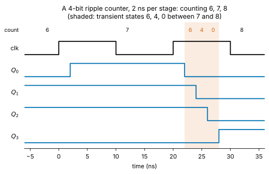
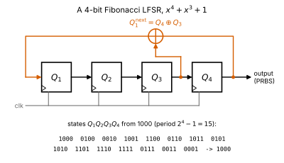

<!-- status: verified -->
# 08-07 · Registers, Counters and Shift Registers

| | |
|---|---|
| **Course** | [08 · Digital Logic Design](../README.md) |
| **University equivalent** | The registers-and-counters chapter of a sophomore digital-design course (Mano & Ciletti, *Digital Design*, ch. 6; Harris & Harris, *Digital Design and Computer Architecture*, §5.4), with linear-feedback shift registers |
| **Prerequisites** | [08-06 Latches, Flip-Flops and Sequential Timing](08-06-latches-and-flip-flops.md) (D flip-flops, enables, setup and hold), [08-01 Number Systems and Codes](08-01-number-systems-and-codes.md) (Gray code, CRCs as polynomial division), [08-05 Verilog and Testbenches](08-05-verilog-and-testbenches.md) |
| **Estimated study hours** | 7 |
| **Last verified** | 2026-11-19 |

**Learning objectives.** After this chapter you can:

1. Build registers with load and enable, and shift registers in all four serial/parallel combinations, including a universal shift register.
2. Design synchronous binary, up/down, modulo-$N$ and BCD counters, and compare them with ripple counters for speed and glitches.
3. Design ring and Johnson counters, count their used and unused states, and decode them.
4. Analyze linear-feedback shift registers (LFSRs) as polynomials over GF(2), test for maximal length, and use them as pseudo-random bit-sequence (PRBS) generators.
5. Compute the maximum clock frequency of counters and the time and power costs of their switching.

---

## 1. Big picture

A single flip-flop stores one bit; a row of them sharing a clock stores a word. With a little logic in front of each flip-flop, that row becomes the workhorse sequential blocks of digital design: registers that hold operands, shift registers that convert between parallel words and serial bit streams, counters that sequence events and divide clocks, and linear-feedback shift registers that generate pseudo-random test patterns. Every one of them is a register plus combinational next-state logic, a pattern that the next chapter generalizes into the finite state machine.

- **Serializers and deserializers.** Every high-speed link (PCIe, Ethernet, USB) turns wide on-chip words into a fast serial stream with a shift register and back again on the other side ([24-03](../../24-high-speed-io-signal-integrity-and-photonics/chapters/24-03-serdes-architecture.md)).
- **Counters everywhere.** Timers, baud-rate generators, address generators for memories and DMA engines, and clock dividers are counters.
- **Pseudo-randomness in hardware.** LFSRs generate the PRBS patterns used to test every serial link, scramble data so that it has enough transitions, and feed built-in self-test of logic and memories ([19-12](../../19-digital-vlsi-design/chapters/19-12-design-for-test.md)).
- **Mathematics in a few gates.** An LFSR is polynomial arithmetic over GF(2), the same algebra as the CRCs of 08-01: a 31-bit register and one XOR gate produce a sequence that repeats only every 2 147 483 647 bits.

## 2. Intuition first

**A bucket brigade.** A shift register is a line of people passing buckets: at each clock tick, every person hands their bucket to the next and takes one from the previous. After $n$ ticks a bucket has traveled the whole line. Loaded all at once and emptied one bucket at a time, the line turns a wide delivery into a stream (serialization); filled one at a time and emptied all at once, it does the reverse.

**An odometer.** A binary counter is the odometer of 08-01 again: the lowest digit turns every tick, and each higher digit turns when every digit below it is at its maximum. Building the counter means building that carry rule in logic. A ripple counter cheats by letting each digit push the next, as in a mechanical odometer, which is simple but makes the higher digits update late.

**A roulette wheel that never repeats too soon.** An LFSR shifts its bits along and feeds back the XOR of a few of them. With the right feedback positions it visits every nonzero state exactly once before repeating, in an order that looks random. *Where the analogy breaks:* a roulette wheel is truly random; an LFSR is completely determined by its starting state and taps. It is predictable to anyone who knows them, which is why LFSRs are used for testing and scrambling but never, alone, for cryptography.

## 3. Theory

### 3.1 Registers

An $n$-bit **register** is $n$ D flip-flops sharing a clock. Common features, each a small piece of logic in front of $D$:

- **Load (enable):** a 2:1 multiplexer per bit chooses between new data and the current value (08-06 §3.5).
- **Reset:** synchronous or asynchronous, as in 08-06.
- **Byte enables:** separate enables for groups of bits, so a processor can write one byte of a 32-bit register.

```verilog
module reg_en #(parameter W = 32) (input wire clk, rst, en, input wire [W-1:0] d, output reg [W-1:0] q);
    always @(posedge clk)
        if (rst)     q <= {W{1'b0}};
        else if (en) q <= d;
endmodule
```

Many registers together, with a decoder selecting which one to write and multiplexers selecting which to read, form a **register file**, the fast scratch memory of a processor ([08-11](08-11-memories-and-programmable-logic.md)).

### 3.2 Shift registers

A **shift register** connects each flip-flop's output to the next one's input. At each clock edge every bit moves one position. By where data enters and leaves, there are four kinds:

- **Serial-in, serial-out (SISO):** a delay line of $n$ clock cycles.
- **Serial-in, parallel-out (SIPO):** a **deserializer**: after $n$ clocks, an $n$-bit word received one bit at a time is available in parallel.
- **Parallel-in, serial-out (PISO):** a **serializer**: load a word, then shift it out one bit per clock.
- **Parallel-in, parallel-out (PIPO):** a register that can also shift.

**Rates.** Serializing $n$-bit words that arrive at a rate $f_{\text{word}}$ requires a bit clock of $n f_{\text{word}}$ (Example 08-07.2). This is why serial links run at many gigabits per second while on-chip logic runs at hundreds of megahertz: the shift register converts a wide, slow interface into a narrow, fast one.

**Universal shift register.** A 4:1 multiplexer in front of each flip-flop, controlled by a 2-bit mode, selects hold, shift right, shift left or parallel load:

```verilog
always @(posedge clk)
    case (mode)
        2'b00: q <= q;                         // hold
        2'b01: q <= {sin_right, q[W-1:1]};     // shift right: a new bit enters at the top
        2'b10: q <= {q[W-2:0], sin_left};      // shift left: a new bit enters at the bottom
        2'b11: q <= d;                         // parallel load
    endcase
```

Shifting left multiplies an unsigned number by 2 (discarding the top bit), and shifting right with the sign bit copied in divides a two's-complement number by 2, rounding toward −∞ (08-05 §3.4).

### 3.3 Synchronous counters

A **synchronous counter** clocks every flip-flop with the same clock and computes the next count with logic: $Q_{\text{next}} = Q + 1$. Where does each bit's logic come from? Adding 1 to a binary number flips bit 0, and flips bit $i$ exactly when every lower bit is 1 (the carry reaches it). So bit $i$ **toggles** when

$$
T_i = Q_0 \cdot Q_1 \cdots Q_{i-1} , \qquad Q_i^{\text{next}} = Q_i \oplus T_i .
$$

The toggle conditions form an AND chain, the carry chain of a half-adder incrementer (08-04 §3.5). Built as a chain of two-input ANDs, $T_{n-1}$ takes $n - 2$ gate delays to settle; built as wide ANDs or a lookahead tree, its delay grows only with $\log_2 n$. The counter's maximum frequency follows from the setup constraint of 08-06: $T_c \ge t_{pcq} + t_{\text{logic}} + t_{\text{setup}}$.

**Variants**, each a small change to the next-state logic:

- **Enable:** count only when EN = 1 ($T_i$ gets an extra factor EN). Cascading counters through their enables (the "terminal count" of one enabling the next) builds long counters.
- **Up/down:** counting down flips bit $i$ when every lower bit is 0.
- **Load:** a multiplexer loads an arbitrary starting value.
- **Modulo $N$:** detect the terminal count $N - 1$ and clear to 0 on the next edge instead of incrementing. Only the bits that are 1 in $N - 1$ need be checked, provided the larger states are unreachable. A **BCD counter** is a modulo-10 counter: it detects 1001 with $Q_3Q_0$ and clears.

**Switching activity.** In a free-running $n$-bit binary counter, bit $i$ toggles once every $2^i$ counts, so the flip-flops make $\sum_{i=0}^{n-1} 2^{n-i} = 2^{n+1} - 2$ toggles per full cycle of $2^n$ counts: almost **2 toggles per count**. A Gray-code counter (08-01 §3.7) toggles exactly **one** bit per count, which halves the switching activity and, more importantly, makes the count safe to sample asynchronously ([08-10](08-10-timing-metastability-cdc.md)).

### 3.4 Ripple counters

A **ripple counter** clocks each flip-flop with the output of the previous one: each stage is a toggle flip-flop (a D flip-flop with $D = \overline{Q}$), which divides its clock frequency by 2. Stage 0 toggles on every clock edge; stage 1 toggles when stage 0 falls from 1 to 0 (on the rising edge of $\overline{Q_0}$); and so on. It needs no counting logic at all.

The cost is timing. A change ripples through the stages one clock-to-Q delay at a time, so stage $n - 1$ settles $n\,t_{cq}$ after the clock edge. During that time the outputs pass through **transient states**: going from 0111 to 1000, the counter briefly reads 0110, 0100 and 0000 (Example 08-07.4). Logic that decodes the count glitches on these states, and a ripple counter's outputs are not synchronous with anything, so they cannot be used as data in a synchronous design without a synchronizer. Ripple counters survive where only the last stage's frequency matters: **clock dividers** and low-power prescalers, where the first stage runs fast and the rest at ever lower rates, saving power.



### 3.5 Ring and Johnson counters

A **ring counter** is a shift register whose output feeds back to its input, initialized with a single 1: 1000 → 0100 → 0010 → 0001 → 1000. It has $n$ states for $n$ flip-flops, and its outputs are already **one-hot**: each state is decoded by reading one flip-flop, with no logic. The price is state efficiency: $n$ flip-flops for $n$ states, against $\lceil\log_2 n\rceil$ for a binary counter.

A **Johnson counter** (twisted-ring counter) feeds back the *complement* of the last stage: 0000 → 1000 → 1100 → 1110 → 1111 → 0111 → 0011 → 0001 → 0000. It has $2n$ states for $n$ flip-flops. Consecutive states differ in exactly one bit (like a Gray code), and each state is decoded by a single two-input AND of two adjacent bits, glitch-free.

**Unused states.** An $n$-bit ring counter uses $n$ of $2^n$ states and a Johnson counter $2n$. If noise, a radiation upset or a bad power-up puts either counter into an unused state, it may cycle among unused states forever (a ring counter loaded with 1100 circulates two 1s). Robust designs add a reset, or self-correcting feedback that steers every unused state back into the main cycle.

### 3.6 Linear-feedback shift registers

An **LFSR** is a shift register whose input is the XOR of selected bits, the **taps**. In the common **Fibonacci** form, stages $Q_1 \ldots Q_n$ shift from $Q_1$ toward $Q_n$, and the new $Q_1$ is the XOR of the tapped stages. It is described by its **characteristic polynomial**: taps at stages $n$ and $k$ give $x^n + x^k + 1$. For example, $x^4 + x^3 + 1$ means $Q_1^{\text{next}} = Q_4 \oplus Q_3$.



**Why the state sequence is periodic, and how long it can be.** The next state is a *linear* function of the current state over GF(2), the two-element field where addition is XOR (08-01 §3.8): $\mathbf{s}_{k+1} = A\,\mathbf{s}_k$ for an $n \times n$ matrix $A$ of 0s and 1s. Three consequences follow:

- The all-zero state maps to itself (XOR of zeros is zero): it is a **lock-up state** and must be avoided at start-up.
- Every other state stays nonzero (the map is invertible, because the oldest bit can always be recovered from the feedback), so the nonzero states split into disjoint cycles.
- There are $2^n - 1$ nonzero states, so no cycle is longer than $2^n - 1$.

An LFSR that reaches this **maximal length** cycles through every nonzero state before repeating; its output is an **m-sequence**. Algebra decides which taps achieve it: **the LFSR has maximal length if and only if its characteristic polynomial is primitive**, meaning it is irreducible (it has no factors, the analogue of a prime number) and the powers of $x$ modulo the polynomial run through all $2^n - 1$ nonzero residues before returning to 1. The proof belongs to a course on finite fields; checking it is mechanical, and the verify script for this chapter does so for every polynomial used here. Example: $x^4 + x^3 + 1$ is primitive, period 15; $x^4 + x^2 + 1 = (x^2 + x + 1)^2$ is not, and its 15 nonzero states fall into cycles of 6, 6 and 3 (Example 08-07.6).

**Properties of an m-sequence of period $N = 2^n - 1$:**

- **Balance:** $2^{n-1}$ ones and $2^{n-1} - 1$ zeros per period.
- **Runs:** half the runs of identical bits have length 1, a quarter length 2, and so on; the longest run is $n$ ones.
- **Autocorrelation:** compared with a shifted copy of itself, it agrees in $(N - 1)/2$ positions and disagrees in $(N + 1)/2$, for every nonzero shift. In ±1 form the correlation is $-1/N$, nearly zero: the sequence looks like white noise to a receiver.

**Uses:**

- **PRBS test patterns.** Link test equipment and on-chip checkers use standard m-sequences, named by their length: PRBS7 ($x^7 + x^6 + 1$), PRBS15, PRBS23 and PRBS31 ($x^{31} + x^{28} + 1$) (§9). The receiver runs the same LFSR, synchronizes to the incoming bits, and counts mismatches to measure the bit-error rate.
- **Scramblers.** XORing data with an m-sequence breaks up long runs of identical bits so that receivers can recover the clock; descrambling with the same sequence restores the data.
- **Built-in self-test.** LFSRs generate pseudo-random test vectors for logic, and a related structure (a multiple-input signature register) compresses the responses ([19-12](../../19-digital-vlsi-design/chapters/19-12-design-for-test.md)).
- **CRCs.** The CRC division of 08-01 is an LFSR with the message fed in: the same polynomial arithmetic.
- **Compact counters.** An LFSR counter needs only one XOR gate for any length, against a carry chain for a binary counter; FPGA designers have long used them when the count sequence does not need to be binary.

> **Going deeper — Galois LFSRs.** An equivalent form puts XOR gates *between* stages, each tapped stage XORing in the output bit as the data shifts past. It has the same period and an equivalent sequence, with only one XOR delay in any path instead of a tree of them: the form used in high-speed CRC and PRBS hardware.

### 3.7 Counter timing and cost

For a synchronous counter, the critical path runs from the lowest bits' flip-flops through the toggle chain to the top bit:

$$
T_c \ge t_{pcq} + t_{\text{chain}} + t_{\text{XOR}} + t_{\text{setup}} ,
$$

where $t_{\text{chain}}$ is the delay to compute $T_{n-1}$. For a ripple counter, the clock can run as fast as the *first* stage allows, but the outputs are valid only $n\,t_{cq}$ after each edge, so anything that decodes them must wait that long. Rings and Johnson counters have no carry chain at all: their next state is a wire (plus one inverter for Johnson), so they run at the flip-flops' maximum speed, which is why they are used as fast sequencers and clock-phase generators.

## 4. Worked examples

### Example 08-07.1 · Driving a universal shift register (tier A)

**Setup.** A 4-bit universal shift register ($Q_3Q_2Q_1Q_0$) holds 1011. It then performs, one per clock: (1) shift right with 0 entering at $Q_3$; (2) shift left with 1 entering at $Q_0$; (3) shift left with 0 entering; (4) parallel load of 1100; (5) hold. Give the contents after each step, as unsigned integers.

**Solution.**

1. Shift right: each bit moves one place toward $Q_0$, $Q_0$'s 1 falls off, and 0 enters at the top: 0101 = **5**.
2. Shift left: each bit moves toward $Q_3$, the top 0 falls off, 1 enters at the bottom: 1011 = **11**.
3. Shift left with 0: 0110 = **6**.
4. Load: 1100 = **12**.
5. Hold: 1100 = **12**.

**Sanity check.** Step 3 is $11 \times 2 = 22$, modulo 16 = 6 ✓: a left shift is multiplication by 2 with the top bit lost.

### Example 08-07.2 · Serializer rates (tier A)

**Setup.** A chip produces 32-bit words at 500 MHz and sends them over one serial lane through a PISO shift register. (a) What bit rate does the lane need? (b) How many bits are in flight in the shift register when it is full? (c) If the lane instead runs at 16 Gb/s and carries 66-bit blocks with 64 data bits each (the 64b/66b line code of [24-05](../../24-high-speed-io-signal-integrity-and-photonics/chapters/24-05-pcie-cxl-ethernet.md)), what data rate does it deliver?

**Solution.** (a) $32 \times 500$ MHz = **16** Gb/s.

(b) A full 32-bit word: **32** bits.

(c) $16 \times 64/66$ = **15.52** Gb/s of data: 3.0% of the line rate is spent on the 2 header bits per block.

**Sanity check.** Bit rate = word width × word rate ✓; the 64/66 ratio is the efficiency of the line code.

### Example 08-07.3 · A synchronous counter and a decade counter (tier B)

**Setup.** (a) A 4-bit synchronous binary counter holds 0110. What does it hold after 5 clock edges? (b) Going from 0111 to 1000, how many bits toggle, and which toggle conditions $T_i$ are true? (c) Over a full cycle of 16 counts, how many bit toggles occur in total, and how many per count on average? (d) A BCD counter detects its terminal count with $Q_3Q_0$. Why is that enough, and how many of the 16 states are unused?

**Solution.** (a) $6 + 5$ = **11** (1011).

(b) All four: $T_0 = 1$ always; $T_1 = Q_0 = 1$; $T_2 = Q_0Q_1 = 1$; $T_3 = Q_0Q_1Q_2 = 1$. **4** toggles, the worst case for a 4-bit counter.

(c) Bit $i$ toggles $16/2^i$ times: $16 + 8 + 4 + 2$ = **30** toggles, **1.875** per count.

(d) The counter only ever visits 0000 to 1001. Among those, 1001 is the only state with both $Q_3 = 1$ and $Q_0 = 1$; states such as 1011 or 1101, which also satisfy $Q_3Q_0$, are never reached (they are don't cares, 08-03 §3.5). **6** states (1010 to 1111) are unused.

**Sanity check.** A Gray-code counter would toggle 16 bits per cycle of 16, exactly 1 per count, against 1.875 here.

### Example 08-07.4 · A ripple counter's transient states (tier B)

**Setup.** A 4-bit ripple counter has $t_{cq}$ = 2 ns per stage. (a) How long after a clock edge are all outputs valid in the worst case? (b) Logic that decodes the count adds 2 ns and must see a stable value before the next edge. What is the maximum clock frequency? (c) List the transient states seen going from 0111 to 1000, and count them.

**Solution.** (a) The change can ripple through all four stages: $4 \times 2$ = **8** ns.

(b) $T_c \ge 8 + 2 = 10$ ns: **100** MHz. (The flip-flops themselves could toggle far faster; the ripple delay, not the flip-flops, limits the usable rate.)

(c) Stage 0 falls at 2 ns (0110), stage 1 at 4 ns (0100), stage 2 at 6 ns (0000), and stage 3 rises at 8 ns (1000). Transient states 0110, 0100, 0000: **3**. A decoder for "count = 0" would glitch high for 2 ns in the middle of a count from 7 to 8.

**Sanity check.** A synchronous counter changes all four bits at the same edge (to within the skew between flip-flops): no transient states.

### Example 08-07.5 · Ring and Johnson counters (tier B)

**Setup.** With 4 flip-flops: (a) how many states does a ring counter have, and how many states are unused? (b) The same for a Johnson counter; list its sequence from 0000. (c) How many flip-flops does a binary counter need for the same number of states as the Johnson counter?

**Solution.** (a) **4** states (one-hot), **12** unused.

(b) 0000, 1000, 1100, 1110, 1111, 0111, 0011, 0001: **8** states, **8** unused. Each state is decoded by a two-input AND of two bits: the states with a boundary between a 1 and a 0 are identified by that boundary (1100 is the only valid state with $Q_2 = 1$ and $Q_1 = 0$, so it is decoded by $Q_2\overline{Q_1}$), and the two states without one by the end bits ($\overline{Q_3}\,\overline{Q_0}$ for 0000, $Q_3Q_0$ for 1111).

(c) $\lceil \log_2 8 \rceil$ = **3** flip-flops, but with a decoder (and a carry chain) instead of single gates.

**Sanity check.** Ring: $n$ states; Johnson: $2n$; binary: $2^n$. Each step up in state efficiency costs decoding logic and, for binary, glitch-prone multi-bit transitions.

### Example 08-07.6 · Which taps give maximal length? (tier B)

**Setup.** For 4-bit Fibonacci LFSRs: (a) with polynomial $x^4 + x^3 + 1$ ($Q_1^{\text{next}} = Q_4 \oplus Q_3$), what is the period from 0001, and how many 1s appear at $Q_4$ in one period? (b) With $x^4 + x^2 + 1$, into which cycle lengths do the 15 nonzero states fall? (c) Why must an LFSR never start at 0000?

**Solution.** (a) Stepping from 0001 visits all 15 nonzero states before returning: period **15** $= 2^4 - 1$, maximal. Balance: **8** ones and 7 zeros per period.

(b) $x^4 + x^2 + 1 = (x^2 + x + 1)^2$ is not irreducible, so it cannot be primitive. Its nonzero states split into cycles of **6**, **6** and **3**: started in the wrong state, it repeats after 3 steps.

(c) 0000 feeds back $0 \oplus 0 = 0$ and stays at 0000 forever: the lock-up state.

**Sanity check.** $6 + 6 + 3 = 15$ ✓: every nonzero state lies on exactly one cycle, as the invertibility argument of §3.6 requires.

### Example 08-07.7 · How long is PRBS31? (tier C)

**Setup.** (a) What is the period of PRBS31 ($x^{31} + x^{28} + 1$), in bits? (b) How long does one period take on a 106.25 Gb/s lane (the 100 Gb/s Ethernet lane rate of [07-10](../../07-circuit-analysis-2-transient-and-ac/chapters/07-10-two-port-networks.md) §9)? (c) How many 1s does one period contain? (d) How long does PRBS7 last on the same lane?

**Solution.** (a) $2^{31} - 1$ = **2 147 483 647** bits (it is maximal length because $x^{31} + x^{28} + 1$ is primitive, which the verify script proves).

(b) $2\,147\,483\,647 / 106.25 \times 10^9$ s = **20.2** ms.

(c) $2^{30}$ = **1 073 741 824** ones.

(d) $(2^7 - 1)/106.25 \times 10^9$ s = **1.195** ns: PRBS7 repeats about 17 million times while PRBS31 completes one period.

**Sanity check.** A long pattern like PRBS31 exercises the receiver with long runs (up to 31 identical bits) and nearly every bit pattern of practical length, while PRBS7 is short enough that a scope can capture complete periods. Test plans use both for that reason.

### Answer key

<!-- answer-key -->
| ID | Quantity | Value | Unit |
|---|---|---|---|
| Ex 08-07.1a | after step 1 | 5 | — |
| Ex 08-07.1b | after step 2 | 11 | — |
| Ex 08-07.1c | after step 3 | 6 | — |
| Ex 08-07.1d | after steps 4 and 5 | 12 | — |
| Ex 08-07.2a | serial bit rate | 16 | Gb/s |
| Ex 08-07.2b | bits in the full shift register | 32 | — |
| Ex 08-07.2c | data rate with 64b/66b | 15.52 | Gb/s |
| Ex 08-07.2d | 64b/66b overhead | 3.0 | % |
| Ex 08-07.3a | count after 5 edges from 6 | 11 | — |
| Ex 08-07.3b | bits toggling from 0111 | 4 | — |
| Ex 08-07.3c | toggles per 16-count cycle | 30 | — |
| Ex 08-07.3d | toggles per count | 1.875 | — |
| Ex 08-07.3e | unused BCD states | 6 | — |
| Ex 08-07.4a | ripple settling time | 8 | ns |
| Ex 08-07.4b | maximum clock with decoding | 100 | MHz |
| Ex 08-07.4c | transient states from 0111 to 1000 | 3 | — |
| Ex 08-07.5a | ring counter states | 4 | — |
| Ex 08-07.5b | ring counter unused states | 12 | — |
| Ex 08-07.5c | Johnson counter states | 8 | — |
| Ex 08-07.5d | Johnson counter unused states | 8 | — |
| Ex 08-07.5e | binary flip-flops for 8 states | 3 | — |
| Ex 08-07.6a | period of $x^4 + x^3 + 1$ | 15 | — |
| Ex 08-07.6b | ones per period | 8 | — |
| Ex 08-07.6c | longest cycle of $x^4 + x^2 + 1$ | 6 | — |
| Ex 08-07.6d | shortest cycle of $x^4 + x^2 + 1$ | 3 | — |
| Ex 08-07.7a | PRBS31 period | 2147483647 | bit |
| Ex 08-07.7b | PRBS31 period at 106.25 Gb/s | 20.2 | ms |
| Ex 08-07.7c | ones per PRBS31 period | 1073741824 | — |
| Ex 08-07.7d | PRBS7 period at 106.25 Gb/s | 1.195 | ns |

## 5. Simulate it

The lab is in [labs/08-07-lab/](../labs/08-07-lab/README.md).

**Notebook** (`08-07-counters-lfsrs.ipynb`):

1. Simulate binary, Gray, ring and Johnson counters and count bit toggles per step.
2. Step an LFSR for every tap pair of 4 to 8 bits and find which give maximal length; compare with a primitivity test.
3. Measure the balance, run lengths and autocorrelation of PRBS7 and PRBS15.
4. Simulate a ripple counter with clock-to-Q delays and plot its transient states.

**Verilog** (`counters.v`, `counters_tb.v`): a universal shift register, a BCD counter, a Johnson counter, and PRBS7 and PRBS15 generators. The testbench replays Example 08-07.1, checks the BCD sequence, checks that the Johnson counter visits 8 states, and measures both PRBS periods and their balance, printing `TEST PASSED`.

**Guided exercise (predict, then run).** Of the 25 possible two-tap feedback polynomials $x^n + x^k + 1$ ($1 \le k < n$) for $n$ = 4 to 8, **before running**, predict roughly what fraction give maximal length. Then let the notebook test every one by stepping the LFSR, and explain why $n = 8$ has none.

## 6. Engineering tradeoffs

| Knob | Improves | Costs | Typical decision owner |
|---|---|---|---|
| Synchronous instead of ripple counters | All bits change together; outputs usable as data | Toggle logic and a carry chain; more power at the top bits | RTL designer |
| Ripple counters (clock dividers) | Minimal logic, low power at low output rates | Accumulated delay, transient states, asynchronous outputs | Clock and low-power designers |
| Ring and Johnson counters | Fastest possible sequencing, glitch-free decoding | $n$ or $2n$ states for $n$ flip-flops; unused-state recovery | Designer of sequencers and clock generators |
| Gray-code counters | One bit changes per count: half the toggles, safe asynchronous sampling | Conversion logic to and from binary | CDC and low-power designers |
| LFSR counters and PRBS | One XOR gate for any length; pseudo-random patterns | Non-binary order; lock-up state; predictable sequence | Test and link designers |
| Wider serializers | Fewer, faster pins | Higher bit rate, harder clocking and equalization | SerDes architect |

## 7. Numbers to know

| Quantity | Value | Note |
|---|---|---|
| States: ring, Johnson, binary with $n$ flip-flops | $n$, $2n$, $2^n$ | §3.5 |
| Binary counter toggles | about 2 per count; Gray code exactly 1 | §3.3 |
| Ripple counter settling | $n\,t_{cq}$ | §3.4 |
| Maximal LFSR period | $2^n - 1$ (all nonzero states) | §3.6 |
| m-sequence balance | $2^{n-1}$ ones and $2^{n-1} - 1$ zeros per period | §3.6 |
| Standard PRBS polynomials | PRBS7 $x^7 + x^6 + 1$; PRBS15 $x^{15} + x^{14} + 1$; PRBS23 $x^{23} + x^{18} + 1$; PRBS31 $x^{31} + x^{28} + 1$ | [R-155](../../../reference/research-log.md#r-155--prbs-and-lfsr-references) **[Established]** (primitivity machine-checked) |
| PRBS periods | 127; 32 767; 8 388 607; 2 147 483 647 bits | §3.6 |

<!-- answer-key -->
| ID | Quantity | Value | Unit |
|---|---|---|---|
| N 08-07.a | PRBS7 period | 127 | bit |
| N 08-07.b | PRBS15 period | 32767 | bit |
| N 08-07.c | PRBS23 period | 8388607 | bit |

## 8. Common mistakes

1. **Shifting in the wrong direction.** Define which end is the most significant bit before writing the shift; "right" and "left" are relative to that choice.
2. **Decoding a ripple counter's outputs with combinational logic.** Transient states produce glitches; synchronize, or use a synchronous counter.
3. **Forgetting the unused states.** Ring and Johnson counters (and state machines) can be stuck in unused states after a disturbance; reset them or make them self-correcting.
4. **Starting an LFSR at zero.** It never leaves; reset to a nonzero seed.
5. **Picking LFSR taps by guesswork.** Most tap choices are not maximal length; use a published primitive polynomial or test it.
6. **Treating an LFSR as a source of secrets.** Its sequence follows from $2n$ observed bits; it is a test and scrambling tool, not encryption.
7. **Counting with the modulo-$N$ terminal count but clearing asynchronously.** The counter visits state $N$ for a moment before the clear takes effect, producing a glitch; clear synchronously on the terminal count $N - 1$.

## 9. Practitioner lens

### State of the art (as of Nov 2026)

- **Standard PRBS patterns** ([R-155](../../../reference/research-log.md#r-155--prbs-and-lfsr-references)). Link test equipment and transceiver test modes use the ITU-T O.150 and O.151 polynomials: PRBS7 ($x^7 + x^6 + 1$), PRBS15 ($x^{15} + x^{14} + 1$), PRBS23 ($x^{23} + x^{18} + 1$) and PRBS31 ($x^{31} + x^{28} + 1$), as listed in Intel's and AMD's transceiver documentation **[Established]** (the attributions come from search excerpts; that each polynomial is primitive, so the sequences are maximal length, is proved by this chapter's verify script). IEEE 802.3 defines a PRBS31 test pattern for 10GBASE-R (clause 49.2.8), the bit-inverse of the O.150 sequence, and later clauses carry it into the 200G-per-lane generation as PRBS31Q, its PAM4 form **[Established]** (from search excerpts of 802.3 task-force material).
- **LFSR tap tables.** Xilinx application note XAPP052 (Peter Alfke, 1996) tabulated maximum-length taps for LFSRs of 3 to 168 bits, based on unpublished 1970 work by Wayne Stahnke at Fairchild, and it is still the table FPGA designers reach for **[Established]** (from search excerpts of university-hosted copies).

<!-- answer-key -->
| ID | Quantity | Value | Unit |
|---|---|---|---|
| PL 08-07.a | longest run of ones in PRBS31 | 31 | bit |
| PL 08-07.b | longest run of zeros in PRBS31 | 30 | bit |

### Why it matters commercially

- **Every link is qualified with PRBS.** Before a SerDes product ships, its bit-error rate is measured for hours with PRBS patterns; test equipment for this is a market of its own, and built-in PRBS generators and checkers are standard features of every transceiver IP block.
- **Counters and shift registers are cheap but everywhere.** They rarely differentiate a product, but their power adds up: free-running counters and wide shift registers in always-on blocks (timers, real-time clocks) are prime targets for Gray coding, clock gating and ripple prescalers in low-power MCUs.
- **Built-in self-test saves test time.** LFSR-driven BIST lets a chip test its own memories and logic at speed, cutting time on expensive automatic test equipment, a direct cost lever in high-volume parts ([19-12](../../19-digital-vlsi-design/chapters/19-12-design-for-test.md), [25-11](../../25-fabrication-packaging-test-and-reliability/chapters/25-11-test-ate-sort-burn-in.md)).

### Marketing vs Reality

- **"Error-free with PRBS31 for X hours."** *Reality:* the meaningful number is the bit-error-rate bound that observation supports: with zero errors in $N$ bits, the 95% upper bound is about $3/N$ (the "rule of three" of [03-05](../../03-probability-statistics-and-random-variables/chapters/03-05-estimation-and-hypothesis-testing.md)). *Sanity check:* convert hours and bit rate into bits, and ask whether the pattern, temperature and channel were worst case.
- **"PRBS31 tests all bit patterns."** *Reality:* every 31-bit pattern but one (all zeros, or all ones in the inverted form) appears exactly once per period, but real traffic with long runs or specific spectra (scrambled or encoded data) can stress a receiver differently. *Sanity check:* ask which patterns were used and why.
- **"Our counter design is glitch-free."** *Reality:* only if outputs are registered or Gray coded; decoded binary or ripple counter outputs glitch. *Sanity check:* ask how counter outputs that leave the clock domain are encoded.

### Questions for engineering leaders

1. **"How do you measure the bit-error rate of your links, and to what confidence?"**
   - *Strong:* PRBS patterns per the standard, BER targets with statistical confidence bounds, worst-case channels and temperatures.
   - *Evasive:* "no errors in the lab."
2. **"Which counters in the design cross clock domains or drive asynchronous logic, and how are they encoded?"**
   - *Strong:* Gray-coded pointers and registered outputs, verified by CDC tools.
   - *Evasive:* "everything is synchronous."
3. **"How do your state machines and counters recover from unused states?"**
   - *Strong:* resets and self-correcting next-state logic, checked in simulation by forcing illegal states.
   - *Evasive:* "they cannot get there."

## 10. Concept check

**Q1.** What are SIPO and PISO shift registers used for in a serial link?

<details><summary>Answer</summary>

A PISO (parallel-in, serial-out) register serializes a word for transmission, one bit per bit-clock; a SIPO (serial-in, parallel-out) register deserializes the received stream back into words.

</details>

**Q2.** When does bit $i$ of a synchronous binary up-counter toggle?

<details><summary>Answer</summary>

When every lower bit is 1: $T_i = Q_0 Q_1 \cdots Q_{i-1}$, because that is when the incrementer's carry reaches bit $i$.

</details>

**Q3.** Why does a ripple counter produce transient states?

<details><summary>Answer</summary>

Each stage is clocked by the previous stage's output, so a change ripples through the stages one clock-to-Q delay at a time. In between, some bits have their new values and some their old ones.

</details>

**Q4.** How many states do ring and Johnson counters have with $n$ flip-flops, and what is the advantage of each?

<details><summary>Answer</summary>

Ring: $n$ states, already one-hot (no decoding). Johnson: $2n$ states, each decoded by a single two-input AND, with one bit changing per step. Both run at the flip-flops' full speed.

</details>

**Q5.** Why can an LFSR never have more than $2^n - 1$ states in its cycle?

<details><summary>Answer</summary>

The all-zero state maps to itself, so a cycle can contain only nonzero states, and there are $2^n - 1$ of those.

</details>

**Q6.** What property of the feedback polynomial makes an LFSR maximal length?

<details><summary>Answer</summary>

The polynomial must be primitive: irreducible over GF(2), with $x$ generating all $2^n - 1$ nonzero residues. Then the LFSR visits every nonzero state.

</details>

**Q7.** How many ones and zeros are in one period of a maximal-length 7-bit LFSR sequence?

<details><summary>Answer</summary>

64 ones and 63 zeros ($2^{n-1}$ and $2^{n-1} - 1$), out of a period of 127.

</details>

**Q8.** Why is a Gray-code counter preferred for a FIFO pointer that another clock domain reads?

<details><summary>Answer</summary>

Exactly one bit changes per count, so a sample taken during a change is either the old or the new value, never a wildly wrong mixture as with binary counters.

</details>

Practice problems: [problems/08-07-problems.md](../problems/08-07-problems.md) · Solutions: [solutions/08-07-solutions.md](../solutions/08-07-solutions.md)

## 11. Key terms

[Register](../../../reference/glossary.md#register) ·
[Shift register](../../../reference/glossary.md#shift-register) ·
[Serializer and deserializer](../../../reference/glossary.md#serializer-and-deserializer) ·
[Synchronous counter](../../../reference/glossary.md#synchronous-counter) ·
[Ripple counter](../../../reference/glossary.md#ripple-counter) ·
[Modulo-N counter](../../../reference/glossary.md#modulo-n-counter) ·
[Ring counter](../../../reference/glossary.md#ring-counter) ·
[Johnson counter](../../../reference/glossary.md#johnson-counter) ·
[Linear-feedback shift register (LFSR)](../../../reference/glossary.md#linear-feedback-shift-register-lfsr) ·
[Primitive polynomial](../../../reference/glossary.md#primitive-polynomial) ·
[Pseudo-random bit sequence (PRBS)](../../../reference/glossary.md#pseudo-random-bit-sequence-prbs) ·
[Scrambler](../../../reference/glossary.md#scrambler)

## 12. Connections

- **Builds on:** [08-06](08-06-latches-and-flip-flops.md) (flip-flops, enables, timing), [08-01](08-01-number-systems-and-codes.md) (Gray code; CRCs as polynomial division over GF(2)), [08-04](08-04-combinational-building-blocks.md) (multiplexers, the incrementer's carry chain).
- **Next:** [08-08](08-08-finite-state-machines.md) generalizes counters into finite state machines with arbitrary next-state logic.
- **Used later:**
  - [08-10](08-10-timing-metastability-cdc.md) uses Gray-coded counters as FIFO pointers between clock domains;
  - [08-11](08-11-memories-and-programmable-logic.md) builds register files from registers, decoders and multiplexers;
  - [24-03](../../24-high-speed-io-signal-integrity-and-photonics/chapters/24-03-serdes-architecture.md) and [24-05](../../24-high-speed-io-signal-integrity-and-photonics/chapters/24-05-pcie-cxl-ethernet.md) build serializers, line codes, scramblers and PRBS checkers;
  - [19-12](../../19-digital-vlsi-design/chapters/19-12-design-for-test.md) uses LFSRs and signature registers for built-in self-test;
  - [17-08](../../17-communication-systems/chapters/17-08-channel-coding.md) returns to polynomial codes over GF(2).

## 13. Further study

- **Mano & Ciletti, *Digital Design*:** ch. 6 (registers and counters).
- **Harris & Harris, *Digital Design and Computer Architecture* (RISC-V Edition):** §5.4 (sequential building blocks: counters, shift registers).
- **S. W. Golomb, *Shift Register Sequences*:** the classic treatment of m-sequences and their properties.
- **P. Alfke, Xilinx XAPP052, "Efficient Shift Registers, LFSR Counters, and Long Pseudo-Random Sequence Generators" (1996):** practical LFSR design and the tap table.

## 14. Sources

1. Research log [R-155](../../../reference/research-log.md#r-155--prbs-and-lfsr-references): Intel E-Tile Transceiver PHY User Guide and AMD transceiver documentation (PRBS polynomials, ITU-T O.150/O.151); IEEE 802.3 PRBS31 test pattern (clause 49.2.8) and P802.3dj material; Xilinx XAPP052 (1996).
2. Textbook alignment as listed in §13. All text, examples and problems in this chapter are original.
