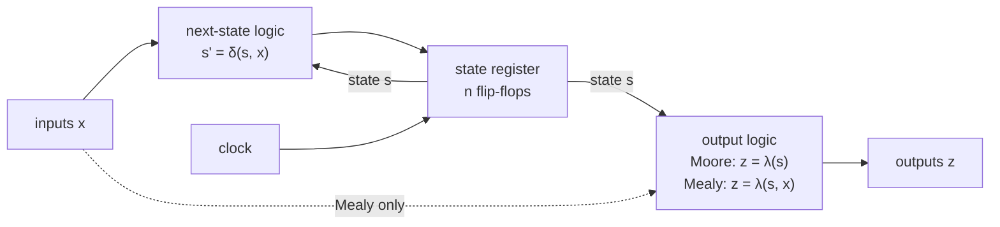
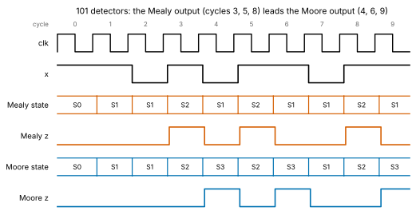
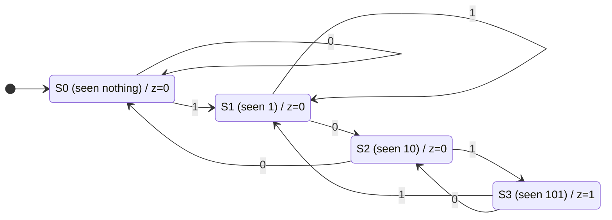
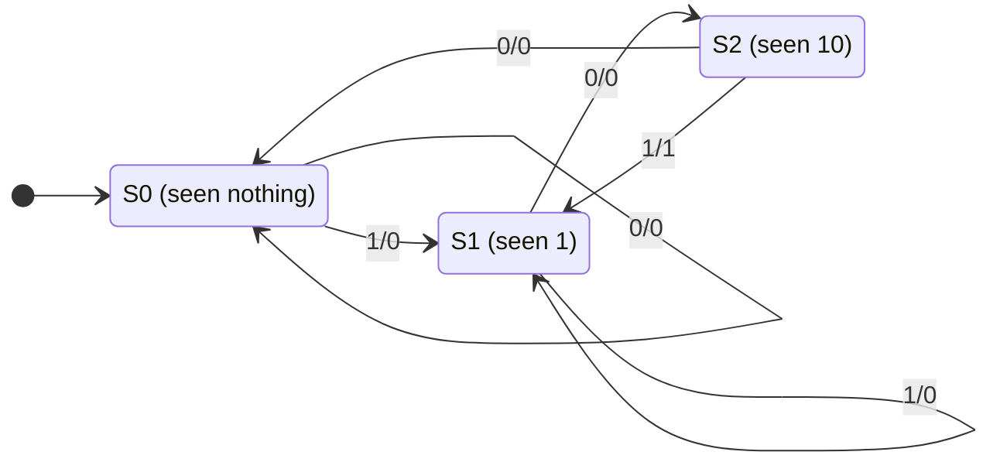

<!-- status: reviewed -->
# 08-08 · Finite State Machines

| | |
|---|---|
| **Course** | [08 · Digital Logic Design](../README.md) |
| **University equivalent** | The synchronous sequential circuits chapter of a sophomore digital-design course (Mano & Ciletti, *Digital Design*, ch. 5; Harris & Harris, *Digital Design and Computer Architecture*, §3.4), with state minimization as in Kohavi & Jha, *Switching and Finite Automata Theory* |
| **Prerequisites** | [08-07 Registers, Counters and Shift Registers](08-07-registers-counters-shift-registers.md), [08-06 Latches, Flip-Flops and Sequential Timing](08-06-latches-and-flip-flops.md) (setup, hold, clock-to-Q), [08-03 Logic Minimization](08-03-logic-minimization.md) (Karnaugh maps, don't cares), [08-05 Verilog and Testbenches](08-05-verilog-and-testbenches.md) |
| **Estimated study hours** | 12 |
| **Last verified** | 2026-11-19 |

**Learning objectives.** After this chapter you can:

1. Model a synchronous circuit as a finite state machine (state register, next-state logic, output logic), analyze a given clocked circuit into its state table, and distinguish Moore and Mealy machines by when their outputs respond.
2. Turn a word specification into a complete, deterministic state diagram and state table, including the reset state and every input combination.
3. Choose a state encoding (binary, Gray-ordered, one-hot) and derive the next-state and output equations, counting flip-flops, logic and illegal states, with D flip-flops or, through excitation tables, with JK and T flip-flops.
4. Minimize the number of states of a machine by partition refinement.
5. Compute an FSM's maximum clock frequency, and the latency and timing effects of Mealy and registered outputs.
6. Write FSMs in Verilog in the three-block style with safe defaults, and verify them against a reference model.

---

## 1. Big picture

Counters (08-07) step through a fixed sequence. A **finite state machine (FSM)** generalizes them: it remembers a finite amount of history in its state register and decides, from that state and its inputs, what to do next. Almost every piece of control in a chip is an FSM: whatever decides *when* things happen, as opposed to the datapath that computes *what* happens. The theory is small and old (it dates from the 1950s), but it is the vocabulary in which hardware control is designed, coded, synthesized and verified.

- **Protocol engines.** A PCIe link trains itself through a defined state machine (Detect, Polling, Configuration, ..., L0) before any data moves ([24-05](../../24-high-speed-io-signal-integrity-and-photonics/chapters/24-05-pcie-cxl-ethernet.md)); USB, Ethernet, I²C and UART controllers are FSMs too ([18-05](../../18-embedded-systems-and-microcontrollers/chapters/18-05-gpio-uart-spi-i2c.md)).
- **Processor control.** The control unit of a simple processor decodes instructions into control signals, and multicycle processors sequence their steps with an FSM ([14-05](../../14-computer-organization-and-architecture/chapters/14-05-single-cycle-datapath.md)).
- **Power management.** The run, sleep and deep-sleep modes of a microcontroller, and the order in which clocks and power domains turn on and off, are sequenced by state machines ([18-09](../../18-embedded-systems-and-microcontrollers/chapters/18-09-ultra-low-power-design.md)).
- **Everyday glue.** Button debouncers, arbiters, memory-controller command sequencers, DMA engines and test controllers.

## 2. Intuition first

**A loan's payment status.** A credit analyst tracks each loan as *current*, *30 days late*, *60 days late*, *default* or *cured*. Each month (the clock tick), the loan moves to a new status that depends only on its current status and this month's event (paid or missed), and the status alone determines what happens next: you do not need the loan's full payment history, only which box it is in. That is exactly a state: a summary of the past that is sufficient for the future. A credit-rating transition matrix is the probabilistic version of this machine. *Where the analogy breaks:* a hardware FSM is deterministic (the same state and input always give the same next state), it changes state only at clock edges, and its set of states is fixed when the chip is designed.

**A combination lock.** To open on the sequence 3-1-4, a lock needs to remember only how much of the code it has seen so far: nothing, "3", "3-1". Those three situations, plus "open", are its states. A wrong digit sends it back, not necessarily to the start: in a lock for 3-3-1, the input 3-3-3-1 must open it, because after 3-3-3 the last two digits are still a valid beginning. Getting these "partial match" transitions right is most of the work in designing sequence detectors.

**The structure.** Every synchronous FSM is the same three blocks: a register holding the state, combinational logic computing the next state from the state and the inputs, and combinational logic computing the outputs.



## 3. Theory

### 3.1 What a finite state machine is

A finite state machine is a six-tuple $(S, I, O, \delta, \lambda, s_0)$:

- $S$, a finite set of **states**;
- $I$, the set of input values (with $k$ input bits, $|I| = 2^k$);
- $O$, the set of output values;
- $\delta: S \times I \to S$, the **next-state function**;
- $\lambda$, the **output function**: $\lambda: S \to O$ for a **Moore machine**, or $\lambda: S \times I \to O$ for a **Mealy machine**;
- $s_0 \in S$, the **reset state**.

In a synchronous implementation, the state is held in a register of $n$ flip-flops, which must be enough to give every state its own code:

$$
n \ge \lceil \log_2 |S| \rceil .
$$

At each active clock edge the register loads $\delta(s, x)$, computed by combinational logic from the present state $s$ and the present input $x$. Between edges, the state is constant. The behavior over time is

$$
s_{t+1} = \delta(s_t, x_t), \qquad z_t = \lambda(s_t)\ \ \text{(Moore)}\quad\text{or}\quad z_t = \lambda(s_t, x_t)\ \ \text{(Mealy)},
$$

where $t$ counts clock cycles: $s_t$ is the state during cycle $t$ and $x_t$ the input sampled at the end of it.

To specify a machine completely you must give $\delta$ for every pair of state and input: $|S| \cdot 2^k$ transitions. A machine with 5 states and 3 input bits has 40 arrows to get right, which is why designers group inputs ("if `req` is high, regardless of the others") and why verification asks for **transition coverage**, not just state coverage. Counters are the special case with no inputs except an enable, so each state has one successor.

**Two representations.** A **state diagram** draws states as circles and transitions as arrows labeled with the input condition (and, for Mealy machines, the output: "1/0" means input 1, output 0). A **state table** lists, for each present state, the next state and output for every input. They carry the same information; the diagram is for thinking, the table for deriving logic.

### 3.2 Moore and Mealy machines

The two kinds differ only in what the outputs may depend on, but that difference controls their timing.

**Moore.** The output depends on the state alone. It can change only after a clock edge (one clock-to-Q delay plus the output logic later), and it is stable for the whole cycle no matter what the inputs do. A Moore machine reacts to an input in the *next* cycle: the input moves the state at the edge, and the new state then shows the new output.

**Mealy.** The output depends on the state and the present input. It can change at any time during the cycle, as soon as the input does, so a Mealy machine reacts in the *same* cycle. Three consequences follow:

- **Fewer states.** Because the output can be attached to a transition rather than a state, a Mealy machine often needs fewer states (Example 08-08.2).
- **A combinational path from input to output.** Glitches on the input pass to the output, and the timing path continues through the machine into whatever logic uses its output (§3.6).
- **Risk of combinational loops.** If the Mealy output of one machine feeds the input of another whose Mealy output feeds back to the first, the loop has no register in it: a combinational loop that can oscillate or latch.



*Figure 1. Moore and Mealy 101 detectors on the same input: the Mealy output responds in the cycle the completing input arrives, the Moore output one cycle later.*

**Converting between them.** The behaviors are interchangeable up to a one-cycle shift.

*Moore to Mealy.* The Moore output in cycle $t + 1$ is

$$
z_{t+1} = \lambda(s_{t+1}) = \lambda\big(\delta(s_t, x_t)\big),
$$

which depends only on $s_t$ and $x_t$. So a Mealy machine with the same states and the output function $\lambda'(s, x) = \lambda(\delta(s, x))$ produces the same output sequence one cycle earlier. Its states may then turn out to be equivalent and mergeable (Problem 08-08.13).

*Mealy to Moore.* Give each state one copy for every output value with which it can be entered: a state $s$ entered with output 0 on some arrows and 1 on others becomes $s/0$ and $s/1$. The Moore machine has at most $|S| \cdot |O|$ states, usually fewer, and its outputs come one cycle later.

> **Going deeper — registered outputs.** Putting a flip-flop on a Mealy output removes the combinational path and gives the output exactly the timing of the equivalent Moore machine: the registered value in cycle $t + 1$ is $\lambda(s_t, x_t)$, the same as the Moore output above. Many design guides recommend registered outputs on every block boundary for this reason; the cost is a flip-flop per output and, compared with the raw Mealy output, one cycle of latency.

### 3.3 From words to a state diagram

The hard part of FSM design is not the logic but deciding what the states are. A reliable method:

1. **Decide what must be remembered.** A state is a summary of the input history that is sufficient to determine all future behavior. Two histories that will produce the same outputs for every possible future input can share a state; two that might not, cannot.
2. **Name the states by what they mean** ("seen 1", "seen 10"), not by numbers.
3. **For every state, draw an arrow for every input value.** Check that the diagram is **complete** (no state lacks an arrow for some input) and **deterministic** (no state has two arrows for the same input).
4. **Define the reset state** and how the machine gets there.

**A sequence detector.** Design a machine whose output $z$ is 1 when the last three input bits are 1, 0, 1 (overlapping occurrences count: in 10101 the pattern appears twice). The only history that matters is how much of the pattern the most recent bits match: the longest suffix of the input so far that is also a prefix of "101". There are three possibilities for a Mealy machine, "" (nothing useful), "1" and "10"; a Moore machine also needs "101", a state in which the output is 1.

The subtle arrows are the ones that leave a partial match. From "10", input 0 gives the history "...100", whose longest suffix that begins the pattern is empty: back to "". From "101" (Moore), input 1 gives "...1011", whose useful suffix is "1"; input 0 gives "...1010", whose useful suffix is "10", so the detector can find the next occurrence that overlaps the last one. A **non-overlapping** detector would instead return to "" after each detection.

**Moore detector for 101** (state name / output):



**Mealy detector for 101** (arrows labeled input/output):



The Mealy machine has three states because the detection is an *event on an arrow* (from "10" on input 1) rather than a place. Applying the Mealy-to-Moore construction of §3.2: only S1 is entered with both output values (0 from S0 and S1, 1 from S2), so it splits into S1/0 and S1/1. The second copy is the Moore S3, with the same successors as S1, giving 4 states, below the bound $3 \times 2 = 6$.

### 3.4 State tables and state assignment

The **state assignment** (or **state encoding**) gives each state a binary code. It decides how many flip-flops the machine uses and how complex its logic is. The main choices:

| Encoding | Flip-flops for $N$ states | Next-state logic | Notes |
|---|---|---|---|
| Binary (minimal) | $\lceil \log_2 N \rceil$ | Dense; each bit depends on many states | Fewest flip-flops |
| Gray-ordered or adjacency-based | $\lceil \log_2 N \rceil$ | Often simpler, fewer toggles | States with common successors or predecessors get codes differing in one bit |
| One-hot | $N$ | One small term per incoming arrow | Fast and regular; $2^N - N$ illegal codes |
| Output-encoded | at least $\lceil \log_2 N \rceil$ | Outputs are state bits directly | No output logic, glitch-free Moore outputs |


*Figure 2. State-register area against the number of states in SKY130: one-hot grows linearly, binary by one flip-flop per doubling.*

**Binary encoding of the Moore 101 detector.** Assign S0 = 00, S1 = 01, S2 = 10, S3 = 11 (bits $q_1 q_0$). The state table, read off the diagram:

| $q_1 q_0$ | state | $x = 0$: next | $x = 1$: next | $z$ |
|---|---|---|---|---|
| 00 | S0 | 00 | 01 | 0 |
| 01 | S1 | 10 | 01 | 0 |
| 10 | S2 | 00 | 11 | 0 |
| 11 | S3 | 10 | 01 | 1 |

Each next-state bit is a Boolean function of $(q_1, q_0, x)$, minimized with a Karnaugh map as in [08-03](08-03-logic-minimization.md):

- $q_0^{+}$ is 1 exactly when $x = 1$ (every "x = 1" entry ends in 1): $q_0^{+} = x$.
- $q_1^{+}$ is 1 for $(q_1q_0x)$ = 010, 110 and 101. The first two form the cube $q_0\overline{x}$; 101 has no neighbor that is also 1, so it stays a full product: $q_1^{+} = q_0\overline{x} + q_1\overline{q_0}x$.
- $z = q_1 q_0$.

**One-hot encoding** gives each state its own flip-flop, exactly one of which is 1. The next-state equation of each state bit collects its incoming arrows: *state $j$ is next if we are in some state $i$ with an arrow to $j$ and that arrow's input condition holds*:

$$
S_j^{+} = \sum_{\text{arrows } i \to j} S_i \cdot c_{ij}(x) ,
$$

where the sum is OR and $c_{ij}$ is the arrow's condition. For the Moore 101 detector: $S_0^{+} = \overline{x}(S_0 + S_2)$, $S_1^{+} = x(S_0 + S_1 + S_3)$, $S_2^{+} = \overline{x}(S_1 + S_3)$, $S_3^{+} = xS_2$, and $z = S_3$. The equations are written straight from the diagram with no Karnaugh map, each is shallow, and adding a state or an arrow changes only a few terms. The price is flip-flops, and many illegal codes (§3.7).

**Why encoding matters.** The same machine can have very different logic under different encodings. For the 110 detector of Problem 08-08.5, a straightforward binary assignment needs 16 literals of minimized logic and a Gray-ordered one needs 7: codes for states that lead to the same place should differ in as few bits as possible, so their terms merge on the Karnaugh map. Classical heuristics formalize this (give adjacent codes to states with a common successor, to successors of a common state, and to states with the same output), but synthesis tools now try encodings automatically (§9).

<!-- answer-key -->
| ID | Quantity | Value | Unit |
|---|---|---|---|
| Th 08-08.a | arrows for 5 states and 3 input bits | 40 | — |
| Th 08-08.b | Moore bound for the Mealy 101 detector | 6 | — |
| Th 08-08.c | 110 detector literals, straightforward binary | 16 | — |
| Th 08-08.d | 110 detector literals, Gray-ordered | 7 | — |

### 3.5 State minimization

Two states are **equivalent** if, started in either one, the machine produces the same output sequence for every input sequence. Equivalent states can be merged without changing the machine's behavior, saving flip-flops and logic, so a design written for clarity (one state per situation the specification names) can be reduced mechanically.

Checking "every input sequence" directly is impossible: there are infinitely many. The trick is to build equivalence up by sequence length. Call states $s$ and $t$ **$k$-equivalent** ($s \equiv_k t$) if they produce the same outputs for every input sequence of length up to $k$.

- For a Moore machine, $s \equiv_0 t$ means $\lambda(s) = \lambda(t)$: the same output now.
- **Recursive step.** $s \equiv_{k+1} t$ if and only if $s \equiv_k t$ and, for every input $x$, $\delta(s, x) \equiv_k \delta(t, x)$.

*Proof of the recursive step.* An input sequence of length $k + 1$ is a first input $x$ followed by a sequence $w$ of length $k$. The output sequence from $s$ is $\lambda(s)$ followed by the outputs from $\delta(s, x)$ on $w$. These agree with the outputs from $t$ for every $x$ and $w$ exactly when the first outputs agree (part of $s \equiv_k t$) and the outputs from $\delta(s, x)$ and $\delta(t, x)$ agree on every $w$ of length $k$, that is, $\delta(s, x) \equiv_k \delta(t, x)$. (For a Mealy machine, replace the first output by the arrow outputs: $s \equiv_1 t$ means $\lambda(s, x) = \lambda(t, x)$ for every $x$, and the recursion is the same.) ∎

This gives **partition refinement** (E. F. Moore's 1956 algorithm):

1. $P_0$: group the states by their outputs (for Mealy: by their whole output row).
2. $P_{k+1}$: split each block of $P_k$ so that two states stay together only if, for every input, their next states lie in the same block of $P_k$.
3. Stop when $P_{k+1} = P_k$. Its blocks are the equivalence classes; each becomes one state of the minimal machine.

*Why it stops, and why the answer is right.* Each step either splits at least one block or changes nothing, and there can never be more blocks than states, so the partition stops changing after at most $|S| - |P_0|$ splitting steps. Once $P_{k+1} = P_k$, the recursive step produces the same partition forever after, so $k$-equivalence for this $k$ already equals equivalence for all lengths.

Example 08-08.4 reduces a 7-state machine to 4 states this way. Two cautions:

- **Fewer states is not always less logic.** Merging can make the next-state functions more complex; the encoding usually matters more than the last state saved.
- **Incompletely specified machines are harder.** When some transitions or outputs are don't cares, "equivalence" is no longer transitive, and finding the minimal machine is a much harder problem (NP-hard in general); designers rarely need the exact minimum.

> **Going deeper — the Myhill–Nerode view.** A state is a class of input histories that no future input can tell apart by the outputs. The minimal machine has one state per class and is unique up to renaming; partition refinement finds the classes, and §3.3 found them directly by asking which suffixes matter.

### 3.6 Timing of FSMs

An FSM is a register with combinational logic around it, so the setup and hold constraints of [08-06](08-06-latches-and-flip-flops.md) apply directly. For the loop from the state register back to itself,

$$
T_c \ge t_{pcq} + t_{\text{next-state}} + t_{\text{setup}} , \qquad t_{ccq} + t_{cd,\text{next-state}} \ge t_{\text{hold}} ,
$$

where $t_{\text{next-state}}$ is the longest path through the next-state logic and $t_{cd,\text{next-state}}$ the shortest. One-hot encoding usually shortens $t_{\text{next-state}}$, because each next-state bit is a small OR of ANDs, while binary encodings need deeper logic that combines many states into each bit (Example 08-08.5).

**Outputs.** A Moore output is valid $t_{pcq} + t_{\text{output}}$ after the edge and then stays put. A Mealy output adds a path from the machine's *inputs* to its outputs, which joins whatever paths lead to those inputs and away from those outputs. If an input comes from a register through logic of delay $t_{\text{in}}$, and the Mealy output feeds logic of delay $t_{\text{down}}$ before the next register, the path

$$
T_c \ge t_{pcq} + t_{\text{in}} + t_{\text{Mealy}} + t_{\text{down}} + t_{\text{setup}}
$$

spans both blocks, and neither block's designer sees it alone. Registering the output splits it in two, at the cost of a cycle of latency. Inputs that arrive through logic also lengthen the path *into* the state register, for Moore and Mealy machines alike: $T_c \ge t_{pcq} + t_{\text{in}} + t_{\text{next-state, from the input}} + t_{\text{setup}}$, which registering the outputs does not shorten.

**Asynchronous inputs.** An input that is not synchronized to the clock (a button, a signal from another clock domain) can change just before an edge. If it feeds several next-state bits, some flip-flops may see the old value and some the new one, so the machine can land in a state that neither input value leads to, or in an illegal code (in a one-hot machine: zero or two bits set). Each such input must pass through a synchronizer (two flip-flops in series) before it reaches the next-state logic, and the synchronized signal must be the only copy used. The reasons, and the probability that a synchronizer itself fails, are the subject of [08-10](08-10-timing-metastability-cdc.md).

### 3.7 Illegal states and safe machines

With $n$ flip-flops and $N$ states there are $2^n - N$ **illegal** (unused) codes: zero for a binary machine whose $N$ is a power of 2, and $2^N - N$ for one-hot. In correct operation the machine never visits them, but it can get there through:

- power-up without a reset;
- a timing violation or an unsynchronized input (§3.6);
- a **single-event upset**, a bit flipped by a particle strike, which matters in automotive, aerospace and large datacenter fleets ([25-10](../../25-fabrication-packaging-test-and-reliability/chapters/25-10-qualification-and-functional-safety.md)).

Once there, a machine whose next-state logic treated illegal codes as don't cares may cycle among them forever: the same trap as the ring counter loaded with 1100 in 08-07.

**Detecting a flipped bit** is a coding question ([08-01](08-01-number-systems-and-codes.md) §3.8). One-hot codes are at Hamming distance 2 from each other: flipping any single bit produces zero or two 1s, always illegal, so every single upset is detectable. Dense binary codes are at distance 1 from their neighbors: a flip usually lands on another *legal* state and cannot be detected at all. Codes with minimum distance 3 can even *correct* a single flip. Example 08-08.7 and Problem 08-08.14 put numbers on this.

**Safe design practice:**

- Reset every FSM to a known state, synchronously released (08-06).
- Give every `case` statement a `default` that sends illegal codes to a safe state.
- Remember that synthesis tools may re-encode the machine (§3.8), which changes which codes are illegal, so a `default` written for the RTL's encoding is not a guarantee. Tools provide explicit options for safe machines (§9).

### 3.8 FSMs in Verilog

The style that synthesizes predictably and reads clearly separates the three blocks of the structure diagram. Here is the Moore 101 detector, in Verilog-2005 so that it runs on Icarus Verilog as written:

```verilog
module det101_moore (input wire clk, input wire rst, input wire x, output wire z);
    localparam [1:0] S0 = 2'd0, S1 = 2'd1, S2 = 2'd2, S3 = 2'd3;
    reg [1:0] state, next;

    // 1. state register: the only flip-flops, with synchronous reset
    always @(posedge clk)
        if (rst) state <= S0;
        else     state <= next;

    // 2. next-state logic: combinational, with a default for every path
    always @(*) begin
        next = S0;                       // default: illegal codes go to reset
        case (state)
            S0: next = x ? S1 : S0;
            S1: next = x ? S1 : S2;
            S2: next = x ? S3 : S0;
            S3: next = x ? S1 : S2;
            default: next = S0;
        endcase
    end

    // 3. output logic: Moore, from the state only
    assign z = (state == S3);
endmodule
```

The rules behind this style come from [08-05](08-05-verilog-and-testbenches.md):

- Non-blocking assignments in the clocked block, blocking assignments in the combinational one.
- The combinational block assigns `next` on every path (here by a default at the top), so no latch is inferred.
- The states are named constants, so the code reads like the diagram. In SystemVerilog, `typedef enum` does the same with type checking.

**What synthesis does with it.** Synthesis tools recognize this pattern as an FSM: a state register whose next value is chosen by a tree of multiplexers from constants and its own old value, compared only with constants. They then extract the state diagram, remove unreachable states, and may **re-encode** the machine: the codes you wrote are a suggestion. Coding that hides the pattern (doing arithmetic on the state, or making the state register a module output) can stop the tool from recognizing the FSM at all (§9).

**Verifying an FSM.** A testbench drives random and directed input sequences and compares the outputs with a reference model, a few lines of software that implement the specification directly (for the detector: "were the last three inputs 1, 0, 1?"). The coverage questions are:

- Was every state visited?
- Was every transition taken?
- Was reset applied from every state?
- Were illegal codes forced into the state register to check recovery?

### 3.9 Datapath and control

Many designs are best split into a **controller** (a small FSM) and a **datapath** (registers, counters, adders), often called an FSMD. The FSM issues control signals (load this register, start that counter) and reads status signals back (counter finished, comparison true). The split keeps the state machine small: a traffic-light controller does not need a state for every second of a 25-second green light, only a "green" state and a timer that tells it when to leave (Example 08-08.6). The processor datapaths of [14-05](../../14-computer-organization-and-architecture/chapters/14-05-single-cycle-datapath.md) are the same idea at larger scale. **Algorithmic state machine (ASM) charts**, flowcharts with one box per state, are a common notation for FSMDs.

### 3.10 Analysis, and design with JK and T flip-flops

**Analysis** runs the design process backward: given a clocked circuit, find what it does.

1. Write the **flip-flop input equations** from the schematic: each D, J, K or T input as a function of the present state and the inputs.
2. Substitute them into the flip-flops' characteristic equations (08-06 §3.9) to get the **next-state equations**: $Q^+ = D$, $Q^+ = T \oplus Q$ or $Q^+ = J\overline{Q} + \overline{K}Q$.
3. Tabulate the next state and the outputs for every present state and input combination: the **state table**.
4. Draw the state diagram from the table and describe the behavior in words.

Take two D flip-flops $A$ and $B$, an input $x$ and an output $y$, with $D_A = A \oplus B \oplus \overline{x}$, $D_B = \overline{B}$ and $y = ABx + \overline{A}\,\overline{B}\,\overline{x}$. $B$ toggles every cycle. For $x = 1$, $A$ toggles exactly when $B = 1$, which is counting up (00, 01, 10, 11); for $x = 0$ it toggles when $B = 0$, counting down. The circuit is a **2-bit up/down counter** whose output marks the terminal count in the current direction (11 counting up, 00 counting down). Example 08-08.8 tabulates it.

**Design with JK or T flip-flops** follows §3.4 up to the state table, then uses the **excitation table** (08-06 §3.9) instead of $D = Q^+$: for each flip-flop and each row, read off the inputs that produce the required transition, with their don't cares, and minimize each input function. For a 2-bit Gray-code counter (00 → 01 → 11 → 10 → 00), with $A$ the high bit:

| $AB$ | $A^+B^+$ | $J_A$ $K_A$ | $J_B$ $K_B$ |
|---|---|---|---|
| 00 | 01 | 0 X | 1 X |
| 01 | 11 | 1 X | X 0 |
| 11 | 10 | X 0 | X 1 |
| 10 | 00 | X 1 | 0 X |

Minimizing with the don't cares gives $J_A = B$, $K_A = \overline{B}$, $J_B = \overline{A}$ and $K_B = A$: four single literals. With D flip-flops the same counter is $D_A = B$, $D_B = \overline{A}$, a 2-bit Johnson counter (08-07 §3.5). In a standard-cell chip the D version is the one built; JK and T design matters for exams, for older logic families, and for reading legacy schematics.

## 4. Worked examples

### Example 08-08.1 · Tracing the Moore 101 detector (tier A)

**Setup.** The Moore detector of §3.3 starts in S0 and receives $x$ = 1, 1, 0, 1, 0, 1, 1, 0, 1 in cycles 0 to 8 (the input of cycle $t$ is sampled at the end of cycle $t$). (a) How many states does it have? (b) In which cycles is $z = 1$? (c) How many detections are there?

**Solution.** Follow the arrows, one per cycle:

| cycle | 0 | 1 | 2 | 3 | 4 | 5 | 6 | 7 | 8 | 9 |
|---|---|---|---|---|---|---|---|---|---|---|
| state | S0 | S1 | S1 | S2 | S3 | S2 | S3 | S1 | S2 | S3 |
| $x$ | 1 | 1 | 0 | 1 | 0 | 1 | 1 | 0 | 1 | — |
| $z$ | 0 | 0 | 0 | 0 | 1 | 0 | 1 | 0 | 0 | 1 |

(a) **4** states. (b) $z = 1$ in cycles **4**, 6 and 9. (c) **3** detections: the pattern ends at the inputs of cycles 3, 5 and 8, and each detection appears one cycle later.

**Sanity check.** The occurrences ending in cycles 3 and 5 share the 1 of cycle 3: overlapping detection works because S3 returns to S2 on input 0.

### Example 08-08.2 · The Mealy version, and overlap (tier A)

**Setup.** (a) How many states does the Mealy 101 detector of §3.3 need? (b) For the input of Example 08-08.1, in which cycle does it first output 1? (c) A *non-overlapping* Mealy detector returns to S0 after each detection. How many detections does it make on the same input?

**Solution.** (a) **3** states: S0, S1, S2.

(b) Its output is 1 while it is in S2 and $x = 1$. It reaches S2 in cycle 2 and sees $x = 1$ in cycle 3, so it outputs 1 in cycle **3**, one cycle before the Moore machine. Its detections are in cycles 3, 5 and 8.

(c) After the detection in cycle 3 it returns to S0 instead of S1. Cycle 4 ($x$ = 0) keeps it in S0, cycle 5 ($x$ = 1) takes it to S1, cycle 6 ($x$ = 1) keeps it in S1, cycle 7 ($x$ = 0) takes it to S2, and cycle 8 ($x$ = 1) detects. The occurrence ending in cycle 5 shared a 1 with the first one and is skipped: **2** detections.

**Sanity check.** The Mealy output equals the Moore output shifted one cycle earlier, as §3.2 derived: Moore cycles 4, 6, 9 against Mealy cycles 3, 5, 8.

### Example 08-08.3 · Implementing the detector (tier B)

**Setup.** (a) For the binary encoding of §3.4 (S0 = 00, S1 = 01, S2 = 10, S3 = 11), how many literals does the minimized next-state logic have in total? (b) For the Mealy detector with S0 = 00, S1 = 01, S2 = 10, derive the next-state and output equations, using the unused code 11 as a don't care. (c) How many flip-flops and illegal codes does each machine have in binary and in one-hot encoding?

**Solution.** (a) From §3.4: $q_0^{+} = x$ (1 literal) and $q_1^{+} = q_0\overline{x} + q_1\overline{q_0}x$ (5 literals): **6** literals. The Moore output $z = q_1q_0$ adds 2.

(b) The Mealy table, with $d$ marking the don't-care row:

| $q_1 q_0$ | $x = 0$: next, $z$ | $x = 1$: next, $z$ |
|---|---|---|
| 00 | 00, 0 | 01, 0 |
| 01 | 10, 0 | 01, 0 |
| 10 | 00, 0 | 01, 1 |
| 11 | $d$ | $d$ |

$q_0^{+}$ is 1 in every $x = 1$ entry and 0 in every $x = 0$ entry: $q_0^{+} = x$. $q_1^{+}$ is 1 only at $(q_1q_0x) = 010$; with the don't care at 110 the cube $q_0\overline{x}$ covers it: $q_1^{+} = q_0\overline{x}$. The output is 1 only at 101; with 111 a don't care, $z = q_1x$. In total **3** literals of next-state logic and 2 of output logic: smaller than the Moore machine, as fewer states suggested.

(c) Binary: Moore **2** flip-flops with **0** illegal codes; Mealy 2 flip-flops with 1 illegal code (11). One-hot: Moore **4** flip-flops with $2^4 - 4$ = **12** illegal codes; Mealy 3 with 5.

**Sanity check.** Simulate the Mealy equations on the input of Example 08-08.1: state 00 → 01 → 01 → 10 → 01 (with $z = q_1x = 1$ in cycle 3) → 10 → 01 ($z$ = 1 in cycle 5) → ..., reproducing Example 08-08.2.

### Example 08-08.4 · Minimizing a machine by partition refinement (tier B)

**Setup.** Minimize this Moore machine (input $x$, output $z$):

| state | $x = 0$ | $x = 1$ | $z$ |
|---|---|---|---|
| A | B | C | 0 |
| B | D | E | 0 |
| C | F | G | 0 |
| D | D | A | 0 |
| E | D | A | 1 |
| F | F | A | 0 |
| G | F | A | 1 |

(a) Give the partitions $P_0$, $P_1$, ... until it stops. (b) How many states does the minimal machine have, and how many flip-flops does binary encoding save?

**Solution.** (a) $P_0$ groups by output: {A, B, C, D, F} and {E, G}: **2** blocks. Call them $\alpha$ and $\beta$.

$P_1$: for each state in $\alpha$, list the blocks of its two next states. A → ($\alpha$, $\alpha$); B → ($\alpha$, $\beta$) because E is in $\beta$; C → ($\alpha$, $\beta$); D → ($\alpha$, $\alpha$); F → ($\alpha$, $\alpha$). In $\beta$: E → ($\alpha$, $\alpha$) and G → ($\alpha$, $\alpha$), together. So $P_1$ = {A, D, F}, {B, C}, {E, G}: **3** blocks.

$P_2$: in {A, D, F}, A goes to {B, C} on both inputs, while D and F go to {A, D, F} on both: split into {A} and {D, F}. B → ({A, D, F}, {E, G}) and C → ({A, D, F}, {E, G}): together. E and G both go to ({A, D, F}, {A, D, F}): together. $P_2$ = {A}, {B, C}, {D, F}, {E, G}: **4** blocks.

$P_3$: B → ({D, F}, {E, G}) and C → ({D, F}, {E, G}); D → ({D, F}, {A}) and F → ({D, F}, {A}); E → ({D, F}, {A}) and G → ({D, F}, {A}). Nothing splits: $P_3 = P_2$, stop.

(b) **4** states: A, BC, DF and EG (with $z = 1$ only in EG). Binary encoding needs **3** flip-flops for 7 states and **2** for 4.

**Sanity check.** In the minimal machine, A → BC on either input, BC → DF on 0 and EG on 1, and both DF and EG → DF on 0 and A on 1. Check one original path: from A, input 1, 1 gives C then G ($z$ = 1); in the minimal machine, A → BC → EG ($z$ = 1) ✓.

### Example 08-08.5 · Encoding and timing (tier B)

**Setup.** Flip-flops have $t_{pcq}$ = 80 ps and $t_{\text{setup}}$ = 40 ps; each gate level costs 35 ps. The next-state logic of an FSM is 6 gate levels deep in binary encoding and 3 in one-hot. (a) Find the minimum clock period and maximum frequency for each. (b) The binary machine is Mealy. One of its inputs comes from a register through 4 gate levels and enters the next-state logic only at its last 2 levels; its Mealy output logic is 2 levels, and the output feeds 3 more levels before the next register. What period do the path from the input register into the state register, and the path through the Mealy output, need? (c) What period does the system need if the Mealy output is registered?

**Solution.** (a) Binary: $80 + 6 \times 35 + 40$ = **330** ps, $f_{\max}$ = **3.03** GHz. One-hot: $80 + 3 \times 35 + 40$ = **225** ps, **4.44** GHz.

(b) Input register to state register: $80 + (4 + 2) \times 35 + 40$ = **330** ps, no worse than the state loop. Through the Mealy output: $80 + (4 + 2 + 3) \times 35 + 40$ = **435** ps, **2.30** GHz: the path through the Mealy output, not the state machine, limits the clock. (Had the input entered the next-state logic at its first level, this path would be $80 + (4 + 6) \times 35 + 40$ = 470 ps, which registering the output cannot shorten.)

(c) A register on the output splits the path into "input logic plus Mealy logic" ($80 + 6 \times 35 + 40$ = 330 ps) and "downstream logic" ($80 + 3 \times 35 + 40$ = 225 ps). The longest path in the system is then 330 ps (the state loop, the input-to-state path and the first half tie): **330** ps, **3.03** GHz, at the cost of one cycle of latency.

**Sanity check.** A register can only shorten the longest combinational path, never lengthen it: 330 ps < 435 ps ✓.

### Example 08-08.6 · A traffic-light controller as datapath and control (tier B)

**Setup.** A two-road intersection cycles through: north–south green 25 s, north–south yellow 4 s, all red 1 s, east–west green 25 s, east–west yellow 4 s, all red 1 s. A 32.768 kHz watch crystal provides the clock. (a) How long is one cycle? (b) How many flip-flops does a binary counter need to divide 32 768 Hz down to a 1 Hz tick? (c) The controller is a 6-state FSM plus a down-counter loaded with each phase's duration minus 1. How many flip-flops do the FSM (binary) and the timer need, together? (d) How many would a single FSM with one state per second need, in binary and in one-hot encoding?

**Solution.** (a) $25 + 4 + 1 + 25 + 4 + 1$ = **60** s.

(b) $32\,768 = 2^{15}$: a **15**-bit counter divides by $2^{15}$ (08-07's divide-by-2 per stage). Its top bit is a 1 Hz square wave, toggling every 0.5 s; the controller's one-cycle 1 Hz tick comes from the counter's terminal count (all ones), which is true for one clock cycle per second.

(c) The FSM has 6 states: $\lceil \log_2 6 \rceil$ = **3** flip-flops. The timer must hold up to $25 - 1 = 24$: $\lceil \log_2 25 \rceil$ = **5** flip-flops. Together **8**.

(d) 60 states: $\lceil \log_2 60 \rceil$ = **6** flip-flops in binary (it is just a modulo-60 counter with decoded outputs), or **60** in one-hot.

**Sanity check.** The single binary machine uses fewer flip-flops (6 against 8), so why split? Because the split machine's logic is simple and its durations are parameters: changing the green time means changing a constant loaded into the timer, not redesigning the decode of a 60-state machine. The one-hot version of the big machine shows why "one state per time step" does not scale.

### Example 08-08.7 · The cost and benefit of one-hot (tier C)

**Setup.** In the SkyWater SKY130 library, a flip-flop with reset (`dfrtp_1`) occupies 25.024 µm² and a two-input NAND (`nand2_1`) 3.7536 µm² ([R-156](../../../reference/research-log.md#r-156--fsm-synthesis-and-protocol-state-machines)). (a) For a 12-state FSM, how much more flip-flop area does one-hot need than binary, in µm² and in NAND2 equivalents? (b) Yosys re-encodes a machine as one-hot when it has fewer than 32 states. For a 31-state machine, what is the extra flip-flop area? (c) For the 31-state machine encoded in binary with codes 0 to 30, what fraction of single-bit upsets from legal states land on an illegal code (and so are detectable)? What is the fraction for one-hot?

**Solution.** (a) Binary needs $\lceil \log_2 12 \rceil = 4$ flip-flops and one-hot 12: 8 more, $8 \times 25.024$ = **200.19** µm², or $200.19 / 3.7536$ = **53.33** NAND2 equivalents. One-hot pays off in area only if its simpler next-state logic saves more than about 53 NAND2s.

(b) Binary $\lceil \log_2 31 \rceil = 5$, one-hot 31: 26 more flip-flops, **650.62** µm², about 173 NAND2s.

(c) The only illegal 5-bit code is 31 = 11111. A single flip reaches it only from a code with four 1s (01111, 10111, 11011, 11101, 11110), one flip each: 5 of the $31 \times 5 = 155$ possible single flips, **3.23**%. In one-hot every single flip gives zero or two 1s: **100**% detectable.

**Sanity check.** A flip-flop with reset is about $25.024/3.7536 \approx 6.7$ NAND2s, so the extra flip-flops dominate unless the decode logic of the binary machine is large. Speed (Example 08-08.5) and error detection are the usual reasons to pay.

### Example 08-08.8 · Analyzing a clocked circuit (tier B)

**Setup.** For the circuit of §3.10 ($D_A = A \oplus B \oplus \overline{x}$, $D_B = \overline{B}$, $y = ABx + \overline{A}\,\overline{B}\,\overline{x}$): (a) Write the state table. (b) Starting at $AB$ = 00, apply $x$ = 1, 1, 1, 1, 0, 0 and list the states and outputs. (c) How many of the 8 rows of the table give $y$ = 1?

**Solution.** (a) $A^+ = A \oplus B \oplus \overline{x}$ and $B^+ = \overline{B}$:

| $AB$ | $x = 0$: $A^+B^+$, $y$ | $x = 1$: $A^+B^+$, $y$ |
|---|---|---|
| 00 | 11, 1 | 01, 0 |
| 01 | 00, 0 | 10, 0 |
| 10 | 01, 0 | 11, 0 |
| 11 | 10, 0 | 00, 1 |

(b) With $x$ = 1 the counter goes up: 00 → 01 → 10 → 11 → 00, with $y$ = 0, 0, 0, 1 in those four cycles (the output is Mealy: it marks the cycle that wraps). Then with $x$ = 0 it goes down: 00 → 11 → 10, with $y$ = 1 in the first of those cycles (00 is the terminal count going down). States: 00, 01, 10, 11, 00, 11, ending at **10** (2), with **2** cycles of $y$ = 1.

(c) **2** rows: 11 with $x$ = 1 and 00 with $x$ = 0.

**Sanity check.** Each row's two next states are one count apart in opposite directions, as an up/down counter's must be, and $B$ alternates in every row.

### Answer key

<!-- answer-key -->
| ID | Quantity | Value | Unit |
|---|---|---|---|
| Ex 08-08.1a | Moore detector states | 4 | — |
| Ex 08-08.1b | first cycle with z = 1 | 4 | — |
| Ex 08-08.1c | detections | 3 | — |
| Ex 08-08.1d | second cycle with z = 1 | 6 | — |
| Ex 08-08.1e | third cycle with z = 1 | 9 | — |
| Ex 08-08.2a | Mealy detector states | 3 | — |
| Ex 08-08.2b | first Mealy detection cycle | 3 | — |
| Ex 08-08.2c | non-overlapping detections | 2 | — |
| Ex 08-08.2d | second Mealy detection cycle | 5 | — |
| Ex 08-08.2e | third Mealy detection cycle | 8 | — |
| Ex 08-08.3a | Moore next-state literals, binary | 6 | — |
| Ex 08-08.3b | Mealy next-state literals, binary | 3 | — |
| Ex 08-08.3c | Moore flip-flops, binary | 2 | — |
| Ex 08-08.3d | Moore illegal codes, binary | 0 | — |
| Ex 08-08.3e | Moore flip-flops, one-hot | 4 | — |
| Ex 08-08.3f | Moore illegal codes, one-hot | 12 | — |
| Ex 08-08.3g | Moore output literals | 2 | — |
| Ex 08-08.3h | Mealy output literals | 2 | — |
| Ex 08-08.3i | Mealy illegal codes, binary | 1 | — |
| Ex 08-08.3j | Mealy flip-flops, one-hot | 3 | — |
| Ex 08-08.3k | Mealy illegal codes, one-hot | 5 | — |
| Ex 08-08.4a | blocks in $P_0$ | 2 | — |
| Ex 08-08.4b | blocks in $P_1$ | 3 | — |
| Ex 08-08.4c | blocks in $P_2$ | 4 | — |
| Ex 08-08.4d | states in the minimal machine | 4 | — |
| Ex 08-08.4e | flip-flops before minimization | 3 | — |
| Ex 08-08.4f | flip-flops after minimization | 2 | — |
| Ex 08-08.5a | minimum period, binary | 330 | ps |
| Ex 08-08.5b | maximum frequency, binary | 3.03 | GHz |
| Ex 08-08.5c | minimum period, one-hot | 225 | ps |
| Ex 08-08.5d | maximum frequency, one-hot | 4.44 | GHz |
| Ex 08-08.5e | period through the Mealy path | 435 | ps |
| Ex 08-08.5f | frequency through the Mealy path | 2.30 | GHz |
| Ex 08-08.5g | period with the output registered | 330 | ps |
| Ex 08-08.5h | frequency with the output registered | 3.03 | GHz |
| Ex 08-08.5i | input register to state register | 330 | ps |
| Ex 08-08.8a | final state after the sequence | 2 | — |
| Ex 08-08.8b | cycles with y = 1 | 2 | — |
| Ex 08-08.8c | table rows with y = 1 | 2 | — |
| Ex 08-08.6a | cycle length | 60 | s |
| Ex 08-08.6b | prescaler flip-flops | 15 | — |
| Ex 08-08.6c | FSM flip-flops, binary | 3 | — |
| Ex 08-08.6d | timer flip-flops | 5 | — |
| Ex 08-08.6e | FSM plus timer | 8 | — |
| Ex 08-08.6f | 60-state FSM, binary | 6 | — |
| Ex 08-08.6g | 60-state FSM, one-hot | 60 | — |
| Ex 08-08.7a | extra flip-flop area, 12 states | 200.19 | µm² |
| Ex 08-08.7b | in NAND2 equivalents | 53.33 | — |
| Ex 08-08.7c | extra flip-flop area, 31 states | 650.62 | µm² |
| Ex 08-08.7d | detectable single flips, binary | 3.23 | % |
| Ex 08-08.7e | detectable single flips, one-hot | 100 | % |
| Ex 08-08.7f | binary flip-flops, 12 states | 4 | — |
| Ex 08-08.7g | extra flip-flops, 12 states | 8 | — |
| Ex 08-08.7h | binary flip-flops, 31 states | 5 | — |
| Ex 08-08.7i | extra flip-flops, 31 states | 26 | — |
| Ex 08-08.7j | NAND2 equivalents, 31 states | 173 | — |
| Ex 08-08.7k | possible single flips, 31 states | 155 | — |
| Ex 08-08.7l | flips landing on the illegal code | 5 | — |
| Ex 08-08.7m | flip-flop area in NAND2s | 6.7 | — |

## 5. Simulate it

The lab is in [labs/08-08-lab/](../labs/08-08-lab/README.md).

**Notebook** (`08-08-state-machines.ipynb`):

1. Simulate the Moore and Mealy 101 detectors on random input and check them against a reference model and against each other (the Mealy output leads by one cycle).
2. Implement partition refinement and apply it to Example 08-08.4 and to randomly generated machines, checking the result by simulation.
3. Encode the 110 detector in every possible way with 2 bits and compare the minimized logic of each encoding.
4. Count illegal codes and single-bit-upset detection for binary and one-hot encodings.

**Verilog** (`fsm.v`, `fsm_tb.v`): Moore and Mealy 101 detectors in the three-block style, and the traffic-light controller of Example 08-08.6 with a scaled-down timer. The testbench checks both detectors against a reference model on random input, checks the one-cycle lead of the Mealy output, forces an illegal code into the state register to check recovery, and measures every phase of the traffic light, printing `TEST PASSED`.

**Guided exercise (predict, then run).** There are 24 ways to assign the codes 00, 01, 10, 11 to the four states of the Moore 110 detector. **Before running**, predict how much the total literal count of the minimized logic varies between the best and worst assignment. Then let the notebook minimize all 24, and find what the best ones have in common.

## 6. Engineering tradeoffs

| Knob | Improves | Costs | Typical decision owner |
|---|---|---|---|
| Moore outputs | Stable, glitch-free outputs; no input-to-output timing path | Often more states; reaction one cycle later | RTL designer |
| Mealy outputs | Fewer states; same-cycle reaction | Combinational input-to-output path; glitches; possible loops between machines | RTL designer, with timing sign-off |
| Registered outputs | Clean block boundaries for timing and integration | A flip-flop per output; one cycle of latency | Architect and RTL designer |
| One-hot encoding | Fast, shallow next-state logic; easy to modify; single upsets detectable | $N$ flip-flops; $2^N - N$ illegal codes | Synthesis tool by default, overridden by the designer |
| Binary or Gray encoding | Fewest flip-flops | Deeper logic; single upsets often undetectable | Designer of area- or power-limited blocks |
| State minimization | Fewer flip-flops and states to verify | Effort; may not reduce logic | Designer, usually informally |
| FSM plus datapath | Small controller; durations and widths as parameters | Interface signals between the two | Architect |
| Safe-FSM recovery logic | Recovery from upsets and bad power-up | Extra logic and verification | Functional-safety and reliability owners |

## 7. Numbers to know

| Quantity | Value | Note |
|---|---|---|
| Flip-flops for $N$ states | $\lceil \log_2 N \rceil$ binary; $N$ one-hot | §3.4 |
| Illegal codes | $2^{\lceil \log_2 N \rceil} - N$ binary; $2^N - N$ one-hot | §3.7 |
| Transitions to specify | $|S| \cdot 2^k$ for $k$ input bits | §3.1 |
| Mealy versus Moore | Mealy outputs lead by one cycle; Moore needs at most $|S|\cdot|O|$ states | §3.2 |
| Yosys automatic re-encoding | one-hot below 32 states, binary from 32 | [R-156](../../../reference/research-log.md#r-156--fsm-synthesis-and-protocol-state-machines) **[Established]** (read from the source code) |
| SKY130 flip-flop with reset (`dfrtp_1`) | 25.024 µm², about 6.7 NAND2s | [R-156](../../../reference/research-log.md#r-156--fsm-synthesis-and-protocol-state-machines) **[Established]** |

## 8. Common mistakes

1. **An incomplete next-state block.** Forgetting to assign `next` on some path infers a latch (08-05). Start the block with a default assignment.
2. **No reset, or a reset into the wrong state.** Simulation starts with X in every flip-flop and hardware with whatever the power-up gives; reset every FSM.
3. **Off-by-one-cycle expectations.** A Moore output responds a cycle after the input that caused it. Mixing Moore and Mealy blocks without tracking this produces protocols that are a cycle early or late.
4. **Feeding an asynchronous input to the next-state logic.** Different flip-flops can see different values; synchronize it once and use only the synchronized copy.
5. **Missing the overlap case.** Sequence detectors that return to the start after a partial match miss overlapping occurrences (or report ones the specification excludes). Decide which the specification wants.
6. **Trusting `default` for illegal-state recovery after re-encoding.** The synthesized machine may use different codes; ask the tool for a safe machine if recovery matters.
7. **One state per time step.** Long waits belong in a counter, not in a chain of states.
8. **Chaining Mealy outputs.** Two Mealy machines that feed each other form a combinational loop; register at least one direction.

## 9. Practitioner lens

### State of the art (as of Nov 2026)

- **Synthesis tools extract and re-encode FSMs** ([R-156](../../../reference/research-log.md#r-156--fsm-synthesis-and-protocol-state-machines)). The open-source Yosys `fsm` pass detects a state register when it is not a module output, is driven by a single flip-flop cell, has a next value chosen only from constants or its old value, and is only compared with constants. It then extracts, optimizes and re-encodes the machine: with automatic encoding it picks one-hot for fewer than 32 states and binary otherwise **[Established]** (read from the Yosys source code and documentation with `git`). AMD's Vivado offers the `FSM_ENCODING` attribute with values one_hot, sequential, johnson, gray, user_encoding, none and auto **[Established]** (from search excerpts of AMD's UG901 and UG912).
- **Safe state machines are a tool feature.** Vivado's `FSM_SAFE_STATE` attribute adds recovery logic: `reset_state`, `power_on_state` and `default_state` detect a single bit flip with Hamming-distance-2 codes and send the machine to the named state, and `auto_safe_state` uses Hamming-distance-3 codes to correct a single flip **[Established]** (from search excerpts of UG901 and UG912; the value list has changed between Vivado versions).
- **Protocol state machines are specified, not invented.** The PCIe Link Training and Status State Machine has eleven top-level states: Detect, Polling, Configuration, Recovery, L0, L0s, L1, L2, Hot Reset, Loopback and Disabled, each with sub-states **[Established]** (from search excerpts of a PCI Express textbook and vendor documentation; the PCI-SIG specification itself is members-only and was not read).

### Why it matters commercially

- **Control bugs are the expensive ones.** Corner-case bugs in silicon often sit in control logic, where a rare sequence of events takes a state machine down an untested arrow, so verification teams invest in transition coverage and formal checks of controllers ([19-13](../../19-digital-vlsi-design/chapters/19-13-verification-methods.md)).
- **Interoperability lives in state machines.** Whether a PCIe or USB device works with every host depends on its protocol FSMs matching the specification's, timeouts and error paths included; compliance testing exists for this reason.
- **Functional safety.** Automotive parts must detect or tolerate upsets in their control state; safe encodings and duplicated state machines are part of the evidence for a safety rating ([25-10](../../25-fabrication-packaging-test-and-reliability/chapters/25-10-qualification-and-functional-safety.md)).

### Marketing vs Reality

- **"100% state coverage."** *Reality:* visiting every state is easy; the bugs live in transitions and sequences. *Sanity check:* ask for transition coverage, and whether illegal-state recovery was tested by forcing bad codes.
- **"Our controller is formally verified."** *Reality:* formal tools prove the specific properties someone wrote, within bounds that may be limited; a property that was never written is never checked. *Sanity check:* ask which properties were proved, whether the proofs were complete or bounded, and how deep.
- **"The FSM cannot hang."** *Reality:* only if every illegal code leads back to a legal state in the *synthesized* encoding, and every wait has a timeout. *Sanity check:* ask what happens after a single-event upset in the state register, and whether every waiting state has a timeout or an exit.

### Questions for engineering leaders

1. **"How do you measure verification completeness on your control logic?"**
   - *Strong:* state and transition coverage, assertions on protocol rules, formal checks on key controllers, illegal-state injection.
   - *Evasive:* "we run a lot of tests."
2. **"What happens if a state register takes a bit flip in the field?"**
   - *Strong:* safe encodings or recovery logic chosen per block criticality, with diagnostic coverage numbers for safety parts.
   - *Evasive:* "the reset fixes it."
3. **"Which of your interface state machines come from a specification, and how do you test compliance?"**
   - *Strong:* the specification's state machines implemented and named as written, compliance suites, interoperability testing with many partners.
   - *Evasive:* "it works with our reference platform."

## 10. Concept check

**Q1.** What distinguishes a Moore machine from a Mealy machine, and what does that do to output timing?

<details><summary>Answer</summary>

A Moore output depends only on the state, so it changes only after a clock edge and responds to an input one cycle later. A Mealy output depends on the state and the present input, so it responds in the same cycle but carries a combinational path (and glitches) from input to output.

</details>

**Q2.** How many flip-flops does a 20-state machine need in binary and in one-hot encoding?

<details><summary>Answer</summary>

Binary $\lceil \log_2 20 \rceil = 5$; one-hot 20.

</details>

**Q3.** Why does the Mealy 101 detector need one state fewer than the Moore one?

<details><summary>Answer</summary>

The Moore machine needs a state in which the output is 1 ("seen 101"). The Mealy machine signals the detection on the arrow from "seen 10" on input 1, so it needs no separate state; the Moore "seen 101" state behaves like "seen 1" except for its output.

</details>

**Q4.** What does it mean for a state diagram to be complete and deterministic?

<details><summary>Answer</summary>

Complete: every state has an outgoing arrow for every input value. Deterministic: no state has two arrows for the same input value. Together they make the next-state function defined everywhere and single-valued.

</details>

**Q5.** In partition refinement, when are two states in the same block split apart?

<details><summary>Answer</summary>

When, for some input, their next states lie in different blocks of the current partition: then some input sequence one step longer distinguishes them by the outputs.

</details>

**Q6.** Why is one-hot encoding often faster than binary?

<details><summary>Answer</summary>

Each one-hot next-state bit is an OR of a few (state AND condition) terms, one per incoming arrow, which is shallow logic. In binary encoding each bit depends on many states at once, which needs deeper logic.

</details>

**Q7.** Why must an asynchronous input be synchronized before it reaches an FSM's next-state logic?

<details><summary>Answer</summary>

It can change just before a clock edge, and the flip-flops it feeds may sample it differently, so the machine can jump to a state that no input value leads to, or to an illegal code. A synchronizer gives one clean, clocked copy.

</details>

**Q8.** Why is one-hot encoding attractive when upsets in the state register must be detected?

<details><summary>Answer</summary>

One-hot codes are at Hamming distance 2 from each other, so flipping any single bit gives zero or two 1s, an illegal code that simple logic can detect. In dense binary encoding most single flips land on another legal state and go unnoticed.

</details>

Practice problems: [problems/08-08-problems.md](../problems/08-08-problems.md) · Solutions: [solutions/08-08-solutions.md](../solutions/08-08-solutions.md)

## 11. Key terms

[Finite state machine (FSM)](../../../reference/glossary.md#finite-state-machine-fsm) ·
[Moore machine](../../../reference/glossary.md#moore-machine) ·
[Mealy machine](../../../reference/glossary.md#mealy-machine) ·
[State diagram](../../../reference/glossary.md#state-diagram) ·
[State table](../../../reference/glossary.md#state-table) ·
[State assignment](../../../reference/glossary.md#state-assignment) ·
[One-hot encoding](../../../reference/glossary.md#one-hot-encoding) ·
[Equivalent states](../../../reference/glossary.md#equivalent-states) ·
[Partition refinement](../../../reference/glossary.md#partition-refinement) ·
[Illegal state](../../../reference/glossary.md#illegal-state) ·
[Single-event upset (SEU)](../../../reference/glossary.md#single-event-upset-seu) ·
[Datapath and controller (FSMD)](../../../reference/glossary.md#datapath-and-controller-fsmd)

## 12. Connections

- **Builds on:** [08-07](08-07-registers-counters-shift-registers.md) (counters are FSMs without inputs), [08-06](08-06-latches-and-flip-flops.md) (flip-flop timing), [08-03](08-03-logic-minimization.md) (minimizing next-state logic), [08-05](08-05-verilog-and-testbenches.md) (combinational and clocked blocks), [08-01](08-01-number-systems-and-codes.md) (Hamming distance).
- **Next:** [08-09](08-09-arithmetic-circuits.md) builds the datapaths that FSMs control.
- **Used later:**
  - [08-10](08-10-timing-metastability-cdc.md) explains synchronizers for FSM inputs and the handshake state machines that cross clock domains;
  - [14-05](../../14-computer-organization-and-architecture/chapters/14-05-single-cycle-datapath.md) designs a processor's control unit;
  - [18-05](../../18-embedded-systems-and-microcontrollers/chapters/18-05-gpio-uart-spi-i2c.md) and [24-05](../../24-high-speed-io-signal-integrity-and-photonics/chapters/24-05-pcie-cxl-ethernet.md) meet protocol state machines;
  - [19-13](../../19-digital-vlsi-design/chapters/19-13-verification-methods.md) verifies controllers with coverage and formal methods;
  - [25-10](../../25-fabrication-packaging-test-and-reliability/chapters/25-10-qualification-and-functional-safety.md) treats upsets and functional safety.

## 13. Further study

- **Mano & Ciletti, *Digital Design*:** ch. 5 (synchronous sequential logic: analysis, state reduction and assignment, design procedure).
- **Harris & Harris, *Digital Design and Computer Architecture* (RISC-V Edition):** §3.4 (finite state machines) and §4.6 (FSMs in HDL).
- **Kohavi & Jha, *Switching and Finite Automata Theory* (3rd ed.):** state equivalence and minimization in depth.
- **Hopcroft, Motwani & Ullman, *Introduction to Automata Theory, Languages, and Computation*:** the Myhill–Nerode theorem and DFA minimization.

## 14. Sources

1. Research log [R-156](../../../reference/research-log.md#r-156--fsm-synthesis-and-protocol-state-machines): Yosys FSM passes and automatic re-encoding (source code read with `git`); AMD Vivado `FSM_ENCODING` and `FSM_SAFE_STATE` (UG901, UG912); SkyWater SKY130 `dfrtp_1` area (Liberty data read with `git`); PCIe LTSSM top-level states (PCI Express textbook and vendor documentation).
2. Research log [R-154](../../../reference/research-log.md#r-154--flip-flop-timing-data): SKY130 `nand2_1` area.
3. E. F. Moore, "Gedanken-experiments on sequential machines", in *Automata Studies* (Annals of Mathematics Studies 34), Princeton University Press, 1956, pp. 129–153: the Moore machine and state equivalence; G. H. Mealy, "A method for synthesizing sequential circuits", *Bell System Technical Journal* 34, 1955, pp. 1045–1079: the Mealy machine. Bibliographic details confirmed by a search on 19 Nov 2026.
4. Textbook alignment as listed in §13. All text, examples and problems in this chapter are original.
