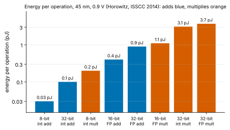

<!-- status: verified -->
# 08-09 · Arithmetic Circuits

| | |
|---|---|
| **Course** | [08 · Digital Logic Design](../README.md) |
| **University equivalent** | The arithmetic-circuits part of a junior digital-design or VLSI course (Harris & Harris, *Digital Design and Computer Architecture*, §5.2; Weste & Harris, *CMOS VLSI Design*, ch. 11 "Datapath Subsystems"), with fast adders and multipliers as in Parhami, *Computer Arithmetic* |
| **Prerequisites** | [08-04 Combinational Building Blocks](08-04-combinational-building-blocks.md) (full adder, ripple-carry adder, generate and propagate, the unit-delay model), [08-01 Number Systems and Codes](08-01-number-systems-and-codes.md) (two's complement, fixed point), [08-06 Latches, Flip-Flops and Sequential Timing](08-06-latches-and-flip-flops.md) |
| **Estimated study hours** | 8 |
| **Last verified** | 2026-11-19 |

**Learning objectives.** After this chapter you can:

1. Express carry computation as a prefix problem over (generate, propagate) pairs, prove the combining operator associative, and derive the carry-lookahead equations.
2. Compare ripple, carry-select and parallel-prefix adders (Kogge–Stone, Brent–Kung, Sklansky) in delay, operator count and fan-out.
3. Build array and tree (Dadda) multipliers, count their adders and reduction levels, and apply radix-4 Booth recoding.
4. Design a logarithmic barrel shifter and count its multiplexers.
5. Design fixed-point datapaths: choose Q formats, size products and accumulators, and apply rounding and saturation.
6. Relate arithmetic width to energy using published per-operation energies.

---

## 1. Big picture

Arithmetic is where digital design meets physical limits most directly. An adder sits on the critical path of almost every processor pipeline, so its delay sets the clock rate; multipliers dominate the area and energy of signal processors and AI accelerators. The ripple-carry adder of [08-04](08-04-combinational-building-blocks.md) is correct but slow: its delay grows linearly with width. This chapter shows how to make that delay grow with the logarithm of the width, how to multiply with trees of adders instead of long chains, and how to size fixed-point datapaths so they neither overflow nor waste bits.

- **Processors.** The 64-bit adder of an integer pipeline and the address-generation adder must finish in a fraction of a cycle; fast adders are a classic topic of high-performance design ([14-04](../../14-computer-organization-and-architecture/chapters/14-04-computer-arithmetic-and-number-formats.md)).
- **AI accelerators.** A matrix engine is thousands of multiply-accumulate (MAC) units; the width of their multipliers and accumulators decides throughput per watt ([14-14](../../14-computer-organization-and-architecture/chapters/14-14-ai-accelerators.md)).
- **DSP and FPGAs.** Filters are MACs in fixed point; FPGAs contain hardened multiply-accumulate slices so that designers do not build multipliers from lookup tables ([16-08](../../16-digital-signal-processing/chapters/16-08-filter-structures.md), [08-11](08-11-memories-and-programmable-logic.md)).
- **Low-power MCUs.** Sensor processing in wearables runs in fixed point, often on 16- or 32-bit datapaths with saturation, because a floating-point unit costs area and energy ([18-09](../../18-embedded-systems-and-microcontrollers/chapters/18-09-ultra-low-power-design.md)).

## 2. Intuition first

**Carries as a relay race, and the shortcut.** In a ripple-carry adder each bit waits for the carry from its neighbor, like runners passing a baton one at a time. But each bit can decide *in advance*, from its own two input bits, what it will do with a carry: it will **generate** one regardless (both inputs 1), **propagate** an incoming one (exactly one input 1), or **kill** it (both 0). A group of bits can summarize itself the same way: "this block generates a carry out, or passes one through." Fast adders compute these group summaries in a tree, so that the carry into bit 60 is known after a handful of steps instead of 60.

**A finance analogy: cumulative returns.** Given monthly growth factors, the cumulative return from the start to every month is a **prefix** computation: each answer combines all the months before it. Done one month at a time it takes $n$ steps; but adjacent spans can be combined in parallel (months 1–2 and 3–4, then 1–4 and 5–8), so all $n$ cumulative returns are ready after about $\log_2 n$ rounds, because multiplication is associative. Carry computation has exactly this structure with a different associative operator. *Where the analogy breaks:* the carry operator is not commutative (the order of the bits matters), and it works on bits, not real numbers.

**Multiplication as many additions.** Multiplying two $n$-bit numbers by hand writes $n$ shifted copies of one number (each copy kept or zeroed by a bit of the other) and adds them. The hardware question is how to add $n$ numbers fast: not one after another, but in a tree that reduces three numbers to two at each level without waiting for carries.

## 3. Theory

### 3.1 Generate, propagate and the prefix operator

For bit $i$ of $A + B$, define (as in 08-04)

$$
G_i = A_i B_i, \qquad P_i = A_i \oplus B_i .
$$

The carry into bit $i + 1$ and the sum bit are

$$
C_{i+1} = G_i + P_i C_i, \qquad S_i = P_i \oplus C_i .
$$

**Group generate and propagate.** For a block of bits $j$ to $i$ ($i \ge j$), let $G_{i:j}$ be 1 if the block produces a carry out of bit $i$ with no carry into bit $j$, and $P_{i:j}$ be 1 if a carry into bit $j$ passes all the way through. For a single bit, $G_{i:i} = G_i$ and $P_{i:i} = P_i$. Two adjacent blocks, a high block $[i:k]$ and a low block $[k-1:j]$, combine as

$$
(G_{i:j},\, P_{i:j}) = (G_{i:k} + P_{i:k}\,G_{k-1:j},\;\; P_{i:k}\,P_{k-1:j}) .
$$

*Derivation.* The combined block generates a carry if the high block generates one, or if the low block generates one and the high block passes it. A carry entering the combined block passes through only if both blocks pass it. ∎

Write this as an operator, $(G, P) \circ (G', P') = (G + PG',\, PP')$, with the high block on the left. It is **associative**:

$$
\big((G_1,P_1)\circ(G_2,P_2)\big)\circ(G_3,P_3) = (G_1 + P_1G_2 + P_1P_2G_3,\; P_1P_2P_3) = (G_1,P_1)\circ\big((G_2,P_2)\circ(G_3,P_3)\big),
$$

as expanding both sides shows. Associativity is what allows the bits to be grouped in any tree, exactly as the cumulative returns of §2. It is not commutative: swapping the blocks changes which one's carry passes through which.

**Carries as prefixes.** Fold the carry into the adder into bit 0 by redefining $G_0 \leftarrow G_0 + P_0C_0$ (the full adder of bit 0 does exactly this). Then every carry is a group generate from bit 0:

$$
C_{i+1} = G_{i:0}, \qquad S_i = P_i \oplus G_{i-1:0} .
$$

Computing all of $G_{0:0}, G_{1:0}, \ldots, G_{n-1:0}$ is a **prefix problem**: every output combines all the inputs up to its position. The ripple-carry adder solves it serially, one operator per bit. Faster adders use parallel prefix networks.

**The delay model.** As in 08-04, every two-input gate costs one unit. $G_i$ and $P_i$ are ready at 1; bit 0's folded generate at 3. One $\circ$ operator costs 2 units on its $G$ output (an AND, then an OR) and 1 on its $P$ output. A sum bit adds one XOR. The ripple-carry adder then reproduces 08-04's result: $C_1$ at 3, each further carry 2 units later, $S_{n-1}$ at $2n$.

### 3.2 Carry-lookahead

Expanding the recurrence for a 4-bit block gives every carry directly from the $G$s and $P$s, with no chain:

$$
\begin{aligned}
C_1 &= G_0 + P_0C_0,\\
C_2 &= G_1 + P_1G_0 + P_1P_0C_0,\\
C_3 &= G_2 + P_2G_1 + P_2P_1G_0 + P_2P_1P_0C_0,\\
C_4 &= G_3 + P_3G_2 + P_3P_2G_1 + P_3P_2P_1G_0 + P_3P_2P_1P_0C_0 .
\end{aligned}
$$

Each is a two-level AND-OR, so in a technology with wide gates every carry is ready after the same short delay. The catch is visible in $C_4$: the $k$-th carry has $k + 1$ product terms and its last term has $k + 1$ inputs. For 16 bits the top carry would need a 17-input OR of terms up to 17 inputs wide, and wide gates are slow (their delay grows with fan-in, [19-04](../../19-digital-vlsi-design/chapters/19-04-sizing-and-logical-effort.md)). Practical carry-lookahead adders therefore use **hierarchy**: 4-bit blocks produce group signals $G_{3:0}$ and $P_{3:0}$, a second level of the same lookahead logic combines four groups, and so on. That hierarchy is already a tree of $\circ$ operators, which parallel-prefix adders make systematic.

### 3.3 Parallel-prefix adders

A **prefix network** for $n$ bits is a circuit of $\circ$ operators that delivers $G_{i:0}$ at every position $i$. Three classic networks span the design space; in each, level $\ell$ combines spans of length up to $2^{\ell}$, so the number of levels is about $\log_2 n$ instead of $n$.

**Kogge–Stone** (1973). At level $\ell$ ($\ell = 1, 2, \ldots, \log_2 n$), every position $i \ge 2^{\ell-1}$ combines with position $i - 2^{\ell-1}$. After level $\ell$, position $i$ covers $[i : \max(0, i - 2^{\ell} + 1)]$, so after $\log_2 n$ levels every position covers back to bit 0. Level $\ell$ has $n - 2^{\ell-1}$ operators, so the total is

$$
\sum_{\ell=1}^{\log_2 n} \left(n - 2^{\ell-1}\right) = n\log_2 n - (n - 1) .
$$

It has the minimum number of levels and every operator output feeds only one other operator per level (fan-out 1, plus its own continuation), but it has the most operators and many long wires.

**Sklansky** (divide and conquer). Compute prefixes of each half recursively, then combine the low half's total with every position of the high half. It also has $\log_2 n$ levels but only $(n/2)\log_2 n$ operators; the price is fan-out: at the last level, one signal drives $n/2$ operators, which slows it down in real wiring.

**Brent–Kung** (1982). An up-sweep computes group generates of spans 2, 4, 8, ... at positions $2^{\ell} - 1, \ldots$ (a binary tree, $n - 1$ operators), and a down-sweep fills in the remaining prefixes ($n - 1 - \log_2 n$ operators). Total $2n - 2 - \log_2 n$ operators in $2\log_2 n - 1$ levels, with fan-out 1 and short, regular wiring: nearly twice the levels of Kogge–Stone for less than a third of its operators at 32 bits.

For 16-bit adders, simulating each network with the unit-delay model of §3.1 gives (Example 08-09.3):

| Adder | $\circ$ operators | Levels | Max fan-out per level | Delay to slowest sum bit |
|---|---|---|---|---|
| Ripple-carry | 15 | 15 | 1 | 32 |
| Brent–Kung | 26 | 7 | 1 | 16 |
| Sklansky | 32 | 4 | 8 | 12 |
| Kogge–Stone | 49 | 4 | 1 | 10 |

The delays are a little below $1 + 2(\text{levels}) + 1$ in some networks because inputs from short spans arrive early; the lab computes every arrival time. The fan-out column matters in silicon more than in this model, which charges nothing for fan-out or wire length. Real designs often use hybrids (for example, sparse trees that compute every fourth carry and finish with short ripple or select stages), chosen by the synthesis tool to meet the timing constraint.

> **Going deeper — the design space.** Kogge–Stone, Sklansky and Brent–Kung are corners of a three-way tradeoff among levels, fan-out and wiring tracks; later work by Knowles and D. Harris's "taxonomy of parallel prefix networks" described whole families of networks in between ([R-157](../../../reference/research-log.md#r-157--arithmetic-energy-and-dsp-blocks)). No prefix network can have fewer than $\lceil \log_2 n \rceil$ levels, because each output depends on all $n$ inputs and every operator has two inputs; in Harris's taxonomy, the networks that reach this minimum differ in how they trade fan-out against wiring.

### 3.4 Carry-select adders

A different idea trades area for time: compute the upper half of the sum **twice**, once assuming its carry-in is 0 and once assuming 1, while the lower half computes the real carry. A row of 2:1 multiplexers then selects the correct upper result as soon as that carry arrives. With two 16-bit ripple halves for a 32-bit sum, the selection waits for the lower half's carry-out (33 units) plus a multiplexer (2 units, an AND then an OR, with the select's complement assumed available): 35 units, against 64 for a 32-bit ripple adder, at the cost of 16 extra full adders and 17 multiplexers (Example 08-09.4). Splitting into more blocks shortens the chain further (Problem 08-09.5).

### 3.5 Multiplication

**Partial products.** For unsigned $n$-bit $A$ and $B$,

$$
A \times B = \sum_{j=0}^{n-1} (A \cdot B_j)\, 2^{j},
$$

and each row $A \cdot B_j$ is just $A$ ANDed with one bit of $B$: $n^2$ AND gates produce the **partial-product matrix**, whose column $c$ (weight $2^c$) holds the bits $A_iB_j$ with $i + j = c$. Columns grow from 1 bit at each end to $n$ bits in the middle.

**Array multiplier.** Adding the rows one at a time with ripple-carry adders gives a regular **array multiplier**: $n - 1$ adder rows, simple to lay out, with a delay that grows linearly in $n$ (the carries of each row must settle before the next row's sum is complete, and a carry-save organization of the array reduces but does not remove this).

**Carry-save addition.** The key observation: a row of full adders takes *three* numbers and returns *two* (a sum word and a carry word shifted left by one), with no carry propagation at all, because each full adder works on its own column. Such a **3:2 counter** (carry-save adder) costs one full-adder delay regardless of width. Repeatedly applying 3:2 counters reduces $n$ rows to 2 in a number of levels that grows only logarithmically, and a single fast adder (§3.3) adds the final two.

**Wallace and Dadda trees.** A **Wallace tree** reduces as many rows as possible at each level. A **Dadda tree** reduces as *little* as possible: it uses the target heights $d_1 = 2$, $d_{k+1} = \lfloor 1.5\,d_k \rfloor$, giving 2, 3, 4, 6, 9, 13, 19, 28, 42, ..., and at each level brings every column down to the next target. Both need the same number of levels, the number of targets below $n$:

| $n$ | 8 | 12 | 16 | 24 | 32 |
|---|---|---|---|---|---|
| levels (3:2 counters) | 4 | 5 | 6 | 7 | 8 |

Each level reduces the height by a factor of about 1.5, so the levels grow as $\log_{1.5} n$.

**How many full adders?** Each full adder takes 3 bits in and gives 2 bits out: it removes exactly one bit from the matrix, and a half adder (2 in, 2 out) removes none. The matrix starts with $n^2$ bits. Dadda's schedule ends with one bit in column 0, two bits in each of columns 1 to $2n - 2$, and none above, $1 + 2(2n - 2) = 4n - 3$ bits in all. So it uses exactly

$$
n^2 - (4n - 3) = n^2 - 4n + 3
$$

full adders, plus $n - 1$ half adders (counted by the lab's construction), and a final adder of $2n - 2$ bits. For $8 \times 8$: 35 full adders, 7 half adders and a 14-bit final adder (Example 08-09.5).

**Signed multiplication.** Two's-complement operands make the top row negative (its weight is $-2^{n-1}$). Hardware handles this either by sign-extending the partial products, or more cheaply by the Baugh–Wooley rearrangement, which inverts a few bits and adds constants so that every partial-product bit is again added with positive weight. Booth recoding (next section) handles signs naturally.

### 3.6 Radix-4 Booth recoding

Fewer partial products means a shallower tree. **Radix-4 Booth recoding** rewrites a two's-complement multiplier $B$ in base 4 with digits from $\{-2, -1, 0, 1, 2\}$, so that an $n$-bit multiplier ($n$ even) gives only $n/2$ partial products, each of which is $0$, $\pm A$ or $\pm 2A$ (a shift and possibly an inversion, all cheap).

**The recoding.** With $b_{-1} = 0$, digit $k$ ($k = 0, 1, \ldots, n/2 - 1$) is computed from the overlapping triplet $(b_{2k+1}, b_{2k}, b_{2k-1})$:

$$
d_k = -2\,b_{2k+1} + b_{2k} + b_{2k-1} .
$$

*Proof that the digits represent $B$.* Sum $d_k\,4^k$ and collect the terms of each bit $b_m$. An even-position bit $b_{2k}$ appears once with coefficient $4^k = 2^{2k}$. An odd-position bit $b_{2k+1}$ appears twice: with $-2\cdot 4^{k} = -2^{2k+1}$ in digit $k$, and with $+4^{k+1} = 2^{2k+2}$ in digit $k + 1$ (as its $b_{2(k+1)-1}$), totaling $2^{2k+1}$, its proper weight. The exception is the top bit $b_{n-1}$, which has no digit $n/2$ to contribute the positive term, so its total coefficient is $-2^{n-1}$: exactly its two's-complement weight. Hence $\sum_k d_k 4^k = -b_{n-1}2^{n-1} + \sum_{m<n-1} b_m 2^m = B$. ∎

| triplet $(b_{2k+1}, b_{2k}, b_{2k-1})$ | 000 | 001 | 010 | 011 | 100 | 101 | 110 | 111 |
|---|---|---|---|---|---|---|---|---|
| digit $d_k$ | 0 | +1 | +1 | +2 | −2 | −1 | −1 | 0 |

The intuition: a run of 1s in $B$ is replaced by "+1 at the top of the run, −1 at the bottom", so long runs cost almost nothing. Radix-4 Booth halves the partial products of a signed multiplier; for unsigned operands one extra digit is needed (treat $B$ as an $(n+2)$-bit signed number with leading zeros).

### 3.7 Shifters

A shift by a variable amount $s$ ($0 \le s < n$) is built as a **logarithmic barrel shifter**: write $s$ in binary, $s = \sum_k s_k 2^k$, and pass the data through $\log_2 n$ stages, where stage $k$ shifts by $2^k$ if $s_k = 1$ and passes the data unchanged otherwise. Each stage is a row of $n$ 2:1 multiplexers, so the shifter has $n\log_2 n$ multiplexers and a delay of $\log_2 n$ multiplexer delays. For 32 bits: 5 stages, 160 multiplexers. The alternative, an $n$:1 multiplexer for every output bit, needs $n(n-1)$ two-input multiplexers. What enters at the vacated end selects the kind of shift: zeros for a logical shift, copies of the sign bit for an arithmetic right shift (which divides a two's-complement number by $2^s$, rounding toward $-\infty$), and the bits leaving the other end for a rotate.

### 3.8 Fixed-point datapaths

A **fixed-point** number stores an integer $k$ and an implied scale: in **Q$m$.$f$** format (here $m$ integer bits including the sign, $f$ fraction bits, $m + f$ bits in all), the value is $k \cdot 2^{-f}$, with range $[-2^{m-1},\, 2^{m-1} - 2^{-f}]$ and resolution $2^{-f}$. The workhorse of audio and DSP is Q1.15: 16 bits, range $[-1,\, 1 - 2^{-15}]$, resolution $2^{-15} \approx 3.05 \times 10^{-5}$. (Conventions differ: some documentation counts the integer bits without the sign, so the same 16-bit format is called Q15 or Q0.15; always check.)

**Products.** Multiplying Q$m_1$.$f_1$ by Q$m_2$.$f_2$ multiplies the integers and adds the scales: the product is Q$(m_1 + m_2)$.$(f_1 + f_2)$, with $m_1 + m_2 + f_1 + f_2$ bits. Q1.15 × Q1.15 is Q2.30 in 32 bits. The second integer bit is needed for one case only: $(-1) \times (-1) = +1$, which Q1.30 cannot represent.

**Accumulation.** Adding $N$ values that each fit in $w$ bits can need $\lceil \log_2 N \rceil$ more bits (**guard bits**), because the worst-case sum is $N$ times the largest value. A 64-tap filter accumulating Q2.30 products needs $32 + 6 = 38$ bits to be safe.

**Returning to the working format.** Converting a Q2.30 result back to Q1.15 drops 15 fraction bits and one integer bit:

- **Truncation** (shift right, dropping bits) rounds toward $-\infty$, an average error of almost $-\tfrac12$ LSB, a bias that accumulates in long computations.
- **Round to nearest** adds half an LSB ($2^{14}$ in the Q2.30 integer) before shifting: the average error is nearly zero.
- **Saturation** clamps a result that exceeds the range to the largest or smallest representable value, instead of letting it **wrap around** (two's-complement overflow turns a large positive number into a large negative one, a disaster in a filter or a control loop).

**How many bits are enough?** Quantizing a full-scale sine wave to $b$ bits leaves a quantization error that is (for busy signals) uniformly distributed over one LSB $\Delta$, with mean-square value $\Delta^2/12$ ([03-06](../../03-probability-statistics-and-random-variables/chapters/03-06-random-processes-preview.md)). The sine's amplitude is $2^{b-1}\Delta$, so its power is $(2^{b-1}\Delta)^2/2$, and the signal-to-quantization-noise ratio is

$$
\text{SQNR} = \frac{2^{2b-2}\Delta^2/2}{\Delta^2/12} = 1.5 \cdot 2^{2b}, \qquad 10\log_{10}\text{SQNR} = 6.02\,b + 1.76\ \text{dB} .
$$

Each bit buys about 6 dB: 16 bits give 98.1 dB, 12 bits 74.0 dB.

### 3.9 The energy of arithmetic

Arithmetic energy scales with width in a way that explains the industry's move to narrow formats. An adder's work grows roughly linearly with its width $n$, and a multiplier's roughly as $n^2$ (the partial-product matrix). M. Horowitz's often-cited estimates for a 45 nm process at 0.9 V ([R-157](../../../reference/research-log.md#r-157--arithmetic-energy-and-dsp-blocks)) bear this out:

| Operation | 8-bit integer | 32-bit integer | 16-bit float | 32-bit float |
|---|---|---|---|---|
| Add | 0.03 pJ | 0.1 pJ | 0.4 pJ | 0.9 pJ |
| Multiply | 0.2 pJ | 3.1 pJ | 1.1 pJ | 3.7 pJ |

Going from 8 to 32 bits multiplies the integer-multiply energy by 15.5, close to the $n^2$ prediction of 16, and the add energy by 3.3, close to the linear prediction of 4. The same estimates put a 64-bit read from a 32 KB cache at 20 pJ and a DRAM access at 1.3 to 2.6 nJ: moving operands costs far more than computing with them, the theme of [14-14](../../14-computer-organization-and-architecture/chapters/14-14-ai-accelerators.md).

<!-- answer-key -->
| ID | Quantity | Value | Unit |
|---|---|---|---|
| Th 08-09.a | 32-bit over 8-bit multiply energy | 15.5 | — |
| Th 08-09.b | 32-bit over 8-bit add energy | 3.3 | — |
| Th 08-09.c | SQNR, 16 bits | 98.1 | dB |
| Th 08-09.d | SQNR, 12 bits | 74.0 | dB |
| Th 08-09.e | Q1.15 resolution | 3.05e-5 | — |
| Th 08-09.f | 32-bit barrel shifter multiplexers | 160 | — |
| Th 08-09.g | 64-tap accumulator width, Q2.30 products | 38 | bit |

## 4. Worked examples

### Example 08-09.1 · Generate, propagate and the carry chain (tier A)

**Setup.** Add $A$ = 1011 0110 (182) and $B$ = 0101 1101 (93) as 8-bit numbers with $C_0 = 0$. (a) Find $G$ and $P$ as 8-bit words. (b) Find the carries $C_1$ to $C_8$, the sum and the carry out. (c) What is the longest run of bits through which a carry propagates?

**Solution.** (a) $G = A \text{ AND } B$ = 0001 0100 = **20**; $P = A \text{ XOR } B$ = 1110 1011 = **235**.

(b) Apply $C_{i+1} = G_i + P_iC_i$ from bit 0: $C_1 = 0$, $C_2 = 0$ ($G_0 = G_1 = 0$, nothing to propagate); $C_3 = G_2 = 1$; $C_4 = G_3 + P_3C_3 = 1$; $C_5 = G_4 = 1$; $C_6 = P_5C_5 = 1$; $C_7 = P_6C_6 = 1$; $C_8 = P_7C_7 = 1$. The sum bits $S_i = P_i \oplus C_i$ are, from bit 7 down, 0001 0011 = **19**, with carry out **1**: $182 + 93 = 275 = 256 + 19$ ✓.

(c) The carry generated at bit 4 rides through bits 5, 6 and 7 to the carry out: **3** bits. (The carry generated at bit 2 passes through bit 3, but bit 4 generates its own carry anyway.)

**Sanity check.** A ripple adder's worst case, a carry traveling all 8 bits, happens only when $P$ is all 1s from the generating bit up; for random inputs the longest propagate run is short, which is why adders that exploit typical cases exist, but synchronous design must budget for the worst case.

### Example 08-09.2 · Carry-lookahead equations (tier A)

**Setup.** For the 4-bit lookahead equations of §3.2: (a) how many product terms does $C_4$ have, and what is the largest AND fan-in? (b) How many AND gates with two or more inputs do $C_1$ to $C_4$ need together (no sharing)? (c) For a flat 16-bit lookahead, how many terms and what fan-in would $C_{16}$ need?

**Solution.** (a) $C_4$ has **5** terms ($G_3$, then $P_3G_2$, $P_3P_2G_1$, $P_3P_2P_1G_0$, $P_3P_2P_1P_0C_0$); the last has **5** inputs.

(b) $C_k$ has $k$ terms with two or more literals: $1 + 2 + 3 + 4$ = **10** AND gates.

(c) $C_{16}$ has **17** terms and a largest fan-in of **17**: impractical, hence block lookahead and prefix trees.

**Sanity check.** Setting all $P = 1$ and $G = 0$ makes every $C_k = C_0$: a carry-in propagates through every bit, as it should.

### Example 08-09.3 · Prefix adders compared (tier B)

**Setup.** For $n = 16$: (a) derive the operator counts of Kogge–Stone, Sklansky and Brent–Kung from the formulas of §3.3, and their numbers of levels; (b) using the unit-delay model, the delay to the slowest sum bit is 10 for Kogge–Stone, 12 for Sklansky and 16 for Brent–Kung (from the arrival-time simulation). Compare with ripple carry, and find each prefix adder's speed-up.

**Solution.** (a) Kogge–Stone: $16 \times 4 - 15$ = **49** operators, **4** levels. Sklansky: $8 \times 4$ = **32** operators, 4 levels. Brent–Kung: $32 - 2 - 4$ = **26** operators, $2 \times 4 - 1$ = **7** levels.

(b) Ripple carry: $2n$ = **32** units. Speed-ups: Kogge–Stone $32/10$ = **3.2**, Sklansky $32/12$ = **2.67**, Brent–Kung $32/16$ = **2.0**.

**Sanity check.** At $n = 64$ the same simulation gives 14, 16 and 24 units against 128 for ripple carry: the advantage grows with width, since ripple is linear and the prefix adders logarithmic.

### Example 08-09.4 · A carry-select adder (tier B)

**Setup.** A 32-bit adder is built from a 16-bit ripple adder for the low half and two 16-bit ripple adders for the high half (carry-in fixed at 0 and at 1), followed by 2:1 multiplexers (2 units each, controlled by the low half's carry-out). (a) When is the low half's carry-out ready? (b) When are the high half's two candidate results ready? (c) What is the adder's delay, compared with a 32-bit ripple adder? (d) How many full adders and multiplexers does it use?

**Solution.** (a) The low half is an ordinary 16-bit ripple adder: $C_{16}$ at $2 \times 16 + 1$ = **33** units.

(b) A ripple adder whose carry-in is a constant has its bit-0 carry ready at 1 instead of 3 (the folded generate is just $G_0$ or $A_0 + B_0$), so its top sum bit is ready at **30** and its carry-out at **31**: both before $C_{16}$.

(c) The multiplexers switch when their select arrives: $33 + 2$ = **35** units, against **64** for a 32-bit ripple adder.

(d) $16 + 2 \times 16$ = **48** full adders (against 32) and **17** multiplexers (16 sum bits and the carry-out).

**Sanity check.** The selection waits only for the low half; the high halves work in parallel. Half the extra hardware buys almost half the delay.

### Example 08-09.5 · An 8 × 8 Dadda multiplier (tier B)

**Setup.** (a) How many partial-product bits does an $8 \times 8$ unsigned multiplier have, and what is the tallest column? (b) List the Dadda target heights and the number of levels. (c) How many full adders and half adders does the reduction use, and how wide is the final adder? (d) How many levels would a $24 \times 24$ multiplier (the significand of single-precision floating point) need?

**Solution.** (a) $8 \times 8$ = **64** bits; column 7 holds $A_iB_j$ for every $i + j = 7$: **8** bits.

(b) The targets below 8 are 6, 4, 3, 2: **4** levels (8 → 6 → 4 → 3 → 2).

(c) $n^2 - 4n + 3 = 64 - 32 + 3$ = **35** full adders, $n - 1$ = **7** half adders, and a final adder of $2n - 2$ = **14** bits.

(d) The targets below 24 are 19, 13, 9, 6, 4, 3, 2: **7** levels.

**Sanity check.** 64 bits minus 35 removed leaves $29 = 4n - 3$ bits, two per column over 14 columns plus one: exactly what the final adder takes.

### Example 08-09.6 · Booth recoding (tier B)

**Setup.** Recode the signed 8-bit multiplier $B$ = 0111 1010 (122) in radix-4 Booth digits, and use them to compute $45 \times 122$.

**Solution.** The triplets $(b_{2k+1}, b_{2k}, b_{2k-1})$ with $b_{-1} = 0$:

| $k$ | triplet | digit $d_k$ |
|---|---|---|
| 0 | $(b_1, b_0, b_{-1})$ = 1, 0, 0 | −2 |
| 1 | $(b_3, b_2, b_1)$ = 1, 0, 1 | −1 |
| 2 | $(b_5, b_4, b_3)$ = 1, 1, 1 | 0 |
| 3 | $(b_7, b_6, b_5)$ = 0, 1, 1 | +2 |

Check: $-2 - 1 \times 4 + 0 \times 16 + 2 \times 64$ = **122** ✓. The product is the sum of the four partial products $d_k \cdot 45 \cdot 4^k$: $-90 - 180 + 0 + 5760$ = **5490** $= 45 \times 122$ ✓. Only **3** of the 4 partial products are nonzero, against 8 rows (5 of them nonzero, one per 1 bit of $B$) without recoding.

**Sanity check.** The run 1111 in bits 3 to 6 became "−1 at bit 2's position, +2 at the top": a run of 1s costs two nonzero digits regardless of its length.

### Example 08-09.7 · Sizing a fixed-point MAC (tier C)

**Setup.** A 64-tap FIR filter uses Q1.15 samples and coefficients. (a) What format and width is each product? (b) How wide must the accumulator be to never overflow? (c) An FPGA's DSP slice has a 48-bit accumulator. How many guard bits does it leave for these products, and how many worst-case products can it add? (d) Compute $0.75 \times (-0.5)$ in Q1.15 integer arithmetic, including the conversion back to Q1.15 with round-to-nearest. (e) What SQNR does a full-scale sine have in Q1.15?

**Solution.** (a) Q2.30, **32** bits.

(b) $32 + \lceil \log_2 64 \rceil$ = **38** bits.

(c) $48 - 32$ = **16** guard bits: $2^{16}$ = **65536** worst-case products.

(d) $0.75 \to 24576$, $-0.5 \to -16384$. Product: $24576 \times (-16384) = -402\,653\,184$ in Q2.30. Add $2^{14}$ and shift right by 15: $(-402\,653\,184 + 16\,384)/32\,768 = -12\,287.5$, and the arithmetic shift rounds toward $-\infty$, giving **−12288**, which is $-12288/32768$ = **−0.375** exactly ✓.

(e) $6.02 \times 16 + 1.76$ = **98.1** dB.

**Sanity check.** The filter's worst case, every product at $+1$, would need all 6 extra bits; real coefficient sets have $\sum |h_k| \ll 64$, so designers often scale the coefficients and use fewer guard bits, at the cost of a proof that overflow cannot occur.

### Answer key

<!-- answer-key -->
| ID | Quantity | Value | Unit |
|---|---|---|---|
| Ex 08-09.1a | G word | 20 | — |
| Ex 08-09.1b | P word | 235 | — |
| Ex 08-09.1c | 8-bit sum | 19 | — |
| Ex 08-09.1d | carry out | 1 | — |
| Ex 08-09.1e | longest propagate run | 3 | bit |
| Ex 08-09.2a | product terms in $C_4$ | 5 | — |
| Ex 08-09.2b | largest AND fan-in | 5 | — |
| Ex 08-09.2c | AND gates for $C_1$ to $C_4$ | 10 | — |
| Ex 08-09.2d | terms in a flat $C_{16}$ | 17 | — |
| Ex 08-09.2e | fan-in of a flat $C_{16}$ | 17 | — |
| Ex 08-09.3a | Kogge–Stone operators | 49 | — |
| Ex 08-09.3b | Kogge–Stone levels | 4 | — |
| Ex 08-09.3c | Sklansky operators | 32 | — |
| Ex 08-09.3d | Brent–Kung operators | 26 | — |
| Ex 08-09.3e | Brent–Kung levels | 7 | — |
| Ex 08-09.3f | ripple delay, 16 bits | 32 | unit |
| Ex 08-09.3g | Kogge–Stone delay | 10 | unit |
| Ex 08-09.3h | Sklansky delay | 12 | unit |
| Ex 08-09.3i | Brent–Kung delay | 16 | unit |
| Ex 08-09.3j | Kogge–Stone speed-up | 3.2 | — |
| Ex 08-09.3k | Sklansky speed-up | 2.67 | — |
| Ex 08-09.3l | Brent–Kung speed-up | 2.0 | — |
| Ex 08-09.3m | Kogge–Stone delay, 64 bits | 14 | unit |
| Ex 08-09.3n | Sklansky delay, 64 bits | 16 | unit |
| Ex 08-09.3o | Brent–Kung delay, 64 bits | 24 | unit |
| Ex 08-09.3p | ripple delay, 64 bits | 128 | unit |
| Ex 08-09.4a | low-half carry-out | 33 | unit |
| Ex 08-09.4b | high-half top sum bit | 30 | unit |
| Ex 08-09.4c | high-half carry-out | 31 | unit |
| Ex 08-09.4d | carry-select delay | 35 | unit |
| Ex 08-09.4e | 32-bit ripple delay | 64 | unit |
| Ex 08-09.4f | full adders | 48 | — |
| Ex 08-09.4g | multiplexers | 17 | — |
| Ex 08-09.5a | partial-product bits | 64 | — |
| Ex 08-09.5b | tallest column | 8 | — |
| Ex 08-09.5c | reduction levels, 8 × 8 | 4 | — |
| Ex 08-09.5d | full adders | 35 | — |
| Ex 08-09.5e | half adders | 7 | — |
| Ex 08-09.5f | final adder width | 14 | bit |
| Ex 08-09.5g | reduction levels, 24 × 24 | 7 | — |
| Ex 08-09.6a | value of the Booth digits | 122 | — |
| Ex 08-09.6b | product | 5490 | — |
| Ex 08-09.6c | nonzero Booth partial products | 3 | — |
| Ex 08-09.6d | nonzero rows without recoding | 5 | — |
| Ex 08-09.7a | product width | 32 | bit |
| Ex 08-09.7b | accumulator width | 38 | bit |
| Ex 08-09.7c | guard bits in a 48-bit accumulator | 16 | bit |
| Ex 08-09.7d | worst-case products | 65536 | — |
| Ex 08-09.7e | Q1.15 result integer | -12288 | — |
| Ex 08-09.7f | result value | -0.375 | — |
| Ex 08-09.7g | SQNR | 98.1 | dB |

## 5. Simulate it

The lab is in [labs/08-09-lab/](../labs/08-09-lab/README.md).

**Notebook** (`08-09-arithmetic.ipynb`):

1. Build ripple, Kogge–Stone, Sklansky and Brent–Kung prefix networks for widths 4 to 64, check them on random additions, and compute every arrival time in the unit-delay model.
2. Build a Dadda reduction for $n \times n$ multipliers, check it bit by bit against Python's multiplication, and count its full adders, half adders and levels.
3. Recode every signed 8-bit number in radix-4 Booth digits and measure how many partial products are nonzero on average.
4. Run a Q1.15 filter with truncation and with rounding, and measure the bias and the SQNR against the $6.02b + 1.76$ dB formula.

**Verilog** (`arith.v`, `arith_tb.v`): a parameterized ripple-carry adder, a 16-bit Kogge–Stone adder written with generate loops, an 8 × 8 array multiplier, a 32-bit logarithmic barrel shifter and a Q1.15 multiplier with rounding and saturation. The testbench checks the multiplier on all 65 536 input pairs and the others on random inputs against Verilog's own `+`, `*` and `<<`, printing `TEST PASSED`.

**Guided exercise (predict, then run).** **Before running**, predict how a Kogge–Stone adder's delay and operator count change from 16 to 64 bits (four times the width). Then let the notebook plot both, and explain why designers of 64-bit adders accept Kogge–Stone's operator count but often prefer sparser networks.

## 6. Engineering tradeoffs

| Knob | Improves | Costs | Typical decision owner |
|---|---|---|---|
| Parallel-prefix instead of ripple adders | Delay from $O(n)$ to $O(\log n)$ | More operators, wiring and power | Synthesis tool under the designer's timing constraint |
| Kogge–Stone versus Brent–Kung | Fewest levels, low fan-out | About $n\log_2 n$ operators and long wires | Datapath designer |
| Carry-select | Delay at modest design effort | Duplicated adders, multiplexers | Designer of mid-speed adders |
| Tree (Dadda/Wallace) multipliers | Delay $O(\log n)$ | Irregular wiring, harder layout | Datapath designer |
| Radix-4 Booth recoding | Half the partial products | Recoding logic and $\pm 2A$ selection | Multiplier designer |
| Narrower operands (INT8, FP8, FP4) | Energy per operation roughly $\propto n^2$ for multiplies | Accuracy; quantization effort | Architect, with algorithm teams |
| Wider accumulators (guard bits) | No overflow | Area and power in every MAC | Architect |
| Rounding and saturation | Unbiased results, no wraparound | Extra logic on every conversion | DSP and RTL designers |

## 7. Numbers to know

| Quantity | Value | Note |
|---|---|---|
| Ripple-carry delay | $2n$ unit gate delays | §3.1, 08-04 |
| Prefix adder levels | $\log_2 n$ (Kogge–Stone, Sklansky); $2\log_2 n - 1$ (Brent–Kung) | §3.3 |
| Kogge–Stone operators | $n\log_2 n - n + 1$ | §3.3 |
| Dadda multiplier | $n^2 - 4n + 3$ full adders; levels 4, 6, 8 for 8, 16, 32 bits | §3.5 |
| Radix-4 Booth | $n/2$ partial products (signed) | §3.6 |
| Barrel shifter | $n\log_2 n$ 2:1 multiplexers | §3.7 |
| SQNR | $6.02b + 1.76$ dB for a full-scale sine | §3.8 |
| Energy per operation, 45 nm | 8-bit add 0.03 pJ, 32-bit add 0.1 pJ; 8-bit multiply 0.2 pJ, 32-bit multiply 3.1 pJ; FP32 add 0.9 pJ, multiply 3.7 pJ | [R-157](../../../reference/research-log.md#r-157--arithmetic-energy-and-dsp-blocks) **[Established]** (Horowitz, ISSCC 2014; read from the paper's figure) |
| FPGA DSP slice (AMD UltraScale+) | 27 × 18 multiplier, 48-bit accumulator | [R-157](../../../reference/research-log.md#r-157--arithmetic-energy-and-dsp-blocks) **[Established]** |

## 8. Common mistakes

1. **Forgetting the carry-in in prefix adders.** Fold $C_0$ into bit 0's generate, or add a prefix position for it; leaving it out gives wrong sums whenever $C_0 = 1$ (subtraction!).
2. **Counting levels, not delay.** Level counts hide fan-out and wire length; Sklansky has Kogge–Stone's levels but a fan-out of $n/2$.
3. **Sizing products too narrow.** An $m$-bit by $n$-bit signed product needs $m + n$ bits; the one case that needs the top bit, $(-2^{m-1})(-2^{n-1})$, is easy to miss in testing.
4. **Accumulating without guard bits.** Sums of $N$ terms need up to $\lceil \log_2 N \rceil$ extra bits, or a proof that the actual coefficients cannot reach the worst case.
5. **Truncating in a feedback loop.** Truncation's $-\tfrac12$ LSB bias accumulates in recursive filters and integrators; round to nearest.
6. **Letting results wrap.** Two's-complement overflow turns the largest positive value into the most negative; saturate at format boundaries.
7. **Writing `>>` for a signed right shift in Verilog.** `>>` shifts in zeros; `>>>` on a `signed` operand shifts in the sign bit (08-05's signedness rules).
8. **Comparing accelerators by peak operations without the format.** A TOPS figure means nothing without the operand width, sparsity assumption and accumulator precision (§9).

## 9. Practitioner lens

### State of the art (as of Nov 2026)

- **Prefix adders are 50-year-old ideas, still current.** Kogge and Stone's "recursive doubling" paper (IEEE Transactions on Computers, 1973) and Brent and Kung's regular-layout adder (same journal, 1982) define the corners of the design space that synthesis libraries still draw on **[Established]** ([R-157](../../../reference/research-log.md#r-157--arithmetic-energy-and-dsp-blocks); bibliographic details from search excerpts).
- **FPGAs harden the MAC.** AMD's UltraScale and UltraScale+ DSP48E2 slice contains a 27 × 18 signed multiplier, a 27-bit pre-adder and a 48-bit accumulator ("48-bit Multi-Functional Arithmetic Block"); the Versal DSP58 widens the multiplier to 27 × 24 **[Established]** ([R-157](../../../reference/research-log.md#r-157--arithmetic-energy-and-dsp-blocks), search excerpts of AMD documentation).
- **AI hardware chases narrow formats.** NVIDIA's HGX B200 specification lists FP4 tensor throughput of 144 PFLOPS sparse and 72 PFLOPS dense for eight GPUs; per GPU that is 9 PFLOPS dense FP4 **[Established]**, while launch coverage quoted "up to 20 petaFLOPS of FP4" for B200 **[Contested]** as to configuration ([R-147](../../../reference/research-log.md#r-147--accelerator-throughput-specifications)). The formats themselves (MX and NVFP4, block-scaled 4- to 8-bit numbers) are the subject of 08-01 ([R-143](../../../reference/research-log.md#r-143--block-scaled-ai-number-formats)).

### Why it matters commercially

- **Energy per operation is the accelerator business.** With an 8-bit multiply costing about a sixteenth of a 32-bit one (§3.9), moving an AI workload from FP32 to INT8 or FP8 multiplies throughput per watt and per mm² by a large factor, provided accuracy holds. Much of the competition among AI chips is about which narrow formats are supported and how well software uses them.
- **Adders set clocks.** In high-performance cores, the adder and its bypass network are among the paths that limit frequency; architecture choices (how much logic per stage) follow from them ([14-06](../../14-computer-organization-and-architecture/chapters/14-06-pipelining-and-hazards.md)).
- **Fixed point saves MCUs.** Many microcontrollers for wearables lack floating-point units or make them optional; fixed-point libraries and saturating instructions keep signal processing within an always-on power budget.

### Marketing vs Reality

- **"X PFLOPS."** *Reality:* the number depends on the format (FP4 against FP8 halves or doubles it), on sparsity (structured sparsity doubles it again on paper) and on whether it is per chip or per system. *Sanity check:* ask for dense throughput at the format your model actually runs, and what accumulator precision is used.
- **"INT8 is as accurate as FP32."** *Reality:* for many inference workloads, after careful calibration and sometimes retraining; not automatically, and not for every layer. *Sanity check:* ask which layers stay in higher precision and what the measured accuracy loss is.
- **"Our MAC array is 95% utilized."** *Reality:* peak arithmetic is cheap; feeding it is expensive (a cache read costs far more than the MAC). *Sanity check:* ask for utilization on real models at batch sizes customers use.

### Questions for engineering leaders

1. **"Which number formats does the datapath support natively, and with what accumulator widths?"**
   - *Strong:* a list with accumulator precision, rounding modes and how scaling factors are handled.
   - *Evasive:* "we support all the formats."
2. **"What limits your clock frequency, and is it arithmetic or wiring?"**
   - *Strong:* the critical paths named, with how adder architecture and floorplan were traded.
   - *Evasive:* "the foundry process."
3. **"How do you verify your arithmetic units?"**
   - *Strong:* exhaustive tests for small units, formal equivalence against reference models, and random plus corner-case testing for wide ones.
   - *Evasive:* "we ran a lot of vectors."
4. **"What happens on overflow in your fixed-point paths?"**
   - *Strong:* saturation at defined points, guard-bit analysis, and tests that drive extreme inputs.
   - *Evasive:* "it does not overflow in practice."

## 10. Concept check

**Q1.** What do the generate and propagate signals of a bit mean?

Answer

Generate ($G = AB$): the bit produces a carry out whatever its carry in. Propagate ($P = A \oplus B$): the bit passes an incoming carry through to its carry out. If neither, it kills any carry.

**Q2.** Why does the associativity of the $\circ$ operator matter?

Answer

It allows the group generate and propagate of a span to be computed by combining sub-spans in any tree, not just left to right. That is what lets a prefix network compute all carries in about $\log_2 n$ levels.

**Q3.** What do Kogge–Stone, Sklansky and Brent–Kung trade against each other?

Answer

Levels, fan-out and operator count (with wiring). Kogge–Stone: fewest levels and fan-out 1, but the most operators and wires. Sklansky: fewest levels and fewer operators, but fan-out up to $n/2$. Brent–Kung: few operators, fan-out 1 and regular wiring, but about twice the levels.

**Q4.** Why is a carry-save adder fast regardless of its width?

Answer

It never propagates carries: each full adder works on one column and its carry goes to the next column's *output* word rather than into the neighboring adder. Three numbers become two after one full-adder delay.

**Q5.** How many levels of 3:2 counters does a 16 × 16 multiplier need, and why does the count grow so slowly?

Answer

Six (16 → 13 → 9 → 6 → 4 → 3 → 2). Each level reduces the height by a factor of about 1.5, so the levels grow as $\log_{1.5} n$.

**Q6.** What does radix-4 Booth recoding buy, and what does it cost?

Answer

Half as many partial products ($n/2$ for a signed $n$-bit multiplier), so a shallower tree. The cost is recoding logic and partial-product selection among $0$, $\pm A$ and $\pm 2A$.

**Q7.** Why does Q1.15 × Q1.15 need a 32-bit, Q2.30 product?

Answer

The fraction bits add (15 + 15 = 30), and one extra integer bit is needed for the single case $(-1) \times (-1) = +1$, which a Q1.30 result cannot represent.

**Q8.** Why do AI accelerators favor 8-bit and narrower multipliers?

Answer

Multiplier energy and area grow roughly as the square of the width: an 8-bit multiply costs about a sixteenth of a 32-bit one (0.2 pJ against 3.1 pJ in Horowitz's 45 nm estimates), so narrow formats give many more operations per joule and per mm², as long as the model's accuracy survives.

Practice problems: [problems/08-09-problems.md](../problems/08-09-problems.md) · Solutions: [solutions/08-09-solutions.md](../solutions/08-09-solutions.md)

## 11. Key terms

[Generate and propagate](../../../reference/glossary.md#generate-and-propagate) ·
[Carry-lookahead adder](../../../reference/glossary.md#carry-lookahead-adder) ·
[Parallel-prefix adder](../../../reference/glossary.md#parallel-prefix-adder) ·
[Kogge–Stone adder](../../../reference/glossary.md#kogge-stone-adder) ·
[Brent–Kung adder](../../../reference/glossary.md#brent-kung-adder) ·
[Carry-select adder](../../../reference/glossary.md#carry-select-adder) ·
[Partial product](../../../reference/glossary.md#partial-product) ·
[Carry-save adder](../../../reference/glossary.md#carry-save-adder) ·
[Dadda tree](../../../reference/glossary.md#dadda-tree) ·
[Booth recoding](../../../reference/glossary.md#booth-recoding) ·
[Barrel shifter](../../../reference/glossary.md#barrel-shifter) ·
[Q format](../../../reference/glossary.md#q-format) ·
[Saturation arithmetic](../../../reference/glossary.md#saturation-arithmetic) ·
[Multiply-accumulate (MAC)](../../../reference/glossary.md#multiply-accumulate-mac)

## 12. Connections

- **Builds on:** [08-04](08-04-combinational-building-blocks.md) (full adders, ripple-carry adders, generate and propagate), [08-01](08-01-number-systems-and-codes.md) (two's complement, fixed point and narrow floating-point formats), [08-03](08-03-logic-minimization.md) (two-level logic and its fan-in limits).
- **Next:** [08-10](08-10-timing-metastability-cdc.md) puts these datapaths between registers and asks how fast they can be clocked.
- **Used later:**
  - [14-04](../../14-computer-organization-and-architecture/chapters/14-04-computer-arithmetic-and-number-formats.md) builds floating-point units from these blocks;
  - [16-08](../../16-digital-signal-processing/chapters/16-08-filter-structures.md) implements filters in fixed point;
  - [19-04](../../19-digital-vlsi-design/chapters/19-04-sizing-and-logical-effort.md) and [19-10](../../19-digital-vlsi-design/chapters/19-10-synthesis-and-sta.md) size and time adders in silicon;
  - [14-14](../../14-computer-organization-and-architecture/chapters/14-14-ai-accelerators.md) builds MAC arrays for AI.

## 13. Further study

- **Harris & Harris, *Digital Design and Computer Architecture* (RISC-V Edition):** §5.2 (arithmetic circuits: adders, shifters, multipliers, fixed point).
- **Weste & Harris, *CMOS VLSI Design* (4th ed.):** ch. 11 (datapath subsystems: adders including prefix networks, multipliers, shifters).
- **B. Parhami, *Computer Arithmetic: Algorithms and Hardware Designs*:** carry-lookahead and prefix adders, tree multipliers, Booth recoding in depth.
- **M. Horowitz, "Computing's energy problem (and what we can do about it)", ISSCC 2014:** the energy of operations and data movement.

## 14. Sources

1. Research log [R-157](../../../reference/research-log.md#r-157--arithmetic-energy-and-dsp-blocks): Horowitz, ISSCC 2014, Figure 1.1.9 (energy per operation, 45 nm, 0.9 V; read from the paper); Kogge and Stone (1973) and Brent and Kung (1982), IEEE Transactions on Computers; AMD DSP48E2 and DSP58 documentation.
2. Research log [R-147](../../../reference/research-log.md#r-147--accelerator-throughput-specifications): NVIDIA B200 throughput figures; [R-143](../../../reference/research-log.md#r-143--block-scaled-ai-number-formats): narrow number formats.
3. Textbook alignment as listed in §13. All text, examples and problems in this chapter are original.
