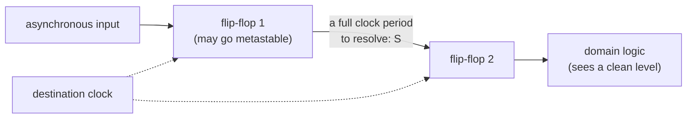

<!-- status: verified -->
# 08-10 · Timing, Metastability and Clock-Domain Crossing

| | |
|---|---|
| **Course** | [08 · Digital Logic Design](../README.md) |
| **University equivalent** | The timing chapter of a junior digital-design course (Harris & Harris, *Digital Design and Computer Architecture*, §3.5 "Timing of sequential logic", including synchronizers), with clock-domain crossing as in Dally & Harting, *Digital Design: A Systems Approach*, and Ginosar's synchronizer tutorials |
| **Prerequisites** | [08-06 Latches, Flip-Flops and Sequential Timing](08-06-latches-and-flip-flops.md) (setup, hold, clock-to-Q, the resolution of a cross-coupled pair), [08-07 Registers, Counters and Shift Registers](08-07-registers-counters-shift-registers.md) (Gray counters), [08-08 Finite State Machines](08-08-finite-state-machines.md), [03-02 Random Variables and Distributions](../../03-probability-statistics-and-random-variables/chapters/03-02-random-variables-and-distributions.md) |
| **Estimated study hours** | 10 |
| **Last verified** | 2026-11-19 |

**Learning objectives.** After this chapter you can:

1. Find the critical path of a synchronous design by static timing analysis, and compute slack and maximum frequency.
2. Derive the setup and hold constraints with clock skew and jitter, and explain why skew helps one and hurts the other.
3. Improve timing by pipelining, and quantify its effect on throughput and latency.
4. Derive the mean time between failures (MTBF) of a synchronizer from the exponential resolution of metastability, and size a synchronizer chain for a target MTBF.
5. Choose a safe clock-domain-crossing scheme for single bits, pulses, multi-bit values and data streams (Gray codes, handshakes, asynchronous FIFOs), and design reset synchronizers.

---

## 1. Big picture

Chapter 08-06 derived the two inequalities every flip-flop-to-flip-flop path must meet. This chapter scales them to a whole chip and then confronts the case they cannot cover. Static timing analysis checks setup and hold on millions of paths without simulating a single vector, which is how every modern chip reaches its clock frequency. But a chip has many clocks, and signals that pass between unrelated clocks *will* violate setup and hold sooner or later: no analysis can prevent it. The flip-flop that samples such a signal can go **metastable**, and the engineering answer is not to prevent metastability but to make its consequences astronomically rare, with a probability we can compute.

- **Clock frequency is a timing result.** "3 GHz" is the outcome of static timing analysis over every path and process corner ([19-10](../../19-digital-vlsi-design/chapters/19-10-synthesis-and-sta.md)).
- **Every SoC has many clock domains.** CPU, GPU, memory controller, PCIe, USB, audio and sensor interfaces run on different clocks; a phone or wearable SoC has dozens of domains, and every crossing needs a synchronizer ([27-02](../../27-system-architectures/chapters/27-02-smartphone-soc.md)).
- **CDC bugs escape simulation.** Simulators model flip-flops as ideal, so a missing synchronizer passes every test and fails in the field, rarely and unreproducibly. CDC checking is a separate verification discipline ([19-13](../../19-digital-vlsi-design/chapters/19-13-verification-methods.md)).
- **Low voltage makes it worse.** The resolution time constant grows as the supply drops, so always-on, near-threshold logic in wearables needs longer synchronizers than the same design at nominal voltage.

## 2. Intuition first

**A relay with fixed handoff times.** A synchronous design is a relay race where runners may only start on a starting pistol (the clock). Each leg must finish before the next pistol, with time to spare for the handoff (setup), and the next runner must not leave so early that the baton is still moving (hold). Timing analysis checks every leg's worst case against the pistol interval.

**A ball balanced on a ridge.** Chapter 08-06 described a latch as a ball in one of two valleys. When the input changes exactly as the latch closes, the ball can be left almost on top of the ridge. It will roll off, but the closer to the top it starts, the longer it takes, and there is no upper limit: starting exactly on top, it would stay forever. A **synchronizer** is simply *waiting*: give the ball a full clock cycle to roll off before anyone looks at it.

**Insurance arithmetic.** You cannot make a failure impossible, but you can price it. Each sampling of an asynchronous input is like an insurance policy with a tiny probability of a claim; with hundreds of millions of samples per second, even tiny probabilities add up, so the probability per sample must be made extraordinarily small. A financial analyst would recognize the shape: an expected loss rate equal to event frequency times probability, with the probability falling *exponentially* with the time allowed. *Where the analogy breaks:* insurance risks are usually independent and diversifiable; synchronizer failures in a deployed fleet simply add up, and one failure can corrupt a system without any visible symptom.

*Figure 1. A two-flip-flop synchronizer: the first flip-flop may hang near the ridge, and the second samples it only after a full period of resolution time $S$, during which the ball almost always rolls off.*

## 3. Theory

### 3.1 Static timing analysis

A synchronous design is a graph: registers and primary inputs launch signals, combinational gates delay them, and registers and primary outputs capture them. **Static timing analysis (STA)** checks every timing path without simulation:

1. Give every gate a delay (from the cell library, for the actual load and input slew).
2. Propagate **arrival times** forward from every launch point: a gate's output arrives at the latest of its input arrival times plus its delay. Because the graph has no cycles (every loop passes through a register), one pass in topological order computes all arrivals, in time proportional to the size of the circuit.
3. At every capture point, compare the arrival time with the **required time** from the capturing clock edge minus the setup time. The difference is the **slack**:

$$
\text{slack}_{\text{setup}} = \underbrace{T_c - t_{\text{setup}}}_{\text{required}} - \underbrace{(t_{pcq} + t_{pd})}_{\text{arrival}} .
$$

The path with the smallest slack is the **critical path**, and the minimum clock period is the one that makes its slack zero. A parallel pass with *minimum* delays (contamination delays) checks hold.

STA is pessimistic in a useful way: it assumes every path can be exercised. Paths that can never be exercised (a **false path**, for example through two multiplexers whose selects are mutually exclusive) or that are allowed several cycles by design (a **multicycle path**) must be declared in the constraints, or STA will report violations that cannot occur. Declaring a real path false is a classic way to ship a broken chip, which is why constraint review is part of sign-off.

**Corners.** Delays depend on process, voltage and temperature (PVT). Setup is checked at the slow corner (slow transistors, low voltage, and usually high temperature) and hold at the fast corner, because hold fails when the short path is *too fast*. Modern flows check many corners and add on-chip variation margins ([19-10](../../19-digital-vlsi-design/chapters/19-10-synthesis-and-sta.md)).

### 3.2 Clock skew and jitter

A clock does not arrive at every flip-flop at the same instant: wires and buffers in the clock tree add different delays. Let the launching flip-flop's clock edge arrive at $t = 0$ and the capturing flip-flop's at $t = \delta$; $\delta$ is the **skew** of this path (positive when the capture clock is late).

**Setup.** The data launched at $0$ arrives at $t_{pcq} + t_{pd}$ and must be stable $t_{\text{setup}}$ before the next capture edge, at $T_c + \delta$:

$$
t_{pcq} + t_{pd} + t_{\text{setup}} \le T_c + \delta \quad\Longrightarrow\quad T_c \ge t_{pcq} + t_{pd} + t_{\text{setup}} - \delta .
$$

**Hold.** The capture edge at $\delta$ must hold the *old* data for $t_{\text{hold}}$; the earliest new data, launched at $0$, arrives at $t_{ccq} + t_{cd}$:

$$
t_{ccq} + t_{cd} \ge \delta + t_{\text{hold}} .
$$

Positive skew lends the setup check $\delta$ and takes the same $\delta$ from the hold check; negative skew does the reverse. Because the clock period does not appear in the hold inequality, a hold violation caused by skew cannot be fixed by slowing the clock. Designers sometimes add skew deliberately ("useful skew") to give a slow path more time, at the expense of the next path in line, which has $\delta$ less.

**Jitter** is the variation of the clock period itself from cycle to cycle. If one cycle can be shorter than nominal by $t_{\text{jitter}}$, the setup inequality must hold with $T_c - t_{\text{jitter}}$. Hold is checked at a single edge, so cycle-to-cycle jitter does not enter it (to first order). Clock-tree designers budget skew and jitter together as **clock uncertainty** ([19-07](../../19-digital-vlsi-design/chapters/19-07-sequential-timing-and-clocking.md)).

### 3.3 Fixing timing: pipelining and retiming

When the critical path is too long, the standard cure is **pipelining**: insert registers to cut the path into stages. A combinational block of delay $t_{\text{logic}}$ in one stage runs at

$$
T_c = t_{\text{logic}} + t_{\text{reg}}, \qquad t_{\text{reg}} = t_{pcq} + t_{\text{setup}} ,
$$

while split into $k$ equal stages it runs at $T_c = t_{\text{logic}}/k + t_{\text{reg}}$. Throughput (results per second) rises almost $k$-fold, but each result now takes $k$ cycles, so the **latency** rises from $t_{\text{logic}} + t_{\text{reg}}$ to $k(t_{\text{logic}}/k + t_{\text{reg}}) = t_{\text{logic}} + k\,t_{\text{reg}}$. Two limits follow:

- **Overhead.** As $k$ grows, $t_{\text{reg}}$ dominates and the gain flattens: the clock can never be faster than $t_{\text{reg}}$.
- **Balance.** The clock is set by the *slowest* stage, so unequal stages waste time in the fast ones.

**Retiming** moves existing registers across logic (without changing the number of registers on any input-to-output path, so the function and latency are unchanged) to balance the stages; synthesis tools do this automatically. Pipelining is also where architecture meets timing: a processor's pipeline depth ([14-06](../../14-computer-organization-and-architecture/chapters/14-06-pipelining-and-hazards.md)) is this tradeoff at scale.

### 3.4 Metastability and its resolution

Everything above assumes the data meets setup and hold. A signal from another clock domain, or from the outside world, cannot promise that: its transitions are unrelated to our clock edge, and sooner or later one lands inside the setup-hold window.

**What happens then.** 08-06 §3.1 showed that a cross-coupled inverter pair has an unstable balance point $V_M$, where each inverter's gain is large. Near it, describe each inverter by its small-signal behavior: a change $v$ at its input drives a current $-g_mv$ into its output node, where $g_m$ (in siemens) is its **transconductance**, and its output conductance $g_o$ drains a current $g_o v_{out}$ back. Each node has capacitance $C$ (in farads). Let $v_1$ and $v_2$ be the deviations of the two nodes from $V_M$. Each node is the output of one inverter and the input of the other, so Kirchhoff's current law at each node gives

$$
C\frac{dv_1}{dt} = -g_m v_2 - g_o v_1, \qquad C\frac{dv_2}{dt} = -g_m v_1 - g_o v_2 .
$$

Subtracting, the difference $\Delta V = v_1 - v_2$ obeys

$$
C\frac{d\Delta V}{dt} = (g_m - g_o)\,\Delta V
\quad\Longrightarrow\quad
\Delta V(t) = \Delta V_0\, e^{t/\tau}, \qquad \tau = \frac{C}{g_m - g_o} \approx \frac{C}{g_m} ,
$$

a first-order linear ODE (02-02) whose solution *grows* because the coefficient is positive: each node pushes the other away from balance. Units: F/S = (C/V)/(A/V) = C/A = s ✓. The approximation holds because a gain stage has $g_m \gg g_o$. A strong, fast inverter (large $g_m$) driving a small capacitance resolves quickly; a weak one at low voltage, slowly. A flip-flop whose input changed near the clock edge starts with a small $\Delta V_0$ and reaches a valid logic level, $\Delta V_r$, after the **resolution time**

$$
t_r = \tau \ln\frac{\Delta V_r}{\Delta V_0} .
$$

The smaller the initial imbalance, the longer it takes, without limit. Until it resolves, the output may sit at an intermediate voltage, oscillate, or resolve late, and downstream logic can interpret it inconsistently.

**From timing offset to failure probability.** The initial imbalance depends on how close the data transition was to the balance instant $t_0$ near the clock edge. For transitions close to $t_0$ it is approximately proportional to the offset, $\Delta V_0 \approx K\,|t_d - t_0|$, where $K$ (volts per second) depends on the circuit. The flip-flop is still unresolved after a time $S$ if $t_r > S$, that is, if

$$
\Delta V_0 < \Delta V_r\, e^{-S/\tau} \quad\Longleftrightarrow\quad |t_d - t_0| < \frac{\Delta V_r}{K}\, e^{-S/\tau} .
$$

So the dangerous data arrival times form a window of width $T_W\,e^{-S/\tau}$ around $t_0$, where $T_W = 2\Delta V_r/K$ is the **metastability window**, a parameter of the flip-flop that is measured rather than computed. The window shrinks exponentially with the time we are willing to wait.

### 3.5 Synchronizer MTBF

Now count failures. Assume the data transitions are uniformly distributed relative to the clock (true for unrelated clocks over many cycles), with $F_D$ transitions per second, and the clock has frequency $F_C = 1/T_c$:

- each transition falls in the dangerous window with probability (window width)/(clock period) $= T_W e^{-S/\tau}/T_c = T_W F_C e^{-S/\tau}$;
- transitions happen $F_D$ times per second, so failures happen at the rate $F_D F_C T_W e^{-S/\tau}$.

The **mean time between failures** is the reciprocal:

$$
\boxed{\text{MTBF} = \frac{e^{S/\tau}}{T_W\, F_C\, F_D}}
$$

This is the standard synchronizer equation used in research and in FPGA vendors' tools ([R-158](../../../reference/research-log.md#r-158--metastability-and-synchronizers)). Its structure dictates the design:

- MTBF is **exponential in $S/\tau$** and only inversely proportional to the frequencies. Waiting longer is overwhelmingly the best lever.
- Every extra $\tau$ of resolution time multiplies the MTBF by $e \approx 2.7$; every extra $2.3\,\tau$ by 10.

**The two-flip-flop synchronizer.** The first flip-flop samples the asynchronous signal and may go metastable; the second samples the first one clock period later. Nothing but a short wire sits between them, so the first flip-flop has

$$
S = T_c - t_{pcq} - t_{\text{setup}}
$$

to resolve before the second samples it. If logic sat between them, its delay would come out of $S$, which is why synchronizer flip-flops are placed next to each other with nothing in between. A third flip-flop adds roughly another $T_c - t_{pcq} - t_{\text{setup}}$, multiplying the MTBF by $e^{(T_c - t_{pcq} - t_{\text{setup}})/\tau}$, an enormous factor when $T_c \gg \tau$. The cost is latency: a synchronized signal arrives two or three destination cycles late.

**What sets $\tau$.** $\tau = C/g_m$ is a property of the flip-flop's internal latch at the actual supply voltage and temperature. Lower supply voltage cuts $g_m$ and so lengthens $\tau$, and measurements show $\tau$ rising severalfold at low voltage and temperature in a 65 nm low-power library flip-flop (§9). Since $\tau$ sits in an exponent, a design that is safe at nominal voltage can be unsafe at its low-power operating point (Example 08-10.5).

> **Going deeper — why the waiting has to be in one flip-flop's loop.** The exponential growth happens inside a bistable loop with gain. A chain of plain buffers or logic does not resolve anything; it just delays an intermediate voltage. That is why "add delay before the second flip-flop" does not help, and why special synchronizer cells, with high-gain, low-capacitance latches, are used where MTBF is tight.

### 3.6 Crossing clock domains with single bits

**Levels.** A slowly changing control signal (an enable, a mode bit) crosses through a two- or three-flip-flop synchronizer. The destination sees each change one to three cycles late, but it sees a clean, synchronous value.

**Pulses.** A one-cycle pulse in a fast source domain can fall entirely between two edges of a slower destination clock and be missed. A **toggle synchronizer** converts each pulse into a change of level: the pulse toggles a flip-flop in the source domain, the level crosses through a synchronizer, and an XOR of two successive synchronized values regenerates a one-cycle pulse in the destination domain. Pulses must be spaced at least a few destination cycles apart, or toggles merge.

**The multi-bit trap.** Synchronizing each bit of a binary bus separately is wrong. When several bits change at once and the sample lands during the change, each bit's synchronizer may resolve to the old or the new value independently, so the destination can see a combination that was never sent (Example 08-10.6). The same problem, **reconvergence**, appears whenever two separately synchronized signals are later combined.

**Gray codes.** A counter whose value crosses domains is Gray-coded (08-01, 08-07): consecutive values differ in one bit, so a sample during a change is either the old or the new value, never something else. This is how asynchronous FIFOs pass their pointers.

**Handshakes.** Arbitrary multi-bit data crosses with a **handshake**: the source holds the data stable and raises a request; the request crosses through a synchronizer; the destination, seeing it, captures the data (which has been stable for several cycles, so it is safe to sample directly) and raises an acknowledge, which crosses back. A four-phase handshake (request up, acknowledge up, request down, acknowledge down) needs four synchronizer delays per transfer: safe and simple, but slow, suited to configuration registers and occasional commands.

### 3.7 Asynchronous FIFOs

Streams of data, such as samples from an ADC clock domain or packets between a network interface and a processor, cross through an **asynchronous FIFO**: a dual-port memory written in one clock domain and read in the other.

- The **write pointer** lives in the write domain and the **read pointer** in the read domain, both counting in binary for addressing.
- Each pointer is converted to Gray code and passed to the other domain through a synchronizer. Because only one bit changes per increment, the synchronized value is always a real (if slightly old) pointer value.
- Pointers have one more bit than the address. **Empty** (read domain): the read pointer equals the synchronized write pointer. **Full** (write domain): the pointers differ only in their top bit, meaning the writer is exactly one lap ahead; in Gray code this is "the top two bits inverted, the rest equal".

The flags are **conservative**: a synchronized pointer is a few cycles old, so the reader may think the FIFO is empty when a word has just arrived, and the writer may think it is full when a word has just been read, but never the reverse. Late flags cost a little throughput, never data. This simple scheme needs a power-of-2 depth: each pointer is a binary counter converted to Gray code, which wraps with a single-bit change only when the counter wraps at a power of 2, and the "top two bits inverted" full test assumes it. (Cyclic Gray codes exist for any even length, but they need different pointer logic.)

**Sizing.** A FIFO must absorb the difference between the write and read rates over the longest burst. If the writer sends a burst of $B$ words at rate $f_w$ and the reader removes words at rate $f_r < f_w$ throughout, the burst lasts $B/f_w$, the reader removes $f_r B/f_w$ in that time, and the FIFO must hold the rest:

$$
D \ge B\left(1 - \frac{f_r}{f_w}\right),
$$

plus a few words for the pointer synchronizer latency, rounded up to a power of 2 (Example 08-10.7).

### 3.8 Reset synchronizers

Chapter 08-06 recommended asynchronous assertion with synchronous release. The release is a CDC problem: the reset input is asynchronous to the clock, and if it is released close to an edge, some flip-flops may leave reset in one cycle and some in the next, or go metastable. A **reset synchronizer** is two flip-flops whose asynchronous reset input is driven by the external reset. For an active-low domain reset (`rst_n`), the flip-flops are cleared to 0 by the external reset and their data input is tied to 1; the lab's active-high version is the mirror image, set to 1 with its data input tied to 0. Either way, reset reaches the whole domain immediately, but its release travels through the two flip-flops and reaches the domain's flip-flops synchronously, two clock edges later. Each clock domain needs its own.

### 3.9 Verifying timing and crossings

- **STA** verifies the synchronous paths, given correct constraints. Paths between unrelated clocks are declared asynchronous in the constraints (otherwise STA analyzes them as if the clocks had a fixed phase), and the designer must then ensure every such path goes through a proper synchronizer.
- **Simulation** cannot show metastability: a simulator's flip-flop always produces a clean 0 or 1. Some flows inject random extra delays at synchronizers to expose design assumptions about exact latency.
- **Structural CDC checking** tools trace every signal that crosses domains and flag missing synchronizers, multi-bit crossings without Gray coding or handshakes, reconvergence and logic between synchronizer stages. FPGA tools similarly identify synchronizer chains and report their MTBF ([R-158](../../../reference/research-log.md#r-158--metastability-and-synchronizers)).

## 4. Worked examples

### Example 08-10.1 · Critical path and slack (tier A)

**Setup.** Flip-flops have $t_{pcq}$ = 50 ps and $t_{\text{setup}}$ = 30 ps. Three register-to-register paths have logic delays of 400, 320 and 150 ps. (a) Which is critical, and what are the minimum period and maximum frequency? (b) What is each path's slack at 2 GHz?

**Solution.** (a) The 400 ps path: $T_c \ge 50 + 400 + 30$ = **480** ps, $f_{\max}$ = **2.08** GHz.

(b) At 2 GHz, $T_c$ = 500 ps and slack = $500 - 30 - (50 + t_{pd})$: **20** ps, **100** ps and **270** ps.

**Sanity check.** The critical path's slack at $f_{\max}$ is zero, and every other path has positive slack there.

### Example 08-10.2 · Skew helps setup and hurts hold (tier B)

**Setup.** The critical path of Example 08-10.1 also has $t_{ccq}$ = 35 ps, $t_{cd}$ = 25 ps and $t_{\text{hold}}$ = 20 ps. The capture clock arrives $\delta$ = 40 ps after the launch clock. (a) What is the new minimum period? (b) What is the hold slack without skew, and with $\delta$ = 40 ps and 60 ps? (c) With 15 ps of cycle-to-cycle jitter and no skew, what is the minimum period?

**Solution.** (a) $T_c \ge 50 + 400 + 30 - 40$ = **440** ps: the late capture edge gives the path 40 ps more.

(b) Hold slack $= t_{ccq} + t_{cd} - t_{\text{hold}} - \delta$: without skew $35 + 25 - 20$ = **40** ps; with $\delta$ = 40 ps, **0** ps (just met); with $\delta$ = 60 ps, **−20** ps, a violation that no clock frequency can fix.

(c) $T_c - 15 \ge 480$, so $T_c \ge$ **495** ps.

**Sanity check.** The 40 ps that helped setup in (a) is exactly the 40 ps lost from hold in (b).

### Example 08-10.3 · Pipelining (tier B)

**Setup.** A 900 ps combinational block sits between registers with $t_{pcq} + t_{\text{setup}}$ = 80 ps. (a) What are its clock frequency and latency? (b) Split into three equal stages: frequency, latency, and throughput gain? (c) If the best available split is 400, 300 and 200 ps, what is the frequency?

**Solution.** (a) $T_c = 900 + 80 = 980$ ps: **1.02** GHz, latency **980** ps.

(b) $T_c = 300 + 80 = 380$ ps: **2.63** GHz. Latency $3 \times 380$ = **1140** ps. Throughput gain $980/380$ = **2.58**, not 3, because the register overhead is paid three times.

(c) The slowest stage sets the clock: $T_c = 400 + 80 = 480$ ps, **2.08** GHz.

**Sanity check.** Latency grew by $2 \times 80 = 160$ ps, exactly the two extra registers' overhead.

### Example 08-10.4 · The MTBF of a synchronizer (tier B)

**Setup.** A 1 GHz destination domain samples an asynchronous signal that changes $F_D$ = 200 million times per second. The flip-flops have $\tau$ = 20 ps, $T_W$ = 20 ps, $t_{pcq}$ = 50 ps and $t_{\text{setup}}$ = 30 ps. Find the MTBF if (a) a single flip-flop's output goes through 400 ps of logic to the next register; (b) a two-flip-flop synchronizer is used; (c) a three-flip-flop synchronizer is used (take the resolution times of its two stages as adding).

**Solution.** The denominator is $T_W F_C F_D = 20 \times 10^{-12} \times 10^9 \times 2 \times 10^8 = 4 \times 10^6$ per second.

(a) $S = 1000 - 50 - 400 - 30 = 520$ ps, $S/\tau = 26$: MTBF $= e^{26}/(4 \times 10^6)$ = **4.89 × 10⁴** s, about **13.6** hours. Unacceptable.

(b) $S = 1000 - 50 - 30 = 920$ ps, $S/\tau = 46$: MTBF $= e^{46}/(4 \times 10^6) = 2.37 \times 10^{13}$ s = **7.5 × 10⁵** years.

(c) $S = 2 \times 920 = 1840$ ps, $S/\tau = 92$: MTBF ≈ **7.1 × 10²⁵** years.

**Sanity check.** Removing 400 ps of logic from $S$ (20 time constants) changed the MTBF by $e^{20} \approx 5 \times 10^8$: from hours to hundreds of thousands of years.

### Example 08-10.5 · Low voltage doubles τ (tier B)

**Setup.** At a low-power operating point, the same flip-flops have $\tau$ = 40 ps (other parameters unchanged). (a) What is the two-flip-flop synchronizer's MTBF now? (b) How many flip-flops restore the MTBF of Example 08-10.4(b)?

**Solution.** (a) $S/\tau = 920/40 = 23$: MTBF $= e^{23}/(4 \times 10^6)$ = **2.44 × 10³** s, about **41** minutes.

(b) Three flip-flops give $S = 1840$ ps and $S/\tau = 46$, exactly the exponent of Example 08-10.4(b): **3** flip-flops, MTBF **7.5 × 10⁵** years again.

**Sanity check.** Doubling $\tau$ halves the exponent; doubling the resolution time restores it. This is why vendor tools make synchronizer length a parameter, and why low-voltage domains need longer synchronizers.

### Example 08-10.6 · Why multi-bit values need Gray code (tier B)

**Setup.** A 4-bit counter in one domain is sampled by another, bit by bit through separate synchronizers, exactly while it changes from 7 to 8. (a) With binary coding, how many different values can the destination see? (b) What is the largest error, measured from the farther of the two values (7 and 8) that would be correct at some instant? (c) With Gray coding (7 = 0100, 8 = 1100), how many values can it see?

**Solution.** (a) 0111 → 1000 changes all **4** bits, and each may be seen old or new: $2^4$ = **16** values, any number from 0 to 15.

(b) The true value is 7 or 8; the destination may read 0 or 15. Reading 0 is 8 away from 8 and reading 15 is 8 away from 7: an error of up to **8**. (Measured from the nearer correct value, it is 7.)

(c) Only one bit changes: **2** values, 7 or 8, both correct at some instant.

**Sanity check.** An asynchronous FIFO comparing a binary pointer read as 15 instead of 8 could declare itself full and lose data; with Gray pointers, the worst case is a one-count-stale pointer, which only delays a flag.

### Example 08-10.7 · Sizing an asynchronous FIFO (tier C)

**Setup.** A sensor interface writes bursts of 120 words at 200 MHz into an asynchronous FIFO; a processor reads continuously at 150 MHz. (a) How many words must the FIFO hold to absorb a burst? (b) Allowing 2 extra words for the pointer synchronizers, what power-of-2 depth do you choose? (c) How wide are the address and the pointers?

**Solution.** (a) The burst lasts $120/200\ \text{MHz}$ = 600 ns, during which the reader removes $600\ \text{ns} \times 150\ \text{MHz}$ = **90** words: $D \ge 120 - 90$ = **30** words.

(b) $30 + 2 = 32$: depth **32**.

(c) $\log_2 32$ = **5** address bits; pointers **6** bits (one extra to tell full from empty).

**Sanity check.** The average rates matter too: if bursts came more often than the reader could drain them ($f_w \times$ duty cycle $> f_r$), no depth would suffice.

### Answer key

<!-- answer-key -->
| ID | Quantity | Value | Unit |
|---|---|---|---|
| Ex 08-10.1a | minimum period | 480 | ps |
| Ex 08-10.1b | maximum frequency | 2.08 | GHz |
| Ex 08-10.1c | slack, 400 ps path, 2 GHz | 20 | ps |
| Ex 08-10.1d | slack, 320 ps path | 100 | ps |
| Ex 08-10.1e | slack, 150 ps path | 270 | ps |
| Ex 08-10.2a | minimum period with 40 ps skew | 440 | ps |
| Ex 08-10.2b | hold slack, no skew | 40 | ps |
| Ex 08-10.2c | hold slack, 40 ps skew | 0 | ps |
| Ex 08-10.2d | hold slack, 60 ps skew | -20 | ps |
| Ex 08-10.2e | minimum period with 15 ps jitter | 495 | ps |
| Ex 08-10.3a | unpipelined frequency | 1.02 | GHz |
| Ex 08-10.3b | unpipelined latency | 980 | ps |
| Ex 08-10.3c | 3-stage frequency | 2.63 | GHz |
| Ex 08-10.3d | 3-stage latency | 1140 | ps |
| Ex 08-10.3e | throughput gain | 2.58 | — |
| Ex 08-10.3f | unbalanced 3-stage frequency | 2.08 | GHz |
| Ex 08-10.4a | MTBF, one flip-flop plus logic | 4.89e4 | s |
| Ex 08-10.4b | the same, in hours | 13.6 | h |
| Ex 08-10.4c | MTBF, two flip-flops | 7.5e5 | yr |
| Ex 08-10.4d | MTBF, three flip-flops | 7.1e25 | yr |
| Ex 08-10.5a | MTBF, two flip-flops at τ = 40 ps | 2.44e3 | s |
| Ex 08-10.5b | the same, in minutes | 41 | min |
| Ex 08-10.5c | flip-flops needed | 3 | — |
| Ex 08-10.5d | MTBF restored | 7.5e5 | yr |
| Ex 08-10.6a | bits changing, 7 to 8 binary | 4 | — |
| Ex 08-10.6b | possible binary samples | 16 | — |
| Ex 08-10.6c | largest binary error | 8 | — |
| Ex 08-10.6d | possible Gray samples | 2 | — |
| Ex 08-10.7a | words read during the burst | 90 | — |
| Ex 08-10.7b | minimum depth | 30 | — |
| Ex 08-10.7c | chosen depth | 32 | — |
| Ex 08-10.7d | address bits | 5 | — |
| Ex 08-10.7e | pointer bits | 6 | — |

## 5. Simulate it

The lab is in [labs/08-10-lab/](../labs/08-10-lab/README.md).

**Notebook** (`08-10-timing-cdc.ipynb`):

1. Run static timing analysis on a small gate-level netlist: arrival times in topological order, the critical path, and slack, checked against brute-force enumeration of every path.
2. Simulate metastability resolution with the exponential model, measure the fraction of samples unresolved after a time $S$, and recover $\tau$ and $T_W$ from the data.
3. Compute synchronizer MTBF against the number of stages, clock frequency and $\tau$.
4. Sample a binary and a Gray-coded counter at random instants during transitions and count impossible values.

**Verilog** (`cdc.v`, `cdc_tb.v`): a two-flip-flop synchronizer, a toggle pulse synchronizer and a 16-deep asynchronous FIFO with Gray-coded pointers. The testbench runs the FIFO between two unrelated clocks with random stalls on both sides, checks that every word arrives once, in order, and that the FIFO never overflows or underflows, and checks that every source pulse produces exactly one destination pulse, printing `TEST PASSED`.

**Guided exercise (predict, then run).** **Before running**, predict how much the MTBF of a two-flip-flop synchronizer changes when the destination clock goes from 500 MHz to 1 GHz (with $\tau$ = 20 ps and the flip-flop parameters of Example 08-10.4). Then let the notebook compute it, and explain why doubling the clock costs far more than a factor of 2.

## 6. Engineering tradeoffs

| Knob | Improves | Costs | Typical decision owner |
|---|---|---|---|
| Pipelining | Clock frequency, throughput | Latency, registers, power, control complexity | Microarchitect |
| Useful skew | Time for a critical path | Time taken from the next path; harder clock tree | Physical design and timing teams |
| Clock-uncertainty margin | Robustness to skew and jitter | Frequency | Timing sign-off owner |
| Synchronizer length (2, 3, 4 stages) | MTBF, exponentially | Latency per crossing; flip-flops | RTL designer, guided by vendor rules |
| Gray-coded counters across domains | Coherent multi-bit samples | Conversion logic; power-of-2 sizes | RTL designer |
| Handshake versus FIFO | Simplicity (handshake) or throughput (FIFO) | Latency (handshake) or memory and design effort (FIFO) | Architect and RTL designer |
| Fewer clock domains | Fewer crossings to verify | Less freedom to scale each block's clock and voltage | SoC architect, with power management |

## 7. Numbers to know

| Quantity | Value | Note |
|---|---|---|
| Synchronizer MTBF | $e^{S/\tau}/(T_W F_C F_D)$ | §3.5; standard form ([R-158](../../../reference/research-log.md#r-158--metastability-and-synchronizers)) |
| MTBF per extra $\tau$ of waiting | ×2.72; per $2.3\,\tau$, ×10 | §3.5 |
| Two-flip-flop resolution time | $S = T_c - t_{pcq} - t_{\text{setup}}$ | §3.5 |
| Metastability time constant $\tau$ | Strongly process- and corner-dependent: one measured 65 nm low-power flip-flop ranged from under about 100 ps to several hundred ps (§9). The examples' 20–40 ps are illustrative | [R-158](../../../reference/research-log.md#r-158--metastability-and-synchronizers) **[Established]** for the measurement |
| Typical synchronizer depth | 2 common, 3 for more margin (Intel Quartus guidance); AMD XPM CDC macros allow 2 to 10 stages, default 4 | [R-158](../../../reference/research-log.md#r-158--metastability-and-synchronizers) **[Established]** |
| Asynchronous FIFO depth | $B(1 - f_r/f_w)$ plus a few words, rounded up to $2^k$ | §3.7 |
| Pipelined latency | $t_{\text{logic}} + k\,t_{\text{reg}}$ | §3.3 |

## 8. Common mistakes

1. **Synchronizing a multi-bit binary value bit by bit.** Use Gray code, a handshake or a FIFO.
2. **Putting logic between synchronizer stages.** Its delay comes straight out of the resolution time $S$ (Example 08-10.4).
3. **Synchronizing the same signal twice in different places.** The copies can resolve in different cycles and disagree (reconvergence); synchronize once and fan out the result.
4. **Fixing a hold violation by slowing the clock.** Hold does not depend on $T_c$; add delay to the short path or reduce skew.
5. **Declaring a path false to make timing pass.** Only paths that genuinely cannot be exercised are false; a wrong exception hides a real bug.
6. **Forgetting the reset release.** An asynchronous reset released without a synchronizer is itself an asynchronous input.
7. **Computing MTBF at nominal voltage only.** $\tau$ grows at low voltage and temperature; use the worst operating corner.
8. **Quoting a per-synchronizer MTBF for a whole product.** Failure rates add over every synchronizer in every deployed unit (Problem 08-10.13).

## 9. Practitioner lens

### State of the art (as of Nov 2026)

- **The MTBF equation in tools.** Altera's white paper "Understanding Metastability in FPGAs" (WP-01082) gives the synchronizer MTBF in the form $e^{t_{MET}/C_2}/(C_1 f_{CLK} f_{DATA})$, with $t_{MET}$ the settling slack and $C_1$, $C_2$ device constants; Quartus analyzes identified synchronizer chains and reports their MTBF **[Established]** (search excerpts; [R-158](../../../reference/research-log.md#r-158--metastability-and-synchronizers)). Beer and Ginosar (IEEE TVLSI, 2015) write the same law as $e^{S/\tau}/(T_W F_C F_D)$ and model how $\tau$ and $T_W$ change with supply voltage and temperature **[Established]** (read from the paper).
- **Measured $\tau$ depends strongly on operating point.** In Beer and Ginosar's 65 nm low-power test chip, the measured $\tau$ of a library flip-flop rose from below about 100 ps at the higher supply voltages and temperatures to several hundred picoseconds at 0.95 V and −20 °C (read from the paper's figures) **[Established]**, one more reason to analyze synchronizers at the worst corner.
- **Vendor guidance on depth.** Intel's Quartus design recommendations say designers commonly use two registers but that three give better protection, and AMD's XPM CDC macros let the designer choose 2 to 10 destination synchronizer stages, defaulting to 4, trading MTBF against latency and area **[Established]** (search excerpts; [R-158](../../../reference/research-log.md#r-158--metastability-and-synchronizers)). Microchip publishes metastability characterization reports for its RTG4 and PolarFire FPGAs (AN6287) **[Established]**.

### Why it matters commercially

- **Timing closure is schedule.** Reaching the target frequency at all corners is often the last and least predictable step before tape-out; every missed nanosecond becomes a frequency bin, a product SKU or a schedule slip ([19-11](../../19-digital-vlsi-design/chapters/19-11-place-route-signoff.md)).
- **CDC escapes are expensive and hard to diagnose.** A synchronizer bug produces rare, non-repeatable failures in the field, exactly the kind that cost the most to debug and that damage customer trust in automotive or datacenter parts.
- **Low-power design multiplies domains.** Wearable and IoT SoCs scale voltage and frequency per block and gate power aggressively, which multiplies clock and power domains and therefore crossings to verify ([18-09](../../18-embedded-systems-and-microcontrollers/chapters/18-09-ultra-low-power-design.md)).

### Marketing vs Reality

- **"MTBF of a billion years."** *Reality:* usually per synchronizer, at nominal conditions. A chip has hundreds to thousands of crossings and a product ships millions of units, so fleet failure rates are the sum (Problem 08-10.13). *Sanity check:* ask for the MTBF at the worst voltage and temperature, per chip, multiplied by the installed base.
- **"Our design is fully synchronous."** *Reality:* almost no SoC is; external interfaces, power-management clocks and debug logic cross domains. *Sanity check:* ask how many clock domains there are and how the crossings are verified.
- **"Timing is closed at 3 GHz."** *Reality:* at which corners, with what margin, and with which paths declared false or multicycle? *Sanity check:* ask for the worst-corner frequency and how timing exceptions were reviewed.

### Questions for engineering leaders

1. **"How do you verify clock-domain crossings, and how many waivers does the CDC report carry?"**
   - *Strong:* structural CDC sign-off on every crossing, with waivers reviewed individually and few in number.
   - *Evasive:* "simulation covers it."
2. **"What is the system-level synchronizer MTBF, at the worst corner, across your installed base?"**
   - *Strong:* a number, with the assumptions (τ at low voltage, number of crossings, fleet size).
   - *Evasive:* "two flip-flops everywhere."
3. **"Which timing exceptions (false and multicycle paths) do you have, and who approves them?"**
   - *Strong:* a reviewed list with owners, checked by formal or simulation methods.
   - *Evasive:* "the tool handles it."
4. **"How much margin do you hold for on-chip variation, aging and jitter at sign-off?"**
   - *Strong:* specific margins per corner, correlated with silicon measurements.
   - *Evasive:* "standard foundry margins."

## 10. Concept check

**Q1.** Why can static timing analysis check a design without simulating any input vectors?

Answer

Because it propagates worst-case (and best-case) arrival times through the circuit graph, assuming every path can be exercised. Every loop passes through a register, so the combinational graph has no cycles and one topological pass computes every arrival time.

**Q2.** Positive skew (late capture clock) helps which constraint and hurts which?

Answer

It helps setup (the data gets $\delta$ more time) and hurts hold (the capturing flip-flop holds its old data $\delta$ later, so the new data must arrive later). The same $\delta$ moves from one budget to the other.

**Q3.** Why does pipelining increase latency even though it increases throughput?

Answer

Each stage adds a register's overhead ($t_{pcq} + t_{\text{setup}}$), and the slowest stage sets the period for all of them, so the total time for one result is $t_{\text{logic}} + k\,t_{\text{reg}}$ or more, larger than before.

**Q4.** In the MTBF equation, why is waiting longer so much more effective than lowering the clock or data frequency?

Answer

The resolution time appears in an exponent, $e^{S/\tau}$, while the frequencies appear only as linear factors in the denominator. Each extra time constant of waiting multiplies the MTBF by $e$.

**Q5.** Why must there be no logic between the two flip-flops of a synchronizer?

Answer

Any delay between them is subtracted from the time the first flip-flop has to resolve, $S$, and MTBF depends exponentially on $S$. Logic also does not help resolution: only the flip-flop's internal positive feedback does.

**Q6.** Why can a binary counter not be passed between clock domains bit by bit, while a Gray counter can?

Answer

A binary increment can change many bits at once; sampled during the change, each bit can be seen old or new independently, giving values that never existed. A Gray increment changes one bit, so the sample is either the old or the new value.

**Q7.** Why are asynchronous FIFO full and empty flags "conservative", and why is that safe?

Answer

Each side sees the other's pointer a few cycles late, so the reader underestimates how much data is available and the writer underestimates how much space is free. The FIFO may stall briefly when it did not need to, but it never reads empty locations or overwrites unread data.

**Q8.** What does a reset synchronizer do, and why does each clock domain need its own?

Answer

It passes the assertion of reset immediately (asynchronously) but releases it through two flip-flops clocked by the domain's clock, so every flip-flop in the domain leaves reset on the same clock edge. The release must be synchronous to each domain's own clock, so each domain needs its own synchronizer.

Practice problems: [problems/08-10-problems.md](../problems/08-10-problems.md) · Solutions: [solutions/08-10-solutions.md](../solutions/08-10-solutions.md)

## 11. Key terms

[Static timing analysis (STA)](../../../reference/glossary.md#static-timing-analysis-sta) ·
[Critical path](../../../reference/glossary.md#critical-path) ·
[Slack](../../../reference/glossary.md#slack) ·
[Clock skew](../../../reference/glossary.md#clock-skew) ·
[Jitter](../../../reference/glossary.md#jitter) ·
[Pipelining](../../../reference/glossary.md#pipelining) ·
[Metastability](../../../reference/glossary.md#metastability) ·
[Mean time between failures (MTBF)](../../../reference/glossary.md#mean-time-between-failures-mtbf) ·
[Synchronizer](../../../reference/glossary.md#synchronizer) ·
[Clock-domain crossing (CDC)](../../../reference/glossary.md#clock-domain-crossing-cdc) ·
[Asynchronous FIFO](../../../reference/glossary.md#asynchronous-fifo) ·
[Reset synchronizer](../../../reference/glossary.md#reset-synchronizer)

## 12. Connections

- **Builds on:** [08-06](08-06-latches-and-flip-flops.md) (setup, hold, and the exponential resolution of a cross-coupled pair), [08-07](08-07-registers-counters-shift-registers.md) (Gray counters), [08-08](08-08-finite-state-machines.md) (FSMs that consume synchronized inputs), [03-02](../../03-probability-statistics-and-random-variables/chapters/03-02-random-variables-and-distributions.md) (uniform distributions and rates).
- **Next:** [08-11](08-11-memories-and-programmable-logic.md) builds the memories that asynchronous FIFOs are made of.
- **Used later:**
  - [19-07](../../19-digital-vlsi-design/chapters/19-07-sequential-timing-and-clocking.md) designs clock trees and budgets skew and jitter;
  - [19-10](../../19-digital-vlsi-design/chapters/19-10-synthesis-and-sta.md) runs STA with real constraints and corners;
  - [19-13](../../19-digital-vlsi-design/chapters/19-13-verification-methods.md) verifies crossings;
  - [14-06](../../14-computer-organization-and-architecture/chapters/14-06-pipelining-and-hazards.md) pipelines a processor;
  - [18-09](../../18-embedded-systems-and-microcontrollers/chapters/18-09-ultra-low-power-design.md) multiplies clock and power domains for low power.

## 13. Further study

- **Harris & Harris, *Digital Design and Computer Architecture* (RISC-V Edition):** §3.5 (timing of sequential logic: skew, metastability, synchronizers, resolution time).
- **Dally & Harting, *Digital Design: A Systems Approach*:** the chapters on timing, synchronization and asynchronous FIFOs.
- **R. Ginosar, "Metastability and Synchronizers: A Tutorial", *IEEE Design & Test*, 2011:** a readable account of synchronizer failure and design.
- **C. E. Cummings, "Simulation and Synthesis Techniques for Asynchronous FIFO Design" (SNUG 2002):** the widely used Gray-pointer FIFO design.

## 14. Sources

1. Research log [R-158](../../../reference/research-log.md#r-158--metastability-and-synchronizers): Beer and Ginosar, IEEE TVLSI 23(11), 2015, and the 65 nm test circuit paper (2012), read from the papers; Altera WP-01082; Intel Quartus design recommendations; AMD XPM CDC documentation (UG974, UG949); Microchip AN6287.
2. Textbook alignment as listed in §13. All text, examples and problems in this chapter are original.
