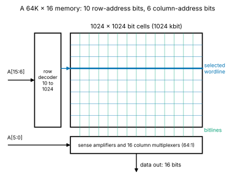

<!-- status: verified -->
# 08-11 · Memories and Programmable Logic

| | |
|---|---|
| **Course** | [08 · Digital Logic Design](../README.md) |
| **University equivalent** | The memory and programmable-logic chapter of a sophomore digital-design course (Harris & Harris, *Digital Design and Computer Architecture*, §5.5 "Memory arrays" and §5.6 "Logic arrays"; Mano & Ciletti, *Digital Design*, ch. 7) |
| **Prerequisites** | [08-04 Combinational Building Blocks](08-04-combinational-building-blocks.md) (decoders, multiplexers), [08-03 Logic Minimization](08-03-logic-minimization.md) (sums of products), [08-07 Registers, Counters and Shift Registers](08-07-registers-counters-shift-registers.md), [08-09 Arithmetic Circuits](08-09-arithmetic-circuits.md) |
| **Estimated study hours** | 5 |
| **Last verified** | 2026-11-19 |

**Learning objectives.** After this chapter you can:

1. Organize a memory array into rows and columns with decoders and column multiplexers, and compute its address split.
2. Compare ROM, SRAM, DRAM and flash at the logic level: cell, volatility, density and access.
3. Design a multi-ported register file and estimate how its cost grows with ports.
4. Implement logic in ROMs, PLAs and lookup tables, and compare their sizes.
5. Describe FPGA architecture (LUTs, carry chains, block RAM, DSP blocks, routing, configuration) and estimate a design's resource use.

---

## 1. Big picture

Two ideas from earlier chapters meet here. A **memory** is a very large register file with a decoder to choose a row: the same decoders and multiplexers of 08-04, scaled up to billions of bits. And any truth table can be *stored* instead of built from gates: a memory addressed by a function's inputs, holding its outputs, *is* that function. Lookup tables built on this idea, wired together by programmable switches, are the **field-programmable gate array (FPGA)**: hardware that can be rewired after manufacture.

- **Memory is most of the silicon.** Caches, register files and on-chip buffers take a large fraction of the area of processors and accelerators ([19-08](../../19-digital-vlsi-design/chapters/19-08-sram-design.md), [23-01](../../23-memory-and-storage-technology/chapters/23-01-memory-hierarchy-and-memory-wall.md)).
- **Register files set processor width.** How many instructions a core can issue per cycle is limited by how many read and write ports its register file can afford ([14-08](../../14-computer-organization-and-architecture/chapters/14-08-out-of-order-and-superscalar.md)).
- **FPGAs prototype every chip and ship in many products.** ASIC teams emulate designs on FPGAs before tape-out; network equipment, test instruments, automotive and aerospace systems ship FPGAs in volume; low-power FPGAs handle sensor glue in wearables.
- **The FPGA business is a corporate-development story.** Xilinx is part of AMD, and Altera, bought by Intel in 2015, became independent again in 2025 under majority private-equity ownership (§9).

## 2. Intuition first

**A memory is a filing cabinet.** The address picks a drawer (the row decoder) and a folder in the drawer (the column multiplexer); the folder holds a fixed number of bits. Making the cabinet square, as many drawers as folders per drawer, keeps both the decoders and the wires short.

**A lookup table is a cheat sheet.** Instead of computing $f(x)$, write every answer down in advance and look it up. For a function of $k$ bits, the cheat sheet has $2^k$ lines, so it is excellent for small $k$ and hopeless for large $k$: a 4-input function needs 16 entries, a 32-input function four billion.

**An FPGA is a city of identical blocks with a programmable road network.** Each block (a small lookup table plus a flip-flop) can be any small function; the roads (routing switches) connect any block to any other. *Where the analogy breaks:* in a real city, roads are cheap compared with buildings. In an FPGA, the programmable routing is most of the silicon and most of the delay, which is why the same logic runs several times slower and costs far more area on an FPGA than in a custom chip.

## 3. Theory

### 3.1 Memory arrays

A memory of $2^n$ words of $m$ bits stores $2^n m$ bits and has $n$ address bits. Built naively, as one column of $2^n$ words, it would be a tall, thin array with a $2^n$-output decoder and very long data wires. Real arrays are folded to be roughly square:

- The array has $R$ rows and $C$ columns of bit cells, $RC = 2^n m$.
- Each row holds $C/m$ words. The **row decoder** takes $\log_2 R$ address bits and activates one **wordline**; every cell on that row drives its **bitline**.
- A **column multiplexer** per output bit selects one of the $C/m$ words in the row, using the remaining $\log_2(C/m)$ address bits.

For a 64 K × 16 memory (1 Mbit) arranged as 1024 × 1024 cells, each row holds 64 words: 10 row-address bits, 6 column-address bits, and sixteen 64:1 column multiplexers (Example 08-11.1). Large memories are split further into **banks** or sub-arrays, each with its own decoders and sense amplifiers, because wordline and bitline delay grow with length.

**Timing.** A read takes the decoder's delay, the wordline's charging time, the time for the selected cells to develop a signal on the bitlines (small, for density, so **sense amplifiers** amplify it) and the column multiplexer's delay. Most on-chip memories are **synchronous**: the address is registered on a clock edge and the data appears after the access time, usually by the next edge. That is why an FPGA's block RAM has a one-cycle read latency, and why code that expects combinational reads from a large memory does not map to it.

### 3.2 Kinds of memory

At the logic level, memories differ in their cell and in what happens when power is removed:

| Type | Cell | Volatile? | Relative density | Writes | Typical use |
|---|---|---|---|---|---|
| Mask ROM | presence or absence of a transistor | no | high | never (set at manufacture) | boot code, fixed tables |
| SRAM | 6 transistors: a cross-coupled latch (08-06) plus two access transistors | yes | low | fast, unlimited | registers, caches, FPGA block RAM and configuration |
| DRAM | 1 transistor + 1 capacitor | yes, and leaks: refreshed every few tens of ms | high | fast, unlimited | main memory |
| Flash | floating-gate or charge-trap transistor | no | very high | slow, block erase, limited endurance | storage, FPGA and MCU configuration |

The device physics and the economics belong to later courses ([19-08](../../19-digital-vlsi-design/chapters/19-08-sram-design.md), [23-01](../../23-memory-and-storage-technology/chapters/23-01-memory-hierarchy-and-memory-wall.md)); what matters here is that every one of them is organized as the array of §3.1.

### 3.3 Register files

A **register file** is a small, fast memory with several **ports**, so that a processor can read two operands and write one result in the same cycle. A file of $N$ registers of $w$ bits with $R$ read ports and $W$ write ports needs:

- **storage:** $N w$ flip-flops or cells;
- **each read port:** a $w$-bit-wide $N$:1 multiplexer, which as a tree is $w(N - 1)$ two-input multiplexers;
- **each write port:** an address decoder producing $N$ enables, and a data input to every register.

In a custom (cell-based) layout each port adds a wordline and one or two bitlines to *every* cell, so the cell's area grows roughly as the square of the number of ports $(R + W)^2$: both its width and its height grow with the wire count. This is one reason wide superscalar processors split their register files into clusters (Example 08-11.3).

Two behaviors must be specified: what a read returns when the same register is written in the same cycle (**read-during-write**: old data, new data, or undefined), and what register 0 does (in RISC-V, `x0` always reads 0, so it needs no storage).

### 3.4 Logic in memories: ROMs, PLAs and lookup tables

**A ROM is a truth table.** A ROM with $n$ address bits and $m$ data bits implements *any* $n$-input, $m$-output function: write each output row at its address. Its size, $2^n m$ bits, is independent of how complicated the function is, and exponential in $n$. A 4 × 4-bit multiplier as a ROM needs $2^8 \times 8 = 2048$ bits; an 8 × 8 multiplier needs $2^{16} \times 16$ = 1 Mbit, against 64 AND gates and about 50 adders for the Dadda multiplier of 08-09.

**A PLA stores a sum of products.** A **programmable logic array** has a programmable AND plane, which forms $p$ product terms from the $n$ inputs and their complements, and a programmable OR plane, which sums any of those products into each of the $m$ outputs. Its size is set by the number of products rather than by $2^n$:

$$
\text{crosspoints} = \underbrace{2n \cdot p}_{\text{AND plane}} + \underbrace{p \cdot m}_{\text{OR plane}} .
$$

Product terms are shared between outputs, so the multi-output minimization of 08-03 pays off directly. PLAs win over ROMs for functions of many inputs with few product terms; ROMs win for small $n$ or dense functions (Example 08-11.5). Historically, PALs (fixed OR plane) and CPLDs (many PAL-like blocks with a central switch) were built on this structure.

**A lookup table (LUT)** is a tiny ROM: a $k$-input LUT stores $2^k$ bits in configuration cells and selects one with a tree of multiplexers driven by the inputs. It implements any of the $2^{2^k}$ functions of $k$ inputs (65 536 for $k$ = 4). Functions of more inputs are split across several LUTs; a general one by **Shannon expansion**,

$$
f(x_1, \ldots, x_n) = \overline{x_n}\, f(x_1, \ldots, x_{n-1}, 0) + x_n\, f(x_1, \ldots, x_{n-1}, 1),
$$

which builds an $n$-input function from two $(n - 1)$-input functions and a multiplexer. If the multiplexer takes one LUT, the number of $k$-LUTs needed obeys $L(n) = 2L(n - 1) + 1$ with $L(k) = 1$, so

$$
L(n) = 2^{\,n-k+1} - 1
$$

in the worst case: doubling with every extra input. Structured functions need far fewer: an AND of 16 inputs needs only 5 four-input LUTs (four ANDs of 4, then an AND of their outputs). Technology mapping, the synthesis step that covers a netlist with LUTs, searches for such efficient covers ([08-12](08-12-fpga-implementation-flow.md)).

### 3.5 FPGA architecture

An SRAM-based FPGA is a grid of programmable blocks embedded in programmable routing:

- **Logic cells.** A $k$-input LUT ($k$ = 4 in small, low-power FPGAs; 6 in high-end ones) followed by a flip-flop that can be bypassed. Groups of cells form a cluster (Lattice's PLB, AMD's CLB) with fast local wiring.
- **Carry chains.** Dedicated, hard-wired carry logic between neighboring cells makes ripple-carry adders fast; it is why the best FPGA adder architecture differs from the best ASIC one (08-09's lab).
- **Block RAM.** Columns of hard, synchronous dual-port SRAM blocks (a few kbit to tens of kbit each), configurable in width and depth.
- **DSP blocks.** Hard multiply-accumulate units (08-09), far smaller and faster than multipliers built from LUTs.
- **Routing.** Wire segments of several lengths joined by programmable switches (pass transistors or multiplexers controlled by configuration bits). Routing takes most of the area and, typically, most of a path's delay.
- **I/O, clocking and hard IP.** Programmable I/O standards, PLLs and global clock networks, and in larger devices serial transceivers, memory controllers, PCIe blocks and processors.
- **Configuration.** In SRAM-based FPGAs every LUT bit, routing switch and mode bit is an SRAM cell, loaded at power-up from an external or on-package flash (a **bitstream**). Flash-based and antifuse FPGAs keep their configuration without power, which suits instant-on and radiation-hard applications.

**FPGA or ASIC?** For the same function, an FPGA is slower and larger, and its unit price is much higher, but it has no mask cost and can be changed in the field. An ASIC has a large non-recurring engineering (NRE) cost (masks, design and verification) and a low unit cost. With NRE $N$, ASIC unit cost $a$ and FPGA unit cost $f$, the ASIC is cheaper above the break-even volume

$$
V^{*} = \frac{N}{f - a},
$$

the same fixed-versus-variable-cost analysis used for any make-or-buy decision (Example 08-11.7).

 Time to market and the value of field upgrades often matter as much as the break-even volume.

## 4. Worked examples

### Example 08-11.1 · Organizing a 1 Mbit memory (tier A)

**Setup.** A 64 K × 16 SRAM is built as a square array. (a) How many bits does it hold, and how many address bits does it need? (b) How many rows and columns, and how many words per row? (c) How are the address bits split between the row decoder and the column multiplexers?

**Solution.** (a) $65\,536 \times 16$ = **1 048 576** bits; $\log_2 65\,536$ = **16** address bits.

(b) $\sqrt{2^{20}} = 1024$: **1024** rows and 1024 columns, with $1024/16$ = **64** words per row.

(c) **10** bits to the row decoder ($2^{10} = 1024$ rows) and **6** to the column multiplexers ($2^6 = 64$), sixteen 64:1 multiplexers, one per output bit.

**Sanity check.** $10 + 6 = 16$ address bits ✓, and $1024 \times 64 = 65\,536$ words ✓.

### Example 08-11.2 · A multiplier in a ROM (tier A)

**Setup.** (a) How many bits does a ROM need to multiply two unsigned 4-bit numbers? (b) Two 8-bit numbers? (c) How many partial-product AND gates does an 8 × 8 Dadda multiplier use, and how many full adders (08-09)?

**Solution.** (a) 8 address bits and an 8-bit product: $2^8 \times 8$ = **2048** bits.

(b) $2^{16} \times 16$ = **1 048 576** bits.

(c) **64** AND gates and $64 - 32 + 3$ = **35** full adders (plus 7 half adders and a 14-bit adder).

**Sanity check.** The ROM grows by $2^{2\Delta n}$ when each operand grows by $\Delta n$ bits; the logic multiplier grows as $n^2$.

### Example 08-11.3 · The cost of register-file ports (tier B)

**Setup.** A RISC-V register file has 32 registers of 32 bits. (a) How many storage bits? (b) With 2 read ports and 1 write port, how many two-input multiplexers do the read ports need as trees? (c) A 4-wide superscalar core needs 8 read and 4 write ports. How many read-port multiplexers now, and by roughly what factor does the cell area grow if it scales as $(R + W)^2$?

**Solution.** (a) $32 \times 32$ = **1024** bits (in RISC-V, register `x0` always reads 0, so 992 bits of real storage).

(b) Each read port is a 32-bit 32:1 multiplexer, $32 \times 31 = 992$ two-input multiplexers: $2 \times 992$ = **1984**.

(c) $8 \times 992$ = **7936** multiplexers. Ports grow from 3 to 12: cell area grows by about $(12/3)^2$ = **16** times.

**Sanity check.** The storage is unchanged; all the growth is in access. That is why high-end cores replicate or cluster register files rather than build one huge multi-ported array.

### Example 08-11.4 · Mapping functions to LUTs (tier B)

**Setup.** (a) How many different functions can a 4-input LUT implement? A 6-input LUT? (b) How many 4-input LUTs, and how many levels, implement a 16-input AND? With 6-input LUTs? (c) What is the worst-case number of 4-input LUTs for an arbitrary 6-input function, by Shannon expansion?

**Solution.** (a) $2^{2^4}$ = **65 536**; $2^{2^6} = 2^{64} \approx$ **1.8 × 10¹⁹**.

(b) Four LUTs each AND 4 inputs, and a fifth ANDs their 4 outputs: **5** LUTs in **2** levels. With 6-input LUTs: three LUTs take 6, 6 and 4 inputs and a fourth combines them: **4** LUTs in 2 levels.

(c) $L(6) = 2^{6-4+1} - 1$ = **7** LUTs: two 5-input functions of 3 LUTs each, plus one LUT as the multiplexer.

**Sanity check.** $L(5) = 3$: two 4-input LUTs for the cofactors and one 3-input multiplexer ✓; and $L(6) = 2 \times 3 + 1 = 7$ ✓.

### Example 08-11.5 · PLA or ROM for a full adder? (tier B)

**Setup.** Implement a full adder ($S$, $C_{out}$ from $A$, $B$, $C_{in}$). (a) What size of ROM? (b) A PLA uses the minimal sums of products: $S$ is the four minterms of odd parity and $C_{out} = AB + AC_{in} + BC_{in}$. How many product terms are there, and how many crosspoints? (c) Which is smaller here, and when would the PLA win?

**Solution.** (a) $2^3 \times 2$ = **16** bits.

(b) $S$ needs 4 products and $C_{out}$ 3, with none shared: **7** products. AND plane $2 \times 3 \times 7 = 42$, OR plane $7 \times 2 = 14$: **56** crosspoints.

(c) The ROM. A PLA wins when the inputs are many and the products few: a 20-input function of 30 products needs $2 \times 20 \times 30 + 30 = 1230$ crosspoints, against $2^{20}$ = 1 048 576 ROM bits.

**Sanity check.** Parity is the worst case for sums of products (no two minterms combine), which is why XOR-rich arithmetic favors LUTs and ROMs over PLAs.

### Example 08-11.6 · Fitting a design into a small FPGA (tier B)

**Setup.** A Lattice iCE40 UltraPlus UP5K has 5280 logic cells, 30 block RAMs of 4 kbit (120 kbit), 4 single-port RAMs of 256 kbit (1 Mbit), and 8 DSP blocks ([R-159](../../../reference/research-log.md#r-159--fpga-devices-and-the-fpga-industry)). A wearable audio feature needs (a) a 4096-sample buffer of 16-bit samples and (b) an 8-tap FIR filter, one multiply per tap per sample. How much block RAM does the buffer take, and what fraction of the DSP blocks does the filter take?

**Solution.** (a) $4096 \times 16$ = **65 536** bits = 64 kbit = **16** of the 4 kbit blocks, **53**% of the block RAM (or a quarter of one 256 kbit single-port RAM).

(b) One DSP block per tap: **8**, all of them, **100**%. If the sample rate allows, one DSP block can be time-shared across all 8 taps (8 multiplies per sample at 8 times the sample rate), freeing 7.

**Sanity check.** At 48 kHz, 8 multiplies per sample is 384 000 per second, trivial for one DSP block clocked at even a few MHz: time-sharing is the natural design.

### Example 08-11.7 · FPGA or ASIC? (tier C)

**Setup.** Hypothetical numbers: an ASIC costs USD 5 million in NRE and USD 5 per unit; an FPGA solution costs USD 50 per unit. (a) Above what volume is the ASIC cheaper? (b) At 50 000 units, what is the cost per unit of each? (c) The largest AMD Virtex UltraScale+ device, the VU19P, has about 4 086 000 LUTs ([R-159](../../../reference/research-log.md#r-159--fpga-devices-and-the-fpga-industry)). How many times the LUTs of a UP5K is that?

**Solution.** (a) $V^{*} = 5\,000\,000/(50 - 5)$ = **111 111** units.

(b) ASIC: $5 + 5\,000\,000/50\,000$ = **105** USD per unit; FPGA **50** USD. Below break-even, the FPGA wins.

(c) $4\,086\,000/5280$ ≈ **774** times.

**Sanity check.** The same arithmetic as a fixed-cost/variable-cost break-even in any business case; FPGA vendors' customers live mostly below such volumes, and ASIC prototyping on the largest FPGAs is a market of its own.

### Answer key

<!-- answer-key -->
| ID | Quantity | Value | Unit |
|---|---|---|---|
| Ex 08-11.1a | bits | 1048576 | bit |
| Ex 08-11.1b | address bits | 16 | — |
| Ex 08-11.1c | rows | 1024 | — |
| Ex 08-11.1d | words per row | 64 | — |
| Ex 08-11.1e | row-address bits | 10 | — |
| Ex 08-11.1f | column-address bits | 6 | — |
| Ex 08-11.2a | ROM bits, 4 × 4 multiplier | 2048 | bit |
| Ex 08-11.2b | ROM bits, 8 × 8 multiplier | 1048576 | bit |
| Ex 08-11.2c | AND gates, 8 × 8 Dadda | 64 | — |
| Ex 08-11.2d | full adders, 8 × 8 Dadda | 35 | — |
| Ex 08-11.3a | storage bits | 1024 | bit |
| Ex 08-11.3b | read multiplexers, 2 ports | 1984 | — |
| Ex 08-11.3c | read multiplexers, 8 ports | 7936 | — |
| Ex 08-11.3d | cell-area growth factor | 16 | — |
| Ex 08-11.4a | functions of a 4-input LUT | 65536 | — |
| Ex 08-11.4b | functions of a 6-input LUT | 1.8e19 | — |
| Ex 08-11.4c | 4-LUTs for a 16-input AND | 5 | — |
| Ex 08-11.4d | levels | 2 | — |
| Ex 08-11.4e | 6-LUTs for a 16-input AND | 4 | — |
| Ex 08-11.4f | worst-case 4-LUTs, 6-input function | 7 | — |
| Ex 08-11.5a | ROM bits | 16 | bit |
| Ex 08-11.5b | PLA products | 7 | — |
| Ex 08-11.5c | PLA crosspoints | 56 | — |
| Ex 08-11.5d | crosspoints, 20 inputs and 30 products | 1230 | — |
| Ex 08-11.6a | buffer bits | 65536 | bit |
| Ex 08-11.6b | 4 kbit blocks | 16 | — |
| Ex 08-11.6c | share of block RAM | 53 | % |
| Ex 08-11.6d | DSP blocks for 8 taps | 8 | — |
| Ex 08-11.6e | share of DSP blocks | 100 | % |
| Ex 08-11.6f | multiplies per second at 48 kHz | 384000 | — |
| Ex 08-11.7a | break-even volume | 111111 | — |
| Ex 08-11.7b | ASIC cost per unit at 50 000 | 105 | USD |
| Ex 08-11.7c | LUT ratio, VU19P to UP5K | 774 | — |

## 5. Simulate it

The lab is in [labs/08-11-lab/](../labs/08-11-lab/README.md).

**Notebook** (`08-11-memories-lut.ipynb`):

1. Compute array organizations (rows, columns, address split) for memories from 1 kbit to 1 Gbit, and compare square and non-square choices.
2. Map random and structured functions onto 4-input and 6-input LUTs by Shannon expansion and by cofactor sharing, and check every mapping exhaustively.
3. Compare ROM bits with PLA crosspoints for functions of increasing size, using exact minimization from 08-03's method.
4. Estimate the resource use of small designs against the iCE40 UP5K.

**Verilog** (`mem.v`, `mem_tb.v`): a synchronous single-port RAM written in the style FPGA tools map to block RAM, a 32 × 32 register file with two read ports, one write port and `x0` hard-wired to 0, a ROM-based 7-segment decoder, and a 6-input function built from 4-input LUT models by Shannon expansion. The testbench checks the RAM and register file against a reference model on random operations (including read-during-write) and the LUT network on all 64 inputs, printing `TEST PASSED`.

**Guided exercise (predict, then run).** **Before running**, predict how many 4-input LUTs a random 8-input function needs by Shannon expansion, and whether sharing identical sub-functions helps much for random functions. Then let the notebook map a thousand random functions and compare with structured ones (a parity function, an adder bit).

## 6. Engineering tradeoffs

| Knob | Improves | Costs | Typical decision owner |
|---|---|---|---|
| Square array organization | Short wordlines and bitlines, small decoders | Column multiplexers | Memory designer or compiler |
| More register-file ports | Instructions issued per cycle | Area roughly $\propto$ ports², power, delay | CPU microarchitect |
| ROM or LUT instead of logic | Any function, no design effort | Exponential size in inputs | Designer of small tables |
| PLA instead of ROM | Size for many-input, sparse functions | Minimization effort; poor for XOR-rich functions | Historically PLD designers |
| Larger LUTs (6 versus 4 inputs) | Fewer levels, fewer LUTs for wide logic | More bits and area per LUT | FPGA architect |
| Hard blocks (BRAM, DSP, transceivers) | Density, speed and power for common functions | Silicon spent whether used or not | FPGA architect and product line |
| FPGA instead of ASIC | No NRE, fast to market, field-upgradable | Unit cost, speed and power | Product management and corporate strategy |

## 7. Numbers to know

| Quantity | Value | Note |
|---|---|---|
| Memory address bits | $\log_2$(words); row bits $\log_2 R$, column bits $\log_2(C/m)$ | §3.1 |
| ROM size for an $n$-input, $m$-output function | $2^n m$ bits | §3.4 |
| PLA size | $2np + pm$ crosspoints | §3.4 |
| Functions of a $k$-LUT | $2^{2^k}$: 65 536 for $k$ = 4 | §3.4 |
| Worst-case $k$-LUTs for $n$ inputs (Shannon) | $2^{n-k+1} - 1$ | §3.4 |
| Lattice iCE40 UltraPlus UP5K | 5280 logic cells (4-input LUT + flip-flop), 120 kbit block RAM in 30 blocks, 1 Mbit single-port RAM, 8 DSP blocks (16 × 16 multiply, 32-bit accumulator), 40 nm low-power CMOS | [R-159](../../../reference/research-log.md#r-159--fpga-devices-and-the-fpga-industry) **[Established]** (read from the data sheet) |
| AMD Virtex UltraScale+ VU19P | about 8.9 million system logic cells, 4.09 million LUTs, 3840 DSP slices, 224 Mb on-chip memory | [R-159](../../../reference/research-log.md#r-159--fpga-devices-and-the-fpga-industry) **[Established]** |
| FPGA break-even against ASIC | $N/(f - a)$ units | §3.5 |

## 8. Common mistakes

1. **Forgetting the column multiplexer.** A memory's rows hold several words; the address splits into row and column bits.
2. **Expecting combinational reads from block RAM.** FPGA block RAMs are synchronous; reading in the same cycle as the address forces the tool to build the memory from LUTs and flip-flops.
3. **Leaving read-during-write undefined.** Specify whether a read of a register being written returns old or new data, and test it.
4. **Using a ROM for a wide function.** Size doubles with every input; 20 inputs is already a megabit.
5. **Counting LUTs as gates.** One LUT can absorb many gates' worth of logic, or one XOR; compare designs in LUTs and levels, not gate counts.
6. **Ignoring routing.** On an FPGA, wiring dominates delay; a design that fits in the LUT count can still fail timing or fail to route.
7. **Quoting "logic cells" across vendors.** Vendors define logic cells differently (AMD's "system logic cells" are a scaled count, not a number of LUTs); compare LUTs, flip-flops, memory bits and DSP blocks directly.

## 9. Practitioner lens

### State of the art (as of Nov 2026)

- **Small, low-power FPGAs.** The Lattice iCE40 UltraPlus UP5K offers 5280 four-input LUT logic cells, 120 kbit of block RAM, 1 Mbit of single-port RAM and 8 DSP blocks in a 40 nm low-power process **[Established]** (read from the data sheet, version 2.0; [R-159](../../../reference/research-log.md#r-159--fpga-devices-and-the-fpga-industry)). Parts like this sit next to sensors and application processors in wearables and IoT devices, doing interface bridging and always-on signal processing.
- **Very large FPGAs.** AMD's Virtex UltraScale+ VU19P lists about 8.9 million system logic cells, 4.09 million LUTs, 3840 DSP slices and 224 Mb of on-chip memory; Xilinx announced it in 2019 as the world's largest FPGA, aimed at ASIC prototyping and emulation **[Established]** (search excerpts of AMD's product table).
- **Industry structure.** Intel agreed in April 2025 to sell 51% of Altera to Silver Lake at a valuation of USD 8.75 billion, keeping 49%, and the deal closed in September 2025, making Altera an independent FPGA company again a decade after Intel bought it for USD 16.7 billion **[Established]**; reported cash proceeds to Intel differ between sources **[Contested]**. AMD's Embedded segment, mostly the former Xilinx business, reported about USD 3.5 billion of 2025 revenue, and Lattice USD 523 million for its fiscal 2025 **[Established]** (company releases, via search excerpts; AMD's segment includes non-FPGA embedded processors).
- **Market size.** Published estimates of the 2025 FPGA market range from about USD 10 billion to USD 14 billion **[Industry estimate]**, a spread that reflects different definitions (whether SoC FPGAs, IP and tools are included); a bottom-up sum of the vendors above gives roughly half the top-down figures, a gap worth questioning in any deal model **[Contested]**.

### Why it matters commercially

- **Memory dominates die area and cost.** On-chip SRAM capacity is a first-order lever for accelerator performance and for die cost; SRAM cells have scaled more slowly than logic in recent nodes, which pushes architects toward chiplets and stacked memory ([25-07](../../25-fabrication-packaging-test-and-reliability/chapters/25-07-advanced-packaging-and-chiplets.md)).
- **FPGAs are both a product market and a development tool.** Every large chip project buys FPGA-based prototyping or emulation; FPGA vendors' fortunes track communications, industrial, automotive and defense cycles.
- **Programmability has a price.** For the same function, FPGA unit cost, power and frequency are worse than an ASIC's; the business case rests on volume, time to market and the value of reprogramming in the field.

### Marketing vs Reality

- **"10 million logic cells."** *Reality:* "system logic cells" are a vendor-defined scaled count; the LUT count is lower (4.09 million LUTs for the VU19P's 8.9 million logic cells). *Sanity check:* compare LUTs, flip-flops, block RAM bits and DSP blocks, and how many can be used at once while still meeting timing.
- **"Runs at 500 MHz."** *Reality:* hard blocks may run that fast; a full design with routing usually runs much slower. *Sanity check:* ask for the achieved frequency of a comparable design, not the block's datasheet maximum.
- **"The FPGA market will grow at X% a year."** *Reality:* forecasts disagree by tens of percent on the base year alone (§9). *Sanity check:* reconcile any top-down estimate with the vendors' reported revenues.

### Questions for engineering leaders

1. **"What fraction of your die is memory, and how did you choose its organization?"**
   - *Strong:* a breakdown by memory type, with the compiler or custom design choices and their power.
   - *Evasive:* "we use the foundry's memory compiler."
2. **"How many register-file ports does your core have, and how did you contain their cost?"**
   - *Strong:* port counts, clustering or banking choices, and the timing impact.
   - *Evasive:* "standard design."
3. **"Why FPGA rather than ASIC (or the reverse) for this product, at what volume does that flip, and what is the plan if it does?"**
   - *Strong:* a break-even analysis including NRE, unit cost, power and time to market, with a migration path.
   - *Evasive:* "flexibility."
4. **"How do you prototype your next chip before tape-out?"**
   - *Strong:* FPGA prototyping or emulation capacity, how much of the design it covers, and how early software runs on it.
   - *Evasive:* "simulation."

## 10. Concept check

**Q1.** Why are memory arrays organized to be roughly square rather than one word per row?

Answer

A square array keeps wordlines and bitlines short (their delay and energy grow with length) and keeps the row decoder small; a column multiplexer then selects the word within the row.

**Q2.** What distinguishes SRAM, DRAM and flash at the logic level?

Answer

SRAM stores a bit in a latch (6 transistors): fast, volatile, no refresh. DRAM stores charge on a capacitor (1 transistor + 1 capacitor): dense, volatile, and needs periodic refresh. Flash stores charge in a floating gate or trap: non-volatile and dense, but writes are slow, done by block erase, and wear out.

**Q3.** Why does register-file area grow so fast with the number of ports?

Answer

Each port adds a wordline and bitlines to every cell, so the cell's width and height both grow with the number of ports: area grows roughly as the square of the port count, before counting the extra multiplexers and decoders.

**Q4.** Why is a ROM a universal but expensive way to implement logic?

Answer

It stores the whole truth table, so it can implement any function of its inputs, but it needs $2^n m$ bits regardless of how simple the function is, which doubles with every added input.

**Q5.** When does a PLA beat a ROM?

Answer

When the function has many inputs but few product terms (and products are shared between outputs): the PLA's size grows with the number of products, $2np + pm$, while the ROM's grows as $2^n m$.

**Q6.** How many 4-input LUTs does an arbitrary 6-input function need in the worst case, and why?

Answer

Seven: by Shannon expansion, a 6-input function is a multiplexer (one LUT) between two 5-input functions, each of which is a multiplexer between two 4-input functions (three LUTs each): $2 \times 3 + 1 = 7$.

**Q7.** Why do FPGAs include hard block RAMs and DSP blocks?

Answer

Memories and multipliers built from LUTs and flip-flops would be many times larger, slower and more power-hungry; hard blocks implement these very common functions efficiently, at the cost of silicon that is wasted when a design does not use them.

**Q8.** What determines whether an FPGA or an ASIC is cheaper for a product?

Answer

Volume: the ASIC's large fixed cost (NRE) is spread over units and its unit cost is low; the FPGA has no NRE but a high unit cost. Above the break-even volume $N/(f - a)$ the ASIC is cheaper, before weighing time to market, power and field upgradability.

Practice problems: [problems/08-11-problems.md](../problems/08-11-problems.md) · Solutions: [solutions/08-11-solutions.md](../solutions/08-11-solutions.md)

## 11. Key terms

[Memory array](../../../reference/glossary.md#memory-array) ·
[Wordline and bitline](../../../reference/glossary.md#wordline-and-bitline) ·
[Column multiplexer](../../../reference/glossary.md#column-multiplexer) ·
[Register file](../../../reference/glossary.md#register-file) ·
[Read-only memory (ROM)](../../../reference/glossary.md#read-only-memory-rom) ·
[Programmable logic array (PLA)](../../../reference/glossary.md#programmable-logic-array-pla) ·
[Lookup table (LUT)](../../../reference/glossary.md#lookup-table-lut) ·
[Shannon expansion](../../../reference/glossary.md#shannon-expansion) ·
[Field-programmable gate array (FPGA)](../../../reference/glossary.md#field-programmable-gate-array-fpga) ·
[Block RAM](../../../reference/glossary.md#block-ram) ·
[Bitstream](../../../reference/glossary.md#bitstream) ·
[Non-recurring engineering (NRE)](../../../reference/glossary.md#non-recurring-engineering-nre)

## 12. Connections

- **Builds on:** [08-04](08-04-combinational-building-blocks.md) (decoders and multiplexers), [08-03](08-03-logic-minimization.md) (sums of products), [08-06](08-06-latches-and-flip-flops.md) (latches as storage), [08-09](08-09-arithmetic-circuits.md) (DSP blocks).
- **Next:** [08-12](08-12-fpga-implementation-flow.md) takes a design through synthesis, placement and routing onto an FPGA.
- **Used later:**
  - [19-08](../../19-digital-vlsi-design/chapters/19-08-sram-design.md) designs SRAM cells, sense amplifiers and register files at the transistor level;
  - [23-01](../../23-memory-and-storage-technology/chapters/23-01-memory-hierarchy-and-memory-wall.md) treats memory technologies and their economics;
  - [14-08](../../14-computer-organization-and-architecture/chapters/14-08-out-of-order-and-superscalar.md) meets the register-file port problem in superscalar cores;
  - [25-07](../../25-fabrication-packaging-test-and-reliability/chapters/25-07-advanced-packaging-and-chiplets.md) stacks memory on logic.

## 13. Further study

- **Harris & Harris, *Digital Design and Computer Architecture* (RISC-V Edition):** §5.5 (memory arrays, register files, ROM as logic) and §5.6 (PLAs and FPGAs).
- **Mano & Ciletti, *Digital Design*:** ch. 7 (memory and programmable logic).
- **Weste & Harris, *CMOS VLSI Design*:** ch. 12 (array subsystems: SRAM, DRAM, ROM, register files).
- **Lattice, iCE40 UltraPlus Family Data Sheet (FPGA-DS-02008):** a compact, readable description of a real FPGA's logic cells, memories and DSP blocks.

## 14. Sources

1. Research log [R-159](../../../reference/research-log.md#r-159--fpga-devices-and-the-fpga-industry): Lattice iCE40 UltraPlus data sheet (FPGA-DS-02008, version 2.0, read directly); AMD Virtex UltraScale+ VU19P product table; Altera and Silver Lake (2025); AMD and Lattice fiscal 2025 results; FPGA market estimates.
2. Textbook alignment as listed in §13. All text, examples and problems in this chapter are original.
