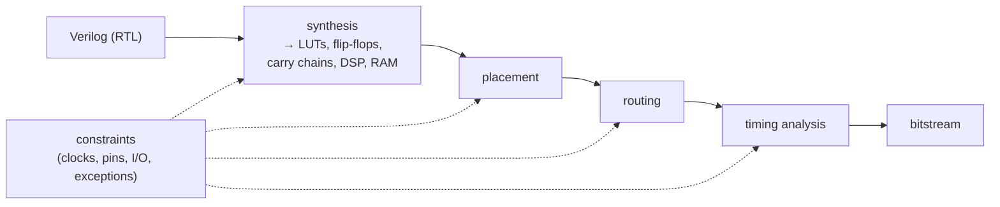
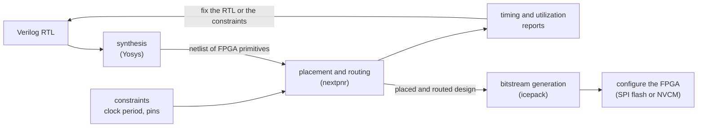
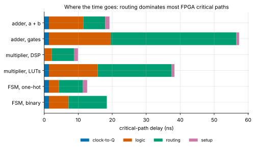

<!-- status: reviewed -->
# 08-12 · FPGA Implementation Flow

| | |
|---|---|
| **Course** | [08 · Digital Logic Design](../README.md) |
| **University equivalent** | The FPGA implementation and timing-closure part of a digital-design laboratory course (Harris & Harris, *Digital Design and Computer Architecture*, §4 and §5.6 with an FPGA board), using the open-source Yosys, nextpnr and Project IceStorm tools |
| **Prerequisites** | [08-11 Memories and Programmable Logic](08-11-memories-and-programmable-logic.md) (LUTs, block RAM, DSP blocks), [08-10 Timing, Metastability and Clock-Domain Crossing](08-10-timing-metastability-cdc.md) (STA, slack), [08-05 Verilog and Testbenches](08-05-verilog-and-testbenches.md), [08-08 Finite State Machines](08-08-finite-state-machines.md), [08-09 Arithmetic Circuits](08-09-arithmetic-circuits.md) |
| **Estimated study hours** | 5 |
| **Last verified** | 2026-11-19 |

**Learning objectives.** After this chapter you can:

1. Describe each step of an FPGA implementation flow (synthesis, technology mapping, placement, routing, timing analysis, bitstream generation) and what it consumes and produces.
2. Write the constraints a design needs (clocks, pins, I/O timing, timing exceptions) and explain what goes wrong without them.
3. Read utilization and timing reports, and break a critical path down into logic and routing delay.
4. Explain, with measured results, how coding style changes the implementation: carry chains, DSP inference, FSM encoding.
5. Compare open-source and vendor FPGA flows, and relate the FPGA flow to the ASIC flow.

---

## 1. Big picture

Chapters 08-01 to 08-11 designed logic on paper and in simulation. This chapter takes Verilog all the way to a configured chip. The flow is automatic, but it is not a black box: every step makes choices that depend on how the design is written and constrained, and the reports it produces are where an engineer learns whether the design meets its goals. Every number in this chapter's examples was produced by running the open-source flow (Yosys 0.71 and nextpnr-ice40 0.11.1) on the designs of the lab, for a Lattice iCE40 UltraPlus UP5K, the small FPGA of 08-11.

- **Prototyping every chip.** ASIC teams run their RTL on FPGAs to boot software months before silicon; the flow here is the same one they use, at much larger scale.
- **Products ship with FPGAs.** In network equipment, instruments, industrial control and low-power sensor hubs, the bitstream is part of the product and is updated in the field.
- **The same ideas, harder, in ASICs.** Synthesis, placement, routing and timing analysis are also the ASIC flow ([19-10](../../19-digital-vlsi-design/chapters/19-10-synthesis-and-sta.md), [19-11](../../19-digital-vlsi-design/chapters/19-11-place-route-signoff.md)); on an FPGA the cells and wires already exist and only their configuration is chosen.
- **Open source has reached real silicon.** For small and mid-size FPGAs, an entirely open flow now works from RTL to bitstream, which matters for teaching, for supply-chain independence and for reproducible research (§9).

## 2. Intuition first

**Translating, seating and wiring a wedding.** Synthesis translates the guest list (the RTL) into the venue's vocabulary: tables of exactly four seats (4-input LUTs), the head table (DSP blocks), the buffet line (carry chains). Placement seats every guest at a table, trying to put people who talk to each other near each other. Routing runs the waiters' paths between tables through a fixed set of aisles; if too many paths need the same aisle, someone takes a longer way round. Timing analysis checks that every course reaches every table before the next one starts. *Where the analogy breaks:* the "aisles" of an FPGA are most of the venue, and the time spent walking them, the routing delay, usually exceeds the time spent at the tables (the logic delay), as Example 08-12.3 shows.

*Figure 1. The flow, with the constraints that steer every step: translating the guests (synthesis), seating them (placement), wiring the room (routing) and checking the timetable (timing analysis).*

## 3. Theory

### 3.1 The flow at a glance

Each step is checked: the RTL by simulation (08-05), the synthesized netlist by simulation or formal equivalence against the RTL, and the routed design by timing analysis. Iterating, by changing the RTL, the constraints or tool options until every constraint is met, is called **timing closure**.

### 3.2 Synthesis and technology mapping

Synthesis turns RTL into a netlist of the target's primitives. For the iCE40 these are `SB_LUT4` (a 4-input LUT), `SB_CARRY` (one cell of the dedicated carry chain), several flip-flop flavors (`SB_DFF`, with enables and set or reset), `SB_RAM40_4K` (a 4 kbit block RAM) and `SB_MAC16` (the DSP block). The steps, in Yosys's `synth_ice40` script and in vendor tools alike:

1. **Elaboration.** Parameters and `generate` loops are resolved and the design hierarchy is built.
2. **Generic optimization.** Constant propagation, removal of unused logic, sharing of common subexpressions, and the two-level and multi-level minimization of 08-03.
3. **Inference of special structures.** Synthesis recognizes patterns in the RTL and maps them to hard resources: finite state machines (extracted and possibly re-encoded, 08-08), memories (mapped to block RAM if their reads are synchronous, 08-11), adders and counters (mapped onto the carry chain), and multipliers (mapped to DSP blocks when enabled). This step is where coding style matters most.
4. **Technology mapping.** The remaining logic is covered with LUTs (08-11's mapping problem), and flip-flops are matched to the available flavors.

The output is a netlist of primitives plus a statistics report. The first sign of a problem is often here: a memory that became thousands of flip-flops, or a multiplier built from hundreds of LUTs because DSP inference was off (Example 08-12.5).

### 3.3 Placement

Placement assigns every primitive to a physical site of the matching type: a logic cell, a block RAM, a DSP block, an I/O pin. Its goals are to keep connected cells close (short wires are fast and easy to route) and to give timing-critical connections the shortest distances. Placers combine analytic methods (treating the netlist as a system of springs and solving for low total wire length) with iterative improvement such as simulated annealing, which proposes random swaps and accepts some worse moves early on to escape local minima. Because of this randomness, results depend on a **seed**: running with several seeds and keeping the best is a standard trick when a design narrowly misses timing. The lab fixes the seed so that its numbers are reproducible.

### 3.4 Routing

Routing connects every net through the FPGA's programmable interconnect: wire segments of several lengths joined by configurable switches. The difficulty is **congestion**: popular wires are wanted by many nets. Routers resolve it by negotiation: route every net by its shortest path, then raise the cost of over-used wires and reroute, repeating until no wire is shared. A design that fits comfortably in the LUT count can still fail to route, or route with long detours, when its utilization is high or its connectivity is dense.

Every switch a signal passes adds resistance and capacitance, so in an FPGA the **routing delay** of a path is usually larger than its logic delay. In the lab's 32-bit ripple-carry adder built from LUTs, routing is about 65% of the critical path (Example 08-12.3). This is the main reason the same logic runs several times slower on an FPGA than in a custom chip.

### 3.5 Timing analysis and constraints

After routing, every wire's delay is known, and static timing analysis (08-10) checks each register-to-register path against the clock constraint, reporting the **maximum frequency** of each clock domain, the slack of the worst paths, and the paths themselves. Nothing in this analysis knows the designer's intent; it all comes from **constraints**:

- **Clock definitions:** the period of each clock (in nextpnr, `--freq` or a constraints file; in vendor tools, SDC or XDC `create_clock`), and how generated clocks relate to their sources.
- **Pin assignments:** which package pin each port uses, and its I/O standard (a PCF file for the iCE40).
- **I/O timing:** when inputs arrive and outputs are needed relative to the clock at the board level.
- **Exceptions:** false paths and multicycle paths (08-10), and the asynchronous clock groups whose crossings are handled by synchronizers rather than by timing.

An unconstrained clock is not checked at all; a wrongly constrained one is checked against the wrong period. Both produce designs that pass the tools and fail on the board, so constraints are reviewed as carefully as RTL.

### 3.6 The bitstream

Finally the placed and routed design is converted into the configuration bits of every LUT, flip-flop mode, routing switch and hard block (for the iCE40, by `icepack`, using the bitstream format documented by Project IceStorm). The bitstream configures the whole device whatever the design's size: every UP5K bitstream in the lab is exactly 104 090 bytes, whether the design uses 29 logic cells or 765. At power-up an SRAM-based FPGA loads it from an SPI flash (or, in the iCE40 UltraPlus, optionally from on-chip non-volatile configuration memory, NVCM), which takes tens to over a hundred milliseconds (Example 08-12.7), a startup delay that system designers must allow for.

### 3.7 How coding style changes the result

The lab synthesizes four comparisons through the full flow on a UP5K. Each design registers its inputs and outputs; the adders and multiplier sit inside the same style of test harness (an internal 64-bit LFSR feeding the operands and an XOR of the outputs driving one pin), so differences between rows mostly reflect the cores. The exception is the DSP multiplier: it is fast enough that the harness's XOR reduction, not the multiplier, sets its critical path (Example 08-12.5).

| Design | Logic cells | DSP blocks | Maximum frequency |
|---|---|---|---|
| 32-bit adder, `a + b` (carry chain) | 175 | 0 | 52.09 MHz |
| 32-bit adder, ripple of full-adder gates | 214 | 0 | 17.44 MHz |
| 16 × 16 multiplier, `a * b` with DSP inference | 79 | 1 | 100.88 MHz |
| 16 × 16 multiplier, `a * b` without DSP inference | 765 | 0 | 26.10 MHz |
| Traffic-light FSM (08-08), automatic (one-hot) encoding | 29 | 0 | 79.23 MHz |
| Traffic-light FSM, forced binary encoding | 37 | 0 | 54.20 MHz |

Three lessons, all measurable:

- **Write arithmetic as arithmetic.** `a + b` lets the tool use the carry chain; the same adder written as gates hides the structure, so the carries become general logic routed through the fabric: three times slower (Example 08-12.4).
- **Use the hard blocks.** The multiplier in a DSP block takes a tenth of the logic cells and runs at least 3.9 times faster; the true margin is larger, because the harness around it limits the measurement (Example 08-12.5).
- **Let encodings be chosen deliberately.** Yosys re-encoded the six-state controller as one-hot (it does so for machines of fewer than 32 states); forcing binary made it larger *and* slower here, because the binary next-state logic needs more 4-input LUTs in series (Example 08-12.6).

### 3.8 Timing closure

When the reports show negative slack, the fixes, roughly from cheapest to most expensive:

1. **Check the constraints.** Is the clock period right? Is a failing path really a false or multicycle path, or a clock-domain crossing that should be declared asynchronous and synchronized?
2. **Use the hard resources** (carry chains, DSP blocks, block RAM) by writing RTL the tool can infer them from.
3. **Pipeline or retime** the critical path (08-10 §3.3); FPGA flip-flops are plentiful, one per logic cell.
4. **Try other seeds and tool options**, such as timing-driven effort levels.
5. **Floorplan:** constrain related logic to a region so the placer keeps it together.
6. **Change the architecture:** a slower clock with wider datapaths, or a bigger or faster device.

### 3.9 FPGA flows and ASIC flows

Vendor flows (AMD Vivado, Altera Quartus, Lattice Radiant, Microchip Libero) perform the same steps with proprietary algorithms and device data, and are the only option for most large devices. Open-source flows (Yosys for synthesis, nextpnr for placement and routing, and per-family bitstream projects such as IceStorm for iCE40) are mature for several small and mid-size families (§9).

An ASIC flow starts the same way, with synthesis to a standard-cell library and STA, but nothing exists until the flow creates it: floorplanning, power-grid design, placement, **clock-tree synthesis**, routing on real metal layers, parasitic extraction and sign-off checks (design rules, layout versus schematic, timing at many corners), ending in GDSII mask data instead of a bitstream ([19-11](../../19-digital-vlsi-design/chapters/19-11-place-route-signoff.md)). Open-source ASIC flows (OpenROAD, LibreLane) do this for open process design kits such as SkyWater SKY130 (08-02, 08-06).

## 4. Worked examples

All measured values come from the lab's reports (Yosys 0.71, nextpnr-ice40 0.11.1, seed 1, iCE40 UP5K in the SG48 package).

### Example 08-12.1 · Reading a utilization report (tier A)

**Setup.** The UP5K has 5280 logic cells and its SG48 package 39 user I/O. (a) What fraction of the logic cells do the ripple adder harness (214 cells) and the traffic-light FSM (29 cells) use? (b) The FSM uses 9 I/O. What fraction is that? (c) How many copies of the LUT-built multiplier harness (765 cells) would fit, by logic cells alone?

**Solution.** (a) $214/5280$ = **4.05**%; $29/5280$ = **0.55**%.

(b) $9/39$ = **23.1**%: pins, not logic, are the scarce resource for this small design.

(c) $\lfloor 5280/765 \rfloor$ = **6** copies, in practice fewer, since routing becomes congested well before 100% of the cells are used.

**Sanity check.** The 32-bit adder harness needs 98 pins without the LFSR and the XOR, which is why the harness exists: the package has 39.

### Example 08-12.2 · From maximum frequency to slack (tier A)

**Setup.** The `a + b` adder harness achieves 52.09 MHz and the ripple adder harness 17.44 MHz. (a) What are their minimum clock periods? (b) What is each one's slack at the lab's 12 MHz constraint? (c) Which would meet a 48 MHz clock, such as the UP5K's internal high-frequency oscillator?

**Solution.** (a) $1000/52.09$ = **19.20** ns and $1000/17.44$ = **57.34** ns.

(b) At 12 MHz the period is 83.33 ns: slacks **64.13** ns and **26.00** ns. Both pass.

(c) At 48 MHz (20.83 ns): the carry-chain adder has **1.63** ns of slack and passes; the ripple adder has **−36.5** ns and fails by a wide margin.

**Sanity check.** "PASS at 12 MHz" in a report says nothing about 48 MHz; the constraint must be the frequency the board will actually use.

### Example 08-12.3 · Where the time goes on a critical path (tier B)

**Setup.** nextpnr's report breaks the ripple adder harness's critical path into clock-to-Q 1.390 ns, logic 18.142 ns, routing 36.981 ns and setup 0.824 ns, over 20 LUTs and 21 routing hops (synthesis packed the carry logic of neighboring full adders into shared 4-input LUTs, so the path from bit 3 to bit 30 crosses 20 LUTs rather than one per bit). (a) What is the total, and does it match the reported maximum frequency? (b) What fraction is routing? (c) What are the average delays per LUT and per routing hop?

**Solution.** (a) $1.390 + 18.142 + 36.981 + 0.824 = 57.337$, so **57.34** ns, which is $1000/17.44$ MHz ✓.

(b) $36.981/57.337$ = **64.5**%.

(c) Logic $18.14/20$ = **0.907** ns per LUT; routing $36.98/21$ = **1.76** ns per hop. Each hop between cells costs about twice as much as the LUT it feeds.

**Sanity check.** The carry chain is fast precisely because it avoids this per-stage routing: its carries run on dedicated wires between neighboring cells.

### Example 08-12.4 · Carry chain against gates (tier B)

**Setup.** Compare the two adder harnesses (175 cells at 52.09 MHz with `a + b`, 214 cells at 17.44 MHz as gates). (a) How many logic cells does the carry chain save, as a fraction of the gate version? (b) What is the speed ratio?

**Solution.** (a) $214 - 175$ = **39** cells, **18.2**%.

(b) $52.09/17.44$ = **2.99**: three times faster.

**Sanity check.** 08-09's lab predicted this: on an FPGA, the best adder is usually the plain `+`, because it maps to hardware no LUT network can match.

### Example 08-12.5 · DSP block against LUTs (tier B)

**Setup.** Compare the multiplier harnesses: with DSP inference, 79 cells, 1 DSP block, 100.88 MHz; without, 765 cells, 26.10 MHz. (a) How many logic cells does the DSP block save, and what fraction of the UP5K is that? (b) What is the speed ratio? (c) How many such multipliers fit in the UP5K's 8 DSP blocks, and how many by logic cells alone without DSP blocks?

**Solution.** (a) $765 - 79$ = **686** cells, **13.0**% of the device.

(b) $100.88/26.10$ = **3.87**. This understates the DSP block's advantage. Synthesis absorbed the multiplier's input and output registers into the DSP block, and the reported critical path starts at the DSP block's own output register and runs through two LUTs of the harness's XOR reduction to the output flip-flop. The multiplier itself never appears on the path, so the true ratio for the multipliers alone is at least 3.87.

(c) **8** with DSP blocks (one each); $\lfloor 5280/765 \rfloor$ = **6** harnesses' worth of LUT multipliers at most, before routing limits.

**Sanity check.** With the DSP block, routing is 6.47 ns of the 9.91 ns critical path: the fabric around the hard block, here the harness's own XOR tree, now sets the frequency. Pipelining that XOR reduction would raise the measured figure.

### Example 08-12.6 · FSM encoding, measured (tier B)

**Setup.** The 08-08 traffic-light controller synthesized with Yosys's automatic encoding (one-hot, 6 states) uses 29 cells at 79.23 MHz; forced to binary it uses 37 cells at 54.20 MHz. (a) How many flip-flops does each encoding need for the state? (b) What are the cell and speed differences?

**Solution.** (a) One-hot: **6**; binary: $\lceil \log_2 6 \rceil$ = **3**.

(b) Binary uses **8** more cells (27.6% more) and is $79.23/54.20$ = **1.46** times slower.

**Sanity check.** 08-08 §3.4 predicted that one-hot logic is shallower; here the extra three flip-flops cost less than the deeper binary decode, so one-hot wins on both counts. That is not universal: for large machines, one-hot's flip-flops dominate (08-08 Example 7).

### Example 08-12.7 · The bitstream and boot time (tier C)

**Setup.** Every UP5K bitstream is 104 090 bytes. (a) How many bits is that, and what fraction are LUT contents (5280 LUTs of 16 bits)? (b) The data sheet gives a maximum configuration time of 140 ms at the default (low) configuration frequency and 50 ms at medium frequency. What average configuration rates do these imply? (c) Why does the bitstream not shrink for small designs?

**Solution.** (a) $104\,090 \times 8$ = **832 720** bits; LUT bits $5280 \times 16 = 84\,480$, **10.1**%. Most of the bitstream configures routing switches and other settings.

(b) $832\,720/0.14\ \text{s}$ = **5.95** Mb/s and $832\,720/0.05\ \text{s}$ = **16.7** Mb/s (lower bounds on the average rate, since the times are maxima).

(c) Every switch and cell of the device must be set to a known state, used or not; the bitstream describes the whole device, not the design.

**Sanity check.** 08-11 noted that routing dominates an FPGA's area; the bitstream says the same thing in bits.

### Answer key

<!-- answer-key -->
| ID | Quantity | Value | Unit |
|---|---|---|---|
| Ex 08-12.1a | ripple adder harness utilization | 4.05 | % |
| Ex 08-12.1b | FSM utilization | 0.55 | % |
| Ex 08-12.1c | FSM I/O utilization | 23.1 | % |
| Ex 08-12.1d | LUT-multiplier harnesses by cells | 6 | — |
| Ex 08-12.2a | minimum period, carry chain | 19.20 | ns |
| Ex 08-12.2b | minimum period, gate ripple | 57.34 | ns |
| Ex 08-12.2c | slack at 12 MHz, carry chain | 64.13 | ns |
| Ex 08-12.2d | slack at 12 MHz, gate ripple | 26.00 | ns |
| Ex 08-12.2e | slack at 48 MHz, carry chain | 1.63 | ns |
| Ex 08-12.2f | slack at 48 MHz, gate ripple | -36.5 | ns |
| Ex 08-12.3a | critical path total | 57.34 | ns |
| Ex 08-12.3b | routing share | 64.5 | % |
| Ex 08-12.3c | LUTs on the path | 20 | — |
| Ex 08-12.3d | routing hops on the path | 21 | — |
| Ex 08-12.3e | logic delay per LUT | 0.907 | ns |
| Ex 08-12.3f | routing delay per hop | 1.76 | ns |
| Ex 08-12.4a | cells saved by the carry chain | 39 | — |
| Ex 08-12.4b | as a fraction | 18.2 | % |
| Ex 08-12.4c | speed ratio | 2.99 | — |
| Ex 08-12.5a | cells saved by the DSP block | 686 | — |
| Ex 08-12.5b | share of the device | 13.0 | % |
| Ex 08-12.5c | speed ratio | 3.87 | — |
| Ex 08-12.5d | multipliers in DSP blocks | 8 | — |
| Ex 08-12.5e | LUT-multiplier harnesses by cells | 6 | — |
| Ex 08-12.5f | routing on the DSP harness's critical path | 6.47 | ns |
| Ex 08-12.5g | that critical path in total | 9.91 | ns |
| Ex 08-12.6a | one-hot state flip-flops | 6 | — |
| Ex 08-12.6b | binary state flip-flops | 3 | — |
| Ex 08-12.6c | extra cells for binary | 8 | — |
| Ex 08-12.6d | as a fraction | 27.6 | % |
| Ex 08-12.6e | speed ratio | 1.46 | — |
| Ex 08-12.7a | bitstream bits | 832720 | bit |
| Ex 08-12.7b | LUT share of the bitstream | 10.1 | % |
| Ex 08-12.7c | configuration rate, 140 ms | 5.95 | Mb/s |
| Ex 08-12.7d | configuration rate, 50 ms | 16.7 | Mb/s |

## 5. Simulate it

The lab is in [labs/08-12-lab/](../labs/08-12-lab/README.md).

**Flow script** (`run_flow.py`, optional): runs Yosys, nextpnr-ice40 and icepack (installable with `pip install yowasp-yosys yowasp-nextpnr-ice40`) on the six designs and writes their reports to `reports/`. The reports from this chapter's run are committed, so the notebook works without the tools.

**Notebook** (`08-12-fpga-flow.ipynb`):

1. Load the six reports, tabulate utilization and maximum frequency, and reproduce the table of §3.7.
2. Break every critical path into clock-to-Q, logic, routing and setup delay.
3. Compute the slack of every design against a range of clock constraints.
4. Read the FSM recoding lines from the synthesis logs.

**Verilog** (`flow_designs.v`, `flow_tb.v`): the adder and multiplier cores and their harnesses. The testbench checks both adders and the multiplier against Verilog's `+` and `*` on random inputs (with their two cycles of register latency), and checks the harness LFSR's first values against a Python-computed reference, printing `TEST PASSED`.

**Guided exercise (predict, then run).** **Before looking at the reports**, predict the speed ratio between the `a + b` adder and the gate-level ripple adder on the iCE40, and the fraction of the ripple adder's critical path spent in routing. Then let the notebook read the reports and explain both numbers.

## 6. Engineering tradeoffs

| Knob | Improves | Costs | Typical decision owner |
|---|---|---|---|
| Behavioral arithmetic (`+`, `*`) instead of gate-level | Use of carry chains and DSP blocks | Less direct control of the structure | RTL designer |
| DSP and block RAM inference | Area, speed, power | Limited number of hard blocks; fixed widths | RTL designer and architect |
| Tighter clock constraint | Performance | Run time, routing effort; may not close | Designer, with system requirements |
| Pipelining for timing closure | Frequency | Latency, flip-flops, verification of the new timing | Designer |
| Several placement seeds | A few percent of frequency, cheaply | Run time | Implementation engineer |
| Floorplanning | Predictable timing for critical blocks | Effort; constrains the placer | Implementation engineer |
| Open-source flow | Transparency, reproducibility, no license cost | Device coverage; fewer optimizations on large parts | Team lead, by device family |

## 7. Numbers to know

| Quantity | Value | Note |
|---|---|---|
| Flow steps | synthesis → placement → routing → timing analysis → bitstream | §3.1 |
| Routing share of an FPGA critical path | about two thirds in the lab's gate-level adder | Example 08-12.3 (measured) |
| Carry chain versus gate-level adder, iCE40 | about 3× faster | Example 08-12.4 (measured) |
| DSP versus LUT 16 × 16 multiplier, iCE40 | about 1/10 the logic cells, at least 3.9× faster (harness-limited) | Example 08-12.5 (measured) |
| iCE40 UP5K bitstream | 104 090 bytes, independent of design size | Example 08-12.7 (measured) |
| iCE40 UltraPlus configuration time | maximum 140 ms (default frequency), 50 ms (medium) | [R-160](../../../reference/research-log.md#r-160--open-source-fpga-and-asic-flows) **[Established]** (data sheet) |
| Open-source tool versions used here | Yosys 0.71 (tag dated 12 Nov 2026), nextpnr 0.11.1 | [R-160](../../../reference/research-log.md#r-160--open-source-fpga-and-asic-flows) **[Established]** |

## 8. Common mistakes

1. **No clock constraint, or the wrong one.** The tools check what you tell them; "timing met" against a missing or wrong period means nothing.
2. **Gate-level arithmetic.** Writing adders and multipliers as gates prevents the tool from using carry chains and DSP blocks.
3. **Asynchronous reads from large memories.** They cannot map to block RAM and are built from logic cells and flip-flops.
4. **Ignoring warnings.** Inferred latches, unconnected ports, multiple drivers and timing loops are reported in the logs; read them.
5. **Treating the routed design as identical to the RTL.** Synthesis can optimize away logic it considers unused (outputs not connected to pins) or retime registers; verify the netlist, and keep test logic observable.
6. **Comparing frequencies from different seeds or tool versions as if they were design changes.** Fix the seed, or compare distributions over several seeds.
7. **Filling the device.** Above roughly 80% utilization, routing congestion often makes timing much worse; plan headroom.

## 9. Practitioner lens

### State of the art (as of Nov 2026)

- **The open-source FPGA toolchain.** Yosys releases roughly monthly (tags v0.70 on 13 October and v0.71 on 12 November 2026), and nextpnr, "a vendor neutral, timing driven, FOSS FPGA place and route tool", is at 0.11.1; nextpnr supports Lattice iCE40 (via Project IceStorm), ECP5 (Project Trellis), Nexus (Project Oxide), Gowin (Project Apicula), NanoXplore NG-Ultra and Cologne Chip GateMate, with Cyclone V, MachXO2 and Xilinx 7-series experimental **[Established]** (read from the projects' repositories with `git`; [R-160](../../../reference/research-log.md#r-160--open-source-fpga-and-asic-flows)). This chapter's numbers were produced with exactly those versions, run as YoWASP WebAssembly packages.
- **Coverage is uneven.** The Xilinx 7-series bitstream project (Project X-Ray) requires Vivado 2017.2 for its fuzzers and was last updated in June 2025, and the F4PGA umbrella repository in October 2024 **[Established]**: open flows are mature for small and mid-size Lattice and Gowin parts and immature for large AMD and Altera devices, which still need the vendors' tools **[Industry estimate]** (an interpretation of the projects' status).
- **Open ASIC flows.** OpenROAD, which describes an autonomous flow with "24 hour turnaround from RTL-GDSII" (the project's own claim), now cuts quarterly releases (26Q4 on 1 October 2026); LibreLane, maintained under the FOSSi Foundation, is the successor of Efabless's OpenLane 2 **[Established]**. Efabless, which ran the SKY130 shuttles behind many open-source tape-outs, shut down in early 2025, and ChipFoundry acquired its assets in September 2025 **[Established]** (search excerpts of several outlets; the exact shutdown date is unconfirmed).

### Why it matters commercially

- **Tool lock-in and cost.** Vendor FPGA tools are free for small devices but tie a design to one vendor's flow; open flows reduce switching costs and enable continuous integration of hardware builds, as in this repository's own CI.
- **Implementation is where schedules slip.** Timing closure on large FPGAs and ASICs can take weeks of iteration; teams that design for the target from the start (inferring hard blocks, pipelining early, constraining correctly) close faster.
- **FPGA prototyping and emulation is a market.** Large ASIC projects spend heavily on FPGA-based prototyping and emulation systems to run software before silicon ([25-12](../../25-fabrication-packaging-test-and-reliability/chapters/25-12-post-silicon-validation.md)).

### Marketing vs Reality

- **"The DSP block runs at X MHz."** *Reality:* a full design including routing between blocks runs slower; in the lab, routing was two thirds of the DSP multiplier harness's critical path. *Sanity check:* ask for the achieved frequency of a complete, comparable design.
- **"Open-source tools match vendor tools."** *Reality:* for some families they work well end to end; for large devices they are experimental or missing. *Sanity check:* ask which device family and which results were compared.
- **"95% utilization, timing met."** *Reality:* possible, but usually after heavy floorplanning and many iterations; congestion rises sharply at high utilization. *Sanity check:* ask how much headroom is planned for later features.

### Questions for engineering leaders

1. **"How long does a full FPGA or ASIC build take, and how often do you run it?"**
   - *Strong:* build times, nightly or per-change builds in CI, and tracked timing trends.
   - *Evasive:* "when we need to."
2. **"How are your timing constraints written and reviewed?"**
   - *Strong:* constraints under version control, reviewed like RTL, with exceptions justified individually.
   - *Evasive:* "the tool generates them."
3. **"Which hard blocks does the design rely on, and what happens if you change device family?"**
   - *Strong:* an inventory of DSP, memory and transceiver use, with portable RTL and wrappers.
   - *Evasive:* "we won't change."
4. **"What is your utilization and timing margin today, and what is planned for future features?"**
   - *Strong:* specific numbers and a plan (bigger device, pipelining) if features grow.
   - *Evasive:* "it fits."

## 10. Concept check

**Q1.** What does each step of the FPGA flow produce?

Answer

Synthesis: a netlist of the device's primitives (LUTs, carry cells, flip-flops, block RAMs, DSP blocks). Placement: a site for every primitive. Routing: a path through the programmable interconnect for every net. Timing analysis: maximum frequency, slack and critical paths. Bitstream generation: the configuration bits for the whole device.

**Q2.** Why does the same adder run three times faster when written as `a + b` than as a chain of full-adder gates on the iCE40?

Answer

`a + b` lets synthesis map the carries onto the dedicated carry chain, which runs on short, fixed wires between neighboring cells. Written as gates, every carry is general logic in a LUT, connected through the programmable routing, whose delay dominates.

**Q3.** Why do placement results depend on a seed?

Answer

Placers use randomized algorithms (such as simulated annealing) that explore different solutions from different starting points; the seed fixes the random sequence, so different seeds give different, slightly better or worse placements.

**Q4.** What is routing congestion, and how do routers resolve it?

Answer

Congestion is demand by several nets for the same wire segments. Routers negotiate: they route every net, raise the cost of over-used segments, and reroute repeatedly until each segment is used by at most one net, which pushes some nets onto longer paths.

**Q5.** What goes wrong if a clock is not constrained?

Answer

Its paths are not checked at all (or are checked against a default), so the reports can claim success while the design fails at the real frequency.

**Q6.** Why is every UP5K bitstream the same size?

Answer

The bitstream sets every configurable element of the device (LUTs, flip-flop modes, routing switches, hard blocks), whether the design uses it or not, so its size is a property of the device, not of the design.

**Q7.** What does an ASIC flow do that an FPGA flow does not?

Answer

It creates the physical structures that an FPGA already has: floorplan, power grid, clock tree, placed standard cells and routed metal layers, followed by extraction and sign-off checks (design rules, layout versus schematic, multi-corner timing), ending in mask data rather than a bitstream.

**Q8.** Why can forcing an FSM to binary encoding make it both larger and slower on an FPGA?

Answer

Binary encoding saves flip-flops, but each next-state bit depends on several state bits and inputs, which needs more and deeper 4-input LUT logic; with one flip-flop per logic cell available anyway, one-hot's extra flip-flops cost little while its shallow logic saves LUTs and levels.

Practice problems: [problems/08-12-problems.md](../problems/08-12-problems.md) · Solutions: [solutions/08-12-solutions.md](../solutions/08-12-solutions.md)

## 11. Key terms

[Logic synthesis](../../../reference/glossary.md#logic-synthesis) ·
[Technology mapping](../../../reference/glossary.md#technology-mapping) ·
[Placement](../../../reference/glossary.md#placement) ·
[Routing](../../../reference/glossary.md#routing) ·
[Routing congestion](../../../reference/glossary.md#routing-congestion) ·
[Timing closure](../../../reference/glossary.md#timing-closure) ·
[Timing constraint](../../../reference/glossary.md#timing-constraint) ·
[Carry chain](../../../reference/glossary.md#carry-chain) ·
[Bitstream](../../../reference/glossary.md#bitstream) ·
[Utilization](../../../reference/glossary.md#utilization)

## 12. Connections

- **Builds on:** [08-11](08-11-memories-and-programmable-logic.md) (FPGA architecture), [08-10](08-10-timing-metastability-cdc.md) (STA and timing closure), [08-09](08-09-arithmetic-circuits.md) (adders and multipliers), [08-08](08-08-finite-state-machines.md) (FSM encoding), [08-05](08-05-verilog-and-testbenches.md) (synthesizable Verilog).
- **Next:** the Course 08 exam and wrap-up, then Term 3, which begins with [09 Semiconductor Devices](../../09-semiconductor-devices/README.md).
- **Used later:**
  - [19-10](../../19-digital-vlsi-design/chapters/19-10-synthesis-and-sta.md) and [19-11](../../19-digital-vlsi-design/chapters/19-11-place-route-signoff.md) run the ASIC versions of these steps on SKY130;
  - [14-05](../../14-computer-organization-and-architecture/chapters/14-05-single-cycle-datapath.md) and later processor chapters can be prototyped with this flow;
  - [25-12](../../25-fabrication-packaging-test-and-reliability/chapters/25-12-post-silicon-validation.md) relies on FPGA prototypes and emulation for bring-up.

## 13. Further study

- **Yosys manual** (YosysHQ documentation): the `synth_ice40` script and the FSM, memory and technology-mapping passes.
- **nextpnr and Project IceStorm documentation** (YosysHQ repositories): the iCE40 architecture as seen by the tools.
- **Harris & Harris, *Digital Design and Computer Architecture* (RISC-V Edition):** the FPGA material of §5.6 and the HDL chapter, applied to a board.
- **Lattice, iCE40 UltraPlus Family Data Sheet (FPGA-DS-02008):** configuration modes and timing.

## 14. Sources

1. Research log [R-160](../../../reference/research-log.md#r-160--open-source-fpga-and-asic-flows): Yosys, nextpnr, Project IceStorm, Project Apicula, Project X-Ray and F4PGA, OpenROAD and LibreLane (repositories read with `git`); Efabless and ChipFoundry (search excerpts); iCE40 UltraPlus configuration time (data sheet).
2. Measured results: the lab's reports in [labs/08-12-lab/reports/](../labs/08-12-lab/README.md), produced by `run_flow.py` with Yosys 0.71 and nextpnr-ice40 0.11.1.
3. Textbook alignment as listed in §13. All text, examples and problems in this chapter are original.
