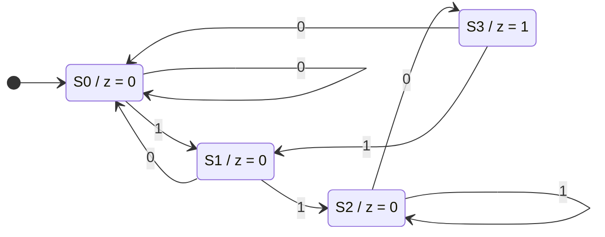

# Solutions 08-08 · Finite State Machines

Problems: [08-08 problems](../problems/08-08-problems.md) · Chapter: [08-08](../chapters/08-08-finite-state-machines.md). Every number below is recomputed by [verify_08_08.py](../verify/verify_08_08.py): machines are simulated from their state tables, minimized logic is found by exhaustive search over all product terms, state minimization runs partition refinement and is cross-checked by simulation, and code-distance claims by searching every code.

---

## Solutions

### Solution 08-08.1

(a) $z = q_1q_0$ depends only on the state: **Moore**. $z = q_1x$ depends on the input too: **Mealy**.

(b) Binary: $\lceil \log_2 9 \rceil$ = **4** flip-flops, $16 - 9$ = **7** illegal codes. One-hot: **9** flip-flops, $2^9 - 9$ = **503** illegal codes.

### Solution 08-08.2

Each state needs an arrow for each of the $2^k$ input values: (a) $6 \times 2^2$ = **24**; (b) $12 \times 2^4$ = **192**. In practice most arrows share conditions ("stay unless `start`"), but every one must be decided.

### Solution 08-08.3

(a) Step the Mealy machine (S0 → S1 on 1, S1 → S2 on 0, S2 → S1 on 1 with output 1, S2 → S0 on 0):

| cycle | 0 | 1 | 2 | 3 | 4 | 5 | 6 | 7 | 8 | 9 | 10 |
|---|---|---|---|---|---|---|---|---|---|---|---|
| state | S0 | S0 | S1 | S2 | S1 | S2 | S1 | S2 | S0 | S1 | S2 |
| $x$ | 0 | 1 | 0 | 1 | 0 | 1 | 0 | 0 | 1 | 0 | 1 |
| $z$ | 0 | 0 | 0 | 1 | 0 | 1 | 0 | 0 | 0 | 0 | 1 |

The output is 1 in cycles **3**, **5** and **10**.

(b) Non-overlapping: after the detection in cycle 3 it goes to S0. Cycle 4 ($x$ = 0) stays in S0, cycle 5 ($x$ = 1) goes to S1, cycle 6 ($x$ = 0) to S2, cycle 7 ($x$ = 0) back to S0, and cycles 8 to 10 (1, 0, 1) detect again: **2** detections.

(c) The Moore output trails the Mealy output by one cycle: first in cycle **4**.

### Solution 08-08.4

(a) The useful suffixes of the input are "", "1", "11" and, for Moore, "110": **4** Moore states and **3** Mealy states. The Moore transitions:

| state | meaning | $x = 0$ | $x = 1$ | $z$ |
|---|---|---|---|---|
| S0 | seen nothing | S0 | S1 | 0 |
| S1 | seen 1 | S0 | S2 | 0 |
| S2 | seen 11 | S3 | S2 | 0 |
| S3 | seen 110 | S0 | S1 | 1 |

The state diagram (each arrow labeled with the input that takes it):

Two arrows need thought. From S2 on 1, "...111" still ends in "11": stay in S2. From S3 on 1, "...1101" ends in "1": go to S1. From S1 on 0, "...10" has no useful suffix: S0.

(b) The states in cycles 0 to 8 are S0, S1, S2, S2, S3, S1, S2, S3, S0: the output is 1 in cycles **4** and **7**, one cycle after the 0s that complete the pattern in cycles 3 and 6.

### Solution 08-08.5

Write the next-state table as minterms of $(q_1q_0x)$, then minimize as in 08-03.

**Encoding A** (S0 = 00, S1 = 01, S2 = 10, S3 = 11). Next states: 00 → 00/01, 01 → 00/10, 10 → 11/10, 11 → 00/01 (for $x$ = 0/1).

- $q_1^{+} = 1$ at 011, 100, 101: $q_1^{+} = q_1\overline{q_0} + \overline{q_1}q_0x$, **5** literals.
- $q_0^{+} = 1$ at 001, 100, 111: no two are adjacent, so three full products, $q_0^{+} = \overline{q_1}\,\overline{q_0}x + q_1\overline{q_0}\,\overline{x} + q_1q_0x$, **9** literals.
- $z = q_1q_0$, 2 literals. Total **16**.

**Encoding B** (S0 = 00, S1 = 01, S2 = 11, S3 = 10). Next states: 00 → 00/01, 01 → 00/11, 11 → 10/11, 10 → 00/01.

- $q_1^{+} = 1$ at 011, 110, 111: $q_1^{+} = q_0x + q_1q_0$, **4** literals.
- $q_0^{+} = 1$ exactly when $x = 1$ (S1 and S2 are the only states entered on input 1, and both have $q_0 = 1$): $q_0^{+} = x$, **1** literal.
- $z = q_1\overline{q_0}$, 2 literals. Total **7**.

The difference comes from giving the two states entered on input 1 a common bit: that bit then simply records the last input. The lab finds the best of all 24 encodings.

### Solution 08-08.6

(a) The machine must remember only the previous input: **2** states, one flip-flop $q$ that stores $x$ each cycle, and $z = x \oplus q$.

(b) A Moore machine's output must be a function of the state, so the state must hold both the previous input (to compare with the next one) and whether the last step was a change: (last input, $z$) takes all four combinations, and they are distinguishable (different outputs, or same output but different behavior on the next input): **4** states.

(c) Rising edge: Mealy **2** states, $z = x\overline{q}$. Moore: (last input 0, $z$ = 0), (last input 1, $z$ = 1) and (last input 1, $z$ = 0); the combination (last input 0, $z$ = 1) is impossible because a rising edge leaves the input at 1: **3** states.

### Solution 08-08.7

(a) For a Mealy machine, $P_0$ groups states by their output rows: A and F have (0, 0), and B, C, D, E have (0, 1). $P_0$ = {A, F}, {B, C, D, E}: **2** blocks.

$P_1$: A goes to (B, C), both in {B, C, D, E}; F goes to (A, C), the first in {A, F}: split. B → (A, D), C → (A, E), D → (F, D), E → (F, E): first next state in {A, F} and second in {B, C, D, E} for all four. $P_1$ = {A}, {F}, {B, C, D, E}: **3** blocks.

$P_2$: B and C go to A on 0, D and E go to F on 0: split. $P_2$ = {A}, {F}, {B, C}, {D, E}: **4** blocks.

$P_3$: B → (A, D) and C → (A, E): D and E are in the same block, together. D → (F, D) and E → (F, E): together. No change: stop.

(b) **4** states: A, F, BC, DE. Binary encoding needs **3** flip-flops for 6 states and **2** for 4.

### Solution 08-08.8

(a) Collect each state's incoming arrows from the table of Solution 08-08.4: $S_0^{+} = \overline{x}(S_0 + S_1 + S_3)$, $S_1^{+} = x(S_0 + S_3)$, $S_2^{+} = x(S_1 + S_2)$, $S_3^{+} = \overline{x}S_2$, and $z = S_3$.

(b) Each of the 4 states has 2 outgoing arrows: **8** AND terms.

(c) An OR of $m$ terms needs $m - 1$ two-input gates: $S_0^{+}$ has 3 terms (2 ORs), $S_1^{+}$ and $S_2^{+}$ have 2 each (1 OR each), $S_3^{+}$ has 1 (none): **4** ORs. Factoring, as in (a), trades some of the ANDs for ORs.

### Solution 08-08.9

(a) $T_c \ge 70 + 260 + 50$ = **380** ps: $f_{\max}$ = **2.63** GHz.

(b) Hold slack $= t_{ccq} + t_{cd} - t_{\text{hold}} = 40 + 20 - 30$ = **30** ps: met.

(c) Skew that delays the capture clock makes the capturing flip-flop hold its window open later, so it subtracts from the hold slack: $30 - 50$ = **−20** ps, a violation that no change of clock period can fix (08-06). Add delay to the short path.

### Solution 08-08.10

(a) $8 - 6$ = **2** illegal codes, 110 and 111.

(b) 6 legal states × 3 bits = **18** single flips. 110 is one flip from 010 and 100; 111 is one flip from 011 and 101. So **4** flips land on illegal codes: **22.2**%. The other 14 turn one legal state into another, undetectably.

(c) $2^6 - 6$ = **58** illegal codes; every single flip gives zero or two 1s: **100**% detectable.

### Solution 08-08.11

(a) $16 \times 115\,200$ = **1.8432** MHz.

(b) 10 bits at 115 200 baud: $10/115\,200$ = **86.81** µs.

(c) $8 / 1.8432\ \text{MHz}$ = **4.34** µs, half a bit time. Sampling in the middle of each bit gives the most margin against the difference between the two ends' clocks.

(d) FSM: 4 states, 2 flip-flops. Sample counter 0 to 15: 4. Bit counter 0 to 7: 3. Shift register: 8. Total **17**. The controller is the smallest part; this is typical of datapath-and-control designs.

### Solution 08-08.12

(a) $1 + 7 + 1 + 7$ = **16** states, $\lceil \log_2 16 \rceil$ = **4** flip-flops.

(b) The controller has 4 states (stable low, checking a rise, stable high, checking a fall): 2 flip-flops. The counter records how many consecutive new-level samples came before the current one, 0 to 7, and the controller switches when the count is 7 and the current sample agrees: 3 flip-flops. Total **5**.

(c) Samples at 0, 1, ..., 7 ms are the 8 agreeing samples; the output changes at the clock edge that takes the eighth: **7** ms after the first stable sample. (Here the pure FSM uses fewer flip-flops, 4 against 5; the counter version wins when the required count grows, because its state count does not.)

### Solution 08-08.13

(a) Each arrow takes the Moore output of the state it enters:

| state | $x = 0$ | $x = 1$ |
|---|---|---|
| S0 | S0 / 0 | S1 / 0 |
| S1 | S2 / 0 | S1 / 0 |
| S2 | S0 / 0 | S3 / 1 |
| S3 | S2 / 0 | S1 / 0 |

(b) S1 and S3 now have identical rows, so they are equivalent (**1** pair). Merging S3 into S1 (and redirecting S2's arrow on 1 to S1) leaves **3** states: exactly the Mealy detector of §3.3.

(c) The output moves one cycle earlier than the Moore machine's cycle 4: cycle **3**.

### Solution 08-08.14

(a) Two bits cannot work: the four codes would be all of 00, 01, 10, 11, and some pairs differ in one bit. With **3** bits, the even-parity codes 000, 011, 101, 110 are pairwise at distance 2. (One-hot with 4 bits also has distance 2, but uses one more bit.)

(b) Minimum distance 3 means the "spheres" of radius 1 around the codes (a code plus its $n$ single-flip neighbors) do not overlap, so $4(1 + n) \le 2^n$. For $n = 4$: $4 \times 5$ = **20** > **16**: impossible. For $n = 5$: $24 \le 32$, and the codes 00000, 00111, 11001, 11110 are pairwise at distance 3 or 4: **5** bits. This is the kind of encoding a tool's "correct a single flip" safe-FSM option builds.

### Solution 08-08.15

(a) Binary $\lceil \log_2 20 \rceil$ = **5**; one-hot **20**.

(b) $15 \times 25.024$ = **375.36** µm², which is $375.36/3.7536$ = **100.0** NAND2 equivalents.

(c) $50 \times 375.36$ = 18 768 µm² = **0.0188** mm². On a die of tens of mm² that is negligible, which is why tools default to one-hot for small machines; it matters for machines with hundreds of states, or for tiny always-on blocks where every gate leaks.

### Solution 08-08.16

(a) Substitute into $Q^+ = J\overline{Q} + \overline{K}Q$: $A^+ = Bx\overline{A} + xA = x(A + B)$ (using $A + \overline{A}B = A + B$), and $B^+ = x\overline{B} + \overline{A}B$.

(b)

| $AB$ | $x = 0$ | $x = 1$ |
|---|---|---|
| 00 | 00 | 01 |
| 01 | 01 | 11 |
| 10 | 00 | 11 |
| 11 | 00 | 10 |

(c) 00 → 01 → 11 → 10 → 00 → 01: the states after each edge are 01, 11, 10, 00 and **01** (1).

(d) With $x$ = 0, $A^+ = 0$ and $B^+ = \overline{A}B$: 00, 10 and 11 go to 00 (**3** states), while 01 stays at 01.

### Solution 08-08.17

(a) The required transitions give $T = Q \oplus Q^+$ for each flip-flop:

| $AB$ | $A^+B^+$ | $T_A$ | $T_B$ |
|---|---|---|---|
| 00 | 01 | 0 | 1 |
| 01 | 10 | 1 | 1 |
| 10 | 00 | 1 | 0 |
| 11 | X | X | X |

With the don't care, $T_A = A + B$ and $T_B = \overline{A}$: **3** literals.

(b) From the JK excitation table: $J_A$ = 0, 1, X, X and $K_A$ = X, X, 1, X for rows 00, 01, 10, 11, so $J_A = B$, $K_A = 1$; $J_B$ = 1, X, 0, X and $K_B$ = X, 1, X, X, so $J_B = \overline{A}$, $K_B = 1$.

(c) T design at 11: $T_A = 1$, $T_B = 0$, so $A$ toggles to 0 and $B$ stays 1: 11 → **01**, which is in the cycle. JK design at 11: $J_A = K_A = 1$ toggles $A$ to 0; $J_B = 0$, $K_B = 1$ resets $B$: 11 → **00**. Both designs are self-correcting: the unused state leads into the counting cycle in one step. The don't cares decided where it goes, so a design must always check them (08-08 §3.7).

### Solution 08-08.18

A reference solution is in [hdl/p08-08-18](hdl/p08-08-18/): `det110.v` and the self-checking `det110_tb.v`, which `tools/run_hdl.py` runs with the rest of the course's testbenches.

- **States.** "" (S0), "1" (S1), "11" (S11) and "110" (S110, output 1). From S11 another 1 stays in S11, because 111 still ends in 11; from S110 a 1 goes to S1 (1101 ends in 1) and a 0 to S0.
- **Style.** One clocked block for the state register with a synchronous reset, one combinational block with `next = S0` as a default and a `default` branch, and a continuous assignment for the Moore output.
- **Checking.** The reference model shifts each input into a 3-bit history and expects `z` = 1 when the history is 110, one cycle after the last input. The testbench compares with `!==` every cycle over 2000 random bits and also checks that the pattern actually occurred (more than 100 detections), so a machine stuck at 0 cannot pass.
- **Mutation.** Changing S110's transition on a 1 from S1 to S11 makes the testbench report dozens of mismatches: the model catches a wrong edge in the state diagram.

---

## Answer key

<!-- answer-key -->
| ID | Quantity | Value | Unit |
|---|---|---|---|
| 08-08.1a | flip-flops, 9 states, binary | 4 | — |
| 08-08.1b | illegal codes, binary | 7 | — |
| 08-08.1c | flip-flops, one-hot | 9 | — |
| 08-08.1d | illegal codes, one-hot | 503 | — |
| 08-08.2a | arrows, 6 states and 2 input bits | 24 | — |
| 08-08.2b | arrows, 12 states and 4 input bits | 192 | — |
| 08-08.3a | first Mealy detection cycle | 3 | — |
| 08-08.3b | second Mealy detection cycle | 5 | — |
| 08-08.3c | third Mealy detection cycle | 10 | — |
| 08-08.3d | non-overlapping detections | 2 | — |
| 08-08.3e | first Moore detection cycle | 4 | — |
| 08-08.4a | Moore 110 detector states | 4 | — |
| 08-08.4b | Mealy 110 detector states | 3 | — |
| 08-08.4c | first Moore detection cycle | 4 | — |
| 08-08.4d | second Moore detection cycle | 7 | — |
| 08-08.5a | encoding A, literals in $q_1^{+}$ | 5 | — |
| 08-08.5b | encoding A, literals in $q_0^{+}$ | 9 | — |
| 08-08.5c | encoding A, total literals | 16 | — |
| 08-08.5d | encoding B, literals in $q_1^{+}$ | 4 | — |
| 08-08.5e | encoding B, literals in $q_0^{+}$ | 1 | — |
| 08-08.5f | encoding B, total literals | 7 | — |
| 08-08.6a | change detector, Mealy states | 2 | — |
| 08-08.6b | change detector, Moore states | 4 | — |
| 08-08.6c | rising-edge detector, Mealy states | 2 | — |
| 08-08.6d | rising-edge detector, Moore states | 3 | — |
| 08-08.7a | blocks in $P_0$ | 2 | — |
| 08-08.7b | blocks in $P_1$ | 3 | — |
| 08-08.7c | blocks in $P_2$ | 4 | — |
| 08-08.7d | states in the minimal machine | 4 | — |
| 08-08.7e | flip-flops before | 3 | — |
| 08-08.7f | flip-flops after | 2 | — |
| 08-08.8a | AND terms | 8 | — |
| 08-08.8b | two-input ORs | 4 | — |
| 08-08.9a | minimum period | 380 | ps |
| 08-08.9b | maximum frequency | 2.63 | GHz |
| 08-08.9c | hold slack | 30 | ps |
| 08-08.9d | hold slack with 50 ps skew | -20 | ps |
| 08-08.10a | illegal codes, binary | 2 | — |
| 08-08.10b | single flips from legal states | 18 | — |
| 08-08.10c | flips landing on illegal codes | 4 | — |
| 08-08.10d | detectable fraction, binary | 22.2 | % |
| 08-08.10e | illegal codes, one-hot | 58 | — |
| 08-08.10f | detectable fraction, one-hot | 100 | % |
| 08-08.11a | sample-clock frequency | 1.8432 | MHz |
| 08-08.11b | frame duration | 86.81 | µs |
| 08-08.11c | start-bit check after the edge | 4.34 | µs |
| 08-08.11d | total flip-flops | 17 | — |
| 08-08.12a | pure-FSM states | 16 | — |
| 08-08.12b | pure-FSM flip-flops | 4 | — |
| 08-08.12c | controller-plus-counter flip-flops | 5 | — |
| 08-08.12d | delay from the first stable sample | 7 | ms |
| 08-08.13a | equivalent pairs after conversion | 1 | — |
| 08-08.13b | states after merging | 3 | — |
| 08-08.13c | first output cycle | 3 | — |
| 08-08.14a | bits for distance 2 | 3 | — |
| 08-08.14b | Hamming-bound need for 4 bits | 20 | — |
| 08-08.14c | codes available with 4 bits | 16 | — |
| 08-08.14d | bits for distance 3 | 5 | — |
| 08-08.15a | flip-flops, binary | 5 | — |
| 08-08.15b | flip-flops, one-hot | 20 | — |
| 08-08.15c | extra area | 375.36 | µm² |
| 08-08.15d | in NAND2 equivalents | 100.0 | — |
| 08-08.15e | extra area for 50 copies | 0.0188 | mm² |
| 08-08.16a | final state after the sequence | 1 | — |
| 08-08.16b | states sent to 00 by x = 0 | 3 | — |
| 08-08.17a | literals, T design | 3 | — |
| 08-08.17b | next state of 11, T design | 1 | — |
| 08-08.17c | next state of 11, JK design | 0 | — |
