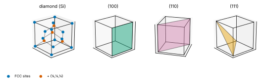
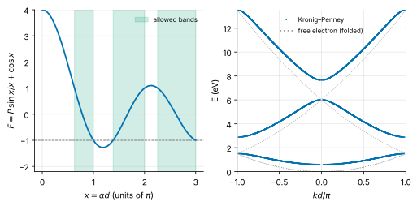
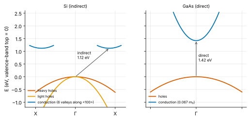
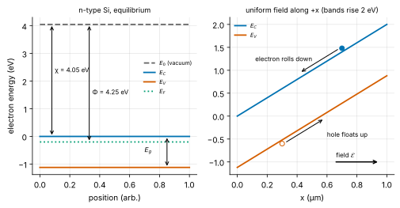

<!-- status: verified -->
# 09-01 · Crystals, Energy Bands and the Semiconductor

| | |
|---|---|
| **Course** | [09 · Semiconductor Devices](../README.md) |
| **University equivalent** | The opening weeks of a junior semiconductor-devices course: crystal structure, Miller indices and energy bands (Streetman & Banerjee, *Solid State Electronic Devices*, ch. 1 and 3; Pierret, *Semiconductor Device Fundamentals*, ch. 1–2; MIT 6.012 and Berkeley EE130 opening lectures) |
| **Prerequisites** | [04-11 Introduction to Solid-State Physics](../../04-physics-for-ee/chapters/04-11-intro-solid-state-physics.md) (crystals, bands, effective mass, holes, direct and indirect gaps), [04-10 Introduction to Quantum Mechanics](../../04-physics-for-ee/chapters/04-10-intro-quantum-mechanics.md) (the Schrödinger equation, wells and barriers), [02-01 Complex Numbers, Euler and Phasors](../../02-complex-numbers-des-and-linear-algebra/chapters/02-01-complex-numbers-euler-and-phasors.md), [01-08 Sequences, Series and Taylor](../../01-calculus-for-engineers/chapters/01-08-sequences-series-and-taylor.md) |
| **Estimated study hours** | 8 |
| **Last verified** | 2026-11-19 |

**Learning objectives.** After this chapter you can:

1. Describe the diamond, zinc-blende and wurtzite crystal structures, and compute atomic densities, bond lengths and planar densities from the lattice constant.
2. Name planes and directions in cubic crystals with Miller indices, compute spacings and angles between them, and explain why device makers care which plane forms a wafer's surface.
3. Derive the band structure of a one-dimensional periodic potential (the Kronig–Penney model), and use it to explain allowed bands, gaps and effective mass.
4. Read the $E$–$k$ diagrams of silicon and gallium arsenide, and compute conductivity and density-of-states effective masses from valley masses.
5. Draw and read energy-band diagrams in real space, with band edges, vacuum level, electron affinity and work function, and relate band bending to the electric field.
6. Estimate how the band gap changes with temperature and with alloy composition, and relate lattice mismatch to strain.

---

## 1. Big picture

Course 04 ended with a surprising fact: put atoms in a perfect periodic array and the electrons' allowed energies merge into bands separated by forbidden gaps, and a material with a modest gap, such as silicon, conducts only as much as its impurities allow. This course turns that fact into devices. Every device in it, from the diode to the gate-all-around transistor, is explained by drawing its **energy-band diagram**: the band edges plotted against position, bent by doping, voltage and junctions. This chapter builds the two foundations of that picture. The first is the crystal itself, the geometry that every wafer, every etch and every strained channel depends on. The second is the band structure, which sets the gap, the masses of the carriers and how they interact with light.

- **Why silicon.** Its 1.12 eV gap is wide enough for low leakage at room temperature and narrow enough to dope and switch easily; it grows a superb native oxide; and its crystals can be made larger and more perfect than any other material's.
- **Why other semiconductors.** LEDs and lasers need **direct** gaps, which silicon lacks, so light emitters use GaAs, InP and GaN alloys. Power and RF devices use wide-gap SiC and GaN (09-13).
- **Effective mass is a design variable.** Since the mid-2000s, leading-edge transistors have strained their silicon channels to change the carriers' effective masses and speed them up (§9).
- **Alloys are band-gap engineering.** Mixing GaAs with AlAs, or InAs with GaAs, tunes the gap and the lattice constant continuously; heterostructures built this way underlie lasers, high-electron-mobility transistors and heterojunction bipolar transistors (09-07, 09-13, 09-14).
- **Orientation is a manufacturing decision.** Which crystal plane faces up decides surface quality, mobility and how the wafer etches and cleaves.

## 2. Intuition first

**A wave in an orchard.** Imagine walking through an orchard planted in a perfect grid. Look along a row and the trees line up; look at a slight angle and they line up again in another pattern. A crystal is such an orchard of atoms, and it has well-defined families of rows and planes, which Miller indices name.

Now send a wave through the orchard. Each row of trees scatters a little of it. For most wavelengths the scattered pieces arrive with random phases and cancel, and the wave passes almost undisturbed. But when the wavelength fits the row spacing, so that reflections from successive rows add in phase (Bragg's condition, 04-11 §3.4), the reflections pile up and the wave cannot propagate: it becomes a standing wave. Electrons in a crystal are waves, so certain energies cannot propagate either. These are the **gaps**. Near a gap the wave is "sticky": a small push changes its energy only slightly, so it behaves as if it had a different mass, the **effective mass**.

**A finance analogy for effective mass.** Think of liquidity. In a deep, liquid market a trade moves the price easily and predictably; in a thin one, the same order meets resistance. An electron near the bottom of a strongly curved band is "liquid": a force accelerates it easily (small effective mass). In a flat band it is sluggish (large effective mass). *Where the analogy breaks:* effective mass can be anisotropic (different in different directions) and even negative near the top of a band, which leads to holes; no market behaves like that.

**The band diagram as a map.** Device engineers redraw the band structure in real space: a horizontal axis of position through the device, a vertical axis of electron energy, and two lines, the conduction-band edge $E_C$ and the valence-band edge $E_V$. Electrons sit near $E_C$ and roll downhill; holes sit near $E_V$ and float uphill, like bubbles. An electric field tilts the lines. With this map you can read a diode, a transistor or a laser at a glance, and the rest of the course does exactly that.

*Figure 1. The diamond structure (silicon) and the three low-index planes of a cubic crystal.*

## 3. Theory

> **Notation for this chapter.** $a$ is the lattice constant (cm or Å, 1 Å = 0.1 nm), $d$ a period or plane spacing, $k$ a wavenumber (m⁻¹), $\hbar = h/2\pi$, $m_0$ the free-electron mass and $m^*$ an effective mass. $E_C$ and $E_V$ are the band edges, $E_g = E_C - E_V$, $E_F$ the Fermi level and $E_0$ the vacuum level, all in eV. $\chi$ is the electron affinity and $\Phi$ the work function (eV). Following the [notation guide](../../../reference/notation.md), band edges are written $E_C$ and $E_V$ (04-11 wrote $E_c$ and $E_v$). Constants are CODATA 2022 ([R-073](../../../reference/research-log.md#r-073--codata-2022-fundamental-constants)).

### 3.1 Crystal structures of semiconductors

A crystal is a **lattice** of points, each decorated with the same group of atoms, the **basis**. Semiconductors are held together by covalent bonds pointing to the four corners of a tetrahedron, and three structures cover almost all of them.

- **Diamond** (Si, Ge, C): a face-centered cubic (FCC) lattice with a two-atom basis, the second atom displaced by $(a/4)(1,1,1)$ from the first. The conventional cube of side $a$ holds $8 \times \tfrac18 + 6 \times \tfrac12 = 4$ lattice points, so **8 atoms** (04-11 §3.1).
- **Zinc blende** (GaAs, InP, GaN in its cubic form): the same arrangement with the two basis sites occupied by different elements, so each Ga has four As neighbors and vice versa.
- **Wurtzite** (GaN, AlN, ZnO): a hexagonal arrangement of the same tetrahedra, described by two lattice constants $a$ and $c$. SiC has many stacking variants (polytypes); power devices use the hexagonal **4H-SiC**.

**Atomic density.** For diamond-structure silicon with $a$ = 5.431 Å ([R-086](../../../reference/research-log.md#r-086--crystals-band-gaps-intrinsic-carriers-and-wide-bandgap-markets)):

$$
N = \frac{8}{a^3} = \frac{8}{(5.431\times10^{-8}\ \text{cm})^3} = 4.994\times10^{22}\ \text{cm}^{-3} .
$$

**Bond length.** The nearest neighbor of the atom at the origin sits at $(a/4)(1,1,1)$, a distance

$$
r_{nn} = \sqrt{3}\,\frac{a}{4} = 2.352\ \text{Å for Si}.
$$

**Packing fraction.** Treat atoms as touching hard spheres of radius $r = r_{nn}/2 = \sqrt3a/8$. The fraction of the cube they fill is

$$
\frac{8 \cdot \tfrac43\pi r^3}{a^3} = \frac{32\pi}{3}\left(\frac{\sqrt3}{8}\right)^3 = \frac{\pi\sqrt3}{16} = 0.340 .
$$

The diamond structure is mostly empty: 34% against 74% for close-packed metals. The directional covalent bonds, not dense packing, hold it together. That openness is why silicon is less dense than its atomic mass suggests, and why interstitial impurities and defects move through it.

> **Going deeper — lattice and reciprocal lattice.** The FCC lattice's primitive cell (the smallest repeating unit) holds one lattice point, so 2 atoms in diamond, with a volume of $a^3/4$. Waves in a periodic structure are best described in the **reciprocal lattice**, whose points are the wavevectors $\mathbf{G}$ with $e^{j\mathbf{G}\cdot\mathbf{R}} = 1$ for every lattice vector $\mathbf{R}$. The reciprocal lattice of FCC is body-centered cubic, and the first Brillouin zone (the region of $\mathbf{k}$ closer to the origin than to any other $\mathbf{G}$) is a truncated octahedron with special points Γ (center), X (along ⟨100⟩, at $2\pi/a$) and L (along ⟨111⟩). Band diagrams of real semiconductors (§3.5) are plotted along lines between these points.

### 3.2 Miller indices: naming planes and directions

To make devices we must specify crystal planes (the wafer surface, an etched sidewall) and directions (a transistor's channel). For cubic crystals, the **Miller indices** of a plane are found in three steps:

1. Find where the plane cuts the three axes, in units of $a$ (a plane parallel to an axis cuts it at ∞).
2. Take the reciprocals.
3. Multiply by the smallest number that makes them integers, giving $(hkl)$.

A plane cutting the axes at $1, 2, \infty$ has reciprocals $1, \tfrac12, 0$, hence indices **(210)**. Negative intercepts are written with a bar: $(\bar{1}00)$. Notation:

- $(hkl)$ is one plane (and its parallel family); $\{hkl\}$ is all planes equivalent by symmetry, e.g. $\{100\}$ includes the six cube faces.
- $[hkl]$ is a direction, the vector $h\hat{x} + k\hat{y} + l\hat{z}$; $\langle hkl\rangle$ is the family of equivalent directions.
- In a **cubic** crystal the direction $[hkl]$ is perpendicular to the plane $(hkl)$. (This is not true in hexagonal crystals.)

**Plane spacing.** The plane $(hkl)$ closest to the origin is $hx + ky + lz = a$, whose distance from the origin is the plane spacing:

$$
d_{hkl} = \frac{a}{\sqrt{h^2 + k^2 + l^2}} .
$$

(The distance from the origin to the plane $\mathbf{n}\cdot\mathbf{r} = c$ is $c/|\mathbf{n}|$, with $\mathbf{n} = (h, k, l)$ and $c = a$.)

This $d_{hkl}$ is the spacing of the planes of the simple-cubic lattice built on the conventional cube, the convention used for Miller indices and in this chapter's examples. It is not always the spacing between layers of atoms, because the diamond structure has atoms between those planes: silicon's atoms form (100) layers $a/4$ = 1.358 Å apart and (110) layers $a/(2\sqrt2)$ = 1.920 Å apart, while $d_{100}$ = 5.431 Å and $d_{110}$ = 3.840 Å. Count atomic layers (in oxidation or epitaxy) with the layer spacing, not with $d_{hkl}$.

**Angles.** Since directions are normals, the angle $\theta$ between planes $(h_1k_1l_1)$ and $(h_2k_2l_2)$ follows from the dot product (02-06):

$$
\cos\theta = \frac{h_1h_2 + k_1k_2 + l_1l_2}{\sqrt{h_1^2 + k_1^2 + l_1^2}\,\sqrt{h_2^2 + k_2^2 + l_2^2}} .
$$

Between (100) and (111): $\cos\theta = 1/\sqrt3$, so $\theta$ = **54.74°**. This angle shows up in micromachining: an etch that attacks {111} planes much more slowly than {100} planes carves pits in a (100) wafer whose sidewalls are {111} planes at 54.74° to the surface.

**Planar density.** The number of atoms per unit area on a plane matters for surface chemistry, oxidation rate and how many bonds are broken at an interface. On a (100) plane of the diamond structure, each cube face holds 4 corner atoms shared by 4 faces and one face-center atom: $2$ atoms per $a^2$, so

$$
\sigma_{100} = \frac{2}{a^2} = 6.78\times10^{14}\ \text{cm}^{-2} .
$$

A (110) plane through the cube cuts a rectangle of $a \times \sqrt2a$ containing 4 atoms, $\sigma_{110} = 4/(\sqrt2a^2)$ = 9.59 × 10¹⁴ cm⁻². A (111) plane cuts an equilateral triangle of side $\sqrt2a$ (area $\sqrt3a^2/2$) containing 2 atoms, so $\sigma_{111} = 4/(\sqrt3a^2)$ = 7.83 × 10¹⁴ cm⁻². In the diamond structure the {111} atomic planes come in closely spaced pairs: each atom has three bonds to the other plane of its pair and one bond to the adjacent pair (none within its own plane). That is why silicon cleaves along {111}: separating two pairs breaks only one bond per surface atom.

**Why orientation matters for devices.** Silicon integrated circuits are built on (100) wafers, chosen for uniformity and for the electronic quality of the oxide–silicon interface, with a notch or flat cut along a {110} plane so that every pattern can be aligned to the crystal [1]. Orientation also sets carrier mobility, because the band structure (§3.5) is anisotropic: for current along ⟨110⟩, electrons are most mobile on a (100) surface and holes on a (110) surface [2]. A transistor's channel runs along the surface, so the surface plane and the channel direction are design choices with a measurable payoff (§9).

### 3.3 Electrons in a periodic potential: Bloch's theorem

An electron in a crystal sees a potential energy $V(x)$ that repeats with the lattice period $d$: $V(x + d) = V(x)$. (We work in one dimension; three dimensions add bookkeeping, not new ideas.) Shifting by one period leaves the Schrödinger equation unchanged, so if $\psi(x)$ is a solution with energy $E$, so is $\psi(x + d)$. At a given $E$ the equation has two independent solutions, and the shift maps them into combinations of each other: it acts as a 2 × 2 matrix (the Math refresher below). Choose the solutions to be its eigenvectors; each then satisfies $\psi(x + d) = \lambda\psi(x)$ with $\lambda$ an eigenvalue. A state that stays bounded over a long crystal requires $|\lambda| = 1$, so $\lambda = e^{jkd}$ for some real $k$. This is **Bloch's theorem**:

$$
\psi_k(x + d) = e^{jkd}\,\psi_k(x), \qquad\text{equivalently}\qquad \psi_k(x) = e^{jkx}u_k(x)\ \text{with}\ u_k(x + d) = u_k(x) .
$$

A crystal electron is a plane wave $e^{jkx}$ modulated by a function with the lattice's period. Two consequences:

- $k$ and $k + 2\pi/d$ give the same factor $e^{jkd}$, so all distinct states have $k$ in one **Brillouin zone**, $-\pi/d < k \le \pi/d$.
- For a crystal of $N$ cells with periodic boundary conditions, $e^{jkNd} = 1$, so $k = 2\pi n/(Nd)$: exactly $N$ allowed $k$ values per zone, one per cell. Each band therefore holds $2N$ electrons with spin, the counting that made silicon's four valence bands exactly full (04-11 §3.6).

> **Math refresher — why "only up to a constant".** The Schrödinger equation is a second-order linear ODE (02-03). At a given $E$ it has two independent solutions, and translation by $d$ maps solutions to solutions, so it acts as a 2 × 2 matrix on them. Its eigenvectors are the Bloch states and its eigenvalues are the $\lambda$ above; their product is 1 (the Wronskian is constant), so $\lambda_{1,2} = e^{\pm jkd}$ exactly when $|\tfrac12(\lambda_1 + \lambda_2)| = |\cos kd| \le 1$. The Kronig–Penney result below is that trace condition written out.

### 3.4 The Kronig–Penney model: bands and gaps derived

To see bands appear from the Schrödinger equation itself, take the simplest periodic potential: square wells of width $w$ (where $V = 0$) separated by barriers of width $b$ and height $V_0$, with period $d = w + b$. Define, for $0 < E < V_0$,

$$
\alpha = \frac{\sqrt{2mE}}{\hbar}, \qquad \beta = \frac{\sqrt{2m(V_0 - E)}}{\hbar} .
$$

**Step 1 — solutions in each region.** In a well, $\psi = Ae^{j\alpha x} + Be^{-j\alpha x}$ (oscillating); in a barrier, $\psi = Ce^{\beta x} + De^{-\beta x}$ (growing and decaying, as in 04-10's tunneling).

**Step 2 — matching conditions.** $\psi$ and $d\psi/dx$ are continuous at each well–barrier boundary (04-10). At the boundaries of one cell, that gives two equations; Bloch's theorem relates $\psi$ and $\psi'$ at the far side of the next barrier to their values one period earlier, giving two more. Four linear homogeneous equations in $A, B, C, D$ have a nonzero solution only if their determinant vanishes.

**Step 3 — the dispersion relation.** Working the determinant out for finite barriers takes a page of algebra (the lab notebook and the verify script check it by multiplying the 2 × 2 transfer matrices of the well and the barrier numerically, which gives the same curve). The result is the **Kronig–Penney relation**:

$$
\cos kd = \cos\alpha w\,\cosh\beta b + \frac{\beta^2 - \alpha^2}{2\alpha\beta}\,\sin\alpha w\,\sinh\beta b \equiv F(E) .
$$

For $E > V_0$, $\beta$ becomes imaginary: replace $\beta$ by $j\gamma$ with $\gamma = \sqrt{2m(E - V_0)}/\hbar$, which turns $\cosh$ into $\cos$ and the second term into $-\frac{\alpha^2 + \gamma^2}{2\alpha\gamma}\sin\alpha w\sin\gamma b$.

**Step 4 — reading it.** The left side lies between −1 and +1. So:

- energies with $|F(E)| \le 1$ are **allowed**: each gives a real $k$, a traveling Bloch wave;
- energies with $|F(E)| > 1$ are **forbidden**: no real $k$ exists, and $k$ becomes complex, a wave that decays into the crystal. These are the **gaps**.

Band edges occur where $F(E) = \pm1$, that is at $k = 0$ or $k = \pm\pi/d$: the zone center and the zone edge, the Bragg condition of §2.

**Two limits make it concrete.**

- **No barrier** ($V_0 \to 0$): $\beta \to j\alpha$ and $F(E) \to \cos\alpha d$, so $k = \alpha$: the free electron, $E = \hbar^2k^2/2m$, with no gaps.
- **Thin, high barriers (delta functions):** let $b \to 0$ and $V_0 \to \infty$ with $V_0b$ fixed. Then $\beta b \to 0$ while $\beta^2b \to 2mV_0b/\hbar^2$, and the relation becomes

$$
\cos kd = P\,\frac{\sin x}{x} + \cos x, \qquad x = \alpha d, \qquad P = \frac{mV_0bd}{\hbar^2} ,
$$

where the dimensionless **barrier strength** $P$ measures how strongly the barriers reflect. Allowed energies are $E = E_d x^2$, with $E_d = \hbar^2/(2md^2)$.

**Deriving the delta-comb relation directly.** This limit, the one every example and problem uses, takes only a few lines with transfer matrices. Describe the wavefunction at any point by the pair $(\psi, \psi')$.

- *Free flight.* Between barriers $\psi'' = -\alpha^2\psi$, whose solution over a distance $d$ is $\psi(x + d) = \psi\cos\alpha d + (\psi'/\alpha)\sin\alpha d$, and $\psi'(x + d) = -\alpha\psi\sin\alpha d + \psi'\cos\alpha d$. As a matrix acting on $(\psi, \psi')$:

$$
M_f = \begin{pmatrix}\cos x & \sin x/\alpha \\ -\alpha\sin x & \cos x\end{pmatrix}, \qquad x = \alpha d .
$$

- *Crossing a barrier.* A delta barrier of strength $V_0b$ leaves $\psi$ continuous, and integrating $-(\hbar^2/2m)\psi'' + V_0b\,\delta(x)\psi = E\psi$ across it gives a jump $\Delta\psi' = (2mV_0b/\hbar^2)\psi = (2P/d)\psi$. As a matrix, $K = \begin{pmatrix}1 & 0 \\ 2P/d & 1\end{pmatrix}$.
- *One period* is $M = KM_f$. Both matrices have determinant 1, so $M$ does too, and its eigenvalues are $\lambda$ and $1/\lambda$. Bloch's theorem says a Bloch state is an eigenvector with $\lambda = e^{jkd}$, so $\lambda + 1/\lambda = 2\cos kd$ equals the trace of $M$:

$$
2\cos kd = \operatorname{tr}(KM_f) = \cos x + \frac{2P}{d}\frac{\sin x}{\alpha} + \cos x \quad\Longrightarrow\quad \cos kd = \cos x + P\,\frac{\sin x}{x} .
$$

The same argument with the finite-barrier matrix in place of $K$ gives the general relation above; that algebra is the page this section skips.

As $P$ grows the bands narrow and the gaps widen. As $P \to \infty$ each band collapses to the energy levels of an isolated well, $x = n\pi$: the tight-binding picture of 04-11 §3.3, where bands are broadened atomic levels. The Kronig–Penney model interpolates between the nearly-free-electron and tight-binding pictures with one parameter.

*Figure 2. The Kronig–Penney function $F(E)$ for the delta-function comb with $P$ = 3 (left); allowed bands are where $|F| \le 1$. Right: the resulting $E$–$k$ diagram in the first Brillouin zone, with the free-electron parabola for comparison.*

**Step 5 — effective mass at a band bottom.** Near a band bottom where $F(E_b) = 1$ and $k = 0$, expand both sides to lowest nonvanishing order in small quantities (01-08), second order in $kd$ and first order in $x - x_b$:

$$
\cos kd \approx 1 - \frac{(kd)^2}{2}, \qquad F \approx 1 + F'(x_b)\,(x - x_b), \qquad E - E_b \approx 2E_dx_b\,(x - x_b) .
$$

Eliminating $x - x_b$ gives $E - E_b = -E_dx_b\,(kd)^2/F'(x_b)$. Matching this to $\hbar^2k^2/2m^*$ and using $E_d = \hbar^2/(2m_0d^2)$:

$$
\frac{m^*}{m_0} = -\frac{F'(x_b)}{x_b} .
$$

At a band bottom $F$ is falling through +1 as energy rises, so $F' < 0$ and $m^* > 0$. In the free-electron limit $F = \cos x$ and $-F'(x)/x = \sin x/x \to 1$: $m^* = m_0$, as it must. A steeply falling $F$ (strong barriers) gives a heavy carrier in a narrow band. At a band edge where $F = -1$ ($k = \pm\pi/d$), the same expansion with $\cos kd \approx -1 + (\delta k\,d)^2/2$ gives $m^*/m_0 = +F'(x_e)/x_e$. At the top of band 1, $F$ is still falling, so $F' < 0$ and $m^*$ is negative: the origin of holes (04-11 §3.7).

### 3.5 Real band structures: silicon and gallium arsenide

Real crystals are three-dimensional, so $E$ depends on the direction of $\mathbf{k}$, and band structures are plotted along lines between the special points of the Brillouin zone (§3.1). Computing them is done numerically; reading them is what device engineers need.

**Silicon** has an **indirect** gap.

- The valence-band maximum is at Γ ($\mathbf{k} = 0$).
- The conduction-band minimum is not at Γ and not at a zone boundary: it lies partway along each ⟨100⟩ direction, close to X. There are **six** equivalent minima (valleys), along $\pm x$, $\pm y$, $\pm z$.
- Near each minimum, constant-energy surfaces are ellipsoids of revolution: the electron is heavy along the valley's axis (**longitudinal mass** $m_l$ = 0.98 $m_0$) and light across it (**transverse mass** $m_t$ = 0.19 $m_0$) [3].
- Two valence bands, **heavy holes** ($m_{hh}$ = 0.49 $m_0$) and **light holes** ($m_{lh}$ = 0.16 $m_0$), meet at Γ, with a third, **split-off** band 0.044 eV below them [3].

**Gallium arsenide** has a **direct** gap: its conduction-band minimum is at Γ, directly above the valence-band maximum, with a small, isotropic effective mass: 0.067 $m_0$ at the band edge at low temperature, the value 04-10 used, and about 0.063 $m_0$ at room temperature [3, 4]. Higher conduction valleys at L and X lie 0.29 eV and 0.48 eV above Γ [3]. Electrons heated by a strong field can transfer into them, where they are much heavier; above a threshold field the drift velocity therefore *falls* as the field rises, a negative differential mobility that Gunn-diode oscillators exploit.

*Figure 3. Schematic band structures of Si (indirect gap, six ⟨100⟩ valleys) and GaAs (direct gap at Γ). Energies are to scale at the band edges only.*

### 3.6 Effective masses for transport and for counting states

Silicon's anisotropic valleys force us to ask *which* mass a calculation needs. Two averages appear throughout the course.

**Conductivity effective mass.** A field $\mathcal E$ along $x$ accelerates electrons in each valley according to the mass along $x$ in that valley (04-11 §3.5). The two valleys on the $x$ axis respond with $m_l$; the four on the $y$ and $z$ axes respond with $m_t$. With electrons shared equally among the six valleys, the average acceleration is

$$
\frac{q\mathcal E}{m_c} = \frac{1}{6}\left(2\,\frac{q\mathcal E}{m_l} + 4\,\frac{q\mathcal E}{m_t}\right)
\quad\Longrightarrow\quad
\frac{1}{m_c} = \frac13\left(\frac{1}{m_l} + \frac{2}{m_t}\right) .
$$

The **harmonic** mean is right because the response (velocity per unit force) is what adds. Mobility, $\mu = q\tau/m_c$ (09-03), uses this mass.

**Density-of-states effective mass.** The number of states below energy $E$ in a valley is proportional to the volume in $\mathbf{k}$-space enclosed by the constant-energy surface. For an ellipsoid with semi-axes proportional to $\sqrt{m_l}$, $\sqrt{m_t}$, $\sqrt{m_t}$, the volume equals that of a sphere for a single mass $m^*$ if $m^{*3/2} = m_l^{1/2}m_t$, that is $m^* = (m_lm_t^2)^{1/3}$. Six valleys hold six times the states, which multiplies $m^{*3/2}$ by 6:

$$
m_{dn} = 6^{2/3}\left(m_lm_t^2\right)^{1/3} .
$$

For holes, the heavy and light bands both have their maximum at Γ and their states add: $m_{dp}^{3/2} = m_{hh}^{3/2} + m_{lh}^{3/2}$.

These masses set the effective densities of states $N_C$ and $N_V$ that 09-02 derives, and through them the intrinsic carrier concentration. Example 09-01.4 shows that the valley masses reproduce the tabulated $N_C$ and $N_V$ of silicon.

> **Going deeper — why strain speeds up transistors.** Stretching a silicon layer in the plane of a (100) wafer (biaxial tensile strain) lowers the energy of the two valleys pointing out of the plane relative to the four in-plane valleys. Electrons move into those two valleys, where motion *in the plane* — the direction a transistor's current flows — uses the light mass $m_t$. The conductivity mass along the channel drops toward $m_t$ = 0.19 $m_0$, and intervalley scattering is suppressed as well, so electron mobility rises. Compressive strain along a channel does the analogous thing for holes by reshaping the valence bands. §9 traces how industry adopted this.

### 3.7 Band diagrams in real space

For device work we plot the band edges against **position** $x$ rather than $k$. The diagram carries five energies:

- $E_C$, the conduction-band minimum, and $E_V$, the valence-band maximum, separated by $E_g$;
- $E_F$, the Fermi level, set by the doping and carrier statistics (09-02);
- $E_0$, the **vacuum level**: the energy of an electron at rest just outside the material;
- the **electron affinity** $\chi = E_0 - E_C$, the energy to lift an electron from the conduction-band edge out of the crystal (4.05 eV for silicon, 4.07 eV for GaAs [3]), and the **work function** $\Phi = E_0 - E_F$.

**Bands follow the electrostatic potential.** An electron's potential energy at a point where the electrostatic potential is $V(x)$ is $-qV(x)$. Every electron energy level shifts with it, so all the band edges move together:

$$
E_C(x) = \text{const} - qV(x), \qquad\text{and so}\qquad \mathcal E(x) = -\frac{dV}{dx} = \frac{1}{q}\frac{dE_C}{dx} .
$$

**A tilted band means an electric field**, and the field points "uphill" for the bands (toward rising electron energy, which is falling potential). An electron is pushed opposite to the field, down the slope of $E_C$; a hole is pushed along the field, up the slope of $E_V$ (holes float). Band diagrams are therefore drawn in **energy in eV per electron**: a 1 V potential difference across a region bends the bands by 1 eV.

**Kinetic energy is height above the edge.** An electron at energy $E$ in the conduction band has kinetic energy $E - E_C$; a hole's kinetic energy grows downward from $E_V$. Carriers that gain energy falling down a steep band are "hot", the starting point of impact ionization (09-06) and hot-carrier damage (09-10).

*Figure 4. Real-space band diagrams: an n-type semiconductor in equilibrium (flat bands, with $\chi$, $\Phi$ and $E_g$ marked), and the same material with a uniform field applied, where the bands tilt, electrons roll down and holes float up.*

### 3.8 Band gaps with temperature and composition

**Temperature.** As a crystal warms, it expands and its atoms vibrate more, and both narrow the gap. An empirical fit due to Varshni (1967) works well for most semiconductors:

$$
E_g(T) = E_g(0) - \frac{\alpha_V T^2}{T + \beta_V} ,
$$

with material parameters $E_g(0)$, $\alpha_V$ and $\beta_V$. For silicon the handbook fit is $E_g(0)$ = 1.17 eV, $\alpha_V$ = 4.73 × 10⁻⁴ eV/K and $\beta_V$ = 636 K; for GaAs it is 1.519 eV, 5.405 × 10⁻⁴ eV/K and 204 K [3, 4]. For silicon these give 1.1245 eV at 300 K. Differentiating, $dE_g/dT = -\alpha_VT(T + 2\beta_V)/(T + \beta_V)^2 \approx -0.25$ meV/K near room temperature. The shift is small, but it enters the exponential of $n_i$ (09-02). A silicon diode's forward voltage at constant current falls by about 2 mV/K (09-06); most of that comes from the activation factor $e^{-E_g/kT}$ at fixed gap and the $T^3$ prefactor of $n_i^2$, and the gap's own shift adds only about an eighth. Its main effect is on the extrapolation: projected linearly back to 0 K from room temperature, the gap is about 1.20 eV, the voltage that bandgap references are built around ([20-03](../../20-analog-and-mixed-signal-ic-design/chapters/20-03-bandgap-references.md)).

**Composition.** Semiconductors with the same crystal structure mix into **alloys**, written by the fraction of each component: Al$_x$Ga$_{1-x}$As replaces a fraction $x$ of the Ga atoms with Al.

- The lattice constant varies almost linearly with composition (**Vegard's law**): $a(x) = (1 - x)a_A + xa_B$.
- The band gap varies smoothly but usually not linearly, with a **bowing** term: $E_g(x) = (1 - x)E_A + xE_B - b\,x(1 - x)$.

Two alloys show what the bowing term does, and how settled it is.

- **Al$_x$Ga$_{1-x}$As.** Adding aluminum raises the direct (Γ) gap faster than the indirect (X) gap, so the alloy turns indirect near $x \approx 0.4$: the standard compilation of III–V parameters puts the crossover at $x$ = 0.38 at low temperature and 0.39 at 300 K [4] **[Established]** for "about 0.4". The same compilation notes that Γ-gap bowing parameters from 0.14 to 0.66 eV have been proposed, and it recommends a composition-dependent one [4] **[Contested]**: the third significant figure of an AlGaAs gap depends on whose fit you use.
- **Ga$_{1-y}$In$_y$As.** Here the compilation recommends a constant $b$ = 0.477 eV, fixed by the measured low-temperature gap, 0.816 eV, of the alloy lattice-matched to InP, Ga$_{0.47}$In$_{0.53}$As [4]. This alloy is the workhorse photodetector material of fiber optics; Example 09-01.6 computes its composition and gap.

**Lattice matching and strain.** A crystal layer grown on a substrate (**epitaxy**) takes up the substrate's lattice spacing in the plane if it can. The **mismatch** is $f = (a_{layer} - a_{substrate})/a_{substrate}$.

- AlAs and GaAs differ by only 0.14% (5.6611 and 5.65325 Å [4]), so AlGaAs of any composition grows on GaAs with negligible strain. That near-perfect match made the GaAs/AlGaAs family the first great heterostructure system: lasers, HEMTs and HBTs.
- Ge is 4.2% larger than Si (lattice constants 5.658 and 5.431 Å). A thin SiGe layer on Si is compressed to fit; beyond a **critical thickness** the strain energy is relieved by misfit dislocations, defects that kill devices. SiGe is therefore used in thin, strained layers: the base of SiGe HBTs (09-07) and the stressors of strained-silicon transistors (§9).
- Unmatched combinations need buffer layers or tolerate high defect densities: GaN on silicon or sapphire is grown with dislocation densities that would be fatal in GaAs, yet still makes efficient LEDs and transistors (09-13).

## 4. Worked examples

### Example 09-01.1 · The silicon crystal by the numbers (tier A)

**Setup.** Silicon has $a$ = 5.431 Å and an atomic mass of 28.0855 g/mol. Find (a) the atomic density, (b) the nearest-neighbor distance, (c) the density, (d) the planar densities of (100), (110) and (111) planes, and (e) how many silicon atoms there are for each dopant atom at $N_D = 10^{16}$ cm⁻³.

**Solution.**

(a) $N = 8/a^3 = 8/(5.431\times10^{-8})^3$ = **4.994 × 10²²** cm⁻³.

(b) $r_{nn} = \sqrt3a/4$ = **2.352** Å.

(c) $\rho = N \times 28.0855/N_A = 4.994\times10^{22} \times 28.0855/6.022\times10^{23}$ = **2.329** g/cm³.

(d) $\sigma_{100} = 2/a^2$ = **6.781 × 10¹⁴** cm⁻²; $\sigma_{110} = 4/(\sqrt2a^2)$ = **9.589 × 10¹⁴** cm⁻²; $\sigma_{111} = 4/(\sqrt3a^2)$ = **7.830 × 10¹⁴** cm⁻².

(e) $4.994\times10^{22}/10^{16}$ = **4.994 × 10⁶**: about one dopant per five million silicon atoms.

**Units check.** cm⁻³ × g/mol ÷ mol⁻¹ = g/cm³. **Sanity check.** Silicon's handbook density is about 2.33 g/cm³, and the result reproduces it from the lattice constant alone. Doping at the parts-per-million level changes conductivity by orders of magnitude, which is why purity is measured in "nines".

### Example 09-01.2 · Miller indices, spacings and angles (tier A)

**Setup.** (a) A plane cuts the axes at $x = 2a$, $y = 3a$ and is parallel to $z$. Find its Miller indices. (b) Find the lattice-plane spacing $d_{hkl}$ of the (100), (110), (111) and (210) families in silicon. (c) Find the angle between (100) and (111), and between (100) and (110). (d) Which of these directions lies in the (001) plane: [110], [111], [1̄10]?

**Solution.**

(a) Intercepts 2, 3, ∞ → reciprocals ½, ⅓, 0 → multiply by 6: **(320)**.

(b) Lattice-plane spacing $d = a/\sqrt{h^2 + k^2 + l^2}$: (100) **5.431** Å, (110) **3.840** Å, (111) **3.136** Å, (210) **2.429** Å.

(c) $\cos\theta = 1/\sqrt3$ → **54.74°**; $\cos\theta = 1/\sqrt2$ → **45.00°**.

(d) A direction lies in a plane when it is perpendicular to the plane's normal, [001]: the dot product must vanish. [110]·[001] = 0 and [1̄10]·[001] = 0, so **[110] and [1̄10]** lie in the (001) plane; [111] does not. Transistors on (001) wafers are usually laid out with channels along ⟨110⟩.

**Sanity check.** Higher-index lattice planes are more closely spaced, since $d$ falls as $\sqrt{h^2 + k^2 + l^2}$ grows. Atomic density on a plane does not follow so simple a rule: in silicon $\sigma_{110} > \sigma_{111} > \sigma_{100}$ (§3.2). The (111) spacing $a/\sqrt3$ is the distance between the double layers described in §3.2.

### Example 09-01.3 · Bands of a delta-function comb (tier B)

**Setup.** Electrons of mass $m_0$ move in a one-dimensional crystal of period $d$ = 0.5 nm with delta-function barriers of strength $P$ = 3. Find (a) the energy scale $E_d = \hbar^2/(2m_0d^2)$, (b) the first band, (c) the first gap and the top of the second band, and (d) the effective mass at the bottom of the first band.

**Solution.**

(a) $E_d = (1.0546\times10^{-34})^2/(2 \times 9.109\times10^{-31} \times (0.5\times10^{-9})^2)$ J = **0.1524** eV.

(b) The bottom of band 1 is where $F(x) = 3\sin x/x + \cos x = 1$ with $0 < x < \pi$. Newton's method (01-04) with $F'(x) = 3(x\cos x - \sin x)/x^2 - \sin x$, from $x = 2$: $x$ = **1.97644**, then **1.976481**, converged at $x_b$ = **1.9765**. So $E$ = 0.1524 × 1.9765² = **0.5953** eV. The top is at $x = \pi$, where $\sin x = 0$ and $\cos x = -1$ exactly, so $F = -1$ for any $P$: $E = 0.1524\pi^2$ = **1.504** eV.

(c) Above $x = \pi$, $F$ first goes below −1 (a gap) and returns to −1 at $x$ = 4.3493 (found the same way). The gap runs from 1.504 to $0.1524 \times 4.3493^2$ = 2.883 eV, a width of **1.379** eV. Band 2 ends at $x = 2\pi$ (where $F = +1$ again): **6.016** eV.

(d) $F'(x_b) = 3(1.9765\cos1.9765 - \sin1.9765)/1.9765^2 - \sin1.9765 = -2.2235$, so $m^*/m_0 = -F'(x_b)/x_b = 2.2235/1.9765$ = **1.125**.

**Sanity check.** The barriers make the lowest band heavier than a free electron ($m^* > m_0$), narrower than the free-electron range up to $x = \pi$, and leave a gap at the zone edge comparable to the band widths: P = 3 is a moderately strong lattice. The lab varies $P$ and shows the bands flattening toward isolated-well levels as $P$ grows.

### Example 09-01.4 · Silicon's effective masses (tier B)

**Setup.** Take silicon's valley masses $m_l$ = 0.98 $m_0$ and $m_t$ = 0.19 $m_0$, and hole masses $m_{hh}$ = 0.49 $m_0$ and $m_{lh}$ = 0.16 $m_0$. (a) Find the conductivity mass $m_c$ of electrons. (b) Find the density-of-states masses $m_{dn}$ and $m_{dp}$. (c) The effective density of states (derived in 09-02) is $N = 2(2\pi m^*kT/h^2)^{3/2}$, which is 2.509 × 10¹⁹ cm⁻³ × $(m^*/m_0)^{3/2}$ at 300 K. Compute $N_C$ and $N_V$ and compare with the textbook values 2.8 × 10¹⁹ and 1.04 × 10¹⁹ cm⁻³ ([C. Hu, Table 1–4](https://www.chu.berkeley.edu/wp-content/uploads/2020/01/Chenming-Hu_ch1-3.pdf)).

**Solution.**

(a) $1/m_c = \tfrac13(1/0.98 + 2/0.19)$ → $m_c$ = **0.2598** $m_0$, matching the 0.26 $m_0$ conductivity mass that Hu tabulates for silicon electrons.

(b) $m_{dn} = 6^{2/3}(0.98 \times 0.19^2)^{1/3}$ = **1.084** $m_0$; $m_{dp} = (0.49^{1.5} + 0.16^{1.5})^{2/3}$ = **0.5492** $m_0$.

(c) $N_C = 2.509\times10^{19} \times 1.084^{1.5}$ = **2.832 × 10¹⁹** cm⁻³ and $N_V = 2.509\times10^{19} \times 0.5492^{1.5}$ = **1.021 × 10¹⁹** cm⁻³, within 1.1% and 1.8% of the tabulated values.

**Sanity check.** The six-valley DOS mass is four times the conductivity mass: many valleys give many states, while each electron still accelerates with a light transverse mass in most directions. Silicon's heavy DOS mass is why its $N_C$ is about **60** times GaAs's (Hu's table gives 4.7 × 10¹⁷ cm⁻³ for GaAs), which matters for transistors at the scaling limit (09-12).

**Which table?** The semiconductor-parameter handbook [3] lists larger values, $N_C$ = 3.2 × 10¹⁹ and $N_V$ = 1.8 × 10¹⁹ cm⁻³, because it uses density-of-states masses evaluated at 300 K, 1.18 $m_0$ and 0.81 $m_0$, rather than the band-edge masses above: $2.509\times10^{19} \times 1.18^{1.5}$ = **3.217 × 10¹⁹** and $2.509\times10^{19} \times 0.81^{1.5}$ = **1.829 × 10¹⁹** cm⁻³. The bands are not perfect parabolas, and the valence bands especially flatten away from Γ, so the effective "counting mass" grows as carriers spread to higher energies. Tabulated values for silicon therefore differ between respected sources, by **14**% for $N_C$ and **73**% for $N_V$; 09-02 picks one set and shows why the choice matters for $n_i$.

### Example 09-01.5 · Reading a band diagram (tier B)

**Setup.** A silicon sample has $\chi$ = 4.05 eV and $E_g$ = 1.12 eV. (a) In n-type material with $E_C - E_F$ = 0.20 eV, what is the work function? In p-type material with $E_F - E_V$ = 0.15 eV? (b) A uniform field of 20 kV/cm is applied along $+x$ across a 1 µm-long bar. By how much do the band edges drop or rise across the bar, and which way does an electron move? (c) An electron at the top end of the bar enters with negligible kinetic energy and crosses without scattering. What kinetic energy does it reach?

**Solution.**

(a) $\Phi = \chi + (E_C - E_F)$ = **4.25** eV. For p-type, $E_C - E_F = 1.12 - 0.15$ = **0.97** eV, so $\Phi$ = **5.02** eV.

(b) The potential drops by $\mathcal E L = 2\times10^4\ \text{V/cm} \times 10^{-4}$ cm = 2 V along $+x$, so electron energies *rise* by **2.00** eV along $+x$: the bands slope up in the direction of the field. Electrons roll down the slope, toward $-x$, against the field, as their negative charge requires.

(c) With no scattering it converts the full 2.00 eV drop into kinetic energy: **2.00** eV, well above the 1.12 eV gap, enough to create electron–hole pairs by impact ionization. In real silicon, electrons scatter every **0.21** ps or so (the mean free time $\tau = \mu m_c/q$ with $\mu$ = 1400 cm²/V·s and $m_c$ = 0.26 $m_0$, 09-03), so at such fields carriers stay far below the 2 eV ballistic value, though they are noticeably heated (by the velocity fit of 09-03 they move at about three-quarters of the saturation velocity). Only in very high fields or very short devices do carriers get anywhere near this hot.

**Sanity check.** The p-type work function is larger, because its Fermi level is lower; joining the two materials, electrons flow from the n side (lower Φ) to the p side until the Fermi levels align, which is how the built-in potential of a PN junction arises (09-05).

### Example 09-01.6 · Band gaps, wavelengths and alloys (tier C)

**Setup.** (a) Using Varshni's fit, find silicon's gap at 77 K, 300 K and 400 K, and $dE_g/dT$ at 300 K. (b) Find GaAs's gap at 300 K and its absorption cutoff wavelength; repeat for silicon. (c) Ga$_{1-y}$In$_y$As is grown on InP. Using Vegard's law with lattice constants 5.65325 Å (GaAs), 6.0583 Å (InAs) and 5.8697 Å (InP) [4], find the indium fraction that matches InP. (d) For Ga$_{0.47}$In$_{0.53}$As, use the bowing parameter $b$ = 0.477 eV and the Varshni parameters of GaAs (above) and InAs ($E_g(0)$ = 0.417 eV, $\alpha_V$ = 2.76 × 10⁻⁴ eV/K, $\beta_V$ = 93 K [4]) to find the gap at 0 K and 300 K and the cutoff wavelength at 300 K. (e) Find the Si–Ge and AlAs–GaAs lattice mismatches.

**Solution.** Photon energy and wavelength are related by $\lambda = hc/E$, with $hc/q$ = 1239.84 nm·eV.

(a) $E_g(T) = 1.17 - 4.73\times10^{-4}T^2/(T + 636)$: **1.166** eV at 77 K, **1.1245** eV at 300 K, **1.0969** eV at 400 K; $dE_g/dT = -\alpha_VT(T + 2\beta_V)/(T + \beta_V)^2$ = **−0.255** meV/K at 300 K.

(b) GaAs: $1.519 - 5.405\times10^{-4} \times 300^2/504$ = **1.4225** eV, cutoff $1239.84/1.4225$ = **871.6** nm. Silicon: $1239.84/1.1245$ = **1103** nm.

(c) Vegard's law, $a(y) = (1 - y)\,a_{GaAs} + y\,a_{InAs}$, equals $a_{InP}$ when

$$
y = \frac{a_{InP} - a_{GaAs}}{a_{InAs} - a_{GaAs}} = \frac{5.8697 - 5.65325}{6.0583 - 5.65325} = 0.5344 ,
$$

so the lattice-matched alloy is Ga$_{0.47}$In$_{0.53}$As, as quoted in §3.8.

(d) At 0 K: $E_g = 0.47 \times 1.519 + 0.53 \times 0.417 - 0.477 \times 0.53 \times 0.47$ = **0.8161** eV, which reproduces the measured 0.816 eV that fixed $b$ (a consistency check, not new information). At 300 K, first move each end point: InAs $0.417 - 2.76\times10^{-4} \times 300^2/393$ = **0.3538** eV and GaAs 1.4225 eV from (b). Then $E_g = 0.47 \times 1.4225 + 0.53 \times 0.3538 - 0.1188$ = **0.7373** eV (the bowing term, $0.477 \times 0.53 \times 0.47$ = **0.1188** eV, is assumed independent of temperature [4]). Cutoff: $1239.84/0.7373$ = **1682** nm.

(e) Si–Ge: $(5.658 - 5.431)/5.431$ = **4.18**%. AlAs–GaAs: $(5.6611 - 5.65325)/5.65325$ = **0.139**%.

**Sanity check.** Silicon's gap shrinks by **27.6** meV between 300 and 400 K, less than one $kT$ at 400 K (34.5 meV), small in energy. But it sits in an exponential: through the factor $e^{-E_g/kT}$ alone, the shrinkage multiplies $n_i^2$ at 400 K by $e^{0.0276/0.0345}$ = **2.23**, on top of the explicit temperature dependence (09-02). The InGaAs cutoff near 1.68 µm is why lattice-matched InGaAs photodiodes detect light in both optical-fiber bands, at 1.31 and 1.55 µm, which silicon, with its cutoff at 1.10 µm, cannot.

### Answer key

<!-- answer-key -->
| ID | Quantity | Value | Unit |
|---|---|---|---|
| Ex 09-01.1a | atomic density of Si | 4.994e22 | cm⁻³ |
| Ex 09-01.1b | nearest-neighbor distance | 2.352 | Å |
| Ex 09-01.1c | density | 2.329 | g/cm³ |
| Ex 09-01.1d | (100) planar density | 6.781e14 | cm⁻² |
| Ex 09-01.1e | (110) planar density | 9.589e14 | cm⁻² |
| Ex 09-01.1f | (111) planar density | 7.830e14 | cm⁻² |
| Ex 09-01.1g | Si atoms per dopant at 1e16 | 4.994e6 | — |
| Ex 09-01.2a | (100) spacing | 5.431 | Å |
| Ex 09-01.2b | (110) spacing | 3.840 | Å |
| Ex 09-01.2c | (111) spacing | 3.136 | Å |
| Ex 09-01.2d | (210) spacing | 2.429 | Å |
| Ex 09-01.2e | angle between (100) and (111) | 54.74 | ° |
| Ex 09-01.2f | angle between (100) and (110) | 45.00 | ° |
| Ex 09-01.3a | energy scale | 0.1524 | eV |
| Ex 09-01.3b | band 1 bottom, x | 1.9765 | — |
| Ex 09-01.3c | band 1 bottom | 0.5953 | eV |
| Ex 09-01.3d | band 1 top | 1.504 | eV |
| Ex 09-01.3e | band 2 bottom, x | 4.3493 | — |
| Ex 09-01.3f | band 2 bottom | 2.883 | eV |
| Ex 09-01.3g | first gap width | 1.379 | eV |
| Ex 09-01.3h | band 2 top | 6.016 | eV |
| Ex 09-01.3i | F' at band 1 bottom | -2.2235 | — |
| Ex 09-01.3j | effective mass at band 1 bottom | 1.125 | m0 |
| Ex 09-01.3k | first Newton iterate | 1.97644 | — |
| Ex 09-01.3l | second Newton iterate | 1.976481 | — |
| Ex 09-01.4a | conductivity mass | 0.2598 | m0 |
| Ex 09-01.4b | electron DOS mass | 1.084 | m0 |
| Ex 09-01.4c | hole DOS mass | 0.5492 | m0 |
| Ex 09-01.4d | N_C | 2.832e19 | cm⁻³ |
| Ex 09-01.4e | N_V | 1.021e19 | cm⁻³ |
| Ex 09-01.4f | N_C deviation from Hu | 1.1 | % |
| Ex 09-01.4g | N_V deviation from Hu | 1.8 | % |
| Ex 09-01.4h | effective-density prefactor at 300 K | 2.509e19 | cm⁻³ |
| Ex 09-01.4i | N_C from the 300 K DOS mass 1.18 | 3.217e19 | cm⁻³ |
| Ex 09-01.4j | N_V from the 300 K DOS mass 0.81 | 1.829e19 | cm⁻³ |
| Ex 09-01.4k | Si to GaAs N_C ratio (Hu's table) | 60 | — |
| Ex 09-01.4l | handbook-to-Hu N_C difference | 14 | % |
| Ex 09-01.4m | handbook-to-Hu N_V difference | 73 | % |
| Ex 09-01.5a | work function, n-type | 4.25 | eV |
| Ex 09-01.5b | work function, p-type | 5.02 | eV |
| Ex 09-01.5c | band drop across the bar | 2.00 | eV |
| Ex 09-01.5d | kinetic energy without scattering | 2.00 | eV |
| Ex 09-01.5e | E_C − E_F, p-type | 0.97 | eV |
| Ex 09-01.5f | electron mean free time | 0.21 | ps |
| Ex 09-01.6a | Si gap at 77 K | 1.166 | eV |
| Ex 09-01.6b | Si gap at 300 K | 1.1245 | eV |
| Ex 09-01.6c | Si gap at 400 K | 1.0969 | eV |
| Ex 09-01.6d | dEg/dT at 300 K | -0.255 | meV/K |
| Ex 09-01.6e | GaAs gap at 300 K | 1.4225 | eV |
| Ex 09-01.6f | GaAs cutoff wavelength | 871.6 | nm |
| Ex 09-01.6g | Si cutoff wavelength | 1103 | nm |
| Ex 09-01.6h | In fraction lattice-matched to InP | 0.5344 | — |
| Ex 09-01.6i | Ga0.47In0.53As gap at 0 K | 0.8161 | eV |
| Ex 09-01.6j | InAs gap at 300 K | 0.3538 | eV |
| Ex 09-01.6k | bowing term at y = 0.53 | 0.1188 | eV |
| Ex 09-01.6l | Ga0.47In0.53As gap at 300 K | 0.7373 | eV |
| Ex 09-01.6m | Ga0.47In0.53As cutoff wavelength | 1682 | nm |
| Ex 09-01.6n | Si–Ge lattice mismatch | 4.18 | % |
| Ex 09-01.6o | AlAs–GaAs lattice mismatch | 0.139 | % |
| Ex 09-01.6p | Si gap shrinkage, 300 K to 400 K | 27.6 | meV |
| Ex 09-01.6q | kT at 400 K | 34.5 | meV |
| Ex 09-01.6r | n_i² factor from gap shrinkage at 400 K | 2.23 | — |
| T 09-01.a | diamond packing fraction | 0.340 | — |
| T 09-01.b | close-packed (FCC) packing fraction | 74 | % |
| C 09-01.a | field in concept check 7 | 5e4 | V/cm |

*Every value in this table is recomputed by [verify_09_01.py](../verify/verify_09_01.py) by an independent route: lattice geometry by generating the diamond lattice and counting atoms, plane spacings and angles from vectors, the Kronig–Penney bands from the transfer matrix of the Schrödinger equation (not from the closed-form relation), effective masses by fitting the computed bands, and band gaps from the parameters cited. Rows marked T key numbers stated in §3.*

## 5. Simulate it

The lab, [labs/09-01-lab](../labs/09-01-lab/README.md), is a notebook that builds the ideas of this chapter numerically:

1. Generate a diamond lattice, count atoms per volume and per plane, and draw the (100), (110) and (111) planes.
2. Solve the Kronig–Penney model two ways: from the dispersion relation, and from the 2 × 2 transfer matrix of one period. Plot $F(E)$ and the $E$–$k$ diagram, and extract effective masses by fitting the band bottoms.
3. Vary the barrier strength from 0 (free electrons) to large values (isolated wells) and watch bands narrow and gaps open.
4. Compute silicon's conductivity and density-of-states masses and its $N_C$, $N_V$.
5. Plot Varshni's $E_g(T)$ for Si and GaAs, and the gap and lattice constant of Ga$_{1-y}$In$_y$As against composition, with InP's lattice constant marked.

**Guided exercise (predict, then run).** **Before running**, predict for the delta-function comb of Example 09-01.3: if the barrier strength $P$ is doubled from 3 to 6, does the first band get wider or narrower, does the first gap get wider or narrower, and does the band-bottom effective mass rise or fall? Write down a rough number for the new effective mass. Then run Part 3 of the notebook and explain any surprise in terms of the tight-binding picture of 04-11.

## 6. Engineering tradeoffs

| Knob | Improves | Costs | Typical decision owner |
|---|---|---|---|
| Material: Si versus III–V (GaAs, InP) versus wide-gap (GaN, SiC) | III–V: direct gap (light emission), light electrons (speed). Wide gap: breakdown field, high-temperature operation | Wafer cost and size, defect density, no native oxide, integration with CMOS | Product line and technology roadmap owners |
| Wafer orientation ((100), (110), (111); hexagonal faces for SiC and GaN) | Interface quality and mobility for the carrier that matters; etch and cleave behavior | Different process recipes and models; mixing orientations on one wafer is complex | Process integration |
| Channel strain (tensile for electrons, compressive for holes) | Mobility and drive current at the same size and voltage | Process complexity (stressor layers, SiGe), layout-dependent effects, variability | Process integration and device engineering |
| Alloy composition (AlGaAs, InGaAs, SiGe, InGaN) | Tuned gap (wavelength, barrier height) and lattice constant | Lattice mismatch, critical thickness and defects; bowing and disorder complicate design | Device and epitaxy engineers |
| Wafer diameter | Dies per wafer, cost per die | Capital equipment, crystal-growth difficulty, transition cost for a whole fab | Manufacturing and corporate capital planning |
| Crystal purity and defect density | Lifetime, leakage, yield | Growth and refining cost | Materials suppliers and fab quality |

## 7. Numbers to know

| Quantity | Value | Note |
|---|---|---|
| Silicon lattice constant; atomic density; bond length | 5.431 Å; 5.0 × 10²² cm⁻³; 2.35 Å | [R-086](../../../reference/research-log.md#r-086--crystals-band-gaps-intrinsic-carriers-and-wide-bandgap-markets), Example 09-01.1 |
| Ge, GaAs, InP lattice constants | 5.658, 5.653, 5.870 Å | [3, 4] |
| Band gaps at 300 K | Si 1.12 (indirect), Ge 0.66 (indirect), GaAs 1.42 (direct), Ga$_{0.47}$In$_{0.53}$As 0.74 (direct) eV | [3, 4], Example 09-01.6 |
| Wide-gap materials | GaN ≈ 3.4 eV; 4H-SiC ≈ 3.2–3.3 eV | **[Contested]** beyond the first decimal ([R-161](../../../reference/research-log.md#r-161--crystal-band-structure-and-alloy-parameters)) |
| Silicon gap temperature coefficient | about −0.25 meV/K near 300 K | Example 09-01.6 |
| Silicon effective masses | $m_l$ 0.98, $m_t$ 0.19, $m_{hh}$ 0.49, $m_{lh}$ 0.16 $m_0$; conductivity mass 0.26 $m_0$ | [3], Example 09-01.4 |
| GaAs electron mass | 0.067 $m_0$ at the band edge (about 0.063 $m_0$ at 300 K) | [3, 4] |
| Silicon $N_C$, $N_V$ at 300 K | 2.8 × 10¹⁹, 1.04 × 10¹⁹ cm⁻³ (Hu) or 3.2 × 10¹⁹, 1.8 × 10¹⁹ cm⁻³ (handbook) | Example 09-01.4 |
| Electron affinity | Si 4.05 eV, GaAs 4.07 eV | [3] |
| Band bending | a 1 V potential difference moves the bands by 1 eV | §3.7 |
| Lattice mismatch | Si–Ge 4.2%; AlAs–GaAs 0.14% | Example 09-01.6 |
| Angle between (100) and (111) | 54.74° (the sidewall angle of anisotropic etch pits in (100) silicon) | §3.2 |
| Leading-edge wafer diameter | 300 mm (as of Nov 2026) | [8] **[Established]** |

## 8. Common mistakes

1. **Counting atoms in the diamond cell as 4.** The FCC lattice has 4 points per cube, but diamond has a 2-atom basis: 8 atoms.
2. **Forgetting to clear fractions in Miller indices, or inverting the order of steps.** Take reciprocals of the intercepts *first*, then clear fractions. A plane through $x = 2a$, $y = 3a$ is (320), not (230).
3. **Assuming $[hkl] \perp (hkl)$ in every crystal.** It holds for cubic crystals only; hexagonal GaN and SiC need their own four-index notation.
4. **Using one effective mass for everything.** Mobility uses the conductivity mass (harmonic average over valleys); carrier counting uses the density-of-states mass (the geometric mean of the three masses, times the number of valleys to the power 2/3). For silicon electrons they differ by a factor of four.
5. **Reading band diagrams backward.** Bands are drawn in electron energy, so a higher potential means *lower* bands. Electrons roll down, holes float up, and the electric field points in the direction in which the bands rise.
6. **Treating an indirect gap as "no absorption".** Indirect-gap silicon absorbs light well above its gap (it makes excellent photodiodes and solar cells); it is *emission* that the indirect gap suppresses.
7. **Adding band gaps linearly for alloys.** Lattice constants follow Vegard's law closely; band gaps usually bow, and some alloys switch from direct to indirect partway across the composition range.
8. **Ignoring the temperature dependence of $E_g$.** A few tens of meV is small in energy but large inside an exponential: $n_i$, leakage and diode voltages all depend on it.

## 9. Practitioner lens

### State of the art (as of Nov 2026)

- **Silicon wafers are 300 mm, and 450 mm never arrived.** Leading-edge logic and memory fabs run 300 mm wafers [8] **[Established]**. Area grows with the square of the diameter, $(300/200)^2$ = **2.25**, and Infineon, announcing 300 mm gallium-nitride-on-silicon production in 2024, cited "2.3 times more chips per wafer" than on 200 mm, the excess coming from smaller edge losses [9] **[Established]**. The industry program to move to 450 mm wafers wound down in the mid-2010s without a production fab ([R-162](../../../reference/research-log.md#r-162--wafer-orientation-strain-and-wafer-size)) **[Industry estimate]** for the date, which rests on press reports.
- **Orientation is a performance knob.** (100) is the standard surface for silicon CMOS [1]. A 2005 review summarized the hybrid-orientation work of that period: pFETs on (110) silicon gave 45% more drive current than on (100), and a substrate with nFETs on (100) regions and pFETs on (110) regions cut ring-oscillator gate delay by 21% [2] **[Established]** (reported research results, not a product). Orientation came back with FinFETs: the gate wraps a fin's sidewalls and top, and a fin aligned with ⟨110⟩ on a (100) wafer has {110} sidewalls (Problem 09-01.5), so much of the channel is not on (100) at all (09-12).
- **Strain entered production logic at the 90 nm generation.** Intel published "A 90-nm logic technology featuring strained-silicon" (Thompson et al., 2004) [5] and described "uniaxial strained silicon transistors in a 90nm CMOS technology" at the 2004 VLSI Symposium [6]; its 45 nm process paper again listed strained silicon in its title, next to high-k/metal gates [7]. The 2005 review gives the size of the effect: biaxial tensile strain of 0.4–1.0% raised electron mobility 1.5–2.0 times, while holes gained only 1.0–1.4 times even at 1.0–1.9% tensile strain; local uniaxial stress, from stressed silicon-nitride films or from SiGe grown in the source and drain (which compresses a pFET channel, Ge being the larger atom), lets each transistor type get the strain it needs [2] **[Established]**. Problem 09-01.15 shows that the change in conductivity mass alone explains only part of the electron gain; the rest comes from reduced scattering between valleys.
- **Material constants are less constant than they look.** Respected tables disagree: silicon's $N_C$ and $N_V$ (Example 09-01.4), GaAs's electron mass (0.063–0.067 $m_0$), GaN's gap at 300 K (3.39–3.44 eV) and 4H-SiC's (3.2, 3.23 or 3.26 eV, partly because low-temperature exciton gaps get quoted at room temperature) [3, 4, 10] **[Contested]** at the second or third digit.

### Why it matters commercially

- **Mobility engineering bought performance when scaling stalled.** The 2005 review opens by noting that reducing dimensions such as the gate-oxide thickness had become increasingly difficult, so performance had to come from carrier mobility instead [2]. Strain and orientation became part of every leading-edge process, and the process that delivers them (stressor films, epitaxial SiGe, wafer bonding) became intellectual property worth owning.
- **Wafer size sets the cost of a die and the cost of a fab.** IRDS notes that during the 300 mm conversion "the cost of a new factory rapidly escalated from the hundreds of million to over 1 billion", pushing many companies out of manufacturing and into the fabless–foundry model [8]. The same economics now play out in wide-gap materials, as SiC moves to 200 mm and GaN-on-silicon to 300 mm (09-13).
- **Band gaps pick the material, and the material picks the supply chain.** Light emission needs a direct gap (III–V compounds), fiber-optic detection at 1.31 and 1.55 µm needs a gap below about 0.8 eV (InGaAs on InP, Example 09-01.6), and high-voltage power needs a wide gap (SiC, GaN). Each brings its own substrates, wafer sizes, defect densities and suppliers, which is why compound-semiconductor businesses are valued differently from silicon ones. For AI datacenter infrastructure, the optical transceivers that link accelerators rely on exactly these III–V devices. **Deeper:** see companion repo *Datacenter Networking*.

### Marketing vs Reality

- **"Our channel material has six times silicon's mobility."** *Reality:* bulk electron mobility in lightly doped GaAs is up to 8500 cm²/V·s against silicon's 1400, a ratio of **6.1**, but GaAs hole mobility (up to 400) is no better than silicon's (up to 450) [3], and CMOS needs both. In short channels, the saturation velocity and the density of states (GaAs's $N_C$ is about 60 times smaller, Example 09-01.4) limit the gain. *Sanity check:* ask for drive current of both transistor types at matched leakage and channel length, compared with strained silicon rather than relaxed bulk silicon.
- **"Strain gives us +X% mobility."** *Reality:* the gain depends on the transistor's layout (how close the stressors are), its channel direction and the wafer orientation, and quoted numbers are often best-case long-channel mobility. *Sanity check:* ask for drive current at matched leakage across the layout variants actually used in the product.
- **"The band gap is 3.26 eV, so…"** *Reality:* wide-gap constants differ between sources in the second digit (§9 above). A conclusion that depends on that digit is fragile. *Sanity check:* ask which source was used and how sensitive the result is to it.
- **"A larger wafer halves our cost."** *Reality:* dies per wafer rise by roughly the area ratio (2.25 from 200 to 300 mm), but the tools, the fab and the crystals all cost more, and yields restart from a learning curve. *Sanity check:* ask for cost per good die, not dies per wafer, through the ramp.

### Questions for engineering leaders

1. **"Which surface orientation and channel direction do your n- and p-type devices use, and why?"**
   - *Strong:* names the wafer orientation and channel direction, and gives measured mobility or drive current for each device type; explains any departure from (100)/⟨110⟩ and what it costs.
   - *Evasive:* "standard wafers."
2. **"Where does your channel strain come from, and how much does performance vary with layout?"**
   - *Strong:* names the stressor for each device type, quantifies layout-dependent effects and says how the compact models capture them.
   - *Evasive:* "strain is built into the process."
3. **"Your new channel material has higher mobility. What about holes, density of states, defect density and integration on 300 mm silicon?"**
   - *Strong:* gives matched-leakage drive current for both polarities, a measured defect density with a roadmap, and an integration plan.
   - *Evasive:* quotes bulk electron mobility.
4. **"Which material constants are in your TCAD and compact models, and how were they calibrated?"**
   - *Strong:* names the sources and the measurements used to calibrate them (capacitance–voltage and current–voltage curves across temperature).
   - *Evasive:* "the tool defaults."
5. **"What wafer diameter and defect density does your supply chain deliver, and what does that do to cost per good die?"**
   - *Strong:* gives the wafer size, a defect density in cm⁻², a yield model and the cost per good die through the ramp.
   - *Evasive:* "our supplier says it is fine."

<!-- answer-key -->
| ID | Quantity | Value | Unit |
|---|---|---|---|
| P 09-01.a | wafer area ratio, 300 mm to 200 mm | 2.25 | — |
| P 09-01.b | GaAs to Si electron mobility ratio (bulk, lightly doped) | 6.1 | — |

## 10. Concept check

**Q1.** Why does the diamond structure have 8 atoms per cubic cell when the FCC lattice has 4 points?

Answer

Diamond puts a two-atom basis at each FCC lattice point: the second atom is displaced by $(a/4)(1,1,1)$. Four lattice points times two atoms gives 8 atoms per cube.

**Q2.** A plane cuts the axes at $a$, $a$ and $2a$. What are its Miller indices, and what is its spacing in units of $a$?

Answer

Reciprocals of 1, 1, 2 are 1, 1, ½; clearing fractions gives **(221)**, with spacing $a/\sqrt{4 + 4 + 1} = a/3$.

**Q3.** In the Kronig–Penney model, why must every band edge occur at $k = 0$ or $k = \pm\pi/d$?

Answer

Band edges are where $\cos kd = F(E) = \pm1$, and $\cos kd = 1$ only at $k = 0$ (modulo $2\pi/d$) while $\cos kd = -1$ only at $k = \pm\pi/d$. Physically, these are the wavevectors where waves reflected by successive cells add in phase (Bragg reflection), producing standing waves.

**Q4.** What happens to the bands of the delta-function comb as $P \to \infty$, and which earlier picture does that limit reproduce?

Answer

The bands shrink to single energies $E = E_d(n\pi)^2$, the levels of isolated wells of width $d$, and the gaps fill the rest of the energy axis. That is the tight-binding picture: bands are broadened atomic (here, well) levels, and the broadening shrinks as tunneling between neighbors becomes harder.

**Q5.** Why is silicon a poor light emitter but a good light detector?

Answer

Its gap is indirect: an electron at the conduction-band minimum and a hole at the valence-band maximum differ in crystal momentum, and a photon carries almost none, so recombination needs a phonon too and is slow; other recombination paths win. Absorption needs a phonon too: across the visible and near-infrared, silicon's absorption is still indirect, because its vertical (direct) transitions lie at ultraviolet energies (the handbook gives 4.2 eV at the zone center [3]). So silicon absorbs more weakly than GaAs, and a detector needs micrometers to tens of micrometers of absorber (09-14). But absorption has no faster process to compete with: a thick enough layer absorbs nearly every photon above the gap, and the carriers it creates are collected before they recombine. Emission fails because slow radiative recombination loses to SRH recombination at defects (09-04).

**Q6.** Silicon electrons have a density-of-states mass about four times their conductivity mass. Explain both averages in one sentence each.

Answer

Conductivity mass: the average of the *accelerations* the valleys give to a force along one axis, a harmonic mean dominated by the light transverse mass. Density-of-states mass: the mass of a single spherical band holding as many states as all six ellipsoidal valleys together, which counts every valley and so comes out heavy.

**Q7.** On a band diagram, the conduction-band edge rises by 0.5 eV from left to right over 100 nm. Which way does the field point, how strong is it, and which way do electrons drift?

Answer

The field points in the direction in which the bands rise: to the right, with strength $(0.5\ \text{eV}/q)/100\ \text{nm} = 5\times10^4$ V/cm (50 kV/cm). Electrons drift downhill, to the left, against the field.

**Q8.** Why are SiGe layers in silicon devices kept thin?

Answer

Germanium's lattice constant is 4.2% larger than silicon's. A thin SiGe layer can stay strained to silicon's spacing, but above a critical thickness, which shrinks as the germanium fraction rises, the strain relaxes through misfit dislocations that ruin devices. Keeping layers thin keeps them defect-free and keeps the useful strain.

Now work the [problem set](../problems/09-01-problems.md).

## 11. Key terms

[Crystal lattice](../../../reference/glossary.md#crystal-lattice) · [Diamond structure](../../../reference/glossary.md#diamond-structure) · [Zinc blende](../../../reference/glossary.md#zinc-blende) · [Wurtzite](../../../reference/glossary.md#wurtzite) · [Miller indices](../../../reference/glossary.md#miller-indices) · [Bloch's theorem](../../../reference/glossary.md#blochs-theorem) · [Brillouin zone](../../../reference/glossary.md#brillouin-zone) · [Kronig–Penney model](../../../reference/glossary.md#kronig-penney-model) · [Effective mass](../../../reference/glossary.md#effective-mass) · [Conductivity effective mass](../../../reference/glossary.md#conductivity-effective-mass) · [Density-of-states effective mass](../../../reference/glossary.md#density-of-states-effective-mass) · [Direct band gap](../../../reference/glossary.md#direct-band-gap) · [Indirect band gap](../../../reference/glossary.md#indirect-band-gap) · [Electron affinity](../../../reference/glossary.md#electron-affinity) · [Work function](../../../reference/glossary.md#work-function) · [Vacuum level](../../../reference/glossary.md#vacuum-level) · [Vegard's law](../../../reference/glossary.md#vegards-law) · [Lattice mismatch](../../../reference/glossary.md#lattice-mismatch) · [Epitaxy](../../../reference/glossary.md#epitaxy) · [Strained silicon](../../../reference/glossary.md#strained-silicon)

## 12. Connections

- **Builds on:** [04-11](../../04-physics-for-ee/chapters/04-11-intro-solid-state-physics.md) (bands, effective mass, holes, direct and indirect gaps), [04-10](../../04-physics-for-ee/chapters/04-10-intro-quantum-mechanics.md) (wells, barriers, tunneling), [02-06](../../02-complex-numbers-des-and-linear-algebra/chapters/02-06-vectors-matrices-and-linear-systems.md) (dot products for angles between planes).
- **Next:** [09-02 Carriers, Doping and the Fermi Level](09-02-carriers-doping-fermi-level.md) turns the density-of-states masses into $N_C$, $N_V$ and $n_i$, and adds dopants.
- **Used later:** band diagrams in every junction and transistor chapter ([09-05](09-05-pn-junction-electrostatics.md), [09-08](09-08-mos-capacitor.md)); strain and orientation in [09-10](09-10-short-channel-effects-and-leakage.md) and [09-12](09-12-finfet-gaa-cfet-backside-power.md); alloys and heterostructures in [09-07](09-07-bipolar-junction-transistor.md), [09-13](09-13-compound-and-wide-bandgap-semiconductors.md) and [09-14](09-14-optoelectronic-devices.md).

## 13. Further study

- C. Hu, *Modern Semiconductor Devices for Integrated Circuits*, ch. 1 (free online from the author's site): bands, effective mass and carrier concentrations at an engineering level.
- B. G. Streetman and S. K. Banerjee, *Solid State Electronic Devices*, ch. 1 (crystal properties and Miller indices) and ch. 3 (energy bands, effective mass).
- R. F. Pierret, *Semiconductor Device Fundamentals*, ch. 1–2; and Pierret, *Advanced Semiconductor Fundamentals*, for the Kronig–Penney model and band structures in depth.
- MIT OpenCourseWare 6.012 *Microelectronic Devices and Circuits* and 6.720J *Integrated Microelectronic Devices*: opening lectures on semiconductor physics.

## 14. Sources

1. C. Hu, *Modern Semiconductor Devices for Integrated Circuits* (Pearson, 2010), ch. 1: §1.1 on crystal orientation and wafer flats, Table 1–4 ($N_C$, $N_V$). [Author's free copy](https://www.chu.berkeley.edu/wp-content/uploads/2020/01/Chenming-Hu_ch1-3.pdf). [R-086](../../../reference/research-log.md#r-086--crystals-band-gaps-intrinsic-carriers-and-wide-bandgap-markets), [R-162](../../../reference/research-log.md#r-162--wafer-orientation-strain-and-wafer-size).
2. P. M. Mooney, "Improved CMOS Performance via Enhanced Carrier Mobility", *The Electrochemical Society Interface*, Spring 2005, pp. 36–37. [PDF](https://www.electrochem.org/dl/interface/spr/spr05/IF03-05-Pg36-37.pdf). [R-162](../../../reference/research-log.md#r-162--wafer-orientation-strain-and-wafer-size).
3. M. E. Levinshtein, S. L. Rumyantsev and M. S. Shur (eds.), *Handbook Series on Semiconductor Parameters, Vol. 1* (World Scientific, 1996): silicon §1.1–1.2, germanium §2.1–2.2, gallium arsenide §4.1–4.2. [R-161](../../../reference/research-log.md#r-161--crystal-band-structure-and-alloy-parameters).
4. I. Vurgaftman, J. R. Meyer and L. R. Ram-Mohan, "Band parameters for III–V compound semiconductors and their alloys", *J. Appl. Phys.* 89, 5815 (2001), DOI 10.1063/1.1368156: Tables I–III, VI, X, XII and §V.A. [R-161](../../../reference/research-log.md#r-161--crystal-band-structure-and-alloy-parameters).
5. S. E. Thompson et al., "A 90-nm logic technology featuring strained-silicon", *IEEE Trans. Electron Devices* 51(11), 1790–1797 (2004), DOI 10.1109/TED.2004.836648 (bibliographic record). [R-162](../../../reference/research-log.md#r-162--wafer-orientation-strain-and-wafer-size).
6. K. Mistry et al., "Delaying forever: Uniaxial strained silicon transistors in a 90nm CMOS technology", *Symposium on VLSI Technology* (2004), pp. 50–51, DOI 10.1109/VLSIT.2004.1345387 (bibliographic record). [R-162](../../../reference/research-log.md#r-162--wafer-orientation-strain-and-wafer-size).
7. K. Mistry et al., "A 45nm Logic Technology with High-k+Metal Gate Transistors, Strained Silicon, 9 Cu Interconnect Layers, 193nm Dry Patterning, and 100% Pb-free Packaging", *IEDM* 2007, pp. 247–250, DOI 10.1109/IEDM.2007.4418914 (bibliographic record). [R-162](../../../reference/research-log.md#r-162--wafer-orientation-strain-and-wafer-size).
8. IEEE IRDS, *International Roadmap for Devices and Systems, 2024 Edition: Executive Summary*. [PDF](https://irds.ieee.org/images/files/pdf/2024/2024IRDS_ES.pdf). [R-162](../../../reference/research-log.md#r-162--wafer-orientation-strain-and-wafer-size).
9. Infineon Technologies, press release on 300 mm GaN wafer technology, 11 Sep 2024. [Release](https://www.infineon.com/regional/austria/press-release/2024/gan300). [R-162](../../../reference/research-log.md#r-162--wafer-orientation-strain-and-wafer-size).
10. J. Burin, P. Gaggl, S. Waid, A. Gsponer and T. Bergauer, "TCAD Parameters for 4H-SiC: A Review", arXiv:2410.06798. [R-086](../../../reference/research-log.md#r-086--crystals-band-gaps-intrinsic-carriers-and-wide-bandgap-markets).
11. NIST, CODATA 2022 value of the lattice parameter of silicon; CODATA 2022 fundamental constants. [R-086](../../../reference/research-log.md#r-086--crystals-band-gaps-intrinsic-carriers-and-wide-bandgap-markets), [R-073](../../../reference/research-log.md#r-073--codata-2022-fundamental-constants).
