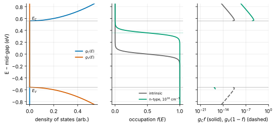
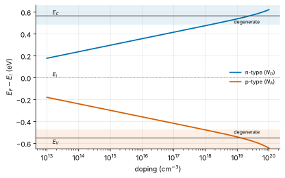
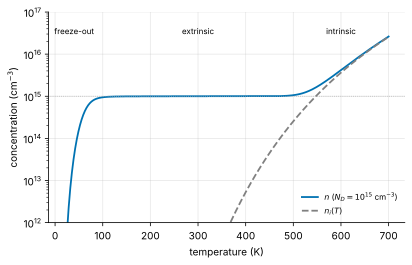

<!-- status: verified -->
# 09-02 · Carriers, Doping and the Fermi Level

| | |
|---|---|
| **Course** | [09 · Semiconductor Devices](../README.md) |
| **University equivalent** | Equilibrium carrier statistics in a junior semiconductor-devices course: density of states, Fermi–Dirac statistics, intrinsic and extrinsic semiconductors (Pierret, *Semiconductor Device Fundamentals*, ch. 2; Streetman & Banerjee, ch. 3; Hu, *Modern Semiconductor Devices for Integrated Circuits*, ch. 1) |
| **Prerequisites** | [09-01 Crystals, Energy Bands and the Semiconductor](09-01-crystals-and-energy-bands.md) (bands, effective and density-of-states masses), [04-11 Introduction to Solid-State Physics](../../04-physics-for-ee/chapters/04-11-intro-solid-state-physics.md) (free-electron counting, Fermi–Dirac, a first look at $n_i$), [04-10 Introduction to Quantum Mechanics](../../04-physics-for-ee/chapters/04-10-intro-quantum-mechanics.md) (the hydrogen atom), [01-06 Techniques of Integration](../../01-calculus-for-engineers/chapters/01-06-techniques-of-integration.md) |
| **Estimated study hours** | 9 |
| **Last verified** | 2026-11-19 |

**Learning objectives.** After this chapter you can:

1. Derive the density of states of a parabolic band with an effective mass, and from it the effective densities of states $N_C$ and $N_V$.
2. Compute electron and hole concentrations from the Fermi level with Boltzmann statistics, state when that approximation fails, and correct it with the Fermi–Dirac integral.
3. Compute the intrinsic concentration and intrinsic Fermi level of a semiconductor, and explain why $np = n_i^2$ holds in equilibrium whatever the doping.
4. Estimate donor and acceptor ionization energies with the hydrogen model, and compute carrier concentrations and the Fermi level for doped, compensated and partly ionized material.
5. Explain how a doped semiconductor's carrier density depends on temperature (freeze-out, extrinsic and intrinsic ranges) and compute the temperatures that bound each range.

---

## 1. Big picture

A semiconductor is useful because we decide how many carriers it has. Pure silicon at room temperature holds about $10^{10}$ free electrons per cm³, one for every five trillion atoms, and conducts almost nothing. Add one phosphorus atom per million silicon atoms (5 × 10¹⁶ cm⁻³) and the electron density rises five-millionfold, set by the doping rather than by temperature. Every transistor, diode and sensor in this course is built from regions doped n-type or p-type, and every device equation starts from the carrier densities in those regions. This chapter derives them: how many states the bands offer, how electrons fill them (Fermi–Dirac statistics), and how donors and acceptors move the **Fermi level**, the single number that summarizes the filling.

- **Doping sets conductivity by design.** Resistors, wells, source/drain regions and the channels of power devices are specified by their doping, and the doping by the Fermi level it produces.
- **$np = n_i^2$ is the law behind leakage.** The minority-carrier density, $n_i^2$ divided by the doping, sets the leakage of every junction, and $n_i$ rises several hundredfold from 300 K to 400 K in silicon: the reason chips have maximum junction temperatures.
- **Temperature limits come from statistics.** A doped region stops behaving as designed when carriers freeze onto their dopants (cryogenic electronics) or when intrinsic carriers swamp the dopants (high-temperature electronics); wide-gap SiC and GaN push the second limit far higher.
- **Too few dopants is a problem too.** A modern transistor's channel is so small that it would hold only a handful of dopant atoms, and their random number makes threshold voltages vary, one reason FinFETs and gate-all-around transistors use lightly doped channels (§9).

## 2. Intuition first

**Seats and a waterline.** Think of the conduction band as a stadium with rows of seats rising upward and the valence band as an identical stadium hanging upside down below it, separated by the gap. The **density of states** says how many seats each row has: few at the bottom of the conduction band, more as you go up. The **Fermi–Dirac distribution** says what fraction of seats at each height is occupied; the **Fermi level** $E_F$ is the height at which seats are half full, a waterline. Seats far above the waterline are almost all empty, those far below almost all full, and the transition takes a few $kT$, about 0.1 eV at room temperature.

In pure silicon the waterline sits near the middle of the gap, more than 0.5 eV (about 20 $kT$) below the conduction-band seats, so only a tiny fraction of them, around $e^{-20}$, is occupied. Donors raise the waterline toward the conduction band and acceptors lower it toward the valence band. Each $kT$ the waterline rises multiplies the electron density by $e$, about 2.7, and divides the hole density by the same factor.

**A finance analogy: the constant-product rule.** An automated market maker that keeps the product of two token reserves constant, $x \cdot y = k$, forces one reserve down when the other goes up. Electrons and holes in equilibrium obey the same rule: $n \cdot p = n_i^2$. Add donors and raise $n$ a millionfold, and $p$ falls a millionfold. *Where the analogy breaks:* the "constant" $n_i^2$ depends exponentially on temperature, nothing is traded (electrons and holes are created and annihilated in pairs by thermal energy), and the rule holds only in equilibrium: under light or current, $np$ departs from $n_i^2$ (09-04).

*Figure 1. How carriers come about: the density of states (left), the Fermi–Dirac occupation (middle) and their product, the electron and hole distributions (right), for intrinsic and n-type silicon. Carriers crowd within a few $kT$ of the band edges.*

## 3. Theory

> **Notation and course values.** $E_C$, $E_V$, $E_F$ are the conduction-band edge, valence-band edge and Fermi level; $E_i$ is the intrinsic Fermi level; $E_D$ and $E_A$ are the donor and acceptor levels; $N_D$, $N_A$ are dopant concentrations and $N_D^+$, $N_A^-$ the ionized ones (cm⁻³); $n$, $p$ are electron and hole concentrations; $k$ is Boltzmann's constant, with $kT$ = 25.85 meV at 300 K. For **silicon at 300 K** this course uses $E_g$ = 1.12 eV, $N_C$ = 3.2 × 10¹⁹ cm⁻³, $N_V$ = 1.8 × 10¹⁹ cm⁻³ [1] and $n_i$ = 1.0 × 10¹⁰ cm⁻³, the conventional round value of handbooks and textbooks [1, 2]. The best measured value is 9.65 × 10⁹ cm⁻³ [3], and §3.4 explains why these constants agree with one another only to a few percent.

### 3.1 How many states: the density of states

A band near its edge behaves like free particles with an effective mass (09-01 §3.5). Counting states is then the free-electron count of 04-11 §3.2 with $m$ replaced by $m^*$ and energy measured from the band edge. For conduction-band electrons with kinetic energy $E - E_C = \hbar^2k^2/2m^*$, the number of states per unit volume with energy below $E$ is (two spins times the $k$-space sphere divided by $(2\pi)^3$ per unit volume)

$$
\frac{N(E)}{V} = 2 \cdot \frac{\tfrac43\pi k^3}{(2\pi)^3} = \frac{1}{3\pi^2}\left(\frac{2m^*(E - E_C)}{\hbar^2}\right)^{3/2} .
$$

Differentiating gives the **density of states** per unit volume per unit energy:

$$
g_C(E) = \frac{1}{2\pi^2}\left(\frac{2m_{dn}}{\hbar^2}\right)^{3/2}\sqrt{E - E_C}, \qquad E \ge E_C ,
$$

and, for holes (states below $E_V$),

$$
g_V(E) = \frac{1}{2\pi^2}\left(\frac{2m_{dp}}{\hbar^2}\right)^{3/2}\sqrt{E_V - E}, \qquad E \le E_V .
$$

The mass is the **density-of-states mass** of 09-01 §3.6, which folds silicon's six ellipsoidal valleys (or its heavy- and light-hole bands) into one equivalent sphere. *Units:* $(\text{kg}/(\text{J}^2\text{s}^2))^{3/2}\,\text{J}^{1/2} = \text{J}^{-1}\text{m}^{-3}$, states per joule per cubic meter. There are no states in the gap: $g = 0$ between $E_V$ and $E_C$ in a perfect crystal.

### 3.2 How they fill: electron and hole concentrations

The electron concentration is the number of states at each energy times the probability that each is occupied, summed over the band:

$$
n = \int_{E_C}^{\infty} g_C(E)\,f(E)\,dE, \qquad f(E) = \frac{1}{1 + e^{(E - E_F)/kT}} .
$$

A state is empty with probability $1 - f$, so holes are counted with $1 - f(E) = 1/(1 + e^{(E_F - E)/kT})$:

$$
p = \int_{-\infty}^{E_V} g_V(E)\,[1 - f(E)]\,dE .
$$

**The Boltzmann approximation.** When $E_F$ lies more than about $3kT$ below $E_C$, every conduction state has $E - E_F \ge 3kT$, the exponential dominates the 1 in the denominator, and $f \approx e^{-(E - E_F)/kT}$ to within 5%. (The error of the approximation at an energy $\Delta$ above $E_F$ is $e^{-\Delta/kT}$ relative: 5% at $3kT$.) Substituting $x = (E - E_C)/kT$:

$$
n \approx \frac{1}{2\pi^2}\left(\frac{2m_{dn}kT}{\hbar^2}\right)^{3/2} e^{-(E_C - E_F)/kT}\int_0^\infty \sqrt{x}\,e^{-x}\,dx .
$$

> **Math refresher — the gamma integral.** $\int_0^\infty x^{1/2}e^{-x}dx = \Gamma(3/2) = \sqrt\pi/2$. To see it, substitute $x = u^2$: the integral becomes $2\int_0^\infty u^2e^{-u^2}du$, and integrating by parts (01-06) with the Gaussian integral $\int_0^\infty e^{-u^2}du = \sqrt\pi/2$ (03-02) gives $2 \cdot \tfrac12 \cdot \sqrt\pi/2 = \sqrt\pi/2$.

Collecting the constants (using $\hbar = h/2\pi$):

$$
n = N_C\,e^{-(E_C - E_F)/kT}, \qquad N_C = 2\left(\frac{2\pi m_{dn}kT}{h^2}\right)^{3/2},
$$

and in the same way

$$
p = N_V\,e^{-(E_F - E_V)/kT}, \qquad N_V = 2\left(\frac{2\pi m_{dp}kT}{h^2}\right)^{3/2}.
$$

The **effective densities of states** $N_C$ and $N_V$ have a vivid meaning: the band behaves as if all its states were piled at its edge, $N_C$ of them per cm³, each occupied with the Boltzmann probability of the edge. They grow as $T^{3/2}$, because warmer carriers spread over more states. Numerically, $N_C$ = 2.509 × 10¹⁹ cm⁻³ × $(m_{dn}/m_0)^{3/2}(T/300\ \text{K})^{3/2}$ (09-01 Example 4).

**Where the carriers sit.** The product $g_C(E)e^{-(E - E_F)/kT}$ rises as $\sqrt{E - E_C}$ and falls exponentially, so it peaks at $kT/2$ above the edge, and the average kinetic energy of the electrons is $\tfrac32kT$, as for a classical gas (Example 09-02.1). Carriers live within a few $kT$ of the band edges, which is why band edges, not band shapes far from them, govern devices.

**When Boltzmann fails: degeneracy.** If $E_F$ comes within about $3kT$ of $E_C$ (or rises into the band), the semiconductor is **degenerate** and the full Fermi–Dirac form is needed:

$$
n = N_C\,\mathcal F_{1/2}(\eta), \qquad \eta = \frac{E_F - E_C}{kT}, \qquad \mathcal F_{1/2}(\eta) = \frac{2}{\sqrt\pi}\int_0^\infty\frac{\sqrt{x}\,dx}{1 + e^{x - \eta}} .
$$

The **Fermi–Dirac integral** $\mathcal F_{1/2}$ has no closed form but is easy to evaluate numerically. Expanding $1/(1 + e^{x-\eta}) = e^{\eta - x} - e^{2(\eta - x)} + \dots$ and integrating term by term gives $\mathcal F_{1/2}(\eta) = e^\eta - e^{2\eta}/2^{3/2} + \dots$, which reduces to Boltzmann for $\eta \ll -1$. Inverting the first two terms gives a handy correction for a given $r = n/N_C$:

$$
\eta \approx \ln r + \frac{r}{\sqrt8} .
$$

The Fermi level of a degenerate semiconductor sits *higher* than Boltzmann predicts for the same $n$ (Pauli exclusion forces electrons into higher states), and can rise into the band (Example 09-02.7).

### 3.3 The law of mass action

Multiply the Boltzmann expressions for $n$ and $p$:

$$
np = N_CN_V\,e^{-(E_C - E_V)/kT} = N_CN_V\,e^{-E_g/kT} .
$$

The Fermi level has cancelled. In equilibrium, **the product $np$ depends only on the material and the temperature**, not on the doping. Physically, electron–hole pairs are generated thermally at a rate set by the material and temperature, and they recombine at a rate proportional to how often an electron meets a hole, $\propto np$; balance fixes the product. In a pure crystal, $n = p$, and both equal the **intrinsic concentration**:

$$
n_i = \sqrt{N_CN_V}\,e^{-E_g/2kT}, \qquad np = n_i^2 .
$$

This is the **law of mass action**, the constant-product rule of §2. It requires equilibrium and non-degenerate statistics; heavy doping (§3.7) and anything that drives carriers (light, current) break it.

### 3.4 Intrinsic semiconductors

**The intrinsic Fermi level.** Setting $n = p$ in the Boltzmann forms and solving for $E_F$ gives

$$
E_i = \frac{E_C + E_V}{2} + \frac{kT}{2}\ln\frac{N_V}{N_C} = \frac{E_C + E_V}{2} + \frac{3kT}{4}\ln\frac{m_{dp}}{m_{dn}} .
$$

The intrinsic Fermi level sits at mid-gap, shifted toward the band with fewer states: for silicon, 7.4 meV below mid-gap with the course values (Example 09-02.2), a correction usually ignored.

**Writing $n$ and $p$ with $n_i$ and $E_i$.** Dividing $n = N_Ce^{-(E_C - E_F)/kT}$ by $n_i = N_Ce^{-(E_C - E_i)/kT}$:

$$
n = n_i\,e^{(E_F - E_i)/kT}, \qquad p = n_i\,e^{(E_i - E_F)/kT} .
$$

These forms are the working tools of device analysis: every $kT$ of separation between $E_F$ and $E_i$ multiplies one carrier density by $e$ and divides the other by $e$, and $kT\ln10$ = 59.5 mV of separation changes them tenfold. They also show why the position of $E_F$ relative to $E_i$ is the natural measure of doping.

**How good are the constants?** With the course values, $\sqrt{N_CN_V}\,e^{-E_g/2kT}$ = 9.39 × 10⁹ cm⁻³, 2.7% below the best measurement, 9.65 × 10⁹ cm⁻³ [3], and 6% below the round $1.0\times10^{10}$. The handbook's $N_C$ and $N_V$ use density-of-states masses evaluated at 300 K (09-01 Example 4), and $E_g$ itself is known to about 0.01 eV, which alone moves $n_i$ by $e^{0.005/0.02585} \approx$ 21%. Device engineers therefore treat $n_i$ as a measured parameter in its own right. Different routes through the course constants differ by a few meV in derived energies (Example 09-02.4); that is the honest precision of these numbers, not an error.

**Intrinsic material is nearly an insulator.** With $\mu_n$ = 1400 and $\mu_p$ = 450 cm²/V·s [1] (09-03 derives mobility), intrinsic silicon's resistivity is $1/[qn_i(\mu_n + \mu_p)]$ ≈ 3.4 × 10⁵ Ω·cm, close to the handbook's 3.2 × 10⁵ Ω·cm [1]. A 1 mm cube of it would measure about 3 MΩ.

### 3.5 Donors and acceptors

**Donors.** A phosphorus atom has five valence electrons. In a silicon lattice four form bonds; the fifth is bound only weakly to the P⁺ ion it leaves behind. The same holds for arsenic and antimony (group V). **Acceptors** from group III (boron, aluminum, gallium) have three valence electrons, so one bond is incomplete; an electron from a neighboring bond can hop in, leaving a mobile hole bound weakly to the B⁻ ion.

**The hydrogen model of a donor.** The extra electron orbits a single positive charge, like the electron of a hydrogen atom (04-10), with two changes: it moves in the conduction band, so its mass is $m^*$, and it sits inside silicon, whose dielectric constant $\varepsilon_r$ = 11.7 [1] weakens the Coulomb attraction. In the hydrogen results, $E_1 = m_0q^4/(8\varepsilon_0^2h^2)$ = 13.606 eV and $a_0 = \varepsilon_0h^2/(\pi m_0q^2)$ = 0.05292 nm, replacing $m_0 \to m^*$ and $\varepsilon_0 \to \varepsilon_r\varepsilon_0$ gives

$$
E_C - E_D = 13.606\ \text{eV}\times\frac{m^*/m_0}{\varepsilon_r^2}, \qquad a_D = 0.05292\ \text{nm}\times\frac{\varepsilon_r}{m^*/m_0} .
$$

With the conductivity mass 0.26 $m_0$: $E_C - E_D \approx$ 26 meV and $a_D \approx$ 2.4 nm (Example 09-02.3). Two things follow.

- **The binding is weak.** A few tens of meV is about one $kT$ at room temperature, so nearly every donor is ionized: each contributes one free electron, and $n \approx N_D$.
- **The model is self-consistent.** The orbit spans more than four lattice constants and encloses about 3000 silicon atoms, so treating the crystal as a uniform dielectric with the band's effective mass is reasonable.

Measured ionization energies are larger and depend on the element: 45 meV for P, 54 meV for As and 43 meV for Sb donors, and 45 meV for B, 72 meV for Al, 74 meV for Ga and 157 meV for In acceptors [1]. The hydrogen model gets the scale right; the element-specific excess, the **central-cell correction**, comes from the electron's wavefunction near the ion core, where the uniform-dielectric picture fails. Boron and phosphorus are the workhorse dopants of silicon CMOS; indium's deep level leaves much of it un-ionized at room temperature.

**Ionization statistics.** A donor level can hold one electron of either spin, but not two (the second would be repelled by the first). Counting these arrangements gives the probability that a donor is *neutral* (occupied):

$$
\frac{N_D - N_D^+}{N_D} = \frac{1}{1 + \tfrac{1}{g_D}e^{(E_D - E_F)/kT}}, \qquad N_D^+ = \frac{N_D}{1 + g_D\,e^{(E_F - E_D)/kT}},
$$

with **degeneracy factor** $g_D$ = 2 for donors. For acceptors in silicon, $g_A$ = 4 (the two degenerate valence bands at Γ, each with two spins), and $N_A^- = N_A/[1 + g_Ae^{(E_A - E_F)/kT}]$. When $E_F$ lies several $kT$ below $E_D$, $N_D^+ \approx N_D$: **complete ionization**, the normal state of doped silicon at room temperature.

> **Going deeper — why the factor 2.** A donor level has three states: empty (energy 0, one way), or holding one electron with spin up or down (energy $E_D$, two ways). Doubly occupied is forbidden. With the grand-canonical weights $1$ and $2e^{-(E_D - E_F)/kT}$, the occupation probability is $2e^{-(E_D - E_F)/kT}/(1 + 2e^{-(E_D - E_F)/kT})$, which is the formula above. A conduction-band state differs because it can hold either spin independently: two separate single-occupancy states, each with plain Fermi–Dirac statistics.

### 3.6 Carrier concentrations in doped semiconductors

**Charge neutrality.** A uniformly doped crystal in equilibrium carries no net charge, so the positive charges (holes and ionized donors) balance the negative ones (electrons and ionized acceptors):

$$
p + N_D^+ = n + N_A^- .
$$

Together with $np = n_i^2$ this fixes $n$ and $p$. With complete ionization, substitute $p = n_i^2/n$ and solve the quadratic:

$$
n = \frac{N_D - N_A}{2} + \sqrt{\left(\frac{N_D - N_A}{2}\right)^2 + n_i^2}, \qquad p = \frac{n_i^2}{n} .
$$

**Three regimes.**

- **n-type,** $N_D - N_A \gg n_i$: $n \approx N_D - N_A$ and $p \approx n_i^2/(N_D - N_A)$. Electrons are the **majority carriers** and holes the **minority carriers**. For $N_D$ = 10¹⁶ cm⁻³, $n$ = 10¹⁶ and $p$ = 10⁴ cm⁻³: a ratio of $10^{12}$.
- **p-type,** $N_A - N_D \gg n_i$: the mirror image, $p \approx N_A - N_D$.
- **Nearly intrinsic,** $|N_D - N_A| \lesssim n_i$: both terms matter (Example 09-02.4).

**Compensation.** Only the *net* doping counts for the carrier densities: silicon with 10¹⁶ donors and 4 × 10¹⁵ acceptors behaves, for $n$ and $p$, like silicon with 6 × 10¹⁵ donors. The acceptors capture donors' electrons, and both ions remain. Compensated material is not equivalent in everything: both ions scatter carriers, so its mobility is lower than that of material with only the net doping (09-03). Device fabrication relies on compensation: an n-type source region is formed inside a p-type well by implanting more donors than the well has acceptors.

**Locating the Fermi level.** With complete ionization and non-degenerate statistics, either reference works:

$$
E_C - E_F = kT\ln\frac{N_C}{n}, \qquad E_F - E_i = kT\ln\frac{n}{n_i}\quad(\text{n-type}) ,
$$

$$
E_F - E_V = kT\ln\frac{N_V}{p}, \qquad E_i - E_F = kT\ln\frac{p}{n_i}\quad(\text{p-type}) .
$$

Every decade of doping moves $E_F$ by $kT\ln10$ = 59.5 meV at 300 K. At $N_D$ = 10¹⁶ cm⁻³, $E_F$ is 0.209 eV below $E_C$ (Example 09-02.4); at $N_D$ ≈ $N_C$/20 ≈ 1.6 × 10¹⁸ cm⁻³ it reaches $3kT$ below $E_C$ and the Boltzmann approximation starts to fail.

*Figure 2. The Fermi level of silicon at 300 K against donor and acceptor concentration, with the band edges and $E_i$. The shaded bands mark where $E_F$ is within $3kT$ of a band edge and the material is degenerate.*

**Partial ionization.** When $E_F$ is not far below $E_D$ (low temperature, or high doping), solve neutrality with the ionization formula instead. For an n-type crystal with negligible holes and acceptors, write $n = N_D^+$ with $e^{(E_F - E_D)/kT} = (n/N_C)\,e^{(E_C - E_D)/kT}$:

$$
n\left(1 + \frac{2n}{N_C}e^{(E_C - E_D)/kT}\right) = N_D \quad\Longrightarrow\quad n = \frac{-1 + \sqrt{1 + 4aN_D}}{2a}, \qquad a = \frac{2}{N_C}e^{(E_C - E_D)/kT} .
$$

At 300 K, 10¹⁶ cm⁻³ phosphorus is 99.6% ionized; at 77 K (liquid nitrogen) only 38% (Example 09-02.5). Exactly half the donors are ionized when $aN_D$ = 2, that is when $kT\ln(N_C/N_D) = E_C - E_D$.

### 3.7 Heavy doping

Near 10¹⁸–10¹⁹ cm⁻³ two assumptions of §3.5–3.6 break.

- **Donor orbits overlap.** Donors spaced $N_D^{-1/3}$ apart touch when that spacing reaches the orbit diameter $2a_D$, at about $(2a_D)^{-3} \approx 10^{19}$ cm⁻³ (Example 09-02.3). The donor levels merge into an **impurity band** that joins the conduction band, the ionization energy vanishes, and the material conducts like a (poor) metal even at low temperature.
- **The gap shrinks.** The crowd of carriers and ions lowers the conduction-band edge and raises the valence-band edge: **band-gap narrowing**. A handbook fit for n-type silicon is $\Delta E_g \approx 3.5\times10^{-8}\,N_D^{1/3}$ eV for $10^{17} < N_D < 3\times10^{20}$ cm⁻³ [1], 75 meV at 10¹⁹ cm⁻³. Because $n_i^2 \propto e^{-E_g/kT}$, the effective $n_i^2$ in that region is $e^{\Delta E_g/kT}$, about 18 times, larger, which raises the minority-carrier density and matters for bipolar emitters (09-07) and solar cells.

Heavily doped regions (source and drain, contacts, emitters) are therefore modeled with Fermi–Dirac statistics, full ionization and band-gap narrowing together.

### 3.8 Temperature dependence

Hold the doping fixed and vary the temperature. Three ranges appear (Figure 3):

1. **Freeze-out** (low $T$): $kT$ is small compared with $E_C - E_D$, electrons fall back onto the donors, and $n < N_D$. Lightly doped silicon begins to lose carriers to its donors below roughly 100 K, and at 10¹⁵ cm⁻³ of phosphorus half the donors are neutral at 65 K (Example 09-02.6).
2. **Extrinsic** (the operating range): the donors are fully ionized and $n_i \ll N_D$, so $n \approx N_D$, independent of temperature. Devices are designed to live here.
3. **Intrinsic** (high $T$): $n_i$ grows past $N_D$ and thermally generated pairs dominate; the doping no longer controls the material. A junction stops rectifying and leakage soars.

To compute $n_i(T)$, scale the 300 K value with the temperature dependence of each factor: $N_CN_V \propto T^3$, and $E_g(T)$ from Varshni's fit (09-01 §3.8):

$$
n_i(T) = n_i(300\ \text{K})\left(\frac{T}{300\ \text{K}}\right)^{3/2}\exp\left[\frac{E_g(300\ \text{K})}{2k\cdot300\ \text{K}} - \frac{E_g(T)}{2kT}\right] .
$$

This gives $n_i$ = 5.3 × 10¹² cm⁻³ at 400 K, 528 times the 300 K value; a widely used empirical fit of measured data gives 564 times [3, R-086]. For a region doped at 10¹⁵ cm⁻³, $n_i$ reaches a tenth of the doping at 472 K and equals it at 547 K (Example 09-02.6). Lightly doped regions, such as the drift layers of power devices, reach the intrinsic limit first; a semiconductor with a wider gap pushes it to far higher temperatures, which is one of the attractions of SiC and GaN (04-11 §3.6, 09-13).

*Figure 3. Electron concentration against temperature for silicon doped with 10¹⁵ cm⁻³ phosphorus, showing freeze-out, the extrinsic plateau and the intrinsic rise, with $n_i(T)$ for comparison.*

## 4. Worked examples

### Example 09-02.1 · Counting states and carriers (tier A)

**Setup.** For silicon's conduction band, use the 300 K density-of-states mass $m_{dn}$ = 1.18 $m_0$ [1]; for the valence band, $m_{dp}$ = 0.81 $m_0$. (a) Find $g_C$ at $kT$ above $E_C$, in cm⁻³ eV⁻¹. (b) Compute $N_C$ and $N_V$. (c) At what energy above $E_C$ is the electron distribution largest, and what is the electrons' average kinetic energy? (d) What fraction of the electrons have kinetic energy above $3kT$?

**Solution.**

(a) $g_C = (1/2\pi^2)(2m_{dn}/\hbar^2)^{3/2}\sqrt{kT}$. With $m_{dn}$ = 1.18 × 9.109 × 10⁻³¹ kg and $kT$ = 4.142 × 10⁻²¹ J this is 8.763 × 10⁴⁵ J⁻¹ m⁻³ = **1.404 × 10²¹** cm⁻³ eV⁻¹.

(b) $N_C = 2(2\pi m_{dn}kT/h^2)^{3/2}$ = **3.217 × 10¹⁹** cm⁻³ and $N_V$ = **1.829 × 10¹⁹** cm⁻³, the handbook's 3.2 and 1.8 × 10¹⁹ cm⁻³.

(c) The distribution $\propto \sqrt{x}\,e^{-x}$ with $x = (E - E_C)/kT$ peaks where $d/dx = 0$: $\tfrac{1}{2\sqrt x} - \sqrt x = 0$, $x = 1/2$, so **12.93** meV above $E_C$. The average is $\int x^{3/2}e^{-x}dx/\int x^{1/2}e^{-x}dx = \Gamma(5/2)/\Gamma(3/2) = 3/2$: **38.78** meV.

(d) The fraction above $x = 3$ is $\int_3^\infty x^{1/2}e^{-x}dx/\Gamma(3/2)$ = **0.1116**, about 11%.

**Units check.** $h^2/(m\,kT)$ has units (J·s)²/(kg·J) = J·s²/kg = m², so $(m\,kT/h^2)^{3/2}$ is m⁻³, a concentration. **Sanity check.** A slice of the band one $kT$ wide at the edge holds about $1.404\times10^{21} \times 0.02585$ = **3.63 × 10¹⁹** states per cm³; the electrons of 10¹⁶ cm⁻³ doping fill a fraction **2.8 × 10⁻⁴** of them, about 1 in **3630**. Nearly every state is empty, so the non-degenerate (Boltzmann) assumption is very comfortable.

### Example 09-02.2 · Intrinsic Si, Ge and GaAs (tier A)

**Setup.** (a) Compute silicon's $n_i$ at 300 K from the course values of $N_C$, $N_V$ and $E_g$, and compare with the measured 9.65 × 10⁹ cm⁻³. (b) Where is $E_i$ relative to mid-gap? (c) Repeat (a) for germanium ($N_C$ = 1.04 × 10¹⁹, $N_V$ = 6.0 × 10¹⁸ cm⁻³, $E_g$ = 0.66 eV) and GaAs ($N_C$ = 4.7 × 10¹⁷, $N_V$ = 7.0 × 10¹⁸ cm⁻³, $E_g$ = 1.42 eV) [2], and find GaAs's $E_i$ shift. (d) Find the resistivity of intrinsic silicon with $n_i$ = 1.0 × 10¹⁰ cm⁻³, $\mu_n$ = 1400 and $\mu_p$ = 450 cm²/V·s.

**Solution.**

(a) $\sqrt{N_CN_V} = \sqrt{3.2\times10^{19} \times 1.8\times10^{19}}$ = 2.4 × 10¹⁹ cm⁻³ and $e^{-1.12/(2 \times 0.02585)}$ = **3.912 × 10⁻¹⁰**, so $n_i$ = **9.39 × 10⁹** cm⁻³, **2.7**% below the measurement.

(b) $(kT/2)\ln(N_V/N_C) = 0.012926 \times \ln0.5625$ = **−7.4** meV: $E_i$ is 7.4 meV below mid-gap.

(c) Germanium: $\sqrt{6.24\times10^{37}}\,e^{-0.66/0.0517}$ = **2.26 × 10¹³** cm⁻³ (the handbook lists 2.0 × 10¹³ [1]). GaAs: $\sqrt{3.29\times10^{36}}\,e^{-1.42/0.0517}$ = **2.14 × 10⁶** cm⁻³ (handbook 2.1 × 10⁶ [1]). GaAs's light electrons give it few conduction states, so $E_i$ moves up: $(kT/2)\ln(7.0/0.47)$ = **+34.9** meV above mid-gap.

(d) $\rho = 1/[1.602\times10^{-19} \times 10^{10} \times (1400 + 450)]$ = **3.37 × 10⁵** Ω·cm.

**Sanity check.** Germanium's smaller gap gives it about **2400** times silicon's $n_i$, and GaAs's larger gap about a **4400**th: each 0.1 eV of gap is a factor $e^{0.1/0.0517} \approx 7$ in $n_i$. That is why germanium transistors leaked badly when warm and why GaAs makes semi-insulating substrates.

### Example 09-02.3 · How strongly a donor holds its electron (tier B)

**Setup.** (a) Using the hydrogen model with $\varepsilon_r$ = 11.7, estimate the ionization energy and orbit radius of a donor in silicon ($m^*$ = 0.26 $m_0$) and of an acceptor ($m^*$ = 0.39 $m_0$, the hole conductivity mass [2]). (b) How many lattice constants is the donor orbit, and how many silicon atoms does it enclose? (c) At what concentration do neighboring donor orbits touch?

**Solution.**

(a) Donor: $E_C - E_D = 13.606 \times 0.26/11.7^2$ = **25.8** meV and $a_D = 0.05292 \times 11.7/0.26$ = **2.381** nm. Acceptor: $13.606 \times 0.39/136.89$ = **38.8** meV, radius **1.588** nm.

(b) $2.381/0.5431$ = **4.38** lattice constants. The sphere of radius $a_D$ has volume 5.656 × 10⁻²⁰ cm³ and holds $5.656\times10^{-20} \times 4.994\times10^{22}$ ≈ **2820** atoms.

(c) Orbits touch when the spacing $N_D^{-1/3}$ equals $2a_D$ = 4.763 nm: $N_D = (4.763\times10^{-7}\ \text{cm})^{-3}$ = **9.3 × 10¹⁸** cm⁻³.

**Sanity check.** The estimates have the right scale, tens of meV against the measured 45 meV (P) and 45 meV (B), and the model's assumptions hold because the orbit spans thousands of atoms. The measured excess over 26 meV is the central-cell correction of §3.5. The overlap estimate matches the doping range, around 10¹⁸–10¹⁹ cm⁻³, where silicon stops freezing out.

### Example 09-02.4 · Doped silicon at room temperature (tier B)

**Setup.** At 300 K with complete ionization, find $n$, $p$ and the Fermi level for (a) $N_D$ = 10¹⁶ cm⁻³ (compute $E_C - E_F$ both from $N_C$ and from $n_i$ via $E_C - E_i$, and compare); (b) $N_D$ = 10¹⁶ and $N_A$ = 4 × 10¹⁵ cm⁻³; (c) $N_A$ = 10¹⁷ cm⁻³; (d) $N_D$ = 2 × 10¹⁰ cm⁻³.

**Solution.**

(a) $n$ = 10¹⁶ cm⁻³ and $p = 10^{20}/10^{16}$ = **10⁴** cm⁻³. From $N_C$: $E_C - E_F = 0.02585\ln(3.2\times10^{19}/10^{16})$ = **0.2086** eV. From $n_i$: $E_F - E_i = 0.02585\ln(10^6)$ = **0.3572** eV. To compare, we need $E_C - E_i$. Computed as $kT\ln(N_C/n_i)$ it is **0.5658** eV, and $0.5658 - 0.3572$ = 0.2086 eV agrees exactly, because both routes then rest on the same $N_C$ and $n_i$. Computed instead from the gap, $E_C - E_i = E_g/2 + 7.4$ meV = **0.5674** eV, it gives $E_C - E_F$ = **0.2103** eV, 1.6 meV different (the rounded displays differ in the last digit). The discrepancy is $kT\ln(1.0\times10^{10}/9.39\times10^{9})$ = **1.6** meV: the rounded constants are consistent with one another only to about 6% in $n_i$ (§3.4).

(b) Net doping 6 × 10¹⁵ cm⁻³: $n$ = 6 × 10¹⁵, $p$ = **1.667 × 10⁴** cm⁻³, $E_F - E_i = kT\ln(6\times10^5)$ = **0.3440** eV.

(c) $p$ = 10¹⁷, $n$ = **10³** cm⁻³; $E_F - E_V = kT\ln(1.8\times10^{19}/10^{17})$ = **0.1342** eV, and $E_i - E_F = kT\ln10^7$ = **0.4167** eV.

(d) Now $N_D$ is comparable with $n_i$, so use the quadratic: $n = 10^{10} + \sqrt{10^{20} + 10^{20}}$ = **2.414 × 10¹⁰** cm⁻³ and $p = n_i^2/n$ = **4.142 × 10⁹** cm⁻³; $E_F - E_i$ = **22.8** meV. Only part of the donors' electrons add to $n$; the rest recombine with intrinsic holes.

**Sanity check.** In (a)–(c) the majority density equals the net doping and the minority density is twelve or more decades smaller. The few-meV disagreement in (a) is below the precision of $E_g$ itself; device work keeps $n_i$ and $E_i$ as the reference and avoids mixing routes.

### Example 09-02.5 · Freeze-out of phosphorus (tier B)

**Setup.** Silicon is doped with $N_D$ = 10¹⁶ cm⁻³ phosphorus ($E_C - E_D$ = 45 meV). Take $N_C \propto T^{3/2}$ from 3.2 × 10¹⁹ cm⁻³ at 300 K and ignore holes. Find the ionized fraction and $E_C - E_F$ at (a) 300 K and (b) 77 K.

**Solution.** Use $n = (-1 + \sqrt{1 + 4aN_D})/2a$ with $a = (2/N_C)e^{(E_C - E_D)/kT}$.

(a) $e^{0.045/0.02585}$ = **5.701**, $a$ = 3.563 × 10⁻¹⁹ cm³, $4aN_D$ = 0.01425: $n$ = **9.965 × 10¹⁵** cm⁻³, **99.65**% ionized; $E_C - E_F = kT\ln(N_C/n)$ = **0.2087** eV.

(b) At 77 K, $kT$ = 6.635 meV and $N_C = 3.2\times10^{19}(77/300)^{1.5}$ = **4.161 × 10¹⁸** cm⁻³. Then $e^{0.045/0.006635}$ = **881.7**, $a$ = 4.238 × 10⁻¹⁶ cm³ and $4aN_D$ = 16.95: $n$ = **3.819 × 10¹⁵** cm⁻³, only **38.2**% ionized; $E_C - E_F$ = **46.4** meV, just below the donor level.

**Sanity check.** At 77 K the Fermi level has risen to within a meV of $E_D$, so donors are about as likely to hold their electron as not, weighted by the spin factor of 2. Cooling also shrinks $N_C$ by a factor of **7.7**. Circuits that must work cryogenically use heavier doping, where the impurity band of §3.7 prevents freeze-out.

### Example 09-02.6 · The temperature window of a lightly doped region (tier C)

**Setup.** A power device's drift region has $N_D$ = 10¹⁵ cm⁻³ (phosphorus). Using the course model for $n_i(T)$ (§3.8, with Varshni's fit for silicon) and the ionization model of Example 09-02.5: (a) find $n_i$ at 400 K; (b) find the temperatures at which $n_i$ reaches 0.1 $N_D$ and $N_D$; (c) find $n/N_D$ at each; (d) find the temperature at which half the donors are frozen out.

**Solution.**

(a) $E_g$(300 K) = 1.1245 eV and $E_g$(400 K) = 1.0969 eV (09-01 Example 6), $kT$ = 25.85 and 34.47 meV:

$$
n_i(400) = 10^{10} \times (4/3)^{1.5} \times \exp\left(\frac{1.1245}{0.05170} - \frac{1.0969}{0.06894}\right) = 10^{10} \times 1.540 \times 342.8 = 5.28\times10^{12}\ \text{cm}^{-3} ,
$$

**528** times its 300 K value.

(b) Solving $n_i(T) = 10^{14}$ and $10^{15}$ cm⁻³ numerically (bisection): **472** K and **547** K.

(c) From $n = N_D/2 + \sqrt{N_D^2/4 + n_i^2}$: at $n_i = 0.1N_D$, $n/N_D$ = **1.0099**, still extrinsic; at $n_i = N_D$, $n/N_D = (1 + \sqrt5)/2$ = **1.618**, and holes are 62% of the doping.

(d) Half ionization requires $kT\ln(N_C(T)/N_D) = 0.045$ eV with $N_C(T) = 3.2\times10^{19}(T/300)^{1.5}$; solving numerically gives **64.7** K.

**Sanity check.** The window runs from about 65 K to about 470 K (about 200 °C). In practice the junction leakage, which grows with $n_i^2$ (09-06), sets a lower ceiling than the intrinsic limit. The upper limit scales roughly with the gap: for 4H-SiC, 04-11 Example 6 found that the intrinsic factor at 873 K equals silicon's at 300 K.

### Example 09-02.7 · When doping makes silicon degenerate (tier C)

**Setup.** Silicon is doped with $N_D$ = 10¹⁹ cm⁻³ arsenic, assumed fully ionized (the impurity band of §3.7). (a) Find $E_C - E_F$ with Boltzmann statistics, and say whether the result is trustworthy. (b) Solve $n = N_C\mathcal F_{1/2}(\eta)$ numerically and compare with the two-term approximation. (c) Repeat for 10²⁰ cm⁻³. (d) Estimate band-gap narrowing at 10¹⁹ cm⁻³ and its effect on $n_i^2$.

**Solution.**

(a) $E_C - E_F = 0.02585\ln(3.2)$ = **30.1** meV $\approx 1.2kT$, well inside the $3kT$ limit: not trustworthy.

(b) $r = n/N_C$ = **0.3125**. Solving $\mathcal F_{1/2}(\eta) = 0.3125$ gives $\eta$ = **−1.053**, so $E_C - E_F$ = **27.2** meV. The approximation $\ln r + r/\sqrt8 = -1.1632 + 0.1105$ = **−1.0527** is within 0.001. Fermi–Dirac statistics put $E_F$ **2.8** meV higher than Boltzmann.

(c) $r$ = 3.125: $\eta$ = **2.200**, so $E_F$ lies **56.9** meV *above* $E_C$, whereas Boltzmann would put it 29.5 meV above, half as far: the electrons fill the band bottom like a metal's Fermi sea.

(d) $\Delta E_g = 3.5\times10^{-8} \times (10^{19})^{1/3}$ = **75.4** meV, so $n_i^2$ grows by $e^{0.0754/0.02585}$ = **18.5**.

**Sanity check.** At 10²⁰ cm⁻³ the semiconductor is degenerate and the "gap" picture blurs, but the transistor's source and drain only need to supply carriers, which they do as well as a metal would. The large band-gap narrowing factor is why heavily doped emitters inject fewer carriers than ideal theory predicts (09-07).

### Answer key

<!-- answer-key -->
| ID | Quantity | Value | Unit |
|---|---|---|---|
| Ex 09-02.1a | g_C at kT above E_C | 1.404e21 | cm⁻³ eV⁻¹ |
| Ex 09-02.1b | g_C in SI units | 8.763e45 | J⁻¹ m⁻³ |
| Ex 09-02.1c | kT at 300 K in joules | 4.142e-21 | J |
| Ex 09-02.1d | N_C from m_dn = 1.18 | 3.217e19 | cm⁻³ |
| Ex 09-02.1e | N_V from m_dp = 0.81 | 1.829e19 | cm⁻³ |
| Ex 09-02.1f | peak of the electron distribution | 12.93 | meV |
| Ex 09-02.1g | average kinetic energy | 38.78 | meV |
| Ex 09-02.1h | fraction above 3kT | 0.1116 | — |
| Ex 09-02.1i | states in a kT slice at the edge | 3.63e19 | cm⁻³ |
| Ex 09-02.1j | occupied fraction of those states | 2.8e-4 | — |
| Ex 09-02.1k | one state in | 3630 | — |
| Ex 09-02.2a | Boltzmann factor at half-gap | 3.912e-10 | — |
| Ex 09-02.2b | sqrt(N_C N_V) | 2.4e19 | cm⁻³ |
| Ex 09-02.2c | Si n_i from N_C, N_V, E_g | 9.39e9 | cm⁻³ |
| Ex 09-02.2d | deficit against 9.65e9 | 2.7 | % |
| Ex 09-02.2e | Si E_i shift from mid-gap | -7.4 | meV |
| Ex 09-02.2f | Ge n_i | 2.26e13 | cm⁻³ |
| Ex 09-02.2g | GaAs n_i | 2.14e6 | cm⁻³ |
| Ex 09-02.2h | GaAs E_i shift from mid-gap | 34.9 | meV |
| Ex 09-02.2i | intrinsic Si resistivity | 3.37e5 | Ω·cm |
| Ex 09-02.2j | Ge to Si n_i ratio | 2400 | — |
| Ex 09-02.2k | Si to GaAs n_i ratio | 4400 | — |
| Ex 09-02.2l | n_i factor per 0.1 eV of gap | 7 | — |
| Ex 09-02.3a | hydrogenic donor ionization energy | 25.8 | meV |
| Ex 09-02.3b | donor orbit radius | 2.381 | nm |
| Ex 09-02.3c | hydrogenic acceptor ionization energy | 38.8 | meV |
| Ex 09-02.3d | acceptor orbit radius | 1.588 | nm |
| Ex 09-02.3e | donor orbit in lattice constants | 4.38 | — |
| Ex 09-02.3f | orbit volume | 5.66e-20 | cm³ |
| Ex 09-02.3g | atoms inside the orbit | 2820 | — |
| Ex 09-02.3h | orbit diameter | 4.763 | nm |
| Ex 09-02.3i | concentration at which orbits touch | 9.3e18 | cm⁻³ |
| Ex 09-02.4a | p for N_D = 1e16 | 1e4 | cm⁻³ |
| Ex 09-02.4b | E_C − E_F from N_C | 0.2086 | eV |
| Ex 09-02.4c | E_F − E_i | 0.3572 | eV |
| Ex 09-02.4d | E_C − E_i from N_C and n_i | 0.5658 | eV |
| Ex 09-02.4e | E_C − E_i from E_g/2 and the shift | 0.5674 | eV |
| Ex 09-02.4f | E_C − E_F by the mixed route | 0.2103 | eV |
| Ex 09-02.4g | inconsistency of rounded constants | 1.6 | meV |
| Ex 09-02.4h | p, compensated | 1.667e4 | cm⁻³ |
| Ex 09-02.4i | E_F − E_i, compensated | 0.3440 | eV |
| Ex 09-02.4j | n for N_A = 1e17 | 1e3 | cm⁻³ |
| Ex 09-02.4k | E_F − E_V for N_A = 1e17 | 0.1342 | eV |
| Ex 09-02.4l | E_i − E_F for N_A = 1e17 | 0.4167 | eV |
| Ex 09-02.4m | n for N_D = 2e10 | 2.414e10 | cm⁻³ |
| Ex 09-02.4n | p for N_D = 2e10 | 4.142e9 | cm⁻³ |
| Ex 09-02.4o | E_F − E_i for N_D = 2e10 | 22.8 | meV |
| Ex 09-02.5a | Boltzmann factor of the donor depth, 300 K | 5.701 | — |
| Ex 09-02.5b | a at 300 K | 3.563e-19 | cm³ |
| Ex 09-02.5c | 4 a N_D at 300 K | 0.01425 | — |
| Ex 09-02.5d | n at 300 K | 9.965e15 | cm⁻³ |
| Ex 09-02.5e | ionized fraction at 300 K | 99.65 | % |
| Ex 09-02.5f | E_C − E_F at 300 K | 0.2087 | eV |
| Ex 09-02.5g | kT at 77 K | 6.635 | meV |
| Ex 09-02.5h | N_C at 77 K | 4.161e18 | cm⁻³ |
| Ex 09-02.5i | Boltzmann factor of the donor depth, 77 K | 881.7 | — |
| Ex 09-02.5j | a at 77 K | 4.238e-16 | cm³ |
| Ex 09-02.5k | 4 a N_D at 77 K | 16.95 | — |
| Ex 09-02.5l | n at 77 K | 3.819e15 | cm⁻³ |
| Ex 09-02.5m | ionized fraction at 77 K | 38.2 | % |
| Ex 09-02.5n | E_C − E_F at 77 K | 46.4 | meV |
| Ex 09-02.5o | N_C shrink factor, 300 K to 77 K | 7.7 | — |
| Ex 09-02.6a | n_i at 400 K | 5.28e12 | cm⁻³ |
| Ex 09-02.6b | n_i ratio, 400 K to 300 K | 528 | — |
| Ex 09-02.6c | (4/3)^1.5 | 1.540 | — |
| Ex 09-02.6d | exponential factor | 342.8 | — |
| Ex 09-02.6e | kT at 400 K | 34.47 | meV |
| Ex 09-02.6f | T at n_i = 0.1 N_D | 472 | K |
| Ex 09-02.6g | T at n_i = N_D | 547 | K |
| Ex 09-02.6h | n/N_D at n_i = 0.1 N_D | 1.0099 | — |
| Ex 09-02.6i | n/N_D at n_i = N_D | 1.618 | — |
| Ex 09-02.6j | p/N_D at n_i = N_D | 62 | % |
| Ex 09-02.6k | half freeze-out temperature | 64.7 | K |
| Ex 09-02.6l | upper window limit in °C | 200 | °C |
| Ex 09-02.7a | E_C − E_F, Boltzmann, 1e19 | 30.1 | meV |
| Ex 09-02.7b | r = n/N_C at 1e19 | 0.3125 | — |
| Ex 09-02.7c | η at 1e19 | -1.053 | — |
| Ex 09-02.7d | E_C − E_F, Fermi–Dirac, 1e19 | 27.2 | meV |
| Ex 09-02.7e | two-term approximation for η | -1.0527 | — |
| Ex 09-02.7f | ln r at 1e19 | -1.1632 | — |
| Ex 09-02.7g | r/√8 at 1e19 | 0.1105 | — |
| Ex 09-02.7h | Fermi–Dirac shift relative to Boltzmann | 2.8 | meV |
| Ex 09-02.7i | r at 1e20 | 3.125 | — |
| Ex 09-02.7j | η at 1e20 | 2.200 | — |
| Ex 09-02.7k | E_F − E_C, Fermi–Dirac, 1e20 | 56.9 | meV |
| Ex 09-02.7l | E_F − E_C, Boltzmann, 1e20 | 29.5 | meV |
| Ex 09-02.7m | band-gap narrowing at 1e19 | 75.4 | meV |
| Ex 09-02.7n | n_i² enhancement | 18.5 | — |
| T 09-02.a | Boltzmann error at 3kT | 5 | % |
| T 09-02.b | kT ln 10 at 300 K | 59.5 | meV |
| T 09-02.c | variation of n_i from 0.01 eV in E_g | 21 | % |
| T 09-02.d | course n_i against N_C, N_V, E_g | 6 | % |
| T 09-02.e | resistance of a 1 mm cube of intrinsic Si | 3 | MΩ |
| T 09-02.f | N_D at E_F = E_C − 3kT | 1.6e18 | cm⁻³ |
| T 09-02.g | minority-to-majority ratio at 1e16 | 1e12 | — |
| T 09-02.h | fit ratio n_i(400)/n_i(300) | 564 | — |
| T 09-02.i | hydrogen ionization energy | 13.606 | eV |
| T 09-02.j | Bohr radius | 0.05292 | nm |
| T 09-02.k | one dopant per million Si atoms | 5e16 | cm⁻³ |
| T 09-02.l | rise in n from that doping | 5e6 | — |
| T 09-02.m | silicon atoms per intrinsic electron | 5e12 | — |
| T 09-02.n | n_i growth 300 to 400 K at fixed gap (04-11) | 346 | — |

*Every value is recomputed by [verify_09_02.py](../verify/verify_09_02.py) by an independent route: densities of states and effective densities by numerical integration over the band, carrier concentrations by solving charge neutrality for $E_F$ with the full Fermi–Dirac integrals, ionization by the occupation statistics of the donor level, and temperatures by root finding on the full model. Rows marked T key numbers stated in §3.*

## 5. Simulate it

The lab, [labs/09-02-lab](../labs/09-02-lab/README.md), is a notebook that computes carrier statistics without the Boltzmann shortcut:

1. Integrate $g_C(E)f(E)$ numerically and compare with $N_Ce^{-(E_C - E_F)/kT}$ as $E_F$ approaches and enters the band; find where the error reaches 5%.
2. Write a general charge-neutrality solver: find the $E_F$ at which $p + N_D^+ - n - N_A^- = 0$ by bisection, with full Fermi–Dirac integrals and donor and acceptor ionization. Use it to reproduce Examples 09-02.4 to 09-02.7.
3. Plot the Fermi level against doping (Figure 2) and $n$ against temperature (Figure 3), and mark the freeze-out, extrinsic and intrinsic ranges.
4. Count dopant atoms in small volumes: draw Poisson samples for a transistor channel and watch the relative spread grow as the volume shrinks.

**Guided exercise (predict, then run).** **Before running**, predict for silicon doped with 10¹⁷ cm⁻³ phosphorus: is it fully ionized at 300 K? Estimate the ionized fraction, and the temperature at which half the donors are frozen out, using Example 09-02.5 as a guide. Then run Part 2 with the neutrality solver and explain any difference from your estimate.

## 6. Engineering tradeoffs

| Knob | Improves | Costs | Typical decision owner |
|---|---|---|---|
| Doping level of a region | Conductivity, contact resistance, threshold and breakdown control | Mobility (impurity scattering), breakdown voltage (09-06), band-gap narrowing and minority-carrier effects | Device and process integration engineers |
| Choice of dopant (P, As, Sb; B, In) | Diffusion behavior (As and Sb diffuse slowly, good for shallow junctions), ionization (P and B nearly complete at 300 K) | Deeper levels (In) leave dopants un-ionized; heavy ions damage the lattice more when implanted | Process engineers |
| Compensation (counter-doping) | Lets one region be formed inside another of opposite type | Lower mobility than uncompensated material with the same net doping; tighter dose control | Process integration |
| Lightly or undoped channel | Mobility, no random dopant fluctuation (§9) | Threshold must be set another way (gate work function), needs thin bodies (FinFET, GAA) | Technology definition |
| Bandgap of the material | Higher intrinsic-limit temperature, lower leakage | Wafer cost, defects, harder ohmic contacts (09-13) | Product and technology roadmap |
| Operating temperature range | Market reach (cryogenic, automotive, downhole) | Freeze-out at the bottom, leakage and intrinsic onset at the top; qualification cost | Product definition and reliability |

## 7. Numbers to know

| Quantity | Value | Note |
|---|---|---|
| $kT$ at 300 K; $kT\ln10$ | 25.85 meV; 59.5 meV per decade of carrier density | §3.4 |
| Silicon $N_C$, $N_V$ at 300 K | 3.2 × 10¹⁹ and 1.8 × 10¹⁹ cm⁻³ (handbook; Hu: 2.8 and 1.04 × 10¹⁹) | [1, 2], 09-01 Example 4 |
| Silicon $n_i$ at 300 K | 1.0 × 10¹⁰ cm⁻³ (course value); 9.65 × 10⁹ cm⁻³ (best measurement) | [3] **[Established]** |
| GaAs, Ge $n_i$ at 300 K | about 2 × 10⁶ and 2 × 10¹³ cm⁻³ | [1], Example 09-02.2 |
| Silicon $n_i$ growth, 300 K → 400 K | about 500-fold | §3.8 |
| Shallow donor and acceptor levels in Si | P 45, As 54, Sb 43 meV; B 45, Al 72, Ga 74, In 157 meV | [1] |
| Hydrogenic estimate | about 26 meV, orbit about 2.4 nm | §3.5 |
| Degeneracy threshold in Si (n-type) | $N_D$ ≈ 1.6 × 10¹⁸ cm⁻³ ($E_F = E_C - 3kT$) | §3.6 |
| Band-gap narrowing (n-type Si) | ≈ 3.5 × 10⁻⁸ $N_D^{1/3}$ eV; 75 meV at 10¹⁹ cm⁻³ | [1] |
| Typical doping levels | 10¹⁴–10¹⁶ cm⁻³ (lightly doped regions), 10¹⁷–10¹⁸ (wells, channels of planar MOSFETs), 10¹⁹–10²⁰ (sources, drains, contacts) | orders of magnitude; device chapters give specifics |

## 8. Common mistakes

1. **Using $np = n_i^2$ out of equilibrium.** It holds only in equilibrium. Under illumination, in a forward-biased junction or wherever current flows, $np \ne n_i^2$ (09-04 introduces quasi-Fermi levels for that case).
2. **Using Boltzmann statistics in degenerate material.** Once $E_F$ is within about $3kT$ of a band edge, the Boltzmann formulas understate how high $E_F$ sits and the mass-action law fails; heavily doped regions need Fermi–Dirac statistics and band-gap narrowing.
3. **Adding $N_D$ and $N_A$ instead of subtracting them.** Carrier densities depend on the net doping $|N_D - N_A|$; mobility depends on the total $N_D + N_A$.
4. **Assuming complete ionization at all temperatures.** It fails below about 100 K for typical doping (freeze-out) and for deep dopants such as indium even at room temperature.
5. **Treating $n_i$ as a precise constant.** Values of 1.45, 1.08, 1.0 and 0.965 × 10¹⁰ cm⁻³ all appear in print for silicon at 300 K. State which value you use; leakage scales with $n_i^2$.
6. **Forgetting the temperature dependence of $E_g$ in $n_i(T)$.** Using a fixed 1.12 eV underestimates the growth of $n_i$ with temperature (the fit of measured data grows 564-fold from 300 to 400 K, against 346-fold at fixed gap, 04-11 Example 6).
7. **Mixing reference levels inconsistently.** $E_C - E_F$ computed from $N_C$ and $E_F - E_i$ computed from $n_i$ can disagree by a few meV with rounded constants; pick one route.
8. **Reading the Fermi level as an energy that electrons occupy.** In a non-degenerate semiconductor $E_F$ lies in the gap, where there are no states; it is a statistical parameter (the energy at which a state *would* be half occupied), not a place where electrons sit.

## 9. Practitioner lens

### State of the art (as of Nov 2026)

- **Silicon's $n_i$ is a "constant" that moved by 50%.** For decades the commonly cited value was 1.45 × 10¹⁰ cm⁻³. Sproul and Green showed in 1991 that it was "inconsistent with the best experimental data", noting that 1.08 × 10¹⁰ had been proposed, and measured 1.00 × 10¹⁰ cm⁻³; Altermatt and co-workers then reinterpreted that measurement with band-gap narrowing and obtained 9.65 × 10⁹ cm⁻³ in 2003 [3] **[Established]** for 9.65 × 10⁹ today. Because diffusion leakage scales with $n_i^2$, a model still carrying 1.45 × 10¹⁰ overstates it by $(1.45/0.965)^2$ = **2.26** times. The photovoltaics community drove the revision, because solar-cell efficiency limits depend directly on $n_i$.
- **Too few dopants to count on.** A channel region 20 nm × 20 nm × 10 nm doped at 10¹⁸ cm⁻³ holds on average **4** dopant atoms. Dopants land at random, so the count follows Poisson statistics, with a standard deviation of $\sqrt4$ = 2, **50**% of the mean. Hu's textbook notes that "the statistical variation of the number of dopant atoms and their location in small size MOSFET creates significant variations in the threshold voltage" [2] **[Established]**. Thin-body and multigate transistors avoid the problem: with the body thin enough, "there is no need for heavy doping in the channel", which also raises mobility [2] **[Established]**. FinFETs and gate-all-around transistors therefore set the threshold voltage mainly with the gate metal rather than with channel doping (09-12).
- **Heavy doping is modeled, not just specified.** Source, drain and contact regions near 10²⁰ cm⁻³ are degenerate, partly band-gap narrowed and sensitive to the statistics used; device-simulation (TCAD) decks carry calibrated models for each. The handbook's narrowing fit used in §3.7 is one of several **[Contested]** at the tens-of-meV level; they disagree most at the highest doping.
- **Temperature extremes are a statistics problem.** At the low end, freeze-out (Example 09-02.5) matters for cryogenic electronics, such as the control circuits being developed for superconducting and spin qubits. **Deeper:** see companion repo *Quantum Computing*. At the high end, $n_i$ sets the intrinsic limit, which wide-gap materials push hundreds of kelvin higher (04-11 Example 6).

### Why it matters commercially

- **Leakage is money.** Standby power in wearables and IoT parts, and refresh power in DRAM, scale with junction leakage, which scales with $n_i$ or $n_i^2$; near room temperature every 10 °C of junction temperature multiplies $n_i$ by about 2.2 and $n_i^2$ by about 5 (Problem 09-02.11), so thermal design and leakage budgets are coupled.
- **Variability costs area and voltage.** Random dopant fluctuation widened threshold-voltage distributions until designers had to add voltage margin or larger transistors (for example in SRAM cells); undoped-channel architectures recovered some of that, a selling point of each new transistor generation.
- **Temperature range defines markets.** Automotive, industrial, downhole and aerospace parts must work at temperatures where silicon's leakage is far higher than at room temperature, and the economics of wide-gap power devices rest partly on their much larger intrinsic margin (09-13).

### Marketing vs Reality

- **"Our leakage model is textbook physics."** *Reality:* textbooks disagree on $n_i$ by up to 50% and on band-gap narrowing by tens of meV, which moves leakage predictions by factors of two or more. *Sanity check:* ask which $n_i$ and band-gap-narrowing models are used and against which measured temperature sweeps they were calibrated.
- **"Our wide-gap device runs at 600 °C."** *Reality:* the intrinsic limit of SiC or GaN is indeed far above that, but contacts, gate dielectrics, metallization and packages usually fail first. *Sanity check:* ask for the rated junction temperature, the lifetime at that temperature, and what fails first.
- **"The sensor works down to 4 K."** *Reality:* lightly doped regions freeze out well above that; cryogenic circuits must use heavily (impurity-band) doped regions or field-induced carriers, and models calibrated at room temperature are not valid there. *Sanity check:* ask for measured characteristics at the temperature, not extrapolations.
- **"Doping is precisely controlled."** *Reality:* the dose is controlled precisely in aggregate; in a nanometer-scale volume the count of dopant atoms is a Poisson random variable. *Sanity check:* ask how many dopants the critical volume holds on average, and what spread that implies.

### Questions for engineering leaders

1. **"Which $n_i$, band-gap-narrowing and mobility models are in your device simulations, and how were they calibrated?"**
   - *Strong:* names the models and their sources, and shows calibration against measured capacitance, leakage and temperature data from the process.
   - *Evasive:* "the simulator defaults."
2. **"How many dopant atoms sit in your transistor's channel, and how much of the threshold-voltage spread comes from that?"**
   - *Strong:* gives an estimate of the count, a variance budget that separates random dopant fluctuation from other sources, and what the architecture (undoped channel, work-function setting) did about it.
   - *Evasive:* "variability is within spec."
3. **"What sets your maximum junction temperature: leakage, intrinsic onset, metallization or package?"**
   - *Strong:* names the limiting mechanism with data, and the margin to the next one.
   - *Evasive:* quotes the datasheet maximum without the reason.
4. **"If the part must work cryogenically, how do you handle dopant freeze-out and model validity?"**
   - *Strong:* describes heavily doped or field-induced regions, cryogenic measurements and re-extracted models.
   - *Evasive:* assumes room-temperature models extrapolate.
5. **"For your high-temperature wide-gap claims, what fails before the semiconductor does?"**
   - *Strong:* identifies the weakest element (gate oxide, contacts, die attach, package) with lifetime data.
   - *Evasive:* cites only the band gap.

<!-- answer-key -->
| ID | Quantity | Value | Unit |
|---|---|---|---|
| P 09-02.a | leakage overstatement from 1.45e10 | 2.26 | — |
| P 09-02.b | mean dopants in a 20 × 20 × 10 nm channel at 1e18 | 4 | — |
| P 09-02.c | Poisson standard deviation | 2 | — |
| P 09-02.d | relative spread | 50 | % |

## 10. Concept check

**Q1.** Why does the Fermi level drop out of the product $np$?

Answer

Raising $E_F$ by $\Delta$ multiplies $n$ by $e^{\Delta/kT}$ and divides $p$ by the same factor, so the product is unchanged. Physically, the product is set by the balance between thermal generation of electron–hole pairs, which depends only on the material and temperature, and their recombination, which is proportional to $np$.

**Q2.** Why do the effective densities of states grow with temperature?

Answer

$N_C$ counts the states within a few $kT$ of the band edge that carriers can occupy. At higher temperature the carriers spread over a wider energy range, where the density of states is larger ($g \propto \sqrt{E - E_C}$), so the effective number of available states grows, as $T^{3/2}$.

**Q3.** The hydrogen model predicts 26 meV for a donor in silicon. Why is the real value for phosphorus larger, and why is the model still useful?

Answer

Near the ion core the electron does not see a uniform dielectric with an effective mass; the true potential is deeper and element-specific (the central-cell correction), which binds the electron more strongly (45 meV for P). The model is still useful because it gives the right scale (tens of meV, a few nm), explains why donors are nearly fully ionized at room temperature, and predicts the doping at which orbits overlap.

**Q4.** A sample has $N_D$ = 10¹⁶ and $N_A$ = 10¹⁶ cm⁻³. What are $n$ and $p$, and is it the same as intrinsic silicon?

Answer

With exact compensation, neutrality gives $n = p = n_i$, so the carrier densities are intrinsic. It is not the same material: it contains 2 × 10¹⁶ cm⁻³ ions that scatter carriers, so its mobility, and hence conductivity, is lower than intrinsic silicon's; its behavior with temperature also differs where the dopants start to freeze out.

**Q5.** Why does the electron density of n-type silicon stay nearly constant from about 150 K to 450 K?

Answer

In that range the donors are fully ionized (freeze-out ended) and $n_i$ is still much smaller than $N_D$, so neutrality gives $n \approx N_D$ regardless of temperature: the extrinsic plateau. Only below it (freeze-out) or above it (intrinsic generation) does temperature change $n$ strongly.

**Q6.** When must you use the Fermi–Dirac integral instead of the Boltzmann formula, and which way does the Boltzmann formula err?

Answer

When $E_F$ comes within about $3kT$ of a band edge (degenerate doping, roughly above 10¹⁸ cm⁻³ in silicon). For a given carrier density, Boltzmann statistics place $E_F$ too low (too far from the band), because they ignore the Pauli exclusion that pushes electrons into higher states.

**Q7.** In a p-type region with $N_A$ = 10¹⁷ cm⁻³, where is $E_F$ relative to $E_i$, and how many electrons are there?

Answer

$E_i - E_F = kT\ln(p/n_i) = 0.02585 \ln(10^7)$ ≈ 0.417 eV below $E_i$, and $n = n_i^2/p$ = 10³ cm⁻³: fourteen decades fewer electrons than holes.

Now work the [problem set](../problems/09-02-problems.md).

## 11. Key terms

[Density of states](../../../reference/glossary.md#density-of-states) · [Effective density of states](../../../reference/glossary.md#effective-density-of-states) · [Fermi–Dirac distribution](../../../reference/glossary.md#fermi-dirac-distribution) · [Fermi level](../../../reference/glossary.md#fermi-level) · [Boltzmann approximation](../../../reference/glossary.md#boltzmann-approximation) · [Degenerate semiconductor](../../../reference/glossary.md#degenerate-semiconductor) · [Fermi–Dirac integral](../../../reference/glossary.md#fermi-dirac-integral) · [Intrinsic carrier concentration](../../../reference/glossary.md#intrinsic-carrier-concentration) · [Intrinsic Fermi level](../../../reference/glossary.md#intrinsic-fermi-level) · [Law of mass action](../../../reference/glossary.md#law-of-mass-action) · [Donor](../../../reference/glossary.md#donor) · [Acceptor](../../../reference/glossary.md#acceptor) · [Ionization energy](../../../reference/glossary.md#ionization-energy) · [Majority carrier](../../../reference/glossary.md#majority-carrier) · [Minority carrier](../../../reference/glossary.md#minority-carrier) · [Compensation](../../../reference/glossary.md#compensation) · [Freeze-out](../../../reference/glossary.md#freeze-out) · [Band-gap narrowing](../../../reference/glossary.md#band-gap-narrowing) · [Random dopant fluctuation](../../../reference/glossary.md#random-dopant-fluctuation)

## 12. Connections

- **Builds on:** [09-01](09-01-crystals-and-energy-bands.md) (band edges, density-of-states masses), [04-11](../../04-physics-for-ee/chapters/04-11-intro-solid-state-physics.md) (state counting, Fermi–Dirac, $n_i$), [04-10](../../04-physics-for-ee/chapters/04-10-intro-quantum-mechanics.md) (the hydrogen atom), [03-02](../../03-probability-statistics-and-random-variables/chapters/03-02-random-variables-and-distributions.md) (the Poisson distribution behind dopant counts).
- **Next:** [09-03 Carrier Transport: Drift and Diffusion](09-03-drift-and-diffusion.md) moves these carriers with fields and gradients, and shows that a constant Fermi level means zero net current.
- **Used later:** minority-carrier densities in [09-04](09-04-generation-recombination-continuity.md) and [09-06](09-06-pn-junction-iv-and-capacitance.md); Fermi-level alignment and built-in potential in [09-05](09-05-pn-junction-electrostatics.md); band-gap narrowing in bipolar emitters ([09-07](09-07-bipolar-junction-transistor.md)); channel doping and random dopant fluctuation in [09-09](09-09-long-channel-mosfet.md), [09-10](09-10-short-channel-effects-and-leakage.md) and [09-12](09-12-finfet-gaa-cfet-backside-power.md).

## 13. Further study

- C. Hu, *Modern Semiconductor Devices for Integrated Circuits*, ch. 1 (§1.5–1.11): density of states, Fermi function, carrier concentrations and doping, written for device engineers (free from the author's site).
- R. F. Pierret, *Semiconductor Device Fundamentals*, ch. 2: carrier modeling, with the clearest treatment of the temperature dependence and of degeneracy.
- B. G. Streetman and S. K. Banerjee, *Solid State Electronic Devices*, ch. 3 (§3.3): carrier concentrations, compensation and temperature dependence.
- S. M. Sze and K. K. Ng, *Physics of Semiconductor Devices*, ch. 1: Fermi–Dirac integrals, band-gap narrowing and dopant data for reference.

## 14. Sources

1. M. E. Levinshtein, S. L. Rumyantsev and M. S. Shur (eds.), *Handbook Series on Semiconductor Parameters, Vol. 1* (World Scientific, 1996): silicon §1.1–1.2 ($N_C$, $N_V$, $n_i$, dielectric constant, mobilities, intrinsic resistivity, donor and acceptor ionization energies, band-gap narrowing), germanium §2.1 and GaAs §4.1. [R-161](../../../reference/research-log.md#r-161--crystal-band-structure-and-alloy-parameters), [R-163](../../../reference/research-log.md#r-163--carrier-statistics-dopants-and-dopant-fluctuation).
2. C. Hu, *Modern Semiconductor Devices for Integrated Circuits* (Pearson, 2010): ch. 1 (Tables 1–3 and 1–4, $n_i$), ch. 7 (§7.7 random dopant fluctuation; §7.8 thin-body and multigate MOSFETs). [Ch. 1–3](https://www.chu.berkeley.edu/wp-content/uploads/2020/01/Chenming-Hu_ch1-3.pdf), [ch. 7](https://www.chu.berkeley.edu/wp-content/uploads/2020/01/Chenming-Hu_ch7.pdf). [R-163](../../../reference/research-log.md#r-163--carrier-statistics-dopants-and-dopant-fluctuation).
3. A. B. Sproul and M. A. Green, *J. Appl. Phys.* 70, 846 (1991); P. P. Altermatt, A. Schenk, F. Geelhaar and G. Heiser, *J. Appl. Phys.* 93, 1598 (2003); the empirical fit $n_i(T) = 5.29\times10^{19}(T/300)^{2.54}e^{-6726/T}$ cm⁻³ (Misiakos and Tsamakis, via PVEducation). [R-086](../../../reference/research-log.md#r-086--crystals-band-gaps-intrinsic-carriers-and-wide-bandgap-markets).
4. CODATA 2022 constants (Rydberg energy, Bohr radius, Boltzmann and Planck constants). [R-073](../../../reference/research-log.md#r-073--codata-2022-fundamental-constants).
