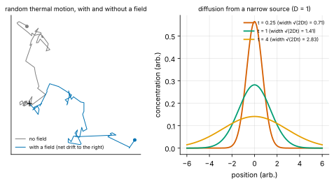
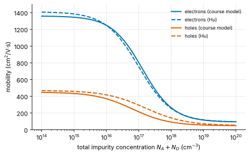
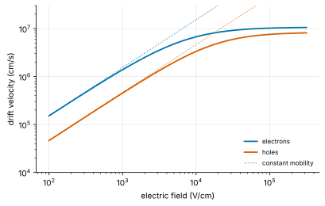

<!-- status: verified -->
# 09-03 · Carrier Transport: Drift and Diffusion

| | |
|---|---|
| **Course** | [09 · Semiconductor Devices](../README.md) |
| **University equivalent** | Carrier transport in a junior semiconductor-devices course: drift, mobility and scattering, velocity saturation, diffusion and the Einstein relation (Pierret, *Semiconductor Device Fundamentals*, ch. 3; Streetman & Banerjee, ch. 3–4; Hu, *Modern Semiconductor Devices for Integrated Circuits*, ch. 2) |
| **Prerequisites** | [09-02 Carriers, Doping and the Fermi Level](09-02-carriers-doping-fermi-level.md) (carrier densities, Fermi level), [09-01 Crystals, Energy Bands and the Semiconductor](09-01-crystals-and-energy-bands.md) (effective mass, band diagrams), [04-05 Current, Resistance and Conduction](../../04-physics-for-ee/chapters/04-05-current-resistance-and-conduction.md) (the Drude model, resistivity), [03-02 Random Variables and Distributions](../../03-probability-statistics-and-random-variables/chapters/03-02-random-variables-and-distributions.md) (random walks) |
| **Estimated study hours** | 8 |
| **Last verified** | 2026-11-19 |

**Learning objectives.** After this chapter you can:

1. Derive the drift velocity and mobility from a scattering-time model, and compute mean free times and paths.
2. Combine scattering mechanisms with Matthiessen's rule, use mobility-versus-doping models, and compute resistivity, sheet resistance and four-point-probe readings of doped silicon.
3. Explain velocity saturation and compute drift velocities and transit times at high fields from a measured velocity–field model.
4. Derive the diffusion current from a random walk and the Einstein relation from equilibrium, and compute diffusion coefficients and lengths.
5. Combine drift and diffusion, relate band slopes to fields, and compute the built-in field of a doping gradient and its effect on transit time.

---

## 1. Big picture

Every current in a semiconductor device is carried by one of two motions. **Drift** is carriers pushed by an electric field, the mechanism of resistors, MOSFET channels and the conduction of every doped region. **Diffusion** is carriers spreading from where they are crowded to where they are sparse, the mechanism that carries current across a forward-biased PN junction and through the base of a bipolar transistor. Both are limited by the same thing: carriers collide with lattice vibrations and impurities every few tenths of a picosecond, so they move at an average velocity set by how often they are scattered. This chapter derives both currents, the **mobility** and **diffusion coefficient** that quantify them, and the **Einstein relation** that ties the two together. Most device equations in the rest of the course are these two terms written out for a particular geometry.

- **Mobility is a figure of merit.** Transistor drive current is proportional to mobility at modest fields, which is why channel engineering (strain, orientation, undoped channels) targets it (09-01, 09-02).
- **Doping costs mobility.** Every ionized dopant scatters carriers, so heavily doped regions conduct by sheer carrier number, not by speed; resistor and well design trade the two.
- **Velocity saturates.** Above about 10⁴ V/cm, carriers in silicon stop speeding up at about 10⁷ cm/s, and short transistors spend most of their channel near this limit, which reshapes their current–voltage curves (09-10).
- **Diffusion is how junctions work.** Diode and bipolar transistor currents are diffusion currents of minority carriers (09-06, 09-07); the Einstein relation means a fast carrier is also a fast diffuser.

## 2. Intuition first

**A pinball crowd.** Picture electrons in a crystal as a crowd of pinballs, each racing about at its thermal speed, about 2 × 10⁷ cm/s, a couple of hundred kilometers per second, but bouncing off obstacles every few tenths of a picosecond. With no field, the bounces send them in every direction and the crowd as a whole goes nowhere. Tilt the table slightly (apply a field): between bounces each ball gains a little speed downhill, and the crowd drifts, slowly, at a velocity far below the thermal speed. That drift velocity is proportional to the tilt: **mobility** is the constant of proportionality, and it is large when bounces are rare and the ball is light (small effective mass).

**Diffusion is the same random motion with a gradient.** If more balls start on the left than on the right, random bounces carry more of them rightward than leftward, simply because more are available to move. No force is needed. The flow is proportional to the gradient in density, and the **diffusion coefficient** measures how fast the random walk spreads.

**A finance analogy: arbitrage flows.** Diffusion is like capital flowing from a market where it is abundant (low returns) to one where it is scarce, through many small independent trades rather than any single directive; drift is like a policy push that moves all capital the same way. *Where the analogy breaks:* carriers have no motives; diffusion is pure statistics of random motion, and the two flows add exactly, which is the basis of the drift–diffusion equations.

*Figure 1. Drift and diffusion. Left: random thermal trajectories with and without a field; the field adds a small net displacement. Right: carriers spreading from a concentrated source; the profile broadens as $\sqrt{Dt}$.*

## 3. Theory

> **Notation and course values.** $\mathcal E$ is the electric field (V/cm); $\mu_n$, $\mu_p$ mobilities (cm²/V·s); $v_d$ drift velocity; $\tau$ mean time between collisions (the momentum relaxation time); $\lambda$ mean free path; $D_n$, $D_p$ diffusion coefficients (cm²/s); $J$ current density (A/cm²); $\rho$ resistivity (Ω·cm), $\sigma = 1/\rho$; $R_s$ sheet resistance (Ω per square). Silicon values at 300 K from 09-02: $n_i$ = 1.0 × 10¹⁰ cm⁻³, and the **thermal voltage** $V_T \equiv kT/q$ = 25.85 mV (written $kT/q$ in this course's device chapters until 09-06, where $V_T$ takes over, as in [notation](../../../reference/notation.md)). *Notation deviation:* device physics writes the scalar field as $\mathcal E$ to keep $E$ free for energy; it is the same quantity as the field magnitude $E$ of Course 04. Mobility models in §3.3 are measured fits from the semiconductor-parameter handbook [1] and Hu [2].

### 3.1 Thermal motion and scattering

In equilibrium, each carrier moves at a speed set by temperature: by equipartition, $\tfrac12m^*\overline{v^2} = \tfrac32kT$, so the **thermal velocity** is

$$
v_{th} = \sqrt{\frac{3kT}{m^*}} \approx 2.3\times10^7\ \text{cm/s for electrons in Si at 300 K}
$$

(with the conductivity mass 0.26 $m_0$; the handbook lists 2.3 × 10⁵ m/s [1]). Carriers do not fly far at this speed. The perfect periodic lattice does not scatter a Bloch wave (09-01), but anything that breaks the periodicity does: **lattice vibrations** (phonons, more numerous as temperature rises) and **ionized impurities** (dopant ions, more numerous with doping). The average time between momentum-randomizing collisions, $\tau$, is a few tenths of a picosecond at room temperature, and the **mean free path** $\lambda = v_{th}\tau$ is a few tens of nanometers.

### 3.2 Drift and mobility

Apply a field $\mathcal E$. Between collisions an electron accelerates as $m^*\,dv/dt = -q\mathcal E$, gaining a velocity $-q\mathcal Et/m^*$ after a time $t$ since its last collision. Collisions randomize the direction, so right after one the average velocity is zero. Collisions occur at random with mean spacing $\tau$, so the average time since the last collision, over all electrons at any instant, is $\tau$ (for a Poisson process, the time back to the last event is exponentially distributed with mean $\tau$; 03-02). The average, or **drift**, velocity is therefore

$$
v_d = -\frac{q\tau}{m^*}\,\mathcal E \equiv -\mu_n\mathcal E, \qquad \mu_n = \frac{q\tau_n}{m_n^*}, \qquad v_d = +\mu_p\mathcal E\ \text{for holes} .
$$

*Units:* C·s/kg = (A·s)·s/kg = m²/(V·s), since 1 V = 1 kg·m²/(A·s³). Device engineers quote mobility in cm²/V·s. The minus sign says only that electrons drift against the field.

The same result follows from a force balance with a "friction" term: $m^*dv_d/dt = -q\mathcal E - m^*v_d/\tau$, whose steady state is $v_d = -q\tau\mathcal E/m^*$. It also shows that the drift velocity responds to a change in field within about $\tau$, a few tenths of a picosecond, which is why mobility is a constant up to frequencies of hundreds of GHz.

Drift is slow. At 1 kV/cm, a moderate field, electrons in lightly doped silicon drift at about 1.3 × 10⁶ cm/s, 6% of their thermal speed (Example 09-03.1): the field only slightly biases a fast random motion.

### 3.3 What limits mobility: scattering mechanisms

**Matthiessen's rule.** Independent scattering mechanisms add their *rates*: if phonons alone would give mean time $\tau_L$ and impurities alone $\tau_I$, the combined collision rate is $1/\tau = 1/\tau_L + 1/\tau_I$, and since $\mu \propto \tau$,

$$
\frac{1}{\mu} = \frac{1}{\mu_L} + \frac{1}{\mu_I} .
$$

The lower mobility dominates, as for resistors in series (the analogy is exact: "resistance to motion" adds).

**Lattice (phonon) scattering** grows with temperature, because there are more phonons to scatter from, so $\mu_L$ falls as $T$ rises. Theory for acoustic phonons alone predicts $T^{-3/2}$; measurement on lightly doped silicon gives [1]

$$
\mu_{L,n} \approx 1430\left(\frac{300\ \text{K}}{T}\right)^{2.2}, \qquad \mu_{L,p} \approx 495\left(\frac{300\ \text{K}}{T}\right)^{2.2}\ \text{cm}^2/\text{V·s} ,
$$

steeper than $T^{-3/2}$ because optical phonons and intervalley scattering add to it.

**Ionized-impurity scattering** deflects carriers by the Coulomb field of each dopant ion, like a comet swinging past the Sun. It grows with the number of ions, $N_D^+ + N_A^-$ (both types scatter, which is why compensated material has low mobility; 09-02 §3.6), and *weakens* as temperature rises: faster carriers fly past an ion in less time and are deflected less. Roughly $\mu_I \propto T^{3/2}/N_I$.

**Mobility versus doping.** At room temperature, measured mobilities are well described by a smooth fit between a phonon-limited maximum and an impurity-limited minimum [1]:

$$
\mu = \mu_{\min} + \frac{\mu_{\max} - \mu_{\min}}{1 + (N/N_{\text{ref}})^\alpha}
$$

| Carrier | $\mu_{\max}$ (cm²/V·s) | $\mu_{\min}$ (cm²/V·s) | $N_{\text{ref}}$ (cm⁻³) | $\alpha$ |
|---|---|---|---|---|
| Electrons | 1360 | 92 | 1.3 × 10¹⁷ | 0.91 |
| Holes | 450 | 48 | 6.3 × 10¹⁶ | 0.76 |

Here $N$ is the total ionized impurity concentration. This is the **course mobility model**. Hu's textbook gives a similar fit (electrons $1318/[1 + (N/10^{17})^{0.85}] + 92$, holes $420/[1 + (N/1.6\times10^{17})^{0.7}] + 50$) [2]; the two agree within 7% for electrons over 10¹⁵–10¹⁹ cm⁻³ (Example 09-03.2), but for holes they differ by up to 55%, near 7 × 10¹⁷ cm⁻³ **[Contested]**. That spread is a fair measure of how well mobility is known in heavily doped material; as Hu notes, mobility is "not easy to measure accurately" [2]. Device simulations calibrate the mobility model to the process rather than trusting any one fit.

*Figure 2. Electron and hole mobility of silicon at 300 K against total impurity concentration, from the course model, with Hu's fit for comparison.*

The **hole mobility is about a third of the electron mobility** in silicon: holes are heavier (conductivity mass 0.39 against 0.26 $m_0$; 09-02) and scatter more often. This is why PMOS transistors are drawn wider than NMOS for equal drive (04-11), and why strain and orientation work so hard on holes (09-01 §9).

### 3.4 Drift current, conductivity and sheet resistance

A density $n$ of electrons drifting at $v_d$ carries a current density $J = -qnv_d$ (charge per unit time crossing unit area). With both carriers:

$$
J_{\text{drift}} = q(n\mu_n + p\mu_p)\,\mathcal E = \sigma\mathcal E, \qquad \rho = \frac{1}{q(n\mu_n + p\mu_p)} .
$$

This is Ohm's law (04-05) with the conductivity written in terms of carriers. In doped material only the majority term matters: $\rho \approx 1/(qN_D\mu_n)$ for n-type. Because $\mu$ falls with doping, resistivity falls more slowly than $1/N$: from 10¹⁵ to 10¹⁹ cm⁻³ the electron density rises 10⁴-fold but resistivity falls only 862-fold (Example 09-03.2).

**Sheet resistance.** Integrated-circuit resistors and doped layers are thin films of thickness $t$. A rectangle of length $L$ and width $W$ has resistance $R = \rho L/(tW) = R_s\,(L/W)$ with

$$
R_s = \frac{\rho}{t}\quad\text{(in ohms "per square")} .
$$

Any square of the film, whatever its size, has resistance $R_s$, so resistors are designed by counting squares: $R = R_s \times (L/W)$. For a layer whose doping varies with depth, the conductances of thin slices add in parallel: $1/R_s = q\int\mu(x)N(x)\,dx$.

**Measuring it: the four-point probe.** Four collinear probes with equal spacing $s$ touch a thin film; current $I$ enters at one outer probe and leaves at the other, and a voltmeter reads $V$ between the inner two (drawing no current, so contact resistance drops out). In a thin sheet, current spreads radially from a point source, so at radius $r$ the current density per unit width is $I/(2\pi r)$ and the field is $R_sI/(2\pi r)$; integrating, the potential is $V(r) = -(R_sI/2\pi)\ln r$ + constant. Superposing the source at the first probe and the sink at the fourth, the inner probes (at distances $s$ and $2s$ from each) differ by

$$
V = \frac{R_sI}{2\pi}\left[(\ln2s - \ln s) + (\ln2s - \ln s)\right] = \frac{R_sI}{\pi}\ln2
\quad\Longrightarrow\quad R_s = \frac{\pi}{\ln2}\,\frac{V}{I} = 4.532\,\frac{V}{I} .
$$

The probe spacing drops out, for a film much larger than the probe array and much thinner than $s$. This is the everyday measurement of doping in a fab.

### 3.5 High fields: velocity saturation

Mobility is a low-field concept. As the field grows, carriers gain energy between collisions faster than they lose it, become "hot", and begin to emit **optical phonons**, high-energy lattice vibrations (63 meV in silicon [1]) that take away a large bite of energy and momentum at each emission. The drift velocity therefore stops growing and saturates. A crude energy balance, $\tfrac12m^*v_{\text{sat}}^2 \approx E_{op}$, gives a few 10⁷ cm/s, too high by a factor of two or three because it ignores how the energy is shared, but it explains why the saturation velocity is similar, about 10⁷ cm/s, in many semiconductors.

For electrons in lightly doped silicon above 250 K, measurements are fitted by [1]

$$
v_d = v_s\,\frac{\mathcal E/\mathcal E_c}{\left[1 + (\mathcal E/\mathcal E_c)^\beta\right]^{1/\beta}}, \qquad v_s = 1.53\times10^9\,T^{-0.87}\ \text{cm/s}, \quad \mathcal E_c = 1.01\,T^{1.55}\ \text{V/cm}, \quad \beta = 2.57\times10^{-2}\,T^{0.66} ,
$$

with $T$ in kelvin and the field along ⟨111⟩. At 300 K: $v_s$ = 1.07 × 10⁷ cm/s, $\mathcal E_c$ = 6.98 × 10³ V/cm and $\beta$ = 1.11. For holes (field along ⟨100⟩), $v_s = 1.62\times10^8\,T^{-0.52}$ cm/s, $\mathcal E_c = 1.24\,T^{1.68}$ V/cm and $\beta = 0.46\,T^{0.17}$ [1]: 8.3 × 10⁶ cm/s, 1.80 × 10⁴ V/cm and 1.21 at 300 K. Two limits check the form: at low field $v_d \to (v_s/\mathcal E_c)\mathcal E$, a mobility of 1534 cm²/V·s (the value for the purest silicon, measured by time of flight), and at high field $v_d \to v_s$. Different sources give different pure-silicon electron mobilities: 1360 cm²/V·s is the low-doping limit of the doping fit (§3.3), 1430 the lattice-mobility fit, 1534 the time-of-flight value here, and 1400 the round number of Hu's table (used in 09-01). They are different fits to different measurements (conductivity, Hall, time of flight), and their ±6% spread is the honest uncertainty of a "pure silicon mobility".

*Figure 3. Electron and hole drift velocity in silicon at 300 K against field, from the fits above, with the low-field (constant-mobility) lines for comparison.*

**Why it matters.** Short transistors run at high fields: 1 V across a 100 nm channel is 10⁵ V/cm, where electrons are at 96% of $v_s$ and a constant-mobility model would overestimate their speed fifteenfold (Example 09-03.5). Their current then depends on how many carriers there are and on $v_s$, not on mobility, which changes the MOSFET equations (09-10). And when a device is shorter than a few mean free paths, carriers can cross it with few collisions, **ballistic transport**, where "mobility and even velocity saturation … become fuzzy" [2].

### 3.6 Diffusion

**A random walk.** Model carriers in one dimension as hopping a distance $\lambda$ left or right, with equal probability, every time $\tau$. Consider the plane at $x$. In one step, half of the carriers within $\lambda$ to its left cross rightward and half of those within $\lambda$ to its right cross leftward. With density $n(x)$, the net number crossing per unit area per unit time is

$$
F = \frac{1}{2\tau}\left[n\!\left(x - \tfrac{\lambda}{2}\right) - n\!\left(x + \tfrac{\lambda}{2}\right)\right]\lambda \approx -\frac{\lambda^2}{2\tau}\,\frac{dn}{dx} ,
$$

using a first-order Taylor expansion (01-08). This is **Fick's law**, flux $= -D\,dn/dx$, with $D = \lambda^2/2\tau$ for this simple walk (in three dimensions with random directions, $D = v_{th}\lambda/3$; the exact factor depends on the model, and the Einstein relation below gives $D$ exactly). The carriers carry charge, so the **diffusion currents** are

$$
J_{n,\text{diff}} = qD_n\frac{dn}{dx}, \qquad J_{p,\text{diff}} = -qD_p\frac{dp}{dx} .
$$

The signs differ because electrons are negative: electrons diffusing down a gradient toward $-x$ carry current toward $+x$ when $dn/dx > 0$. **Memorize the picture, not the signs:** particles flow downhill in concentration; current flows with holes and against electrons.

**How far diffusion reaches.** A carrier's random walk spreads as $\sqrt{Dt}$, not in proportion to $t$: the mean squared displacement after $N$ independent steps is $N\lambda^2$, a sum of independent variances (03-04). Diffusing ten times farther takes a hundred times longer, which is why diffusion is fast across 0.1 µm (a bipolar base) and slow across millimeters.

### 3.7 The Einstein relation

Drift and diffusion are two faces of the same random motion, so their coefficients must be related. Consider a non-uniformly doped sample in **equilibrium**. Equilibrium means no net current for each carrier type, and a constant Fermi level (09-02). Where the doping varies, $n(x) = N_Ce^{-(E_C(x) - E_F)/kT}$ varies too, so

$$
\frac{dn}{dx} = -\frac{n}{kT}\frac{dE_C}{dx} = -\frac{qn}{kT}\,\mathcal E ,
$$

using $\mathcal E = (1/q)\,dE_C/dx$ (09-01 §3.7). The total electron current is then

$$
J_n = qn\mu_n\mathcal E + qD_n\frac{dn}{dx} = qn\mathcal E\left(\mu_n - \frac{q}{kT}D_n\right) = 0
\quad\Longrightarrow\quad
\frac{D_n}{\mu_n} = \frac{kT}{q} .
$$

The same holds for holes. This is the **Einstein relation**: $D = (kT/q)\,\mu$, $D$ in cm²/s when $\mu$ is in cm²/V·s and $kT/q$ in volts. At 300 K, $D_n$ ≈ 35 cm²/s for lightly doped silicon (Example 09-03.6), matching the handbook's ≤ 36 cm²/s [1]. The relation holds for non-degenerate carriers near equilibrium; it is how diffusion coefficients are usually obtained from measured mobilities.

The derivation also shows the physical meaning of the field in a non-uniformly doped sample: there *is* a field, the **built-in field**, and it pushes carriers back exactly as hard as diffusion pushes them down the gradient.

### 3.8 Drift and diffusion together

The total currents are

$$
J_n = qn\mu_n\mathcal E + qD_n\frac{dn}{dx}, \qquad J_p = qp\mu_p\mathcal E - qD_p\frac{dp}{dx}, \qquad J = J_n + J_p .
$$

These **drift–diffusion equations**, with Poisson's equation (04-03) for the field and the continuity equations of 09-04 for the carrier densities, are the model that device simulators solve. Two consequences:

- **Flat Fermi level, no current.** Using the Einstein relation and $n = N_Ce^{-(E_C - E_F)/kT}$, the drift and diffusion terms combine into $J_n = \mu_nn\,dE_F/dx$: current flows only where the Fermi level slopes. In equilibrium $E_F$ is flat however the bands bend. (Out of equilibrium, each carrier type has its own quasi-Fermi level, and its slope drives its current; 09-04.)
- **Graded doping builds in a field.** In an n-type region with $n \approx N_D(x)$, zero current requires

$$
\mathcal E = -\frac{kT}{q}\,\frac{1}{N_D}\frac{dN_D}{dx} .
$$

An exponential profile $N_D \propto e^{-x/L}$ gives a uniform field $(kT/q)/L$, pointing toward the lightly doped side (the side the electrons would diffuse to; the field holds them back). For a profile falling by 100 over 0.2 µm, the field is about 6 kV/cm. Minority carriers in such a region feel the same field with nothing opposing it, so they are swept across faster than by diffusion alone: the principle of the **graded base** in bipolar transistors (Example 09-03.7, 09-07).

### 3.9 Measuring carriers: the Hall effect revisited

The Hall effect (04-06) gives the carrier *type* (from the sign of the Hall voltage) and density, $n = 1/(q|R_H|)$, with the **Hall coefficient** $R_H = V_Ht/(IB)$. Combined with a resistivity measurement it gives the **Hall mobility** $\mu_H = |R_H|/\rho$. Hall and drift mobilities differ by a **Hall factor** $r_H$ that depends on the scattering mechanism: $R_H = r_H/(qn)$, so the Hall density is $n_H = n/r_H$ and $\mu_H = r_H\mu$. In silicon at 300 K the handbook's data give $r_H$ above 1 for electrons (about 1.1–1.15 in lightly doped n-type) and below 1 for holes (about 0.75–0.9) [1], so careful work states which mobility is meant. Hall measurement on test structures, together with four-point-probe sheet resistance, is how fabs check that implanted doses produce the intended carrier densities.

## 4. Worked examples

### Example 09-03.1 · How fast electrons really move (tier A)

**Setup.** Lightly doped n-type silicon ($N_D$ = 10¹⁵ cm⁻³) at 300 K. Use the course mobility model and the conductivity mass 0.26 $m_0$. Find (a) the mobility, (b) the mean free time, (c) the thermal velocity, (d) the mean free path, (e) the drift velocity at 1 kV/cm and its ratio to the thermal velocity.

**Solution.**

(a) $\mu_n = 92 + 1268/[1 + (10^{15}/1.3\times10^{17})^{0.91}]$: $(0.007692)^{0.91}$ = 0.01192, so $\mu_n$ = **1345** cm²/V·s.

(b) $\tau = \mu m^*/q = 0.1345\ \text{m}^2/\text{V·s} \times 0.26 \times 9.109\times10^{-31}\ \text{kg}/1.602\times10^{-19}$ C = **0.199** ps.

(c) $v_{th} = \sqrt{3kT/m^*} = \sqrt{3 \times 4.142\times10^{-21}/(2.368\times10^{-31})}$ m/s = **2.29 × 10⁷** cm/s.

(d) $\lambda = v_{th}\tau$ = **45.5** nm.

(e) $v_d = \mu\mathcal E = 1345 \times 10^3$ = **1.345 × 10⁶** cm/s, **0.059** of the thermal velocity.

**Units check.** (m²/V·s)(kg)/(C) = m²·kg/(V·C·s) = m²·kg/(J·s) = s, since 1 J = 1 kg·m²/s². **Sanity check.** About **84** lattice constants between collisions: the electron is a wave that travels freely through the periodic lattice and is scattered only by its imperfections. The drift is a small bias on a fast random motion, which is why mobility, a linear response, works so well.

### Example 09-03.2 · Mobility and resistivity against doping (tier A)

**Setup.** At 300 K, find the electron mobility and resistivity of n-type silicon doped at 10¹⁵, 10¹⁷ and 10¹⁹ cm⁻³ with the course model, and compare the mobilities with Hu's fit. Then find the hole mobility and resistivity of p-type silicon with $N_A$ = 10¹⁶ cm⁻³.

**Solution.** With $\rho = 1/(qN\mu)$:

| $N_D$ (cm⁻³) | $\mu_n$ course (cm²/V·s) | $\mu_n$ Hu | difference | $\rho$ (Ω·cm) |
|---|---|---|---|---|
| 10¹⁵ | **1345** | **1384** | **+2.9**% | **4.64** |
| 10¹⁷ | **801.3** | **751.0** | **−6.3**% | **0.0779** |
| 10¹⁹ | **115.9** | **117.8** | **+1.6**% | **0.00538** |

For $N_A$ = 10¹⁶ cm⁻³: $\mu_p = 48 + 402/[1 + (10^{16}/6.3\times10^{16})^{0.76}]$ = **370.4** cm²/V·s (Hu's fit: **417.3**), and $\rho$ = **1.685** Ω·cm.

**Sanity check.** From 10¹⁵ to 10¹⁹ cm⁻³ the electron density rises 10⁴-fold but $\rho$ falls only **862**-fold, because mobility drops by a factor of **11.6**. Read backward, a p-type wafer of about 1.7 Ω·cm holds about 10¹⁶ cm⁻³ acceptors; resistivity is how wafer doping is specified.

### Example 09-03.3 · A diffused resistor and a four-point probe (tier B)

**Setup.** An n-type layer 0.5 µm thick is doped uniformly at 10¹⁸ cm⁻³. (a) Find its resistivity and sheet resistance. (b) What voltage does a four-point probe read with 1 mA of current? (c) How long must a 1 µm-wide resistor be for 10 kΩ?

**Solution.**

(a) $\mu_n(10^{18})$ = **263.3** cm²/V·s, $\rho = 1/(1.602\times10^{-19} \times 10^{18} \times 263.3)$ = **0.02370** Ω·cm, and $R_s = \rho/t = 0.02370/0.5\times10^{-4}$ = **474.1** Ω/□.

(b) $V = R_sI\ln2/\pi = 474.1 \times 10^{-3} \times 0.2206$ = **0.1046** V (the probe constant is $\pi/\ln2$ = **4.532**).

(c) $L/W = 10^4/474.1$ = **21.09** squares, so $L$ = **21.09** µm.

**Sanity check.** Real resistors also count the contact regions (a fraction of a square to a few squares each) and depletion at the edges, so designers calibrate $R_s$ on test structures. Absolute values vary from wafer to wafer with doping and layer thickness, while the ratio of two resistors on the same chip, which see the same doping, matches far better; analog circuits are designed to depend on ratios.

### Example 09-03.4 · Mobility and temperature (tier B)

**Setup.** (a) Using the lattice mobility $\mu_{L,n} = 1430(300/T)^{2.2}$, find the electron mobility of lightly doped silicon at 250, 300 and 400 K, and the factor by which a lightly doped resistor's resistance rises from 300 to 400 K. (b) For $N_D$ = 10¹⁷ cm⁻³, find the impurity-limited mobility $\mu_I$ at 300 K that makes Matthiessen's rule reproduce the course model's 801.3 cm²/V·s. Assuming $\mu_I \propto T^{3/2}$, find the mobility at 400 K and the resistance ratio.

**Solution.**

(a) $\mu_L$ = **2136**, **1430** and **759.4** cm²/V·s. The resistance rises by $1430/759.4$ = **1.883**.

(b) $1/\mu_I = 1/801.3 - 1/1430$, so $\mu_I$ = **1823** cm²/V·s at 300 K. At 400 K, $\mu_I = 1823 \times (4/3)^{1.5}$ = 2806 cm²/V·s and $\mu = 1/(1/759.4 + 1/2806)$ = **597.7** cm²/V·s: the resistance rises by only **1.341**.

**Sanity check.** Doped silicon has a smaller temperature coefficient than lightly doped silicon because impurity scattering, which weakens with temperature, partly offsets phonon scattering. At high enough doping the two cancel, which is why diffused single-crystal resistors can be made with small temperature coefficients. (Polysilicon resistors also reach small coefficients, but for a different reason: conduction across grain boundaries, whose barriers are crossed more easily at higher temperature, offsets the phonon term.)

### Example 09-03.5 · Velocity saturation (tier B)

**Setup.** Using the electron velocity–field fit for silicon at 300 K: (a) find $v_s$, $\mathcal E_c$, $\beta$ and the implied low-field mobility; (b) find $v_d$ at 10³, 10⁴, 3 × 10⁴ and 10⁵ V/cm, and the ratio to the constant-mobility prediction $\mu_0\mathcal E$; (c) find the time for an electron to cross 1 µm with 5 V across it, by the fit and by a constant mobility of 1400 cm²/V·s.

**Solution.**

(a) $v_s = 1.53\times10^9 \times 300^{-0.87}$ = **1.071 × 10⁷** cm/s, $\mathcal E_c = 1.01 \times 300^{1.55}$ = **6.98 × 10³** V/cm, $\beta = 0.0257 \times 300^{0.66}$ = **1.109**, $\mu_0 = v_s/\mathcal E_c$ = **1534** cm²/V·s.

(b)

| $\mathcal E$ (V/cm) | $v_d$ (cm/s) | $v_d/(\mu_0\mathcal E)$ |
|---|---|---|
| 10³ | **1.389 × 10⁶** | **0.906** |
| 10⁴ | **6.74 × 10⁶** | **0.439** |
| 3 × 10⁴ | **9.09 × 10⁶** | **0.198** |
| 10⁵ | **1.022 × 10⁷** | **0.0667** |

(c) The field is $5/10^{-4}$ = 5 × 10⁴ V/cm. By the fit $v_d$ = **9.72 × 10⁶** cm/s and the transit time is $10^{-4}/9.72\times10^6$ = **10.3** ps; a constant 1400 cm²/V·s would give $7\times10^7$ cm/s, faster than the saturation velocity, and **1.43** ps.

**Sanity check.** At 10⁵ V/cm the electrons move at **96**% of $v_s$, and the constant-mobility model is wrong by a factor of fifteen. A transit time of picoseconds per micrometer at saturation sets the scale of transistor delays: ~10 ps per µm, or about 1 ps across a 100 nm channel.

### Example 09-03.6 · Diffusion coefficients and lengths (tier A)

**Setup.** (a) Find $D_n$ and $D_p$ at 300 K for lightly doped silicon ($N$ = 10¹⁵ cm⁻³). (b) How far do electrons diffuse, $\sqrt{D_nt}$, in 1 µs? (c) An electron density falls linearly from 10¹⁶ to 10¹⁴ cm⁻³ over 1 µm. Find the diffusion current density.

**Solution.**

(a) $D_n = (kT/q)\mu_n = 0.025852 \times 1345$ = **34.77** cm²/s; $\mu_p(10^{15})$ = **433.5** cm²/V·s, so $D_p$ = **11.21** cm²/s.

(b) $\sqrt{34.77 \times 10^{-6}}$ cm = **59.0** µm.

(c) The density falls with $x$: $dn/dx = -(10^{16} - 10^{14})/10^{-4}$, a gradient of magnitude **9.9 × 10¹⁹** cm⁻⁴. Electrons diffuse toward lower density, toward $+x$, so the current, carried by negative charges, flows toward $-x$: $J_n = qD_n\,dn/dx = 1.602\times10^{-19} \times 34.77 \times (-9.9\times10^{19})$ = **−551.5** A/cm².

**Sanity check.** A gradient of a modest density over a micrometer drives hundreds of amperes per cm², a large current density: diffusion currents are not small, which is why junctions can carry large forward currents with tiny gradients of minority carriers. The handbook lists $D_n$ ≤ 36 and $D_p$ ≤ 12 cm²/s for pure silicon [1], consistent with (a).

### Example 09-03.7 · A graded base speeds electrons (tier C)

**Setup.** The base of a bipolar transistor is p-type, with acceptor doping falling exponentially from 10¹⁸ cm⁻³ at the emitter side to 10¹⁶ cm⁻³ over $W$ = 0.2 µm. (a) Find the built-in field (for holes, the majority carriers, $\mathcal E = (kT/q)(1/N_A)(dN_A/dx)$, with the mirror-image argument to §3.8). (b) Electrons injected from the emitter are minority carriers here; taking their mobility at 10¹⁷ cm⁻³, find their drift velocity in this field and the drift transit time across the base. (c) Compare with the diffusion transit time $W^2/2D_n$ of a uniform base.

**Solution.**

(a) $N_A(x) = 10^{18}e^{-x/L}$ with $L = W/\ln100$, so $(1/N_A)(dN_A/dx) = -1/L$ and $|\mathcal E| = (kT/q)\ln100/W = 0.025852 \times 4.605/(0.2\times10^{-4})$ = **5953** V/cm, pointing from the lightly doped (collector) side toward the heavily doped (emitter) side so that it holds holes against their diffusion toward the collector.

(b) That field pushes electrons toward the collector. With $\mu_n$(10¹⁷) = 801.3 cm²/V·s, $v = 801.3 \times 5953$ = **4.77 × 10⁶** cm/s and the drift transit time is $0.2\times10^{-4}/4.77\times10^6$ = **4.19** ps.

(c) $D_n = 0.025852 \times 801.3$ = **20.72** cm²/s and $W^2/2D_n = (2\times10^{-5})^2/(2 \times 20.72)$ = **9.65** ps. The built-in field cuts the transit time to less than half (and in reality drift and diffusion act together, so the time is shorter than either alone).

**Sanity check.** 6 kV/cm is below the velocity-saturation range, so the mobility model applies. Shorter base transit means higher transistor gain–bandwidth: graded bases (and graded SiGe composition, 09-07) are a standard speed lever in RF bipolar transistors.

### Answer key

<!-- answer-key -->
| ID | Quantity | Value | Unit |
|---|---|---|---|
| Ex 09-03.1a | (N/N_ref)^α at 1e15 | 0.01192 | — |
| Ex 09-03.1b | electron mobility at 1e15 | 1345 | cm²/V·s |
| Ex 09-03.1c | mean free time | 0.199 | ps |
| Ex 09-03.1d | thermal velocity | 2.29e7 | cm/s |
| Ex 09-03.1e | mean free path | 45.5 | nm |
| Ex 09-03.1f | drift velocity at 1 kV/cm | 1.345e6 | cm/s |
| Ex 09-03.1g | ratio to thermal velocity | 0.059 | — |
| Ex 09-03.1h | kT at 300 K | 4.142e-21 | J |
| Ex 09-03.1i | conductivity mass | 2.368e-31 | kg |
| Ex 09-03.1j | mean free path in lattice constants | 84 | — |
| Ex 09-03.2a | μ_n at 1e15 | 1345 | cm²/V·s |
| Ex 09-03.2b | μ_n at 1e15, Hu | 1384 | cm²/V·s |
| Ex 09-03.2c | difference at 1e15 | 2.9 | % |
| Ex 09-03.2d | ρ at 1e15 | 4.64 | Ω·cm |
| Ex 09-03.2e | μ_n at 1e17 | 801.3 | cm²/V·s |
| Ex 09-03.2f | μ_n at 1e17, Hu | 751.0 | cm²/V·s |
| Ex 09-03.2g | difference at 1e17 | -6.3 | % |
| Ex 09-03.2h | ρ at 1e17 | 0.0779 | Ω·cm |
| Ex 09-03.2i | μ_n at 1e19 | 115.9 | cm²/V·s |
| Ex 09-03.2j | μ_n at 1e19, Hu | 117.8 | cm²/V·s |
| Ex 09-03.2k | difference at 1e19 | 1.6 | % |
| Ex 09-03.2l | ρ at 1e19 | 0.00538 | Ω·cm |
| Ex 09-03.2m | μ_p at 1e16 | 370.4 | cm²/V·s |
| Ex 09-03.2n | μ_p at 1e16, Hu | 417.3 | cm²/V·s |
| Ex 09-03.2o | ρ of p-type 1e16 | 1.685 | Ω·cm |
| Ex 09-03.2p | resistivity drop 1e15 to 1e19 | 862 | — |
| Ex 09-03.2q | mobility drop 1e15 to 1e19 | 11.6 | — |
| Ex 09-03.3a | μ_n at 1e18 | 263.3 | cm²/V·s |
| Ex 09-03.3b | ρ at 1e18 | 0.02370 | Ω·cm |
| Ex 09-03.3c | sheet resistance | 474.1 | Ω/□ |
| Ex 09-03.3d | four-point-probe voltage | 0.1046 | V |
| Ex 09-03.3e | ln 2/π | 0.2206 | — |
| Ex 09-03.3f | probe constant π/ln 2 | 4.532 | — |
| Ex 09-03.3g | squares for 10 kΩ | 21.09 | — |
| Ex 09-03.3h | resistor length | 21.09 | µm |
| Ex 09-03.4a | μ_L at 250 K | 2136 | cm²/V·s |
| Ex 09-03.4b | μ_L at 300 K | 1430 | cm²/V·s |
| Ex 09-03.4c | μ_L at 400 K | 759.4 | cm²/V·s |
| Ex 09-03.4d | resistance ratio, lightly doped | 1.883 | — |
| Ex 09-03.4e | μ_I at 300 K, 1e17 | 1823 | cm²/V·s |
| Ex 09-03.4f | μ_I at 400 K | 2806 | cm²/V·s |
| Ex 09-03.4g | μ at 400 K, 1e17 | 597.7 | cm²/V·s |
| Ex 09-03.4h | resistance ratio, 1e17 | 1.341 | — |
| Ex 09-03.5a | v_s at 300 K | 1.071e7 | cm/s |
| Ex 09-03.5b | E_c at 300 K | 6.98e3 | V/cm |
| Ex 09-03.5c | β at 300 K | 1.109 | — |
| Ex 09-03.5d | low-field mobility of the fit | 1534 | cm²/V·s |
| Ex 09-03.5e | v_d at 1e3 V/cm | 1.389e6 | cm/s |
| Ex 09-03.5f | ratio at 1e3 V/cm | 0.906 | — |
| Ex 09-03.5g | v_d at 1e4 V/cm | 6.74e6 | cm/s |
| Ex 09-03.5h | ratio at 1e4 V/cm | 0.439 | — |
| Ex 09-03.5i | v_d at 3e4 V/cm | 9.09e6 | cm/s |
| Ex 09-03.5j | ratio at 3e4 V/cm | 0.198 | — |
| Ex 09-03.5k | v_d at 1e5 V/cm | 1.022e7 | cm/s |
| Ex 09-03.5l | ratio at 1e5 V/cm | 0.0667 | — |
| Ex 09-03.5m | v_d at 5e4 V/cm | 9.72e6 | cm/s |
| Ex 09-03.5n | transit time, fit | 10.3 | ps |
| Ex 09-03.5o | transit time, constant mobility | 1.43 | ps |
| Ex 09-03.5p | constant-mobility velocity at 5e4 V/cm | 7e7 | cm/s |
| Ex 09-03.5q | fraction of v_s at 1e5 V/cm | 96 | % |
| Ex 09-03.6a | D_n | 34.77 | cm²/s |
| Ex 09-03.6b | μ_p at 1e15 | 433.5 | cm²/V·s |
| Ex 09-03.6c | D_p | 11.21 | cm²/s |
| Ex 09-03.6d | diffusion distance in 1 µs | 59.0 | µm |
| Ex 09-03.6e | density gradient | 9.9e19 | cm⁻⁴ |
| Ex 09-03.6f | diffusion current density | -551.5 | A/cm² |
| Ex 09-03.7a | built-in field in the graded base | 5953 | V/cm |
| Ex 09-03.7b | electron drift velocity | 4.77e6 | cm/s |
| Ex 09-03.7c | drift transit time | 4.19 | ps |
| Ex 09-03.7d | D_n at 1e17 | 20.72 | cm²/s |
| Ex 09-03.7e | diffusion transit time | 9.65 | ps |
| T 09-03.a | handbook thermal velocity | 2.3e5 | m/s |
| T 09-03.b | electron density rise 1e15 to 1e19 | 1e4 | — |
| T 09-03.c | crude energy-balance saturation velocity | 2.9e7 | cm/s |
| T 09-03.d | v_s of holes at 300 K | 8.3e6 | cm/s |
| T 09-03.e | E_c of holes at 300 K | 1.80e4 | V/cm |
| T 09-03.f | β of holes at 300 K | 1.21 | — |
| T 09-03.g | low-field mobility of the electron fit | 1534 | cm²/V·s |
| T 09-03.h | field across a 100 nm channel at 1 V | 1e5 | V/cm |
| T 09-03.i | overestimate of constant mobility at 1e5 V/cm | 15 | — |
| T 09-03.j | graded-profile field (100× over 0.2 µm) | 6 | kV/cm |
| T 09-03.k | largest electron model difference, 1e15 to 1e19 | 7 | % |
| T 09-03.l | largest hole model difference, 1e15 to 1e19 | 55 | % |
| T 09-03.m | doping of the largest hole difference | 7e17 | cm⁻³ |

*Every value is recomputed by [verify_09_03.py](../verify/verify_09_03.py) by an independent route: mean free times from a simulated ensemble of electrons with Poisson-distributed collisions, mobility models evaluated and inverted by root finding, sheet resistance by integrating slice conductances and the four-point-probe constant by superposing point-source potentials numerically, velocities from the fit and its limits, diffusion from a simulated random walk, and the Einstein relation and built-in field by solving zero-current equilibrium numerically. Rows marked T key numbers stated in §3.*

## 5. Simulate it

The lab, [labs/09-03-lab](../labs/09-03-lab/README.md), is a notebook that builds transport from simulated carriers:

1. Simulate an ensemble of electrons that accelerate in a field and collide at random (Poisson) times; measure the drift velocity and confirm $\mu = q\tau/m^*$.
2. Simulate a random walk from a narrow starting distribution; measure the spreading and recover Fick's law and $D = \lambda^2/2\tau$.
3. Compute mobility against doping and temperature with Matthiessen's rule, and the sheet resistance of a non-uniform (Gaussian) doping profile by integrating slice conductances.
4. Plot the velocity–field curves and compute transit times across channels of different lengths.
5. Solve for the equilibrium field in a graded doping profile and check that drift and diffusion cancel point by point.

**Guided exercise (predict, then run).** **Before running**, predict: if the scattering time in Part 1 is halved, what happens to the drift velocity, the mobility and the diffusion coefficient measured in Part 2? Then predict how the sheet resistance of a Gaussian implant changes if the same dose is spread twice as deep (lower peak doping, higher mobility). Run Parts 1–3 and compare.

## 6. Engineering tradeoffs

| Knob | Improves | Costs | Typical decision owner |
|---|---|---|---|
| Doping of a resistive or conducting region | Lower resistance (more carriers) | Mobility falls (impurity scattering), junction capacitance and leakage rise | Device and process engineers |
| Resistor implementation (lightly doped well, diffusion, polysilicon) | Sheet resistance range, area | Temperature coefficient, voltage coefficient, matching, parasitic capacitance | Analog designers with the process team |
| Channel mobility enhancement (strain, orientation, undoped channel) | Drive current at modest fields | Process complexity; gains shrink once velocity saturates | Technology development |
| Channel length | Speed (shorter transit), density | Velocity saturation and short-channel effects; mobility no longer sets speed | Technology definition and circuit designers |
| Graded doping (or graded composition) | Built-in drift field, shorter transit time | Process control of profiles; field reduces at high injection | Bipolar and RF device engineers |
| Operating temperature | Higher mobility when cold (phonon scattering falls) | Cooling cost; freeze-out at very low temperature (09-02) | System architects |

## 7. Numbers to know

| Quantity | Value | Note |
|---|---|---|
| Lightly doped Si mobility at 300 K | $\mu_n$ ≈ 1360–1400, $\mu_p$ ≈ 450–470 cm²/V·s | [1, 2] |
| Electron thermal velocity in Si | 2.3 × 10⁷ cm/s | [1], §3.1 |
| Mean free time and path (electrons, lightly doped) | about 0.2 ps; about 45 nm | Example 09-03.1 |
| Saturation velocity at 300 K | electrons 1.07 × 10⁷, holes 8.3 × 10⁶ cm/s | [1] |
| Critical fields at 300 K | electrons about 7 kV/cm, holes about 18 kV/cm | [1] |
| Diffusion coefficients, lightly doped Si | $D_n$ ≈ 35, $D_p$ ≈ 11–12 cm²/s | [1], Example 09-03.6 |
| Einstein relation | $D = (kT/q)\mu$, $kT/q$ = 25.85 mV at 300 K | §3.7 |
| Lattice mobility temperature exponent | $\mu_L \propto T^{-2.2}$ | [1] |
| Silicon optical phonon energy | 63 meV | [1] |
| Resistivity | n-type 10¹⁵ cm⁻³: 4.6 Ω·cm; p-type 10¹⁶ cm⁻³: 1.7 Ω·cm; n-type 10¹⁹ cm⁻³: 5.4 mΩ·cm | Example 09-03.2 |
| Four-point-probe constant (thin sheet) | $R_s$ = 4.532 $V/I$ | §3.4 |
| Transit time at saturation | about 10 ps per µm | Example 09-03.5 |

## 8. Common mistakes

1. **Getting the diffusion-current signs wrong.** Particles flow from high to low concentration; electron current flows opposite to electron flow. $J_n = +qD_n\,dn/dx$ and $J_p = -qD_p\,dp/dx$. When in doubt, draw the arrows.
2. **Using a lightly doped mobility in a heavily doped region.** At 10¹⁹ cm⁻³ electron mobility is about a twelfth of its lightly doped value.
3. **Using the net doping for mobility.** Carrier density depends on $N_D - N_A$; scattering depends on $N_D + N_A$.
4. **Applying $v = \mu\mathcal E$ at high fields.** Above about 10⁴ V/cm in silicon the velocity saturates; constant mobility can overestimate speed tenfold or more.
5. **Treating mobility as a fixed material constant.** It depends on doping, temperature, field, strain, crystal direction and, in transistors, on the surface (09-09).
6. **Forgetting the built-in field.** A doping gradient in equilibrium carries a field; drift and diffusion cancel, so there is no current, even though each term alone is large.
7. **Confusing Hall and drift mobility.** They differ by the Hall factor; state which one a datasheet or paper means.
8. **Assuming diffusion spreads linearly in time.** The spread grows as $\sqrt{Dt}$: four times the time for twice the distance.

## 9. Practitioner lens

### State of the art (as of Nov 2026)

- **Mobility is engineered, not just accepted.** Strain and orientation (09-01 §9) raise channel mobility by factors such as 1.5–2.0 for electrons under biaxial tensile strain [3] **[Established]**; undoped multigate channels avoid impurity scattering altogether (09-02 §9). The physics behind all of these is $\mu = q\tau/m^*$: change the mass, or change the scattering time.
- **Short channels run near saturation.** Hu notes that "in small devices, the electric field can easily reach 10⁵ V/cm", where velocities saturate near 10⁷ cm/s, and that mobility and velocity saturation "become fuzzy when we deal with devices whose sizes are smaller than the mean free path", where transport becomes partly ballistic [2] **[Established]**. With mean free paths of tens of nanometers (Example 09-03.1) and leading-edge gate lengths in the same range (09-11), modern transistors live between the drift–diffusion and ballistic pictures, and their models blend both (09-10, 09-12).
- **Mobility models disagree.** Two respected fits for hole mobility in silicon differ by up to 55% near 7 × 10¹⁷ cm⁻³ (§3.3) **[Contested]**; process-specific calibration of device-simulation models is standard practice for exactly this reason.

### Why it matters commercially

- **Drive current is money.** Faster transistors at the same leakage and area make a process node competitive, and the cheapest speed has often come from mobility (strain) rather than from shrinking.
- **Resistors are analog's raw material.** Data converters, references and amplifiers rely on resistor ratios and temperature coefficients (Example 09-03.4); the doping choices behind each resistor type decide the precision a process can offer to analog and mixed-signal products, which matter in IoT and automotive parts.
- **Sheet resistance is a first-line process monitor.** Every implant and anneal changes the dose and profile, and four-point-probe or test-structure measurements of $R_s$ (§3.4) catch drifts before they reach product.

### Marketing vs Reality

- **"Our channel material has ten times the mobility, so our transistors are ten times faster."** *Reality:* in short channels most of the path runs near velocity saturation, where speed is set by $v_{\text{sat}}$ and by how many carriers the gate induces, not by low-field mobility; the gain is a fraction of the mobility ratio. *Sanity check:* ask for drive current and delay at the target channel length and supply voltage, not mobility.
- **"Our resistor has zero temperature coefficient."** *Reality:* phonon and impurity scattering cancel only near particular doping levels and temperatures (Example 09-03.4). *Sanity check:* ask for the coefficient over the full rated temperature range, and for its spread across wafers.
- **"Ballistic transistors."** *Reality:* no practical silicon transistor is fully ballistic at room temperature; channels a few mean free paths long are *quasi*-ballistic. *Sanity check:* ask what fraction of the ballistic limit the measured current reaches, and at what channel length.
- **"Mobility of X cm²/V·s."** *Reality:* which mobility? Bulk drift mobility at low doping, Hall mobility, and inversion-layer (effective) mobility in a transistor (09-09) can differ by factors of two or more. *Sanity check:* ask how and where it was measured.

### Questions for engineering leaders

1. **"Where along your channel are carriers velocity-saturated, and how much of your drive current depends on low-field mobility?"**
   - *Strong:* quantifies the saturated fraction from simulation or measurement, and explains which knobs (mobility, $v_{\text{sat}}$, injection velocity, series resistance) move current at the target length.
   - *Evasive:* quotes mobility gains as drive-current gains.
2. **"How are your mobility models calibrated, and how far apart are the fits you considered?"**
   - *Strong:* names the models, the test structures (Hall, split C–V, sheet resistance) and the residual error across doping and temperature.
   - *Evasive:* "standard models."
3. **"What are your resistor options' temperature and voltage coefficients and matching, and how do they vary across wafers?"**
   - *Strong:* gives the numbers per resistor type and the monitoring that keeps them in specification.
   - *Evasive:* gives typical values only.
4. **"Where in the flow do you measure sheet resistance, and what drift triggers action?"**
   - *Strong:* lists the monitor points, limits and the response procedure.
   - *Evasive:* "we check it at the end."

## 10. Concept check

**Q1.** Why is the drift velocity at 1 kV/cm so much smaller than the thermal velocity, and why does that make mobility a good concept?

Answer

Between collisions, a few tenths of a picosecond apart, the field adds only a small velocity to a fast random motion (6% of the thermal speed at 1 kV/cm in lightly doped silicon). Because the bias is small, the response is linear in the field, so a single constant, the mobility, describes it. Mobility fails when the field is large enough that carriers gain significant energy between collisions (velocity saturation).

**Q2.** Why does ionized-impurity scattering weaken as temperature rises, while phonon scattering strengthens?

Answer

Faster (hotter) carriers spend less time near each ion, so the Coulomb force deflects them less. Phonon scattering grows because a warmer lattice vibrates more: there are more phonons to scatter from.

**Q3.** A p-type region is compensated with donors until its net doping equals that of a lightly doped region. Are the two regions' resistivities equal?

Answer

No. The carrier density is the same, but the compensated region has many more ions (the sum $N_A + N_D$), which scatter carriers, so its mobility is lower and its resistivity higher.

**Q4.** Why does the four-point probe use separate current and voltage probes?

Answer

The voltmeter draws essentially no current, so no voltage drops across the contact resistances of the inner probes; the reading reflects only the film. With two probes, the large and variable contact resistances would add to the measurement.

**Q5.** Derive in one line why $D/\mu = kT/q$ must hold.

Answer

In equilibrium a doping gradient gives $dn/dx = -(qn/kT)\mathcal E$ (from $n \propto e^{-(E_C - E_F)/kT}$ with a flat $E_F$), and zero current requires $qn\mu\mathcal E + qD\,dn/dx = qn\mathcal E(\mu - qD/kT) = 0$, so $D = (kT/q)\mu$.

**Q6.** Why does a short transistor's speed depend more on saturation velocity than on mobility?

Answer

A volt or so across a channel tens of nanometers long gives fields above 10⁵ V/cm, where carriers move at nearly the saturation velocity regardless of their low-field mobility; only the low-field portions of the channel (near the source) still feel mobility.

**Q7.** In equilibrium, a region has a strong built-in field. Why does no current flow?

Answer

The field arises precisely because of a carrier-density gradient: the drift current it drives is equal and opposite to the diffusion current of that gradient, for each carrier type. Equivalently, the Fermi level is flat, and current flows only where the Fermi level slopes.

Now work the [problem set](../problems/09-03-problems.md).

## 11. Key terms

[Drift](../../../reference/glossary.md#drift) · [Mobility](../../../reference/glossary.md#mobility) · [Thermal velocity](../../../reference/glossary.md#thermal-velocity) · [Mean free path](../../../reference/glossary.md#mean-free-path) · [Matthiessen's rule](../../../reference/glossary.md#matthiessens-rule) · [Sheet resistance](../../../reference/glossary.md#sheet-resistance) · [Four-point probe](../../../reference/glossary.md#four-point-probe) · [Velocity saturation](../../../reference/glossary.md#velocity-saturation) · [Optical phonon](../../../reference/glossary.md#optical-phonon) · [Ballistic transport](../../../reference/glossary.md#ballistic-transport) · [Diffusion](../../../reference/glossary.md#diffusion) · [Diffusion coefficient](../../../reference/glossary.md#diffusion-coefficient) · [Fick's law](../../../reference/glossary.md#ficks-law) · [Einstein relation](../../../reference/glossary.md#einstein-relation) · [Built-in field](../../../reference/glossary.md#built-in-field) · [Drift–diffusion equations](../../../reference/glossary.md#drift-diffusion-equations) · [Hall effect](../../../reference/glossary.md#hall-effect) · [Hall mobility](../../../reference/glossary.md#hall-mobility)

## 12. Connections

- **Builds on:** [09-02](09-02-carriers-doping-fermi-level.md) (carrier densities, Fermi level), [09-01](09-01-crystals-and-energy-bands.md) (effective mass, band diagrams and fields), [04-05](../../04-physics-for-ee/chapters/04-05-current-resistance-and-conduction.md) (the Drude model and Ohm's law), [03-02](../../03-probability-statistics-and-random-variables/chapters/03-02-random-variables-and-distributions.md) (Poisson processes and random walks).
- **Next:** [09-04 Generation, Recombination and the Continuity Equation](09-04-generation-recombination-continuity.md) adds the creation and loss of carriers, completing the equations that the drift and diffusion currents enter.
- **Used later:** diffusion currents of minority carriers in [09-06](09-06-pn-junction-iv-and-capacitance.md) and [09-07](09-07-bipolar-junction-transistor.md); drift in the MOSFET channel in [09-09](09-09-long-channel-mosfet.md); velocity saturation and quasi-ballistic transport in [09-10](09-10-short-channel-effects-and-leakage.md); resistors and their temperature coefficients in analog design ([20-03](../../20-analog-and-mixed-signal-ic-design/chapters/20-03-bandgap-references.md)).

## 13. Further study

- C. Hu, *Modern Semiconductor Devices for Integrated Circuits*, ch. 2 (§2.1–2.5): drift, mobility, velocity saturation, diffusion and the Einstein relation, with measured mobility curves (free from the author's site).
- R. F. Pierret, *Semiconductor Device Fundamentals*, ch. 3: carrier action, with a careful treatment of signs and of the four-point probe.
- B. G. Streetman and S. K. Banerjee, *Solid State Electronic Devices*, ch. 3–4: drift, diffusion, the Hall effect and built-in fields.
- M. Lundstrom, *Fundamentals of Carrier Transport*: the step from drift–diffusion to ballistic transport, for the curious.

## 14. Sources

1. M. E. Levinshtein, S. L. Rumyantsev and M. S. Shur (eds.), *Handbook Series on Semiconductor Parameters, Vol. 1* (World Scientific, 1996), silicon §1.1 (thermal velocities, optical phonon energy, diffusion coefficients) and §1.3 (mobility against doping after Baccarani and Ostoja; lattice mobility after Dorkel and Leturcq; drift velocity against field after Jacoboni et al.; Hall factor). [R-164](../../../reference/research-log.md#r-164--carrier-transport-in-silicon).
2. C. Hu, *Modern Semiconductor Devices for Integrated Circuits* (Pearson, 2010), ch. 2: Table 2–1, Eqs. (2.2.8)–(2.2.9) mobility fits, §2.2.2 velocity saturation and ballistic transport. [Ch. 2](https://www.chu.berkeley.edu/wp-content/uploads/2020/01/Chenming-Hu_ch2-2.pdf). [R-164](../../../reference/research-log.md#r-164--carrier-transport-in-silicon).
3. P. M. Mooney, "Improved CMOS Performance via Enhanced Carrier Mobility", *The Electrochemical Society Interface*, Spring 2005. [R-162](../../../reference/research-log.md#r-162--wafer-orientation-strain-and-wafer-size).
4. CODATA 2022 constants. [R-073](../../../reference/research-log.md#r-073--codata-2022-fundamental-constants).
