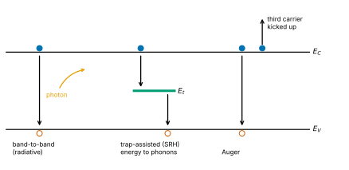
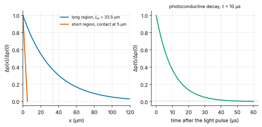

<!-- status: reviewed -->
# 09-04 · Generation, Recombination and the Continuity Equation

| | |
|---|---|
| **Course** | [09 · Semiconductor Devices](../README.md) |
| **University equivalent** | Non-equilibrium carriers in a junior semiconductor-devices course: recombination mechanisms and lifetime, Shockley–Read–Hall statistics, quasi-Fermi levels, the continuity and minority-carrier diffusion equations (Pierret, *Semiconductor Device Fundamentals*, ch. 3; Streetman & Banerjee, ch. 4; Hu, *Modern Semiconductor Devices for Integrated Circuits*, ch. 2) |
| **Prerequisites** | [09-03 Carrier Transport: Drift and Diffusion](09-03-drift-and-diffusion.md), [09-02 Carriers, Doping and the Fermi Level](09-02-carriers-doping-fermi-level.md), [02-02 First-Order Linear ODEs](../../02-complex-numbers-des-and-linear-algebra/chapters/02-02-first-order-linear-odes.md), [02-03 Second-Order Linear ODEs](../../02-complex-numbers-des-and-linear-algebra/chapters/02-03-second-order-linear-odes.md) |
| **Estimated study hours** | 7 |
| **Last verified** | 2026-11-19 |

**Learning objectives.** After this chapter you can:

1. Distinguish radiative, trap-assisted (Shockley–Read–Hall) and Auger recombination, and compute each one's rate and lifetime from its coefficients.
2. Derive the Shockley–Read–Hall net rate from capture and emission at a single trap level, and explain why traps near mid-gap are the most effective.
3. Compute minority-carrier lifetimes under low-level injection, and generation rates and currents in depleted regions.
4. Describe a non-equilibrium semiconductor with quasi-Fermi levels and compute their splitting.
5. Derive the continuity equation and solve the minority-carrier diffusion equation for transient decay, steady injection, short regions and surface recombination.

---

## 1. Big picture

So far carriers have been in equilibrium: thermal generation of electron–hole pairs exactly balanced by their recombination, with $np = n_i^2$. Devices work by disturbing that balance. A forward-biased diode injects extra minority carriers; light in a photodiode or solar cell creates extra pairs; a reverse-biased junction sweeps carriers away, leaving too few. Each time, **recombination** and **generation** act to restore equilibrium, at rates set by the material's purity and structure, and the **continuity equation** keeps the books: carriers that flow in, minus those that flow out, plus those generated, minus those recombined. This chapter supplies the last piece of the semiconductor equations; with drift–diffusion (09-03) and Poisson's equation, it is the complete model that every later device chapter solves.

- **Lifetime is a quality metric.** In silicon, recombination happens mostly at defects and impurities, so the minority-carrier lifetime measures crystal purity: milliseconds in the best material, nanoseconds in heavily doped or contaminated regions.
- **Diffusion length sets device scale.** Minority carriers diffuse a distance $L = \sqrt{D\tau}$ before recombining; a bipolar transistor's base must be much thinner than $L$, and a solar cell needs $L$ longer than the depth at which light is absorbed, plus passivated surfaces so that carriers generated near them are not lost.
- **Generation is leakage.** Defects in a depleted region generate pairs that flow as reverse-bias leakage and as image-sensor dark current, both proportional to $n_i$ and so strongly temperature-dependent.
- **Sometimes short lifetime is the goal.** Fast-switching power diodes are deliberately doped with gold or platinum, or irradiated, to kill lifetime so stored charge disappears quickly.

## 2. Intuition first

**A pool with a drain and a tap.** Picture the excess carriers in a region as water in a pool. Generation (by light, say) is a tap pouring in; recombination is a drain whose outflow grows with the water level: the more excess carriers, the faster they recombine. Turn on the tap and the level rises until outflow matches inflow: a steady excess $\Delta n = G\tau$, where $\tau$ is the drain's time constant, the **lifetime**. Turn off the tap and the level falls exponentially with time constant $\tau$. Diffusion adds pipes to neighboring pools: carriers flow from high to low levels, and the continuity equation is the accounting rule for the whole system.

**Why defects dominate in silicon.** An electron at the bottom of silicon's conduction band and a hole at the top of its valence band have different crystal momentum (09-01). To recombine directly, emitting a photon, they would need a phonon to supply the difference, a three-body event that is slow. A defect with a level in the gap offers a stepping stone: it captures the electron, then the hole, each step dumping energy into lattice vibrations. That two-step route is far faster, so a few impurity atoms per trillion silicon atoms can set the lifetime.

**A finance analogy: settlement through a clearing house.** Two counterparties who cannot trade directly settle through an intermediary that takes one side, then the other. The intermediary's capacity (trap density) and the speed of each leg (capture rates) set how fast the backlog clears, and the slower leg is the bottleneck, exactly as in the trap-assisted recombination formula. *Where the analogy breaks:* traps work in both directions at once (they also generate pairs), and their effectiveness depends on their energy position, which has no clean financial counterpart.

*Figure 1. Recombination paths in an indirect-gap semiconductor: band-to-band (radiative), through a trap level in the gap (Shockley–Read–Hall), and Auger, where the energy goes to a third carrier.*

## 3. Theory

> **Notation and course values.** $n_0$, $p_0$ are equilibrium densities and $\Delta n = n - n_0$, $\Delta p = p - p_0$ the excess densities (cm⁻³); $G$ and $R$ are generation and recombination rates (cm⁻³ s⁻¹), and $U = R - G$ the net recombination rate; $\tau$ is a lifetime (s); $N_t$ a trap density, $E_t$ its level, $\sigma_n$, $\sigma_p$ its capture cross sections (cm²); $S$ a surface recombination velocity (cm/s). Silicon at 300 K: $n_i$ = 1.0 × 10¹⁰ cm⁻³, $kT$ = 25.85 meV, thermal velocities 2.3 × 10⁷ (electrons) and 1.65 × 10⁷ cm/s (holes) [1]. Mobilities from the course model of 09-03.

### 3.1 Generation and recombination in equilibrium

Thermal energy continually creates electron–hole pairs and they continually recombine. In equilibrium the two rates are equal for every mechanism separately (**detailed balance**), so nothing changes on average and $np = n_i^2$ (09-02). Out of equilibrium, the net rate $U = R - G$ is positive (net recombination) when $np > n_i^2$ and negative (net generation) when $np < n_i^2$: nature pushes the product back toward $n_i^2$.

Each mechanism below has a rate of the form (something) × $(np - n_i^2)$, which automatically vanishes in equilibrium.

**Low-level injection.** Most device analysis assumes the excess densities are much smaller than the majority density: $\Delta p = \Delta n \ll n_0$ in n-type material. The majority density is then essentially unchanged, while the minority density can rise by many orders of magnitude (Problem 09-02.7). Under low-level injection every mechanism reduces to $U = \Delta p/\tau$, with a **minority-carrier lifetime** $\tau$ that depends on the material and its majority density, but not on $\Delta p$.

### 3.2 Band-to-band (radiative) recombination

An electron falls directly into a hole and emits a photon. The rate is proportional to how often electrons meet holes:

$$
U_{\text{rad}} = B\,(np - n_i^2) .
$$

In n-type material under low-level injection, $np - n_i^2 \approx n_0\Delta p$ (the $\Delta p^2$ term is negligible), so $U = Bn_0\Delta p$ and

$$
\tau_{\text{rad}} = \frac{1}{Bn_0} .
$$

Silicon's indirect gap makes $B$ tiny: 1.1 × 10⁻¹⁴ cm³/s [1]. At $n_0$ = 10¹⁷ cm⁻³ the radiative lifetime is 0.91 ms, far longer than the lifetimes measured in practice; radiative recombination is negligible in silicon. In direct-gap GaAs, $B$ is 7 × 10⁻¹⁰ cm³/s [1], **6.4 × 10⁴** times larger, which is why it makes LEDs and lasers (09-14).

### 3.3 Auger recombination

An electron and a hole recombine and give their energy to a *third* carrier, which is kicked high into its band and then cools by emitting phonons. Two variants, with the third carrier an electron or a hole:

$$
U_{\text{Auger}} = (C_nn + C_pp)(np - n_i^2) ,
$$

with $C_n$ = 1.1 × 10⁻³⁰ and $C_p$ = 0.3 × 10⁻³⁰ cm⁶/s for silicon at 300 K [1]. In n-type material under low-level injection the electron-assisted process dominates: $U \approx C_nn_0^2\Delta p$, so

$$
\tau_{\text{Auger}} = \frac{1}{C_nn_0^2} .
$$

The square makes Auger recombination negligible at moderate doping and dominant at high doping: 91 µs at 10¹⁷ cm⁻³, but 9.1 ns at 10¹⁹ and 91 ps at 10²⁰ cm⁻³ (Example 09-04.1). Heavily doped emitters and contacts are therefore short-lifetime regions whatever the crystal quality, and Auger recombination sets the ultimate efficiency limit of silicon solar cells (§9).

### 3.4 Trap-assisted recombination: Shockley–Read–Hall

Consider $N_t$ traps per cm³, each with a single level at energy $E_t$ in the gap, which can be empty or hold one electron; let $f_t$ be the fraction occupied. Four processes connect it to the bands:

1. **Electron capture** from the conduction band into an empty trap: rate $c_nnN_t(1 - f_t)$, with capture coefficient $c_n = \sigma_nv_{th,n}$ (a carrier sweeps a volume $\sigma v_{th}$ per second and is captured if a trap lies in it).
2. **Electron emission** from a full trap to the conduction band: rate $e_nN_tf_t$.
3. **Hole capture** (an electron in a full trap drops to the valence band): rate $c_ppN_tf_t$.
4. **Hole emission** (an electron from the valence band jumps into an empty trap): rate $e_pN_t(1 - f_t)$.

**Emission rates from detailed balance.** In equilibrium, process 1 balances process 2 by itself. With the equilibrium occupation $f_t = 1/(1 + e^{(E_t - E_F)/kT})$ and $n = n_ie^{(E_F - E_i)/kT}$:

$$
e_n = c_nn\frac{1 - f_t}{f_t} = c_n\,n_ie^{(E_F - E_i)/kT}e^{(E_t - E_F)/kT} = c_nn_1, \qquad n_1 \equiv n_ie^{(E_t - E_i)/kT} .
$$

The Fermi level cancels: $e_n$ is a property of the trap, valid in or out of equilibrium. Likewise $e_p = c_pp_1$ with $p_1 \equiv n_ie^{(E_i - E_t)/kT}$, and $n_1p_1 = n_i^2$. Physically, $n_1$ is the electron density the semiconductor would have if its Fermi level sat at the trap level.

**Steady state.** Out of equilibrium, in steady state the trap occupation is constant, so the net electron capture equals the net hole capture, and each equals the net recombination rate $U$:

$$
c_nnN_t(1 - f_t) - c_nn_1N_tf_t = c_ppN_tf_t - c_pp_1N_t(1 - f_t) .
$$

Solving for $f_t$ gives $f_t = (c_nn + c_pp_1)/[c_n(n + n_1) + c_p(p + p_1)]$. Substituting back into the electron capture rate, the key step is

$$
n(1 - f_t) - n_1f_t = \frac{n\,[c_n(n + n_1) + c_p(p + p_1)] - (n + n_1)(c_nn + c_pp_1)}{c_n(n + n_1) + c_p(p + p_1)} = \frac{c_p(np - n_1p_1)}{c_n(n + n_1) + c_p(p + p_1)} ,
$$

where the $c_nn^2$ and $c_nnn_1$ terms cancel in the numerator. Multiplying by $c_nN_t$, using $n_1p_1 = n_i^2$ and dividing top and bottom by $c_nc_pN_t$:

$$
U_{\text{SRH}} = \frac{np - n_i^2}{\tau_{p0}(n + n_1) + \tau_{n0}(p + p_1)}, \qquad \tau_{n0} = \frac{1}{\sigma_nv_{th,n}N_t}, \quad \tau_{p0} = \frac{1}{\sigma_pv_{th,p}N_t} .
$$

This is the **Shockley–Read–Hall (SRH)** rate, the most important recombination formula in silicon device physics.

**Three consequences.**

- **Low-level injection.** In n-type material with a trap not too close to a band edge ($n_0 \gg n_1, p_1$ and $n_0 \gg p$), $U \approx n_0\Delta p/(\tau_{p0}n_0) = \Delta p/\tau_{p0}$: the minority-carrier lifetime is the time for a *hole* to find a trap, $\tau_{p0}$. In p-type material it is $\tau_{n0}$. Capture of the minority carrier is the bottleneck, because majority carriers fill or empty the traps almost instantly.
- **Mid-gap traps are the most effective.** For given cross sections, $n_1 + p_1$ in the denominator is smallest when $E_t \approx E_i$; a trap near a band edge mostly re-emits what it captures instead of completing the recombination (Example 09-04.3).
- **Lifetime falls as $1/N_t$.** Each trap adds capture opportunities, which is why parts-per-trillion contamination by fast-diffusing metals matters, and why gold and platinum are used deliberately to kill lifetime. Their levels are deep but not all near mid-gap: the handbook lists gold's acceptor at $E_C$ − 0.55 eV (close to mid-gap) and donor at $E_V$ + 0.35 eV, and platinum's levels at $E_V$ + 0.32, $E_V$ + 0.36 and $E_C$ − 0.25 eV [1].

### 3.5 Generation in depleted regions

In a reverse-biased junction's depletion region (09-05), carriers are swept out, so $n, p \ll n_i$. Then $np - n_i^2 \approx -n_i^2$ and

$$
U = -\frac{n_i^2}{\tau_{p0}n_1 + \tau_{n0}p_1} \;\xrightarrow{E_t = E_i,\ \tau_{n0} = \tau_{p0} = \tau_0}\; -\frac{n_i}{2\tau_0} ,
$$

a net **generation** rate $G = n_i/2\tau_0$ for mid-gap traps. Every generated pair is swept out as current, so a depletion region of width $W$ leaks a current density

$$
J_{\text{gen}} = qGW = \frac{qn_iW}{2\tau_0} .
$$

Two features matter in practice. The current is proportional to $n_i$, not $n_i^2$, so it rises more slowly with temperature than diffusion leakage (09-06); and it comes from traps, so it measures crystal and interface quality. Image sensors call it **dark current**: charge collected in a pixel with no light.

### 3.6 Quasi-Fermi levels

Out of equilibrium $np \ne n_i^2$, so a single Fermi level cannot describe both carriers. But within each band, carriers scatter and re-equilibrate among themselves in about 0.1 ps, while electrons and holes exchange only through recombination, which takes microseconds [2]. Each population is therefore in equilibrium with itself, and we give each its own **quasi-Fermi level**:

$$
n = n_ie^{(E_{Fn} - E_i)/kT}, \qquad p = n_ie^{(E_i - E_{Fp})/kT}, \qquad np = n_i^2e^{(E_{Fn} - E_{Fp})/kT} .
$$

The splitting $E_{Fn} - E_{Fp}$ measures how far the material is from equilibrium. Under low-level injection in n-type material, $E_{Fn}$ barely moves (the majority density hardly changes) while $E_{Fp}$ moves a long way toward the valence band (Example 09-04.4). In a solar cell under light, the splitting is the maximum voltage the cell can deliver, its open-circuit voltage; in a forward-biased diode it equals $qV$ (09-06). Currents follow the quasi-Fermi levels: $J_n = \mu_nn\,dE_{Fn}/dx$ and $J_p = \mu_pp\,dE_{Fp}/dx$, generalizing 09-03 §3.8.

### 3.7 The continuity equation

Count holes in a thin slab between $x$ and $x + dx$, of unit area. Holes enter at $x$ at the rate $J_p(x)/q$ and leave at $x + dx$ at the rate $J_p(x + dx)/q$; inside, they are generated at rate $G$ and recombine at rate $R$:

$$
\frac{\partial p}{\partial t}\,dx = \frac{J_p(x) - J_p(x + dx)}{q} + (G - R)\,dx
\quad\Longrightarrow\quad
\frac{\partial p}{\partial t} = -\frac1q\frac{\partial J_p}{\partial x} + G - R ,
$$

and for electrons, whose charge is negative,

$$
\frac{\partial n}{\partial t} = +\frac1q\frac{\partial J_n}{\partial x} + G - R .
$$

These are the **continuity equations**: conservation of carriers, one per type. With the drift–diffusion currents (09-03) and Poisson's equation, they form the complete set of **semiconductor equations**.

**The minority-carrier diffusion equation.** In a uniformly doped, quasi-neutral n-type region under low-level injection, the field is small and the minority holes move mainly by diffusion, $J_p \approx -qD_p\,\partial p/\partial x$, and recombine at $\Delta p/\tau_p$. With an external generation rate $G_L$ (from light, say):

$$
\frac{\partial\Delta p}{\partial t} = D_p\frac{\partial^2\Delta p}{\partial x^2} - \frac{\Delta p}{\tau_p} + G_L .
$$

(Neglecting the field term is justified because the majority carriers, being so numerous, need only a tiny field to carry their share of the current, and that field moves the far fewer minority carriers negligibly.) This one equation, with boundary conditions, gives the currents of diodes, bipolar transistors, photodiodes and solar cells.

### 3.8 Standard solutions

**Uniform decay.** Uniform excess, no gradients, light switched off at $t = 0$: $d\Delta p/dt = -\Delta p/\tau_p$, so $\Delta p(t) = \Delta p(0)e^{-t/\tau_p}$ (02-02). With constant light $G_L$, the steady excess is $\Delta p = G_L\tau_p$. Measuring the conductivity decay after a light pulse, **photoconductive decay**, is a standard way to measure lifetime.

**Steady injection into a long region.** Holes are held at $\Delta p(0)$ at $x = 0$ (by a junction, say) and the region extends far beyond. In steady state with no light, $D_p\,d^2\Delta p/dx^2 = \Delta p/\tau_p$, a second-order linear ODE (02-03) with solutions $e^{\pm x/L_p}$. The growing one is excluded, so

$$
\Delta p(x) = \Delta p(0)\,e^{-x/L_p}, \qquad L_p = \sqrt{D_p\tau_p} ,
$$

the **diffusion length**: the average distance a minority carrier diffuses before recombining. The hole current entering at $x = 0$ is $J_p = qD_p\Delta p(0)/L_p$, which equals $q$ times the total recombination in the region, $q\int_0^\infty\Delta p/\tau_p\,dx$: every injected hole recombines somewhere.

**Short region.** If the region ends at a contact at $x = W \ll L_p$, where the excess is held at zero (an ohmic contact recombines carriers instantly), the solution is nearly a straight line, $\Delta p(x) \approx \Delta p(0)(1 - x/W)$. The current is $qD_p\Delta p(0)/W$, larger than the long-region value by $L_p/W$, and only a fraction of about $W^2/2L_p^2$ of the injected holes recombines on the way (Example 09-04.6). The base of a bipolar transistor is a short region by design (09-07).

**Surface recombination.** Surfaces carry dangling bonds that act as traps per unit area. Their effect is a boundary condition: the diffusion flux into the surface equals the recombination there, $D_p\,d\Delta p/dx = S\Delta p$ at the surface (with $x$ pointing into the bulk), where the **surface recombination velocity** $S$ (cm/s) plays the role of a speed at which carriers are swallowed. For silicon it ranges from 10² up to (6–8) × 10⁴ cm/s depending on surface treatment, and can be as small as 0.5 cm/s at a good Si–SiO₂ interface [1]. Passivating surfaces is as important as bulk lifetime for solar cells and image sensors.

**The effective lifetime of a wafer.** A lifetime tester excites a uniform excess in a wafer of thickness $W$ with both surfaces at velocity $S$, and measures how fast it decays. Two limits cover most cases.

- *Weak surface recombination* ($SW/2D \ll 1$). Diffusion is fast enough to keep the excess nearly uniform across the wafer. Per unit area, the bulk loses $W\Delta p/\tau_b$ per second and the two surfaces lose $2S\Delta p$. The total, divided by the stored $W\Delta p$, is the decay rate:

$$
\frac{1}{\tau_{\text{eff}}} = \frac{1}{\tau_b} + \frac{2S}{W} .
$$

- *Strong surface recombination* ($S \to \infty$). The surfaces hold $\Delta p = 0$, and the slowest-decaying profile is the half-sine $\Delta p \propto \sin(\pi x/W)$. Substituting into the diffusion equation, $D\,d^2\Delta p/dx^2 = -D(\pi/W)^2\Delta p$, so diffusion to the surfaces adds a rate $D\pi^2/W^2$: $1/\tau_{\text{eff}} = 1/\tau_b + D\pi^2/W^2$. No passivation, however poor, can make the measured lifetime shorter than this floor allows.

*Figure 2. Excess-hole profiles: exponential decay into a long region (diffusion length $L_p$), the near-linear profile of a short region ending at a contact, and the exponential decay in time after a light pulse.*

## 4. Worked examples

### Example 09-04.1 · Which mechanism wins? (tier A)

**Setup.** n-type silicon with $n_0$ = 10¹⁷ cm⁻³ contains $N_t$ = 10¹² cm⁻³ mid-gap traps with hole cross section 10⁻¹⁵ cm². Find the hole lifetime limited by (a) radiative, (b) Auger and (c) SRH recombination, and (d) the combined lifetime. (e) Find the Auger lifetime at 10¹⁹ and 10²⁰ cm⁻³, and the radiative lifetime at 10¹⁹ cm⁻³.

**Solution.** Rates add, so inverse lifetimes add.

(a) $\tau_{\text{rad}} = 1/(1.1\times10^{-14} \times 10^{17})$ = **0.909** ms.

(b) $\tau_{\text{Auger}} = 1/(1.1\times10^{-30} \times 10^{34})$ = **90.9** µs.

(c) $\tau_{\text{SRH}} = 1/(10^{-15} \times 1.65\times10^7 \times 10^{12})$ = **60.6** µs.

(d) $1/\tau = 1/909 + 1/90.9 + 1/60.6$ (µs⁻¹), so $\tau$ = **35.0** µs.

(e) Auger: **9.09** ns at 10¹⁹ and **90.9** ps at 10²⁰ cm⁻³. Radiative at 10¹⁹: **9.09** µs, a thousand times longer than Auger.

**Sanity check.** One trap per **50 billion** silicon atoms already competes with Auger at 10¹⁷ cm⁻³; in moderately doped silicon SRH usually dominates, and above about 10¹⁸ cm⁻³ Auger takes over regardless of purity.

### Example 09-04.2 · Gold in silicon (tier B)

**Setup.** Silicon is doped with $N_t$ = 10¹⁵ cm⁻³ gold. Gold has two levels [1]: an acceptor at $E_C$ − 0.55 eV ($\sigma_n$ = 8 × 10⁻¹⁷ cm², $\sigma_p$ = 9.0 × 10⁻¹⁵ cm²), which controls recombination in n-type silicon, and a donor at $E_V$ + 0.35 eV ($\sigma_n$ = 10⁻¹⁵ cm², $\sigma_p$ = 3.5 × 10⁻¹⁵ cm²), which controls it in p-type silicon, where the Fermi level puts gold in the donor's charge states. (a) Find $\tau_{n0}$ and $\tau_{p0}$ for the acceptor level. (b) Where is the acceptor level relative to $E_i$ (use $E_C - E_i = kT\ln(N_C/n_i)$ with the course values), and what are $n_1$ and $p_1$? (c) Find the low-injection lifetime in n-type silicon doped at 10¹⁶ cm⁻³ from the full SRH formula with the acceptor level. (d) Repeat for p-type silicon doped at 10¹⁶ cm⁻³ with the donor level.

**Solution.**

(a) $\tau_{n0} = 1/(8\times10^{-17} \times 2.3\times10^7 \times 10^{15})$ = **543** ns and $\tau_{p0} = 1/(9.0\times10^{-15} \times 1.65\times10^7 \times 10^{15})$ = **6.73** ns.

(b) $E_C - E_i$ = **0.5658** eV, so $E_t - E_i = 0.5658 - 0.55$ = **15.8** meV: essentially mid-gap. $n_1 = n_ie^{0.0158/0.02585}$ = **1.84 × 10¹⁰** cm⁻³ and $p_1 = n_i^2/n_1$ = **5.43 × 10⁹** cm⁻³.

(c) With a small excess (10¹⁰ cm⁻³) in the SRH formula: $\tau$ = **6.73** ns $= \tau_{p0}$, the hole capture time.

(d) For the donor level, $\tau_{n0} = 1/(10^{-15} \times 2.3\times10^7 \times 10^{15})$ = **43.5** ns. The level sits $E_i - E_V - 0.35$ eV below $E_i$, with $E_i - E_V = kT\ln(N_V/n_i)$ = 0.5509 eV, so $p_1 = n_ie^{0.2009/0.02585}$ = **2.37 × 10¹³** cm⁻³, still far below $p_0$ = 10¹⁶ cm⁻³. The full SRH formula gives $\tau$ = **43.6** ns, essentially $\tau_{n0}$. (Using the acceptor level here would give 543 ns, an error of more than ten times.)

**Sanity check.** Gold shortens minority-hole lifetime in n-type silicon about **6.47** times more than minority-electron lifetime in p-type (43.6/6.73), not the 81 times that the acceptor level's ratio $\tau_{n0}/\tau_{p0}$ alone would suggest: which level matters depends on where the Fermi level puts the gold. Fast-recovery power diodes store their charge in a lightly doped n-type region, so gold or platinum doping gives them nanosecond lifetimes and fast turn-off, at the cost of more leakage (§3.5). The two metals trade differently. Platinum's levels sit farther from mid-gap, so by Example 09-04.3 each trap generates far less leakage in a depletion region; yet under the high injection of a conducting diode, where $n$ and $p$ dwarf $n_1$ and $p_1$, the SRH formula shows trap position barely matters, so platinum still recombines the stored charge. That is the reason power-device designers weigh platinum against gold.

### Example 09-04.3 · Why mid-gap traps generate (tier B)

**Setup.** In a depletion region with $\tau_{n0} = \tau_{p0}$ = 1 µs, find the generation rate for a trap at $E_i$, and the factor by which it falls for traps 0.1 eV and 0.3 eV from $E_i$.

**Solution.** With $n, p \ll n_i$: $G = n_i/[\tau_0(e^{(E_t - E_i)/kT} + e^{(E_i - E_t)/kT})] = n_i/[2\tau_0\cosh((E_t - E_i)/kT)]$.

At mid-gap: $G = 10^{10}/(2\times10^{-6})$ = **5.0 × 10¹⁵** cm⁻³ s⁻¹. At 0.1 eV the rate falls by $\cosh(3.868)$ = **23.9**; at 0.3 eV by $\cosh(11.60)$ = **5.48 × 10⁴**.

**Sanity check.** A trap 0.3 eV from mid-gap is nearly useless for generation: it can exchange carriers easily with only one band. Leakage and dark current come from levels near mid-gap, such as gold's acceptor at $E_C$ − 0.55 eV. Other common metals have levels 0.17–0.33 eV from mid-gap (iron at $E_V$ + 0.39 eV, nickel at $E_C$ − 0.35 and $E_V$ + 0.23 eV, platinum at $E_C$ − 0.25 eV [1]); they generate far less per trap but still recombine carriers and shorten lifetime, so fabs police all metallic contamination strictly.

### Example 09-04.4 · Quasi-Fermi levels under light (tier B)

**Setup.** n-type silicon with $N_D$ = 10¹⁶ cm⁻³ is illuminated so that $\Delta n = \Delta p$ = 10¹⁴ cm⁻³. Find (a) $E_F - E_i$ in the dark and $E_{Fn} - E_i$ under light; (b) $E_i - E_{Fp}$ under light, and where the hole level was in the dark; (c) the splitting $E_{Fn} - E_{Fp}$.

**Solution.**

(a) Dark: $E_F - E_i = kT\ln(10^6)$ = **0.3572** eV. Light: $n = 1.01\times10^{16}$, so $E_{Fn} - E_i$ = **0.3574** eV, a shift of only **0.257** meV.

(b) $p = 10^4 + 10^{14} \approx 10^{14}$ cm⁻³ (ten billion times the dark value $p_0$ = 10⁴), so $E_i - E_{Fp} = kT\ln(p/n_i)$ = **0.2381** eV: the hole quasi-Fermi level has moved from 0.3572 eV *above* $E_i$ to 0.2381 eV below it.

(c) $E_{Fn} - E_{Fp} = kT\ln(np/n_i^2)$ = **0.5955** eV.

**Sanity check.** Low-level injection: a 1% change in the majority density, ten orders of magnitude in the minority density. The splitting is the voltage the illuminated material could deliver to an external circuit; 09-14 develops this into the open-circuit voltage of a solar cell.

### Example 09-04.5 · Measuring lifetime by photoconductive decay (tier B)

**Setup.** n-type silicon with $N_D$ = 10¹⁵ cm⁻³ and $\tau_p$ = 10 µs is uniformly illuminated with $G_L$ = 10¹⁹ cm⁻³ s⁻¹. (a) Find the steady excess density. (b) Find the dark conductivity and the increase under light (use mobilities at 10¹⁵ cm⁻³). (c) After the light is switched off, how long until the excess conductivity falls to 1% of its value?

**Solution.**

(a) $\Delta p = G_L\tau_p = 10^{19} \times 10^{-5}$ = **10¹⁴** cm⁻³.

(b) $\sigma_0 = qN_D\mu_n = 1.602\times10^{-19} \times 10^{15} \times 1345$ = **0.2155** S/cm. Both carriers add: $\Delta\sigma = q\Delta p(\mu_n + \mu_p) = 1.602\times10^{-19} \times 10^{14} \times (1345 + 433.5)$ = **0.02850** S/cm, a **13.2**% increase.

(c) $\Delta\sigma \propto \Delta p \propto e^{-t/\tau_p}$, so $t = \tau_p\ln100$ = **46.1** µs.

**Sanity check.** The decay time constant is the lifetime itself, independent of the light level as long as injection stays low; fitting the exponential gives $\tau$ without knowing $G_L$, which is why the method is popular.

### Example 09-04.6 · Injection into long and short regions (tier C)

**Setup.** At $x = 0$, holes are injected into n-type silicon ($N_D$ = 10¹⁵ cm⁻³, $\tau_p$ = 1 µs), holding $\Delta p(0)$ = 10¹⁴ cm⁻³. (a) Find $D_p$ and $L_p$. (b) For a long region, find the hole current density at $x = 0$ and the fraction of the excess surviving at $2L_p$. (c) Now the region ends at an ohmic contact at $W$ = 5 µm. Find the current and compare; what fraction of injected holes recombines before reaching the contact?

**Solution.**

(a) $D_p = 0.025852 \times 433.5$ = **11.21** cm²/s; $L_p = \sqrt{11.21 \times 10^{-6}}$ cm = **33.5** µm.

(b) $J_p = qD_p\Delta p(0)/L_p = 1.602\times10^{-19} \times 11.21 \times 10^{14}/3.348\times10^{-3}$ = **53.6** mA/cm². At $2L_p$ the excess is $e^{-2}$ = **0.135** of its starting value.

(c) With the linear profile, $J_p \approx qD_p\Delta p(0)/W$ = **359** mA/cm², **6.70** times larger. (The exact solution of the boundary-value problem, $\Delta p \propto \sinh((W - x)/L_p)$, gives $qD_p\Delta p(0)\coth(W/L_p)/L_p$ = **361.7** mA/cm², 0.7% more.) The recombined fraction is about $W^2/2L_p^2$ = **1.1**%.

**Sanity check.** The short region carries more current because its gradient is steeper; almost every hole reaches the contact. This is the essence of a bipolar transistor's base (thin compared with $L$, so most injected carriers reach the collector) and of a "short-base" diode (09-06).

### Example 09-04.7 · Leakage from generation and from a bad surface (tier C)

**Setup.** (a) A reverse-biased junction has a 1 µm depletion region with mid-gap traps and $\tau_0$ = 1 µs. Find the generation rate and the generation current density at 300 K. (b) By what factor does it grow at 350 K (use the course $n_i(T)$ model), and how does that compare with a leakage that scales as $n_i^2$? (c) A surface with $S$ = 10⁴ cm/s sits where the excess hole density is 10¹² cm⁻³. What current density does it draw?

**Solution.**

(a) $G = n_i/2\tau_0$ = **5.0 × 10¹⁵** cm⁻³ s⁻¹ and $J_{\text{gen}} = qGW = 1.602\times10^{-19} \times 5\times10^{15} \times 10^{-4}$ = **8.01 × 10⁻⁸** A/cm², about 80 nA/cm².

(b) $n_i$ rises by **35.1** (Problem 09-02.11 found the same model ratio), so the generation current rises 35-fold; an $n_i^2$ leakage would rise **1233**-fold.

(c) $J = qS\Delta p = 1.602\times10^{-19} \times 10^4 \times 10^{12}$ = **1.60** mA/cm².

**Sanity check.** At room temperature generation usually dominates silicon junction leakage, but its weaker temperature dependence means diffusion leakage overtakes it as the chip heats (09-06). A poorly passivated surface can recombine far more carriers than the bulk; good oxide interfaces cut $S$ by up to five orders of magnitude, from 8 × 10⁴ to 0.5 cm/s, a factor of **1.6 × 10⁵** [1].

### Answer key

<!-- answer-key -->
| ID | Quantity | Value | Unit |
|---|---|---|---|
| Ex 09-04.1a | radiative lifetime at 1e17 | 0.909 | ms |
| Ex 09-04.1b | Auger lifetime at 1e17 | 90.9 | µs |
| Ex 09-04.1c | SRH lifetime | 60.6 | µs |
| Ex 09-04.1d | combined lifetime | 35.0 | µs |
| Ex 09-04.1e | Auger lifetime at 1e19 | 9.09 | ns |
| Ex 09-04.1f | Auger lifetime at 1e20 | 90.9 | ps |
| Ex 09-04.1g | radiative lifetime at 1e19 | 9.09 | µs |
| Ex 09-04.2a | τ_n0 for gold | 543 | ns |
| Ex 09-04.2b | τ_p0 for gold | 6.73 | ns |
| Ex 09-04.2c | E_C − E_i | 0.5658 | eV |
| Ex 09-04.2d | E_t − E_i | 15.8 | meV |
| Ex 09-04.2e | n_1 | 1.84e10 | cm⁻³ |
| Ex 09-04.2f | p_1 | 5.43e9 | cm⁻³ |
| Ex 09-04.2g | lifetime, n-type 1e16 | 6.73 | ns |
| Ex 09-04.2h | lifetime, p-type 1e16 (donor level) | 43.6 | ns |
| Ex 09-04.2i | τ_n0 for the gold donor level | 43.5 | ns |
| Ex 09-04.2j | p_1 for the gold donor level | 2.37e13 | cm⁻³ |
| Ex 09-04.2k | p-type to n-type lifetime ratio | 6.47 | — |
| Ex 09-04.2l | E_i − E_V | 0.5509 | eV |
| Ex 09-04.3a | generation at mid-gap | 5.0e15 | cm⁻³ s⁻¹ |
| Ex 09-04.3b | reduction at 0.1 eV | 23.9 | — |
| Ex 09-04.3c | reduction at 0.3 eV | 5.48e4 | — |
| Ex 09-04.4a | E_F − E_i, dark | 0.3572 | eV |
| Ex 09-04.4b | E_Fn − E_i, light | 0.3574 | eV |
| Ex 09-04.4c | shift of E_Fn | 0.257 | meV |
| Ex 09-04.4d | E_i − E_Fp, light | 0.2381 | eV |
| Ex 09-04.4e | quasi-Fermi splitting | 0.5955 | eV |
| Ex 09-04.4f | minority density increase | 1e10 | — |
| Ex 09-04.5a | steady excess density | 1e14 | cm⁻³ |
| Ex 09-04.5b | dark conductivity | 0.2155 | S/cm |
| Ex 09-04.5c | photoconductivity | 0.02850 | S/cm |
| Ex 09-04.5d | relative increase | 13.2 | % |
| Ex 09-04.5e | time to fall to 1% | 46.1 | µs |
| Ex 09-04.6a | D_p at 1e15 | 11.21 | cm²/s |
| Ex 09-04.6b | L_p | 33.5 | µm |
| Ex 09-04.6c | current density, long region | 53.6 | mA/cm² |
| Ex 09-04.6d | fraction surviving at 2L_p | 0.135 | — |
| Ex 09-04.6e | current density, short region | 359 | mA/cm² |
| Ex 09-04.6f | short-to-long current ratio | 6.70 | — |
| Ex 09-04.6g | fraction recombining in the short region | 1.1 | % |
| Ex 09-04.6h | exact short-region current density | 361.7 | mA/cm² |
| Ex 09-04.7a | generation rate | 5.0e15 | cm⁻³ s⁻¹ |
| Ex 09-04.7b | generation current density | 8.01e-8 | A/cm² |
| Ex 09-04.7c | n_i ratio, 350 K to 300 K | 35.1 | — |
| Ex 09-04.7d | n_i² ratio, 350 K to 300 K | 1233 | — |
| Ex 09-04.7e | surface recombination current | 1.60 | mA/cm² |
| T 09-04.a | radiative lifetime at 1e17 (§3.2) | 0.91 | ms |
| T 09-04.b | Auger lifetime at 1e19 (§3.3) | 9.1 | ns |
| T 09-04.c | GaAs to Si radiative coefficient ratio | 6.4e4 | — |
| T 09-04.d | Si atoms per trap at 1e12 | 5e10 | — |
| T 09-04.e | gold capture asymmetry | 81 | — |
| T 09-04.f | surface passivation factor | 1.6e5 | — |

*Every value is recomputed by [verify_09_04.py](../verify/verify_09_04.py) by an independent route: the SRH rate by solving the trap's steady-state occupation numerically from its four capture and emission processes (not from the closed formula), lifetimes by integrating the rate equations in time and fitting the decay, diffusion profiles by solving the boundary-value problem numerically, and photoconductive decay by simulating the light pulse.*

## 5. Simulate it

The lab, [labs/09-04-lab](../labs/09-04-lab/README.md), is a notebook that computes non-equilibrium carriers numerically:

1. Model a single trap level with its four capture and emission processes, integrate the trap occupation and carrier densities in time after a light pulse, and compare the decay with the SRH lifetime.
2. Sweep the trap energy across the gap and plot the recombination and generation rates.
3. Solve the steady-state minority-carrier diffusion equation as a boundary-value problem (finite differences) for long and short regions and for a surface with recombination velocity $S$.
4. Simulate photoconductive decay with surface recombination and extract the "effective lifetime" a measurement would report.

**Guided exercise (predict, then run).** **Before running**, predict: a 300 µm-thick wafer with bulk lifetime 1 ms has both surfaces with $S$ = 10⁴ cm/s. Is the lifetime a photoconductive-decay measurement reports closer to 1 ms, to 100 µs or to 10 µs? Then run Part 4 and compare with the estimate $1/\tau_{\text{eff}} \approx 1/\tau_b + 2S/W$ (valid when surface recombination is weak) and with the diffusion-limited value for strong surface recombination.

## 6. Engineering tradeoffs

| Knob | Improves | Costs | Typical decision owner |
|---|---|---|---|
| Crystal purity and gettering (removing metals) | Long lifetime: low leakage, high solar-cell and bipolar efficiency | Wafer cost, process steps, contamination control | Materials and process engineers |
| Deliberate lifetime killing (Au, Pt, irradiation) | Fast switching of power diodes and IGBTs (less stored charge) | Higher leakage (more generation), lower forward conduction efficiency | Power-device designers |
| Surface passivation (thermal oxide, nitrides, alumina) | Low surface recombination: solar efficiency, image-sensor dark current | Process complexity and thermal budget | Process integration |
| Heavy doping of emitters and contacts | Low contact resistance, high injection | Auger and band-gap-narrowing losses (short lifetime) | Device engineers |
| Region thickness relative to diffusion length | Collection efficiency (thin bases, thick absorbers) | Thin regions are hard to make; thick ones need long lifetime | Device and product designers |
| Operating temperature | Lower generation leakage and dark current when cool | Cooling cost | System architects |

## 7. Numbers to know

| Quantity | Value | Note |
|---|---|---|
| Radiative coefficient | Si 1.1 × 10⁻¹⁴, GaAs 7 × 10⁻¹⁰ cm³/s | [1] |
| Auger coefficients (Si, 300 K) | $C_n$ 1.1 × 10⁻³⁰, $C_p$ 0.3 × 10⁻³⁰ cm⁶/s | [1] |
| Auger lifetime in n-type Si | 91 µs at 10¹⁷, 9.1 ns at 10¹⁹, 91 ps at 10²⁰ cm⁻³ | Example 09-04.1 |
| SRH lifetime | $1/(\sigma v_{th}N_t)$: 60 µs for 10¹² cm⁻³ traps with σ = 10⁻¹⁵ cm² | Example 09-04.1 |
| Lifetime range in practice | about 1 ms (lightly doped, high-quality Si) down to about 1 ns (heavily doped) | [1], Fig. 1.3.22–23 |
| Gold in silicon | acceptor at $E_C$ − 0.55 eV, σ_n 8 × 10⁻¹⁷, σ_p 9 × 10⁻¹⁵ cm² | [1] |
| Surface recombination velocity | 10² to (6–8) × 10⁴ cm/s; ≤ 0.5 cm/s at a good Si–SiO₂ interface | [1] |
| Intra-band versus inter-band equilibration | about 0.1 ps versus about 1 µs | [2], §3.6 |
| Diffusion length | $\sqrt{D\tau}$: 33 µm for holes with 1 µs at 10¹⁵ cm⁻³ | Example 09-04.6 |
| Generation current | $qn_iW/2\tau_0$: 80 nA/cm² for 1 µm and 1 µs | Example 09-04.7 |

## 8. Common mistakes

1. **Using the majority-carrier lifetime.** Under low-level injection, the minority carrier's capture sets the lifetime: $\tau_{p0}$ in n-type, $\tau_{n0}$ in p-type material.
2. **Forgetting that rates add, not lifetimes.** Combine mechanisms as $1/\tau = \sum 1/\tau_i$.
3. **Applying low-level formulas at high injection.** When $\Delta p$ approaches the majority density, $\tau$ changes (SRH lifetime rises toward $\tau_{n0} + \tau_{p0}$, Auger grows with $\Delta p^2$).
4. **Using a single Fermi level out of equilibrium.** Under light or bias, use quasi-Fermi levels; $np = n_i^2$ no longer holds.
5. **Sign errors in the continuity equation.** For electrons the divergence term is $+\frac1q\partial J_n/\partial x$ because their charge is negative.
6. **Assuming any defect is a good recombination center.** Only levels near mid-gap recombine or generate efficiently; shallow levels mostly trap and re-emit.
7. **Ignoring surfaces.** A measured "lifetime" is an effective value that includes surface recombination; thin samples can be surface-limited.
8. **Confusing diffusion length with region thickness.** $L = \sqrt{D\tau}$ is a material property; a region shorter than $L$ behaves very differently (linear profile, little recombination) from one longer than $L$.

## 9. Practitioner lens

### State of the art (as of Nov 2026)

- **Solar cells are recombination engineering.** The record laboratory efficiency for monocrystalline silicon cells is 28.1%, as tabulated in the Solar Cell Efficiency Tables (version 68, May 2026) and reported by Fraunhofer ISE [3] **[Established]**. In September 2026 LONGi announced a back-contact cell at 28.29%, verified by ISFH, and described it as 96.2% of the theoretical limit [4], which implies a limit of about **29.4**%, consistent with published theoretical limits for single-junction silicon **[Established]**; the 28.29% cell itself remains **[Contested]** until it appears in the efficiency tables. What separates practical cells from that limit is recombination: in the bulk, at contacts and above all at surfaces, which is why record cells depend on passivated surfaces and millisecond lifetimes. **Deeper:** solar cells return in 09-14.
- **Lifetime is killed on purpose in power electronics.** Fast-recovery diodes and many IGBTs are doped with deep-level metals or irradiated, to shorten lifetime so stored charge clears quickly; the handbook lists the gold and platinum levels these rely on and the defect levels that radiation creates [1] **[Established]**.
- **Dark current is generation.** Image sensors for phones, cars and XR headsets fight dark current, which is generation through traps in depleted regions and at interfaces (§3.5). It scales with $n_i$, doubling about every 9 K near room temperature (Problem 09-02.11), so automotive sensors running hot are especially sensitive to it.

### Why it matters commercially

- **Efficiency is revenue for solar.** Each percentage point of cell efficiency changes the cost per watt of a module, so lifetime and passivation are core intellectual property in photovoltaics.
- **Leakage defines standby power.** In wearables and IoT parts, junction leakage from generation sets the standby current that limits battery life, and it depends on wafer purity and the absence of metallic contamination.
- **Contamination control is fab yield.** A few parts per trillion of fast-diffusing metals can cut lifetime and raise leakage across a wafer; fabs police metal contamination with lifetime and leakage monitors.

### Marketing vs Reality

- **"Our wafers have millisecond lifetime."** *Reality:* measured lifetime is an effective value that depends on injection level, doping and above all surface passivation during the measurement. *Sanity check:* ask for the doping, the injection level and the surface treatment used, and whether the value is bulk or effective.
- **"New world-record cell efficiency."** *Reality:* record claims come from company announcements before they appear in the independent Efficiency Tables, and differ in cell area and measurement conditions. *Sanity check:* ask which accredited laboratory measured it, on what area, and whether it is tabulated.
- **"Low dark current."** *Reality:* dark current grows roughly as $n_i$ with temperature, so a value quoted at 25 °C can be many times higher at operating temperature. *Sanity check:* ask for dark current at the maximum operating temperature.
- **"Fast diodes with no penalty."** *Reality:* lifetime killing that speeds switching also raises leakage and forward voltage. *Sanity check:* ask for reverse-recovery charge, leakage and forward drop together, at temperature.

### Questions for engineering leaders

1. **"What limits lifetime in your critical regions: bulk traps, Auger, or surfaces?"**
   - *Strong:* gives measured effective lifetimes, separates bulk from surface with thickness or passivation experiments, and names the dominant mechanism.
   - *Evasive:* quotes a single lifetime number.
2. **"How do you monitor and control metallic contamination?"**
   - *Strong:* describes lifetime or leakage monitors, the contaminants tracked, the action limits and gettering steps.
   - *Evasive:* "our fab is clean."
3. **"How does your leakage or dark current scale with temperature, and which mechanism dominates where?"**
   - *Strong:* shows measured activation energies (near $E_g/2$ for generation, near $E_g$ for diffusion) and the crossover temperature.
   - *Evasive:* quotes room-temperature values only.
4. **"For your efficiency claims, which recombination losses remain, and what is your path to reducing each?"**
   - *Strong:* gives a loss breakdown (bulk, surface, contacts, Auger) and the roadmap per term.
   - *Evasive:* cites the record number.

<!-- answer-key -->
| ID | Quantity | Value | Unit |
|---|---|---|---|
| P 09-04.a | implied theoretical limit from LONGi's statement | 29.4 | % |

## 10. Concept check

**Q1.** Why is radiative recombination negligible in silicon but dominant in GaAs?

Answer

Silicon's gap is indirect: the conduction-band minimum and valence-band maximum are at different crystal momenta, so emitting a photon (which carries almost no momentum) needs a phonon too, a slow three-body process; $B$ is tiny (1.1 × 10⁻¹⁴ cm³/s). GaAs is direct, so electrons and holes recombine radiatively without a phonon, with $B$ tens of thousands of times larger.

**Q2.** Under low-level injection in n-type silicon, why is the SRH lifetime set by hole capture rather than electron capture?

Answer

Electrons are so plentiful that empty traps fill almost instantly; recombination then waits for a hole to arrive at a filled trap. The rare minority carrier's capture is the bottleneck, so $\tau = \tau_{p0} = 1/(\sigma_pv_{th}N_t)$.

**Q3.** Why are traps near mid-gap the most effective recombination and generation centers?

Answer

A trap near one band edge exchanges carriers rapidly with that band: it captures, say, an electron and re-emits it before a hole arrives. Only a trap that holds an electron long enough to capture a hole (and vice versa) completes a recombination, and that happens when the level is deep, near mid-gap, where $n_1 + p_1$ in the SRH denominator is smallest.

**Q4.** What do quasi-Fermi levels describe, and why can electrons and holes each have one?

Answer

They describe the electron and hole populations separately when the system is out of equilibrium. Within each band, carriers re-equilibrate among themselves in about 0.1 ps, but electrons and holes exchange only through recombination over microseconds, so each population reaches its own internal equilibrium, described by its own Fermi level; the splitting measures the departure from overall equilibrium.

**Q5.** Write the continuity equation in words.

Answer

The rate of change of the number of carriers in a small volume equals the rate at which they flow in minus the rate at which they flow out, plus the rate at which they are generated, minus the rate at which they recombine.

**Q6.** Why does a short base (much thinner than the diffusion length) carry more current for the same injected density, and recombine less of it?

Answer

The excess must fall to zero at the contact over a distance $W$ instead of $L_p$, so the gradient, and with it the diffusion current, is larger by $L_p/W$. Carriers cross in a time of order $W^2/D$, much shorter than the lifetime, so only a fraction of about $W^2/2L_p^2$ recombines on the way.

**Q7.** Why does generation leakage scale with $n_i$ while diffusion leakage scales with $n_i^2$?

Answer

In a depleted region, $n, p \ll n_i$, and the SRH rate becomes $n_i/2\tau_0$ for mid-gap traps: proportional to $n_i$. Diffusion leakage comes from minority carriers in neutral regions, whose equilibrium density is $n_i^2/N$: proportional to $n_i^2$.

Now work the [problem set](../problems/09-04-problems.md).

## 11. Key terms

[Generation](../../../reference/glossary.md#generation) · [Recombination](../../../reference/glossary.md#recombination) · [Minority-carrier lifetime](../../../reference/glossary.md#minority-carrier-lifetime) · [Low-level injection](../../../reference/glossary.md#low-level-injection) · [Radiative recombination](../../../reference/glossary.md#radiative-recombination) · [Auger recombination](../../../reference/glossary.md#auger-recombination) · [Shockley–Read–Hall recombination](../../../reference/glossary.md#shockley-read-hall-recombination) · [Trap](../../../reference/glossary.md#trap) · [Capture cross section](../../../reference/glossary.md#capture-cross-section) · [Quasi-Fermi level](../../../reference/glossary.md#quasi-fermi-level) · [Continuity equation](../../../reference/glossary.md#continuity-equation) · [Minority-carrier diffusion equation](../../../reference/glossary.md#minority-carrier-diffusion-equation) · [Diffusion length](../../../reference/glossary.md#diffusion-length) · [Surface recombination velocity](../../../reference/glossary.md#surface-recombination-velocity) · [Photoconductive decay](../../../reference/glossary.md#photoconductive-decay) · [Lifetime killing](../../../reference/glossary.md#lifetime-killing) · [Dark current](../../../reference/glossary.md#dark-current)

## 12. Connections

- **Builds on:** [09-03](09-03-drift-and-diffusion.md) (drift and diffusion currents), [09-02](09-02-carriers-doping-fermi-level.md) (equilibrium statistics, $np = n_i^2$), [02-02](../../02-complex-numbers-des-and-linear-algebra/chapters/02-02-first-order-linear-odes.md) and [02-03](../../02-complex-numbers-des-and-linear-algebra/chapters/02-03-second-order-linear-odes.md) (the ODEs solved in §3.8).
- **Next:** [09-05 PN Junction Electrostatics](09-05-pn-junction-electrostatics.md) puts p- and n-type regions together and solves Poisson's equation for the depletion region.
- **Used later:** minority-carrier diffusion in neutral regions gives the diode equation ([09-06](09-06-pn-junction-iv-and-capacitance.md)) and bipolar transistor action ([09-07](09-07-bipolar-junction-transistor.md)); generation leakage and band-to-band processes return in [09-10](09-10-short-channel-effects-and-leakage.md); radiative recombination, photodetectors and solar cells in [09-14](09-14-optoelectronic-devices.md).

## 13. Further study

- C. Hu, *Modern Semiconductor Devices for Integrated Circuits*, ch. 2 (§2.6–2.9): recombination, generation, quasi-Fermi levels and the continuity equation (free from the author's site).
- R. F. Pierret, *Semiconductor Device Fundamentals*, ch. 3 (§3.3–3.4): recombination–generation and the minority-carrier diffusion equation, with many worked solutions.
- B. G. Streetman and S. K. Banerjee, *Solid State Electronic Devices*, ch. 4: excess carriers, photoconductivity and diffusion lengths.
- S. M. Sze and K. K. Ng, *Physics of Semiconductor Devices*, ch. 1 (§1.5): the Shockley–Read–Hall derivation in full.

## 14. Sources

1. M. E. Levinshtein, S. L. Rumyantsev and M. S. Shur (eds.), *Handbook Series on Semiconductor Parameters, Vol. 1* (World Scientific, 1996): silicon §1.1 (thermal velocities), §1.2 (deep levels with impurities and radiation defects, capture cross sections), §1.3.4 (lifetime against doping, surface recombination, radiative and Auger coefficients); GaAs §4.1 (radiative coefficient). [R-165](../../../reference/research-log.md#r-165--recombination-parameters-and-solar-cell-records).
2. C. Hu, *Modern Semiconductor Devices for Integrated Circuits* (Pearson, 2010), ch. 2, §2.6–2.8: recombination time, thermal generation, quasi-equilibrium (intra-band scattering about 0.1 ps against recombination about 1 µs). [Ch. 2](https://www.chu.berkeley.edu/wp-content/uploads/2020/01/Chenming-Hu_ch2-2.pdf). [R-164](../../../reference/research-log.md#r-164--carrier-transport-in-silicon).
3. Fraunhofer ISE, *Photovoltaics Report* (updated 14 July 2026), citing the Solar Cell Efficiency Tables, version 68. [Report](https://www.ise.fraunhofer.de/content/dam/ise/de/documents/publications/studies/Photovoltaics-Report.pdf). [R-165](../../../reference/research-log.md#r-165--recombination-parameters-and-solar-cell-records).
4. LONGi, "ISFH-verified HIBC crystalline silicon cell efficiency" (company release, September 2026). [Release](https://www.longi.com/en/news/isfh-hibc-crystalline-silicon-cell-efficiency/). [R-165](../../../reference/research-log.md#r-165--recombination-parameters-and-solar-cell-records).
