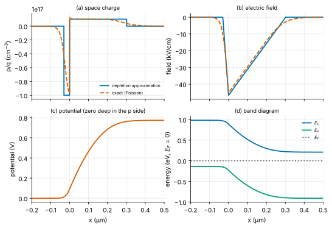
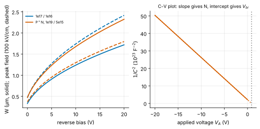

<!-- status: verified -->
# 09-05 · PN Junction Electrostatics

| | |
|---|---|
| **Course** | [09 · Semiconductor Devices](../README.md) |
| **University equivalent** | PN junction electrostatics in a junior semiconductor-devices course: built-in potential, the depletion approximation, field and potential profiles, depletion width and its dependence on bias (Pierret, *Semiconductor Device Fundamentals*, ch. 5; Streetman & Banerjee, ch. 5; Hu, *Modern Semiconductor Devices for Integrated Circuits*, ch. 4) |
| **Prerequisites** | [09-02 Carriers, Doping and the Fermi Level](09-02-carriers-doping-fermi-level.md), [09-03 Carrier Transport: Drift and Diffusion](09-03-drift-and-diffusion.md) (built-in fields, flat Fermi level), [04-03 Gauss's Law](../../04-physics-for-ee/chapters/04-03-gauss-law.md) and [04-04 Potential, Capacitance and Dielectrics](../../04-physics-for-ee/chapters/04-04-potential-capacitance-and-dielectrics.md) (Poisson's equation, parallel plates) |
| **Estimated study hours** | 8 |
| **Last verified** | 2026-11-19 |

**Learning objectives.** After this chapter you can:

1. Construct the equilibrium energy-band diagram of a PN junction and derive its built-in potential from the alignment of Fermi levels.
2. Apply the depletion approximation to a step junction and solve Poisson's equation for the charge, field and potential.
3. Compute the depletion width, its split between the two sides and the peak field, for symmetric and one-sided junctions, under forward and reverse bias.
4. Treat a linearly graded junction, and judge the accuracy of the depletion approximation with the Debye length and a numerical solution.
5. Compute junction capacitance per area and extract doping from capacitance–voltage measurements.

---

## 1. Big picture

Put p-type silicon against n-type silicon and something remarkable happens at the boundary: a thin layer empties of carriers, a strong internal field appears, and a potential step of several tenths of a volt forms, all without any external source. This **PN junction** is the elementary building block of semiconductor devices. It is a diode by itself (09-06), two of them back to back make a bipolar transistor (09-07), every MOSFET's source and drain is one (09-09), and photodiodes, solar cells, LEDs and power rectifiers are junctions optimized for light or voltage (09-13, 09-14). This chapter works out the junction's electrostatics: where the charge sits, how large the field is, how wide the depleted layer is and how all three change with applied voltage. The next chapter adds current.

- **Depletion width sets capacitance.** Every junction is a voltage-dependent capacitor; in a chip, source/drain junction capacitance adds to every switching node's load, and varactor diodes tune RF oscillators with it.
- **Peak field sets voltage rating.** Breakdown happens when the junction's peak field reaches a critical value, so blocking voltage is designed through doping and depletion width; power devices are mostly a lightly doped region wide enough to hold the field.
- **Built-in potential sets turn-on.** The potential step is what forward bias must overcome, which is why silicon diodes conduct near 0.6–0.7 V and why junctions in different materials turn on at different voltages.
- **Capacitance reveals doping.** Measuring capacitance against voltage profiles the doping beneath a junction, a standard process-control measurement.

## 2. Intuition first

**Two crowds meet.** On the n side, electrons are plentiful; on the p side, holes. Bring the two together and each carrier type diffuses across the boundary into the region where it is scarce, where it promptly recombines with the opposite carrier. Each electron that leaves the n side leaves behind a positive donor ion fixed in the lattice; each hole that leaves the p side leaves behind a negative acceptor ion. A layer of uncovered ions builds up on each side: positive on the n side, negative on the p side. Their charge creates an electric field pointing from n to p, which pushes electrons back toward the n side and holes back toward the p side. Equilibrium is reached when this drift exactly cancels the diffusion: the field grows until it holds back the very carriers whose departure created it.

**The band picture.** In equilibrium the Fermi level is flat (09-03). On the n side it sits near the conduction band, on the p side near the valence band, so the bands themselves must bend: they rise by $qV_{bi}$ going from the n side to the p side. Electrons on the n side face an energy hill they cannot easily climb; holes on the p side face a hill downward (holes float up). The **built-in potential** $V_{bi}$ is the height of that hill.

**A finance analogy: a capital-control equilibrium.** Two economies with different interest rates connected by an open border see capital flow toward the higher return until a counter-flow (a currency move, a tax) balances it. The equilibrium is not "no forces" but two large opposing flows that cancel. *Where the analogy breaks:* the junction's balancing force (the field) is created by the flow itself, through the charge left behind, and it is exactly computable from Poisson's equation.

*Figure 1. A step PN junction in equilibrium: (a) the doping and the space charge of the depletion approximation; (b) the electric field, a triangle peaking at the metallurgical junction; (c) the electrostatic potential; (d) the energy-band diagram with a flat Fermi level.*

## 3. Theory

> **Notation and course values.** The metallurgical junction is at $x = 0$, with the p side at $x < 0$ and the n side at $x > 0$. $N_A$ and $N_D$ are the doping on each side (step junction); $x_p$ and $x_n$ are the depletion depths into each side and $W = x_p + x_n$; $\rho$ is charge density (C/cm³), $\mathcal E$ the field and $V$ the electrostatic potential; $V_{bi}$ is the built-in potential and $V_A$ the applied voltage (positive for forward bias, p side positive). Silicon: $\varepsilon_s = 11.7\varepsilon_0$ = 1.036 × 10⁻¹² F/cm [1], $n_i$ = 1.0 × 10¹⁰ cm⁻³, $kT/q$ = 25.85 mV at 300 K.

### 3.1 Forming the junction

Imagine joining a p-type and an n-type piece of silicon, each initially neutral and uniform. Before contact, the n side's Fermi level lies higher than the p side's (09-02). After contact, electrons flow from the n side (high Fermi level) to the p side (low Fermi level), and holes the other way, until the Fermi levels align, exactly as water levels equalize between connected tanks. The flow uncovers fixed ions near the junction: a **depletion region** (or **space-charge region**) almost empty of mobile carriers, positively charged on the n side and negatively on the p side. Outside it, the material is neutral and unchanged: the **quasi-neutral regions**.

### 3.2 The built-in potential

In equilibrium $E_F$ is constant through the junction. Far from it, each side has its bulk values, so with the electrostatic potential taken as zero deep in the p side, the bands on the n side lie lower by $qV_{bi}$, the difference of the two original Fermi levels:

$$
qV_{bi} = (E_F - E_i)_{n\,\text{side}} + (E_i - E_F)_{p\,\text{side}} = kT\ln\frac{N_D}{n_i} + kT\ln\frac{N_A}{n_i}
\quad\Longrightarrow\quad
V_{bi} = \frac{kT}{q}\ln\frac{N_AN_D}{n_i^2} .
$$

For $N_A$ = 10¹⁷ and $N_D$ = 10¹⁶ cm⁻³, $V_{bi}$ = 0.774 V (Example 09-05.1). The same result follows from zero electron current (09-03): the Einstein relation integrated across the junction gives $V_{bi} = (kT/q)\ln(n_{n0}/n_{p0})$, the ratio of the electron densities on the two sides, and $n_{n0}/n_{p0} = N_D/(n_i^2/N_A)$.

Two practical remarks. $V_{bi}$ grows only logarithmically with doping, about 60 mV per decade of either doping, and it is always less than the gap: it approaches $E_g/q$ only as both sides become degenerate. And it **cannot be measured with a voltmeter**: contacts to each side have their own built-in potentials that cancel it exactly, as they must, since an equilibrium device can deliver no energy.

### 3.3 Poisson's equation and the depletion approximation

The potential follows from the charge through Poisson's equation (04-03), in one dimension:

$$
\frac{d^2V}{dx^2} = -\frac{\rho(x)}{\varepsilon_s}, \qquad \frac{d\mathcal E}{dx} = \frac{\rho(x)}{\varepsilon_s}, \qquad \rho = q(p - n + N_D - N_A) .
$$

The carrier densities depend on the potential exponentially ($n \propto e^{qV/kT}$), so the exact equation is nonlinear. The **depletion approximation** makes it easy: assume the region $-x_p < x < x_n$ is completely empty of carriers and everything outside is exactly neutral. Then the charge is a pair of rectangles,

$$
\rho(x) = \begin{cases} -qN_A, & -x_p < x < 0 \\ +qN_D, & 0 < x < x_n \\ 0, & \text{otherwise.} \end{cases}
$$

Why is this reasonable? Across the depletion region the bands move by $qV_{bi}$, many $kT$; a few $kT$ into it, the majority density has fallen by orders of magnitude, so the region is indeed nearly empty except within a transition zone a few **Debye lengths** wide at each edge (§3.7).

### 3.4 The step junction solved

**Field.** Integrate $d\mathcal E/dx = \rho/\varepsilon_s$ from the neutral p side, where $\mathcal E = 0$:

$$
\mathcal E(x) = -\frac{qN_A}{\varepsilon_s}(x + x_p)\quad(-x_p \le x \le 0), \qquad \mathcal E(x) = -\frac{qN_D}{\varepsilon_s}(x_n - x)\quad(0 \le x \le x_n) .
$$

The field is negative (pointing from n to p, toward $-x$), its magnitude rises linearly to a peak at the junction and falls back to zero at $x_n$. Requiring the two expressions to agree at $x = 0$ gives **charge neutrality** of the depletion region:

$$
N_Ax_p = N_Dx_n , \qquad |\mathcal E_{\max}| = \frac{qN_Ax_p}{\varepsilon_s} = \frac{qN_Dx_n}{\varepsilon_s} .
$$

The depletion region extends farther into the more lightly doped side.

**Potential.** The potential difference across the junction is the area under the field triangle:

$$
V_{bi} = \tfrac12|\mathcal E_{\max}|\,W .
$$

Integrating once more shows the potential is two parabolic arcs, with the drop on each side in proportion to its depletion depth: $V_n/V_p = N_Ax_n^2/(N_Dx_p^2)\cdot(N_D/N_A) = x_n/x_p = N_A/N_D$.

**Width.** Combining $V_{bi} = \tfrac12|\mathcal E_{\max}|W$, $|\mathcal E_{\max}| = qN_Dx_n/\varepsilon_s$ and $x_n = WN_A/(N_A + N_D)$:

$$
W = \sqrt{\frac{2\varepsilon_s V_{bi}}{q}\left(\frac{1}{N_A} + \frac{1}{N_D}\right)}, \qquad x_n = W\frac{N_A}{N_A + N_D}, \qquad x_p = W\frac{N_D}{N_A + N_D} .
$$

For the junction of Example 09-05.1, $W$ = 0.332 µm, 91% of it on the n side, and the peak field is 4.66 × 10⁴ V/cm (Example 09-05.2).

### 3.5 Applied bias

Apply a voltage $V_A$ (p side positive for forward bias). Almost all of it appears across the depletion region, because the quasi-neutral regions are good conductors and the depleted region is not. The potential step becomes $V_{bi} - V_A$:

$$
W(V_A) = \sqrt{\frac{2\varepsilon_s(V_{bi} - V_A)}{q}\left(\frac{1}{N_A} + \frac{1}{N_D}\right)}, \qquad |\mathcal E_{\max}| = \frac{2(V_{bi} - V_A)}{W} .
$$

**Reverse bias** ($V_A < 0$) raises the barrier, widens the depletion region and increases the field, as $\sqrt{V_{bi} + |V_A|}$. **Forward bias** lowers the barrier and narrows the region; when $V_A$ approaches $V_{bi}$ the current grows so large that the depletion approximation and the assumption "all the voltage drops across the junction" both fail (09-06). Out of equilibrium, the Fermi level splits into quasi-Fermi levels separated by $qV_A$ across the junction (09-04 §3.6).

### 3.6 One-sided junctions

Most practical junctions are strongly asymmetric: a heavily doped region formed inside a lightly doped one, for example a P⁺ source in an n-well. For $N_A \gg N_D$ (a **P⁺N junction**),

$$
W \approx x_n \approx \sqrt{\frac{2\varepsilon_s(V_{bi} - V_A)}{qN_D}}, \qquad x_p = W\frac{N_D}{N_A} \approx 0 .
$$

The junction's electrostatics are set entirely by the lightly doped side: its doping fixes the width, the capacitance and the breakdown voltage. This is why device design talks about "the doping of the lightly doped side" and why C–V profiling measures it (§3.9).

**Breakdown preview.** The peak field grows with reverse bias. When it reaches a critical value, about 3 × 10⁵ V/cm for silicon [1] (the exact value depends on doping; 09-06), carriers gain enough energy to break bonds and the current avalanches. For a one-sided junction, $|\mathcal E_{\max}| = \sqrt{2qN_D(V_{bi} - V_A)/\varepsilon_s}$, so the breakdown voltage is roughly

$$
V_{br} \approx \frac{\varepsilon_s\mathcal E_{\text{crit}}^2}{2qN_D} :
$$

lighter doping, higher voltage rating, at the price of a wider depletion region ($W = 2V_{br}/\mathcal E_{\text{crit}}$) that adds resistance. This tradeoff governs power-device design (§9).

### 3.7 How good is the depletion approximation?

The edges of the depletion region are not sharp. Where the potential has risen by only a few $kT/q$ above the neutral value, the majority carriers have not yet left, and they partly screen the ionized dopants. The length over which a charge disturbance is screened in a semiconductor with doping $N$ is the **Debye length**:

$$
L_D = \sqrt{\frac{\varepsilon_skT}{q^2N}} .
$$

It follows from linearizing Poisson's equation with Boltzmann carriers (a small potential $\phi$ changes the majority density by $N q\phi/kT$, giving $d^2\phi/dx^2 = \phi/L_D^2$). At 10¹⁶ cm⁻³, $L_D$ = 40.9 nm, about an eighth of the 0.33 µm depletion width of Example 09-05.2. The depletion approximation is accurate when $W$ spans several Debye lengths, which is the case except very near flat-band (strong forward bias). A careful treatment shows that the transition tails reduce the effective potential across the fully depleted part by about $2kT/q$; solving the full nonlinear Poisson equation numerically (lab) shows that the depletion-approximation width differs from any reasonable definition of the real, soft-edged width by a few percent at zero and reverse bias (Example 09-05.5).

### 3.8 Linearly graded junctions

Junctions formed by diffusion have doping that changes gradually across the junction. Near $x = 0$ the net doping is approximately linear, $N_D - N_A = ax$, with **grading constant** $a$ (cm⁻⁴). The charge is $\rho = qax$ inside the depletion region, which is symmetric ($x_n = x_p = W/2$). Integrating twice:

$$
|\mathcal E_{\max}| = \frac{qaW^2}{8\varepsilon_s}, \qquad V_{bi} - V_A = \frac{qaW^3}{12\varepsilon_s}
\quad\Longrightarrow\quad
W = \left(\frac{12\varepsilon_s(V_{bi} - V_A)}{qa}\right)^{1/3} .
$$

The width grows as the cube root of the voltage, not the square root. The built-in potential uses the doping at the depletion edges, $aW/2$ on each side: $V_{bi} = (2kT/q)\ln(aW/2n_i)$, which depends on $W$, so $V_{bi}$ and $W$ are found together (by iteration or root finding; Example 09-05.6).

### 3.9 Junction capacitance and C–V profiling

Under reverse bias, a small increase of the voltage uncovers a little more charge at both edges of the depletion region, $dQ = qN_D\,dx_n$ per area. The edges act like the plates of a parallel-plate capacitor (04-04) separated by $W$:

$$
C_j = \frac{dQ}{d|V_A|} = \frac{\varepsilon_s}{W} \quad\text{per unit area} .
$$

For a one-sided junction, $C_j = \sqrt{q\varepsilon_sN_D/2(V_{bi} - V_A)}$, so

$$
\frac{1}{C_j^2} = \frac{2(V_{bi} - V_A)}{q\varepsilon_sN_D} .
$$

A plot of $1/C^2$ against $V_A$ is a straight line whose slope gives the doping of the lightly doped side, $N = -2/(q\varepsilon_sA^2\,\text{slope})$ for a junction of area $A$, and whose intercept on the voltage axis gives $V_{bi}$. For a non-uniform profile the local slope gives the doping at the depletion edge, so sweeping the voltage profiles the doping with depth: **C–V profiling**. For a two-sided step junction the slope gives $N_AN_D/(N_A + N_D)$, which reduces to the lighter doping when one side dominates. 09-06 adds the diffusion capacitance of forward bias.

*Figure 2. Depletion width and peak field against reverse bias for the junction of Example 09-05.2 and for a one-sided P⁺N junction, and the C–V profiling plot ($1/C^2$ against voltage) for the latter.*

## 4. Worked examples

### Example 09-05.1 · The built-in potential (tier A)

**Setup.** A silicon step junction has $N_A$ = 10¹⁷ cm⁻³ on the p side and $N_D$ = 10¹⁶ cm⁻³ on the n side. Find (a) $E_F - E_i$ on the n side and $E_i - E_F$ on the p side before contact, and (b) the built-in potential.

**Solution.**

(a) n side: $kT\ln(10^{16}/10^{10})$ = **0.3572** eV. p side: $kT\ln(10^{17}/10^{10})$ = **0.4167** eV.

(b) The Fermi levels align on contact, so the bands shift by their difference: $V_{bi}$ = 0.3572 + 0.4167 = **0.7738** V, the same as $(kT/q)\ln(10^{33}/10^{20})$.

**Sanity check.** Less than the 1.12 V gap, as it must be for non-degenerate doping, and in the typical 0.6–0.9 V range of silicon junctions.

### Example 09-05.2 · Inside the step junction (tier A)

**Setup.** For the junction of Example 09-05.1 at zero bias, find $W$, $x_n$, $x_p$, the peak field and the potential drop on each side.

**Solution.** $W = \sqrt{(2 \times 1.036\times10^{-12} \times 0.7738/1.602\times10^{-19})(10^{-17} + 10^{-16})}$ = **0.3318** µm. Then $x_n = W \times 10^{17}/1.1\times10^{17}$ = **0.3016** µm and $x_p$ = **30.16** nm. The peak field is $qN_Dx_n/\varepsilon_s$ = **4.665 × 10⁴** V/cm. The potential drops are $V_n = qN_Dx_n^2/2\varepsilon_s$ = **0.7035** V on the n side and $V_p$ = **0.0703** V on the p side.

**Units check.** $\sqrt{(\text{F/cm} \cdot \text{V}/\text{C}) \cdot \text{cm}^3}$ = $\sqrt{\text{cm}^2}$, since F·V = C. **Sanity check.** $\tfrac12 \times 4.665\times10^4 \times 0.3318\times10^{-4}$ = 0.774 V = $V_{bi}$, and 91% of the potential drops on the lighter side, in the ratio $N_A/N_D$ = 10.

### Example 09-05.3 · Reverse and forward bias (tier A)

**Setup.** For the same junction, find $W$ and the peak field at (a) 5 V reverse bias and (b) 0.5 V forward bias.

**Solution.** Replace $V_{bi}$ by $V_{bi} - V_A$.

(a) $V_A$ = −5 V: $W$ = **0.9063** µm and $|\mathcal E_{\max}| = 2(5.774)/W$ = **1.274 × 10⁵** V/cm.

(b) $V_A$ = +0.5 V: $W$ = **0.1974** µm and $|\mathcal E_{\max}|$ = **2.775 × 10⁴** V/cm.

**Sanity check.** Reverse bias multiplies $W$ by $\sqrt{5.774/0.774}$ = **2.732**. At 5 V the field is still well below silicon's breakdown field of about 3 × 10⁵ V/cm.

### Example 09-05.4 · A one-sided junction and its voltage rating (tier B)

**Setup.** A P⁺N junction has $N_A$ = 10¹⁹ cm⁻³ and $N_D$ = 5 × 10¹⁵ cm⁻³. (a) Find $V_{bi}$, $W$ at zero bias and the fraction of $W$ on the p side. (b) Find $W$ and the peak field at −10 V, and compare with the one-sided approximation. (c) At what reverse bias does the peak field reach 3 × 10⁵ V/cm?

**Solution.**

(a) $V_{bi} = 0.025852\ln(5\times10^{34}/10^{20})$ = **0.8750** V; $W$ = **0.4758** µm; $x_p/W = N_D/(N_A + N_D)$ = **0.050**%.

(b) At −10 V: $W$ = **1.6775** µm (the one-sided formula gives **1.6771** µm), and $|\mathcal E_{\max}|$ = **1.297 × 10⁵** V/cm.

(c) Solving $\sqrt{2qN_DN_A(V_{bi} + V_R)/[\varepsilon_s(N_A + N_D)]}$ = 3 × 10⁵ V/cm gives $V_R$ = **57.3** V.

**Sanity check.** The n side carries 99.95% of the depletion width, so the one-sided formula is essentially exact. A rating near 57 V, from $\varepsilon_s\mathcal E_{\text{crit}}^2/2qN_D$ = 58.2 V minus $V_{bi}$, is typical of junctions with mid-10¹⁵ cm⁻³ doping; the critical field itself depends on doping, which 09-06 refines.

### Example 09-05.5 · How sharp are the edges? (tier B)

**Setup.** (a) Find the Debye length in silicon doped at 10¹⁶ cm⁻³ and compare it with the zero-bias depletion width of Example 09-05.2. (b) A numerical solution of the full Poisson equation (see the lab and the verify script) gives the depletion width as the distance between the points where the majority density has fallen to half its bulk value. How does it compare with the depletion approximation?

**Solution.**

(a) $L_D = \sqrt{1.036\times10^{-12} \times 0.025852/(1.602\times10^{-19} \times 10^{16})}$ = **40.88** nm; $W/L_D$ = **8.12**.

(b) The numerical solution places the half-density points **0.3118** µm apart, **6.0**% narrower than the depletion approximation's 0.3318 µm. The difference, **19.9** nm, is about half a Debye length (**0.49** $L_D$).

**Sanity check.** The edges of the real depletion region are soft over a few Debye lengths, so any definition of "the edge" is uncertain by a fraction of $L_D$. A common correction subtracts $2kT/q$ from the potential across the fully depleted part, giving $W\sqrt{(V_{bi} - 2kT/q)/V_{bi}}$ = **0.3205** µm (a factor **0.966**); the half-density width is shorter still. Either way the depletion approximation is accurate to a few percent at zero and reverse bias, good enough for engineering.

### Example 09-05.6 · A linearly graded junction (tier C)

**Setup.** A diffused junction has grading constant $a$ = 10²⁰ cm⁻⁴. (a) At zero bias, find $W$ and $V_{bi}$ self-consistently, and the peak field. (b) Find $W$ and the peak field at 5 V reverse bias (keep $V_{bi}$ from (a)).

**Solution.**

(a) Solve $(2kT/q)\ln(aW/2n_i) = qaW^3/12\varepsilon_s$ for $W$ by root finding: $W$ = **0.8029** µm, $V_{bi}$ = **0.6671** V (doping at each edge $aW/2$ = **4.01 × 10¹⁵** cm⁻³), and $|\mathcal E_{\max}| = qaW^2/8\varepsilon_s$ = **1.246 × 10⁴** V/cm.

(b) $W = [12\varepsilon_s(0.6671 + 5)/qa]^{1/3}$ = **1.638** µm and $|\mathcal E_{\max}|$ = **5.189 × 10⁴** V/cm.

**Sanity check.** Raising the voltage across the junction from 0.667 to 5.667 V, a factor of 8.5, multiplies $W$ by only $8.5^{1/3}$ = **2.04**: the cube-root law of graded junctions, against the square root for step junctions.

### Example 09-05.7 · Reading doping from C–V data (tier B)

**Setup.** The P⁺N junction of Example 09-05.4 has an area of 100 µm × 100 µm. (a) Find its capacitance at 0 V and at −5 V. (b) From these two points, compute the slope of $1/C^2$ against $V_A$ and the doping it implies. (c) Find the capacitance per area at zero bias.

**Solution.**

(a) $C = \varepsilon_sA/W$ with $A$ = 10⁻⁴ cm²: **2.177** pF at 0 V and **0.8402** pF at −5 V.

(b) Slope $= (1/C_{-5}^2 - 1/C_0^2)/(-5 - 0)$ = **−2.411 × 10²³** F⁻² V⁻¹, so $N = -2/(q\varepsilon_sA^2\,\text{slope})$ = **4.998 × 10¹⁵** cm⁻³, which is $N_AN_D/(N_A + N_D)$, essentially the n-side doping.

(c) **21.77** nF/cm².

**Sanity check.** About **0.218** pF per thousand µm² at zero bias is a typical junction capacitance; at gigahertz frequencies such capacitances, charged and discharged every cycle, are a visible part of a chip's switching energy.

### Answer key

<!-- answer-key -->
| ID | Quantity | Value | Unit |
|---|---|---|---|
| Ex 09-05.1a | E_F − E_i, n side | 0.3572 | eV |
| Ex 09-05.1b | E_i − E_F, p side | 0.4167 | eV |
| Ex 09-05.1c | built-in potential | 0.7738 | V |
| Ex 09-05.2a | depletion width | 0.3318 | µm |
| Ex 09-05.2b | x_n | 0.3016 | µm |
| Ex 09-05.2c | x_p | 30.16 | nm |
| Ex 09-05.2d | peak field | 4.665e4 | V/cm |
| Ex 09-05.2e | potential drop, n side | 0.7035 | V |
| Ex 09-05.2f | potential drop, p side | 0.0703 | V |
| Ex 09-05.2g | fraction of potential on the n side | 91 | % |
| Ex 09-05.3a | W at −5 V | 0.9063 | µm |
| Ex 09-05.3b | peak field at −5 V | 1.274e5 | V/cm |
| Ex 09-05.3c | W at +0.5 V | 0.1974 | µm |
| Ex 09-05.3d | peak field at +0.5 V | 2.775e4 | V/cm |
| Ex 09-05.3e | widening factor at −5 V | 2.732 | — |
| Ex 09-05.4a | V_bi of the P+N junction | 0.8750 | V |
| Ex 09-05.4b | W at zero bias | 0.4758 | µm |
| Ex 09-05.4c | p-side fraction of W | 0.050 | % |
| Ex 09-05.4d | W at −10 V | 1.6775 | µm |
| Ex 09-05.4e | one-sided approximation at −10 V | 1.6771 | µm |
| Ex 09-05.4f | peak field at −10 V | 1.297e5 | V/cm |
| Ex 09-05.4g | reverse bias for 3e5 V/cm | 57.3 | V |
| Ex 09-05.4h | ε E²/(2qN_D) | 58.2 | V |
| Ex 09-05.5a | Debye length at 1e16 | 40.88 | nm |
| Ex 09-05.5b | W/L_D | 8.12 | — |
| Ex 09-05.5c | numerical half-density width | 0.3118 | µm |
| Ex 09-05.5d | narrowing against the approximation | 6.0 | % |
| Ex 09-05.5e | √((V_bi − 2kT/q)/V_bi) | 0.966 | — |
| Ex 09-05.5f | difference in width | 19.9 | nm |
| Ex 09-05.5g | difference in Debye lengths | 0.49 | — |
| Ex 09-05.5h | 2kT/q-corrected width | 0.3205 | µm |
| Ex 09-05.6a | graded-junction W at zero bias | 0.8029 | µm |
| Ex 09-05.6b | graded-junction V_bi | 0.6671 | V |
| Ex 09-05.6c | edge doping | 4.01e15 | cm⁻³ |
| Ex 09-05.6d | peak field at zero bias | 1.246e4 | V/cm |
| Ex 09-05.6e | W at −5 V | 1.638 | µm |
| Ex 09-05.6f | peak field at −5 V | 5.189e4 | V/cm |
| Ex 09-05.6g | width ratio | 2.04 | — |
| Ex 09-05.7a | capacitance at 0 V | 2.177 | pF |
| Ex 09-05.7b | capacitance at −5 V | 0.8402 | pF |
| Ex 09-05.7c | slope of 1/C² | -2.411e23 | F⁻² V⁻¹ |
| Ex 09-05.7d | extracted doping | 4.998e15 | cm⁻³ |
| Ex 09-05.7e | capacitance per area at 0 V | 21.77 | nF/cm² |
| Ex 09-05.7f | capacitance per thousand µm² | 0.218 | pF |
| T 09-05.a | silicon permittivity | 1.036e-12 | F/cm |
| T 09-05.b | V_bi change per decade of doping | 59.5 | mV |

*Every value is recomputed by [verify_09_05.py](../verify/verify_09_05.py) by an independent route: the built-in potential from flat-Fermi-level band positions, step-junction quantities by integrating the depletion-approximation charge numerically (field and potential by cumulative integration, edges by root finding on charge neutrality and the total potential), the full nonlinear Poisson equation solved numerically for Example 09-05.5, the graded junction by root finding, and capacitance by differentiating the computed depletion charge with respect to voltage.*

## 5. Simulate it

The lab, [labs/09-05-lab](../labs/09-05-lab/README.md), is a notebook that solves the junction exactly:

1. Integrate the depletion-approximation charge numerically to get the field and potential, and find the depletion edges by root finding on charge neutrality and the total potential.
2. Solve the full nonlinear Poisson equation with Boltzmann carriers by Newton's method on a fine mesh, and compare the carrier densities, field and potential with the depletion approximation.
3. Sweep the reverse bias: depletion width, peak field and capacitance; extract doping from a simulated C–V curve.
4. Solve a linearly graded junction and a junction with an arbitrary (Gaussian) profile.

**Guided exercise (predict, then run).** **Before running**, predict: for the junction of Example 09-05.2, how many Debye lengths wide is the transition zone at the n-side edge, where the electron density climbs from 10% to 90% of $N_D$? And is the peak field of the exact solution larger or smaller than the depletion approximation's? Then run Part 2 and compare.

## 6. Engineering tradeoffs

| Knob | Improves | Costs | Typical decision owner |
|---|---|---|---|
| Doping of the lightly doped side (lower) | Breakdown voltage, lower junction capacitance | Wider depletion, more series resistance, larger area for the same current | Device designers |
| Doping of the lightly doped side (higher) | Lower resistance, thinner depletion (smaller devices) | Higher capacitance and field; lower breakdown; more tunneling leakage | Device designers |
| Reverse bias on a junction | Lower capacitance (varactors, photodiode speed) | Higher field, more leakage, closer to breakdown | Circuit designers |
| Junction area (and SOI or FinFET structures) | Lower capacitance and leakage | Process cost (SOI wafers), layout constraints | Technology and layout |
| Abrupt versus graded profile | Abrupt: sharper capacitance tuning; graded: lower peak field for the same voltage | Process control of the profile | Process and device engineers |
| Semiconductor bandgap and critical field | Higher breakdown with thinner, more heavily doped drift regions | Wafer cost and maturity (09-13) | Product and technology roadmap |

## 7. Numbers to know

| Quantity | Value | Note |
|---|---|---|
| Silicon permittivity | 11.7 ε₀ = 1.036 × 10⁻¹² F/cm | [1] |
| Built-in potential of silicon junctions | about 0.6–0.9 V; +59.5 mV per decade of either doping | §3.2 |
| Depletion width | $\approx\sqrt{2\varepsilon_s V/qN}$: 0.33 µm at 10¹⁶ cm⁻³ and zero bias; grows as $\sqrt{V}$ (step) or $V^{1/3}$ (graded) | Examples 09-05.2, 09-05.6 |
| Peak field | $2(V_{bi} - V_A)/W$; tens of kV/cm at zero bias | §3.4 |
| Critical (breakdown) field | Si about 3 × 10⁵ V/cm; GaAs about 4 × 10⁵ V/cm | [1] |
| Debye length | $\sqrt{\varepsilon_skT/q^2N}$: 41 nm at 10¹⁶ cm⁻³ | §3.7 |
| Junction capacitance | $\varepsilon_s/W$: about 1 fF/µm² at $W$ = 0.1 µm | [2], §3.9 |
| C–V profiling | slope of $1/C^2$ gives $N$ of the lighter side | §3.9 |

## 8. Common mistakes

1. **Putting the depletion region on the heavily doped side.** It extends mostly into the *lightly* doped side, in the ratio $x_n/x_p = N_A/N_D$.
2. **Using $V_A$ with the wrong sign.** Forward bias (p side positive) *reduces* the barrier to $V_{bi} - V_A$ and narrows the depletion region; reverse bias widens it.
3. **Trying to measure $V_{bi}$ with a voltmeter.** Contact potentials cancel it; an unbiased junction shows zero volts at its terminals.
4. **Forgetting the square root.** Depletion width scales as $\sqrt{V}$ and $1/\sqrt{N}$ for a step junction; quadrupling the reverse voltage only doubles $W$.
5. **Applying step-junction formulas to graded junctions.** A linearly graded junction has $W \propto V^{1/3}$ and a different peak-field formula.
6. **Using the depletion approximation near flat band.** When $V_{bi} - V_A$ is only a few $kT/q$, the "depleted" region is not depleted, and the approximation fails; this matters in strong forward bias (09-06).
7. **Mixing the two-sided and one-sided C–V results.** A C–V slope measures $N_AN_D/(N_A + N_D)$, which equals the lighter doping only for a one-sided junction.
8. **Treating the peak-field breakdown estimate as exact.** The critical field depends on doping and on how the field is distributed; 09-06 gives the proper treatment.

## 9. Practitioner lens

### State of the art (as of Nov 2026)

- **Junction capacitance is an unwelcome load.** Hu describes junction capacitance as "an unwelcome capacitive load to the devices and the circuits", about 1 fF/µm² at a 0.1 µm depletion width, reduced by smaller area, lighter doping and reverse bias [2] **[Established]**. Silicon-on-insulator removes most of it: "the source/drain to body junction capacitance is practically eliminated as the source and drain diffusion regions extend vertically to the buried oxide" [2]. Thin-body and FinFET structures (09-12) shrink junction area for the same reason.
- **The silicon limit of power devices is an electrostatics result.** For a one-sided junction, $V_{br} \approx \varepsilon_s\mathcal E_c^2/2qN$ and the depletion width at breakdown is $2V_{br}/\mathcal E_c$. The drift region's resistance per area is then $W/(q\mu N) = 4V_{br}^2/(\varepsilon_s\mu\mathcal E_c^3)$: it grows as the **square** of the voltage rating and falls as the **cube** of the critical field. With $\mathcal E_c$ ≈ 3 × 10⁵ V/cm [1], a 600 V silicon drift region needs about **4.8 × 10¹⁴** cm⁻³ doping and **40** µm of width, and has about **38** mΩ·cm² of resistance (Problem 09-05.13) **[Established]** as an order-of-magnitude estimate (the critical field itself varies with doping). The cube law is why materials with roughly ten times silicon's critical field (SiC, GaN; 09-13) dominate high-voltage power conversion.
- **C–V profiling is everyday metrology.** Doping profiles under junctions and in MOS structures are routinely extracted from capacitance–voltage measurements on test structures, as §3.9 derives [2].

### Why it matters commercially

- **Every switching node pays for junction capacitance.** Source and drain junctions add to the capacitance charged every clock cycle, which is part of the case for SOI and FinFETs in speed- and power-sensitive products, and why SOI wafers, though more expensive, survived in niches [2].
- **Voltage rating is designed in.** For power products (chargers, automotive inverters, datacenter power supplies), the drift-region doping and thickness set the voltage class and the on-resistance, so the electrostatics of this chapter decide die size and therefore cost per ampere.
- **Varactors and photodiodes use the bias dependence.** RF oscillators tune with varactor diodes ($C \propto (V_{bi} + V_R)^{-1/2}$ or $^{-1/3}$), and photodiodes are reverse-biased to widen the depleted collection region and cut capacitance for speed.

### Marketing vs Reality

- **"Our 650 V device has the lowest on-resistance."** *Reality:* drift-region resistance scales as $V^2/\mathcal E_c^3$; comparisons only make sense at the same voltage rating, temperature and die area. *Sanity check:* ask for the specific on-resistance (mΩ·cm²) at rated voltage and 25 °C and 150 °C, and the actual avalanche voltage distribution.
- **"Junction capacitance is negligible."** *Reality:* at 1 fF/µm² it rarely is for wide devices or high-frequency nodes. *Sanity check:* ask for the capacitance against bias and its share of total node capacitance.
- **"Breakdown voltage X V."** *Reality:* rated voltage includes margin over the avalanche voltage, which spreads with doping and temperature; edges and corners of real devices break down before the planar estimate unless terminated carefully. *Sanity check:* ask for the measured avalanche distribution and the termination design.

### Questions for engineering leaders

1. **"What sets your junction capacitance budget, and how much of a critical node's load is junction capacitance?"**
   - *Strong:* gives the capacitance per area and periphery from measurements, and the fraction of node load, with the levers used (bias, doping, SOI or fin geometry).
   - *Evasive:* "the extraction tools handle it."
2. **"For your power devices, how close is the drift region to the silicon limit, and what would a wide-bandgap version buy?"**
   - *Strong:* quotes specific on-resistance against the $V^2/\mathcal E_c^3$ limit and a quantified comparison for SiC or GaN at the same rating.
   - *Evasive:* qualitative claims of "better efficiency."
3. **"How is the breakdown voltage margined, and what does the edge termination add?"**
   - *Strong:* shows the planar estimate, the measured avalanche distribution and the termination's efficiency.
   - *Evasive:* quotes only the rated voltage.
4. **"How do you monitor doping profiles in production?"**
   - *Strong:* names the test structures (C–V, sheet resistance, spreading resistance) and the limits.
   - *Evasive:* relies on implant-dose logs only.

<!-- answer-key -->
| ID | Quantity | Value | Unit |
|---|---|---|---|
| P 09-05.a | capacitance per area at W = 0.1 µm | 1.04 | fF/µm² |
| P 09-05.b | 600 V drift doping | 4.8e14 | cm⁻³ |
| P 09-05.c | 600 V drift width | 40 | µm |
| P 09-05.d | 600 V drift resistance | 38 | mΩ·cm² |
| C 09-05.a | widening factor, 1 V to 9 V reverse | 2.33 | — |

## 10. Concept check

**Q1.** Why does a field appear at a PN junction even though no voltage is applied?

Answer

Carriers diffuse across the junction down their concentration gradients and leave behind uncovered dopant ions, positive on the n side and negative on the p side. That fixed charge creates a field pointing from n to p, which grows until the drift it drives cancels the diffusion; equilibrium is a balance of two large opposing flows.

**Q2.** Why does the depletion region extend mostly into the lightly doped side?

Answer

The depleted charge on the two sides must be equal and opposite ($N_Ax_p = N_Dx_n$), and the lightly doped side has fewer ions per unit volume, so it must be depleted over a greater depth to supply the same charge.

**Q3.** A junction's reverse bias is increased from 1 V to 9 V (with $V_{bi}$ = 0.8 V). By what factor do the depletion width and capacitance change for a step junction?

Answer

$W \propto \sqrt{V_{bi} + V_R}$: the ratio is $\sqrt{9.8/1.8}$ = 2.33, so $W$ grows 2.33-fold and the capacitance $\varepsilon_s/W$ falls by the same factor.

**Q4.** Why can't you measure $V_{bi}$ with a voltmeter across an unbiased diode?

Answer

The metal–semiconductor contacts at each end have their own built-in potentials, and in equilibrium the sum of all the potential steps around the circuit is zero (the Fermi level is flat everywhere). A voltmeter measures the difference of Fermi levels between its probes, which is zero.

**Q5.** When is the depletion approximation poor?

Answer

When the potential across the junction is only a few $kT/q$, so the depletion region is only a few Debye lengths wide and the soft edges, where carriers partly remain, make up much of it. That happens in strong forward bias, near flat band, and in very lightly doped material with large Debye lengths.

**Q6.** In a C–V plot of $1/C^2$ against reverse voltage, what do the slope and intercept tell you?

Answer

The slope gives the doping of the lightly doped side (more precisely $N_AN_D/(N_A + N_D)$), via $N = 2/(q\varepsilon_sA^2|\text{slope}|)$; the intercept on the voltage axis gives the built-in potential. A curved plot means non-uniform doping, and its local slope gives the doping at the depletion edge.

**Q7.** Why does a higher critical field help power devices so much?

Answer

For a given blocking voltage, a higher critical field allows heavier doping ($N \propto \mathcal E_c^2/V$) and a thinner drift region ($W \propto V/\mathcal E_c$); the drift resistance $W/(q\mu N)$ therefore falls as $1/\mathcal E_c^3$. A tenfold critical field cuts the resistance roughly a thousandfold, before differences in mobility and permittivity.

Now work the [problem set](../problems/09-05-problems.md).

## 11. Key terms

[PN junction](../../../reference/glossary.md#pn-junction) · [Depletion region](../../../reference/glossary.md#depletion-region) · [Built-in potential](../../../reference/glossary.md#built-in-potential) · [Depletion approximation](../../../reference/glossary.md#depletion-approximation) · [Quasi-neutral region](../../../reference/glossary.md#quasi-neutral-region) · [Poisson's equation](../../../reference/glossary.md#poissons-equation) · [Step junction](../../../reference/glossary.md#step-junction) · [One-sided junction](../../../reference/glossary.md#one-sided-junction) · [Linearly graded junction](../../../reference/glossary.md#linearly-graded-junction) · [Debye length](../../../reference/glossary.md#debye-length) · [Junction capacitance](../../../reference/glossary.md#junction-capacitance) · [C–V profiling](../../../reference/glossary.md#c-v-profiling) · [Critical field](../../../reference/glossary.md#critical-field)

## 12. Connections

- **Builds on:** [09-02](09-02-carriers-doping-fermi-level.md) (Fermi-level positions), [09-03](09-03-drift-and-diffusion.md) (built-in fields, flat Fermi level), [04-03](../../04-physics-for-ee/chapters/04-03-gauss-law.md) and [04-04](../../04-physics-for-ee/chapters/04-04-potential-capacitance-and-dielectrics.md) (Poisson's equation and capacitors).
- **Next:** [09-06 PN Junction I–V, Capacitance and Breakdown](09-06-pn-junction-iv-and-capacitance.md) adds current: injection across the lowered barrier, diffusion in the neutral regions (09-04), and the ideal diode equation.
- **Used later:** emitter and collector junctions of the bipolar transistor ([09-07](09-07-bipolar-junction-transistor.md)); the MOS capacitor's depletion region ([09-08](09-08-mos-capacitor.md)); source and drain junctions and their capacitance ([09-09](09-09-long-channel-mosfet.md)); power-device drift regions ([09-13](09-13-compound-and-wide-bandgap-semiconductors.md)); photodiodes ([09-14](09-14-optoelectronic-devices.md)).

## 13. Further study

- C. Hu, *Modern Semiconductor Devices for Integrated Circuits*, ch. 4 (§4.1–4.4): building blocks, the depletion-layer model, reverse bias and C–V (free from the author's site).
- R. F. Pierret, *Semiconductor Device Fundamentals*, ch. 5: PN junction electrostatics, with the clearest step-by-step Poisson solutions and the graded junction.
- B. G. Streetman and S. K. Banerjee, *Solid State Electronic Devices*, ch. 5 (§5.2): equilibrium conditions and the space-charge region.
- S. M. Sze and K. K. Ng, *Physics of Semiconductor Devices*, ch. 2: depletion region beyond the depletion approximation, with the Debye-length corrections.

## 14. Sources

1. M. E. Levinshtein, S. L. Rumyantsev and M. S. Shur (eds.), *Handbook Series on Semiconductor Parameters, Vol. 1* (World Scientific, 1996): silicon dielectric constant 11.7 and breakdown field about 3 × 10⁵ V/cm (§1.1); GaAs breakdown field about 4 × 10⁵ V/cm (§4.1). [R-166](../../../reference/research-log.md#r-166--junction-electrostatics-references).
2. C. Hu, *Modern Semiconductor Devices for Integrated Circuits* (Pearson, 2010): ch. 4 (§4.4 junction capacitance and C–V; "unwelcome capacitive load", about 1 fF/µm² at 0.1 µm), ch. 7 (SOI and junction capacitance). [Ch. 4](https://www.chu.berkeley.edu/wp-content/uploads/2020/01/Chenming-Hu_ch4-1.pdf), [ch. 7](https://www.chu.berkeley.edu/wp-content/uploads/2020/01/Chenming-Hu_ch7.pdf). [R-166](../../../reference/research-log.md#r-166--junction-electrostatics-references).
3. CODATA 2022 constants (ε₀, q, k). [R-073](../../../reference/research-log.md#r-073--codata-2022-fundamental-constants).
