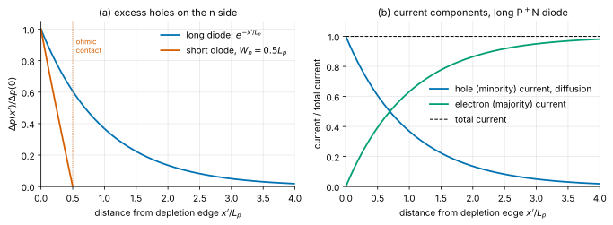
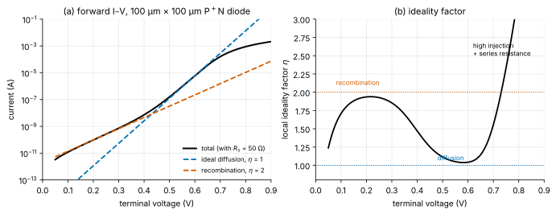
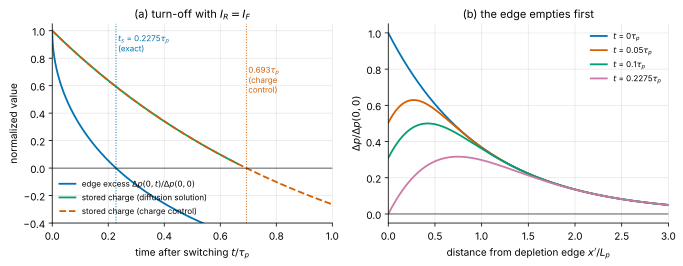
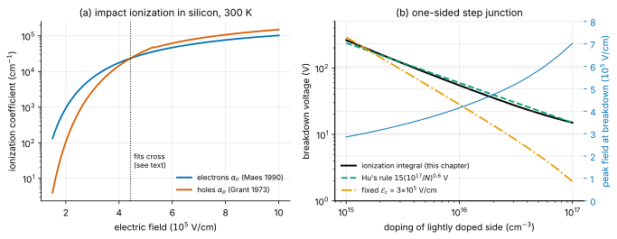

<!-- status: reviewed -->
# 09-06 · PN Junction I–V, Capacitance and Breakdown

| | |
|---|---|
| **Course** | [09 · Semiconductor Devices](../README.md) |
| **University equivalent** | The PN diode and metal–semiconductor junction in a junior semiconductor-devices course: carrier injection, the ideal diode equation, non-ideal currents, small-signal and switching behavior, junction breakdown, Schottky diodes and ohmic contacts (Pierret, *Semiconductor Device Fundamentals*, ch. 6–8 and 14; Streetman & Banerjee, ch. 5; Hu, *Modern Semiconductor Devices for Integrated Circuits*, ch. 4) |
| **Prerequisites** | [09-04 Generation, Recombination and Continuity](09-04-generation-recombination-continuity.md) (minority-carrier diffusion, quasi-Fermi levels, generation in depleted regions), [09-05 PN Junction Electrostatics](09-05-pn-junction-electrostatics.md) (built-in potential, depletion width, junction capacitance), [04-10 Introduction to Quantum Mechanics](../../04-physics-for-ee/chapters/04-10-intro-quantum-mechanics.md) (tunneling) |
| **Estimated study hours** | 9 |
| **Last verified** | 2026-11-19 |

**Learning objectives.** After this chapter you can:

1. Derive the ideal diode equation from the law of the junction and minority-carrier diffusion, for long and short diodes, and compute saturation current, forward voltage and injection efficiency.
2. Quantify the departures from the ideal equation (recombination and generation in the depletion region, high-level injection, series resistance) and extract an ideality factor.
3. Derive and compute the temperature coefficient of a diode's forward voltage and the proportional-to-absolute-temperature voltage used in on-chip sensors.
4. Build the diode's small-signal model (conductance, junction and diffusion capacitance) and compute switching storage time by charge control and by the exact diffusion solution.
5. Compute avalanche breakdown from the impact-ionization integral, and distinguish avalanche from tunneling breakdown by doping and temperature coefficient.
6. Analyze metal–semiconductor junctions: Schottky barrier height, thermionic-emission current, the Schottky–PN comparison, and the tunneling physics of ohmic contacts.

---

## 1. Big picture

A PN junction conducts easily one way and hardly at all the other. Forward bias lowers the junction's potential barrier, and carriers flood across it as minority carriers that diffuse away and recombine. Reverse bias raises the barrier, and only a trickle of thermally generated carriers leaks across. This chapter derives the resulting **diode equation**, $I = I_s(e^{qV_A/kT} - 1)$, from the physics of 09-04 and 09-05. It then follows the diode through everything a designer meets: the non-ideal currents of real devices, the temperature drift every analog designer must handle, the capacitance and stored charge that limit speed, the breakdown that limits voltage, and the metal–semiconductor junctions (rectifying Schottky diodes and ohmic contacts) that connect every device to the outside world.

- **Every transistor contains diodes.** A MOSFET's source and drain are PN junctions whose leakage and capacitance load every node (09-09); a bipolar transistor is two junctions sharing a thin region, and its current is this chapter's diffusion current (09-07).
- **Temperature sensing and voltage references** rely on the diode's exactly predictable temperature dependence: about −2 mV/K in forward voltage and a difference voltage proportional to absolute temperature.
- **Power conversion** depends on rectifiers. PN diodes block high voltages but store charge that slows switching; Schottky diodes switch fast with a lower drop but leak more.
- **Leakage sets retention and noise.** Junction leakage drains DRAM cells and adds dark current to image sensors, and it grows steeply with temperature.
- **Breakdown sets voltage ratings.** Avalanche and tunneling limit how much reverse voltage a junction can hold, and Zener diodes exploit breakdown on purpose.

## 2. Intuition first

**A dam with a sluice.** In equilibrium the junction's built-in potential is a dam holding back two reservoirs: electrons on the n side, holes on the p side. A few carriers in the high-energy tail of each reservoir always spill over the dam, but an equal flow of minority carriers falls back the other way, so the net flow is zero. Forward bias lowers the dam by $V_A$. Carriers spill over in proportion to the number with energy above the new height, which by the Boltzmann factor rises by $e^{qV_A/kT}$: ten times more current for every 60 mV. Reverse bias raises the dam; spill-over stops, and only the minority carriers that happen to wander to the edge fall down the other side. Their supply is tiny and does not depend on how high the dam is, so the reverse current saturates.

**What happens after the carriers cross.** A hole that crosses into the n side is a minority carrier surrounded by electrons. It diffuses away from the junction and, within a diffusion length or so, recombines (09-04). The electron it recombines with is replaced by electrons flowing in from the n-side contact. So the current near the junction is carried by diffusing minority carriers, and farther away by drifting majority carriers. The total is the same everywhere: the handoff from one to the other is recombination.

**A finance analogy: a toll that changes with the exchange rate.** The forward current behaves like trade flowing over a tariff wall: lowering the tariff by a fixed amount multiplies the volume by a fixed factor, because trade is concentrated in the marginal "high-energy" participants whose numbers fall off exponentially. *Where the analogy breaks:* the exponential here is exact physics (the Boltzmann distribution), not an empirical elasticity, and it holds over ten or more decades of current until the injected carriers become comparable with the majority carriers.

*Figure 1. A forward-biased P⁺N diode. (a) Excess-hole profiles on the n side: exponential decay over a diffusion length in a long diode and a straight line in a short diode ending at an ohmic contact. (b) Current components in the long diode: the hole (minority) current decays as holes recombine, the electron (majority) current rises to replace it, and the total is constant.*

## 3. Theory

We analyze a step junction (09-05) with acceptor density $N_A$ on the p side and donor density $N_D$ on the n side. The applied voltage $V_A$ is positive when the p side is positive (forward bias), and the current $I$ is positive flowing from p to n inside the diode, so the diode obeys the passive sign convention. The depletion region spans $-x_p < x < x_n$. Equilibrium minority densities are $n_{p0} = n_i^2/N_A$ on the p side and $p_{n0} = n_i^2/N_D$ on the n side. We assume, until §3.5 says otherwise:

1. **The depletion approximation** (09-05) holds: all voltage drops across the depletion region, and the neutral regions are field-free to first order.
2. **Low-level injection** (09-04): excess minority densities stay far below the majority densities.
3. **No generation or recombination inside the depletion region**: carriers cross it unchanged.
4. **Uniform doping** in each neutral region, where minority carriers move by diffusion and recombine with lifetimes $\tau_n$ and $\tau_p$.

### 3.1 The law of the junction

In equilibrium, the hole densities on the two sides of the junction are related by the Boltzmann factor of the barrier (09-05): $p_{n0} = p_{p0}e^{-qV_{bi}/kT}$, where $p_{p0} = N_A$. Under bias the barrier becomes $V_{bi} - V_A$. If the holes in the depletion region stay in quasi-equilibrium with each other (justified below), the same Boltzmann relation holds across the reduced barrier:

$$
p_n(x_n) = p_p(-x_p)\,e^{-q(V_{bi} - V_A)/kT} = p_{n0}\,e^{qV_A/kT} ,
$$

using low-level injection, $p_p(-x_p) \approx N_A$. In the language of quasi-Fermi levels (09-04 §3.6): if $E_{Fn}$ and $E_{Fp}$ are flat across the depletion region, their separation there equals the applied bias, $E_{Fn} - E_{Fp} = qV_A$, so

$$
np = n_i^2\,e^{qV_A/kT} \quad\text{throughout the depletion region}.
$$

At the n-side edge $n = N_D$, which gives the same result. This boundary condition is the **law of the junction** (Hu calls it the quasi-equilibrium boundary condition [2]):

$$
p_n(x_n) = p_{n0}\,e^{qV_A/kT}, \qquad n_p(-x_p) = n_{p0}\,e^{qV_A/kT} .
$$

The excess at each edge is therefore $\Delta p_n(x_n) = p_{n0}(e^{qV_A/kT} - 1)$, and similarly for electrons. Forward bias raises the minority density at the edge exponentially; reverse bias pulls it toward zero.

> **Going deeper — why the quasi-Fermi levels stay flat.** The hole current obeys $J_p = \mu_pp\,dE_{Fp}/dx$ (09-04). Across the depletion region, the drop in $E_{Fp}$ is therefore $\Delta E_{Fp} = \int J_p/(\mu_pp)\,dx \le J_pW/(\mu_pp_{\min})$, where $p_{\min} = p_n(x_n)$ is the smallest hole density in the region (at its n-side edge). The hole current is at most $qD_pp_n(x_n)/L_p$ (§3.2), so $\Delta E_{Fp} \le qD_pW/(\mu_pL_p) = kT\,W/L_p$ by the Einstein relation. A depletion region a fraction of a micrometer wide next to a diffusion length of tens of micrometers keeps the drop below about 1% of $kT$. Physically, drift and diffusion inside the depletion region are each enormous and nearly cancel; the net current is a tiny imbalance that needs almost no gradient of the quasi-Fermi level. In a short diode, the same argument gives $kT\,W/W_n$.

### 3.2 The ideal diode equation

Take the n side first. Beyond $x_n$, the excess holes obey the steady minority-carrier diffusion equation (09-04 §3.7), $D_p\,d^2\Delta p/dx^2 = \Delta p/\tau_p$. Measure distance $x' = x - x_n$ into the n region. For a **long diode**, whose neutral region is many diffusion lengths long, the solution that stays finite is (09-04 §3.8)

$$
\Delta p(x') = p_{n0}\big(e^{qV_A/kT} - 1\big)\,e^{-x'/L_p}, \qquad L_p = \sqrt{D_p\tau_p} .
$$

The hole current at the edge is the diffusion current there:

$$
J_p(x_n) = -qD_p\frac{d\Delta p}{dx'}\bigg|_{x' = 0} = \frac{qD_pp_{n0}}{L_p}\big(e^{qV_A/kT} - 1\big) .
$$

The p side gives, in the same way, an electron current $J_n(-x_p) = (qD_nn_{p0}/L_n)(e^{qV_A/kT} - 1)$ with $L_n = \sqrt{D_n\tau_n}$. (Electrons diffuse in the $-x$ direction, and their negative charge makes the current point in $+x$, the same direction as the hole current.)

Now add them. The total current $J = J_n + J_p$ is the same at every $x$ (charge is conserved). With no recombination inside the depletion region, $J_n$ does not change across it, so $J_n(x_n) = J_n(-x_p)$. Evaluating the total at $x_n$:

$$
J = J_p(x_n) + J_n(x_n) = J_p(x_n) + J_n(-x_p) .
$$

Substituting $p_{n0} = n_i^2/N_D$ and $n_{p0} = n_i^2/N_A$ gives the **ideal (Shockley) diode equation**:

$$
I = I_s\big(e^{qV_A/kT} - 1\big), \qquad I_s = AJ_s = Aqn_i^2\Big(\frac{D_p}{L_pN_D} + \frac{D_n}{L_nN_A}\Big) ,
$$

with $A$ the junction area and $I_s$ the **reverse saturation current**.

**Units check.** $qn_i^2D/(LN)$ has units C · cm⁻⁶ · cm²/s ÷ (cm · cm⁻³) = C/(s·cm²) = A/cm². ✓

**Where the current goes.** The hole current entering the n region equals $q$ times the holes recombining there per second: $J_p(x_n) = q\int_0^\infty \Delta p/\tau_p\,dx' = q\Delta p(0)L_p/\tau_p$. Writing $Q_p = qA\Delta p(0)L_p$ for the stored excess-hole charge gives $I_p = Q_p/\tau_p$. The diode current is the rate at which stored charge recombines, a view that becomes the charge-control model of §3.8. Figure 1(b) shows the handoff: the hole current decays as $e^{-x'/L_p}$, and electrons flowing in from the contact supply the recombination.

### 3.3 Short diodes

Many real diodes, and every bipolar transistor's emitter and base, have neutral regions much shorter than a diffusion length. Let the n-side neutral region end at an ohmic contact a distance $W_n$ from $x_n$, where the excess is held at zero (the contact recombines carriers instantly). The solution of $D_p\Delta p'' = \Delta p/\tau_p$ satisfying $\Delta p(0) = \Delta p_0$ and $\Delta p(W_n) = 0$ is

$$
\Delta p(x') = \Delta p_0\,\frac{\sinh\big((W_n - x')/L_p\big)}{\sinh(W_n/L_p)}, \qquad
J_p(x_n) = \frac{qD_p\Delta p_0}{L_p}\coth\frac{W_n}{L_p} .
$$

(Check: $\sinh$ of zero at $x' = W_n$ gives the contact condition, and $\sinh''= \sinh$ satisfies the equation.) For $W_n \gg L_p$, $\coth \to 1$ and we recover the long diode. For $W_n \ll L_p$, $\coth z \approx 1/z$, the profile is a straight line, and

$$
J_{s,p} \approx \frac{qn_i^2D_p}{N_DW_n} \qquad (\text{short diode}).
$$

The short diode carries $L_p/W_n$ times more current at the same voltage, because its gradient is steeper, and almost none of its injected carriers recombine on the way: they reach the contact in the **transit time** $\tau_t = W_n^2/2D_p$ (the stored charge $qA\Delta p_0W_n/2$ divided by the current $qAD_p\Delta p_0/W_n$). Its saturation current depends on geometry, not lifetime, which makes it far more reproducible. Note that $W_n$ here is the *neutral* width; as reverse bias widens the depletion region, $W_n$ shrinks slightly and the current rises, an effect that matters in the bipolar transistor (09-07).

### 3.4 Reading the diode equation

- **Sixty millivolts per decade.** In forward bias, $I \approx I_se^{qV_A/kT}$, so the current rises tenfold every $V_T\ln10$ = **59.5** mV at 300 K. The "turn-on voltage" is not a device parameter: it is simply the voltage at which the current reaches a level the circuit cares about, $V_A = V_T\ln(I/I_s)$.
- **Reverse saturation.** For $V_A \ll -3kT/q$, $I \to -I_s$. Minority carriers generated within about a diffusion length of the junction wander to its edge and are swept across by the field; their supply depends on $n_i^2$ and the lifetimes, not on the reverse voltage.
- **The lightly doped side dominates.** Each term of $I_s$ is inversely proportional to the doping of the side it describes. In a P⁺N diode the current is almost entirely holes injected into the n side, and the fraction carried by holes, the **injection efficiency**, approaches 1. Bipolar transistors are built on this asymmetry (09-07).
- **The bandgap matters exponentially.** $I_s \propto n_i^2 \propto e^{-E_g/kT}$. A material with a wider gap has a far smaller $I_s$ and needs a larger forward voltage for the same current, which is why a GaAs or GaN LED drops more voltage than a silicon diode.

### 3.5 Real diodes: departures from the ideal equation

Measured diode characteristics follow the ideal equation over only part of their range (Figure 2). Four effects account for the rest.

**Recombination in the depletion region.** Assumption 3 ignored recombination inside the depletion region. Take Shockley–Read–Hall recombination through mid-gap traps with equal lifetimes $\tau_0$ (09-04 §3.4):

$$
U = \frac{np - n_i^2}{\tau_0(n + p + 2n_i)} .
$$

Inside the depletion region $np = n_i^2e^{qV_A/kT}$ is fixed (§3.1), but $n$ and $p$ individually vary by orders of magnitude. For a fixed product, the sum $n + p$ is smallest when $n = p = n_ie^{qV_A/2kT}$, so that is where $U$ peaks:

$$
U_{\max} = \frac{n_i^2\big(e^{qV_A/kT} - 1\big)}{2\tau_0n_i\big(e^{qV_A/2kT} + 1\big)} = \frac{n_i}{2\tau_0}\big(e^{qV_A/2kT} - 1\big) ,
$$

using $e^{a} - 1 = (e^{a/2} - 1)(e^{a/2} + 1)$. Every recombination inside the depletion region removes one electron and one hole that would otherwise have crossed, so it adds to the current. Bounding the rate by its maximum over the whole width $W$:

$$
J_{\text{rec}} \approx \frac{qn_iW}{2\tau_0}\big(e^{qV_A/2kT} - 1\big) .
$$

This current grows only as $e^{qV_A/2kT}$, a factor of ten per **119** mV. It is proportional to $n_i$, while the diffusion current is proportional to $n_i^2$, so in silicon it dominates at low forward bias and the diffusion current takes over at higher bias (Example 09-06.3). Hu calls this the space-charge-region (SCR) current and notes that it is responsible for the low gain of bipolar transistors at low current [2]. The estimate is an upper bound: $U$ falls off on either side of the plane where $n = p$, so the effective width is less than $W$. Detailed treatments (Sah, Noyce and Shockley, 1957) replace $W$ by a width of order $(kT/q)/\mathcal E$, a few thermal voltages' worth of the local field.

**Generation in reverse bias.** In reverse bias, $np \ll n_i^2$ inside the depletion region, and the same traps *generate* pairs at the rate $n_i/2\tau_0$ (09-04 §3.5). The generation current $J_{\text{gen}} = qn_iW/2\tau_0$ adds to $I_s$, and because $W$ grows as $\sqrt{V_{bi} + V_R}$ (09-05), the reverse current of a real silicon diode does not saturate: it creeps upward with reverse voltage. At room temperature it is usually thousands of times larger than the ideal $I_s$ (Example 09-06.3); Hu notes that this junction leakage is "a very important issue in DRAM" and "generates noise in imager devices" [2].

**The ideality factor.** A convenient summary of a measured forward characteristic is

$$
I \approx I_0\,e^{qV_A/\eta kT}, \qquad \eta = \frac{q}{kT}\,\frac{dV_A}{d\ln I} ,
$$

where the **ideality factor** $\eta$ is 1 for diffusion current and 2 for depletion-region recombination, with values between where both contribute. (Many texts write $n$; we use $\eta$ to avoid a clash with the electron density.)

**High-level injection.** As forward bias rises, $\Delta p$ at the n-side edge approaches $N_D$ and assumption 2 fails. Quasi-neutrality then forces the electron density up too, $n = N_D + \Delta p$, and once $\Delta p \gg N_D$, $n \approx p$. With $np = n_i^2e^{qV_A/kT}$ this gives $p \approx n_ie^{qV_A/2kT}$, and the current again rises only as $e^{qV_A/2kT}$: $\eta \to 2$ at high current. The onset is where the law of the junction predicts $\Delta p = N_D$:

$$
V_{\text{HI}} \approx \frac{kT}{q}\ln\frac{N_D^2}{n_i^2} = 2V_T\ln\frac{N_D}{n_i} ,
$$

**0.714** V for $N_D$ = 10¹⁶ cm⁻³.

**Series resistance.** The neutral regions and contacts add a resistance $R_s$, so the terminal voltage is $V = V_A + IR_s$. On a semilog plot the curve bends over at high current, where $IR_s$ becomes comparable with $V_T$. In practice, high injection and series resistance arrive together and are hard to separate.

Hu shows a measured silicon diode, normalized to 1 cm², that follows the ideal equation with $I_0 = 1.8\times10^{-12}$ A and 60 mV/decade over most of its forward range, with the excess low-current component and a reverse current "raised by thermal generation in the depletion layer" [2]. He also notes that circuit simulators fit $I_0$ to measured data rather than computing it, "because $N_a$, $N_d$, $\tau_n$, and $\tau_p$ are generally not accurately known and can vary with x" [2].

*Figure 2. A real silicon diode on a semilog plot (computed for the diode of Example 09-06.1 with $R_s$ = 50 Ω). At low bias, depletion-region recombination ($\eta$ = 2, 119 mV/decade) dominates; then the ideal diffusion current ($\eta$ = 1, 59.5 mV/decade); at high current, high-level injection and series resistance bend the curve over.*

### 3.6 Temperature dependence

Holding $D$ and $\tau$ fixed (their temperature dependence is much weaker), $I_s \propto n_i^2 \propto T^3e^{-E_g(T)/kT}$ (09-02 §3.8). Near a reference temperature $T_0$, write the gap as its tangent line, $E_g(T) \approx qV_{g0} + T\,dE_g/dT$, where

$$
V_{g0} = \frac{1}{q}\Big(E_g(T_0) - T_0\frac{dE_g}{dT}\Big)
$$

is the gap extrapolated linearly to 0 K. The term $T\,dE_g/dT$ divided by $kT$ is a constant, so

$$
\frac{d\ln I_s}{dT} = \frac{3}{T} + \frac{qV_{g0}}{kT^2} .
$$

At fixed current, $V_A = (kT/q)\ln(I/I_s)$. Differentiating:

$$
\frac{dV_A}{dT} = \frac{k}{q}\ln\frac{I}{I_s} - \frac{kT}{q}\,\frac{d\ln I_s}{dT} = \frac{V_A - V_{g0} - 3V_T}{T} .
$$

**Units check.** volts over kelvin. ✓ For silicon, with the course's Varshni fit (09-02), $E_g(300\text{ K})$ = **1.1245** eV, $dE_g/dT$ = **−0.2546** meV/K and $V_{g0}$ = **1.2009** V. A forward voltage of 0.6 V then gives **−2.26** mV/K. The coefficient is negative because the current at fixed voltage rises so steeply with temperature that less voltage is needed to carry it. Hu notes that this makes the junction "a simple IC-based thermometer" [2].

**The PTAT voltage.** Two identical diodes at currents $I_1$ and $I_2$ (or one diode at two current densities) differ in voltage by

$$
\Delta V = V_T\ln\frac{I_1}{I_2} = \frac{kT}{q}\ln\frac{I_1}{I_2} ,
$$

which is exactly **proportional to absolute temperature** (PTAT) and independent of $I_s$ and its process spread: **198.4** µV/K for a current ratio of 10. Adding a scaled PTAT voltage to a diode voltage, whose coefficient is negative, cancels the temperature dependence near $V_{g0}$. That is the principle of the bandgap voltage reference, developed in [Course 20](../../20-analog-and-mixed-signal-ic-design/README.md).

### 3.7 The small-signal model

A diode biased at a DC point $(V_D, I_D)$ responds to a small voltage $v_d$ with a small current $i_d$. Three elements describe it.

**Conductance.** From the diode equation, $g_d = dI/dV_A = (I_D + I_s)/V_T \approx I_D/V_T$, or $I_D/\eta V_T$ for a non-ideal diode. The resistance $r_d = 1/g_d$ is **25.85** Ω at 1 mA and 300 K, the familiar result of [01-03](../../01-calculus-for-engineers/chapters/01-03-derivatives.md) and [10-01](../../10-electronics-1/chapters/10-01-diodes-and-diode-circuits.md).

**Junction capacitance.** The depletion charge changes with voltage, giving $C_j = \varepsilon_sA/W$ (09-05 §3.9), dominant in reverse bias. In forward bias the depletion approximation weakens (09-05 §3.7), and the formula would blow up at $V_A = V_{bi}$; circuit simulators (SPICE) therefore use it only up to a fraction FC of $V_{bi}$ (0.5 by default) and extrapolate $C_j$ linearly beyond that, so it stays finite.

**Diffusion capacitance.** In forward bias the stored minority charge $Q$ changes with voltage. The simplest estimate is quasi-static: the long diode stores $Q = I\tau_p$ (§3.2), so $dQ/dV_A = \tau_pg_d$. The exact small-signal analysis gives half of that. Write the excess as a DC part plus a small phasor, $\Delta p + \hat p\,e^{j\omega t}$. The phasor obeys $j\omega\hat p = D_p\hat p'' - \hat p/\tau_p$, so it decays as $e^{-x'\sqrt{1 + j\omega\tau_p}/L_p}$, and its current at the edge is $\sqrt{1 + j\omega\tau_p}$ times the low-frequency value. The admittance is therefore

$$
Y = g_d\sqrt{1 + j\omega\tau_p} \approx g_d\Big(1 + \frac{j\omega\tau_p}{2}\Big) \quad (\omega\tau_p \ll 1),
\qquad C_d = \frac{\tau_p}{2}\,g_d \quad\text{(long diode)} .
$$

The quasi-static estimate is too large because part of each change in stored charge, the part far from the junction, is made up by recombination rather than by current through the terminal. For a short diode the same analysis (expanding $\coth z \approx 1/z + z/3$) gives

$$
C_d = \frac{W_n^2}{3D_p}\,g_d = \frac23\,\tau_tg_d \quad\text{(short diode)} .
$$

Either way, $C_d$ is proportional to the bias current. At 10 µA, a long diode with a microsecond lifetime has a diffusion capacitance of a couple of hundred picofarads, dwarfing its junction capacitance; a short diode's is under a picofarad (Example 09-06.5). The full model is $g_d$ in parallel with $C_j + C_d$, in series with $R_s$. Hu draws the same parallel RC model, with the diffusion capacitance expressed through a charge-storage time [2].

> **Math refresher — square root of a complex number near 1.** For small $|z|$, $\sqrt{1 + z} \approx 1 + z/2$ (the first term of the Taylor series of [01-08](../../01-calculus-for-engineers/chapters/01-08-sequences-series-and-taylor.md)). With $z = j\omega\tau_p$ the imaginary part, $\omega\tau_p/2$, is the capacitive susceptance divided by $g_d$.

### 3.8 Charge storage and switching

**The charge-control equation.** Start from the hole continuity equation in the neutral n region, $\partial\Delta p/\partial t = -(1/q)\,\partial J_p/\partial x - \Delta p/\tau_p$ (09-04). Multiply by $qA$ and integrate from the depletion edge $x_n$ into the bulk, where $J_p$ and $\Delta p$ vanish. With $Q = qA\int\Delta p\,dx$ the stored charge, this gives $dQ/dt = AJ_p(x_n) - Q/\tau_p$. In a P⁺N diode nearly all the current at $x_n$ is hole current, so $AJ_p(x_n) \approx i(t)$, and the stored charge obeys a single equation:

$$
i(t) = \frac{dQ}{dt} + \frac{Q}{\tau_p} .
$$

Current flowing in either builds up stored charge or replaces charge lost to recombination. In steady forward conduction $Q = I_F\tau_p$.

**Turn-off.** Suppose a circuit switches the current at $t = 0$ from $I_F$ to a reverse current $-I_R$ (set by a resistor and a reverse supply). The stored holes cannot vanish instantly. While excess holes remain at the junction edge, the law of the junction keeps the junction forward biased, so the external circuit, not the diode, sets the current: a constant $-I_R$ flows during a **storage phase**. Solving the charge-control equation with $i = -I_R$ and $Q(0) = I_F\tau_p$:

$$
Q(t) = -I_R\tau_p + (I_F + I_R)\tau_pe^{-t/\tau_p} ,
$$

which reaches zero at

$$
t_s \approx \tau_p\ln\Big(1 + \frac{I_F}{I_R}\Big) \qquad (\text{charge-control estimate}).
$$

After that, the junction voltage swings negative, the depletion capacitance charges, and the current decays to the leakage value. The storage time plus this decay is the **reverse-recovery time**.

**The exact answer is shorter.** The storage phase really ends when the *edge* density reaches zero, not when the *total* stored charge does. The reverse current pulls holes out at the junction, so the edge empties first while holes farther away remain. Solving the time-dependent diffusion equation exactly (a classic result due to Kingston) gives

$$
\operatorname{erf}\sqrt{t_s/\tau_p} = \frac{I_F}{I_F + I_R} ,
$$

where $\operatorname{erf}x = (2/\sqrt\pi)\int_0^xe^{-u^2}du$ is the error function, the complement of the erfc met in [03-02](../../03-probability-statistics-and-random-variables/chapters/03-02-random-variables-and-distributions.md). For $I_R = I_F$, the exact $t_s$ = 0.2275$\tau_p$ against the charge-control $\tau_p\ln2$ = 0.693$\tau_p$. Charge control does not get the *charge* wrong: integrating the diffusion equation over the region gives the charge-control equation exactly, and Figure 3(a) shows the two charge curves coincide. It gets wrong the moment the junction voltage reverses, which depends on the edge density alone. The lab solves the diffusion equation numerically and confirms the exact result.

> **Going deeper — Kingston's result in five steps.** (1) Before switching, the profile is $\Delta p_F = p_ee^{-x/L_p}$ with $p_e = I_FL_p/(qAD_p)$. (2) After switching, write $\Delta p = \Delta p_F - u(x, t)$. Because $\Delta p_F$ is a steady solution, $u$ obeys the same diffusion equation, $\partial u/\partial t = D_p\,\partial^2u/\partial x^2 - u/\tau_p$, with $u = 0$ at $t = 0$, and the current step from $+I_F$ to $-I_R$ sets its slope at the edge: $\partial u/\partial x|_0 = -(I_F + I_R)/(qAD_p)$. (3) Laplace-transform in time (07-04): $sU = D_pU'' - U/\tau_p$, so $U = U_0(s)e^{-kx}$ with $k = \sqrt{(s + 1/\tau_p)/D_p}$, and the slope condition gives $U_0 = (I_F + I_R)/(qA\sqrt{D_p}\,s\sqrt{s + 1/\tau_p})$. (4) The transform pair $1/(s\sqrt{s + a}) \leftrightarrow \operatorname{erf}(\sqrt{at})/\sqrt a$ gives $u(0, t) = (I_F + I_R)\,L_p/(qAD_p)\cdot\operatorname{erf}\sqrt{t/\tau_p}$. (5) The edge empties when $u(0, t_s) = p_e$, which is the formula above. Circuit simulators use the charge-control picture with a fitted transit-time parameter, so their storage times follow the logarithmic formula (the lab's ngspice netlist shows this).

**Making diodes fast.** Every route shortens $\tau$ or removes the stored charge: lifetime killing with gold, platinum or irradiation (09-04), which cuts $t_s$ in proportion to $\tau_p$ at the cost of more leakage; short diodes, whose stored charge is set by the transit time; or no minority storage at all, the Schottky diode of §3.10.

*Figure 3. Reverse recovery of a long P⁺N diode switched from $I_F$ to $-I_R = -I_F$, from the numerical solution of the diffusion equation. (a) The excess density at the junction edge falls to zero at $t_s$ = 0.2275$\tau_p$, when the junction voltage reverses, while the stored charge follows the charge-control curve exactly up to $t_s$. The charge-control model would empty the charge at 0.693$\tau_p$ only if $-I_R$ could be held that long, which the junction cannot do once its edge density reaches zero; as a storage-time estimate it is **3.05** times too long. (b) Profiles at successive times: the reverse current empties the region next to the junction first.*

### 3.9 Junction breakdown

Under large reverse bias, the peak field grows as $\sqrt{V_{bi} + V_R}$ (09-05) until, at a well-defined **breakdown voltage** $V_B$, the reverse current rises abruptly. Two mechanisms are responsible [2].

**Impact ionization.** A carrier accelerated by a strong field can gain enough kinetic energy, more than the bandgap, to knock an electron out of the valence band: one carrier becomes three (the original plus a new electron–hole pair). The **ionization coefficients** $\alpha_n(\mathcal E)$ and $\alpha_p(\mathcal E)$ count the pairs created per centimeter of travel by an electron and a hole. Measured values follow

$$
\alpha = \alpha_0\,e^{-\mathcal E_0/\mathcal E} .
$$

For silicon at 300 K the handbook gives, for electrons, $\alpha_0$ = 3.318 × 10⁵ cm⁻¹ and $\mathcal E_0$ = 1.174 × 10⁶ V/cm (Maes et al., 1990); for holes, $\alpha_0$ = 2 × 10⁶ cm⁻¹ and $\mathcal E_0$ = 1.97 × 10⁶ V/cm between 2 × 10⁵ and 5.3 × 10⁵ V/cm, and 5.6 × 10⁵ cm⁻¹ with 1.32 × 10⁶ V/cm above (Grant, 1973) [1] **[Established]**. At 3 × 10⁵ V/cm, these give **6.63 × 10³** cm⁻¹ for electrons and **2.81 × 10³** cm⁻¹ for holes. Electrons ionize **2.36** times more readily: an electron travels about 1.5 µm between ionizing collisions. The form $e^{-\mathcal E_0/\mathcal E}$ has a simple reading: a carrier must gain the threshold energy over a stretch free of energy-robbing phonon collisions, and the probability of such a "lucky" run falls exponentially with the distance it needs, which is inversely proportional to the field.

> **Going deeper — a caution on mixing fits.** The two coefficients come from different studies. Above about 4.4 × 10⁵ V/cm, the pairing predicts that holes ionize more than electrons, the reverse of their order at lower fields. Breakdown results that depend on fields that high (one-sided junctions doped above a few 10¹⁶ cm⁻³) should be read as estimates **[Contested]**.

**The multiplication integral.** Consider a reverse-biased depletion region $0 < x < W$ in which electrons drift toward $+x$ and holes toward $-x$. Let $J_n(x)$ and $J_p(x)$ be the magnitudes of the electron and hole contributions to the reverse current, whose sum $J$ is the same everywhere. Each carrier creates pairs as it travels, and each pair adds to both streams, so the electron stream grows along $+x$:

$$
\frac{dJ_n}{dx} = \alpha_nJ_n + \alpha_pJ_p = (\alpha_n - \alpha_p)J_n + \alpha_pJ .
$$

Suppose electrons enter at $x = 0$ with current $J_n(0)$, and no holes enter at $x = W$, so $J_n(W) = J$. Define $\varphi(x) = \int_0^x(\alpha_n - \alpha_p)\,dx'$ and multiply by the integrating factor $e^{-\varphi}$ (02-02):

$$
\frac{d}{dx}\big(J_ne^{-\varphi}\big) = \alpha_pJe^{-\varphi}
\quad\Longrightarrow\quad
Je^{-\varphi(W)} - J_n(0) = J\int_0^W\alpha_pe^{-\varphi}\,dx .
$$

Since $\int_0^W(\alpha_n - \alpha_p)e^{-\varphi}dx = 1 - e^{-\varphi(W)}$, substituting for $e^{-\varphi(W)}$ and dividing by $J$ gives the **multiplication factor** $M = J/J_n(0)$:

$$
1 - \frac1M = \int_0^W\alpha_n\exp\Big[-\int_0^x(\alpha_n - \alpha_p)\,dx'\Big]dx .
$$

As the reverse voltage rises, the integral on the right grows; when it reaches 1, $M$ becomes infinite: any carrier entering the region triggers a self-sustaining avalanche. That is the **avalanche breakdown** condition. (Starting from holes injected at $x = W$ leads to the same condition; the lab checks this numerically.) If $\alpha_n = \alpha_p = \alpha$, it reduces to $\int_0^W\alpha\,dx = 1$: on average, each carrier crossing the region creates one pair.

**Breakdown voltage against doping.** For a one-sided P⁺N junction, the field falls linearly from its peak $\mathcal E_m$ at the junction to zero at $W = \varepsilon_s\mathcal E_m/qN_D$ (09-05). Solving the breakdown condition numerically for $\mathcal E_m$ gives $V_B = \mathcal E_mW/2 - V_{bi}$:

| $N_D$ (cm⁻³) | Peak field at breakdown (V/cm) | $V_B$ (V) | Depletion width at breakdown (µm) |
|---|---|---|---|
| 10¹⁵ | **2.85 × 10⁵** | **262** | **18.4** |
| 10¹⁶ | **4.15 × 10⁵** | **54.7** | **2.68** |
| 10¹⁷ | **7.02 × 10⁵** (estimate) | **15.0** (estimate) | **0.454** |

Two features stand out. First, the "critical field" is not a constant: it rises with doping, because a thinner high-field region needs a larger ionization rate to reach $\int\alpha\,dx = 1$. The rule of 09-05, $V_B \approx \varepsilon_s\mathcal E_c^2/2qN$ with a fixed $\mathcal E_c$ = 3 × 10⁵ V/cm, is therefore good only near 10¹⁵ cm⁻³; at 10¹⁶ it underestimates $V_B$ by half (Example 09-06.7). Second, $V_B$ falls steeply with doping: between 10¹⁵ and 10¹⁷ cm⁻³ the computed values fall as $N^{-0.62}$. Hu's empirical rule, $V_B \approx 15\text{ V} \times (10^{17}\text{ cm}^{-3}/N)^{0.6}$, gives **238**, **59.7** and **15.0** V at the three dopings [2] **[Established]** as a rule of thumb. The handbook's curve (after Sze) is somewhat steeper: read from the figure, it gives about 12 V at 10¹⁷ and roughly 350 V at 10¹⁵ cm⁻³ [1]. Differences of 20–40% between such routes reflect the spread of published ionization data, which is why breakdown ratings come from measurement. Figure 4 plots the coefficients and the computed breakdown voltage.

Hu adds two practical points: "IC devices typically have junction breakdown voltages under 20 V", while "silicon power devices can operate at 100–1,000 V", which requires the light doping below about 10¹⁴ cm⁻³ that his rule gives for 1,000 V; and breakdown voltage "progressively increases from Ge to Si to GaAs diodes, due to increasing $E_g$" [2] **[Established]**. Real junctions break down first where the field is concentrated, at curved edges and corners, so planar results are upper bounds; power devices add edge terminations (guard rings, field plates) to approach them.

**Temperature coefficient.** Higher temperature means more phonon scattering, so carriers lose energy more often and need a stronger field to ionize. Avalanche breakdown voltage therefore *rises* with temperature; the handbook's data show the increase is larger at lighter doping [1]. A positive coefficient is stabilizing: a hot spot breaks down less readily.

**Tunneling breakdown.** If both sides are heavily doped, the depletion region is only tens of nanometers wide and the field is intense. Under modest reverse bias, the filled valence-band states on the p side then face empty conduction-band states on the n side only $E_g/q\mathcal E$ away horizontally, **11.2** nm at 10⁶ V/cm. Electrons tunnel straight through (04-10 §3.4), with a current density $J \propto e^{-H/\mathcal E}$, where $H$ is proportional to $E_g^{3/2}$ and to the square root of the tunneling mass. Hu puts the critical field for tunneling at about 10⁶ V/cm in silicon and says tunneling dominates "when $N$ is very high and $V_B$ is quite low (below a few volts)" [2]. Because the bandgap shrinks with temperature, tunneling gets easier as the junction warms, and tunneling breakdown has a *negative* temperature coefficient. A **Zener diode** is any diode designed to operate in breakdown at a specified voltage. Low-voltage ones break down by tunneling (negative coefficient) and higher-voltage ones by avalanche (positive), so near the crossover the two effects partly cancel.

*Figure 4. (a) Impact-ionization coefficients of silicon at 300 K from the handbook fits. (b) Avalanche breakdown voltage and peak field at breakdown of a one-sided step junction against the doping of the lightly doped side, from the ionization integral, with Hu's empirical rule and the fixed-critical-field estimate for comparison.*

### 3.10 Metal–semiconductor junctions: Schottky diodes

**The Schottky barrier.** Where a metal meets n-type silicon, electrons in the metal see a barrier of height $\phi_{Bn}$ to enter the semiconductor's conduction band. In the ideal (Schottky–Mott) picture, $\phi_{Bn} = \psi_M - \chi_{\text{Si}}$, the metal's work function minus silicon's electron affinity (4.05 eV) [2]. Measured barriers rise with $\psi_M$ much more slowly than this predicts. Hu's Table 4–4 gives $\phi_{Bn}$ = 0.4 V for Mg, 0.5 V for Ti, 0.61 V for Cr, 0.67 V for W, 0.68 V for Mo, 0.77 V for Pd, 0.8 V for Au and 0.9 V for Pt, over work functions from 3.7 to 5.7 V [2] **[Established]**. The reason is interface states in the gap at the metal–semiconductor boundary, which hold charge and form a dipole that pins the Fermi level near the middle of the gap: **Fermi-level pinning**. Hu fits the table with

$$
\phi_{Bn} \approx 0.7\text{ V} + 0.2(\psi_M - 4.75\text{ V}) ,
$$

and notes that $\phi_{Bn} + \phi_{Bp} \approx E_g/q$: a metal that forms a high barrier to electrons forms a low one to holes [2]. Silicides (TiSi₂ 0.61 V, CoSi₂ 0.65 V, NiSi₂ 0.67 V, PtSi 0.87 V for electrons, in Hu's Table 4–5) are the practical contact metals [2].

**Electrostatics.** On the semiconductor side, the bands bend up by the built-in potential $V_{bi} = \phi_{Bn} - (E_C - E_F)/q$, and a depletion region forms exactly as on the lightly doped side of a P⁺N junction (the metal holds its compensating charge in a sheet at the surface). Every formula of 09-05 for one-sided junctions applies.

**Thermionic emission.** Current crosses the barrier by electrons with enough energy to go over it. Electrons at the barrier top have density $N_Ce^{-q(\phi_{Bn} - V_A)/kT}$ under forward bias $V_A$ (the barrier seen from the semiconductor falls by $V_A$). Half of them move toward the metal, with average velocity toward it $\bar v_x = \sqrt{2kT/\pi m}$ for a Maxwell–Boltzmann distribution. The flux into the metal is therefore $\tfrac12N_Ce^{-q(\phi_{Bn} - V_A)/kT}\sqrt{2kT/\pi m}$. Substituting $N_C = 2(2\pi mkT/h^2)^{3/2}$ (09-02):

$$
J_{S\to M} = q\cdot2\Big(\frac{2\pi mkT}{h^2}\Big)^{3/2}\sqrt{\frac{kT}{2\pi m}}\;e^{-q(\phi_{Bn} - V_A)/kT} = \frac{4\pi qmk^2}{h^3}\,T^2\,e^{-q\phi_{Bn}/kT}e^{qV_A/kT} .
$$

The flow from metal to semiconductor faces the unchanged barrier $\phi_{Bn}$, so it stays at its equilibrium value, which balances $J_{S\to M}$ at $V_A$ = 0. The net current is

$$
J = J_0\big(e^{qV_A/kT} - 1\big), \qquad J_0 = KT^2e^{-q\phi_{Bn}/kT}, \qquad K = \frac{4\pi qmk^2}{h^3} ,
$$

the same form as the PN diode's. The **Richardson constant** $K$ is **120.2** A/(cm²·K²) for the free-electron mass; Hu uses $K \approx$ 100 A/(cm²·K²) for silicon [2].

**Schottky against PN.** The forms match, but the physics differs in two ways.

- **A far larger saturation current.** $J_0$ depends on the barrier height, not on $n_i^2$. Hu notes that a silicon Schottky diode's $I_0$ "can be 10³–10⁸ times larger than a typical PN junction diode" [2], so it conducts the same current at $V_T\ln10^3$ = **0.179** V to $V_T\ln10^8$ = **0.476** V less forward voltage (Example 09-06.8). The price is reverse leakage larger by the same factor and growing as $T^2e^{-q\phi_B/kT}$.
- **Majority carriers only.** Electrons pass from semiconductor to metal and simply join the metal's electron sea; there is negligible minority injection and therefore negligible stored charge. Schottky diodes switch as fast as their junction capacitance allows.

Hu's example: in a 1 V, 50 A computer power supply, a PN rectifier dropping 0.8 V would dissipate **40** W, which is why low-voltage rectifiers use Schottky diodes (about 0.3 V), or MOSFET switches (synchronous rectifiers) that avoid the diode trade-off between forward drop and leakage altogether [2]. (In a real Schottky diode the image force also lowers the barrier slightly as the field grows, so its reverse current rises with reverse voltage; Pierret ch. 14 develops this.)

### 3.11 Ohmic contacts

A contact should pass current in both directions with negligible voltage drop. Lowering the barrier is limited by pinning ($\phi_B$ cannot be made near zero on both n- and p-type silicon with one metal), so practical **ohmic contacts** thin the barrier instead: very heavy doping shrinks the depletion width $W = \sqrt{2\varepsilon_s\phi_B/qN}$ to a few nanometers, and electrons tunnel through it.

**The tunneling exponent.** Model the barrier as rectangular, of height $q\phi_B$ and thickness $W/2$ (Hu's approximation [2]). The tunneling probability is about $e^{-2\kappa W/2}$ with $\kappa = \sqrt{2m^*q\phi_B}/\hbar$ (04-10 §3.4), so

$$
P \approx \exp\Big[-\frac{2\sqrt{2m^*q\phi_B}}{\hbar}\sqrt{\frac{\varepsilon_s\phi_B}{2qN}}\Big]
= \exp\Big[-\frac{4\pi\phi_B}{h}\sqrt{\frac{\varepsilon_sm^*}{N}}\Big] .
$$

**Units check.** $\phi_B\sqrt{\varepsilon m/N}$ has units V · √(F·m⁻¹ · kg · m³) = √(C·V · kg · m²) = √(J · kg · m²) = kg·m²/s = J·s, which cancels $h$. ✓

The **specific contact resistivity** $\rho_c$ (Ω·cm², resistance times area) is inversely proportional to $P$, so it falls exponentially with $\sqrt N$ and with the barrier height (Hu derives $\rho_c \propto e^{H\phi_{Bn}/\sqrt{N_d}}$ [2]). Raising the doping from 10¹⁹ to 10²⁰ cm⁻³ multiplies the tunneling probability by about 2 × 10⁵ (Example 09-06.8). Hu shows a measured 0.3 µm TiSi₂ contact with 140 Ω, a specific contact resistivity of about 10⁻⁷ Ω·cm² [2]. Contact resistance scales as $\rho_c$ divided by area, so it grows quadratically as contacts shrink, which makes it a first-order concern in advanced CMOS (09-11, 09-12).

## 4. Worked examples

The diode of Examples 09-06.1 and 09-06.3 to 09-06.7 is a P⁺N step junction with $N_A$ = 10¹⁹ cm⁻³, $N_D$ = 10¹⁶ cm⁻³, hole lifetime $\tau_p$ = 1 µs on the n side, and area $A$ = 10⁻⁴ cm² (100 µm × 100 µm), at 300 K. Course values hold: $n_i$ = 10¹⁰ cm⁻³, $V_T$ = 25.852 mV, $\varepsilon_s$ = 1.036 × 10⁻¹² F/cm, and the handbook mobility model of 09-03.

### Example 09-06.1 · The ideal long diode (tier A)

**Setup.** (a) Find $D_p$ and $L_p$ on the n side. (b) Find the hole and electron saturation current densities. On the p⁺ side, the electron lifetime is set by Auger recombination (09-04, $C_p$ = 0.3 × 10⁻³⁰ cm⁶/s). Then find the injection efficiency and $I_s$. (c) Find the forward voltage at 10 µA and at 100 µA. (d) At what voltage and current does the excess hole density at the junction edge reach $N_D$, ending low-level injection?

**Solution.**

(a) The mobility model gives $\mu_p$ = **370.4** cm²/V·s at 10¹⁶ cm⁻³, so $D_p = V_T\mu_p$ = **9.576** cm²/s and $L_p = \sqrt{9.576 \times 10^{-6}}$ cm = **30.94** µm.

(b) Holes: $J_{p0} = qn_i^2D_p/(L_pN_D) = 1.602\times10^{-19} \times 10^{20} \times 9.576/(3.094\times10^{-3} \times 10^{16})$ = **4.958 × 10⁻¹²** A/cm².
Electrons on the p⁺ side:

- the Auger lifetime is $\tau_n = 1/(C_pN_A^2)$ = **33.3** ns;
- $\mu_n$ = **115.9** cm²/V·s at 10¹⁹ cm⁻³, so $D_n$ = **2.996** cm²/s and $L_n$ = **3.160** µm;
- $J_{n0} = qn_i^2D_n/(L_nN_A)$ = **1.519 × 10⁻¹⁴** A/cm².

The holes carry **99.7**% of the current. $I_s = A(J_{p0} + J_{n0})$ = **4.973 × 10⁻¹⁶** A.

(c) $V_A = V_T\ln(I/I_s + 1)$: **0.6133** V at 10 µA and **0.6728** V at 100 µA, which is **59.5** mV more for ten times the current.

(d) $\Delta p = N_D$ when $p_{n0}e^{qV_A/kT} = N_D$, at $V_A = 2V_T\ln(N_D/n_i)$ = **0.7143** V. The current there is $I_s(N_D/p_{n0})$ = **0.497** mA. At 10 µA the edge excess is **2.01 × 10¹⁴** cm⁻³, **2.0**% of $N_D$.

**Units check.** $L_p = \sqrt{D\tau}$: √(cm²/s · s) = cm. ✓ Current densities: A/cm² (§3.2). ✓

**Sanity check.** Silicon diodes conduct milliamps near 0.6–0.75 V, as here. The p⁺ side contributes little even though its lifetime is short, because its minority density $n_i^2/N_A$ is a thousand times smaller. (Heavy doping also narrows the bandgap and raises $n_i^2$ there, which increases the electron current several-fold; 09-07 returns to this for bipolar emitters.) This 100 µm diode leaves low-level injection at about half a milliamp, so the ideal equation describes it only below that.

### Example 09-06.2 · A short diode (tier A)

**Setup.** The same junction, but the n-side neutral region is only $W_n$ = 2 µm long and ends at an ohmic contact. (a) Find the hole saturation current density exactly and by the short-diode approximation. (b) Find $I_s$ and the forward voltage at 10 µA. (c) What fraction of the injected holes recombines before reaching the contact, and what is the transit time?

**Solution.**

(a) $W_n/L_p = 2/30.94$ = **0.0646**, and $\coth(0.0646)$ = **15.49**, so $J_{p0} = 4.958\times10^{-12} \times 15.49$ = **7.682 × 10⁻¹¹** A/cm². The short-diode approximation $qn_i^2D_p/(N_DW_n)$ gives **7.671 × 10⁻¹¹** A/cm², **0.14**% lower.

(b) Adding the unchanged electron term, $I_s$ = **7.683 × 10⁻¹⁵** A, and $V_A(10\ \mu\text{A})$ = **0.5426** V, **70.8** mV below the long diode.

(c) The fraction recombining is $1 - 1/\cosh(W_n/L_p)$ = **0.21**%, matching the estimate $W_n^2/2L_p^2$. The transit time is $\tau_t = W_n^2/2D_p$ = **2.089** ns, against a lifetime of 1 µs.

**Sanity check.** Fifteen times the current means $V_T\ln15.5$ ≈ 71 mV less voltage. ✓ The short diode stores much less charge per ampere (§3.8), so it is faster.

### Example 09-06.3 · Recombination and generation currents (tier B)

**Setup.** In the diode of Example 09-06.1, mid-gap traps give a depletion-region lifetime $\tau_0$ = 1 µs. (a) Using the depletion width at 0.4 V forward bias, estimate the recombination-current prefactor $J_{r0} = qn_iW/2\tau_0$, and find the voltage below which recombination current exceeds diffusion current. (b) Compare the two at 0.2 V and 0.6 V. (c) At the crossover, what ideality factor does the total current show? (d) At 5 V reverse bias, compare the generation current with $I_s$.

**Solution.**

(a) $V_{bi} = V_T\ln(N_AN_D/n_i^2)$ = **0.8929** V. At $V_A$ = 0.4 V, $W = \sqrt{2\varepsilon_s(V_{bi} - V_A)/qN_D}$ = **0.2526** µm, so $J_{r0} = 1.602\times10^{-19} \times 10^{10} \times 2.526\times10^{-5}/(2\times10^{-6})$ = **2.023 × 10⁻⁸** A/cm². The currents are equal where $J_se^{qV/kT} = J_{r0}e^{qV/2kT}$:

$$
V_x = 2V_T\ln\frac{J_{r0}}{J_s} = 2 \times 0.025852 \times \ln\frac{2.023\times10^{-8}}{4.973\times10^{-12}} = \mathbf{0.4297}\text{ V} .
$$

(b) The ratio $J_{\text{rec}}/J_{\text{diff}} = (J_{r0}/J_s)e^{-qV/2kT}$ is **85.0** at 0.2 V and **0.0371** at 0.6 V. Recombination dominates low bias; diffusion dominates normal operating bias.

(c) For $I = I_1e^{V/V_T} + I_2e^{V/2V_T}$, $d\ln I/dV = (I_1e^{V/V_T} + \tfrac12I_2e^{V/2V_T})/(IV_T)$. At the crossover the two terms are equal, so $d\ln I/dV = 0.75/V_T$ and $\eta$ = **1.333**.

(d) At −5 V, $W$ = **0.8734** µm, $J_{\text{gen}} = qn_iW/2\tau_0$ = **7.00 × 10⁻⁸** A/cm², and $I_{\text{gen}}$ = **7.00** pA, **1.407 × 10⁴** times $I_s$.

**Sanity check.** Silicon's $n_i$ is so small that the $n_i^2$ diffusion terms are minute at room temperature, so the $n_i$-proportional generation and recombination terms win wherever the exponential factors do not overwhelm them. This is why a silicon diode's measured reverse current is set by trap density, not by the ideal equation.

### Example 09-06.4 · Temperature and the diode thermometer (tier B)

**Setup.** For the diode of Example 09-06.1 at 10 µA: (a) using the course $n_i(T)$ model and holding $D_p$ and $\tau_p$ fixed, find $I_s(350\text{ K})/I_s(300\text{ K})$, the forward voltage at 350 K, and the average temperature coefficient; (b) find $dV_A/dT$ at 300 K from the formula of §3.6; (c) find the voltage difference between 100 µA and 10 µA, and its temperature coefficient.

**Solution.**

(a) $(n_i(350)/n_i(300))^2$ = **1233** (09-04 Example 7 found $n_i$ rises 35.1-fold). So $I_s(350)$ = **6.13 × 10⁻¹³** A and

$$
V_A(350\text{ K}) = \frac{k \times 350}{q}\ln\frac{10^{-5}}{6.13\times10^{-13}} = \mathbf{0.5009}\text{ V} ,
$$

a drop of **112** mV, or **−2.249** mV/K on average.

(b) $dV_A/dT = (V_A - V_{g0} - 3V_T)/T = (0.6133 - 1.2009 - 0.0776)/300$ = **−2.217** mV/K.

(c) $\Delta V = V_T\ln10$ = **59.53** mV at 300 K, rising at $(k/q)\ln10$ = **198.4** µV/K.

**Sanity check.** The magnitude of the coefficient grows as the forward voltage falls (lower current), since the numerator $V_A - V_{g0} - 3V_T$ becomes more negative. The average over 300–350 K is a little steeper than the 300 K slope because the curve bends. The PTAT difference is independent of $I_s$, so it does not depend on the diode's doping, area or lifetime, which is what makes it a good thermometer.

### Example 09-06.5 · The small-signal model (tier B)

**Setup.** Bias the long diode of Example 09-06.1 at $I_D$ = 10 µA. (a) Find $g_d$ and $r_d$. (b) Find the stored charge, the quasi-static $dQ/dV_A$, and the exact low-frequency diffusion capacitance. (c) Compare with the junction capacitance at zero bias and at 0.6 V (depletion approximation). (d) Up to what frequency is the low-frequency model adequate? (e) Find the diffusion capacitance of the short diode of Example 09-06.2 at the same current.

**Solution.**

(a) $g_d = I_D/V_T$ = **0.3868** mS and $r_d$ = **2585** Ω.

(b) Treat the current as entirely hole current (it is 99.7% holes, Example 09-06.1). Then $Q = I_D\tau_p$ = **10.0** pC. The quasi-static $dQ/dV_A = \tau_pg_d$ = **386.8** pF, but the exact value is $C_d = (\tau_p/2)g_d$ = **193.4** pF.

(c) $C_j = \varepsilon_sA/W$: **3.047** pF at zero bias ($W$ = 0.340 µm) and **5.32** pF at 0.6 V. The diffusion capacitance is **63.5** and **36.4** times larger.

(d) The approximation $\sqrt{1 + j\omega\tau_p} \approx 1 + j\omega\tau_p/2$ needs $\omega\tau_p \ll 1$, that is $f \ll 1/(2\pi\tau_p)$ = **159.2** kHz ($\tau_p$ = 1 µs). Quantitatively, the next term of the expansion makes the conductance too large by about $(\omega\tau_p)^2/8$: a 1% error in $G$ is reached at $\omega\tau_p$ = 0.286, or **45.6** kHz. Note that the corner where $r_d$ and $C_d$ have equal admittance, $f = 1/(2\pi r_dC_d) = 1/(\pi\tau_p)$ = **318.3** kHz (independent of current), lies *outside* the range of validity: there $\omega\tau_p$ = 2 and the exact admittance has **27.2**% more conductance and **21.4**% less capacitance than the model.

(e) $C_d \approx g_dW_n^2/3D_p$ = **0.539** pF; the full solution, which includes the 0.2% of holes that recombine, gives **0.538** pF. Either way it is smaller than the junction capacitance.

**Units check.** $\tau g$: s × S = s/Ω = F. ✓

**Sanity check.** A long-lifetime diode is a poor high-frequency device: its stored charge responds only on microsecond scales. Short diodes, and above all Schottky diodes, store far less charge per unit current.

### Example 09-06.6 · Reverse recovery (tier B)

**Setup.** The long diode of Example 09-06.1 conducts $I_F$ = 20 µA and is switched at $t = 0$ to a reverse current $I_R$ = 20 µA. (a) Find the stored charge and the storage time by charge control. (b) Find the exact storage time. (c) Repeat both for $I_R$ = 200 µA. (d) Gold doping cuts the hole lifetime to 6.73 ns (09-04 Example 2). Find the exact storage time for $I_R = I_F$.

**Solution.**

(a) Treating the current as hole current, as in Example 09-06.5, $Q = I_F\tau_p$ = **20.0** pC, and $t_s = \tau_p\ln(1 + I_F/I_R) = \tau_p\ln2$ = **0.693** µs.

(b) Solve $\operatorname{erf}\sqrt{x} = I_F/(I_F + I_R)$ = 0.5 for $x = t_s/\tau_p$. Since $\operatorname{erf}(\mathbf{0.4769}) = 0.5$, $x = 0.4769^2$, so $t_s$ = **0.2275** µs.

(c) With $I_F/I_R$ = 0.1, charge control gives $\tau_p\ln1.1$ = **0.0953** µs. The exact condition $\operatorname{erf}\sqrt x = 1/11$ gives $t_s$ = **6.52** ns. Pulling ten times harder extracts the edge holes almost immediately.

(d) $t_s = 0.2275 \times 6.73$ ns = **1.53** ns.

**Sanity check.** Both methods agree that storage time scales with $\tau_p$ and falls with harder reverse drive. The charge-control estimate is consistently long because it waits for *all* the charge to leave. Charge left behind after $t_s$ still flows out during the recovery tail, so charge control's total "charge to remove" remains a fair estimate of the energy lost per switching event.

### Example 09-06.7 · Avalanche breakdown from first principles (tier C)

**Setup.** For the P⁺N junction with $N_D$ = 10¹⁶ cm⁻³: (a) solve the breakdown condition with the handbook ionization coefficients for the peak field, breakdown voltage and depletion width at breakdown; (b) find the multiplication factor $M_n$ at 40 V and 50 V reverse bias; (c) compare with the fixed-critical-field estimate ($\mathcal E_c$ = 3 × 10⁵ V/cm) and with Hu's rule.

**Solution.**

(a) For a trial $\mathcal E_m$, the field is $\mathcal E(x) = \mathcal E_m(1 - x/W)$ with $W = \varepsilon_s\mathcal E_m/qN_D$. Evaluate the ionization integral numerically (a few thousand points suffice) and adjust $\mathcal E_m$ by root finding until it equals 1. The result is $\mathcal E_m$ = **4.15 × 10⁵** V/cm, $W$ = **2.68** µm, and $V_B = \mathcal E_mW/2 - V_{bi}$ = **54.7** V.

(b) At $V_R$ = 40 V the peak field is $2(V_{bi} + V_R)/W$ = **3.56 × 10⁵** V/cm. The integral is **0.494**, so $M_n = 1/(1 - 0.494)$ = **1.98**. At 50 V the integral is **0.817** and $M_n$ = **5.47**. Multiplication is already significant well below breakdown.

(c) $\varepsilon_s\mathcal E_c^2/2qN_D - V_{bi}$ = **28.2** V, half the computed value. Hu's rule gives **59.7** V, **9**% higher.

**Sanity check.** The breakdown field, 4.15 × 10⁵ V/cm, exceeds the handbook's generic "about 3 × 10⁵ V/cm" (09-05) because this junction's high-field region is only 2.7 µm wide. Because the ionization rate is so steep, the field needs to rise only modestly to make up for the shorter path. The multiplication curve explains why a "40 V" rating on a 55 V junction is prudent: at 40 V each injected carrier is already doubled.

### Example 09-06.8 · A Schottky diode and an ohmic contact (tier B)

**Setup.** Tungsten ($\phi_{Bn}$ = 0.67 V, $\psi_M$ = 4.6 V [2]) contacts n-type silicon with $N_D$ = 10¹⁶ cm⁻³, area 10⁻⁴ cm², at 300 K, with $K$ = 100 A/(cm²·K²). (a) Find $J_0$, $I_0$ and their ratio to the PN diode of Example 09-06.1. (b) Find the forward voltage at 10 µA. (c) Find the built-in potential and zero-bias depletion width. Compare the barrier with the Schottky–Mott and pinning predictions. (d) For an ohmic contact with $\phi_B$ = 0.6 V and tunneling mass 0.26$m_0$, find the depletion width and the tunneling exponent at 10¹⁸, 10¹⁹ and 10²⁰ cm⁻³, and the gain in tunneling probability from 10¹⁹ to 10²⁰ cm⁻³.

**Solution.**

(a) $J_0 = 100 \times 300^2 \times e^{-0.67/0.025852}$ = **5.00 × 10⁻⁵** A/cm². $I_0$ = **5.00** nA, **1.00 × 10⁷** times the PN diode's $I_s$.

(b) $V_A = V_T\ln(10^{-5}/5.00\times10^{-9} + 1)$ = **0.1965** V, **0.417** V below the PN diode.

(c) $E_C - E_F = kT\ln(N_C/N_D)$ = **0.2086** eV, so $V_{bi}$ = 0.67 − 0.2086 = **0.4614** V. Then $W = \sqrt{2\varepsilon_sV_{bi}/qN_D}$ = **0.2443** µm. The Schottky–Mott value $\psi_M - \chi$ = 4.6 − 4.05 = **0.55** V misses the measurement; the pinning fit gives 0.7 + 0.2(4.6 − 4.75) = **0.67** V.

(d) $W = \sqrt{2\varepsilon_s\phi_B/qN}$ = **27.9**, **8.81** and **2.79** nm. The exponent $(4\pi\phi_B/h)\sqrt{\varepsilon_sm^*/N}$, in SI units, is **56.4**, **17.8** and **5.64**. The tunneling probability rises by $e^{17.82 - 5.64}$ = **1.96 × 10⁵** from 10¹⁹ to 10²⁰ cm⁻³.

**Sanity check.** The Schottky diode drops less voltage, by $V_T$ times the logarithm of the saturation-current ratio: 0.0259 × ln(10⁷) ≈ 0.42 V. ✓ At 10¹⁸ cm⁻³ the barrier is opaque (exponent 56), so the contact rectifies; by 10²⁰ cm⁻³ tunneling dominates and the contact is ohmic. That is why every contact sits on the most heavily doped silicon the process can make.

### Answer key

<!-- answer-key -->
| ID | Quantity | Value | Unit |
|---|---|---|---|
| Ex 09-06.1a | hole mobility at 1e16 | 370.4 | cm²/V·s |
| Ex 09-06.1b | D_p | 9.576 | cm²/s |
| Ex 09-06.1c | L_p | 30.94 | µm |
| Ex 09-06.1d | J_p0 | 4.958e-12 | A/cm² |
| Ex 09-06.1e | Auger electron lifetime at 1e19 | 33.3 | ns |
| Ex 09-06.1f | electron mobility at 1e19 | 115.9 | cm²/V·s |
| Ex 09-06.1g | D_n at 1e19 | 2.996 | cm²/s |
| Ex 09-06.1h | L_n | 3.160 | µm |
| Ex 09-06.1i | J_n0 | 1.519e-14 | A/cm² |
| Ex 09-06.1j | hole share of the current | 99.7 | % |
| Ex 09-06.1k | I_s | 4.973e-16 | A |
| Ex 09-06.1l | V at 10 µA | 0.6133 | V |
| Ex 09-06.1m | V at 100 µA | 0.6728 | V |
| Ex 09-06.1n | voltage per decade | 59.5 | mV |
| Ex 09-06.1o | voltage for Δp = N_D | 0.7143 | V |
| Ex 09-06.1p | current for Δp = N_D | 0.497 | mA |
| Ex 09-06.1q | edge excess at 10 µA | 2.01e14 | cm⁻³ |
| Ex 09-06.1r | edge excess at 10 µA as a share of N_D | 2.0 | % |
| Ex 09-06.2a | coth(W_n/L_p) | 15.49 | — |
| Ex 09-06.2b | J_p0, exact short diode | 7.682e-11 | A/cm² |
| Ex 09-06.2c | J_p0, short-diode approximation | 7.671e-11 | A/cm² |
| Ex 09-06.2d | I_s, short diode | 7.683e-15 | A |
| Ex 09-06.2e | V at 10 µA, short diode | 0.5426 | V |
| Ex 09-06.2f | voltage reduction against long diode | 70.8 | mV |
| Ex 09-06.2g | fraction recombining | 0.21 | % |
| Ex 09-06.2h | transit time | 2.089 | ns |
| Ex 09-06.2i | approximation shortfall | 0.14 | % |
| Ex 09-06.2j | W_n/L_p | 0.0646 | — |
| Ex 09-06.3a | V_bi | 0.8929 | V |
| Ex 09-06.3b | W at 0.4 V | 0.2526 | µm |
| Ex 09-06.3c | J_r0 | 2.023e-8 | A/cm² |
| Ex 09-06.3d | crossover voltage | 0.4297 | V |
| Ex 09-06.3e | recombination/diffusion at 0.2 V | 85.0 | — |
| Ex 09-06.3f | recombination/diffusion at 0.6 V | 0.0371 | — |
| Ex 09-06.3g | ideality factor at crossover | 1.333 | — |
| Ex 09-06.3h | W at −5 V | 0.8734 | µm |
| Ex 09-06.3i | J_gen at −5 V | 7.00e-8 | A/cm² |
| Ex 09-06.3j | I_gen at −5 V | 7.00 | pA |
| Ex 09-06.3k | I_gen/I_s | 1.407e4 | — |
| Ex 09-06.4a | I_s ratio 350 K/300 K | 1233 | — |
| Ex 09-06.4b | V at 10 µA, 350 K | 0.5009 | V |
| Ex 09-06.4c | average coefficient 300–350 K | -2.249 | mV/K |
| Ex 09-06.4d | dV/dT at 300 K | -2.217 | mV/K |
| Ex 09-06.4e | ΔV for a decade of current | 59.53 | mV |
| Ex 09-06.4f | PTAT coefficient, ratio 10 | 198.4 | µV/K |
| Ex 09-06.4g | I_s at 350 K | 6.13e-13 | A |
| Ex 09-06.4h | drop in V from 300 K to 350 K | 112 | mV |
| Ex 09-06.5a | g_d at 10 µA | 0.3868 | mS |
| Ex 09-06.5b | r_d at 10 µA | 2585 | Ω |
| Ex 09-06.5c | stored charge at 10 µA | 10.0 | pC |
| Ex 09-06.5d | quasi-static dQ/dV | 386.8 | pF |
| Ex 09-06.5e | exact diffusion capacitance | 193.4 | pF |
| Ex 09-06.5f | C_j at zero bias | 3.047 | pF |
| Ex 09-06.5g | W at zero bias | 0.340 | µm |
| Ex 09-06.5h | C_j at 0.6 V | 5.32 | pF |
| Ex 09-06.5i | r_d–C_d corner frequency 1/(πτ_p) | 318.3 | kHz |
| Ex 09-06.5n | frequency where ωτ_p = 1 | 159.2 | kHz |
| Ex 09-06.5o | frequency for a 1% conductance error | 45.6 | kHz |
| Ex 09-06.5p | conductance excess at the corner | 27.2 | % |
| Ex 09-06.5q | capacitance shortfall at the corner | 21.4 | % |
| Ex 09-06.5j | short-diode diffusion capacitance | 0.539 | pF |
| Ex 09-06.5k | C_d/C_j at zero bias | 63.5 | — |
| Ex 09-06.5l | C_d/C_j at 0.6 V | 36.4 | — |
| Ex 09-06.5m | short-diode C_d, full solution | 0.538 | pF |
| Ex 09-06.6a | stored charge at 20 µA | 20.0 | pC |
| Ex 09-06.6b | t_s charge control, I_R = I_F | 0.693 | µs |
| Ex 09-06.6c | t_s exact, I_R = I_F | 0.2275 | µs |
| Ex 09-06.6d | t_s charge control, I_R = 10 I_F | 0.0953 | µs |
| Ex 09-06.6e | t_s exact, I_R = 10 I_F | 6.52 | ns |
| Ex 09-06.6f | t_s exact, gold-doped | 1.53 | ns |
| Ex 09-06.6g | erf⁻¹(0.5) | 0.4769 | — |
| Ex 09-06.7a | peak field at breakdown | 4.15e5 | V/cm |
| Ex 09-06.7b | depletion width at breakdown | 2.68 | µm |
| Ex 09-06.7c | breakdown voltage | 54.7 | V |
| Ex 09-06.7d | ionization integral at 40 V | 0.494 | — |
| Ex 09-06.7e | M_n at 40 V | 1.98 | — |
| Ex 09-06.7f | M_n at 50 V | 5.47 | — |
| Ex 09-06.7g | fixed-critical-field estimate | 28.2 | V |
| Ex 09-06.7h | Hu's rule at 1e16 | 59.7 | V |
| Ex 09-06.7i | peak field at 40 V | 3.56e5 | V/cm |
| Ex 09-06.7j | ionization integral at 50 V | 0.817 | — |
| Ex 09-06.7k | Hu's rule above the computed value | 9 | % |
| Ex 09-06.8a | Schottky J_0 | 5.00e-5 | A/cm² |
| Ex 09-06.8b | Schottky I_0 | 5.00 | nA |
| Ex 09-06.8c | I_0 ratio to the PN diode | 1.00e7 | — |
| Ex 09-06.8d | V at 10 µA, Schottky | 0.1965 | V |
| Ex 09-06.8e | voltage saving against PN | 0.417 | V |
| Ex 09-06.8f | Schottky V_bi | 0.4614 | V |
| Ex 09-06.8g | Schottky depletion width | 0.2443 | µm |
| Ex 09-06.8h | Schottky–Mott barrier for W | 0.55 | V |
| Ex 09-06.8i | pinning-fit barrier for W | 0.67 | V |
| Ex 09-06.8j | contact depletion width at 1e18 | 27.9 | nm |
| Ex 09-06.8k | contact depletion width at 1e19 | 8.81 | nm |
| Ex 09-06.8l | contact depletion width at 1e20 | 2.79 | nm |
| Ex 09-06.8m | tunneling exponent at 1e18 | 56.4 | — |
| Ex 09-06.8n | tunneling exponent at 1e19 | 17.8 | — |
| Ex 09-06.8o | tunneling exponent at 1e20 | 5.64 | — |
| Ex 09-06.8p | tunneling gain 1e19 to 1e20 | 1.96e5 | — |
| Ex 09-06.8q | E_C − E_F at 1e16 | 0.2086 | eV |
| T 09-06.a | voltage per decade, η = 2 | 119 | mV |
| T 09-06.b | high-injection onset at 1e16 | 0.714 | V |
| T 09-06.c | E_g(300 K), Varshni | 1.1245 | eV |
| T 09-06.d | dE_g/dT at 300 K | -0.2546 | meV/K |
| T 09-06.e | V_g0 | 1.2009 | V |
| T 09-06.f | α_n at 3e5 V/cm | 6.63e3 | cm⁻¹ |
| T 09-06.g | α_p at 3e5 V/cm | 2.81e3 | cm⁻¹ |
| T 09-06.h | α_n/α_p at 3e5 V/cm | 2.36 | — |
| T 09-06.i | field where the fits cross | 4.4e5 | V/cm |
| T 09-06.j | peak field at breakdown, 1e15 | 2.85e5 | V/cm |
| T 09-06.k | V_B at 1e15 | 262 | V |
| T 09-06.l | W at breakdown, 1e15 | 18.4 | µm |
| T 09-06.m | peak field at breakdown, 1e17 | 7.02e5 | V/cm |
| T 09-06.n | V_B at 1e17 | 15.0 | V |
| T 09-06.o | W at breakdown, 1e17 | 0.454 | µm |
| T 09-06.p | Hu's rule at 1e15 | 238 | V |
| T 09-06.q | Hu's rule at 1e17 | 15.0 | V |
| T 09-06.r | Richardson constant, free-electron mass | 120.2 | A/(cm²·K²) |
| T 09-06.s | electron path between ionizations at 3e5 V/cm | 1.5 | µm |
| T 09-06.t | dV/dT at 0.6 V | -2.26 | mV/K |
| T 09-06.u | r_d at 1 mA | 25.85 | Ω |
| T 09-06.v | charge-control over exact storage time | 3.05 | — |
| T 09-06.w | Schottky voltage saving for a 1e3 ratio | 0.179 | V |
| T 09-06.x | Schottky voltage saving for a 1e8 ratio | 0.476 | V |
| T 09-06.y | tunneling distance E_g/qE at 1e6 V/cm | 11.2 | nm |
| T 09-06.z | exponent of V_B against N, 1e15 to 1e17 | -0.62 | — |

*Every value is recomputed by [verify_09_06.py](../verify/verify_09_06.py) by an independent route: the diode currents by solving the minority-carrier boundary-value problem numerically (finite differences) instead of using the closed forms; voltages by root finding on the current equation; the temperature coefficient by numerical differentiation of the full $n_i(T)$ model; capacitances from the numerically solved small-signal admittance; storage times by solving the time-dependent diffusion equation; breakdown from the ionization integral evaluated on a fine grid with both carrier types; and the Schottky current from integration over a Maxwell–Boltzmann velocity distribution.*

## 5. Simulate it

The lab, [labs/09-06-lab](../labs/09-06-lab/README.md), contains a notebook and an ngspice netlist:

1. Build a real diode's I–V from its parts (diffusion, depletion-region recombination, high injection, series resistance), then fit a synthetic measurement for $I_0$, $\eta$ and $R_s$.
2. Compute forward voltage against temperature at fixed current, and a PTAT thermometer from two currents.
3. Solve the time-dependent diffusion equation for reverse recovery, and compare the storage time with the charge-control and Kingston formulas over a range of $I_F/I_R$.
4. Evaluate the ionization integral: breakdown voltage against doping, multiplication against voltage, and the electron- and hole-initiated forms.
5. Run the netlist `diode.cir` in ngspice: the operating point at 10 µA and the storage time of the SPICE diode model, which follows charge control.

**Guided exercise (predict, then run).** **Before running Part 3**, predict: if the reverse current is doubled from $I_F$ to $2I_F$, does the exact storage time halve, fall by more than half, or by less? And does charge control predict the same factor? Then run the reverse-recovery solver for $I_R/I_F$ = 1 and 2 and compare.

## 6. Engineering tradeoffs

| Knob | Improves | Costs | Typical decision owner |
|---|---|---|---|
| Lower doping of the lightly doped side | Breakdown voltage, junction capacitance | Series resistance, larger area for a given current, more stored charge | Device designers |
| Shorter minority lifetime (gold, platinum, irradiation) | Faster reverse recovery | Higher leakage (generation ∝ 1/τ), higher forward drop in power diodes | Process and power-device engineers |
| Short-base geometry | Less stored charge, saturation current set by geometry (reproducible) | Higher saturation current (more leakage); thin regions are harder to make | Device designers |
| Schottky instead of PN | Lower forward drop, almost no stored charge | Much higher leakage that rises steeply with temperature; lower blocking voltage in silicon | Power and circuit designers |
| Lower Schottky barrier | Lower forward drop | Exponentially higher leakage; risk of thermal runaway [2] | Power designers |
| Heavier contact doping, lower-barrier silicide | Lower contact resistance | Process complexity; different silicides may be needed for n⁺ and p⁺ [2] | Process integration |
| Diode bias current | Lower $r_d$, less sensitivity to leakage | More power; larger diffusion capacitance | Circuit designers |

## 7. Numbers to know

| Quantity | Value | Note |
|---|---|---|
| Forward-voltage slope | 59.5 mV/decade at 300 K ($\eta$ = 1); 119 mV/decade ($\eta$ = 2) | §3.4, §3.5 |
| Silicon diode forward voltage | about 0.6–0.75 V at practical current densities | Example 09-06.1 |
| Measured saturation current density | 1.8 × 10⁻¹² A/cm² in Hu's measured silicon diode | [2] |
| Temperature coefficient of $V_D$ | about −2 mV/K; $(V_A - V_{g0} - 3V_T)/T$ | §3.6 |
| PTAT voltage | $(k/q)\ln(I_1/I_2)$: 198 µV/K for a ratio of 10 | §3.6 |
| $V_{g0}$ for silicon | 1.20 V | §3.6, Varshni fit [1] |
| Small-signal resistance | $V_T/I$: 25.85 Ω at 1 mA | §3.7 |
| Long-diode diffusion capacitance | $\tau g_d/2$ | §3.7 |
| Storage time ($I_R = I_F$) | 0.23τ exact; 0.69τ by charge control | §3.8 |
| Avalanche breakdown, one-sided Si junction | about 12–15 V at 10¹⁷, 55–65 V at 10¹⁶, 240–350 V at 10¹⁵ cm⁻³ (spread between routes) | §3.9 [1, 2] |
| IC junction breakdown / Si power devices | under 20 V / 100–1,000 V | [2] |
| Tunneling-breakdown field (Si) | about 10⁶ V/cm | [2] |
| Schottky barriers on n-Si | 0.4 (Mg) to 0.9 V (Pt); pinned near 0.7 V | [2] |
| Richardson constant | about 100–120 A/(cm²·K²) | §3.10, [2] |
| Schottky $I_0$ against PN | 10³–10⁸ times larger | [2] |
| Specific contact resistivity | about 10⁻⁷ Ω·cm² for Hu's 0.3 µm TiSi₂ contact | [2] |

## 8. Common mistakes

1. **Treating the turn-on voltage as a constant.** "0.7 V" is a current level in disguise. Forward voltage changes 60 mV per decade of current, about −2 mV/K, and with area and doping.
2. **Using the ideal $I_s$ for reverse leakage.** In silicon at room temperature, generation in the depletion region usually exceeds the ideal $I_s$ by orders of magnitude, and it grows with reverse voltage.
3. **Forgetting which side dominates.** In a one-sided junction, the current, stored charge and switching speed are set by the *lightly* doped side's minority carriers.
4. **Applying the long-diode formula to a short region.** If the neutral region is shorter than a diffusion length, replace $L_p$ by $W_n$ (strictly, use $L_p\tanh(W_n/L_p)$). The saturation current is then set by geometry, not lifetime.
5. **Ignoring high-level injection.** The ideal equation assumes $\Delta p \ll N$; a small, lightly doped diode can leave that regime at a fraction of a milliamp.
6. **Equating diffusion capacitance with $\tau g_d$.** The quasi-static charge-control value doubles the true small-signal capacitance of a long diode.
7. **Trusting charge control for storage time.** It overestimates $t_s$, threefold for equal forward and reverse currents.
8. **Using one critical field for every doping.** The field at avalanche breakdown rises with doping; with a fixed 3 × 10⁵ V/cm, breakdown voltages above 10¹⁵ cm⁻³ come out too low.
9. **Calling every breakdown "Zener".** Tunneling and avalanche have opposite temperature coefficients and different physics; a "Zener diode" above several volts is avalanching.
10. **Using $\psi_M - \chi$ for Schottky barriers.** Interface states pin barriers near 0.7 V on n-type silicon; use measured barrier heights.

## 9. Practitioner lens

### State of the art (as of Nov 2026)

- **Diode models are fitted, not computed.** Hu notes that the saturation current in circuit simulators "is usually determined by fitting the forward IV data rather than calculated", because doping and lifetimes are not accurately known and vary with position [2] **[Established]**. The physics of this chapter tells you which parameters (η, $R_s$, the transit time, the temperature exponent) a model needs and why they take the values they do.
- **Leakage is a product constraint.** Junction leakage is "a very important issue in DRAM" and "generates noise in imager devices"; manufacturing those products "requires special care to make the generation/recombination lifetime long with super-clean and nearly crystal-defects free processing" [2] **[Established]**. Example 09-06.3 shows why: room-temperature leakage is set by traps, and it grows as $n_i$ (generation) or $n_i^2$ (diffusion) with temperature.
- **Voltage classes are physics.** "IC devices typically have junction breakdown voltages under 20 V, silicon power devices can operate at 100–1,000 V" [2] **[Established]**; the ionization integral of §3.9 explains the doping each needs.
- **Rectification is a forward-drop–leakage trade.** Schottky diodes' saturation currents are "10³–10⁸ times larger than a typical PN junction diode", which makes them "the preferred rectifier in low-voltage and high-current applications", and below about 1 V of output even a Schottky drop is too large, so designers use MOSFET synchronous rectifiers [2] **[Established]**.
- **Contacts get harder as they shrink.** Hu's measured 0.3 µm TiSi₂ contact had 140 Ω and a specific contact resistivity of about 10⁻⁷ Ω·cm² [2] **[Established]**. Resistance is $\rho_c$ over area, so a 20 nm × 20 nm contact would need $\rho_c$ = 10⁻⁹ Ω·cm² just to reach **250** Ω (computed here). That is why contact doping and silicide choice are central process-integration problems at advanced nodes (09-11, 09-12).

### Why it matters commercially

- **Temperature sensors and references.** Every analog and mixed-signal chip that needs a stable voltage or a temperature reading uses the PTAT and $V_D(T)$ behavior of §3.6, usually in bipolar or diode-connected structures available in CMOS.
- **Power-conversion efficiency.** Rectifier forward drop and reverse-recovery loss are direct efficiency terms in chargers, server power supplies and automotive converters; choices between PN, Schottky, wide-bandgap Schottky (09-13) and synchronous MOSFETs are made on this chapter's trade-offs.
- **Memory and imaging yield.** DRAM retention and image-sensor dark current are leakage problems, so they are trap-density problems.

### Marketing vs Reality

- **"Ultra-low leakage."** *Reality:* leakage depends steeply on temperature: generation current rises 35-fold and diffusion current 1,233-fold from 300 K to 350 K in silicon (Example 09-06.4). *Sanity check:* ask for leakage at the maximum junction temperature and the reverse voltage of use, not at 25 °C.
- **"Zero reverse recovery."** *Reality:* a Schottky diode stores almost no minority charge but still has junction capacitance to charge, so it shows a capacitive current spike, smaller and temperature-independent. *Sanity check:* ask for the measured recovery charge and the test conditions ($I_F$, di/dt, temperature).
- **"Precision 5.1 V Zener."** *Reality:* the voltage depends on test current and temperature, with a coefficient whose sign depends on whether the device tunnels or avalanches. *Sanity check:* ask for the temperature coefficient and the dynamic resistance at the operating current.
- **"Our diode has a 0.3 V forward drop."** *Reality:* at what current density and temperature? Forward drop falls with temperature and rises with current; a low drop at a low current density is unremarkable. *Sanity check:* compare forward drop and leakage at the same area, current and temperature.

### Questions for engineering leaders

1. **"What dominates your junction leakage at room temperature and at maximum temperature, generation or diffusion, and where is the crossover?"**
   - *Strong:* identifies generation (∝ $n_i$) at room temperature and diffusion (∝ $n_i^2$) at high temperature, gives activation energies from measurements (about half the bandgap and the full bandgap), and names the trap-control steps.
   - *Evasive:* "Leakage is within spec."
2. **"For this rectifier, what are the forward drop and the leakage at the maximum junction temperature, and how close is it to thermal runaway?"**
   - *Strong:* quantifies both at temperature and explains the barrier-height choice and the thermal design margin.
   - *Evasive:* quotes room-temperature forward drop only.
3. **"How is reverse recovery controlled, and what does lifetime control cost you in leakage?"**
   - *Strong:* names the lifetime-control method (platinum, electron irradiation, short base), the measured $Q_{rr}$ and the leakage penalty.
   - *Evasive:* "We use fast diodes."
4. **"What is your specific contact resistivity, and what fraction of transistor on-resistance is contact?"**
   - *Strong:* gives $\rho_c$ by polarity, its trend across nodes, and the silicide and doping strategy.
   - *Evasive:* "Contacts are fine."
5. **"How do you guarantee breakdown margin across process and temperature?"**
   - *Strong:* shows the avalanche distribution, the termination design and the temperature coefficient.
   - *Evasive:* quotes the rated voltage.

<!-- answer-key -->
| ID | Quantity | Value | Unit |
|---|---|---|---|
| P 09-06.a | resistance of a 20 nm square contact at 1e-9 Ω·cm² | 250 | Ω |
| P 09-06.b | specific contact resistivity, Hu's 0.3 µm contact | 9.9e-8 | Ω·cm² |
| P 09-06.c | PN rectifier loss in Hu's example | 40 | W |
| P 09-06.d | generation-current rise 300 K to 350 K | 35.1 | — |

## 10. Concept check

**Q1.** Why does the forward current rise by a factor of ten every 60 mV?

Answer

The law of the junction sets the minority density at each depletion edge to its equilibrium value times $e^{qV_A/kT}$, because only carriers with energy above the lowered barrier cross it and their number follows the Boltzmann factor. The diffusion current is proportional to that edge excess, so it rises as $e^{qV_A/kT}$: a factor of $e$ per $kT/q$ = 25.85 mV, or ten per $V_T\ln10$ = 59.5 mV at 300 K.

**Q2.** In a P⁺N diode, which carriers carry the current, and where?

Answer

Near the junction on the n side, holes injected from the p⁺ side carry almost all of it, by diffusion; they recombine within a few diffusion lengths. Farther into the n side, electrons flowing in from the contact carry it by drift, supplying the recombination. Electrons injected into the p⁺ side are negligible because $n_i^2/N_A$ is tiny.

**Q3.** Why is a real silicon diode's reverse current much larger than $I_s$, and why does it grow with reverse voltage?

Answer

Traps in the depletion region generate electron–hole pairs at the rate $n_i/2\tau_0$, and the field sweeps them out as current. That current is proportional to $n_i$ while $I_s$ is proportional to $n_i^2$, so in silicon at room temperature generation wins by orders of magnitude. It is also proportional to the depletion width, which grows as $\sqrt{V_{bi} + V_R}$.

**Q4.** A diode's forward characteristic has a slope of about 120 mV per decade at low current. What does that tell you?

Answer

The ideality factor is about 2, the signature of recombination inside the depletion region (or, at high current, of high-level injection). It means the low-current behavior is set by trap density, and the ideal diffusion current only takes over at higher bias.

**Q5.** Why does a diode's forward voltage at constant current fall with temperature?

Answer

The saturation current is proportional to $n_i^2$, which rises steeply with temperature (as $T^3e^{-E_g/kT}$). At a fixed current, less forward bias is needed to multiply the larger $I_s$ up to that current; the result is $(V_A - V_{g0} - 3V_T)/T$, about −2 mV/K.

**Q6.** Why does charge control overestimate the storage time?

Answer

Charge control assumes the junction stays forward biased until *all* the stored charge is gone. In fact the reverse current extracts holes at the junction edge, which empties first; the junction voltage reverses when the edge density reaches zero, while holes farther away remain and flow out afterwards. The exact diffusion solution gives 0.23τ instead of 0.69τ for equal forward and reverse currents.

**Q7.** Why does the field at avalanche breakdown rise with doping?

Answer

Breakdown requires the ionization integral, roughly $\int\alpha\,dx$, to reach 1. A heavily doped junction has a thinner high-field region, so it needs a higher ionization rate per unit length, which requires a higher field. Because the ionization rate rises so steeply with field, a modest increase in field suffices.

**Q8.** Why does a Schottky diode switch faster than a PN diode, and what does it give up?

Answer

Its current is carried by majority carriers crossing the barrier by thermionic emission, so there is essentially no minority-carrier injection and no stored charge to remove when it turns off. Its saturation current, set by the barrier height rather than $n_i^2$, is many orders of magnitude larger, which lowers the forward drop but raises the reverse leakage by the same factor.

Now work the [problem set](../problems/09-06-problems.md).

## 11. Key terms

[Law of the junction](../../../reference/glossary.md#law-of-the-junction) · [Ideal diode equation](../../../reference/glossary.md#ideal-diode-equation) · [Reverse saturation current](../../../reference/glossary.md#reverse-saturation-current) · [Short diode](../../../reference/glossary.md#short-diode) · [Injection efficiency](../../../reference/glossary.md#injection-efficiency) · [Ideality factor](../../../reference/glossary.md#ideality-factor) · [High-level injection](../../../reference/glossary.md#high-level-injection) · [Recombination current](../../../reference/glossary.md#recombination-current) · [PTAT voltage](../../../reference/glossary.md#ptat-voltage) · [Small-signal conductance](../../../reference/glossary.md#small-signal-conductance) · [Diffusion capacitance](../../../reference/glossary.md#diffusion-capacitance) · [Charge-control model](../../../reference/glossary.md#charge-control-model) · [Reverse recovery](../../../reference/glossary.md#reverse-recovery) · [Storage time](../../../reference/glossary.md#storage-time) · [Impact ionization](../../../reference/glossary.md#impact-ionization) · [Ionization coefficient](../../../reference/glossary.md#ionization-coefficient) · [Avalanche multiplication](../../../reference/glossary.md#avalanche-multiplication) · [Avalanche breakdown](../../../reference/glossary.md#avalanche-breakdown) · [Tunneling breakdown](../../../reference/glossary.md#tunneling-breakdown) · [Zener diode](../../../reference/glossary.md#zener-diode) · [Schottky barrier](../../../reference/glossary.md#schottky-barrier) · [Fermi-level pinning](../../../reference/glossary.md#fermi-level-pinning) · [Thermionic emission](../../../reference/glossary.md#thermionic-emission) · [Richardson constant](../../../reference/glossary.md#richardson-constant) · [Schottky diode](../../../reference/glossary.md#schottky-diode) · [Ohmic contact](../../../reference/glossary.md#ohmic-contact) · [Specific contact resistivity](../../../reference/glossary.md#specific-contact-resistivity)

## 12. Connections

- **Builds on:** [09-04](09-04-generation-recombination-continuity.md) (minority-carrier diffusion, SRH generation and recombination, quasi-Fermi levels), [09-05](09-05-pn-junction-electrostatics.md) (built-in potential, depletion width, junction capacitance), [09-02](09-02-carriers-doping-fermi-level.md) ($n_i(T)$), [04-10](../../04-physics-for-ee/chapters/04-10-intro-quantum-mechanics.md) (tunneling), [02-02](../../02-complex-numbers-des-and-linear-algebra/chapters/02-02-first-order-linear-odes.md) (integrating factors).
- **Next:** [09-07 The Bipolar Junction Transistor](09-07-bipolar-junction-transistor.md) puts two junctions back to back: the emitter injects as in this chapter's short diode, and the collector collects.
- **Used later:** diode circuits and the small-signal model in [10-01](../../10-electronics-1/chapters/10-01-diodes-and-diode-circuits.md); source and drain junctions and their leakage in [09-09](09-09-long-channel-mosfet.md) and [09-10](09-10-short-channel-effects-and-leakage.md); contacts in [09-11](09-11-cmos-and-scaling.md) and [09-12](09-12-finfet-gaa-cfet-backside-power.md); power diodes and wide-bandgap Schottky devices in [09-13](09-13-compound-and-wide-bandgap-semiconductors.md) and [Course 22](../../22-power-electronics-and-energy-conversion/README.md); photodiodes, solar cells and LEDs in [09-14](09-14-optoelectronic-devices.md); bandgap references in [Course 20](../../20-analog-and-mixed-signal-ic-design/README.md).

## 13. Further study

- C. Hu, *Modern Semiconductor Devices for Integrated Circuits*, ch. 4 (§4.5–4.11 and §4.16–4.21): breakdown, carrier injection, the diode equation, charge storage, the small-signal model, Schottky diodes and ohmic contacts (free from the author's site).
- R. F. Pierret, *Semiconductor Device Fundamentals*, ch. 6–8 and 14: the ideal diode, deviations from ideal, small-signal admittance (including the exact long-diode result) and transient response, and metal–semiconductor contacts.
- B. G. Streetman and S. K. Banerjee, *Solid State Electronic Devices*, ch. 5 (§5.3–5.7): forward- and reverse-biased junctions, breakdown, transient and AC conditions, metal–semiconductor junctions.
- S. M. Sze and K. K. Ng, *Physics of Semiconductor Devices*, ch. 2–3: junction breakdown with ionization integrals, and metal–semiconductor contacts in depth.

## 14. Sources

1. M. E. Levinshtein, S. L. Rumyantsev and M. S. Shur (eds.), *Handbook Series on Semiconductor Parameters, Vol. 1* (World Scientific, 1996): silicon impact-ionization coefficients (§1.3.3, eqs. 1.3.11–1.3.12, after Maes et al. 1990 and Grant 1973); breakdown voltage and field against doping for an abrupt junction (Fig. 1.3.20, after Sze 1981); normalized breakdown voltage against temperature (Fig. 1.3.21, after Crowell and Sze 1966); Varshni fit (§1.2). [R-167](../../../reference/research-log.md#r-167--diode-breakdown-and-contact-references).
2. C. Hu, *Modern Semiconductor Devices for Integrated Circuits* (Pearson, 2010), ch. 4: §4.5 breakdown (Eq. 4.5.5 rule, tunneling field, voltage classes), §4.6 quasi-equilibrium boundary condition, §4.9 diode I–V, SCR current and leakage (Fig. 4–22, fitted $I_0$), §4.10–4.11 charge storage and small-signal model, §4.16–4.19 Schottky barriers (Tables 4–4, 4–5, Eq. 4.16.3), thermionic emission and applications, §4.20–4.21 tunneling and ohmic contacts. [Ch. 4](https://www.chu.berkeley.edu/wp-content/uploads/2020/01/Chenming-Hu_ch4-1.pdf). [R-167](../../../reference/research-log.md#r-167--diode-breakdown-and-contact-references).
3. CODATA 2022 constants (q, k, h, m₀, ε₀). [R-073](../../../reference/research-log.md#r-073--codata-2022-fundamental-constants).
