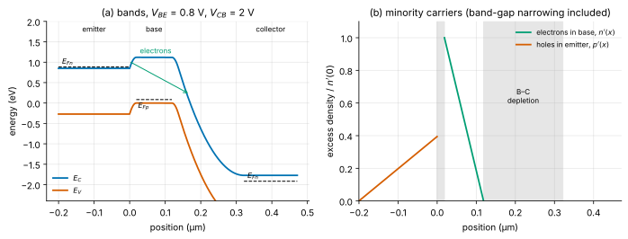
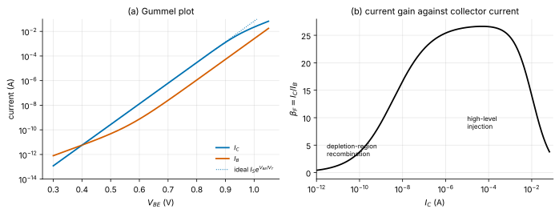
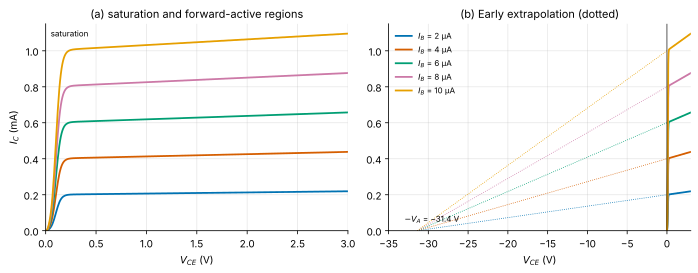
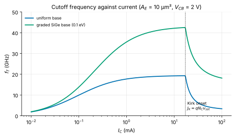

<!-- status: verified -->
# 09-07 · The Bipolar Junction Transistor

| | |
|---|---|
| **Course** | [09 · Semiconductor Devices](../README.md) |
| **University equivalent** | The bipolar junction transistor in a junior semiconductor-devices course: carrier flows and current gain, the Gummel number, band-gap narrowing and heterojunction transistors, the Early effect, Ebers–Moll, transit time, the hybrid-π model, f_T and f_max, charge control (Pierret, *Semiconductor Device Fundamentals*, ch. 10–12; Streetman & Banerjee, ch. 7; Hu, *Modern Semiconductor Devices for Integrated Circuits*, ch. 8) |
| **Prerequisites** | [09-06 PN Junction I–V, Capacitance and Breakdown](09-06-pn-junction-iv-and-capacitance.md) (short diodes, injection efficiency, charge control), [09-05 PN Junction Electrostatics](09-05-pn-junction-electrostatics.md) (depletion width, junction capacitance), [09-03 Drift and Diffusion](09-03-drift-and-diffusion.md) (built-in fields, velocity saturation) |
| **Estimated study hours** | 9 |
| **Last verified** | 2026-11-19 |

**Learning objectives.** After this chapter you can:

1. Explain how a bipolar transistor turns a small base current into a large collector current, and derive the collector current from the base's minority-carrier diffusion problem, including the Gummel number.
2. Derive the base current and current gain from emitter injection and base recombination, and quantify how band-gap narrowing and a SiGe base change them.
3. Derive the Early voltage from base-width modulation and compute output resistance and intrinsic gain.
4. Use the Ebers–Moll model across the operating regions and compute the saturation voltage.
5. Compute base and collector transit times, the hybrid-π parameters, the cutoff frequency f_T and the maximum oscillation frequency f_max, and explain current-gain and f_T fall-off (high injection, Kirk effect).
6. Analyze large-signal switching with the charge-control model.

---

## 1. Big picture

Put two PN junctions back to back, so close together that the region between them is thinner than a diffusion length, and you get an amplifier. Forward-bias the first junction (emitter–base), and electrons flood into the thin middle region (the base). Almost all of them diffuse straight across it and are swept out by the reverse-biased second junction (base–collector). The collector current is set exponentially by the base–emitter voltage, exactly as in the diode of 09-06, but it flows into a terminal that does not control it, and only a small base current is needed to sustain it. The **bipolar junction transistor (BJT)** was the first mass-produced transistor. Hu notes that MOS technology's "high-density and low-power advantages" steadily eroded its dominance after the late 1960s, but that BJTs "are still preferred in some high-frequency and analog applications because of their high speed, low noise, and high output power" [1].

- **RF and mmWave front ends** use SiGe heterojunction bipolar transistors (HBTs), often integrated with CMOS as BiCMOS. Production SiGe processes now offer cutoff frequencies of 300 GHz and more (§9).
- **Analog precision**: bandgap references, temperature sensors and some low-noise amplifiers rely on the BJT's exactly exponential $I_C(V_{BE})$ and its transconductance of $I_C/V_T$, the largest per unit current of any transistor.
- **Every CMOS process contains parasitic BJTs** (in wells and substrates). They provide the diode-like devices used for on-chip references, and they cause latch-up (09-11).
- **Power**: insulated-gate bipolar transistors (IGBTs) and older power BJTs use bipolar injection to carry high current densities (Course 22).

## 2. Intuition first

**A waterfall with a gate.** Picture electrons on the emitter side as a reservoir held behind a dam (the emitter–base barrier). Lowering the dam by $V_{BE}$ lets electrons spill over into the base, in numbers that rise by $e^{qV_{BE}/kT}$. The base is a short, gently sloping valley: electrons wander across it by diffusion. On the far side is a cliff, the reverse-biased base–collector junction, where every electron that arrives is swept down into the collector. The collector voltage only changes how high the cliff is; it barely affects how many electrons reach the edge. So the collector current is set by the emitter–base voltage alone, and the collector behaves like a current source.

**Why so little base current?** The base supplies holes that leak back into the emitter, and holes to replace the few that recombine with electrons crossing the base. Make the emitter far more heavily doped than the base, so that electron injection dominates hole injection (09-06's injection efficiency). Make the base far thinner than a diffusion length, so that almost no electrons recombine in transit. Then the base current is a hundred times smaller than the collector current.

**A finance analogy: a broker on commission.** The base current is the broker's commission; the collector current is the client flow it unlocks. The commission is a fixed small fraction (1/β) of the flow, and the flow itself is set by the market price (the barrier height). *Where the analogy breaks:* there is no negotiation. The ratio is fixed by doping and geometry, and the base current does not "cause" the collector current: both are consequences of $V_{BE}$, which is why designers prefer to think of the BJT as voltage-controlled.

*Figure 1. An NPN transistor in the forward-active mode, computed for the transistor of the worked examples at $V_{BE}$ = 0.8 V and $V_{CB}$ = 2 V. (a) Energy-band diagram: electrons injected from the emitter over the lowered barrier diffuse across the thin base and fall into the collector. (b) Excess minority carriers: a straight-line electron profile in the base, from $n'(0)$ to zero at the collector edge, and a far smaller hole profile in the emitter.*

## 3. Theory

We analyze an NPN transistor (Hu notes that BJTs "are almost exclusively of the NPN type" because electrons are faster than holes [1]). The emitter is doped $N_E$ (n⁺), the base $N_B$ (p), and the collector $N_C$ (n). $W_B$ is the **neutral** base width between the two depletion regions, and $W_E$ the neutral emitter width up to its contact. $A_E$ is the emitter area. Currents $I_C$ and $I_B$ flow *into* the collector and base terminals, and $I_E = I_C + I_B$ flows *out of* the emitter. $V_{BE}$ and $V_{BC}$ are the base–emitter and base–collector voltages.

### 3.1 Operating regions

Each junction can be forward or reverse biased, so the transistor has four regions:

| Region | Base–emitter | Base–collector | Behavior | Used for |
|---|---|---|---|---|
| Forward active | forward | reverse | $I_C \approx I_Se^{V_{BE}/V_T}$, nearly independent of $V_{CE}$ | amplifiers |
| Saturation | forward | forward | both junctions inject; $V_{CE}$ ≈ 0.05–0.2 V | switch "on" |
| Cutoff | reverse | reverse | only leakage | switch "off" |
| Reverse active | reverse | forward | emitter and collector swap roles; poor gain | rarely used |

Note the confusing name: a BJT's *saturation* region is where the collector voltage is low, the opposite of a MOSFET's saturation region (09-09), as Hu also warns [1].

### 3.2 The collector current

In the forward-active mode, the emitter–base junction is forward biased and the base–collector junction reverse biased. Take $x = 0$ at the emitter-side edge of the neutral base and $x = W_B$ at the collector-side edge. The excess electrons in the base obey the steady minority-carrier diffusion equation (09-04), $D_B\,d^2n'/dx^2 = n'/\tau_B$, with boundary conditions from the law of the junction (09-06 §3.1):

$$
n'(0) = n_{B0}\big(e^{V_{BE}/V_T} - 1\big), \qquad n'(W_B) = n_{B0}\big(e^{V_{BC}/V_T} - 1\big) \approx -n_{B0} \approx 0 ,
$$

where $n_{B0} = n_{iB}^2/N_B$ is the equilibrium electron density in the base. The base material's intrinsic density $n_{iB}$ may differ from silicon's $n_i$ (§3.5). This is the short diode of 09-06 §3.3 with the contact replaced by the collector junction. Since $W_B$ is far less than the diffusion length $L_B = \sqrt{D_B\tau_B}$, the profile is a straight line:

$$
n'(x) = n'(0)\Big(1 - \frac{x}{W_B}\Big) .
$$

The collector current is the diffusion current of this profile (electrons flowing in $+x$ carry conventional current into the collector):

$$
I_C = qA_ED_B\frac{n'(0)}{W_B} = \frac{qA_ED_Bn_{iB}^2}{W_BN_B}\big(e^{V_{BE}/V_T} - 1\big) \equiv I_S\big(e^{V_{BE}/V_T} - 1\big) .
$$

The **saturation current** $I_S$ looks like a short diode's because it *is* one. Writing $I_S = qA_En_i^2/G_B$ defines the **base Gummel number**

$$
G_B = \frac{N_BW_B}{D_B}\,\frac{n_i^2}{n_{iB}^2} \qquad\text{(uniform base)}, \qquad
G_B = \int_0^{W_B}\frac{n_i^2}{n_{iB}^2}\,\frac{p(x)}{D_B(x)}\,dx \qquad\text{(general)} ,
$$

in s/cm⁴ [1]. For a silicon base at low injection, $G_B$ is just the number of base dopant atoms per unit area, $\int N_B\,dx$, divided by $D_B$. The collector current depends on how much base charge the electrons must "see" on their way across, not on the profile's details. A **Gummel plot** of $\ln I_C$ and $\ln I_B$ against $V_{BE}$ shows the 59.5 mV/decade slope (09-06); its intercept gives $I_S$ and therefore $G_B$.

**High-level injection.** When $n'(0)$ approaches $N_B$, quasi-neutrality raises the hole density as well, and as in the diode (09-06 §3.5) $n \approx p \approx n_ie^{V_{BE}/2V_T}$. The collector current then rises only as $e^{V_{BE}/2V_T}$, 119 mV per decade, above a "knee" current [1].

### 3.3 The base current and current gain

The base current has three parts.

**1. Hole injection into the emitter.** The forward-biased emitter–base junction injects holes into the emitter as well, exactly as a diode does. Treating the emitter as a short region of width $W_E$ ending at its contact:

$$
I_{B1} = \frac{qA_ED_En_{iE}^2}{W_EN_E}\big(e^{V_{BE}/V_T} - 1\big) ,
$$

with $D_E$ the hole diffusion coefficient in the emitter and $n_{iE}$ the emitter's intrinsic density (larger than $n_i$ because of band-gap narrowing, §3.4).

**2. Recombination in the base.** A few electrons recombine while crossing. The stored excess electron charge is the triangle $Q_B = qA_En'(0)W_B/2$, and it recombines at the rate $Q_B/\tau_B$, which the base must resupply with holes:

$$
I_{B2} = \frac{Q_B}{\tau_B} = \frac{qA_En'(0)W_B}{2\tau_B} = I_C\frac{W_B^2}{2D_B\tau_B} = I_C\frac{W_B^2}{2L_B^2} .
$$

**3. Recombination in the emitter–base depletion region**, $\propto e^{V_{BE}/2V_T}$ (09-06 §3.5). It dominates at very low current and makes the gain fall there.

**Current gain.** The common-emitter current gain is $\beta_F = I_C/I_B$. When the first two parts dominate:

$$
\frac{1}{\beta_F} = \frac{I_{B1}}{I_C} + \frac{I_{B2}}{I_C} = \frac{D_EW_BN_Bn_{iE}^2}{D_BW_EN_En_{iB}^2} + \frac{W_B^2}{2L_B^2} .
$$

The first term is the **emitter-injection** limit; the second is the **base-transport** limit. In a modern transistor, $W_B \approx 0.1$ µm against diffusion lengths of micrometers, so base recombination is negligible, and

$$
\beta_F \approx \frac{G_E}{G_B} = \frac{D_BW_EN_En_{iB}^2}{D_EW_BN_Bn_{iE}^2} ,
$$

the ratio of the emitter and base Gummel numbers [1]. A heavily doped emitter, a lightly doped thin base, and a fast minority carrier in the base all raise gain. The gain is constant only over a middle range of current (Figure 2): depletion-region recombination lowers it at low current, and high-level injection in the base lowers it at high current [1]. The **common-base gain** $\alpha_F = I_C/I_E = \beta_F/(1 + \beta_F)$ is just below 1. It is the product of the **emitter injection efficiency** $\gamma = I_{nE}/I_E$ (the fraction of emitter current that is electrons injected into the base) and the **base transport factor** $\alpha_T$ (the fraction of those that reach the collector).

*Figure 2. (a) Gummel plot of the worked-example transistor, computed with high-level injection in the base and depletion-region recombination in the emitter–base junction (an assumed 0.1 µs lifetime over a 30 nm depletion width). (b) The resulting current gain against collector current: flat over the middle decades, falling at both ends.*

### 3.4 Heavy doping: band-gap narrowing

To raise $\beta_F$, emitters are doped above 10²⁰ cm⁻³. At such densities the dopant atoms perturb the crystal enough to shrink the band gap by $\Delta E_{gE}$, and $n_i^2 \propto e^{-E_g/kT}$ grows:

$$
n_{iE}^2 = n_i^2\,e^{\Delta E_{gE}/kT} .
$$

The emitter-injection term of $1/\beta_F$ rises by the same factor. Published narrowing values disagree. Hu gives $\Delta E_{gE}$ as negligible below 10¹⁸ cm⁻³, 50 meV at 10¹⁹, 95 meV at 10²⁰ and 140 meV at 10²¹ cm⁻³ [1]. The handbook fit used in 09-02, $\Delta E_g \approx 3.5\times10^{-8}N^{1/3}$ eV, gives **75** meV at 10¹⁹ and **162** meV at 10²⁰ cm⁻³ [2] **[Contested]**. Because the gain depends on $e^{\Delta E_{gE}/kT}$, a 67 meV disagreement is a factor of about 13 in predicted gain (Example 09-07.2 shows the consequence). This is one reason emitter Gummel numbers are measured, not computed. Raising emitter doping beyond about 10²⁰ cm⁻³ buys little gain, because narrowing undoes most of it. High-performance BJTs instead use a **polysilicon emitter**: a thick (over 100 nm) arsenic-doped polysilicon layer on top of a shallow single-crystal emitter, which raises the effective $W_E$ and with it the emitter Gummel number [1].

### 3.5 Heterojunction bipolar transistors

The gain formula contains $n_{iB}^2/n_{iE}^2$. Narrowing the *base* band gap raises $n_{iB}^2$ and the gain together. Silicon–germanium does this: Hu notes that $\text{Si}_{1-y}\text{Ge}_y$ with Ge fraction $y$ = 0.2 has a band gap about 0.1 eV smaller than silicon's [1], so

$$
\frac{n_{iB}^2}{n_i^2} = e^{\Delta E_{gB}/kT} = e^{0.1/0.025852} = \mathbf{47.9} .
$$

A transistor whose emitter and base are different semiconductors is a **heterojunction bipolar transistor (HBT)**. In practice, designers spend this gain on other parameters. They dope the base more heavily, which lowers base resistance (and so raises f_max, §3.9) and reduces base-width modulation (§3.6), while keeping a useful $\beta$. They also grade the germanium fraction, from about 0 at the emitter end to 0.2 at the collector end [1]. The conduction-band edge then slopes down across the base, a built-in **drift field** of $\Delta E_{gB}/(qW_B)$ that pushes electrons toward the collector and shortens the transit time (§3.8). III–V HBTs (InP emitter with InGaAs base, AlGaAs emitter with GaAs base) use the same principle [1].

### 3.6 Base-width modulation: the Early effect

*Symbol note:* in this chapter $V_A$ is the **Early voltage**; in 09-06 the same letters meant the applied junction voltage. Junction voltages here are written $V_{BE}$ and $V_{BC}$.

Raising $V_{CB}$ widens the base–collector depletion region, and part of the widening eats into the base, so the neutral base width $W_B$ shrinks. Since $I_C \propto 1/W_B$, the collector current rises with $V_{CE}$ even at fixed $V_{BE}$. Extrapolated backward, the output characteristics meet the voltage axis near a common point $-V_A$. The **Early voltage** $V_A$ defines the output resistance $r_o = V_A/I_C$ [1].

**Deriving $V_A$.** With $I_C \propto 1/W_B$,

$$
\frac{\partial I_C}{\partial V_{CB}} = -\frac{I_C}{W_B}\frac{\partial W_B}{\partial V_{CB}} .
$$

The base-side depletion edge moves by $\partial x_{pB}$, uncovering acceptor charge $qN_B\,\partial x_{pB}$ per unit area, which by definition equals the junction capacitance per area times $\partial V_{CB}$: $qN_B\,\partial x_{pB} = C'_{jC}\,\partial V_{CB}$. Since $\partial W_B = -\partial x_{pB}$,

$$
V_A = \frac{I_C}{\partial I_C/\partial V_{CB}} = \frac{qN_BW_B}{C'_{jC}} = \frac{Q'_B}{C'_{jC}} ,
$$

the base's dopant charge per area divided by the base–collector junction capacitance per area. A large $V_A$ needs a heavily doped or wide base (both lower $\beta$) or a lightly doped collector, which pushes the depletion region into the collector instead. Hu concludes that the collector is "typically ten times lighter than base doping" [1]. A typical $V_A$ is around 50 V [1]. The **intrinsic voltage gain** of a transistor amplifier, $g_mr_o = (I_C/V_T)(V_A/I_C) = V_A/V_T$, is independent of current: **1,934** for $V_A$ = 50 V. Hu's anecdote from James Early describes discovering the effect while bored at a 1952 Bell Labs meeting [1].

### 3.7 The Ebers–Moll model

A transistor with both junctions biased can be described by superposition, because the base diffusion equation is linear in $n'$. Forward injection from the emitter, driven by $V_{BE}$, gives $I_C = I_S(e^{V_{BE}/V_T} - 1)$ and a base current $(I_S/\beta_F)(e^{V_{BE}/V_T} - 1)$. Reverse injection from the collector, driven by $V_{BC}$ with the roles of emitter and collector swapped, gives an emitter current $I_S(e^{V_{BC}/V_T} - 1)$ and a base current $(I_S/\beta_R)(e^{V_{BC}/V_T} - 1)$, where $\beta_R$ is the (small) reverse gain. The saturation current is the same in both directions, because $G_B$ is the same integral whichever way the electrons cross [1]. Adding the two cases, the **Ebers–Moll model** is [1]

$$
\begin{aligned}
I_C &= I_S\big(e^{V_{BE}/V_T} - 1\big) - I_S\Big(1 + \frac{1}{\beta_R}\Big)\big(e^{V_{BC}/V_T} - 1\big), \\
I_B &= \frac{I_S}{\beta_F}\big(e^{V_{BE}/V_T} - 1\big) + \frac{I_S}{\beta_R}\big(e^{V_{BC}/V_T} - 1\big) .
\end{aligned}
$$

In the forward-active region the $V_{BC}$ terms vanish. In saturation both junctions are forward biased: the collector also injects, the base profile $n'(W_B)$ rises above zero, the slope falls, and $I_C$ drops below $\beta_FI_B$.

**Saturation voltage.** Drive the transistor with a base current $I_B$ while the circuit limits the collector current to $I_C$, so that the **forced gain** $\beta_f = I_C/I_B$ is below $\beta_F$. With $x = e^{V_{BE}/V_T}$ and $y = e^{V_{BC}/V_T}$ (both ≫ 1), and $\alpha_R = \beta_R/(1 + \beta_R)$:

$$
I_C = I_S\big(x - y/\alpha_R\big) = \beta_f\Big(\frac{I_Sx}{\beta_F} + \frac{I_Sy}{\beta_R}\Big)
\;\Longrightarrow\;
\frac{x}{y} = \frac{1/\alpha_R + \beta_f/\beta_R}{1 - \beta_f/\beta_F} .
$$

Since $V_{CE} = V_{BE} - V_{BC} = V_T\ln(x/y)$:

$$
V_{CE,\text{sat}} = V_T\ln\frac{1/\alpha_R + \beta_f/\beta_R}{1 - \beta_f/\beta_F} .
$$

This intrinsic value is a few tens of millivolts. Measured values of 0.1–0.2 V include collector and emitter series resistance.

*Figure 3. Output characteristics from the Ebers–Moll model with base-width modulation ($\beta_F$ = 100, $\beta_R$ = 2, $V_A$ = 31.4 V). (a) Saturation at small $V_{CE}$, where the collector junction becomes forward biased, and the forward-active region. (b) Extrapolating the active-region slopes back to the voltage axis locates $-V_A$.*

### 3.8 Transit time and charge storage

The excess charge stored in a forward-active transistor is proportional to its collector current. The ratio is the **forward transit time** [1]:

$$
\tau_F = \frac{Q_F}{I_C} .
$$

It has several parts.

**Base transit time.** For the triangular profile, $Q_B = qA_En'(0)W_B/2$ and $I_C = qA_ED_Bn'(0)/W_B$, so

$$
\tau_B = \frac{W_B^2}{2D_B} ,
$$

the same transit time as a short diode (09-06 §3.3). Hu's example: a 70 nm base with $D_B$ = 10 cm²/s gives **2.45** ps, which Hu rounds to 2.5 ps [1].

**Drift-aided base.** A graded SiGe base adds a uniform field $\mathcal E = \Delta E_{gB}/(qW_B)$. Take $x$ from the emitter edge of the base toward the collector, and let $J$ and $\mathcal E$ be magnitudes, with the field pushing electrons toward the collector. In steady state the electron flux toward the collector is constant: drift down the field plus diffusion down the gradient, $J/q = \mu_nn\mathcal E - D_B\,dn/dx$, with $n(W_B) = 0$. Writing $\xi = \Delta E_{gB}/kT$ for the field's strength in thermal units, the solution is

$$
n(x) = \frac{JW_B}{qD_B\xi}\Big(1 - e^{-\xi(1 - x/W_B)}\Big) .
$$

(Check: $\mu_n\mathcal E = D_B\xi/W_B$ by the Einstein relation, so the drift term is $\mu_nn\mathcal E = (J/q)(1 - e^{-\xi(1 - x/W_B)})$; and $-D_B\,dn/dx = +(J/q)e^{-\xi(1 - x/W_B)}$. They add to $J/q$ at every $x$.) Integrating for the charge and dividing by $J$:

$$
\tau_B = \frac{W_B^2}{D_B}\cdot\frac{1}{\xi}\Big[1 - \frac{1 - e^{-\xi}}{\xi}\Big] ,
$$

which tends to $W_B^2/2D_B$ as $\xi \to 0$ and to $W_B^2/(\xi D_B) = W_B/(\mu_n\mathcal E)$, pure drift, for large $\xi$. A 0.1 eV grading ($\xi$ = 3.87) cuts the base transit time by a factor of **2.59**. Hu reports drift transistors with base transit times "several times less than $W_B^2/2D_B$, as short as 1 ps" [1].

**Collector transit.** Electrons cross the base–collector depletion region of width $W_{dC}$ at roughly the saturation velocity $v_{\text{sat}}$ (09-03). The mobile charge in transit is $I_CW_{dC}/v_{\text{sat}}$, but only half of it appears as a change in the base's charge. (A charge at position $x$ in a region of width $W$ induces image charges on the two sides in the ratio $(W - x):x$, and averaging over a uniform distribution gives one half.) So the collector delay is

$$
\tau_C = \frac{W_{dC}}{2v_{\text{sat}}} .
$$

**Emitter delay** (stored holes in the emitter) adds a further term. Hu notes that the base transit time is typically about half of $\tau_F$ [1].

**The Kirk effect.** The collector's depletion charge is $qN_C$, minus the mobile electrons carrying $I_C$, whose density is $n = I_C/(qA_Ev_{\text{sat}})$ [1]. When the current density approaches

$$
J_K \approx qN_Cv_{\text{sat}} ,
$$

the net charge in the collector depletion region vanishes and then reverses. The high-field region moves to the far side of the collector, and the neutral base effectively extends into the collector. The base widens, $\tau_F$ rises sharply, and $f_T$ falls [1]. Heavier collector doping postpones the Kirk effect but lowers the Early voltage and raises the base–collector capacitance: a central design trade-off.

### 3.9 Small-signal model, f_T and f_max

Linearizing about a forward-active operating point gives the **hybrid-π model** [1]:

- **Transconductance** $g_m = \partial I_C/\partial V_{BE} = I_C/V_T$: 38.7 mS at 1 mA and 300 K, the largest $g_m$ per ampere any transistor achieves (a MOSFET's is lower, 09-09).
- **Input resistance** $r_\pi = \beta_F/g_m$.
- **Input capacitance** $C_\pi = \tau_Fg_m + C_{jE}$: diffusion capacitance (stored charge, §3.8) plus the emitter–base depletion capacitance.
- **Output resistance** $r_o = V_A/I_C$.
- **Feedback capacitance** $C_\mu$, mainly the base–collector depletion capacitance $C_{jC}$.
- Parasitic series resistances: the base resistance $r_b$, and emitter and collector resistances.

**Cutoff frequency.** Drive the base with a small AC current $i_b$ and short the collector to AC ground. The current gain $\beta(\omega) = i_c/i_b = g_m/(1/r_\pi + j\omega C_{\text{in}})$, with $C_{\text{in}} = C_\pi + C_\mu$, falls as $1/\omega$ above $\omega = 1/(r_\pi C_{\text{in}})$. It reaches unity at the **cutoff frequency**

$$
f_T = \frac{g_m}{2\pi(C_\pi + C_\mu)} = \frac{1}{2\pi\big[\tau_F + (C_{jE} + C_{jC})V_T/I_C\big]} ,
$$

Hu's Eq. (8.9.5) without the parasitic-resistance term [1]. At low current, the depletion capacitances, charged through $1/g_m$, dominate the delay, so $f_T$ rises with $I_C$. At moderate current, $f_T$ approaches $1/(2\pi\tau_F)$. At high current, the Kirk effect raises $\tau_F$ and $f_T$ falls, so transistors are biased near the $f_T$ peak [1].

**Maximum oscillation frequency.** The frequency at which power gain falls to unity depends also on the base resistance and the feedback capacitance [1]:

$$
f_{\max} = \sqrt{\frac{f_T}{8\pi r_bC_{jC}}} .
$$

Low base resistance (a heavily doped base, which SiGe makes affordable, and narrow emitter stripes contacted from both sides) and low base–collector capacitance are therefore as important as transit time.

> **Going deeper — where the $8\pi$ comes from.** Use the hybrid-π model with base resistance $r_b$ in series with the base and $C_{jC}$ from base to collector, at frequencies well above $f_T/\beta$, where $C_\pi$ shorts $r_\pi$. Three facts set the power gain. (1) The input is essentially $r_b$, so the input power is $|i_b|^2r_b$. (2) The current gain is $|i_c/i_b| \approx \omega_T/\omega$. (3) Seen from the collector, $C_{jC}$ feeds the output voltage back to the base node, where it is converted to current by $g_m$ through the divider $C_{jC}/(C_\pi + C_{jC})$; this acts as an output conductance $g_o \approx g_mC_{jC}/(C_\pi + C_{jC}) \approx \omega_TC_{jC}$. A conjugate-matched load then receives $|i_c|^2/4g_o$. The power gain is
>
> $$
> G = \frac{|i_c|^2/4g_o}{|i_b|^2r_b} = \frac{(\omega_T/\omega)^2}{4\omega_TC_{jC}r_b} = \frac{\omega_T}{4\omega^2r_bC_{jC}} ,
> $$
>
> falling 20 dB per decade. Setting $G = 1$ gives $\omega_{\max}^2 = \omega_T/(4r_bC_{jC})$, which with $\omega = 2\pi f$ is the formula above. This is an estimate (it ignores emitter resistance and the frequency dependence of $g_o$); its value is in showing which three parameters set $f_{\max}$.

*Figure 4. Cutoff frequency against collector current for the worked-example transistor with a uniform and a graded SiGe base. $f_T$ rises as $g_m$ grows, levels off at $1/(2\pi\tau_F)$ and collapses above the Kirk-effect current; the collapse uses an illustrative base push-out of $W_{dC}(1 - J_K/J)$.*

### 3.10 Charge control and switching

Hu extends the charge-storage idea to large signals [1]. Assume $I_C(t) = Q_F(t)/\tau_F$ holds instant by instant. In steady state the base current replaces the stored holes lost to recombination, $I_B = Q_F/(\tau_F\beta_F)$, so in general

$$
\frac{dQ_F}{dt} = I_B(t) - \frac{Q_F}{\tau_F\beta_F} .
$$

This is the same leaky-bucket equation as the diode's (09-06 §3.8), with time constant $\tau_F\beta_F$. For a step of base current $I_B$ at $t = 0$:

$$
Q_F(t) = I_B\tau_F\beta_F\big(1 - e^{-t/\tau_F\beta_F}\big), \qquad I_C(t) = \beta_FI_B\big(1 - e^{-t/\tau_F\beta_F}\big) .
$$

If the load limits the collector current to $I_{C,\text{sat}} < \beta_FI_B$, the transistor enters saturation when $I_C(t)$ reaches it, at

$$
t_{\text{on}} = \tau_F\beta_F\ln\frac{\beta_FI_B}{\beta_FI_B - I_{C,\text{sat}}} .
$$

Once saturated, the excess base drive keeps storing charge (both junctions now inject). At turn-off, that charge must be removed before the collector current can fall: a **storage delay** like the diode's. Overdriving the base speeds turn-on but lengthens the storage delay at turn-off. Historically, logic families clamped the base–collector junction with a Schottky diode (09-06 §3.10) to keep transistors out of saturation.

### 3.11 Two limits a designer meets: open-base breakdown and current crowding

**Breakdown with the base open.** The collector–base junction alone breaks down at $BV_{CBO}$ by avalanche (09-06 §3.8). With the base *open* the transistor breaks down much earlier, because its own gain amplifies the avalanche. Let the junction multiply every carrier crossing it by $M$. With the base floating, $I_E = I_C$, and the collector current is the multiplied sum of the transported emitter current and the leakage: $I_C = M(\alpha_FI_C + I_{CBO})$, so

$$
I_C = \frac{MI_{CBO}}{1 - M\alpha_F} .
$$

The current runs away when $M\alpha_F = 1$, that is when $M = 1/\alpha_F \approx 1 + 1/\beta_F$: only a few percent of multiplication suffices, far below the infinite $M$ that defines $BV_{CBO}$. With the empirical form $M = 1/[1 - (V/BV_{CBO})^n]$ (Miller's fit, with $n$ between about 3 and 6 for silicon junctions; Sze and Ng, ch. 5), the condition $1 - (V/BV_{CBO})^n = 1 - \alpha_F = 1/(\beta_F + 1)$ gives

$$
BV_{CEO} = \frac{BV_{CBO}}{(\beta_F + 1)^{1/n}} \approx \frac{BV_{CBO}}{\beta_F^{1/n}} .
$$

For $\beta_F$ = 100 and $n$ = 4, $BV_{CEO}/BV_{CBO} = 101^{-1/4}$ = **0.315**, about a third. This is the rating on a transistor data sheet that matters in most circuits, and it is one more reason high-gain and high-voltage transistors pull against each other.

**Emitter current crowding.** The base current flows sideways under the emitter to reach the base contact, and the base's sheet resistance makes the junction voltage fall along that path. Because collector current depends exponentially on $V_{BE}$, a drop of only $V_T$ (26 mV) cuts the local injection by $e$: the emitter's edges nearest the base contact carry most of the current and the center little. Wide emitters therefore waste area and suffer local high-injection effects at their edges. The cure is geometric: narrow emitter stripes, contacted by base on both sides, which also lowers $r_b$ for $f_{\max}$ (§3.9).

## 4. Worked examples

Unless stated otherwise, the transistor is an NPN with emitter area $A_E$ = 10 µm² (1 × 10⁻⁷ cm²), neutral base width $W_B$ = 0.1 µm, uniform base doping $N_B$ = 10¹⁸ cm⁻³, emitter doping $N_E$ = 10²⁰ cm⁻³ with effective width $W_E$ = 0.2 µm, and collector doping $N_C$ = 10¹⁷ cm⁻³, at 300 K. Course values hold ($n_i$ = 10¹⁰ cm⁻³, $V_T$ = 25.852 mV, the handbook mobility model).

### Example 09-07.1 · Collector current and the Gummel number (tier A)

**Setup.** (a) Find the electron diffusion coefficient in the base and the saturation current $I_S$. (b) Find $V_{BE}$ at 1 µA and 1 mA. (c) Find the base Gummel number and the base dopant count per unit area. (d) At 1 mA, compare $n'(0)$ with $N_B$.

**Solution.**

(a) $\mu_n(10^{18})$ = **263.3** cm²/V·s, so $D_B$ = **6.807** cm²/s. Then

$$
I_S = \frac{qA_ED_Bn_i^2}{W_BN_B} = \frac{1.602\times10^{-19} \times 10^{-7} \times 6.807 \times 10^{20}}{10^{-5} \times 10^{18}} = \mathbf{1.091\times10^{-18}}\text{ A} .
$$

(b) $V_{BE} = V_T\ln(I_C/I_S)$: **0.7121** V at 1 µA and **0.8907** V at 1 mA.

(c) $G_B = N_BW_B/D_B$ = **1.469 × 10¹²** s/cm⁴. The base holds $N_BW_B$ = **1.0 × 10¹³** dopant atoms per cm², which is **1.0 × 10⁵** per µm² of emitter.

(d) $n'(0) = (n_i^2/N_B)e^{V_{BE}/V_T}$ = **9.17 × 10¹⁶** cm⁻³, **9.2**% of $N_B$. The transistor is near the edge of low-level injection: 1 mA in 10 µm² is 10⁴ A/cm².

**Units check.** $qAD n_i^2/(WN)$: C · cm² · cm²/s · cm⁻⁶ ÷ (cm · cm⁻³) = C/s = A. ✓

**Sanity check.** Bipolar transistors in high-speed processes operate near 0.8–0.9 V of $V_{BE}$ at milliamp currents in micrometer-scale emitters, as here. The tiny $I_S$ reflects a small area and a heavily doped base.

### Example 09-07.2 · Current gain, band-gap narrowing and SiGe (tier B)

**Setup.** Neglect base recombination. (a) Find the hole diffusion coefficient in the emitter and $\beta_F$ ignoring band-gap narrowing. (b) Find $\beta_F$ with Hu's 95 meV narrowing at 10²⁰ cm⁻³, and with the handbook fit. (c) A SiGe base narrows the base gap by 0.1 eV. Find $\beta_F$ (with Hu's emitter narrowing). (d) The designer uses the SiGe gain to raise the base doping to 10¹⁹ cm⁻³ at the same width. Find the new $\beta_F$, and the intrinsic base sheet resistance before and after. (e) For comparison, an old long-base transistor has $W_B$ = 2 µm, $N_B$ = 10¹⁶ cm⁻³ and $\tau_B$ = 1 µs. What gain limit does base transport alone impose?

**Solution.**

(a) $\mu_p(10^{20})$ = **49.48** cm²/V·s, so $D_E$ = **1.279** cm²/s, and

$$
\beta_F = \frac{D_BW_EN_E}{D_EW_BN_B} = \frac{6.807 \times 0.2 \times 10^{20}}{1.279 \times 0.1 \times 10^{18}} = \mathbf{1064} .
$$

(b) Hu: $e^{0.095/0.025852}$ = **39.44**, so $\beta_F$ = **27.0**. Handbook: $\Delta E_g$ = **0.1625** eV, a factor of **536**, so $\beta_F$ = **1.99**. The two published narrowings predict gains a factor of 13.6 apart, and the second is plainly too pessimistic for a working transistor at these dimensions.

(c) $e^{0.1/0.025852}$ = **47.85**, so $\beta_F = 27.0 \times 47.85$ = **1291**.

(d) At 10¹⁹ cm⁻³, $D_B$ = **2.996** cm²/s and $\beta_F$ = **56.8**. The base sheet resistance $1/(q\mu_pN_BW_B)$ falls from **6798** Ω/□ to **1107** Ω/□ (hole mobility at 10¹⁸ and 10¹⁹ cm⁻³).

(e) $W_B^2/2L_B^2$ with $L_B^2 = D_B\tau_B = 32.26 \times 10^{-6}$ cm² gives $1/\beta_T$ = **6.20 × 10⁻⁴**, so the transport limit is $\beta$ = **1613**.

**Sanity check.** Hu's measured SiGe device shows a gain of about 90 [1], which lies inside the range spanned by (b) to (d) for SiGe bases; the large spread between published narrowings shows why the emitter Gummel number is measured rather than computed. The SiGe trade in (d) is the standard one: a sixfold drop in base resistance for a still-healthy gain. (Part (d) ignores band-gap narrowing in the base itself, about 50 meV at 10¹⁹ cm⁻³ by Hu's table [1]; including it would raise $n_{iB}^2$ and the gain by $e^{0.050/0.025852}$ = **6.92**, more than recovering the loss, so the assumption makes (d) conservative.)

### Example 09-07.3 · The Early voltage (tier B)

**Setup.** With $V_{CB}$ = 2 V, find (a) the base–collector built-in potential, depletion width and its split, (b) the junction capacitance per area, (c) $V_A$, (d) $r_o$ and the intrinsic gain $g_mr_o$ at 1 mA.

**Solution.**

(a) $V_{bi} = V_T\ln(N_BN_C/n_i^2)$ = **0.8929** V. Then $W = \sqrt{2\varepsilon_s(V_{bi} + V_{CB})(1/N_B + 1/N_C)/q}$ = **0.2029** µm. Of this, **18.4** nm lies in the base and **0.1844** µm in the collector.

(b) $C'_{jC} = \varepsilon_s/W$ = **5.107 × 10⁻⁸** F/cm², that is **0.511** fF/µm².

(c) $V_A = qN_BW_B/C'_{jC} = 1.602\times10^{-19} \times 10^{18} \times 10^{-5}/5.107\times10^{-8}$ = **31.4** V.

(d) $r_o = V_A/I_C$ = **31.4** kΩ and $g_mr_o = V_A/V_T$ = **1214**.

**Sanity check.** Ten times lighter collector doping puts 91% of the depletion width in the collector, so the base loses only 18 nm at 2 V. A 31 V Early voltage is comparable with the 50 V Hu calls typical [1].

### Example 09-07.4 · Ebers–Moll and saturation (tier B)

**Setup.** The transistor has $\beta_F$ = 100 and $\beta_R$ = 2. A switch circuit drives $I_B$ = 0.1 mA while the load limits $I_C$ to 1 mA. (a) Find $\alpha_F$ and $\alpha_R$. (b) Find $V_{CE,\text{sat}}$ from the formula. (c) Solve the Ebers–Moll equations for $V_{BE}$ and $V_{BC}$.

**Solution.**

(a) $\alpha_F = 100/101$ = **0.9901**; $\alpha_R = 2/3$ = **0.667**.

(b) $\beta_f$ = 10, so

$$
V_{CE,\text{sat}} = 0.025852\ln\frac{1.5 + 10/2}{1 - 10/100} = 0.025852\ln7.222 = \mathbf{51.1}\text{ mV} .
$$

(c) Numerical solution of the two equations gives $V_{BE}$ = **0.8967** V and $V_{BC}$ = **0.8456** V, whose difference reproduces (b).

**Sanity check.** Both junctions are strongly forward biased, the hallmark of saturation; the collector junction sits only 51 mV below the emitter junction. Measured $V_{CE,\text{sat}}$ is larger because of series resistance.

### Example 09-07.5 · Transit times, f_T and the Kirk effect (tier B)

**Setup.** At $I_C$ = 1 mA and $V_{CB}$ = 2 V: (a) find the base transit time for the uniform base; (b) find it for a SiGe base graded by 0.1 eV, and the built-in field; (c) find the collector transit time using the depletion width of Example 09-07.3 and the course saturation velocity $v_{\text{sat}} = 1.53\times10^9\,T^{-0.87}$ cm/s; (d) with $C_{jE}$ = 20 fF and $C_{jC}$ = 0.511 fF/µm² over a collector area twice the emitter's, find $f_T$ for both bases (neglect emitter delay); (e) estimate the Kirk-effect current.

**Solution.**

(a) $\tau_B = W_B^2/2D_B = 10^{-10}/(2 \times 6.807)$ = **7.35** ps.

(b) $\xi = 0.1/0.025852$ = **3.868**, and the bracket $[1 - (1 - e^{-\xi})/\xi]/\xi$ = **0.1931**. So $\tau_B = 0.1931\,W_B^2/D_B$ = **2.84** ps, **2.59** times faster. The field is 0.1 V/0.1 µm = **1.0 × 10⁴** V/cm.

(c) $v_{\text{sat}}$ = **1.07 × 10⁷** cm/s, so $\tau_C = 0.1844\ \mu\text{m}/(2v_{\text{sat}})$ = **0.861** ps.

(d) $C_{jC}$ = **10.2** fF, so the charging term $(C_{jE} + C_{jC})V_T/I_C$ = **0.781** ps.

- Uniform base: $\tau_F$ = 7.35 + 0.86 = **8.21** ps, the total delay is **8.99** ps, and $f_T = 1/(2\pi \times 8.99\text{ ps})$ = **17.7** GHz.
- Graded base: the total delay is **4.48** ps and $f_T$ = **35.5** GHz.

(e) $J_K = qN_Cv_{\text{sat}}$ = **1.72 × 10⁵** A/cm², that is **1.72** mA/µm², or **17.2** mA for this emitter.

**Sanity check.** The base transit time dominates, so grading the base doubles $f_T$. Modern SiGe HBTs reach hundreds of gigahertz with bases a few tens of nanometers thick and aggressive vertical scaling (§9). The Kirk current density matches the scale at which Hu's measured transit time starts to rise, around 1 mA/µm² [1].

### Example 09-07.6 · The hybrid-π model and f_max (tier B)

**Setup.** For the uniform-base transistor at 1 mA with $\beta_F$ = 100: find $g_m$, $r_\pi$, $C_\pi$ (with $C_{jE}$ = 20 fF and $\tau_F$ = 8.21 ps), $r_o$, and $f_{\max}$ for a base resistance of 100 Ω.

**Solution.** $g_m = I_C/V_T$ = **38.68** mS and $r_\pi = \beta_F/g_m$ = **2585** Ω. The diffusion part of $C_\pi$ is $\tau_Fg_m$ = **317.6** fF, so $C_\pi$ = **337.6** fF. $r_o$ = 31.4 kΩ (Example 09-07.3). Finally

$$
f_{\max} = \sqrt{\frac{17.7\times10^9}{8\pi \times 100 \times 10.2\times10^{-15}}} = \mathbf{26.3}\text{ GHz} .
$$

**Sanity check.** Hu's measured SiGe example at 1 mA has $g_m$ = 39 mS, $r_\pi$ = 2.3 kΩ and $C_\pi$ ≈ 200 fF with $\tau_F$ ≈ 5 ps [1], close to these values. $f_{\max}$ exceeds $f_T$ only if $r_bC_{jC}$ is small. Halving $r_b$ raises $f_{\max}$ by √2.

### Example 09-07.7 · Switching by charge control (tier B)

**Setup.** The transistor of Example 09-07.6 ($\tau_F$ = 8.21 ps, $\beta_F$ = 100) receives a base-current step of 20 µA at $t = 0$; the load limits $I_C$ to 1 mA. (a) Find the charge-control time constant. (b) When does the transistor saturate? (c) How much charge is stored at the edge of saturation, and how much would the base drive eventually store if the collector current were not limited?

**Solution.**

(a) $\tau_F\beta_F$ = **0.821** ns.

(b) $\beta_FI_B$ = 2 mA, so $t_{\text{on}} = 0.821\ln(2/(2 - 1))$ = **0.569** ns.

(c) $Q_F = I_C\tau_F$ = **8.21** fC at the edge of saturation. The base drive could sustain $I_B\tau_F\beta_F$ = **16.4** fC. The difference is extra stored charge that the turn-off must remove.

**Sanity check.** The time constant $\tau_F\beta_F$ is $\beta_F$ times the transit time, because the base current replaces stored charge only slowly. Doubling the base drive (forced gain 50 instead of 100) shortens turn-on but doubles the excess charge to be removed later.

### Answer key

<!-- answer-key -->
| ID | Quantity | Value | Unit |
|---|---|---|---|
| Ex 09-07.1a | electron mobility at 1e18 | 263.3 | cm²/V·s |
| Ex 09-07.1b | D_B | 6.807 | cm²/s |
| Ex 09-07.1c | I_S | 1.091e-18 | A |
| Ex 09-07.1d | V_BE at 1 µA | 0.7121 | V |
| Ex 09-07.1e | V_BE at 1 mA | 0.8907 | V |
| Ex 09-07.1f | base Gummel number | 1.469e12 | s/cm⁴ |
| Ex 09-07.1g | base dopants per area | 1.0e13 | cm⁻² |
| Ex 09-07.1h | n'(0) at 1 mA | 9.17e16 | cm⁻³ |
| Ex 09-07.1i | n'(0)/N_B at 1 mA | 9.2 | % |
| Ex 09-07.1j | base dopants per µm² | 1.0e5 | — |
| Ex 09-07.2a | hole mobility at 1e20 | 49.48 | cm²/V·s |
| Ex 09-07.2b | D_E | 1.279 | cm²/s |
| Ex 09-07.2c | β_F without narrowing | 1064 | — |
| Ex 09-07.2d | Hu narrowing factor | 39.44 | — |
| Ex 09-07.2e | β_F with Hu narrowing | 27.0 | — |
| Ex 09-07.2f | handbook narrowing at 1e20 | 0.1625 | eV |
| Ex 09-07.2g | handbook narrowing factor | 536 | — |
| Ex 09-07.2h | β_F with handbook narrowing | 1.99 | — |
| Ex 09-07.2i | SiGe factor | 47.85 | — |
| Ex 09-07.2j | β_F with SiGe base | 1291 | — |
| Ex 09-07.2k | D_B at 1e19 | 2.996 | cm²/s |
| Ex 09-07.2l | β_F, SiGe base at 1e19 | 56.8 | — |
| Ex 09-07.2m | base sheet resistance at 1e18 | 6798 | Ω/□ |
| Ex 09-07.2n | base sheet resistance at 1e19 | 1107 | Ω/□ |
| Ex 09-07.2o | 1/β_T, long base | 6.20e-4 | — |
| Ex 09-07.2p | transport-limited β | 1613 | — |
| Ex 09-07.2q | ratio of the two narrowing predictions | 13.6 | — |
| Ex 09-07.2r | gain factor from 50 meV of base narrowing | 6.92 | — |
| Ex 09-07.3a | V_bi base–collector | 0.8929 | V |
| Ex 09-07.3b | depletion width at V_CB = 2 V | 0.2029 | µm |
| Ex 09-07.3c | base side of the depletion width | 18.4 | nm |
| Ex 09-07.3d | collector side | 0.1844 | µm |
| Ex 09-07.3e | C'_jC | 5.107e-8 | F/cm² |
| Ex 09-07.3f | C'_jC per µm² | 0.511 | fF/µm² |
| Ex 09-07.3g | Early voltage | 31.4 | V |
| Ex 09-07.3h | r_o at 1 mA | 31.4 | kΩ |
| Ex 09-07.3i | intrinsic gain | 1214 | — |
| Ex 09-07.3j | collector share of depletion width | 91 | % |
| Ex 09-07.4a | α_F | 0.9901 | — |
| Ex 09-07.4b | α_R | 0.667 | — |
| Ex 09-07.4c | V_CE,sat | 51.1 | mV |
| Ex 09-07.4d | V_BE in saturation | 0.8967 | V |
| Ex 09-07.4e | V_BC in saturation | 0.8456 | V |
| Ex 09-07.4f | argument of the logarithm | 7.222 | — |
| Ex 09-07.5a | uniform-base transit time | 7.35 | ps |
| Ex 09-07.5b | ξ for 0.1 eV grading | 3.868 | — |
| Ex 09-07.5c | drift transit factor | 0.1931 | — |
| Ex 09-07.5d | graded-base transit time | 2.84 | ps |
| Ex 09-07.5e | speed-up from grading | 2.59 | — |
| Ex 09-07.5f | built-in field | 1.0e4 | V/cm |
| Ex 09-07.5g | saturation velocity | 1.07e7 | cm/s |
| Ex 09-07.5h | collector transit time | 0.861 | ps |
| Ex 09-07.5i | C_jC | 10.2 | fF |
| Ex 09-07.5j | depletion charging time | 0.781 | ps |
| Ex 09-07.5k | f_T, uniform base | 17.7 | GHz |
| Ex 09-07.5l | f_T, graded base | 35.5 | GHz |
| Ex 09-07.5m | Kirk current density | 1.72e5 | A/cm² |
| Ex 09-07.5n | Kirk current density per µm² | 1.72 | mA/µm² |
| Ex 09-07.5o | Kirk current for this emitter | 17.2 | mA |
| Ex 09-07.5p | τ_F, uniform base | 8.21 | ps |
| Ex 09-07.5q | total delay, uniform base | 8.99 | ps |
| Ex 09-07.5r | total delay, graded base | 4.48 | ps |
| Ex 09-07.6a | g_m | 38.68 | mS |
| Ex 09-07.6b | r_π | 2585 | Ω |
| Ex 09-07.6c | τ_F g_m | 317.6 | fF |
| Ex 09-07.6d | C_π | 337.6 | fF |
| Ex 09-07.6e | f_max | 26.3 | GHz |
| Ex 09-07.7a | charge-control time constant | 0.821 | ns |
| Ex 09-07.7b | time to saturation | 0.569 | ns |
| Ex 09-07.7c | stored charge at saturation edge | 8.21 | fC |
| Ex 09-07.7d | charge the base drive could sustain | 16.4 | fC |
| T 09-07.a | SiGe n_iB² enhancement for 0.1 eV | 47.9 | — |
| T 09-07.b | handbook narrowing at 1e19 | 75 | meV |
| T 09-07.c | handbook narrowing at 1e20 | 162 | meV |
| T 09-07.d | gain factor from a 67 meV disagreement | 13 | — |
| T 09-07.e | intrinsic gain for V_A = 50 V | 1934 | — |
| T 09-07.f | Hu's base transit time example | 2.45 | ps |
| T 09-07.g | g_m at 1 mA | 38.7 | mS |
| T 09-07.h | BV_CEO/BV_CBO for β_F = 100, n = 4 | 0.315 | — |

*Every value is recomputed by [verify_09_07.py](../verify/verify_09_07.py) by an independent route: the collector current by solving the base's diffusion boundary-value problem numerically (finite differences, including recombination); gains from the numerically computed electron and hole currents; the Early voltage by numerically differentiating the collector current as the depletion edge moves; saturation by solving the Ebers–Moll equations with a root finder; transit times by integrating the numerically solved drift–diffusion profile; f_T from the hybrid-π current gain evaluated against frequency; and switching by integrating the charge-control equation.*

## 5. Simulate it

The lab, [labs/09-07-lab](../labs/09-07-lab/README.md), has a notebook and an ngspice netlist:

1. Build a Gummel plot from the device equations (collector current with high-level injection, base current with emitter injection and depletion-region recombination), and plot $\beta_F$ against $I_C$, showing fall-off at both ends.
2. Compute output characteristics with base-width modulation, extract the Early voltage by extrapolation, and compare with $Q'_B/C'_{jC}$.
3. Solve the drift–diffusion base-transit problem for graded SiGe bases and plot $\tau_B$ against grading.
4. Compute $\beta(f)$ from the hybrid-π model and $f_T$ against $I_C$, including the Kirk-effect rise in $\tau_F$.
5. Run `bjt.cir` in ngspice: the SPICE Gummel–Poon model (which reduces to Ebers–Moll here) reproduces the saturation point of Example 09-07.4 and the output resistance of Example 09-07.3.

**Guided exercise (predict, then run).** **Before running Part 4**, predict: as $I_C$ rises from 10 µA to 10 mA, does $f_T$ rise, fall, or peak? Where, and why? Then run it and identify the regions where depletion charging, transit time and the Kirk effect each dominate.

## 6. Engineering tradeoffs

| Knob | Improves | Costs | Typical decision owner |
|---|---|---|---|
| Thinner base | Transit time, f_T; gain | Base resistance (lower f_max), punch-through, Early voltage | Device designers |
| Heavier base doping | Base resistance, Early voltage, punch-through margin | Gain (unless recovered with SiGe) | Device designers |
| SiGe base (and grading) | Gain, transit time (drift field) | Process complexity, strain limits on Ge content and thickness | Technology |
| Heavier emitter doping | Gain, up to ~10²⁰ cm⁻³ | Band-gap narrowing cancels the benefit; emitter–base capacitance | Device designers |
| Lighter collector doping | Early voltage, C_jC, breakdown | Kirk effect at lower current, collector resistance | Device designers |
| Bias current | g_m, f_T (up to the peak) | Power; Kirk effect beyond the peak | Circuit designers |
| Narrow emitter stripes, double base contacts | Base resistance, f_max | Current per stripe, layout area | Layout and device |
| BJT vs MOSFET for a function | g_m per current, matching, 1/f noise, f_T at a given lithography | Density, static input current, process cost of BiCMOS | Product and architecture |

## 7. Numbers to know

| Quantity | Value | Note |
|---|---|---|
| Transconductance | $I_C/V_T$: 38.7 mS at 1 mA | §3.9 |
| $V_{BE}$ at practical currents | about 0.7–0.9 V; −2 mV/K | Example 09-07.1, 09-06 |
| Current gain | typically ~100 (Hu's measured SiGe example about 90) | [1] |
| Early voltage | typical ~50 V; intrinsic gain $V_A/V_T$ ≈ 2,000 | [1] |
| Base transit time | $W_B^2/2D_B$: 2.5 ps for 70 nm (Hu); down to ~1 ps with grading | [1] |
| Emitter band-gap narrowing | 50 / 95 / 140 meV at 10¹⁹ / 10²⁰ / 10²¹ cm⁻³ (Hu); larger in the handbook fit | [1, 2] **[Contested]** |
| SiGe band-gap reduction | about 0.1 eV for 20% Ge | [1] |
| Kirk-effect onset | $J_K \approx qN_Cv_{\text{sat}}$: ~1–2 mA/µm² for $N_C$ ≈ 10¹⁷ cm⁻³ | §3.8, [1] |
| $V_{CE,\text{sat}}$ | tens of mV intrinsic; 0.1–0.2 V with series resistance | §3.7 |
| SiGe HBT record | f_T/f_max = 505/720 GHz (IHP, IEDM 2016) | [3] |
| Production SiGe BiCMOS | 300/500 GHz (IHP SG13G2), 470/650 GHz (SG13G3, research and prototyping), as of Feb 2026 | [4] |

## 8. Common mistakes

1. **Thinking the base current causes the collector current.** Both are set by $V_{BE}$; $\beta_F$ is a ratio of two consequences. Biasing by $V_{BE}$ (or a current mirror) is the precise way to set $I_C$.
2. **Using the total base width.** The *neutral* base width sets $I_C$, and it changes with both junction voltages (the Early effect).
3. **Assuming more emitter doping always helps.** Above about 10²⁰ cm⁻³, band-gap narrowing cancels the benefit.
4. **Treating β as a constant.** It falls at low current (depletion-region recombination) and at high current (high injection, Kirk effect), and varies with temperature and $V_{CB}$.
5. **Mixing up saturation regions.** BJT saturation means both junctions are forward biased and $V_{CE}$ is small: the opposite of MOSFET saturation.
6. **Using $1/(2\pi\tau_F)$ as $f_T$ at any current.** The depletion-capacitance charging term $(C_{jE} + C_{jC})V_T/I_C$ dominates at low current.
7. **Ignoring base resistance.** $f_{\max}$, noise and switching all depend on $r_b$; a fast transit time is wasted with a resistive base.
8. **Forgetting stored charge in saturation.** Turn-off delay grows with base overdrive.

## 9. Practitioner lens

### State of the art (as of Nov 2026)

- **SiGe HBT speed record.** IHP presented a "SiGe HBT with fT/fmax of 505 GHz/720 GHz" at IEDM 2016, concluding the EU DOTSEVEN project run with Infineon and twelve other partners [3] **[Established]**. No later SiGe record was found in this build's sources (open issue).
- **Production and prototyping SiGe BiCMOS.** IHP's 0.13 µm processes, as listed by Europractice in February 2026: SG13S with "fT/fmax = 250/300 GHz"; SG13G2, described as "the fastest currently available SiGe HBT technology featuring peak fT/fmax values of 300 GHz/500 GHz"; and SG13G3Cu, "the highest performance HBT with up to 470GHz transit frequencies and up to 650 GHz maximum oscillation frequencies", offered for research and prototyping [4]. The $f_T$/$f_{\max}$ figures are the published process values **[Established]**; "fastest currently available" is the provider's own description, not an independent ranking. SG13G2 also has an open-source PDK [4].
- **Where BJTs win.** Hu: BJTs remain "preferred in some high-frequency and analog applications because of their high speed, low noise, and high output power advantages such as in some cell phone amplifier circuits", usually as a small number of BJTs integrated with CMOS (BiCMOS) [1] **[Established]**.
- **Design data are measured.** Hu notes that small-signal parameters "are difficult to predict from theory with the accuracy required for commercial circuit design" and "are routinely determined through comprehensive measurement" [1] **[Established]**. The band-gap-narrowing disagreement in §3.4 shows why.

### Why it matters commercially

- **RF and mmWave.** Radar, high-speed wireline and optical-link front ends need transistors with f_T and f_max several times the operating frequency; SiGe BiCMOS provides them on silicon wafers with CMOS logic alongside. **Deeper:** see companion repo *Datacenter Networking* for the optical and electrical link context.
- **Precision analog.** Bandgap references and temperature sensors in nearly every SoC use bipolar (often parasitic) devices for their exact $V_T\ln$ behavior (09-06 §3.6; Course 20).
- **Process economics.** BiCMOS adds mask steps and cost; the decision is whether bipolar performance (g_m per current, noise, f_max at relaxed lithography) is worth the extra steps compared with an all-CMOS design at a more advanced node.

### Marketing vs Reality

- **"700 GHz transistor."** *Reality:* f_T and f_max are measured on optimized single devices at the f_T-peak bias, de-embedded from pads. Circuit speed is lower, and production process variants are slower than records. *Sanity check:* ask for f_T and f_max in the offered production PDK, at what current density, and with what parasitics included.
- **"High gain."** *Reality:* β depends on current, temperature and $V_{CB}$, and falls at both ends of the current range. *Sanity check:* ask for the Gummel plot and β(I_C) at the operating point and temperature extremes.
- **"BJTs are obsolete."** *Reality:* for many RF, mmWave and precision analog functions, SiGe BiCMOS remains competitive; the choice is a cost–performance question. *Sanity check:* compare noise figure, output power and f_max at the target frequency, not lithography node.

### Questions for engineering leaders

1. **"What are f_T and f_max of the production devices you will use, at the bias current you will use, with layout parasitics?"**
   - *Strong:* quotes PDK values against current density and explains where the f_T peak and the Kirk effect sit.
   - *Evasive:* quotes the record device.
2. **"How sensitive is your design to β variation across process, temperature and current?"**
   - *Strong:* designs for β-independence (feedback, current-mirror biasing) and shows Monte Carlo results.
   - *Evasive:* "β is about 100."
3. **"Why BiCMOS rather than RF CMOS for this product?"**
   - *Strong:* quantifies noise figure, output power, f_max and cost per wafer for both options.
   - *Evasive:* "We've always used SiGe."
4. **"What limits your amplifier's intrinsic gain and linearity?"**
   - *Strong:* cites the Early voltage ($V_A/V_T$), high-injection and Kirk effects at the bias point.
   - *Evasive:* attributes everything to "the process."

<!-- answer-key -->
| ID | Quantity | Value | Unit |
|---|---|---|---|
| P 09-07.a | SiGe record f_T | 505 | GHz |
| P 09-07.b | SiGe record f_max | 720 | GHz |
| P 09-07.c | SG13G2 f_T | 300 | GHz |
| P 09-07.d | SG13G2 f_max | 500 | GHz |
| P 09-07.e | SG13G3Cu f_T | 470 | GHz |
| P 09-07.f | SG13G3Cu f_max | 650 | GHz |

## 10. Concept check

**Q1.** Why must the base be much thinner than a diffusion length?

Answer

So that almost every electron injected from the emitter reaches the collector before recombining. The fraction lost is about $W_B^2/2L_B^2$; with $W_B$ = 0.1 µm and $L_B$ of micrometers it is negligible, and the base current is set by hole injection into the emitter instead. A base as long as a diffusion length would turn the device into two separate diodes.

**Q2.** Why is the emitter doped much more heavily than the base?

Answer

The ratio of electron injection into the base to hole injection into the emitter scales as $N_E/N_B$ (times the diffusion-coefficient and width ratios). A heavily doped emitter makes the injected current almost all electrons, which become collector current; the holes are wasted base current. Band-gap narrowing limits how far this can be pushed.

**Q3.** How does a SiGe base raise gain, and what do designers usually do with the extra gain?

Answer

The narrower base gap raises $n_{iB}^2$ by $e^{\Delta E_{gB}/kT}$, increasing electron injection into the base without changing hole injection into the emitter. Designers usually spend the gain on heavier base doping, which lowers base resistance (raising f_max) and improves the Early voltage, and they grade the germanium to add a drift field that cuts the transit time.

**Q4.** Why does the collector current rise with $V_{CE}$ in the active region?

Answer

Raising the collector voltage widens the base–collector depletion region, part of which comes out of the base, so the neutral base width shrinks. Since $I_C \propto 1/W_B$, the current rises. This is the Early effect; $V_A = Q'_B/C'_{jC}$ measures how much base charge must be uncovered to change $W_B$ significantly.

**Q5.** What happens physically in saturation, and why is $V_{CE}$ so small there?

Answer

Both junctions are forward biased, so the collector also injects electrons into the base, raising $n'(W_B)$ and flattening the gradient that carries collector current. The two junction voltages nearly cancel in $V_{CE} = V_{BE} - V_{BC}$, leaving only tens of millivolts (plus series-resistance drops).

**Q6.** Why does $f_T$ first rise and then fall as the collector current increases?

Answer

At low current, the delay is dominated by charging the depletion capacitances through $1/g_m = V_T/I_C$, which shrinks as current rises, so $f_T$ rises. At moderate current, the transit time $\tau_F$ dominates and $f_T$ levels off. At high current, the Kirk effect widens the base and raises $\tau_F$, so $f_T$ falls.

**Q7.** What sets the Kirk-effect current, and what is the cost of raising it?

Answer

It sets in when the mobile electron charge in the collector depletion region, $J/v_{\text{sat}}$, cancels the donor charge $qN_C$, at about $J_K = qN_Cv_{\text{sat}}$. Raising $N_C$ raises $J_K$ but increases the base–collector capacitance, lowers the Early voltage and the breakdown voltage.

**Q8.** Why does the charge-control time constant for switching equal $\tau_F\beta_F$ rather than $\tau_F$?

Answer

The base current must supply the stored charge $Q_F = I_C\tau_F$, but in steady state it only needs to replace charge lost at the rate $Q_F/(\tau_F\beta_F)$. A base current step therefore fills the "bucket" with time constant $\tau_F\beta_F$: $\beta_F$ times slower than the transit time, which is why overdriving the base speeds turn-on (at the cost of a longer storage delay at turn-off, §3.10).

Now work the [problem set](../problems/09-07-problems.md).

## 11. Key terms

[Bipolar junction transistor](../../../reference/glossary.md#bipolar-junction-transistor) · [Forward-active mode](../../../reference/glossary.md#forward-active-mode) · [Gummel number](../../../reference/glossary.md#gummel-number) · [Gummel plot](../../../reference/glossary.md#gummel-plot) · [Current gain](../../../reference/glossary.md#current-gain) · [Emitter injection efficiency](../../../reference/glossary.md#emitter-injection-efficiency) · [Base transport factor](../../../reference/glossary.md#base-transport-factor) · [Band-gap narrowing](../../../reference/glossary.md#band-gap-narrowing) · [Polysilicon emitter](../../../reference/glossary.md#polysilicon-emitter) · [Heterojunction bipolar transistor](../../../reference/glossary.md#heterojunction-bipolar-transistor) · [Early effect](../../../reference/glossary.md#early-effect) · [Early voltage](../../../reference/glossary.md#early-voltage) · [Ebers–Moll model](../../../reference/glossary.md#ebers-moll-model) · [Forward transit time](../../../reference/glossary.md#forward-transit-time) · [Kirk effect](../../../reference/glossary.md#kirk-effect) · [Hybrid-π model](../../../reference/glossary.md#hybrid-model) · [Cutoff frequency](../../../reference/glossary.md#cutoff-frequency) · [Maximum oscillation frequency](../../../reference/glossary.md#maximum-oscillation-frequency) · [BiCMOS](../../../reference/glossary.md#bicmos)

## 12. Connections

- **Builds on:** [09-06](09-06-pn-junction-iv-and-capacitance.md) (short diodes, injection efficiency, charge control, recombination current), [09-05](09-05-pn-junction-electrostatics.md) (depletion widths and capacitance), [09-03](09-03-drift-and-diffusion.md) (built-in fields, saturation velocity), [09-02](09-02-carriers-doping-fermi-level.md) (band-gap narrowing).
- **Next:** [09-08 The MOS Capacitor](09-08-mos-capacitor.md) begins the field-effect transistor, the device that displaced the BJT in digital logic.
- **Used later:** BJT biasing and amplifiers in [10-03](../../10-electronics-1/chapters/10-03-bjt-dc-operation-and-biasing.md), [10-04](../../10-electronics-1/chapters/10-04-small-signal-models.md) and [10-07](../../10-electronics-1/chapters/10-07-bjt-single-stage-amplifiers.md); frequency response in [Course 12](../../12-electronics-2/README.md); bandgap references in [Course 20](../../20-analog-and-mixed-signal-ic-design/README.md); RF transistors in [Course 21](../../21-rf-and-microwave-engineering/README.md); IGBTs in [Course 22](../../22-power-electronics-and-energy-conversion/README.md); compound-semiconductor HBTs in [09-13](09-13-compound-and-wide-bandgap-semiconductors.md).

## 13. Further study

- C. Hu, *Modern Semiconductor Devices for Integrated Circuits*, ch. 8: collector and base currents, Gummel numbers, band-gap narrowing and SiGe, the Early effect, Ebers–Moll, transit time and the Kirk effect, small-signal model, f_T, charge control (free from the author's site).
- R. F. Pierret, *Semiconductor Device Fundamentals*, ch. 10–12: BJT fundamentals, static characteristics (with the general solution including base recombination), and dynamic response.
- B. G. Streetman and S. K. Banerjee, *Solid State Electronic Devices*, ch. 7: bipolar junction transistors, including the charge-control approach and HBTs.
- S. M. Sze and K. K. Ng, *Physics of Semiconductor Devices*, ch. 5: bipolar transistors, heterojunction devices and high-frequency figures of merit.

## 14. Sources

1. C. Hu, *Modern Semiconductor Devices for Integrated Circuits* (Pearson, 2010), ch. 8: §8.1 introduction and BiCMOS, §8.2 collector current and Gummel number, §8.3–8.4 base current, gain, band-gap narrowing (50/95/140 meV), SiGe (0.1 eV at 20% Ge) and poly-Si emitters, §8.5 Early effect (typical $V_A$ 50 V; collector "ten times lighter"), §8.6 Ebers–Moll, §8.7 transit time (2.5 ps example, drift transistors to 1 ps) and the Kirk effect, §8.8–8.9 small-signal model (Example 8–4), f_T and f_max, §8.10 charge control. [Ch. 8](https://www.chu.berkeley.edu/wp-content/uploads/2020/01/Chenming-Hu_ch8-2.pdf). [R-168](../../../reference/research-log.md#r-168--bipolar-transistor-references).
2. M. E. Levinshtein, S. L. Rumyantsev and M. S. Shur (eds.), *Handbook Series on Semiconductor Parameters, Vol. 1* (World Scientific, 1996): band-gap narrowing fit (§1.2.3), mobility model (§1.3). [R-163](../../../reference/research-log.md#r-163--carrier-statistics-dopants-and-dopant-fluctuation).
3. IHP press release, "IHP presents the fastest silicon-based transistor in the world", 5 Dec 2016, via idw: [nachrichten.idw-online.de](https://nachrichten.idw-online.de/2016/12/05/ihp-presents-the-fastest-silicon-based-transistor-in-the-world). [R-168](../../../reference/research-log.md#r-168--bipolar-transistor-references).
4. Europractice, "IHP February 2026" technology sheet: [europractice-ic.com](https://europractice-ic.com/wp-content/uploads/2026/02/IHP_February_2026.pdf). [R-168](../../../reference/research-log.md#r-168--bipolar-transistor-references).
