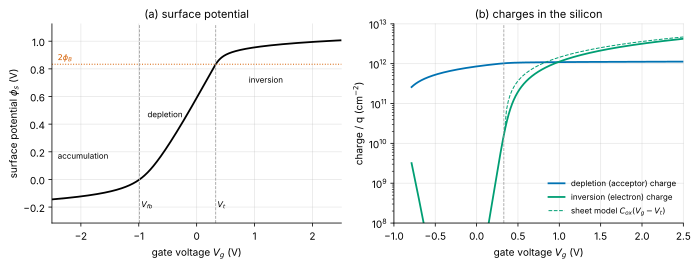
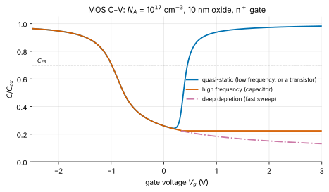

<!-- status: verified -->
# 09-08 · The MOS Capacitor

| | |
|---|---|
| **Course** | [09 · Semiconductor Devices](../README.md) |
| **University equivalent** | The metal–oxide–semiconductor capacitor in a junior semiconductor-devices course: band diagrams, flat band, accumulation, depletion and inversion, threshold voltage, the exact surface-charge solution, C–V characteristics, oxide charges, poly depletion and inversion-layer thickness, gate leakage and high-k dielectrics (Pierret, *Semiconductor Device Fundamentals*, ch. 16 and 18; Streetman & Banerjee, ch. 6; Hu, *Modern Semiconductor Devices for Integrated Circuits*, ch. 5 and §7.4) |
| **Prerequisites** | [09-05 PN Junction Electrostatics](09-05-pn-junction-electrostatics.md) (depletion approximation, Poisson's equation, Debye length), [09-02 Carriers, Doping and the Fermi Level](09-02-carriers-doping-fermi-level.md) (band positions, work functions), [04-04 Potential, Capacitance and Dielectrics](../../04-physics-for-ee/chapters/04-04-potential-capacitance-and-dielectrics.md), [04-10 Introduction to Quantum Mechanics](../../04-physics-for-ee/chapters/04-10-intro-quantum-mechanics.md) (tunneling) |
| **Estimated study hours** | 8 |
| **Last verified** | 2026-11-19 |

**Learning objectives.** After this chapter you can:

1. Draw the MOS energy-band diagram in accumulation, depletion and inversion, and compute the flat-band voltage from work functions and oxide charge.
2. Derive the threshold condition and threshold voltage, and the inversion charge above threshold.
3. Derive the exact surface charge from the Poisson–Boltzmann equation and use it to judge the depletion and sheet-charge approximations.
4. Compute and interpret quasi-static, high-frequency and deep-depletion C–V curves, and extract oxide thickness, doping, flat-band voltage and oxide charge from them.
5. Quantify thin-dielectric effects: poly-gate depletion, inversion-layer thickness, the electrical oxide thickness, gate tunneling and the move to high-k dielectrics and metal gates.

---

## 1. Big picture

Put a conductor on a thin insulator on a semiconductor and you have a capacitor whose bottom plate is alive. A gate voltage does not just store charge: it changes which carriers sit at the semiconductor's surface. With one polarity it piles up majority carriers (accumulation); with the other it pushes them away, leaving bare dopant ions (depletion); and push harder, and it pulls in a thin layer of *minority* carriers (inversion), turning the surface's conductivity type around. That inversion layer is the channel of every MOSFET. Hu calls the MOS transistor "by far the most widely used semiconductor device" and describes it as an MOS capacitor "with two PN junctions flanking the capacitor" [1]. Understanding the capacitor is understanding the transistor's control mechanism.

- **The threshold voltage of every MOSFET** is set by this chapter's electrostatics: work functions, doping, oxide thickness and oxide charge.
- **Gate capacitance sets drive current and switching energy.** A thinner dielectric gives more channel charge per volt, until tunneling leakage forced the industry from silicon dioxide to high-k dielectrics and metal gates (§3.10).
- **C–V measurement is everyday process control**: oxide thickness, doping, interface quality and contamination are read from capacitance–voltage curves.
- **Image sensors**: charge-coupled devices are arrays of MOS capacitors driven into deep depletion; CMOS image sensors use related structures [1].
- **Memory**: DRAM storage capacitors and flash memory cells are MOS structures (Course 23).

## 2. Intuition first

**A capacitor that can change its bottom plate.** In an ordinary parallel-plate capacitor, charge on the top plate is mirrored by an equal and opposite charge on the bottom plate, sitting right at the surface. In an MOS capacitor on p-type silicon, the "bottom plate" has three ways to supply that mirror charge:

- **Accumulation** (gate negative): holes, the majority carriers, crowd to the surface. They are abundant, so they form a thin sheet right at the interface, and the device behaves like a simple capacitor.
- **Depletion** (gate moderately positive): holes are pushed away, uncovering negative acceptor ions. These are fixed, one per acceptor, so supplying more charge means depleting deeper: a second capacitor, the depletion layer, appears in series.
- **Inversion** (gate strongly positive): the surface potential bends the bands so far that electrons, the minority carriers, become plentiful at the surface. They form a thin sheet, and additional gate charge is mirrored almost entirely by electrons. The depletion layer stops growing.

**A finance analogy: funding a position.** A trader can fund a growing position from cheap overnight repo (majority carriers in accumulation: abundant, instant), by selling fixed assets one at a time (depletion: costly, each unit of funding requires liquidating deeper), or, once a rate threshold is crossed, from a new funding source that becomes cheap all at once (inversion). *Where the analogy breaks:* the switch to the new source is set by a sharp physical condition, the surface potential reaching twice the bulk Fermi potential, and the "new source" must be physically supplied: by a nearby junction in a transistor, or slowly by thermal generation in an isolated capacitor.

*Figure 1. The MOS capacitor on p-type silicon ($N_A$ = 10¹⁷ cm⁻³, 10 nm oxide, n⁺ polysilicon gate), from the exact Poisson–Boltzmann solution. (a) Surface potential against gate voltage: zero at flat band, rising through depletion, and pinned a little above $2\phi_B$ in inversion. (b) Magnitudes of the depletion (ionized acceptor) charge and the inversion (electron) charge per area: the depletion charge saturates at threshold while the inversion charge takes over.*

## 3. Theory

We treat a p-type body (acceptor density $N_A$) with an n⁺ polysilicon or metal gate, a gate dielectric of thickness $T_{ox}$ and permittivity $\varepsilon_{ox}$, and the body grounded. The **oxide capacitance per area** is $C_{ox} = \varepsilon_{ox}/T_{ox}$, with $\varepsilon_{ox} = 3.9\varepsilon_0$ = 3.453 × 10⁻¹³ F/cm for SiO₂. The **surface potential** $\phi_s$ is the band bending at the silicon surface: positive when the bands bend down toward the surface. $Q_s$ is the total charge per area in the silicon. The **bulk Fermi potential** is

$$
\phi_B = \frac{kT}{q}\ln\frac{N_A}{n_i} ,
$$

the distance (in volts) between the intrinsic level and the Fermi level in the neutral body (09-02).

### 3.1 The flat-band voltage

Hu draws the MOS system with the gate on the left, the oxide in the middle and the body on the right [1]. SiO₂ has a band gap of about 9 eV, and its conduction band lies 3.1 eV above silicon's: the electron barrier. The hole barrier is 4.8 eV [1]. These barriers are why carriers normally cannot cross the oxide. The vacuum level is continuous across the interfaces, so each material's position is fixed by its **electron affinity** $\chi$ (vacuum level minus conduction-band edge; 4.05 eV for silicon) and its **work function** $\psi$ (vacuum level minus Fermi level) [1].

With no voltage applied, the gate's and body's Fermi levels must align. If the two work functions differ, the bands bend and the oxide carries a field even at zero bias. The gate voltage that cancels this, making the silicon bands flat right up to the surface, is the **flat-band voltage** [1]:

$$
V_{FB} = \psi_g - \psi_s - \frac{Q_{ox}}{C_{ox}} .
$$

For an n⁺ poly gate, $\psi_g = \chi_{\text{Si}}$ = 4.05 V (its Fermi level sits at the conduction-band edge), and for a p⁺ poly gate, $\psi_g = \chi_{\text{Si}} + E_g/q$. For the p-type body, $\psi_s = \chi_{\text{Si}} + (E_C - E_F)/q$ [1]. The last term accounts for a sheet of oxide charge $Q_{ox}$ at the oxide–silicon interface (§3.8). Positive oxide charge pulls the bands down, so a more negative gate voltage is needed to flatten them.

### 3.2 The voltage balance

At any gate voltage, the applied voltage divides between the oxide and the silicon:

$$
V_g = V_{FB} + \phi_s + V_{ox} .
$$

Gauss's law (04-03) relates the oxide voltage to the silicon's charge. The field in the oxide is $-Q_s/\varepsilon_{ox}$ (the gate holds $-Q_s$ when the oxide is charge-free), so

$$
V_{ox} = -\frac{Q_s}{C_{ox}} .
$$

The minus sign appears because the voltage is taken at the gate but the charge in the silicon [1]. Every MOS result follows from these two equations once we know how $Q_s$ depends on $\phi_s$.

### 3.3 Accumulation and depletion

**Accumulation** ($V_g < V_{FB}$). The surface hole density $p_s = N_Ae^{-\phi_s/V_T}$ grows exponentially with the (negative) band bending, so a small $|\phi_s|$, a few $V_T$, supplies a large charge. To first order $\phi_s \approx 0$, and $Q_{acc} = -C_{ox}(V_g - V_{FB})$: a plain capacitor [1].

**Depletion** ($V_g > V_{FB}$, below threshold). The surface is emptied of holes to a depth $W_{dep}$. The depletion approximation of 09-05 gives

$$
Q_s = -qN_AW_{dep}, \qquad \phi_s = \frac{qN_AW_{dep}^2}{2\varepsilon_s} ,
$$

so the voltage balance becomes a quadratic in $W_{dep}$ [1]:

$$
V_g = V_{FB} + \frac{qN_AW_{dep}^2}{2\varepsilon_s} + \frac{qN_AW_{dep}}{C_{ox}} .
$$

Solving it, $W_{dep} = (\varepsilon_s/C_{ox})\big[\sqrt{1 + 2C_{ox}^2(V_g - V_{FB})/(q\varepsilon_sN_A)} - 1\big]$.

### 3.4 The threshold condition and threshold voltage

As $V_g$ rises, the bands bend further and the surface electron density $n_s = n_ie^{(\phi_s - \phi_B)/V_T}$ grows. The conventional **threshold** is the point where the surface is as n-type as the bulk is p-type: $n_s = N_A$. That happens when the surface potential reaches

$$
\phi_{st} = 2\phi_B = 2\frac{kT}{q}\ln\frac{N_A}{n_i} .
$$

At that point the depletion width has reached its maximum, $W_{d\max} = \sqrt{2\varepsilon_s(2\phi_B)/qN_A}$, and the depletion charge is $-qN_AW_{d\max}$. Substituting into the voltage balance gives the **threshold voltage** [1]:

$$
V_{TH} = V_{FB} + 2\phi_B + \frac{\sqrt{2qN_A\varepsilon_s\,(2\phi_B)}}{C_{ox}} .
$$

**Units check.** $\sqrt{qN\varepsilon\phi}$: √(C · cm⁻³ · F/cm · V) = √(C · C/cm⁴) = C/cm²; divided by F/cm² gives V. ✓

**Choosing the gate.** Circuits need a small positive $V_{TH}$ for n-channel devices (Hu suggests about 0.4 V), so that the transistor is off at $V_g = 0$ (an **enhancement-mode** device) [1]. A p-body paired with an n⁺ gate achieves this; a p⁺ gate would push $V_{TH}$ above 1 V. An n-type body (for p-channel devices) is paired with a p⁺ gate, and its threshold, $V_{TH} = V_{FB} - 2\phi_B - \sqrt{2qN_D\varepsilon_s(2\phi_B)}/C_{ox}$, is negative [1].

### 3.5 Strong inversion

Beyond threshold, a small further increase in $\phi_s$ brings in exponentially more electrons, so the surface potential is effectively pinned near $2\phi_B$, the depletion width stays at $W_{d\max}$, and every additional unit of gate charge is mirrored by electrons [1]:

$$
Q_{inv} = -C_{ox}(V_g - V_{TH}) .
$$

Above threshold the MOS capacitor is again a simple capacitor, offset by $V_{TH}$. This **sheet-charge approximation** is the basis of the long-channel MOSFET model (09-09). One practical question remains: where do the electrons come from? In a p-type body they are minority carriers, produced only by slow thermal generation, which can take a long time in high-quality silicon [1]. In a MOSFET, the n⁺ source and drain supply them instantly. That difference shapes the C–V curves (§3.7).

### 3.6 The exact surface charge

The approximations above are good but not exact. In particular, the surface potential is not truly pinned at $2\phi_B$. The exact one-dimensional problem is solvable in closed form.

Inside the silicon, let $\phi(x)$ be the band bending at depth $x$ ($\phi \to 0$ deep in the body). With Boltzmann statistics (09-02), $p = N_Ae^{-\phi/V_T}$ and $n = n_0e^{\phi/V_T}$ with $n_0 = n_i^2/N_A$, and Poisson's equation is

$$
\frac{d^2\phi}{dx^2} = -\frac{q}{\varepsilon_s}\big(p - n - N_A + n_0\big) = \frac{qN_A}{\varepsilon_s}\Big[(1 - e^{-\phi/V_T}) + \frac{n_0}{N_A}(e^{\phi/V_T} - 1)\Big] .
$$

**Integrate once.** Multiply both sides by $2\,d\phi/dx$. The left side becomes $d(\mathcal E^2)/dx$, where $\mathcal E = -d\phi/dx$. Integrate from deep in the bulk, where $\phi = 0$ and $\mathcal E = 0$, to the surface:

$$
\mathcal E_s^2 = \frac{2qN_AV_T}{\varepsilon_s}\,F(\phi_s)^2, \qquad
F(\phi_s)^2 = \Big(e^{-\phi_s/V_T} + \frac{\phi_s}{V_T} - 1\Big) + \frac{n_0}{N_A}\Big(e^{\phi_s/V_T} - \frac{\phi_s}{V_T} - 1\Big) .
$$

By Gauss's law the total silicon charge is $Q_s = -\varepsilon_s\mathcal E_s$, so

$$
Q_s = -\operatorname{sign}(\phi_s)\sqrt{2qN_A\varepsilon_sV_T}\;F(\phi_s) .
$$

The three terms in $F^2$ are the physics of §3.3–3.5. The $e^{-\phi_s/V_T}$ term is the accumulation of holes when $\phi_s < 0$. The $\phi_s/V_T - 1$ term is depletion: for $\phi_s \gg V_T$, $Q_s \approx -\sqrt{2qN_A\varepsilon_s(\phi_s - V_T)}$, the depletion result with a small $-V_T$ correction for the depletion edge's soft tail. The $(n_0/N_A)e^{\phi_s/V_T}$ term is inversion: it is negligible until $e^{\phi_s/V_T}$ approaches $N_A/n_0 = (N_A/n_i)^2 = e^{2\phi_B/V_T}$, which is exactly the threshold condition.

**At threshold the approximations agree exactly.** At $\phi_s = 2\phi_B$, the inversion term contributes $+1$, which cancels the $-1$ of the depletion term. So $F^2 = 2\phi_B/V_T$ (plus negligible terms), and the exact charge equals the depletion approximation's $\sqrt{2qN_A\varepsilon_s(2\phi_B)}$ (Example 09-08.3).

**Above threshold** the exact solution shows the surface potential still creeping up: about 60 mV per decade of inversion charge just above threshold, approaching $2V_T\ln10$ = **119** mV per decade deep in strong inversion (where $Q_s \propto e^{\phi_s/2V_T}$), and **95** mV per decade at $V_g$ = 2 V in the example. Some of the gate's extra charge is therefore mirrored by extra depletion charge rather than electrons. For the chapter's example at $V_g$ = 2 V, $\phi_s$ is 161 mV above $2\phi_B$ and the true inversion charge is 12% below the sheet-charge estimate (Example 09-08.3). Compact MOSFET models (09-09, 09-10) handle this with the exact surface-potential solution or a fitted correction.

### 3.7 C–V characteristics

The MOS capacitance is the small-signal $C = dQ_g/dV_g = -dQ_s/dV_g$ [1]. Differentiating the voltage balance, $dV_g = d\phi_s - dQ_s/C_{ox}$, so

$$
\frac1C = \frac{1}{C_{ox}} + \frac{1}{C_s}, \qquad C_s = -\frac{dQ_s}{d\phi_s} :
$$

the oxide capacitance in series with the **semiconductor capacitance**.

- **Accumulation:** $C_s$ is huge (the hole sheet responds to tiny changes in $\phi_s$), so $C \to C_{ox}$.
- **Flat band:** the semiconductor capacitance is $\varepsilon_s/L_D$, where $L_D = \sqrt{\varepsilon_sV_T/qN_A}$ is the Debye length (09-05). This follows from expanding $F^2 \approx (\phi_s/V_T)^2/2$ near zero. The flat-band capacitance $C_{FB}$ is a definite fraction of $C_{ox}$, which is how $V_{FB}$ is located on a measured curve.
- **Depletion:** $C_s = \varepsilon_s/W_{dep}$. Combining this with §3.3 gives [1]
  $$
  \frac{1}{C^2} = \frac{1}{C_{ox}^2} + \frac{2(V_g - V_{FB})}{q\varepsilon_sN_A} ,
  $$
  so $1/C^2$ is linear in $V_g$ with a slope that gives $N_A$: the same profiling idea as for junctions (09-05 §3.9).

- **Inversion, quasi-static (low frequency) or in a transistor:** the electrons follow the signal, and the inversion layer becomes the bottom plate, so $C \to C_{ox}$ again.
- **Inversion, high frequency in an isolated capacitor:** thermal generation cannot supply electrons at the signal frequency. The inversion charge stays frozen, the depletion edge breathes instead, and $C$ stays at its minimum, $C_{\min} = (1/C_{ox} + W_{d\max}/\varepsilon_s)^{-1}$ [1].
- **Deep depletion:** if the gate is swept quickly into inversion, there is no time to form the inversion layer at all. The depletion region grows beyond $W_{d\max}$, and $C$ keeps falling [1]. CCD imagers exploit this state: photogenerated electrons collect in the empty potential well in proportion to the light received [1].

Hu's Example 5–1 sums up the rule: a MOS *transistor* shows the quasi-static curve at any frequency, because its source and drain supply electrons; an isolated *capacitor* shows the high-frequency curve except under a very slow voltage ramp [1].

**Extraction.** From a measured high-frequency C–V curve:

- the accumulation capacitance gives $C_{ox}$ and hence $T_{ox}$;
- the minimum capacitance gives $N_A$ (by root finding, because $W_{d\max}$ depends on $N_A$);
- the computed $C_{FB}$ locates $V_{FB}$;
- comparing $V_{FB}$ with $\psi_g - \psi_s$ gives the oxide charge (Examples 09-08.4 and 09-08.5).

*Figure 2. C–V curves of the example capacitor, from the exact surface charge: quasi-static (low frequency, or any frequency in a transistor), high frequency (inversion charge frozen) and deep depletion (fast sweep, no inversion layer). The dashed line marks $C_{FB}$.*

### 3.8 Oxide charges

Real oxides contain charge. Hu lists **fixed oxide charge** (positive, attributed to silicon ions at the interface), **mobile ions** (mostly sodium, detected by flat-band shifts under bias–temperature stress), and **interface traps**, states at the interface whose occupancy changes with surface potential [1]. A sheet of charge at the interface shifts the flat-band and threshold voltages by $-Q_{ox}/C_{ox}$, and the shift grows with oxide thickness. Interface traps also stretch the C–V curve along the voltage axis, because part of each charge increment goes into the traps rather than into band bending.

Hu reports that a high-quality MOS interface has about 10¹⁰ cm⁻² of charge, against about 7 × 10¹⁴ silicon atoms per cm² on a (100) plane: "the SiO₂–Si interface is remarkably well-behaved" [1] **[Established]**. That near-perfect interface, available only with silicon and its native oxide, is a large part of why silicon won.

### 3.9 Thin-dielectric effects: gate depletion and inversion-layer thickness

Two effects add to the electrical thickness of the gate stack, and they become significant when the oxide is a few nanometers thin.

**Poly-gate depletion.** A polysilicon gate is a heavily doped semiconductor, so the field at its oxide interface depletes a thin layer of it. Continuity of electric displacement gives $\varepsilon_{ox}\mathcal E_{ox} = qN_{poly}W_{dpoly}$, so [1]

$$
W_{dpoly} = \frac{\varepsilon_{ox}\mathcal E_{ox}}{qN_{poly}} .
$$

This adds a capacitance $\varepsilon_s/W_{dpoly}$ in series, equivalent to $W_{dpoly}\varepsilon_{ox}/\varepsilon_s = W_{dpoly}/3$ of extra oxide. It also costs a voltage drop $\phi_{poly} = qN_{poly}W_{dpoly}^2/2\varepsilon_s$ that the channel never sees [1].

**Inversion-layer thickness.** The inversion electrons are not a sheet at the interface. Quantum confinement (a particle in the triangular potential well of the surface field; 04-10) and the field itself place their centroid about 1.5 nm below the interface at high gate voltage, and up to 3 nm at low voltage [1]. This too acts as extra oxide, $T_{inv}/3$.

Together they define the **electrical oxide thickness** [1]:

$$
T_{oxe} = T_{ox} + \frac{W_{dpoly}}{3} + \frac{T_{inv}}{3} ,
$$

typically 6–10 Å more than $T_{ox}$ [1]. The factor 3 is $\varepsilon_s/\varepsilon_{ox}$ = 11.7/3.9. A **metal gate** removes the poly term entirely, one reason for the switch to metal gates (§3.10). The inversion term remains, and depends on the carriers' effective mass normal to the interface [1].

### 3.10 Gate leakage, high-k dielectrics and metal gates

Thinning the oxide raises $C_{ox}$ and the transistor's drive current, but electrons tunnel through a thin enough barrier (04-10 §3.4), with a probability that rises exponentially as thickness falls. Hu shows 1.2 nm of SiO₂ conducting about 10³ A/cm² of leakage, so that 1 mm² of such oxide on a chip would leak 10 A, "a leakage that would drain the battery of a cell phone in minutes"; adding nitrogen to the oxide cuts the leakage about tenfold [1] **[Established]**.

**High-k dielectrics.** The way out is a dielectric with a higher permittivity, which gives the same capacitance at a greater physical thickness. Define the **equivalent oxide thickness**

$$
\text{EOT} = t_{hk}\,\frac{\varepsilon_{\text{SiO}_2}}{\varepsilon_{hk}} = t_{hk}\frac{3.9}{k} .
$$

Hu: HfO₂ has $k$ ≈ 24, so "a 6 nm thick HfO₂ film is equivalent to 1 nm thick SiO₂", but presents a much thicker barrier, and its leakage is "several orders of magnitude smaller" [1] **[Established]**. The IRDS 2024 tables use $k$ = 21.2 for HfO₂ in their worked definition [3]. Values in the low 20s are typical, and the exact value depends on the film's phase. High-k films bring difficulties: chemical reactions with silicon, lower channel mobility and more oxide charge. A thin SiO₂ **interfacial layer** between the silicon and the high-k film reduces these problems [1].

**Metal gates.** Poly-gate depletion and the reaction of polysilicon with high-k films led to metal gates. NFETs and PFETs need two different metals, with work functions near those of n⁺ and p⁺ polysilicon, to reach the right thresholds [1]. Intel introduced a hafnium-based high-k dielectric with metal gate electrodes at its 45 nm generation in 2007, after SiO₂ had scaled "from about 100 nm down to 1.2 nm" and stopped shrinking because of tunneling leakage [4] **[Established]**.

**Capacitive equivalent thickness.** Roadmaps now quote the **CET**: the equivalent oxide thickness of the whole stack, including interfacial layer, high-k film, dipole layers and the inversion layer's capacitance, the quantity that sets drive current [3]. The IRDS 2024 More Moore tables list a CET of 1.0 nm for 2024–2025 and 0.9 nm from 2027 onward [3] **[Industry estimate]** (roadmap values).

**Oxide breakdown.** Hu notes that a 10 nm SiO₂ film breaks down at about 15 V in a 1-second test, a field of 15 MV/cm, but at lower fields if stressed for hours or months. This **time-dependent dielectric breakdown** means that products are qualified by extrapolating accelerated tests to a ten-year life [1].

## 4. Worked examples

Unless stated otherwise, the capacitor has a p-type body with $N_A$ = 10¹⁷ cm⁻³, a 10 nm SiO₂ gate dielectric and an n⁺ polysilicon gate, at 300 K. Course values hold: $n_i$ = 10¹⁰ cm⁻³, $V_T$ = 25.852 mV, $E_g$ = 1.12 eV, $N_V$ = 1.8 × 10¹⁹ cm⁻³, $\chi_{\text{Si}}$ = 4.05 eV, $\varepsilon_s$ = 11.7ε₀ and $\varepsilon_{ox}$ = 3.9ε₀.

### Example 09-08.1 · The flat-band voltage (tier A)

**Setup.** (a) Find $C_{ox}$. (b) Find $E_C - E_F$ in the body and the flat-band voltage with an n⁺ poly gate and with a p⁺ poly gate. (c) How much does a positive interface charge of 5 × 10¹⁰ cm⁻² shift $V_{FB}$?

**Solution.**

(a) $C_{ox} = 3.9 \times 8.854\times10^{-14}/10^{-6}$ = **345.3** nF/cm².

(b) $E_F - E_V = kT\ln(N_V/N_A)$ = 0.134 eV, so $E_C - E_F = 1.12 - 0.134$ = **0.9858** eV and $\psi_s$ = 4.05 + 0.9858 V.

- n⁺ gate ($\psi_g$ = 4.05 V): $V_{FB}$ = **−0.9858** V.
- p⁺ gate ($\psi_g$ = 4.05 + 1.12 V): $V_{FB}$ = **+0.1342** V.

(c) $-Q_{ox}/C_{ox} = -1.602\times10^{-19} \times 5\times10^{10}/3.453\times10^{-7}$ = **−23.2** mV.

**Sanity check.** The n⁺ gate's Fermi level is near the conduction band and the p-body's near the valence band, so they differ by nearly a band gap; flat band needs about −1 V. (Hu's schematic example quotes about −0.7 V [1]; the exact figure depends on the body doping, through $E_F - E_V$.)

### Example 09-08.2 · Depletion, threshold and inversion charge (tier A)

**Setup.** (a) At $V_g$ = 0, find the depletion width and surface potential. (b) Find $\phi_B$, $W_{d\max}$, the depletion charge at threshold, the oxide voltage there, and $V_{TH}$. (c) At $V_g$ = 2 V, find $Q_{inv}$ and the electron sheet density from the sheet-charge approximation.

**Solution.**

(a) Solving the quadratic of §3.3 with $V_g - V_{FB}$ = 0.9858 V gives $W_{dep}$ = **86.8** nm and $\phi_s$ = **0.583** V. The surface is depleted but below threshold.

(b) The threshold quantities:

- $\phi_B = 0.025852\ln10^7$ = **0.4167** V, so $2\phi_B$ = **0.8334** V.
- $W_{d\max} = \sqrt{2\varepsilon_s \times 0.8334/(qN_A)}$ = **0.1038** µm, and $qN_AW_{d\max}$ = **1.663 × 10⁻⁷** C/cm².
- $V_{ox} = 1.663\times10^{-7}/3.453\times10^{-7}$ = **0.4817** V.
- $V_{TH} = -0.9858 + 0.8334 + 0.4817$ = **0.3293** V.

(c) $Q_{inv} = -C_{ox}(2 - 0.3293)$ = **−5.769 × 10⁻⁷** C/cm², which is **3.60 × 10¹²** electrons per cm².

**Sanity check.** A threshold near 0.3 V with an n⁺ gate on 10¹⁷ cm⁻³ is consistent with Hu's Fig. 5–8 trend [1]. A few 10¹² cm⁻² is the typical inversion density of a strongly on MOSFET.

### Example 09-08.3 · The exact surface charge (tier B)

**Setup.** Using the exact $Q_s(\phi_s)$ of §3.6: (a) compare it with the depletion approximation at $\phi_s = 2\phi_B$; (b) at $V_g$ = 2 V, solve for $\phi_s$, $Q_s$, the bulk (depletion) charge $-\sqrt{2qN_A\varepsilon_s(\phi_s - V_T)}$ and the inversion charge, and compare with Example 09-08.2(c).

**Solution.**

(a) At $2\phi_B$ the exact charge is **1.663 × 10⁻⁷** C/cm², identical to the depletion approximation, as §3.6 showed.

(b) Root finding on $V_g = V_{FB} + \phi_s - Q_s(\phi_s)/C_{ox}$ = 2 V gives $\phi_s$ = **0.9947** V, **161** mV above $2\phi_B$. Then:

- $Q_s$ = **−6.875 × 10⁻⁷** C/cm²;
- the bulk charge is **−1.793 × 10⁻⁷** C/cm²;
- the inversion charge is **−5.082 × 10⁻⁷** C/cm², or **3.17 × 10¹²** cm⁻².

The sheet-charge estimate is **13.5**% too high. Equivalently, the exact inversion charge is **11.9**% below it.

**Sanity check.** The surface potential creeps up by about 0.1 V for every decade of electron density, uncovering a little more depletion charge; the sheet model ignores this. It also takes a few tenths of a volt above $V_{TH}$ before the exact inversion charge grows linearly, which is why threshold is a convention rather than a sharp event.

### Example 09-08.4 · C–V curve and parameter extraction (tier B)

**Setup.** (a) Find the Debye length, the semiconductor capacitance at flat band, and $C_{FB}$ as a fraction of $C_{ox}$. (b) Find the high-frequency minimum capacitance. (c) A measured high-frequency curve on an unknown capacitor shows $C_{\max}$ = 345.3 nF/cm² and $C_{\min}/C_{\max}$ = 0.2242. Extract $T_{ox}$ and $N_A$.

**Solution.**

(a) $L_D = \sqrt{\varepsilon_sV_T/(qN_A)}$ = **12.93** nm, so $\varepsilon_s/L_D$ = **801.3** nF/cm², and $C_{FB}$ = **241.3** nF/cm², **0.6988** of $C_{ox}$.

(b) $\varepsilon_s/W_{d\max}$ = 99.79 nF/cm², so $C_{\min}$ = **77.42** nF/cm², **0.2242** of $C_{ox}$.

(c) $T_{ox} = \varepsilon_{ox}/C_{\max}$ = **10.00** nm. Root finding on $C_{\min}/C_{ox}$ as a function of $N_A$ (with $W_{d\max}$ recomputed for each trial doping) gives $N_A$ = **1.00 × 10¹⁷** cm⁻³.

**Sanity check.** The extraction recovers the device. In practice, $C_{FB}$ computed from the extracted $N_A$ locates $V_{FB}$ on the measured curve, as the next example uses.

### Example 09-08.5 · Measuring oxide charge (tier B)

**Setup.** The capacitor's measured flat-band voltage is −1.10 V instead of the ideal −0.9858 V. (a) Find the oxide charge per area and per cm² of electronic charge. (b) Compare with Hu's figure for a high-quality interface and with the silicon atoms on a (100) surface, $2/a^2$ with $a$ = 0.5431 nm.

**Solution.**

(a) $\Delta V_{FB}$ = **−0.1142** V, so $Q_{ox} = -C_{ox}\Delta V_{FB}$ = **3.945 × 10⁻⁸** C/cm², which is **2.46 × 10¹¹** positive charges per cm².

(b) This is **24.6** times Hu's high-quality 10¹⁰ cm⁻² [1], against **6.78 × 10¹⁴** silicon atoms per cm². That is still only one charge per **2.75 × 10³** surface atoms, but enough to move the threshold by 0.11 V.

**Sanity check.** The shift scales with $T_{ox}$ for the same charge. Thin modern oxides are therefore less sensitive to a given charge, but thresholds must also be controlled to tens of millivolts.

### Example 09-08.6 · Poly depletion and the electrical oxide thickness (tier B)

**Setup.** A thin-oxide device has $T_{ox}$ = 2 nm, an n⁺ poly gate doped 10²⁰ cm⁻³ and 1.0 V across the oxide in inversion. Take $T_{inv}$ = 1.5 nm (Hu's high-field value). (a) Find the oxide field, $W_{dpoly}$ and $\phi_{poly}$. (b) Find $T_{oxe}$ and the fraction of the ideal inversion charge actually achieved. (c) What would a metal gate give?

**Solution.**

(a) $\mathcal E_{ox}$ = 1.0 V/2 nm = **5.0** MV/cm. Then $W_{dpoly} = \varepsilon_{ox}\mathcal E_{ox}/(qN_{poly})$ = **1.08** nm and $\phi_{poly} = qN_{poly}W_{dpoly}^2/2\varepsilon_s$ = **0.0898** V.

(b) $T_{oxe} = 2 + 1.08/3 + 1.5/3$ = **2.86** nm. The gate delivers $2/2.86$ = **0.699** of the charge the physical oxide promises, 30% less.

(c) With no poly depletion, $T_{oxe}$ = **2.50** nm.

**Sanity check.** The extra 0.86 nm is close to the 6–10 Å Hu quotes [1]. At 2 nm physical oxide these corrections are a 43% thickness penalty, which is why they dominated gate-stack engineering once oxides became this thin.

### Example 09-08.7 · Leakage, EOT and CET (tier B)

**Setup.** (a) Using Hu's 10³ A/cm² for 1.2 nm SiO₂, find the leakage of 1 mm² of such oxide, and with nitrogen added. (b) Find $C_{ox}$ at an EOT of 1 nm. (c) What HfO₂ thickness gives an EOT of 1 nm with Hu's $k$ = 24, and with the IRDS's 21.2? (d) A stack has 0.5 nm of SiO₂ interfacial layer and 2 nm of HfO₂ ($k$ = 21.2). Find its EOT, and its CET including $T_{inv}/3$ with $T_{inv}$ = 1.5 nm (Hu's high-gate-voltage centroid). Compare with the IRDS 2024 CET of 1.0 nm.

**Solution.**

(a) $10^3$ A/cm² × 0.01 cm² = **10** A; with nitrogen about **1** A.

(b) $C_{ox} = \varepsilon_{ox}/1\text{ nm}$ = **3.453** µF/cm².

(c) $t = \text{EOT} \times k/3.9$: **6.15** nm for $k$ = 24 and **5.44** nm for $k$ = 21.2.

(d) EOT = 0.5 + 2 × 3.9/21.2 = **0.868** nm, and CET = 0.868 + 1.5/3 = **1.368** nm. That is 0.37 nm above the roadmap value. The gap depends on the inversion term: with $T_{inv}$ = 1.5 nm it adds 0.5 nm, while metal-gate stacks with thinner inversion layers (Problem 09-08.15 assumes $T_{inv}/3$ = 0.3 nm) would bring this stack to 1.17 nm, still above target. Meeting it requires thinner interfacial layers, higher-k films and a thinner inversion layer, which is why every term of the CET is a research topic.

**Sanity check.** The 2.5 nm physical stack is **2.88** times as thick as its EOT, which is the point: a thicker tunneling barrier with the same capacitance.

### Answer key

<!-- answer-key -->
| ID | Quantity | Value | Unit |
|---|---|---|---|
| Ex 09-08.1a | C_ox, 10 nm SiO₂ | 345.3 | nF/cm² |
| Ex 09-08.1b | E_C − E_F, p-body 1e17 | 0.9858 | eV |
| Ex 09-08.1c | V_FB, n⁺ gate | -0.9858 | V |
| Ex 09-08.1d | V_FB, p⁺ gate | 0.1342 | V |
| Ex 09-08.1e | shift from 5e10 cm⁻² | -23.2 | mV |
| Ex 09-08.1f | E_F − E_V | 0.134 | eV |
| Ex 09-08.2a | W_dep at V_g = 0 | 86.8 | nm |
| Ex 09-08.2b | φ_s at V_g = 0 | 0.583 | V |
| Ex 09-08.2c | φ_B | 0.4167 | V |
| Ex 09-08.2d | 2φ_B | 0.8334 | V |
| Ex 09-08.2e | W_dmax | 0.1038 | µm |
| Ex 09-08.2f | depletion charge at threshold | 1.663e-7 | C/cm² |
| Ex 09-08.2g | V_ox at threshold | 0.4817 | V |
| Ex 09-08.2h | V_TH | 0.3293 | V |
| Ex 09-08.2i | Q_inv at 2 V | -5.769e-7 | C/cm² |
| Ex 09-08.2j | electron sheet density at 2 V | 3.60e12 | cm⁻² |
| Ex 09-08.3a | exact charge at 2φ_B | 1.663e-7 | C/cm² |
| Ex 09-08.3b | φ_s at V_g = 2 V | 0.9947 | V |
| Ex 09-08.3c | φ_s above 2φ_B | 161 | mV |
| Ex 09-08.3d | Q_s at 2 V | -6.875e-7 | C/cm² |
| Ex 09-08.3e | bulk charge at 2 V | -1.793e-7 | C/cm² |
| Ex 09-08.3f | exact inversion charge at 2 V | -5.082e-7 | C/cm² |
| Ex 09-08.3g | exact electron density at 2 V | 3.17e12 | cm⁻² |
| Ex 09-08.3h | sheet estimate above exact | 13.5 | % |
| Ex 09-08.3i | exact below sheet estimate | 11.9 | % |
| Ex 09-08.4a | Debye length at 1e17 | 12.93 | nm |
| Ex 09-08.4b | ε_s/L_D | 801.3 | nF/cm² |
| Ex 09-08.4c | C_FB | 241.3 | nF/cm² |
| Ex 09-08.4d | C_FB/C_ox | 0.6988 | — |
| Ex 09-08.4e | ε_s/W_dmax | 99.79 | nF/cm² |
| Ex 09-08.4f | C_min | 77.42 | nF/cm² |
| Ex 09-08.4g | C_min/C_ox | 0.2242 | — |
| Ex 09-08.4h | extracted T_ox | 10.00 | nm |
| Ex 09-08.4i | extracted N_A | 1.00e17 | cm⁻³ |
| Ex 09-08.5a | ΔV_FB | -0.1142 | V |
| Ex 09-08.5b | Q_ox | 3.945e-8 | C/cm² |
| Ex 09-08.5c | oxide charges per cm² | 2.46e11 | cm⁻² |
| Ex 09-08.5d | ratio to 1e10 | 24.6 | — |
| Ex 09-08.5e | Si atoms per cm² on (100) | 6.78e14 | cm⁻² |
| Ex 09-08.5f | surface atoms per charge | 2.75e3 | — |
| Ex 09-08.6a | oxide field | 5.0 | MV/cm |
| Ex 09-08.6b | W_dpoly | 1.08 | nm |
| Ex 09-08.6c | φ_poly | 0.0898 | V |
| Ex 09-08.6d | T_oxe | 2.86 | nm |
| Ex 09-08.6e | charge fraction achieved | 0.699 | — |
| Ex 09-08.6f | T_oxe with a metal gate | 2.50 | nm |
| Ex 09-08.6g | thickness penalty | 43 | % |
| Ex 09-08.7a | leakage of 1 mm² | 10 | A |
| Ex 09-08.7b | with nitrogen | 1 | A |
| Ex 09-08.7c | C_ox at EOT 1 nm | 3.453 | µF/cm² |
| Ex 09-08.7d | HfO₂ thickness, k = 24 | 6.15 | nm |
| Ex 09-08.7e | HfO₂ thickness, k = 21.2 | 5.44 | nm |
| Ex 09-08.7f | stack EOT | 0.868 | nm |
| Ex 09-08.7g | stack CET | 1.368 | nm |
| Ex 09-08.7h | CET above the 1.0 nm roadmap | 0.37 | nm |
| Ex 09-08.7i | physical thickness over EOT | 2.88 | — |
| Ex 09-08.7j | CET with T_inv/3 = 0.3 nm | 1.17 | nm |
| T 09-08.a | ε_ox for SiO₂ | 3.453e-13 | F/cm |
| T 09-08.b | strong-inversion limit of the rise per decade | 119 | mV |
| T 09-08.c | rise per decade at V_g = 2 V | 95 | mV |

*Every value is recomputed by [verify_09_08.py](../verify/verify_09_08.py) by an independent route: band positions from Fermi–Dirac-free Boltzmann densities; the depletion width by root finding on the voltage balance; the threshold by locating $n_s = N_A$ in the exact solution; the exact surface charge by integrating Poisson's equation numerically (not the closed-form $F$); C–V values by numerically differentiating the computed charge; extraction by root finding; and thin-film quantities from series-capacitor arithmetic.*

## 5. Simulate it

The lab, [labs/09-08-lab](../labs/09-08-lab/README.md), is a notebook that:

1. Solves Poisson's equation in the silicon numerically for any surface potential and compares with the closed-form $Q_s(\phi_s)$.
2. Computes the surface potential, depletion charge and inversion charge against gate voltage (Figure 1), and locates threshold by several definitions.
3. Computes quasi-static, high-frequency and deep-depletion C–V curves (Figure 2), and extracts $T_{ox}$, $N_A$ and $V_{FB}$ from a synthetic noisy measurement.
4. Adds an interface charge and a poly-depletion layer and shows how each distorts the C–V curve.

**Guided exercise (predict, then run).** **Before running Part 2**, predict: how many millivolts above $2\phi_B$ is the surface potential when the inversion charge equals the depletion charge? And is the gate voltage there larger or smaller than $V_{TH}$ plus the depletion charge divided by $C_{ox}$? Then run it.

## 6. Engineering tradeoffs

| Knob | Improves | Costs | Typical decision owner |
|---|---|---|---|
| Thinner gate dielectric (lower EOT) | Gate control, drive current, short-channel immunity | Tunneling leakage, reliability (TDDB), variability of thin films | Technology development |
| High-k dielectric | Same capacitance with a thicker barrier, so less leakage | Mobility loss, oxide charge, interface quality (needs an interfacial layer), process complexity | Technology development |
| Metal gate (vs poly) | No poly depletion; compatible with high-k | Two work-function metals for NFET/PFET; integration complexity | Technology development |
| Body doping | Threshold voltage, depletion width (short-channel control) | Mobility (impurity scattering), junction capacitance, random dopant fluctuation (09-02) | Device designers |
| Gate work function | Threshold without heavy doping | Limited choice of metals; work-function variability | Technology and device |
| Interface quality | Stable thresholds, steep turn-on, low noise | Clean processing, anneals | Process engineers |

## 7. Numbers to know

| Quantity | Value | Note |
|---|---|---|
| $C_{ox}$ | 345 nF/cm² at 10 nm; 3.45 µF/cm² at 1 nm EOT | §3, Example 09-08.7 |
| Si–SiO₂ barriers | 3.1 eV for electrons, 4.8 eV for holes; SiO₂ gap about 9 eV | [1] |
| Threshold condition | $\phi_s = 2\phi_B$; 0.83 V at 10¹⁷ cm⁻³ | §3.4 |
| Typical NMOS threshold | about 0.4 V (enhancement) | [1] |
| Inversion density, strongly on | a few 10¹² cm⁻² | Example 09-08.2 |
| High-quality interface charge | about 10¹⁰ cm⁻² (vs 7 × 10¹⁴ Si atoms/cm²) | [1] |
| Poly depletion | 1–2 nm; $T_{oxe} - T_{ox}$ ≈ 6–10 Å with $T_{inv}$ | [1] |
| Inversion-layer centroid | about 1.5 nm (high field) to 3 nm (low field) | [1] |
| SiO₂ leakage at 1.2 nm | about 10³ A/cm² | [1] |
| HfO₂ permittivity | $k$ ≈ 24 (Hu), 21.2 (IRDS example) | [1, 3] |
| CET roadmap | 1.0 nm (2024–2025), 0.9 nm (2027 on), IRDS 2024 | [3] |
| SiO₂ breakdown | about 15 MV/cm in a 1 s test; lower for long stress (TDDB) | [1] |

## 8. Common mistakes

1. **Sign confusion in $V_{ox} = -Q_s/C_{ox}$.** The voltage is on the gate and the charge in the silicon; draw the band diagram to check signs.
2. **Using the wrong work function for the gate.** n⁺ poly's Fermi level is at $E_C$ ($\psi_g$ = 4.05 V), p⁺ poly's at $E_V$ (5.17 V); metals use their own work functions, modified by pinning-like interface effects.
3. **Assuming $\phi_s$ is exactly pinned at $2\phi_B$.** It rises by 60–120 mV per decade of inversion charge; the sheet-charge model overestimates inversion charge near threshold.
4. **Expecting a capacitor to show the transistor C–V.** An isolated MOS capacitor at normal measurement frequencies shows the high-frequency curve; a transistor shows the quasi-static curve at any frequency.
5. **Ignoring $T_{inv}$ and poly depletion for thin oxides.** At 2 nm, they add about 40% to the electrical thickness.
6. **Confusing EOT and CET.** EOT is the dielectric's equivalent thickness; CET (or $T_{oxe}$) adds the inversion-layer and gate-depletion terms that set drive current.
7. **Forgetting that oxide charge shifts scale with $T_{ox}$.** The same charge moves $V_{FB}$ ten times more through a 10 nm oxide than through 1 nm.

## 9. Practitioner lens

### State of the art (as of Nov 2026)

- **The high-k/metal-gate transition is history, not news.** Intel's 45 nm process (2007) used "a hafnium-based oxide and metal gate electrodes", after SiO₂ had scaled from about 100 nm to 1.2 nm and stalled on tunneling leakage [4] **[Established]**. Hu's compilation of roadmap electrical EOTs runs from 1.9 nm (90 nm node, 2003) to 0.9 nm (22 nm node, 2013) for high-performance logic [2] **[Established]** as roadmap targets.
- **Roadmap CET is nearly flat.** The IRDS 2024 More Moore tables give a CET of 1.0 nm for 2024–2025 and 0.9 nm from 2027 onward [3] **[Industry estimate]**. Gate capacitance per area has largely stopped scaling; gate control now improves through geometry (FinFET, gate-all-around; 09-12) rather than thinner dielectrics.
- **The interface remains silicon's advantage.** About 10¹⁰ cm⁻² interface charge on a well-made Si–SiO₂ interface [1], preserved under high-k stacks by an interfacial SiO₂ layer, is a key reason that alternative channel materials (09-13) find gate stacks hard.

### Why it matters commercially

- **Leakage power.** Gate tunneling leakage was on track to dominate standby power before high-k; it remains a constraint for always-on and battery products, which use thicker-EOT low-power devices (Hu's table lists separate low-standby-power EOTs [2]).
- **Threshold control is yield.** Thresholds depend on work function, doping and oxide charge; tens of millivolts of spread change leakage by multiples (09-10) and limit SRAM voltage scaling.
- **C–V is process control.** Fabs monitor oxide thickness, doping and interface charge with C–V test structures on every lot.

### Marketing vs Reality

- **"Thinner gate oxide."** *Reality:* physical thickness is not the metric; EOT and CET (with inversion and gate-depletion terms) set performance, and the CET roadmap is nearly flat at 0.9–1.0 nm. *Sanity check:* ask for CET or $T_{oxe}$ in inversion and the gate leakage density at operating voltage.
- **"High-k solved leakage."** *Reality:* it cut gate leakage by orders of magnitude at the same EOT, at the cost of mobility, interface quality and reliability work. *Sanity check:* ask for mobility relative to SiO₂-based devices and the TDDB lifetime at operating voltage and temperature.
- **"Threshold voltage X mV."** *Reality:* threshold is defined by convention (a current level or $2\phi_B$) and varies with temperature, drain bias and device size. *Sanity check:* ask for the definition, the measurement current, and the distribution.

### Questions for engineering leaders

1. **"What is the CET of your gate stack in inversion, and how much of it is interfacial layer, high-k, and inversion-layer thickness?"**
   - *Strong:* breaks down the stack term by term and names the next lever.
   - *Evasive:* quotes physical thickness only.
2. **"How do you set NFET and PFET thresholds, and what is the threshold spread?"**
   - *Strong:* describes work-function metals, dipole layers and doping, with measured σ(V_TH) and its causes.
   - *Evasive:* "Threshold is tuned by implant."
3. **"What limits gate-dielectric reliability, and how is the lifetime extrapolated?"**
   - *Strong:* TDDB and bias-temperature instability models, with acceleration factors and margins.
   - *Evasive:* "It passes qualification."
4. **"What interface-trap density do you see after your gate-stack anneals, and how is it measured?"**
   - *Strong:* gives a measured density and method (C–V stretch-out, charge pumping, conductance).
   - *Evasive:* no number.

<!-- answer-key -->
| ID | Quantity | Value | Unit |
|---|---|---|---|
| P 09-08.a | Hu EOTe, 90 nm node HP | 1.9 | nm |
| P 09-08.b | Hu EOTe, 22 nm node HP | 0.9 | nm |
| P 09-08.c | IRDS CET 2024–2025 | 1.0 | nm |
| P 09-08.d | IRDS CET from 2027 | 0.9 | nm |

## 10. Concept check

**Q1.** Why does an n⁺ polysilicon gate on p-type silicon need a negative voltage to reach flat band?

Answer

The n⁺ gate's Fermi level is near its conduction band and the p-body's near its valence band, so *before contact* the gate's Fermi level lies about a band gap above the body's. Once connected with no bias, the system is in equilibrium and the Fermi levels align; the difference has to go somewhere, so the bands bend down at the silicon surface (and some appears across the oxide). Applying $V_{FB} = \psi_g - \psi_s$ ≈ −1 V to the gate restores flat bands.

**Q2.** Why does the depletion width stop growing at threshold?

Answer

Beyond threshold, a small further increase in surface potential brings in exponentially more electrons, so additional gate charge is mirrored by the inversion layer rather than by uncovering more acceptors. The surface potential, and with it the depletion width, stays near its threshold value.

**Q3.** At threshold, the exact surface charge equals the depletion approximation exactly. Why?

Answer

The exact $F^2$ contains $\phi_s/V_T - 1$ from depletion (the $-1$ is the soft depletion edge) and $(n_0/N_A)e^{\phi_s/V_T}$ from electrons. At $\phi_s = 2\phi_B$ the electron term equals 1, which cancels the $-1$, leaving exactly the depletion approximation's $2\phi_B/V_T$.

**Q4.** Why does an isolated MOS capacitor show a low high-frequency capacitance in inversion, while a MOSFET's gate shows $C_{ox}$?

Answer

In the capacitor, electrons can only come from thermal generation, which is far too slow to follow a kilohertz-to-megahertz signal; the inversion charge stays fixed, and the signal moves the depletion edge, giving $C_{ox}$ in series with $\varepsilon_s/W_{d\max}$. In a MOSFET the source and drain supply electrons instantly, so the inversion layer follows the signal and the capacitance returns to $C_{ox}$.

**Q5.** What does a flat-band voltage more negative than $\psi_g - \psi_s$ tell you?

Answer

There is net positive charge in the oxide or at the interface (fixed charge, mobile ions or charged interface traps), of density $-C_{ox}\Delta V_{FB}$. Repeating the measurement after bias–temperature stress distinguishes mobile ions, which move, from fixed charge, which does not.

**Q6.** Why is the electrical oxide thickness larger than the physical one?

Answer

The inversion electrons' centroid lies about 1–3 nm below the interface (quantum confinement and the surface field), and a polysilicon gate depletes a thin layer at its interface. Each acts as extra dielectric, $T_{inv}/3$ and $W_{dpoly}/3$ in oxide-equivalent terms, adding roughly 6–10 Å.

**Q7.** Why did the industry replace SiO₂ with high-k dielectrics rather than simply keep thinning it?

Answer

Tunneling current rises exponentially as the barrier thins: 1.2 nm of SiO₂ leaks about 10³ A/cm². A high-k film delivers the same capacitance at several times the physical thickness, so the tunneling barrier is much thicker and leakage drops by orders of magnitude.

Now work the [problem set](../problems/09-08-problems.md).

## 11. Key terms

[MOS capacitor](../../../reference/glossary.md#mos-capacitor) · [Work function](../../../reference/glossary.md#work-function) · [Electron affinity](../../../reference/glossary.md#electron-affinity) · [Flat-band voltage](../../../reference/glossary.md#flat-band-voltage) · [Surface potential](../../../reference/glossary.md#surface-potential) · [Accumulation](../../../reference/glossary.md#accumulation) · [Surface depletion](../../../reference/glossary.md#surface-depletion) · [Inversion layer](../../../reference/glossary.md#inversion-layer) · [Threshold voltage](../../../reference/glossary.md#threshold-voltage) · [Enhancement-mode transistor](../../../reference/glossary.md#enhancement-mode-transistor) · [Oxide capacitance](../../../reference/glossary.md#oxide-capacitance) · [C–V characteristics](../../../reference/glossary.md#c-v-characteristics) · [Deep depletion](../../../reference/glossary.md#deep-depletion) · [Oxide charge](../../../reference/glossary.md#oxide-charge) · [Interface traps](../../../reference/glossary.md#interface-traps) · [Poly-gate depletion](../../../reference/glossary.md#poly-gate-depletion) · [Electrical oxide thickness](../../../reference/glossary.md#electrical-oxide-thickness) · [Equivalent oxide thickness](../../../reference/glossary.md#equivalent-oxide-thickness-eot) · [Capacitive equivalent thickness](../../../reference/glossary.md#capacitive-equivalent-thickness) · [High-k dielectric](../../../reference/glossary.md#high-k-dielectric) · [Metal gate](../../../reference/glossary.md#metal-gate) · [Time-dependent dielectric breakdown](../../../reference/glossary.md#time-dependent-dielectric-breakdown) · [Charge-coupled device](../../../reference/glossary.md#charge-coupled-device)

## 12. Connections

- **Builds on:** [09-05](09-05-pn-junction-electrostatics.md) (Poisson's equation, depletion approximation, Debye length, C–V profiling), [09-02](09-02-carriers-doping-fermi-level.md) (Fermi-level positions), [04-04](../../04-physics-for-ee/chapters/04-04-potential-capacitance-and-dielectrics.md) (capacitors and dielectrics), [04-10](../../04-physics-for-ee/chapters/04-10-intro-quantum-mechanics.md) (tunneling, confinement), [09-04](09-04-generation-recombination-continuity.md) (thermal generation).
- **Next:** [09-09 The Long-Channel MOSFET](09-09-long-channel-mosfet.md) adds source and drain to the capacitor and computes the channel current.
- **Used later:** subthreshold conduction and gate leakage in [09-10](09-10-short-channel-effects-and-leakage.md); EOT scaling in [09-11](09-11-cmos-and-scaling.md) and [09-12](09-12-finfet-gaa-cfet-backside-power.md); image sensors in [09-14](09-14-optoelectronic-devices.md); DRAM and flash in [Course 23](../../23-memory-and-storage-technology/README.md); gate-dielectric reliability in [Course 25](../../25-fabrication-packaging-test-and-reliability/README.md).

## 13. Further study

- C. Hu, *Modern Semiconductor Devices for Integrated Circuits*, ch. 5 (the MOS capacitor, C–V, oxide charge, poly depletion, inversion-layer thickness, CCD and CMOS imagers) and §7.4 (gate leakage, high-k, metal gate) (free from the author's site).
- R. F. Pierret, *Semiconductor Device Fundamentals*, ch. 16 (MOS fundamentals, including the exact charge solution) and ch. 18 (nonideal MOS: oxide charges, interface traps).
- B. G. Streetman and S. K. Banerjee, *Solid State Electronic Devices*, ch. 6 (§6.4–6.5: the MOS capacitor and C–V analysis).
- S. M. Sze and K. K. Ng, *Physics of Semiconductor Devices*, ch. 4: the MIS capacitor in depth, including interface-trap measurement.

## 14. Sources

1. C. Hu, *Modern Semiconductor Devices for Integrated Circuits* (Pearson, 2010): ch. 5 (§5.1 flat band and barriers, §5.4–5.5 threshold and inversion, typical $V_{TH}$ ≈ 0.4 V, §5.6 C–V and Example 5–1, §5.7 oxide charge and interface quality, §5.8 poly depletion, §5.9 inversion-layer thickness and $T_{oxe}$, §5.10 CCD), §7.4 (1.2 nm SiO₂ leakage, nitrogen, HfO₂ $k$ ≈ 24 and EOT, interfacial layer, metal gates, SiO₂ breakdown and TDDB). [Ch. 5](https://www.chu.berkeley.edu/wp-content/uploads/2020/01/Chenming-Hu_ch5-1.pdf), [ch. 7](https://www.chu.berkeley.edu/wp-content/uploads/2020/01/Chenming-Hu_ch7.pdf). [R-169](../../../reference/research-log.md#r-169--mos-capacitor-and-gate-stack-references).
2. C. Hu, ch. 7, Table 7–1: EOTe for high-performance and low-standby-power devices from the 90 nm to the 22 nm node (compiled from the ITRS). [R-169](../../../reference/research-log.md#r-169--mos-capacitor-and-gate-stack-references).
3. IEEE IRDS, 2024 Edition, More Moore tables (Table MM01, "Capacitive equivalent thickness (CET) (nm)", and its note [2] defining CET with $k$ = 21.2 for HfO₂): [IRDS 2024 More Moore tables](https://irds.ieee.org/images/files/pdf/2024/2024IRDS_MM_Tables.xlsx). [R-169](../../../reference/research-log.md#r-169--mos-capacitor-and-gate-stack-references).
4. M. T. Bohr, R. S. Chau, T. Ghani and K. Mistry, "The High-k Solution", *IEEE Spectrum*, 1 Oct 2007: [spectrum.ieee.org](https://spectrum.ieee.org/the-highk-solution); and K. Mistry et al., IEDM 2007, pp. 247–250, DOI 10.1109/IEDM.2007.4418914 (metadata only). [R-169](../../../reference/research-log.md#r-169--mos-capacitor-and-gate-stack-references).
