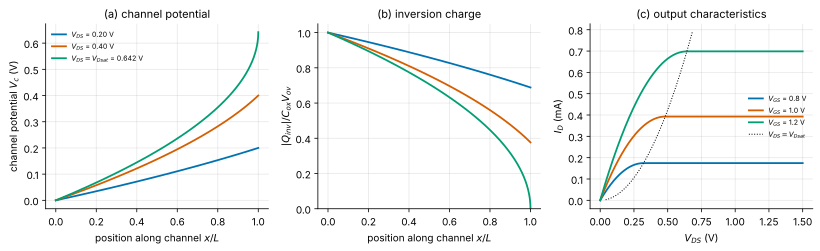

<!-- status: verified -->
# 09-09 · The Long-Channel MOSFET

| | |
|---|---|
| **Course** | [09 · Semiconductor Devices](../README.md) |
| **University equivalent** | The long-channel MOSFET in a junior semiconductor-devices course: the gradual-channel approximation, linear and saturation regions, the bulk-charge (body-effect) factor, surface mobility, channel-length modulation, small-signal parameters and subthreshold conduction (Pierret, *Semiconductor Device Fundamentals*, ch. 17; Streetman & Banerjee, ch. 6; Hu, *Modern Semiconductor Devices for Integrated Circuits*, ch. 6 and §7.2) |
| **Prerequisites** | [09-08 The MOS Capacitor](09-08-mos-capacitor.md) (threshold, inversion charge, exact surface charge), [09-03 Drift and Diffusion](09-03-drift-and-diffusion.md) (mobility, diffusion current), [09-05 PN Junction Electrostatics](09-05-pn-junction-electrostatics.md) (depletion widths), [01-05 Integrals](../../01-calculus-for-engineers/chapters/01-05-integrals.md) |
| **Estimated study hours** | 10 |
| **Last verified** | 2026-11-19 |

**Learning objectives.** After this chapter you can:

1. Derive the MOSFET drain current from the gradual-channel approximation, including the bulk-charge factor, in the linear and saturation regions.
2. Compute the body effect, and judge the linearized bulk-charge model against the exact bulk-charge integral.
3. Estimate surface mobility from Hu's universal-mobility fit, and explain why it is lower than bulk mobility.
4. Model channel-length modulation and compute output resistance and intrinsic gain.
5. Compute small-signal parameters ($g_m$, $g_{mb}$, $C_{gs}$, $f_T$) and compare MOSFET and bipolar transconductance efficiency.
6. Derive subthreshold conduction and the subthreshold swing, and compute off-state leakage.

---

## 1. Big picture

Add an n⁺ source and drain to the MOS capacitor of 09-08, one on each side of the gate, and the inversion layer becomes a resistive channel connecting them. The gate voltage sets how much charge the channel holds, and the drain voltage pushes that charge from source to drain. That is the metal–oxide–semiconductor field-effect transistor (MOSFET), "by far the most widely used semiconductor device" [1]. This chapter derives its current–voltage behavior for the long-channel case, where the channel is long enough that the field along it stays well below the velocity-saturation field and the gate controls the channel without interference from the drain. That model, the "square law" and its refinements, is still the language of analog design and the starting point for every short-channel correction in 09-10.

- **Every digital gate** switches by charging capacitances with MOSFET on-current and leaks through MOSFET off-current; both are derived here.
- **Analog design** uses the long-channel square law and its small-signal parameters ($g_m$, $r_o$, $C_{gs}$) as its first-order model.
- **The subthreshold region** sets standby power (Hu's example: 100 nA per transistor across 10⁸ transistors is 10 A [3]) and is also where ultra-low-power circuits operate.
- **Body effect** shapes stacked logic gates, pass transistors and analog references.

## 2. Intuition first

**A conveyor belt whose load depends on the gate.** The inversion layer is a belt of electrons. The gate decides how densely the belt is loaded: the charge per area is $C_{ox}$ times the gate overdrive. The drain voltage decides how fast the belt moves. But the belt's loading is not uniform: near the drain the channel sits at a higher potential, so less of the gate voltage appears across the oxide there, and the belt carries fewer electrons. Raise the drain voltage far enough and the loading at the drain end falls to zero. The channel "pinches off", and further drain voltage only drops across a short depleted gap that electrons cross at high speed. The current stops rising: **saturation**.

**A finance analogy: a tolled highway.** Current is traffic flow, the number of cars per lane-meter times their speed. The gate sets how many lanes are open (charge density); the drain sets the speed limit (field). Near the exit, fewer lanes are open, so the flow is limited by the narrowest stretch. *Where the analogy breaks:* in the transistor, lanes and speed are coupled through one variable, the local channel voltage, and the flow is the same at every point, which is what makes the problem solvable exactly.

*Figure 1. An n-channel MOSFET in the linear region and at saturation. (a) Channel potential along the channel for increasing drain voltage. (b) Inversion charge per area, falling toward the drain and reaching zero at pinch-off. (c) Output characteristics $I_D(V_{DS})$ for several gate voltages, with the locus $V_{DS} = V_{Dsat}$.*

## 3. Theory

We analyze an n-channel MOSFET: p-type body with acceptor density $N_A$, n⁺ source and drain, gate dielectric with capacitance $C_{ox}$ per area (strictly the electrical $C_{oxe}$ of 09-08 §3.9), channel length $L$ and width $W$. Voltages are referenced to the source: $V_{GS}$, $V_{DS}$ and the source-to-body voltage $V_{SB}$. $V_t$ is the threshold at $V_{SB} = 0$ (09-08) and $V_{ov} = V_{GS} - V_t$ is the **overdrive**. $x$ runs from source ($x = 0$) to drain ($x = L$), and $V_c(x)$ is the channel potential relative to the source.

### 3.1 The body effect

Reverse-biasing the source–body junction by $V_{SB}$ separates the quasi-Fermi levels by $qV_{SB}$ (09-04), so the surface must bend by $2\phi_B + V_{SB}$ before electrons appear [1]. In the threshold formula of 09-08, $2\phi_B$ becomes $2\phi_B + V_{SB}$ in the depletion-charge term:

$$
V_t(V_{SB}) = V_t + \gamma\Big(\sqrt{2\phi_B + V_{SB}} - \sqrt{2\phi_B}\Big), \qquad \gamma = \frac{\sqrt{2qN_A\varepsilon_s}}{C_{ox}} ,
$$

where $\gamma$ is the **body-effect parameter**, in V^1/2 [1]. Linearizing about $V_{SB} = 0$ gives $V_t + \alpha V_{SB}$ with

$$
\alpha = \frac{\gamma}{2\sqrt{2\phi_B}} = \frac{\varepsilon_s/W_{d\max}}{C_{ox}} = \frac{C_{dep}}{C_{ox}} = \frac{3T_{ox}}{W_{d\max}} .
$$

The body acts as a weak second gate, coupled to the channel through the depletion capacitance [1]. Modern transistors use **steep retrograde doping**, a lightly doped surface layer over a heavily doped region, so that the depletion width barely changes with $V_{SB}$ and the body effect is nearly linear [1].

### 3.2 The gradual-channel approximation

Along the channel, the potential $V_c(x)$ rises from 0 at the source to $V_{DS}$ at the drain. At each point the local gate-to-channel voltage is $V_{GS} - V_c$, and the local source-to-body bias is $V_{SB} + V_c$. If the channel potential varies slowly compared with the vertical field (the **gradual-channel approximation**, valid for long channels), each slice of channel behaves like a MOS capacitor with its own bias. Using the linearized body effect, the local inversion charge is [1]

$$
Q_{inv}(x) = -C_{ox}\big(V_{GS} - V_t - mV_c(x)\big), \qquad m = 1 + \frac{C_{dep}}{C_{ox}} = 1 + \frac{3T_{ox}}{W_{d\max}} .
$$

The **bulk-charge factor** $m$ (typically about 1.2 [1]) captures that raising the channel potential reduces the inversion charge both through the oxide (the 1) and by deepening the depletion region (the $C_{dep}/C_{ox}$).

**The current.** Electrons drift along the channel, $v = \mu_n\,dV_c/dx$, so the current is the charge per length times velocity:

$$
I_D = -W\,Q_{inv}(x)\,\mu_n\frac{dV_c}{dx} = W\mu_nC_{ox}\big(V_{GS} - V_t - mV_c\big)\frac{dV_c}{dx} .
$$

**Integrate along the channel.** The current is the same at every $x$ (no carriers are created or lost), so multiply by $dx$ and integrate from source to drain:

$$
\int_0^LI_D\,dx = W\mu_nC_{ox}\int_0^{V_{DS}}\big(V_{GS} - V_t - mV_c\big)\,dV_c
\quad\Longrightarrow\quad
I_D = \frac{W}{L}\,\mu_nC_{ox}\Big(V_{GS} - V_t - \frac m2V_{DS}\Big)V_{DS} .
$$

This is the **linear-region** (triode) current. For small $V_{DS}$ the transistor is a resistor, $R_{on} = L/[W\mu_nC_{ox}(V_{GS} - V_t)]$.

**Units check.** $(W/L)\,\mu C\,V^2$: cm²/V·s × F/cm² × V² = F·V/s = C/s = A. ✓

### 3.3 Saturation

The linear-region current is a downward parabola in $V_{DS}$. It peaks where $dI_D/dV_{DS} = 0$:

$$
V_{Dsat} = \frac{V_{GS} - V_t}{m}, \qquad
I_{Dsat} = \frac{W}{2mL}\,\mu_nC_{ox}\big(V_{GS} - V_t\big)^2 .
$$

At $V_{DS} = V_{Dsat}$ the inversion charge at the drain end, $-C_{ox}(V_{GS} - V_t - mV_{Dsat})$, is exactly zero: the channel is **pinched off** [1]. Beyond that, the extra drain voltage drops across a short, high-field, depleted region next to the drain. Electrons arriving at the pinch-off point are swept across it, just as minority carriers are swept across a reverse-biased junction (09-06). The channel itself, and so the current, stays as it was at $V_{Dsat}$. With $m = 1$ this is the familiar **square law**, $I_{Dsat} = (W/2L)\mu_nC_{ox}V_{ov}^2$, which overestimates the current by the factor $m$.

**When is a channel "long"?** The model assumes the electron velocity is proportional to the field. The average field in saturation is about $V_{Dsat}/L$. Velocity saturation (09-03) sets in near $\mathcal E_{sat} \approx 2v_{sat}/\mu_n$. When $V_{Dsat}/L$ is well below $\mathcal E_{sat}$, roughly for channels longer than a micrometer at volt-level overdrives, the square law holds; 09-10 handles shorter channels.

> **Going deeper — the exact bulk charge.** Linearizing the body effect is an approximation. Without it, the local inversion charge is $-C_{ox}[V_{GS} - V_{FB} - 2\phi_B - V_c - \gamma\sqrt{2\phi_B + V_c}]$ (for $V_{SB} = 0$), and integrating gives the "bulk-charge" model. For the transistor of the worked examples it predicts a saturation current 1.9% above the $m$-model (Example 09-09.4). The $m$-model's simplicity is worth that small error for hand analysis; compact models used in simulation keep the exact form.

### 3.4 Surface mobility

The mobility in the channel is not the bulk mobility of 09-03. Carriers squeezed against the oxide by the vertical field scatter from interface roughness and from phonons, and the result depends mainly on the average vertical field in the inversion layer, the **effective field**. Hu shows that for n-channel devices with an n⁺ poly gate the effective field is approximately $(V_{GS} + V_t + 0.2\text{ V})/6T_{oxe}$, and that all silicon MOSFETs then follow one **universal mobility** curve, which he fits with [1]

$$
\mu_{ns} = \frac{540\text{ cm}^2/\text{V·s}}{1 + \big(\mathcal E_{\text{eff}}/0.9\text{ MV/cm}\big)^{1.85}} .
$$

At typical operating fields (about 1 MV/cm) the electron surface mobility is a few hundred cm²/V·s, several times below the bulk value. Hole surface mobility is lower still (Hu's data top out near 185 cm²/V·s) [1]. The mobility falls with gate overdrive, which makes real $I_D$–$V_{GS}$ curves rise more slowly than the square law predicts. Strain and crystal orientation raise it (09-01, 09-12) [1].

### 3.5 Channel-length modulation and output resistance

In saturation, the pinch-off point moves toward the source as $V_{DS}$ rises, because the depleted gap at the drain widens by $\Delta L$. The current is set by the remaining channel, $L - \Delta L$, so

$$
I_D = \frac{I_{Dsat}}{1 - \Delta L/L} \approx I_{Dsat}\big(1 + \lambda V_{DS}\big) .
$$

A crude estimate treats the gap as a one-sided depletion region absorbing the excess voltage: $\Delta L \approx \sqrt{2\varepsilon_s(V_{DS} - V_{Dsat})/qN_A}$. This **channel-length modulation** gives the output conductance $g_{ds} = \partial I_D/\partial V_{DS}$ and output resistance $r_o = 1/g_{ds} \approx 1/(\lambda I_D)$. The effect weakens as $L$ grows. Hu notes that output conductance comes both from channel-length modulation and from the drain's influence on threshold (09-10), and that a small $g_{ds}$ needs a long channel, thin oxide and shallow junctions [1]. The transistor's **intrinsic gain** is $g_m/g_{ds} = g_mr_o$ [1].

### 3.6 Small-signal parameters

In saturation, linearizing $I_{Dsat}$ gives:

- **Transconductance**
  $$
  g_m = \frac{\partial I_D}{\partial V_{GS}} = \frac WL\,\frac{\mu_nC_{ox}}{m}\,V_{ov} = \frac{2I_D}{V_{ov}} = \sqrt{\frac{2\mu_nC_{ox}(W/L)I_D}{m}} .
  $$
  The **transconductance efficiency** $g_m/I_D = 2/V_{ov}$ is 2.5 V⁻¹ at 0.8 V of overdrive, against $1/V_T$ = 38.7 V⁻¹ for a bipolar transistor (09-07). A MOSFET approaches bipolar-like efficiency only at small overdrive, in weak inversion (§3.7). Analog designers trade $g_m/I_D$ against speed and area with exactly this relation.

- **Body transconductance** $g_{mb} = \partial I_D/\partial V_{BS} = (m - 1)g_m$: the body acts as a back gate.
- **Gate capacitance.** In saturation, the channel charge is $-\tfrac23WLC_{ox}V_{ov}$ (integrating the linearly vanishing charge profile), so $C_{gs} = \tfrac23WLC_{ox}$ and $C_{gd} \approx 0$ apart from overlap.
- **Cutoff frequency.** Current gain falls to unity at
  $$
  f_T = \frac{g_m}{2\pi C_{gs}} = \frac{3\mu_nV_{ov}}{4\pi mL^2} .
  $$
  It improves as $1/L^2$, the long-channel reason why shrinking transistors made them faster [1].

### 3.7 Subthreshold conduction

Below threshold, the inversion layer is weak, but it is not empty. Electrons at the source end are present at density $n_s \propto e^{\phi_s/V_T}$; at the drain end the reverse bias of the drain junction reduces their density by $e^{-V_{DS}/V_T}$. With the surface potential nearly uniform along the channel, the electrons move by **diffusion**, like minority carriers across a short base (09-07) [3]. The current is

$$
I_D \propto \Big(e^{\phi_s/V_T}\Big)\big(1 - e^{-V_{DS}/V_T}\big) .
$$

**How the gate moves the surface potential.** The gate couples to the surface through $C_{ox}$, and the body through $C_{dep}$, a capacitive divider. Hu's equivalent circuit gives [3]

$$
\frac{d\phi_s}{dV_{GS}} = \frac{C_{ox}}{C_{ox} + C_{dep}} = \frac1m .
$$

So $I_D \propto e^{V_{GS}/mV_T}$: the current rises tenfold for every

$$
S = mV_T\ln10 = m \times 59.5\text{ mV}
$$

of gate voltage at 300 K, the **subthreshold swing** [3]. With $m \ge 1$, no MOSFET can turn on more steeply than 59.5 mV/decade at room temperature, the "Boltzmann limit" that 09-10 discusses. Carrying the constant through (integrating the diffusion current with the depletion charge's dependence on $\phi_s$) gives the standard result

$$
I_D = \frac WL\,\mu_nC_{ox}(m - 1)V_T^2\,e^{(V_{GS} - V_t)/mV_T}\big(1 - e^{-V_{DS}/V_T}\big) ,
$$

which saturates once $V_{DS}$ exceeds a few $V_T$.

**Off-current and the practical threshold.** Industry defines threshold by a current: Hu's common definition is the $V_{GS}$ at which $I_D = 100\text{ nA} \times W/L$ (some companies use 200 nA) [3]. Below it,

$$
I_{off} = I_D(V_{GS} = 0) = 100\text{ nA}\cdot\frac WL\cdot10^{-V_t/S} .
$$

Every 60–80 mV of threshold reduction buys speed (more overdrive) at the cost of ten times more leakage. This trade-off between on-current and off-current is the central constraint of CMOS scaling (09-11) [3].

## 4. Worked examples

The transistor for all examples is an n-channel MOSFET with $W$ = 10 µm, $L$ = 1 µm, $T_{ox}$ = 4 nm (SiO₂-equivalent, $C_{ox}$ = 863.3 nF/cm²), body doping $N_A$ = 5 × 10¹⁷ cm⁻³, and a gate work function chosen so that $V_t$ = 0.4 V at $V_{SB}$ = 0. Bias: $V_{GS}$ = 1.2 V, 300 K, $n_i$ = 10¹⁰ cm⁻³.

### Example 09-09.1 · Device parameters and on-resistance (tier A)

**Setup.** (a) Find $\phi_B$, $W_{d\max}$, the bulk-charge factor $m$ and the body-effect parameter $\gamma$. (b) Find the effective field and the electron surface mobility from Hu's fit. (c) Find the on-resistance for small $V_{DS}$, and the average resistance $V_{DS}/I_D$ at $V_{DS}$ = 0.1 V.

**Solution.**

(a) The electrostatic parameters:

- $\phi_B = 0.025852\ln(5\times10^7)$ = **0.4583** V.
- $W_{d\max} = \sqrt{2\varepsilon_s(0.9166)/qN_A}$ = **48.7** nm.
- $m = 1 + (\varepsilon_s/W_{d\max})/C_{ox}$ = **1.246**.
- $\gamma = \sqrt{2qN_A\varepsilon_s}/C_{ox}$ = **0.472** V^1/2.

(b) $\mathcal E_{\text{eff}} = (1.2 + 0.4 + 0.2)/(6 \times 4\text{ nm})$ = **0.75** MV/cm, so $\mu_{ns} = 540/[1 + (0.75/0.9)^{1.85}]$ = **315.1** cm²/V·s.

(c) $R_{on} = L/[W\mu C_{ox}V_{ov}] = 1/(10 \times 315.1 \times 8.633\times10^{-7} \times 0.8)$ = **459.5** Ω. At 0.1 V the bulk-charge term lowers the current slightly, and $V_{DS}/I_D$ = **498.3** Ω.

**Sanity check.** A 10:1 transistor with 0.8 V of overdrive is a few hundred ohms, the right scale for a logic switch.

### Example 09-09.2 · Saturation and the long-channel check (tier A)

**Setup.** (a) Find $V_{Dsat}$ and $I_{Dsat}$, and compare with the square law ($m$ = 1). (b) Find $I_D$ at $V_{DS}$ = 0.3 V. (c) Compare the average channel field at saturation with the velocity-saturation field $2v_{sat}/\mu_{ns}$ ($v_{sat}$ = 10⁷ cm/s).

**Solution.**

(a) $V_{Dsat} = 0.8/1.246$ = **0.6418** V. $I_{Dsat} = (10/2.493) \times 315.1 \times 8.633\times10^{-7} \times 0.64$ = **0.698** mA. The square law gives **0.870** mA, **24.6**% more.

(b) $I_D = (W/L)\mu C_{ox}(0.8 - 1.246 \times 0.15)(0.3)$ = **0.500** mA.

(c) The average field is $0.6418\text{ V}/1\text{ µm}$ = **6.42 × 10³** V/cm, against $\mathcal E_{sat}$ = **6.35 × 10⁴** V/cm, a factor of about 10 below. Velocity saturation is negligible, so the long-channel model applies.

**Sanity check.** About **69.8** µA per micrometer of width at 0.8 V overdrive for a 1 µm channel; short-channel devices deliver more per micrometer (09-10, 09-11).

### Example 09-09.3 · The body effect (tier A)

**Setup.** With $V_{SB}$ = 1 V, find the threshold voltage exactly and with the linearized body effect. Show that the linearization coefficient equals $m - 1$.

**Solution.** $V_t(1\text{ V}) = 0.4 + 0.472(\sqrt{1.9166} - \sqrt{0.9166})$ = **0.602** V. The linear coefficient is $\alpha = \gamma/(2\sqrt{2\phi_B})$ = **0.2465**, identical to $m - 1$. The linearized estimate is 0.4 + 0.2465 = **0.646** V, which overestimates because the true dependence is a square root. A SPICE level-1 model, which uses the square law ($m$ = 1) with this body effect, would give $I_{Dsat} = (W/2L)\mu C_{ox}(1.2 - 0.602)^2$ = **0.487** mA at $V_{SB}$ = 1 V.

**Sanity check.** A volt of source-to-body bias raises the threshold by about 0.2 V. That is why stacked NMOS transistors, whose sources sit above ground, are slower.

### Example 09-09.4 · The exact bulk-charge model (tier C)

**Setup.** Using the exact local charge $-C_{ox}[V_{GS} - V_{FB} - 2\phi_B - V_c - \gamma\sqrt{2\phi_B + V_c}]$, with $V_{FB}$ chosen to give $V_t$ = 0.4 V, find $V_{FB}$, the saturation voltage (where the charge vanishes) and the saturation current. Compare with Example 09-09.2.

**Solution.** $V_{FB} = V_t - 2\phi_B - \gamma\sqrt{2\phi_B}$ = **−0.968** V. The charge vanishes at $V_c$ = **0.6594** V. Integrating the charge numerically from 0 to that point gives $I_{Dsat}$ = **0.7118** mA. The $m$-model's 0.698 mA is **1.89**% low.

**Sanity check.** The linearized model uses the bulk-charge slope at the source, where it is steepest. The true slope flattens as $V_c$ rises, so the exact model has slightly more charge near the drain.

### Example 09-09.5 · Channel-length modulation (tier B)

**Setup.** At $V_{DS}$ = 1.2 V, estimate the pinched-off length with the one-sided depletion formula, the drain current, the output conductance (numerically), $\lambda$ and $r_o$.

**Solution.** $\Delta L = \sqrt{2\varepsilon_s(1.2 - 0.6418)/qN_A}$ = **38.0** nm, or **3.80**% of $L$. Then $I_D = 0.698/(1 - 0.038)$ = **0.726** mA. Differentiating numerically, $g_{ds}$ = **25.7** µS, so $r_o$ = **38.9** kΩ and $\lambda = g_{ds}/I_{Dsat}$ = **0.0368** V⁻¹.

**Sanity check.** The output resistance grows with $L$ (both because $I_D$ falls and because $\Delta L/L$ shrinks), which is why analog designers use long devices where gain matters.

### Example 09-09.6 · Small-signal parameters (tier B)

**Setup.** In saturation (ignore channel-length modulation in $g_m$), find $g_m$, $g_m/I_D$ and its ratio to a BJT's, $g_{mb}$, $C_{gs}$, $f_T$, and the intrinsic gain $g_mr_o$ using Example 09-09.5.

**Solution.**

- $g_m = 2I_D/V_{ov}$ = **1.746** mS and $g_m/I_D$ = **2.50** V⁻¹, against **38.68** V⁻¹ for a bipolar transistor.
- $g_{mb} = (m - 1)g_m$ = **0.430** mS.
- $WLC_{ox}$ = **86.33** fF, so $C_{gs}$ = **57.55** fF.
- $f_T = g_m/(2\pi C_{gs})$ = **4.83** GHz, the same as $3\mu V_{ov}/(4\pi mL^2)$.
- $g_mr_o$ = **68.0**.

**Sanity check.** The BJT's **15.5**-fold advantage in $g_m/I_D$ is why bipolar input stages and references persist. The MOSFET gains on density, zero DC gate current, and $f_T$ that rises steeply as $L$ shrinks.

### Example 09-09.7 · Subthreshold swing and leakage (tier B)

**Setup.** (a) Find the subthreshold swing. (b) Using Hu's current-defined threshold (100 nA × $W/L$ at $V_t$), find $I_{off}$ at $V_{GS}$ = 0 and the number of decades below threshold. (c) Evaluate the physical prefactor $(W/L)\mu C_{ox}(m - 1)V_T^2$, the current at $V_{GS} = V_t$, and compare. (d) Hu's illustration: what standby current does 10⁸ transistors at 100 nA each draw?

**Solution.**

(a) $S = 1.246 \times 59.53$ = **74.2** mV/decade.

(b) $0.4/0.0742$ = **5.39** decades, so $I_{off} = 1\text{ µA} \times 10^{-5.39}$ = **4.06** pA.

(c) $10 \times 315.1 \times 8.633\times10^{-7} \times 0.2465 \times (0.025852)^2$ = **0.448** µA, the same order as the 1 µA convention. (Mobility near threshold is higher than at 1.2 V, and the two thresholds are defined differently.)

(d) $10^8 \times 100\text{ nA}$ = **10** A [3].

**Sanity check.** A low-leakage transistor with a 0.4 V threshold and 74 mV/decade has picoamps of leakage; cutting $V_t$ to 0.25 V would multiply that by **105**, which is the scaling dilemma of 09-11.

### Answer key

<!-- answer-key -->
| ID | Quantity | Value | Unit |
|---|---|---|---|
| Ex 09-09.1a | φ_B | 0.4583 | V |
| Ex 09-09.1b | W_dmax | 48.7 | nm |
| Ex 09-09.1c | m | 1.246 | — |
| Ex 09-09.1d | γ | 0.472 | V^1/2 |
| Ex 09-09.1e | effective field | 0.75 | MV/cm |
| Ex 09-09.1f | surface mobility | 315.1 | cm²/V·s |
| Ex 09-09.1g | R_on, small V_DS | 459.5 | Ω |
| Ex 09-09.1h | V_DS/I_D at 0.1 V | 498.3 | Ω |
| Ex 09-09.1i | C_ox, 4 nm | 863.3 | nF/cm² |
| Ex 09-09.2a | V_Dsat | 0.6418 | V |
| Ex 09-09.2b | I_Dsat | 0.698 | mA |
| Ex 09-09.2c | square-law I_Dsat | 0.870 | mA |
| Ex 09-09.2d | square-law excess | 24.6 | % |
| Ex 09-09.2e | I_D at 0.3 V | 0.500 | mA |
| Ex 09-09.2f | average channel field | 6.42e3 | V/cm |
| Ex 09-09.2g | velocity-saturation field | 6.35e4 | V/cm |
| Ex 09-09.3a | V_t at V_SB = 1 V | 0.602 | V |
| Ex 09-09.3b | linear body-effect coefficient | 0.2465 | — |
| Ex 09-09.3c | linearized V_t | 0.646 | V |
| Ex 09-09.4a | V_FB | -0.968 | V |
| Ex 09-09.4b | exact V_Dsat | 0.6594 | V |
| Ex 09-09.4c | exact I_Dsat | 0.7118 | mA |
| Ex 09-09.4d | m-model shortfall | 1.89 | % |
| Ex 09-09.5a | ΔL | 38.0 | nm |
| Ex 09-09.5b | ΔL/L | 3.80 | % |
| Ex 09-09.5c | I_D at 1.2 V | 0.726 | mA |
| Ex 09-09.5d | g_ds | 25.7 | µS |
| Ex 09-09.5e | r_o | 38.9 | kΩ |
| Ex 09-09.5f | λ | 0.0368 | V⁻¹ |
| Ex 09-09.6a | g_m | 1.746 | mS |
| Ex 09-09.6b | g_m/I_D | 2.50 | V⁻¹ |
| Ex 09-09.6c | BJT g_m/I_C | 38.68 | V⁻¹ |
| Ex 09-09.6d | g_mb | 0.430 | mS |
| Ex 09-09.6e | WLC_ox | 86.33 | fF |
| Ex 09-09.6f | C_gs | 57.55 | fF |
| Ex 09-09.6g | f_T | 4.83 | GHz |
| Ex 09-09.6h | g_m r_o | 68.0 | — |
| Ex 09-09.7a | subthreshold swing | 74.2 | mV/decade |
| Ex 09-09.7b | decades below threshold | 5.39 | — |
| Ex 09-09.7c | I_off | 4.06 | pA |
| Ex 09-09.7d | physical prefactor at V_t | 0.448 | µA |
| Ex 09-09.7e | standby current, 1e8 × 100 nA | 10 | A |
| T 09-09.a | Boltzmann limit of the swing | 59.5 | mV/decade |
| T 09-09.b | weak-inversion g_m/I_D bound, m = 1.246 | 31.0 | V⁻¹ |
| Ex 09-09.7f | leakage factor for V_t 0.25 V | 105 | — |
| Ex 09-09.2h | current per µm of width | 69.8 | µA/µm |
| Ex 09-09.6i | BJT advantage in g_m/I | 15.5 | — |
| Ex 09-09.3d | level-1 I_Dsat at V_SB = 1 V | 0.487 | mA |

*Every value is recomputed by [verify_09_09.py](../verify/verify_09_09.py) by an independent route: the drain current by numerically integrating the local channel charge along the channel (solving $dV_c/dx$ for constant current); saturation by maximizing the computed current; the body effect from the exact threshold condition; mobility from Hu's fit; channel-length modulation and small-signal parameters by numerical differentiation; $C_{gs}$ by integrating the channel-charge profile; and the subthreshold current by integrating the diffusion current with the exact weak-inversion charge of 09-08.*

## 5. Simulate it

The lab, [labs/09-09-lab](../labs/09-09-lab/README.md), has a notebook and an ngspice netlist:

1. Solve the channel numerically: potential and charge along the channel, and output characteristics, for the $m$-model and the exact bulk-charge model.
2. Add the universal mobility and see how it bends the transfer curve away from the square law.
3. Compute $g_m/I_D$ from weak to strong inversion, using an interpolation that is exact in both limits, and locate the boundary where it falls below half its weak-inversion value.
4. Run `nmos.cir` in ngspice with a level-1 (Shichman–Hodges) model set to this chapter's parameters and confirm the saturation current and on-resistance.

**Guided exercise (predict, then run).** **Before running Part 3**, predict: at what overdrive does the MOSFET's $g_m/I_D$ fall to half of its subthreshold value $1/(mV_T)$? Then compute it.

## 6. Engineering tradeoffs

| Knob | Improves | Costs | Typical decision owner |
|---|---|---|---|
| Shorter channel | Drive current (∝ 1/L), f_T (∝ 1/L²), density | Output resistance, short-channel effects (09-10), variability | Technology and circuit designers |
| Larger W/L | Current, g_m | Area, gate capacitance (input load) | Circuit designers |
| Larger overdrive (V_GS − V_t) | Current and speed | Lower g_m/I_D (efficiency), higher power, less headroom | Circuit designers |
| Lower threshold | Overdrive at fixed supply, speed | Off-current rises tenfold per S (≈ 60–80 mV) | Technology and product |
| Thinner oxide (higher C_ox) | Current, g_m, smaller m (steeper subthreshold) | Gate leakage, reliability (09-08) | Technology development |
| Body doping profile (retrograde) | Threshold control, short-channel control, linear body effect | Mobility, junction capacitance, dopant fluctuation | Device designers |
| Body bias | Tunes threshold after manufacture | Extra supply rails; weakened by low γ in thin-body devices | Circuit and product |

## 7. Numbers to know

| Quantity | Value | Note |
|---|---|---|
| Square law (long channel) | $I_{Dsat} = (W/2mL)\mu C_{ox}V_{ov}^2$ | §3.3 |
| Bulk-charge factor $m$ | typically about 1.2 | [1] |
| Electron surface mobility | 540/[1 + (E/0.9 MV/cm)^1.85] cm²/V·s; ~250–350 at ~1 MV/cm | [1] |
| Hole surface mobility | up to about 185 cm²/V·s | [1] |
| $g_m/I_D$ | $2/V_{ov}$ in strong inversion; ≤ $1/(mV_T)$ in weak inversion (31.0 V⁻¹ for $m$ = 1.246); BJT 38.7 V⁻¹ | §3.6 |
| Subthreshold swing | $m \times 59.5$ mV/decade at 300 K, never below 59.5 | [3] |
| Current-defined threshold | $I_D$ = 100 nA × W/L (some use 200 nA) | [3] |
| Long-channel $f_T$ | $3\mu V_{ov}/(4\pi mL^2)$: ~5 GHz at 1 µm | Example 09-09.6 |
| Off-current targets (roadmap) | about 0.15–0.84 µA/µm for high-performance, ~10⁻⁵ µA/µm for low-standby-power devices (90–22 nm nodes) | [2] |

## 8. Common mistakes

1. **Forgetting $m$.** The square law with $m$ = 1 overestimates saturation current and $V_{Dsat}$ by 20–30% for typical doping.
2. **Using bulk mobility.** Channel mobility is several times lower and falls with gate overdrive.
3. **Assuming the current is zero below threshold.** Subthreshold current falls only tenfold per 60–80 mV; it sets standby power.
4. **Applying the square law to short channels.** Once $V_{Dsat}/L$ approaches the velocity-saturation field, current becomes more nearly linear in overdrive (09-10).
5. **Treating $\lambda$ as a constant.** Channel-length modulation depends on $L$, doping and bias; quote $r_o$ at the operating point and length.
6. **Comparing $g_m$ without the current.** The fair comparison is $g_m/I_D$: a MOSFET at 0.8 V overdrive has about 15 times less transconductance per ampere than a BJT.
7. **Ignoring the body effect in stacks.** Source voltages above the body raise thresholds and slow series transistors.

## 9. Practitioner lens

### State of the art (as of Nov 2026)

- **The long-channel model is the analog designer's model.** The gate–drain current relations of §3.3 and the $g_m/I_D$ view of §3.6 remain the first-order tools of analog design (Course 20). Production design uses compact models (such as BSIM) fitted to measured devices, whose core is the bulk-charge picture of §3.2 [1] **[Established]**.
- **Universal mobility still anchors device engineering.** Hu's fit, after work published in 1996, shows all silicon NFETs on one curve once the effective field is accounted for [1] **[Established]**. Strain and orientation (09-01, 09-12) are the levers that move devices off it.
- **Leakage is specified per micrometer.** Hu's compilation of roadmap targets lists high-performance off-currents of 0.15–0.84 µA/µm and low-standby-power off-currents near 10⁻⁵ µA/µm across the 90–22 nm nodes [2] **[Established]** as roadmap targets. The five-decade spread between device flavors on one process comes almost entirely from threshold voltage, through the subthreshold swing.

### Why it matters commercially

- **Standby power.** Hu's illustration, 100 nA per transistor across 10⁸ transistors giving 10 A, shows why mobile SoCs mix low-leakage and high-speed transistors and power-gate idle blocks [3].
- **Analog headroom.** As supplies fall, overdrive shrinks, and transistors move toward moderate and weak inversion, where $g_m/I_D$ is high but speed is low: a central trade in analog and RF design.
- **Body bias as a knob.** Processes with strong body effect allow post-manufacture threshold tuning; thin-body processes (FD-SOI) use back-gate bias deliberately, while FinFETs have almost no body effect (09-12).

### Marketing vs Reality

- **"Drive current X mA/µm."** *Reality:* drive current depends on $V_{DD}$, threshold flavor and $I_{off}$; it is meaningless without the matching off-current and supply. *Sanity check:* ask for $I_{on}$ and $I_{off}$ at the same $V_{DD}$, and the threshold flavor.
- **"Low-leakage process."** *Reality:* leakage is a threshold choice; every process offers several thresholds trading speed for leakage. *Sanity check:* ask which flavor, at what temperature, and the swing.
- **"60 mV/decade switching."** *Reality:* 59.5 mV/decade at 300 K is the floor for a conventional transistor; real swings are higher and rise with temperature. *Sanity check:* ask for the measured swing over how many decades and at what temperature.

### Questions for engineering leaders

1. **"What $g_m/I_D$ do your analog blocks run at, and why?"**
   - *Strong:* names the inversion level per block (input pairs in moderate inversion, current sources in strong inversion) and the speed–efficiency–matching trade.
   - *Evasive:* "We size for speed."
2. **"Which threshold flavors do you use, and how much leakage does each cost at the hot corner?"**
   - *Strong:* gives $I_{off}$ per flavor at temperature, and the mix by area.
   - *Evasive:* room-temperature numbers only.
3. **"How far do your devices sit from the long-channel model, and which corrections dominate?"**
   - *Strong:* identifies velocity saturation, series resistance, mobility degradation and DIBL with magnitudes (09-10).
   - *Evasive:* "The models are calibrated."
4. **"Do you use body bias, and what range of threshold adjustment does it give?"**
   - *Strong:* quotes the body coefficient and tuning range per process.
   - *Evasive:* no data.

<!-- answer-key -->
| ID | Quantity | Value | Unit |
|---|---|---|---|
| P 09-09.a | HP off-current, low end | 0.15 | µA/µm |
| P 09-09.b | HP off-current, high end | 0.84 | µA/µm |
| P 09-09.c | LSTP off-current | 1e-5 | µA/µm |

## 10. Concept check

**Q1.** Why does the drain current saturate in a long-channel MOSFET?

Answer

As $V_{DS}$ rises, the channel potential near the drain rises, reducing the gate-to-channel voltage there and the inversion charge. At $V_{DS} = V_{Dsat} = (V_{GS} - V_t)/m$ the charge at the drain end reaches zero (pinch-off). Extra drain voltage drops across a short depleted region that electrons cross easily, while the channel up to the pinch-off point, and so the current, stays essentially the same.

**Q2.** What does the bulk-charge factor $m$ represent, and how does it change the square law?

Answer

Raising the local channel potential deepens the depletion region under the channel, so some of the gate's charge goes to uncovering acceptors rather than inducing electrons. $m = 1 + C_{dep}/C_{ox}$ accounts for this; it lowers $V_{Dsat}$ and $I_{Dsat}$ by the factor $m$ relative to the simple square law.

**Q3.** Why is channel mobility lower than bulk mobility, and why does it fall with gate voltage?

Answer

Carriers in the inversion layer are confined against the oxide interface, where surface-roughness scattering and phonon scattering add to bulk mechanisms. A stronger vertical field (more gate voltage) pushes them closer to the interface, increasing roughness scattering, so mobility falls with the effective field.

**Q4.** Why is a MOSFET's $g_m/I_D$ lower than a bipolar transistor's in strong inversion?

Answer

In strong inversion, $I_D \propto V_{ov}^2$, so $g_m/I_D = 2/V_{ov}$, a few per volt. A bipolar transistor's current is exponential in $V_{BE}$, so $g_m/I_C = 1/V_T$ ≈ 38.7 V⁻¹. A MOSFET reaches near-exponential behavior, $g_m/I_D = 1/(mV_T)$, only in weak inversion, where it is slow.

**Q5.** Why can't a MOSFET's subthreshold swing be below about 60 mV/decade at room temperature?

Answer

Below threshold the current is carried by electrons that must surmount a barrier; their number follows the Boltzmann factor $e^{\phi_s/V_T}$, a tenfold change per 59.5 mV of surface potential. The gate can at best move the surface potential one-for-one ($m$ = 1), so the swing is at least $V_T\ln10$; any depletion capacitance makes it worse.

**Q6.** How does lowering the threshold voltage by 150 mV change the off-current for a swing of 75 mV/decade?

Answer

Off-current rises by $10^{150/75} = 100$. Each swing's worth of threshold reduction costs a decade of leakage, which is why threshold cannot be scaled down freely with supply voltage.

Now work the [problem set](../problems/09-09-problems.md).

## 11. Key terms

[MOSFET](../../../reference/glossary.md#mosfet) · [Gradual-channel approximation](../../../reference/glossary.md#gradual-channel-approximation) · [Linear region](../../../reference/glossary.md#linear-region) · [Saturation region](../../../reference/glossary.md#saturation-region) · [Pinch-off](../../../reference/glossary.md#pinch-off) · [Square law](../../../reference/glossary.md#square-law) · [Bulk-charge factor](../../../reference/glossary.md#bulk-charge-factor) · [Body effect](../../../reference/glossary.md#body-effect) · [Body-effect parameter](../../../reference/glossary.md#body-effect-parameter) · [Overdrive voltage](../../../reference/glossary.md#overdrive-voltage) · [Surface mobility](../../../reference/glossary.md#surface-mobility) · [Universal mobility](../../../reference/glossary.md#universal-mobility) · [Channel-length modulation](../../../reference/glossary.md#channel-length-modulation) · [Intrinsic gain](../../../reference/glossary.md#intrinsic-gain) · [Transconductance efficiency](../../../reference/glossary.md#transconductance-efficiency) · [Subthreshold conduction](../../../reference/glossary.md#subthreshold-conduction) · [Subthreshold swing](../../../reference/glossary.md#subthreshold-swing) · [Off-state current](../../../reference/glossary.md#off-state-current) · [Retrograde doping](../../../reference/glossary.md#retrograde-doping)

## 12. Connections

- **Builds on:** [09-08](09-08-mos-capacitor.md) (threshold, inversion charge, exact surface charge), [09-03](09-03-drift-and-diffusion.md) (drift, diffusion, velocity saturation), [09-07](09-07-bipolar-junction-transistor.md) (diffusion across a short region, $g_m/I_C$), [01-05](../../01-calculus-for-engineers/chapters/01-05-integrals.md) (integration).
- **Next:** [09-10 Short-Channel Effects and Leakage](09-10-short-channel-effects-and-leakage.md) adds velocity saturation, DIBL, threshold roll-off, the swing limit in practice, gate leakage and variability.
- **Used later:** MOSFET biasing and amplifiers in [10-02](../../10-electronics-1/chapters/10-02-mosfet-dc-operation-and-biasing.md), [10-04](../../10-electronics-1/chapters/10-04-small-signal-models.md) and [10-06](../../10-electronics-1/chapters/10-06-mos-single-stage-amplifiers.md); CMOS logic and scaling in [09-11](09-11-cmos-and-scaling.md) and [Course 19](../../19-digital-vlsi-design/README.md); analog design in [Course 20](../../20-analog-and-mixed-signal-ic-design/README.md).

## 13. Further study

- C. Hu, *Modern Semiconductor Devices for Integrated Circuits*, ch. 6 (§6.3 surface mobility, §6.4 body effect, §6.5–6.6 the basic I–V model, §6.13–6.14 output conductance and high-frequency performance) and §7.2 (subthreshold current) (free from the author's site).
- R. F. Pierret, *Semiconductor Device Fundamentals*, ch. 17: MOSFET static characteristics, including the square-law and bulk-charge theories derived side by side.
- B. G. Streetman and S. K. Banerjee, *Solid State Electronic Devices*, ch. 6 (§6.5): the MOS field-effect transistor.
- Y. Tsividis and C. McAndrew, *Operation and Modeling of the MOS Transistor*: the standard graduate text on charge-sheet models and the weak-to-strong-inversion transition.

## 14. Sources

1. C. Hu, *Modern Semiconductor Devices for Integrated Circuits* (Pearson, 2010), ch. 6: §6.1 the MOSFET, §6.3 surface mobility (Eqs. 6.3.6–6.3.8, Fig. 6–9, universal mobility, after a 1996 IEEE paper), §6.4 body effect and retrograde doping (Eqs. 6.4.6–6.4.8), §6.5–6.6 Q_inv, bulk-charge factor ("m is typically around 1.2"), Eqs. 6.6.4–6.6.6, §6.13 output conductance and intrinsic gain, §6.14 f_T. [Ch. 6](https://www.chu.berkeley.edu/wp-content/uploads/2020/01/Chenming-Hu_ch6-1.pdf). [R-170](../../../reference/research-log.md#r-170--long-channel-mosfet-references).
2. C. Hu, ch. 7, Table 7–1: I_off for high-performance and low-standby-power devices from the 90 nm to the 22 nm node (compiled from the ITRS). [Ch. 7](https://www.chu.berkeley.edu/wp-content/uploads/2020/01/Chenming-Hu_ch7.pdf). [R-170](../../../reference/research-log.md#r-170--long-channel-mosfet-references).
3. C. Hu, ch. 7, §7.2: subthreshold current, Eqs. 7.2.1–7.2.8 (swing, current-defined threshold of 100 nA × W/L, off-current), and the 10⁸-transistor standby example. [Ch. 7](https://www.chu.berkeley.edu/wp-content/uploads/2020/01/Chenming-Hu_ch7.pdf). [R-170](../../../reference/research-log.md#r-170--long-channel-mosfet-references).
