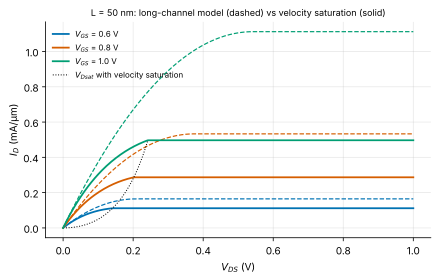
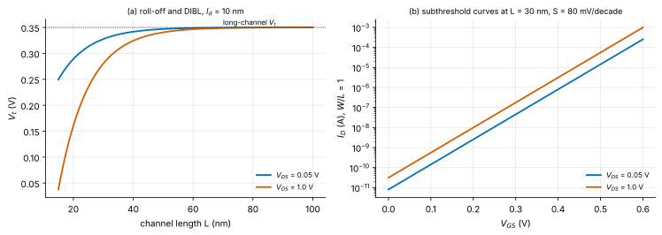
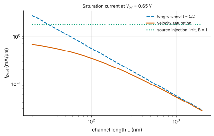

<!-- status: verified -->
# 09-10 · Short-Channel Effects and Leakage

| | |
|---|---|
| **Course** | [09 · Semiconductor Devices](../README.md) |
| **University equivalent** | Short-channel MOSFETs in a junior/senior devices course: velocity saturation and the source-injection limit, series resistance, threshold roll-off and drain-induced barrier lowering, the subthreshold-swing limit and the I_on–I_off trade-off, gate and junction leakage including band-to-band tunneling, and random variability (Pierret ch. 19; Taur & Ning, *Fundamentals of Modern VLSI Devices*, ch. 3–4; Hu, *Modern Semiconductor Devices for Integrated Circuits*, §6.8–6.12 and ch. 7) |
| **Prerequisites** | [09-09 The Long-Channel MOSFET](09-09-long-channel-mosfet.md) (gradual-channel model, subthreshold swing), [09-08 The MOS Capacitor](09-08-mos-capacitor.md) (gate leakage, EOT), [09-06 PN Junction I–V, Capacitance and Breakdown](09-06-pn-junction-iv-and-capacitance.md) (junction leakage, tunneling breakdown), [09-03 Drift and Diffusion](09-03-drift-and-diffusion.md) (velocity saturation), [09-02 Carriers, Doping and the Fermi Level](09-02-carriers-doping-fermi-level.md) (dopant counting) |
| **Estimated study hours** | 8 |
| **Last verified** | 2026-11-19 |

**Learning objectives.** After this chapter you can:

1. Derive the drain current with velocity saturation, compute $V_{Dsat}$ and $I_{Dsat}$ for short channels, and compare with the long-channel and source-injection limits.
2. Include parasitic source/drain resistance self-consistently.
3. Explain threshold roll-off and drain-induced barrier lowering (DIBL), and compute their effect on off-current with the characteristic-length model.
4. Apply the subthreshold-swing limit to the I_on–I_off trade-off, including temperature.
5. Estimate band-to-band tunneling fields behind gate-induced drain leakage, and place gate, junction and subthreshold leakage in one budget.
6. Estimate threshold variability from random dopant fluctuation using Poisson statistics.

---

## 1. Big picture

The long-channel MOSFET of 09-09 is a clean device: current set by the gate, nothing from the drain once saturated, and an off-current set only by threshold and swing. Shrink the channel to tens of nanometers and every one of those statements weakens. Carriers hit their velocity ceiling, so current grows only linearly with gate overdrive. The drain, now close to the source, reaches in and lowers the barrier that keeps the transistor off. Thin dielectrics and steep junctions leak by tunneling. And the transistor holds so few dopant atoms that their random count shifts each device's threshold. This chapter quantifies each effect. Together they explain why gate length stopped scaling freely, why supply voltages are now planned near 0.6–0.7 V rather than falling further (§9), and why the industry moved to fins and gate-all-around structures (09-12).

- **Drive current** is set by velocity saturation and series resistance, not the square law, in every modern logic transistor.
- **Leakage power** comes from subthreshold current raised by DIBL and threshold roll-off, plus gate tunneling, junction leakage and GIDL.
- **Variability** limits SRAM voltage and yield; random dopants are one reason thin-body transistors avoid heavy channel doping.
- **Roadmaps** are written in these terms: the IRDS 2024 tables give subthreshold-slope targets of 70–82 mV/decade for high-performance logic at supplies of 0.60–0.70 V [4].

## 2. Intuition first

**A speed limit on the highway.** In a long channel, raising the field makes carriers faster, so current rises as the square of overdrive. In a short channel, the field is so high that carriers already move at their saturation velocity (about 10⁷ cm/s in bulk silicon, 8 × 10⁶ cm/s for electrons in the inversion layer), like cars at a speed limit. More gate voltage can only add more cars (charge), not more speed, so current grows linearly with overdrive. At the very shortest lengths, the limit is how fast carriers enter the channel from the source: the injection velocity.

**A dam the drain can reach.** A transistor is off because a potential barrier between source and channel holds back the source's electrons (Hu's analogy: the source is a reservoir, the barrier is a dam, and the gate sets its height [2]). In a long channel the drain is far away and cannot affect the dam. In a short channel the drain's field reaches the barrier and pulls it down: **drain-induced barrier lowering**. The transistor then leaks more and its threshold falls, and the effect grows exponentially as the channel shortens.

**A finance analogy: concentration risk.** A large portfolio's return is predictable because many positions average out; a portfolio of three stocks is volatile. A large transistor holds thousands of dopants, so its threshold is predictable; a tiny one holds a hundred, and their random count (Poisson statistics, 03-02) makes each device's threshold a draw from a distribution. *Where the analogy breaks:* the fix is not diversification but removal: thin-body transistors need no heavy channel doping, so there is little to count.

*Figure 1. Velocity saturation in the 50 nm NMOS of Example 09-10.1 (2 nm EOT, $V_{TH}$ = 0.35 V, $\mu_{ns}$ = 183 cm²/V·s, $v_{sat}$ = 8 × 10⁶ cm/s): output characteristics from the long-channel model (dashed) and with velocity saturation (solid). The short-channel device saturates at a much lower $V_{DS}$ and current, and its saturation current grows nearly linearly with gate voltage.*

## 3. Theory

We continue with the n-channel MOSFET of 09-09: overdrive $V_{ov} = V_{GS} - V_{TH}$, bulk-charge factor $m$, surface mobility $\mu_{ns}$ and gate capacitance $C_{ox}$ per area (the electrical value). Currents are often quoted per micrometer of width.

### 3.1 Velocity saturation

The drift velocity cannot grow without bound (09-03): once carriers have enough energy to emit optical phonons, they lose it as fast as they gain it [1]. Hu uses a model that fits the measured inversion-layer data well [1]:

$$
v = \frac{\mu_{ns}\mathcal E}{1 + \mathcal E/\mathcal E_{sat}} \quad (\mathcal E \le \mathcal E_{sat}), \qquad v = v_{sat} \quad (\mathcal E \ge \mathcal E_{sat}), \qquad \mathcal E_{sat} = \frac{2v_{sat}}{\mu_{ns}} .
$$

(The two pieces meet at $\mathcal E_{sat}$, which is what fixes $\mathcal E_{sat} = 2v_{sat}/\mu_{ns}$.) Hu takes $v_{sat}$ = 8 × 10⁶ cm/s for electrons and 6 × 10⁶ cm/s for holes in the inversion layer [1], somewhat below the bulk values of 09-03 §3.5.

**The current below saturation.** Put this velocity into the gradual-channel current, $I_D = WC_{ox}(V_{ov} - mV_c)\,v$, with $\mathcal E = dV_c/dx$:

$$
I_D\Big(1 + \frac{1}{\mathcal E_{sat}}\frac{dV_c}{dx}\Big) = WC_{ox}\mu_{ns}(V_{ov} - mV_c)\frac{dV_c}{dx} .
$$

Integrate along the channel exactly as in 09-09 §3.2; the extra term integrates to $I_DV_{DS}/\mathcal E_{sat}$:

$$
I_D = \frac{\dfrac WL\,\mu_{ns}C_{ox}\Big(V_{ov} - \dfrac m2V_{DS}\Big)V_{DS}}{1 + V_{DS}/\mathcal E_{sat}L} .
$$

Velocity saturation divides the long-channel current by $1 + \mathcal E_{\text{avg}}/\mathcal E_{sat}$, where $\mathcal E_{\text{avg}} = V_{DS}/L$ is the average channel field [1].

**Saturation.** The current saturates when the carriers at the drain end reach $v_{sat}$. There, $I_D = WC_{ox}(V_{ov} - mV_{Dsat})v_{sat}$. Equate this to the expression above at $V_{DS} = V_{Dsat}$ (written $V$ for short), using $\mu = 2v_{sat}/\mathcal E_{sat}$, and multiply both sides by $\mathcal E_{sat}L/v_{sat}$:

$$
2\Big(V_{ov} - \frac{mV}{2}\Big)V = (V_{ov} - mV)(\mathcal E_{sat}L + V)
\;\Longrightarrow\;
2V_{ov}V - mV^2 = V_{ov}\mathcal E_{sat}L + V_{ov}V - mV\mathcal E_{sat}L - mV^2 .
$$

The $mV^2$ terms cancel, leaving $V(V_{ov} + m\mathcal E_{sat}L) = V_{ov}\mathcal E_{sat}L$. Dividing by $VV_{ov}\mathcal E_{sat}L$ gives Hu's result [1]

$$
\frac{1}{V_{Dsat}} = \frac{m}{V_{ov}} + \frac{1}{\mathcal E_{sat}L}, \qquad
I_{Dsat} = WC_{ox}v_{sat}\big(V_{ov} - mV_{Dsat}\big) .
$$

Two limits frame it.

- **Long channel** ($\mathcal E_{sat}L \gg V_{ov}$): $V_{Dsat} \to V_{ov}/m$ and the square law returns.
- **Very short channel** ($\mathcal E_{sat}L \ll V_{ov}$): $V_{Dsat} \to \mathcal E_{sat}L$, and $I_{Dsat} \approx WC_{ox}v_{sat}(V_{ov} - m\mathcal E_{sat}L)$. The current is now *linear* in overdrive and nearly independent of $L$ [1].

Hu shows a 0.15 µm device whose saturation current is linear in $V_{GS}$ next to a 2 µm device that follows the square law, and notes that p-channel devices deliver about half the n-channel current, because holes have about a third of the mobility and a lower saturation velocity [1] **[Established]**. (Hu's text says 30% lower; his own values of 8 and 6 × 10⁶ cm/s make it 25%, the figure Solution 09-10.4 uses.)

**How long is "long"?** The condition is $\mathcal E_{sat}L \gg V_{ov}$, which depends on bias as well as length. Hu's example: a 0.2 µm channel at 2 V overdrive is short, while an analog circuit biased at 0.1 V overdrive can use the long-channel equations even at 0.05 µm [1].

### 3.2 The source-injection limit

At lengths well below 100 nm, carriers cross the channel in less time than they need to lose energy, and they can briefly exceed $v_{sat}$ (**velocity overshoot**) [1]. The current is then limited at the source instead: carriers enter the channel at their thermal velocity, and only a fraction $B$ of those injected reach the drain without scattering back [1]:

$$
I_{Dsat} = WBv_{thx}C_{ox}V_{ov} .
$$

Hu gives $v_{thx}$ ≈ 1.6 × 10⁷ cm/s for electrons and 1 × 10⁷ cm/s for holes, and a typical $B$ ≈ 0.5 from Monte Carlo simulation [1]. Since $0.5 \times 1.6\times10^7$ cm/s = 8 × 10⁶ cm/s = $v_{sat}$, the source-injection and drain-end velocity-saturation limits predict similar currents; Hu expects $B$, like the effective $v_{sat}$, to rise somewhat as $L$ shrinks [1]. With $B$ = 1 (no backscattering at all), the same expression is the "ballistic" ceiling on drive current per unit width at a given overdrive.

### 3.3 Parasitic source and drain resistance

The source and drain extensions, contacts and silicide add a resistance $R_S$ (and $R_D$) in series. The source resistance matters most, because the current through it raises the source and so reduces the gate overdrive: $V_{ov,\text{int}} = V_{ov} - I_DR_S$ [1]. In the very-short-channel limit, where $I_D \propto V_{ov}$, this gives Hu's closed form [1]

$$
I_{Dsat} = \frac{I_{Dsat0}}{1 + R_SI_{Dsat0}/V_{ov}} ,
$$

where $I_{Dsat0}$ is the current without $R_S$. In general, the internal overdrive must be found self-consistently. Hu notes that the shallow source/drain extensions under the gate spacer, needed to limit short-channel leakage (§3.4), contribute to $R_S$, and he expects its impact to rise [1]. This is one reason for the contact-resistance focus of 09-06 §3.11.

### 3.4 Threshold roll-off and drain-induced barrier lowering

In a long channel, the gate alone sets the height of the barrier between source and channel. In a short channel the source and drain junctions also shape it. Their depletion regions share the channel's charge and, crucially, the drain's potential reaches the barrier. Hu explains the result with a two-capacitor picture [2]: the gate couples to the barrier through $C_{ox}$, and the drain couples through a small capacitance $C_d$ that grows as the channel shortens. The drain voltage therefore acts like a little extra gate voltage, and less real gate voltage is needed to reach threshold:

$$
V_{TH} = V_{TH,\text{long}} - \big(V_{DS} + 0.4\text{ V}\big)\frac{C_d}{C_{ox}} .
$$

The 0.4 V represents the built-in potentials between the inversion layer and the source and drain [2]. Solving Poisson's equation in two dimensions shows that the coupling decays exponentially with length [2]:

$$
V_{TH} = V_{TH,\text{long}} - \big(V_{DS} + 0.4\text{ V}\big)\,e^{-L/l_d}, \qquad l_d \propto \sqrt[3]{T_{oxe}W_{dep}X_j} ,
$$

where $X_j$ is the source/drain junction depth and $l_d$ is the **characteristic length** of DIBL [2] **[Established]** as a semi-quantitative model.

> **Going deeper — why the coupling decays exponentially.** Draw a box of depth $W_{dep}$ and length $dx$ under the gate, and apply Gauss's law to it with the surface potential $\psi(x)$. Three fluxes cross the box: from the gate through the oxide, $\varepsilon_{ox}(V_{GS} - V_{FB} - \psi)/T_{ox}$ per unit length; along the channel, the change in lateral field, approximated as uniform over the depth, $\varepsilon_sW_{dep}\,d^2\psi/dx^2$; and they must balance the depletion charge $qN_AW_{dep}$. So
>
> $$
> \varepsilon_sW_{dep}\frac{d^2\psi}{dx^2} + \frac{\varepsilon_{ox}}{T_{ox}}(V_{GS} - V_{FB} - \psi) = qN_AW_{dep}
> \quad\Longrightarrow\quad
> \frac{d^2\psi}{dx^2} = \frac{\psi - \psi_{1D}}{\lambda^2}, \qquad \lambda = \sqrt{\frac{\varepsilon_s}{\varepsilon_{ox}}T_{ox}W_{dep}} ,
> $$
>
> where $\psi_{1D}$ is the long-channel surface potential (the value with $d^2\psi/dx^2 = 0$). The solution is a sum of $e^{x/\lambda}$ and $e^{-x/\lambda}$ anchored to the source and drain potentials, so their influence on the barrier in the middle of the channel decays as $e^{-L/2\lambda}$: an exponential roll-off with a **scale length** $\lambda$ set by oxide thickness and depletion depth. Hu's $l_d$, with its cube root and junction depth, is a semi-empirical refinement of the same physics. The double-gate version of this argument gives the scale length of 09-12. Two effects follow:

- **Threshold roll-off.** At any $V_{DS}$, the threshold falls as $L$ shrinks; at small $V_{DS}$ the 0.4 V term still lowers it.
- **DIBL.** The threshold falls further as $V_{DS}$ rises, by $e^{-L/l_d}$ per volt. It is quoted in mV/V, as the threshold difference between low and high drain bias divided by the drain-voltage difference.

*Figure 3. Hu's roll-off model with $l_d$ = 10 nm and a long-channel threshold of 0.35 V. (a) Threshold against channel length at $V_{DS}$ = 0.05 V and 1.0 V: the gap between the curves is DIBL, and both collapse below about $3l_d$. (b) Subthreshold curves of a 30 nm device ($S$ = 80 mV/decade, threshold current 100 nA): raising the drain voltage from 0.05 V to 1.0 V shifts the whole curve left by 47 mV, multiplying the off-current by about four against the same device at low drain bias (Example 09-10.3's DIBL-only factor, 3.90).*

Since off-current depends on threshold exponentially (09-09 §3.7), every $S$ millivolts of DIBL at the supply voltage multiply the off-current by ten. The acceptable minimum length is "several times" $l_d$ [2]. To shrink $L$, $l_d$ must shrink with it, so the oxide, the depletion width and the junction depth must all be thinned [2]. That is the vertical-scaling requirement that drove thinner oxides, high-k dielectrics (09-08), shallow junctions, steep retrograde doping (09-09 §3.1), and ultimately thin bodies controlled from several sides (FinFETs and gate-all-around, 09-12).

### 3.5 The subthreshold-swing limit and the I_on–I_off trade-off

In 09-09 §3.7 the subthreshold swing is $S = mV_T\ln10 \ge$ 59.5 mV/decade at 300 K. It also scales with absolute temperature. Short channels make it worse: in the two-capacitor picture the drain and source capacitances to the barrier join $C_{dep}$ in the denominator of the gate's coupling ratio, $C_{ox}/(C_{ox} + C_{dep} + C_d + \dots)$, so the gate's leverage over the barrier falls and $S$ rises.

**The trade-off.** For a fixed supply $V_{DD}$, the transistor must turn on hard ($I_{on}$ grows with $V_{DD} - V_{TH}$) and off hard ($I_{off} = I_{t}\,10^{-V_{TH}/S}$, where $I_t$ is the current that defines threshold). Every decade of on/off ratio below threshold costs $S$ millivolts of threshold, and so of overdrive. Hu describes the resulting manufacturing strategies [2]:

- several threshold flavors on one chip, with high-$V_{TH}$ devices everywhere and low-$V_{TH}$ devices only on speed-critical paths;
- multiple supply voltages, so most circuits run at a lower $V_{DD}$;
- well (body) bias applied to idle blocks to raise their thresholds (09-09 §3.1).

With $V_{DD}$ falling toward 0.6–0.7 V (§9), and $S$ unable to fall below 59.5 mV/decade, the on/off window can no longer improve by voltage scaling. That is the root of the "power wall" of 09-11 and the motivation for steep-slope devices (tunneling FETs, negative-capacitance FETs), which aim to beat the Boltzmann limit by changing the injection mechanism. Whether any will displace CMOS in volume logic is **[Contested]**.

### 3.6 Other leakage paths

A modern transistor leaks through four channels, each with its own physics.

- **Subthreshold leakage** (§3.5, 09-09): source to drain over the barrier, $\propto 10^{-V_{TH}/S}$, raised by DIBL and temperature; the term threshold choice controls.
- **Gate leakage** (09-08 §3.10): tunneling through the dielectric, exponentially sensitive to its physical thickness; tamed by high-k dielectrics.
- **Junction leakage** (09-06 §3.5): generation in the source/drain-to-body depletion regions (∝ $n_i$) and diffusion (∝ $n_i^2$), rising steeply with temperature.
- **Gate-induced drain leakage (GIDL)**: band-to-band tunneling in the drain under the gate edge, below.

**The GIDL field.** With the gate low and the drain high, the drain surface under the gate edge is pushed into depletion. Once its bands bend by more than the gap, about $E_g/q$ ≈ 1.12 V, filled valence-band states face empty conduction-band states a short distance away, and electrons can tunnel across: the mechanism of tunneling breakdown (09-06 §3.9). Take the gate and drain of the same type (n⁺ polysilicon over an n⁺ drain), so their flat-band offset is near zero. Then whatever part of the drain-to-gate voltage is not used to bend the silicon bands falls across the oxide, and Gauss's law (continuity of $\varepsilon\mathcal E$) carries the oxide field into the silicon reduced by $\varepsilon_{ox}/\varepsilon_s$ = 3.9/11.7 = 1/3:

$$
\mathcal E_s \approx \frac{\varepsilon_{ox}}{\varepsilon_s}\,\frac{V_{DG} - E_g/q}{T_{ox}} = \frac{V_{DG} - E_g/q}{3\,T_{ox}} .
$$

Tunneling becomes significant near 10⁶ V/cm in silicon (09-06), across a distance $E_g/q\mathcal E_s$ of order 10 nm. GIDL therefore turns on steeply once $V_{DG}$ exceeds about $E_g/q + 3T_{ox} \times 10^6$ V/cm, a voltage that falls as the oxide thins. The electrons go to the drain and the holes to the body. Raising the threshold does not reduce GIDL; thicker oxides and more gradual drain doping do. It matters most in designs whose other leakage paths have been pushed very low.

**Three more short-channel limits.** Each gets a sentence here; device-design texts (Taur and Ning, *Fundamentals of Modern VLSI Devices*) treat them in depth.

- **Punch-through.** If the source and drain depletion regions merge *below* the surface, where the gate has little control, the barrier vanishes deep in the body and current flows regardless of gate voltage. Heavily doped **halo** (pocket) implants next to the junctions keep the depletion regions apart.
- **Hot carriers.** In saturation the field peaks near the drain. Electrons gain enough energy there to ionize atoms, producing **substrate current** (the holes flow to the body), and a few are injected into the gate oxide, where they create traps that shift the threshold over the product's life. Lightly doped drain extensions soften the peak field, and lower supply voltages have reduced, though not removed, the problem; it is a reliability (wear-out) mechanism rather than an instant failure.
- **Tunneling at halo junctions.** A heavily doped halo against a heavily doped drain makes a junction abrupt enough for band-to-band tunneling, adding junction leakage by the same mechanism as GIDL (§3.6; 09-06 §3.9).

### 3.7 Random dopant fluctuation and variability

The threshold depends on the depletion charge $qN_AW_{dep}$ under the gate (09-08). In a small device that charge is carried by a countable number of dopant atoms placed at random. The count in the depletion volume is a Poisson random variable with mean $\bar N = N_AWLW_{dep}$ and standard deviation $\sqrt{\bar N}$ (09-02 Problem 14; 03-02).

**A first estimate.** Treat the extra or missing dopants as charge spread evenly over the gate area. A fluctuation of $\sqrt{\bar N}$ atoms changes the depletion charge by $q\sqrt{\bar N}/(WL)$ per unit area, which the gate must balance:

$$
\sigma_{V_{TH},0} = \frac{q\sqrt{\bar N}}{C_{ox}WL} .
$$

**Weighting by depth.** A dopant deep in the depletion region matters less than one at the surface. To see by how much, add a thin sheet of extra acceptor charge, of magnitude $\delta Q$ per unit area, at depth $x$, and hold the surface potential at its threshold value $\phi_s$. In the depletion approximation (09-05) the band bending is the depletion-layer term plus the sheet's own contribution:

$$
\phi_s = \frac{qN_AW'^2}{2\varepsilon_s} + \frac{\delta Q\,x}{\varepsilon_s} .
$$

With $\phi_s$ fixed, the depletion edge retreats. To first order in $\delta Q$, $W' = W_{dep} - \delta Q\,x/(qN_AW_{dep})$. The total charge the gate must balance changes by

$$
qN_A(W' - W_{dep}) + \delta Q = \delta Q\Big(1 - \frac{x}{W_{dep}}\Big) ,
$$

so the threshold shifts by $\delta Q(1 - x/W_{dep})/C_{ox}$. A dopant at the surface counts fully; one at the depletion edge not at all.

Now add up independent Poisson counts. A slab of thickness $dx$ at depth $x$ holds on average $N_AWL\,dx$ dopants, with the same variance, and each shifts $V_{TH}$ by $q(1 - x/W_{dep})/(C_{ox}WL)$. Variances of independent counts add:

$$
\sigma_{V_{TH}}^2 = \int_0^{W_{dep}} N_AWL\left[\frac{q(1 - x/W_{dep})}{C_{ox}WL}\right]^2 dx = \frac{q^2N_AW_{dep}}{3\,C_{ox}^2\,WL}, \qquad \sigma_{V_{TH}} = \frac{\sigma_{V_{TH},0}}{\sqrt3} .
$$

*Units check:* C² × cm⁻³ × cm ÷ [(F/cm²)² × cm²] = C²/F² = V². ✓

The scaling is the point. σ grows as $1/\sqrt{WL}$ (smaller devices vary more), as $\sqrt{N_A}$ (heavier doping varies more) and as $T_{ox}$ (weaker gate coupling varies more). Hu identifies random dopant fluctuation as a significant source of threshold variation in small MOSFETs, and notes that thin-body and multigate devices need no heavy channel doping, which improves mobility [3] **[Established]**. Undoped devices still vary: Hu names gate-edge roughness and manufacturing variation in gate length as other sources [2].

## 4. Worked examples

The short-channel transistor for Examples 09-10.1 and 09-10.2: an NMOS with $L$ = 50 nm, 2 nm EOT ($C_{ox}$ = 1.727 µF/cm²), $m$ = 1.2 and $V_{TH}$ = 0.35 V, at $V_{GS}$ = 1.0 V, with $v_{sat}$ = 8 × 10⁶ cm/s [1]. Currents are per micrometer of width.

### Example 09-10.1 · Velocity saturation and the injection limit (tier B)

**Setup.** (a) Find the surface mobility from Hu's universal fit (09-09 §3.4), then $\mathcal E_{sat}$ and $\mathcal E_{sat}L$. (b) Find $V_{Dsat}$ and $I_{Dsat}$ with velocity saturation, and compare with the long-channel values. (c) Find the source-injection limit for $B$ = 1 and $B$ = 0.5 with $v_{thx}$ = 1.6 × 10⁷ cm/s.

**Solution.**

(a) $\mathcal E_{\text{eff}}$ = (1.0 + 0.35 + 0.2) V/(6 × 2 nm) = **1.292** MV/cm, so $\mu_{ns} = 540/[1 + (1.292/0.9)^{1.85}]$ = **183.0** cm²/V·s. Then $\mathcal E_{sat} = 2 \times 8\times10^6/183.0$ = **8.74 × 10⁴** V/cm, and $\mathcal E_{sat}L$ = **0.437** V. This is comparable with $V_{ov}$ = 0.65 V, so the channel is short.

(b) $1/V_{Dsat} = 1.2/0.65 + 1/0.437$, so $V_{Dsat}$ = **0.2419** V, against $V_{ov}/m$ = **0.5417** V. Then

$$
I_{Dsat} = 10^{-4}\text{ cm} \times 1.727\times10^{-6}\text{ F/cm}^2 \times 8\times10^6\text{ cm/s} \times (0.65 - 1.2 \times 0.2419)\text{ V} = \mathbf{0.497}\text{ mA/µm} .
$$

The long-channel square law, $(W/2mL)\mu_{ns}C_{ox}V_{ov}^2$, would give **1.112** mA/µm. Velocity saturation removes **55.3**% of it.

(c) $WBv_{thx}C_{ox}V_{ov}$ = **1.80** mA/µm for $B$ = 1 and **0.898** mA/µm for $B$ = 0.5.

*Units check:* cm × F/cm² × cm/s × V = C/s = A. ✓

**Sanity check.** The velocity-saturation estimate sits below the ballistic ceiling, as it must. With $B$ = 0.5, $Bv_{thx} = v_{sat}$, so the two models differ only by the $mV_{Dsat}$ term: 0.898 × (0.65 − 0.290)/0.65 = 0.497 mA/µm. ✓ Hu's Fig. 7–12 plots measured high-performance NMOS drive currents of order 1 mA/µm [2]; real devices get there with thinner effective oxides, strain and higher overdrive.

### Example 09-10.2 · Series resistance (tier B)

**Setup.** The transistor has a source resistance of 100 Ω·µm. Find the saturation current (a) with Hu's closed form and (b) self-consistently, solving $I = I_{Dsat}(V_{ov} - IR_S)$ with the full model of Example 09-10.1.

**Solution.**

(a) $R_SI_{Dsat0}$ = 100 Ω·µm × 0.497 mA/µm = **0.0497** V, so $I_{Dsat} = 0.497/(1 + 0.0497/0.65)$ = **0.462** mA/µm, a **7.1**% loss.

(b) Root finding gives **0.448** mA/µm, a **9.9**% loss. The closed form assumes $I \propto V_{ov}$, but this device is only partly velocity-saturated, so its current falls faster than linearly with overdrive.

**Sanity check.** Only 45 mV of IR drop costs a tenth of the current: series resistance is a first-order performance lever, which is why contact and extension resistance get so much engineering attention.

### Example 09-10.3 · Threshold roll-off and DIBL (tier B)

**Setup.** A technology has $l_d$ = 10 nm. Using Hu's model, find the threshold reduction at $V_{DS}$ = 0.05 V and 1.0 V, the DIBL in mV/V, the factor by which the off-current at $V_{DS}$ = 1 V exceeds a long-channel device's (total roll-off), and the part of it due to DIBL alone (against the same device at 0.05 V), taking $S$ = 80 mV/decade, for $L$ = 50, 30 and 20 nm.

**Solution.** $\Delta V_{TH} = (V_{DS} + 0.4)e^{-L/l_d}$ and DIBL $= (\Delta V_{TH}(1.0) - \Delta V_{TH}(0.05))/0.95$:

| $L$ (nm) | $e^{-L/l_d}$ | $\Delta V_{TH}$ at 0.05 V | $\Delta V_{TH}$ at 1.0 V | DIBL | $I_{off}$ at 1 V vs long channel | DIBL-only factor |
|---|---|---|---|---|---|---|
| 50 | **0.00674** | **3.03** mV | **9.43** mV | **6.74** mV/V | **1.31** | **1.20** |
| 30 | **0.0498** | **22.4** mV | **69.7** mV | **49.8** mV/V | **7.43** | **3.90** |
| 20 | **0.135** | **60.9** mV | **189.5** mV | **135** mV/V | **234** | **40.5** |

**Sanity check.** Going from $5l_d$ to $2l_d$ multiplies the roll-off twentyfold, and the leakage at full drain bias by about **178** (234/1.31). This is why minimum length is several times the characteristic length, and why $l_d$ must shrink every generation.

### Example 09-10.4 · The I_on–I_off window (tier B)

**Setup.** A logic transistor at $V_{DD}$ = 0.7 V must have $I_{off}$ a thousand times below its threshold-defining current. (a) Find the minimum $V_{TH}$ and the remaining overdrive for $S$ = 60, 70 and 90 mV/decade. (b) For $S$ = 70 mV/decade at 300 K, what is the swing at 85 °C, and by how much does the swing change alone raise the off-current?

**Solution.**

(a) $V_{TH} = 3S$:

| $S$ (mV/decade) | $V_{TH}$ (V) | $V_{DD} - V_{TH}$ (V) | share of $V_{DD}$ |
|---|---|---|---|
| 60 | **0.18** | **0.52** | **74**% |
| 70 | **0.21** | **0.49** | **70**% |
| 90 | **0.27** | **0.43** | **61**% |

(b) $S$ scales with $T$: 70 × 358.15/300 = **83.6** mV/decade. The off-current rises by $10^{0.21/0.070 - 0.21/0.0836}$ = **3.07**, before any threshold shift with temperature (which, in 09-09 Problem 12, multiplied leakage further).

**Sanity check.** Each extra 10 mV/decade of swing costs about 30 mV of overdrive at three decades: steep turn-on is worth as much as a higher supply.

### Example 09-10.5 · The field behind GIDL (tier B)

**Setup.** A transistor with a 2 nm EOT has an n⁺ polysilicon gate over an n⁺ drain. Using §3.6 with $E_g$ = 1.12 eV, find the oxide field, the silicon surface field and the tunneling distance $E_g/q\mathcal E_s$ for $V_{DG}$ = 2.0 V and 1.5 V. Then find the drain-to-gate voltage at which the silicon field reaches 10⁶ V/cm, for this oxide and for a 1.2 nm oxide.

**Solution.**

- $V_{DG}$ = 2.0 V: the oxide carries 2.0 − 1.12 = 0.88 V, so $\mathcal E_{ox}$ = 0.88 V/2 nm = **4.40** MV/cm and $\mathcal E_s$ = **1.47** MV/cm. The tunneling distance is 1.12 V ÷ 1.467 MV/cm = **7.64** nm.
- $V_{DG}$ = 1.5 V: **1.90** MV/cm in the oxide and **0.633** MV/cm in the silicon, with a distance of **17.7** nm.
- Onset: $V_{DG} = 1.12\text{ V} + 3T_{ox} \times 10^6$ V/cm = **1.72** V for 2 nm and **1.48** V for 1.2 nm.

**Sanity check.** The tunneling probability falls exponentially with the barrier width (04-10, 09-06), so shrinking it from 17.7 nm to 7.64 nm over half a volt turns GIDL from negligible to significant. Thinner oxides pull the onset toward the supply voltage; that is why low-leakage transistors keep thicker oxides and graded drains.

### Example 09-10.6 · Random dopant fluctuation (tier C)

**Setup.** A planar transistor has $W$ = 50 nm, $L$ = 30 nm, uniform $N_A$ = 5 × 10¹⁸ cm⁻³, 2 nm EOT, and a depletion depth of 20 nm. (At zero body bias the maximum depletion depth at $2\phi_B$ would be **16.4** nm; 20 nm corresponds to about **0.51** V of reverse body bias. Take the 20 nm as given.) Find the mean dopant count, its standard deviation and relative spread, the depletion-charge term of the threshold, the first-estimate $\sigma_{V_{TH},0}$ and the depth-weighted $\sigma_{V_{TH}}$.

**Solution.**

- $\bar N = 5\times10^{18} \times 50\times10^{-7} \times 30\times10^{-7} \times 20\times10^{-7}$ = **150**.
- $\sigma = \sqrt{150}$ = **12.2**, a relative spread of **8.2**%.
- The depletion term $qN_AW_{dep}/C_{ox}$ = **0.928** V.
- $\sigma_{V_{TH},0} = q\sqrt{\bar N}/(C_{ox}WL)$ = **75.8** mV, which equals 8.2% of 0.928 V.
- Weighting by depth divides by √3: $\sigma_{V_{TH}}$ = **43.7** mV.

**Sanity check.** Tens of millivolts of random threshold spread is ruinous for SRAM cells, whose stability depends on matched transistors, and comparable to the whole roll-off budget of Example 09-10.3. A lightly doped thin body largely removes this term.

### Answer key

<!-- answer-key -->
| ID | Quantity | Value | Unit |
|---|---|---|---|
| Ex 09-10.1a | C_ox, 2 nm | 1.727 | µF/cm² |
| Ex 09-10.1b | effective field | 1.292 | MV/cm |
| Ex 09-10.1c | surface mobility | 183.0 | cm²/V·s |
| Ex 09-10.1d | E_sat | 8.74e4 | V/cm |
| Ex 09-10.1e | E_sat L | 0.437 | V |
| Ex 09-10.1f | V_Dsat with velocity saturation | 0.2419 | V |
| Ex 09-10.1g | long-channel V_Dsat | 0.5417 | V |
| Ex 09-10.1h | I_Dsat with velocity saturation | 0.497 | mA/µm |
| Ex 09-10.1i | long-channel I_Dsat | 1.112 | mA/µm |
| Ex 09-10.1j | reduction | 55.3 | % |
| Ex 09-10.1k | injection limit, B = 1 | 1.80 | mA/µm |
| Ex 09-10.1l | injection limit, B = 0.5 | 0.898 | mA/µm |
| Ex 09-10.2a | R_S I_Dsat0 | 0.0497 | V |
| Ex 09-10.2b | I_Dsat, closed form | 0.462 | mA/µm |
| Ex 09-10.2c | loss, closed form | 7.1 | % |
| Ex 09-10.2d | I_Dsat, self-consistent | 0.448 | mA/µm |
| Ex 09-10.2e | loss, self-consistent | 9.9 | % |
| Ex 09-10.3a | e^(−L/l_d), 50 nm | 0.00674 | — |
| Ex 09-10.3b | ΔV_TH at 0.05 V, 50 nm | 3.03 | mV |
| Ex 09-10.3c | ΔV_TH at 1.0 V, 50 nm | 9.43 | mV |
| Ex 09-10.3d | DIBL, 50 nm | 6.74 | mV/V |
| Ex 09-10.3e | I_off factor, 50 nm | 1.31 | — |
| Ex 09-10.3f | e^(−L/l_d), 30 nm | 0.0498 | — |
| Ex 09-10.3g | ΔV_TH at 0.05 V, 30 nm | 22.4 | mV |
| Ex 09-10.3h | ΔV_TH at 1.0 V, 30 nm | 69.7 | mV |
| Ex 09-10.3i | DIBL, 30 nm | 49.8 | mV/V |
| Ex 09-10.3j | I_off factor, 30 nm | 7.43 | — |
| Ex 09-10.3k | e^(−L/l_d), 20 nm | 0.135 | — |
| Ex 09-10.3l | ΔV_TH at 0.05 V, 20 nm | 60.9 | mV |
| Ex 09-10.3m | ΔV_TH at 1.0 V, 20 nm | 189.5 | mV |
| Ex 09-10.3n | DIBL, 20 nm | 135 | mV/V |
| Ex 09-10.3o | I_off factor, 20 nm | 234 | — |
| Ex 09-10.3p | DIBL-only factor, 50 nm | 1.20 | — |
| Ex 09-10.3q | DIBL-only factor, 30 nm | 3.90 | — |
| Ex 09-10.3r | DIBL-only factor, 20 nm | 40.5 | — |
| Ex 09-10.3s | leakage ratio, 20 nm to 50 nm | 178 | — |
| Ex 09-10.4a | V_TH, S = 60 | 0.18 | V |
| Ex 09-10.4b | overdrive, S = 60 | 0.52 | V |
| Ex 09-10.4c | share of V_DD, S = 60 | 74 | % |
| Ex 09-10.4d | V_TH, S = 70 | 0.21 | V |
| Ex 09-10.4e | overdrive, S = 70 | 0.49 | V |
| Ex 09-10.4f | share of V_DD, S = 70 | 70 | % |
| Ex 09-10.4g | V_TH, S = 90 | 0.27 | V |
| Ex 09-10.4h | overdrive, S = 90 | 0.43 | V |
| Ex 09-10.4i | share of V_DD, S = 90 | 61 | % |
| Ex 09-10.4j | S at 85 °C | 83.6 | mV/decade |
| Ex 09-10.4k | off-current rise from the swing | 3.07 | — |
| Ex 09-10.5a | E_ox at V_DG = 2.0 V | 4.40 | MV/cm |
| Ex 09-10.5b | E_s at 2.0 V | 1.47 | MV/cm |
| Ex 09-10.5c | tunneling distance at 2.0 V | 7.64 | nm |
| Ex 09-10.5d | E_ox at 1.5 V | 1.90 | MV/cm |
| Ex 09-10.5e | E_s at 1.5 V | 0.633 | MV/cm |
| Ex 09-10.5f | tunneling distance at 1.5 V | 17.7 | nm |
| Ex 09-10.5g | onset V_DG, 2 nm | 1.72 | V |
| Ex 09-10.5h | onset V_DG, 1.2 nm | 1.48 | V |
| Ex 09-10.6a | mean dopant count | 150 | — |
| Ex 09-10.6b | standard deviation | 12.2 | — |
| Ex 09-10.6c | relative spread | 8.2 | % |
| Ex 09-10.6d | depletion term of V_TH | 0.928 | V |
| Ex 09-10.6e | σ(V_TH), first estimate | 75.8 | mV |
| Ex 09-10.6f | σ(V_TH), depth-weighted | 43.7 | mV |
| Ex 09-10.6g | zero-bias W_dmax at 5e18 | 16.4 | nm |
| Ex 09-10.6h | body bias for a 20 nm depletion depth | 0.51 | V |
| T 09-10.a | electron injection velocity (Hu) | 1.6e7 | cm/s |
| T 09-10.b | inversion-layer electron v_sat (Hu) | 8e6 | cm/s |
| T 09-10.c | typical B (Hu) | 0.5 | — |

*Every value is recomputed by [verify_09_10.py](../verify/verify_09_10.py) by an independent route: the velocity-saturated current by integrating the channel equation with the piecewise velocity model and locating saturation where the drain-end velocity reaches $v_{sat}$; series resistance by root finding; roll-off and DIBL from Hu's model evaluated directly; the on/off window by root finding on the subthreshold current; fields from Gauss's law across the oxide–silicon interface; and the dopant spread by numerical integration of the depth-weighted variance, cross-checked by a seeded Monte Carlo of random dopant positions.*

## 5. Simulate it

The lab, [labs/09-10-lab](../labs/09-10-lab/README.md), is a notebook that:

1. Computes output characteristics with velocity saturation and series resistance, and $I_{Dsat}$ against $L$ from 2 µm to 20 nm alongside the long-channel and injection limits (Figure 2).
2. Plots threshold roll-off and DIBL against $L$ with Hu's model and shows the subthreshold curves shifting with drain bias.
3. Explores the I_on–I_off window against supply, swing and temperature.
4. Samples dopant counts in thousands of virtual transistors and builds the threshold distribution.

**Guided exercise (predict, then run).** **Before running Part 1**, predict: as $L$ shrinks from 2 µm to 20 nm at fixed overdrive, by what factor does the velocity-saturated $I_{Dsat}$ rise, compared with the 100-fold rise the long-channel law promises? Then compute it.

*Figure 2. Saturation current against channel length at 0.65 V overdrive for the example technology: long-channel law ($\propto 1/L$), velocity-saturation model, and the source-injection ceiling ($B$ = 1). Below about 100 nm the current departs from the $1/L$ law and approaches a length-independent ceiling.*

## 6. Engineering tradeoffs

| Knob | Improves | Costs | Typical decision owner |
|---|---|---|---|
| Shorter gate length | Drive current (weakly, once velocity-saturated), density | DIBL, roll-off, leakage, variability | Technology roadmap |
| Thinner EOT | Gate control: smaller $l_d$, larger $C_{ox}$ | Gate leakage, reliability (09-08) | Technology development |
| Shallower junctions / extensions | Smaller $l_d$, less DIBL | Series resistance | Process integration |
| Heavier or halo channel doping (planar) | Less roll-off | Mobility, junction leakage, GIDL, random dopant fluctuation | Device designers |
| Undoped thin body (FinFET, GAA, FD-SOI) | Electrostatics and variability without doping | Process complexity; threshold set by work function (09-12) | Technology roadmap |
| Lower $V_{TH}$ | $I_{on}$ | $I_{off}$ ×10 per $S$ | Product and design (multi-$V_{TH}$) |
| Higher $V_{DD}$ | $I_{on}$, speed | Dynamic power ∝ $V_{DD}^2$, GIDL, reliability | Product and design |
| Strain | Mobility, and so $I_{on}$ | Process complexity, layout dependence | Technology development |

## 7. Numbers to know

| Quantity | Value | Note |
|---|---|---|
| Inversion-layer $v_{sat}$ | 8 × 10⁶ cm/s (electrons), 6 × 10⁶ cm/s (holes) | [1] |
| Velocity-saturation field | $2v_{sat}/\mu_{ns}$: ~6–9 × 10⁴ V/cm | [1], §3.1 |
| Short-channel $I_{Dsat}$ | $WC_{ox}v_{sat}(V_{ov} - mV_{Dsat})$; linear in $V_{ov}$ | [1] |
| Injection velocity | ~1.6 × 10⁷ cm/s (electrons), 1 × 10⁷ cm/s (holes) | [1] |
| PMOS vs NMOS current | about one half | [1] |
| DIBL model | $\Delta V_{TH} = (V_{DS} + 0.4)e^{-L/l_d}$; minimum $L$ several $l_d$ | [2] |
| Swing limit | 59.5 mV/decade at 300 K, ∝ T | [2] |
| IRDS 2024 HP logic | swing 82 → 70 mV/decade, $V_{DD}$ 0.70 → 0.60 V, $L_g$ 16 → 12 nm (2024–2027) | [4] |
| Tunneling field (Si) | ~10⁶ V/cm | 09-06 |
| Random dopant σ(V_TH) | $(q/C_{ox})\sqrt{N_AW_{dep}/3WL}$: tens of mV for doped nanoscale planar devices | §3.7 |

## 8. Common mistakes

1. **Using the square law for short channels.** Velocity saturation makes $I_{Dsat}$ nearly linear in overdrive and roughly length-independent.
2. **Reading DIBL as a constant.** It grows exponentially as $L$ falls below a few characteristic lengths.
3. **Quoting $V_{TH}$ without the drain bias.** Short-channel thresholds differ by tens of millivolts between $V_{DS}$ = 0.05 V and $V_{DD}$; leakage at $V_{DD}$ uses the saturation threshold.
4. **Ignoring temperature in leakage.** Swing grows ∝ T, threshold falls, and junction leakage soars; hot-corner leakage can be orders of magnitude above room temperature.
5. **Treating series resistance as a small correction.** Tens of millivolts of $I R_S$ cost 10% or more of drive current.
6. **Assuming one leakage mechanism.** Subthreshold, gate, junction and GIDL leakage have different voltage and temperature dependences; budgets need all four.
7. **Expecting doping to fix everything.** Doping that suppresses roll-off increases variability, junction leakage and GIDL and lowers mobility.

## 9. Practitioner lens

### State of the art (as of Nov 2026)

- **Roadmap targets.** The IRDS 2024 More Moore tables list, for high-performance logic, subthreshold slopes of 82, 72 and 70 mV/decade for 2024, 2025 and 2027 onward, with supplies of 0.70, 0.65 and 0.60 V and gate lengths of 16, 14 and 12 nm (falling to 10 nm by 2033); high-density libraries target 75 to 65 mV/decade [4] **[Industry estimate]** (roadmap targets, not measured products). Targets within about 10–20 mV/decade of the 59.5 mV/decade limit presume the strong gate control of fins and gate-all-around channels (09-12).
- **Series resistance and injection velocity.** The same tables put the total source-plus-drain resistance at 271 Ω·µm in 2024, falling about 5% per period to 180 Ω·µm by 2039, and assume an injection velocity of 9 × 10⁶ cm/s throughout [4] **[Industry estimate]**. That velocity is a useful check on §3.2: Hu's $Bv_{thx}$ with $B$ ≈ 0.5 and $v_{thx}$ ≈ 1.6 × 10⁷ cm/s gives 8 × 10⁶ cm/s, within about 11%.
- **DIBL figures for current nodes were not found in a primary source** for this build: the IRDS 2024 tables have no DIBL row (open issue).
- **Multi-threshold, multi-supply design is standard.** Hu describes the practice of offering two, three or more thresholds, multiple supplies and well bias to manage the I_on–I_off trade-off [2] **[Established]**.
- **Thin bodies remove the need for heavy channel doping.** Hu cites random dopant fluctuation as a threshold-variation source in small MOSFETs, and notes that multigate devices need no heavy channel doping, improving mobility [3] **[Established]**.

### Why it matters commercially

- **Leakage sets battery life and data-center idle power.** Hu's 10⁸ transistors at 100 nA each drawing 10 A (09-09) is the scale of the problem; multi-$V_{TH}$ libraries, multiple supplies and well bias are part of the response.
- **Drive current per micrometer sets speed.** Velocity saturation, injection and series resistance, not mobility alone, set it in short devices, and Hu expected the series-resistance share to keep rising [1].
- **Variability sets the minimum SRAM voltage.** The lowest operating voltage of caches, and so of whole SoCs, is largely set by the worst-case threshold spread across millions of matched cells.

### Marketing vs Reality

- **"X% faster at the same power."** *Reality:* such claims fix a point on the I_on–I_off curve; at another threshold or supply the gain differs. *Sanity check:* ask for the I_on–I_off curve, the supply and the threshold flavor.
- **"Near-ideal subthreshold slope."** *Reality:* 60 mV/decade is the floor at 300 K; quoted values are often best-case, low-drain-bias, room-temperature. *Sanity check:* ask for swing at $V_{DD}$, at 85–125 °C, and the DIBL.
- **"Steep-slope transistors will end the power wall."** *Reality:* the 59.5 mV/decade limit belongs to thermionic injection over a barrier; devices that beat it must inject differently, and the test is whether they also deliver CMOS-class drive current (§3.5). Whether any will reach volume logic is **[Contested]**. *Sanity check:* ask for the drive current at the slope claimed, and over how many decades of current the slope holds.

### Questions for engineering leaders

1. **"What are the saturation-threshold, DIBL and swing at the supply and the hot corner for your critical devices?"**
   - *Strong:* quotes all three at $V_{DD}$ and temperature, with distributions.
   - *Evasive:* linear-region threshold at room temperature.
2. **"How much of your drive current is lost to series resistance, and what is your contact resistivity?"**
   - *Strong:* gives the $R_S$ share of on-resistance and the roadmap to reduce it.
   - *Evasive:* "Contacts are optimized."
3. **"What is your leakage budget by mechanism?"**
   - *Strong:* splits subthreshold, gate, junction and GIDL, against temperature.
   - *Evasive:* one total number.
4. **"What limits your SRAM minimum voltage, and what threshold σ do you see?"**
   - *Strong:* quotes σ(V_TH) for the bitcell devices, its sources (work function, line-edge, dopants) and the assist circuits used.
   - *Evasive:* no data.

<!-- answer-key -->
| ID | Quantity | Value | Unit |
|---|---|---|---|
| P 09-10.a | IRDS HP swing 2024 | 82 | mV/decade |
| P 09-10.b | IRDS HP swing 2027 on | 70 | mV/decade |
| P 09-10.c | IRDS V_DD 2024 | 0.70 | V |
| P 09-10.d | IRDS V_DD 2027 on | 0.60 | V |
| P 09-10.e | IRDS HP gate length 2024 | 16 | nm |
| P 09-10.f | IRDS HP gate length 2027 | 12 | nm |
| P 09-10.g | IRDS R_sd 2024 | 271 | Ω·µm |
| P 09-10.h | IRDS R_sd 2039 | 180 | Ω·µm |
| P 09-10.i | IRDS injection velocity | 9e6 | cm/s |
| P 09-10.j | Hu's B v_thx | 8e6 | cm/s |

## 10. Concept check

**Q1.** Why does a short-channel transistor's saturation current grow linearly, not quadratically, with gate overdrive?

Answer

In a short channel the field is high enough that carriers at the drain end move at the saturation velocity. The current is then charge times a fixed velocity, $WC_{ox}(V_{ov} - mV_{Dsat})v_{sat}$, and the charge grows linearly with overdrive. In a long channel the velocity also grows with field, giving the extra power of $V_{ov}$.

**Q2.** What physical effect does DIBL describe, and why does it grow so fast as the channel shortens?

Answer

The drain's potential reaches into the channel and lowers the source–channel barrier that keeps the transistor off, so less gate voltage is needed to turn it on and the threshold falls with drain bias. The coupling comes from the two-dimensional electrostatics of the channel, whose solution decays as $e^{-L/l_d}$, so it grows exponentially as $L$ approaches the characteristic length.

**Q3.** Why must the oxide, depletion depth and junction depth shrink when the gate length does?

Answer

The characteristic length $l_d$ scales roughly as the cube root of $T_{ox}W_{dep}X_j$, and acceptable DIBL needs $L$ to stay several times $l_d$. Thinner oxide strengthens the gate's coupling; a shallower depletion region and junctions weaken the drain's coupling and add a nearby "ground plane".

**Q4.** Why does a lower supply voltage make the I_on–I_off trade-off harder?

Answer

Off-current requires the threshold to sit a fixed number of swings (each at least 59.5 mV) above zero. That threshold does not shrink with the supply, so a lower $V_{DD}$ leaves less overdrive, and less on-current, for the same leakage.

**Q5.** How does GIDL differ from subthreshold leakage?

Answer

Subthreshold leakage flows from source to drain over the channel barrier and is set by threshold and swing. GIDL is band-to-band tunneling in the drain region under the gate edge, driven by the drain-to-gate voltage through the thin oxide. It flows from drain to body, grows steeply with drain-to-gate voltage and oxide thinness, and is not reduced by raising the threshold.

**Q6.** Why do thin-body and multigate transistors avoid heavy channel doping?

Answer

In nanoscale doped channels the dopant count is small and Poisson-distributed, giving tens of millivolts of random threshold spread, and heavy doping also lowers mobility and raises junction leakage and GIDL. Thin bodies controlled by gates on several sides (FinFETs, gate-all-around) get their electrostatic control from geometry: the thin body takes the place of $W_{dep}$ and $X_j$ in $l_d$, so they need no heavy doping and avoid those penalties (Hu also notes the mobility gain). Their thresholds are then set mainly by the gate work function (09-12).

Now work the [problem set](../problems/09-10-problems.md).

## 11. Key terms

[Velocity saturation](../../../reference/glossary.md#velocity-saturation) · [Velocity overshoot](../../../reference/glossary.md#velocity-overshoot) · [Source injection velocity](../../../reference/glossary.md#source-injection-velocity) · [Parasitic series resistance](../../../reference/glossary.md#parasitic-series-resistance) · [Threshold roll-off](../../../reference/glossary.md#threshold-roll-off) · [Drain-induced barrier lowering](../../../reference/glossary.md#drain-induced-barrier-lowering) · [Characteristic length](../../../reference/glossary.md#characteristic-length) · [Short-channel effects](../../../reference/glossary.md#short-channel-effects) · [Multi-threshold CMOS](../../../reference/glossary.md#multi-threshold-cmos) · [Steep-slope transistor](../../../reference/glossary.md#steep-slope-transistor) · [Gate-induced drain leakage](../../../reference/glossary.md#gate-induced-drain-leakage) · [Random dopant fluctuation](../../../reference/glossary.md#random-dopant-fluctuation) · [Matching coefficient](../../../reference/glossary.md#matching-coefficient) · [Subthreshold swing](../../../reference/glossary.md#subthreshold-swing) · [Off-state current](../../../reference/glossary.md#off-state-current)

## 12. Connections

- **Builds on:** [09-09](09-09-long-channel-mosfet.md) (long-channel model, swing), [09-08](09-08-mos-capacitor.md) (gate leakage), [09-06](09-06-pn-junction-iv-and-capacitance.md) (junction leakage, tunneling), [09-03](09-03-drift-and-diffusion.md) (velocity saturation), [09-02](09-02-carriers-doping-fermi-level.md) (dopant statistics), [03-02](../../03-probability-statistics-and-random-variables/chapters/03-02-random-variables-and-distributions.md) (Poisson distribution).
- **Next:** [09-11 CMOS and Scaling](09-11-cmos-and-scaling.md) turns these device limits into the end of Dennard scaling and the power wall.
- **Used later:** FinFET, gate-all-around and backside power in [09-12](09-12-finfet-gaa-cfet-backside-power.md); SRAM and DRAM leakage and variability in [Course 23](../../23-memory-and-storage-technology/README.md); timing and leakage sign-off in [Course 19](../../19-digital-vlsi-design/README.md); reliability in [Course 25](../../25-fabrication-packaging-test-and-reliability/README.md).

## 13. Further study

- C. Hu, *Modern Semiconductor Devices for Integrated Circuits*, §6.8–6.12 (velocity saturation, series resistance, overshoot and the injection limit) and ch. 7 (subthreshold current, V_TH roll-off and DIBL, reducing EOT and W_dep, shallow junctions, the I_on–I_off trade-off, thin-body and multigate devices) (free from the author's site).
- Y. Taur and T. H. Ning, *Fundamentals of Modern VLSI Devices*, ch. 3–4: the standard senior/graduate treatment of short-channel MOSFETs, scale length and leakage.
- R. F. Pierret, *Semiconductor Device Fundamentals*, ch. 19: MOSFETs in ICs, small-dimension effects.
- M. Lundstrom, "Elementary scattering theory of the Si MOSFET", *IEEE Electron Device Letters* (1997), and his later notes on nanoscale transistors: the backscattering view behind the injection limit (named for further reading, not used for numbers here).

## 14. Sources

1. C. Hu, *Modern Semiconductor Devices for Integrated Circuits* (Pearson, 2010), ch. 6: §6.8 velocity saturation and overshoot, §6.9 I–V with velocity saturation (Eqs. 6.9.3–6.9.14, $\mathcal E_{sat} = 2v_{sat}/\mu_{ns}$, the long-channel criterion, Fig. 6–23 and PMOS/NMOS comparison), §6.10 parasitic resistance (Eq. 6.10.1), §6.12 source injection (Eq. 6.12.1, $v_{thx}$). [Ch. 6](https://www.chu.berkeley.edu/wp-content/uploads/2020/01/Chenming-Hu_ch6-1.pdf). [R-171](../../../reference/research-log.md#r-171--short-channel-and-leakage-references).
2. C. Hu, ch. 7: §7.2 subthreshold current and swing, §7.3 V_TH roll-off and DIBL (Eqs. 7.3.1–7.3.4, dam analogy), §7.5–7.6 reducing $W_{dep}$ and shallow junctions, §7.7 the I_on–I_off trade-off, multiple $V_{TH}$ and $V_{DD}$, Fig. 7–12. [Ch. 7](https://www.chu.berkeley.edu/wp-content/uploads/2020/01/Chenming-Hu_ch7.pdf). [R-171](../../../reference/research-log.md#r-171--short-channel-and-leakage-references).
3. C. Hu, ch. 7, §7.7–7.8: random dopant fluctuation, and thin-body and multigate channels without heavy doping (quoted in R-163). [R-163](../../../reference/research-log.md#r-163--carrier-statistics-dopants-and-dopant-fluctuation).
4. IEEE IRDS, 2024 Edition, More Moore tables (Table MM01: subthreshold slope HP and HD, $V_{dd}$, physical gate length): [IRDS 2024 More Moore tables](https://irds.ieee.org/images/files/pdf/2024/2024IRDS_MM_Tables.xlsx). [R-171](../../../reference/research-log.md#r-171--short-channel-and-leakage-references).
