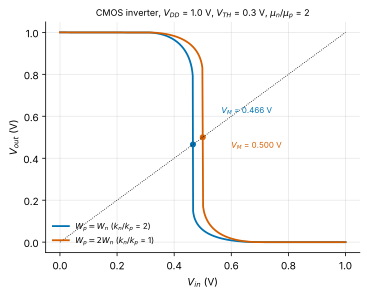
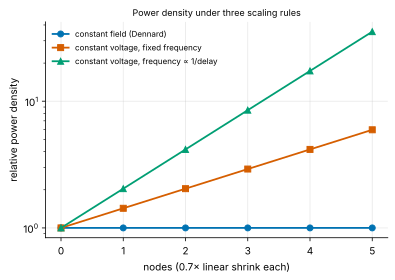
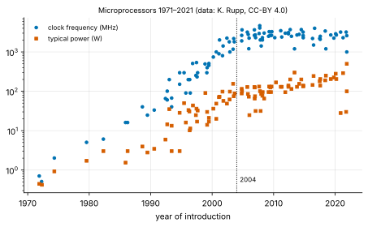

<!-- status: reviewed -->
# 09-11 · CMOS and Scaling: Moore, Dennard and Beyond

| | |
|---|---|
| **Course** | [09 · Semiconductor Devices](../README.md) |
| **University equivalent** | The CMOS-and-scaling unit of a junior devices course, with a preview of the digital VLSI inverter: static transfer curve, delay and power; Moore's law; constant-field scaling and why it ended; power density; node names against physical dimensions (Hu, *Modern Semiconductor Devices for Integrated Circuits*, §6.7 and §7.1; Rabaey, Chandrakasan and Nikolić, *Digital Integrated Circuits*, ch. 3 and 5 for the inverter) |
| **Prerequisites** | [09-09 The Long-Channel MOSFET](09-09-long-channel-mosfet.md), [09-10 Short-Channel Effects and Leakage](09-10-short-channel-effects-and-leakage.md), [07-02 First-Order Circuits](../../07-circuit-analysis-2-transient-and-ac/chapters/07-02-first-order-rc-rl-transients.md) (switching energy) |
| **Estimated study hours** | 6 |
| **Last verified** | 2026-11-19 |

**Learning objectives.** After this chapter you can:

1. Derive the switching threshold of a CMOS inverter, size its transistors for a symmetric transfer curve, and explain its noise margins.
2. Estimate inverter delay from $CV_{DD}/I_{on}$ and ring-oscillator frequency from the stage delay.
3. Compute dynamic, short-circuit and leakage power and the energy per operation of a logic block.
4. Quantify Moore's law as compound growth and check the 1965 and 1975 statements.
5. Derive constant-field (Dennard) scaling, and show why a threshold voltage that cannot scale ended it and created a power-density wall.
6. Relate node names to physical pitches and estimate density gains from contacted poly pitch and cell height.

---

## 1. Big picture

Chapters 09-08 to 09-10 built one transistor. A chip uses billions of them, mostly in complementary pairs: an n-channel and a p-channel MOSFET switching against each other, so that in either logic state one device is off and almost no current flows. That is **CMOS** (complementary MOS). Its low standby power is why computer makers abandoned power-hungry bipolar logic for it [6]. For fifty years the industry improved CMOS by shrinking it. Moore's law describes the pace. Dennard's constant-field scaling explained why shrinking made each transistor faster and more efficient at no cost in power density. When threshold voltages stopped scaling (09-10), supply voltages stopped too, power density rose, and clock frequencies stalled in the mid-2000s. Node names, once a physical length, became labels. This chapter connects the device physics you now know to these industry-level facts.

- **Every digital product** is built from the inverter's cousins: NAND, NOR, flip-flops and SRAM cells all share its pull-up/pull-down structure.
- **Power is often the binding limit.** Data-center accelerators, phones and wearables are designed to a power or thermal budget.
- **Roadmaps and investment theses** are written in scaling terms: density, performance per watt, cost per transistor.
- **Node names** are marketing labels; the physics lives in pitches, cell heights, voltages and currents.

## 2. Intuition first

**Two switches in series, never both on.** A CMOS inverter is a p-channel transistor from the supply to the output and an n-channel transistor from the output to ground, with both gates tied to the input. A high input turns the n-channel device on and the p-channel device off, so the output is pulled to ground. A low input does the reverse. Like a seesaw, one side is always up. In steady state no path connects supply to ground, so the inverter draws only leakage. It draws real current only while it switches, to charge or discharge the capacitance it drives.

**Scaling as a photocopier with a reduction setting.** Dennard's insight was that if you shrink every dimension *and* every voltage by the same factor, the electric fields inside the transistor stay the same, so the device behaves the same, only smaller and faster. Per unit area, nothing changes: more transistors, each using proportionally less power, so the chip does not get hotter.

**A finance analogy: compounding.** Moore's law is a compound-growth rate. A doubling every two years is 41% a year, and the same arithmetic as a high-growth company's revenue applies, including the warning that no exponential runs forever. *Where the analogy breaks:* in finance, a growth rate is an outcome. Moore's law was also a coordination device: the industry planned tools, materials and designs around it, so the forecast helped cause itself.

*Figure 1. Static transfer curve of a CMOS inverter at $V_{DD}$ = 1.0 V with $V_{TN} = |V_{TP}|$ = 0.3 V and $\mu_n/\mu_p$ = 2 (square-law model, Example 09-11.1). With equal widths the switching point sits below $V_{DD}/2$; doubling the p-channel width centers it.*

## 3. Theory

### 3.1 The CMOS inverter and its transfer curve

An n-channel MOSFET (NMOS) connects the output to ground; a p-channel MOSFET (PMOS) connects the output to $V_{DD}$; both gates take the input $V_{in}$. Their gate–source voltages are $V_{GSn} = V_{in}$ and $V_{SGp} = V_{DD} - V_{in}$, and their drain–source voltages are $V_{DSn} = V_{out}$ and $V_{SDp} = V_{DD} - V_{out}$. With no load current, the two drain currents must be equal. For each input, the output is the voltage at which the NMOS sinks exactly what the PMOS sources. Plotting $V_{out}$ against $V_{in}$ gives the **voltage transfer characteristic** (VTC) [1].

Three regions follow directly:

- $V_{in} < V_{TN}$: the NMOS is off, so $V_{out} = V_{DD}$ exactly.
- $V_{in} > V_{DD} - |V_{TP}|$: the PMOS is off, so $V_{out} = 0$.
- In between, both conduct, and the output swings steeply from high to low.

Hu stresses the consequence: an input anywhere between 0 and $V_{TN}$ still produces a perfect $V_{DD}$ output, so a chain of gates cleans up noise instead of accumulating it. The inverter is **regenerative** [1].

**The switching threshold.** The switching threshold $V_M$ is the input at which $V_{out} = V_{in}$. There both transistors are saturated. With square-law devices ($m$ = 1) and $k_n = \mu_nC_{ox}W_n/L$, $k_p = \mu_pC_{ox}W_p/L$:

$$
\frac{k_n}{2}(V_M - V_{TN})^2 = \frac{k_p}{2}(V_{DD} - V_M - |V_{TP}|)^2 .
$$

Take square roots (both sides positive) and solve for $V_M$, with $r = k_n/k_p$:

$$
V_M = \frac{V_{TN}\sqrt r + V_{DD} - |V_{TP}|}{1 + \sqrt r} .
$$

For $r$ = 1 and matched thresholds, $V_M = V_{DD}/2$. Holes are less mobile, so equal widths give $r = \mu_n/\mu_p > 1$ and pull $V_M$ below the midpoint. A symmetric curve needs $W_p/W_n \approx \mu_n/\mu_p$. Hu notes that the ratio "is usually around two" [1]. In short-channel devices velocity saturation narrows the NMOS–PMOS gap (09-10 Problem 4), so the required ratio is smaller than the mobility ratio.

**Noise margins.** The unity-gain points $V_{IL}$ and $V_{IH}$, where $dV_{out}/dV_{in} = -1$, bound the inputs that a gate reliably reads as low or high. The noise margins are $NM_L = V_{IL} - V_{OL}$ and $NM_H = V_{OH} - V_{IH}$, with $V_{OL}$ = 0 and $V_{OH} = V_{DD}$ for CMOS (00-02 introduced the idea). A steep transfer curve, which needs high transconductance, low leakage and high output resistance, maximizes them [1]. Course 19 derives the closed forms; Example 09-11.1 finds them numerically.

### 3.2 Inverter delay

The output of one inverter drives a capacitance $C$: the gates of the next stage, the drain junctions, and the wiring. When the input rises, the NMOS discharges $C$ with roughly its on-current $I_{onN}$, the saturation current at $V_{GS} = V_{DD}$. The **propagation delay** is measured to the 50% point, so the transistor must remove a charge $CV_{DD}/2$:

$$
t_{pHL} \approx \frac{CV_{DD}}{2I_{onN}}, \qquad t_{pLH} \approx \frac{CV_{DD}}{2I_{onP}}, \qquad
\tau_d = \frac{t_{pHL} + t_{pLH}}{2} = \frac{CV_{DD}}{4}\Big(\frac{1}{I_{onN}} + \frac{1}{I_{onP}}\Big) .
$$

This is Hu's Eq. (6.7.1) [1]. It treats the transistor as a constant current source over the first half of the swing. That is accurate for a short, velocity-saturated device (09-10), whose current barely depends on $V_{DS}$ above $V_{Dsat}$. The message is simple: **speed is $I_{on}$ per unit capacitance**. One can read $V_{DD}/2I_{on}$ as an effective switching resistance [1].

**Ring oscillators.** Connect an odd number $N$ of inverters in a loop and the circuit oscillates. Each node must make one falling and one rising transition per period, and a transition passes through all $N$ stages before the node flips again. So

$$
T = N(t_{pHL} + t_{pLH}) = 2N\tau_d .
$$

Measuring $T$ for a long ring gives $\tau_d$ with an ordinary frequency counter, the standard way to measure gate delay [1]. (Hu's text says the period equals "τd times the number of gates"; with $\tau_d$ defined, as here and in his Eq. 6.7.1, as the *average* of the rising and falling delays, the factor of 2 above is right, because each node rises and falls once per period.) (An even ring has a stable state and does not oscillate [1].)

### 3.3 Power and energy

**Dynamic power.** When the output rises, the supply delivers charge $CV_{DD}$ at voltage $V_{DD}$: energy $CV_{DD}^2$. Half is stored on the capacitor and half is dissipated in the PMOS. When the output falls, the stored half is dissipated in the NMOS (07-02 derived both halves). With $\alpha$ the **activity factor**, the fraction of nodes making a rising transition per cycle, a block of total switched capacitance $C$ at clock frequency $f$ draws

$$
P_{dyn} = \alpha CV_{DD}^2f ,
$$

Hu's Eq. (6.7.6) [1]. Hu points out that raising $I_{on}$ does not raise this power: speed comes free, power comes from $C$, $V_{DD}$ and activity [1].

**Short-circuit power.** During an input transition both transistors conduct briefly and a current flows straight from supply to ground. With well-matched input and output edges it is usually a small fraction of the dynamic power. Course 19 treats it.

**Static power.** With the input steady, the off transistor leaks: $P_{static} = V_{DD}I_{off}$ summed over the chip [1], where $I_{off}$ includes all the mechanisms of 09-10.

**Energy per operation.** For battery and data-center work the useful figure is energy per operation, $E \approx \alpha CV_{DD}^2 + P_{static}/f$. Lowering $V_{DD}$ cuts the first term quadratically, but slows the gates (lower $I_{on}$), so each operation takes longer and the leakage term grows. The minimum-energy supply therefore lies near or even below threshold (near-threshold and subthreshold operation, Course 19).

### 3.4 Moore's law

In 1965 Gordon Moore observed that "the complexity for minimum component costs has increased at a rate of roughly a factor of two per year" and projected that by 1975 "the number of components per integrated circuit for minimum cost will be 65 000" [3] **[Established]**. In 1975 he revised the rate: complexity had "approximately doubled every year" since the first integrated circuits, but the new slope "might approximate a doubling every two years, rather than every year, by the end of the decade" [4] **[Established]**. The often-quoted "every 18 months" is neither of Moore's figures. Hu, for example, paraphrases the law as a doubling "every 18 to 24 months or so" [2].

The law is compound growth. With a doubling time $T_2$, the count grows as $N(t) = N_02^{t/T_2}$, an annual growth rate of $2^{1/T_2} - 1$ (41.4% for $T_2$ = 2 years). Note that it concerns the *number of components on the most cost-effective chip*, an economic optimum, not a law of physics. Moore's 1975 paper decomposes the growth since 1959 into three factors: about 32× from finer geometry (line widths fell from about 25 µm in 1961 to 5 µm in 1975), larger dice (640× for the two combined), and "a factor of about 100" from "circuit and device advances", which he judged more important than either of the others [4] **[Established]**.

**Nodes.** Hu describes the practice that turned Moore's law into an engineering schedule. Each **technology node** shrinks every feature to about 70% of the previous node, so the area per circuit halves (0.7² = 0.49), and a new node arrived every two to three years [2] **[Established]**.

### 3.5 Constant-field (Dennard) scaling

In 1974 Dennard and colleagues showed how to scale a MOSFET without changing its internal fields [5]. The rules follow from the device equations you already have. Scale every length by $1/\kappa$ ($\kappa > 1$): $L$, $W$, $T_{ox}$, junction depth and wiring. Scale every voltage ($V_{DD}$, $V_{TH}$) by $1/\kappa$ too. Raise the doping by $\kappa$. Then:

- **Fields** ($V/L$, $V/T_{ox}$) are unchanged, so mobility, velocity saturation, oxide stress and breakdown are unchanged.
- **Depletion widths** $\sqrt{2\varepsilon_sV/qN}$ scale as $\sqrt{(1/\kappa)/\kappa} = 1/\kappa$, in step with the geometry, so the device's electrostatics (the shape of the potential, 09-10 §3.4) are preserved.
- **Gate capacitance per area** $C_{ox} = \varepsilon_{ox}/T_{ox}$ rises by $\kappa$; total gate capacitance $C_{ox}WL$ falls by $\kappa$.
- **Current.** Long-channel: $I \propto (W/L)C_{ox}V^2 \propto 1 \times \kappa \times \kappa^{-2} = 1/\kappa$. Velocity-saturated: $I \propto WC_{ox}v_{sat}V \propto \kappa^{-1}\kappa\,\kappa^{-1} = 1/\kappa$. Either way, $1/\kappa$.
- **Delay** $CV/I \propto \kappa^{-1}\kappa^{-1}/\kappa^{-1} = 1/\kappa$: faster.
- **Power per circuit** $VI \propto 1/\kappa^2$, and **area per circuit** $\propto 1/\kappa^2$, so **power density is constant**.
- **Energy per switch** $CV^2 \propto 1/\kappa^3$.

| Quantity | Constant-field scaling | Constant voltage, frequency ∝ κ |
|---|---|---|
| Dimensions, $T_{ox}$ | $1/\kappa$ | $1/\kappa$ |
| Voltages | $1/\kappa$ | 1 |
| Circuit density | $\kappa^2$ | $\kappa^2$ |
| Gate capacitance | $1/\kappa$ | $1/\kappa$ |
| Current per device | $1/\kappa$ | 1 (velocity-saturated) |
| Delay | $1/\kappa$ | $1/\kappa$ |
| Energy per switch | $1/\kappa^3$ | $1/\kappa$ |
| Power per circuit at $f \propto \kappa$ | $1/\kappa^2$ | 1 |
| Power density | 1 | $\kappa^2$ |
| Fields | 1 | $\kappa$ |

**A crack from the start.** Not every potential in a transistor scales. Built-in junction potentials and the threshold band bending $2\phi_B$ are set by the band gap and only logarithmically by doping, so they stay near 0.7–1 V. A depletion width set by them shrinks only as $1/\sqrt\kappa$ if doping rises by $\kappa$. Keeping it in step needs doping to rise by about $\kappa^2$ (Problem 09-11.7). The threshold's own floor, from the subthreshold swing, is the more serious crack (§3.6).

Within those limits, this was the golden era: every node gave twice the transistors, each 1.4 times faster, at the same power per square centimeter. Hu summarizes the result: scaling improved cost, speed and power per function at every generation, and IC speed rose roughly 30% per node [2] **[Established]**. *(The derivation above is this chapter's; the attribution to Dennard et al. is bibliographic: the paper itself was not read for this build.)*

> **Going deeper — generalized scaling.** Real technologies never scaled voltage fully. Let dimensions scale by $1/\kappa$ and voltages by $1/u$ with $1 \le u \le \kappa$, so fields grow by $\kappa/u$. To keep the depletion widths in step, doping must rise by $\kappa^2/u$. With velocity-saturated current $I \propto WC_{ox}V \propto 1/u$, delay $CV/I \propto 1/\kappa$ still. Power per circuit at $f \propto \kappa$ is $VI\cdot(\text{delay-limited}) \propto 1/u^2$, and power density grows as $\kappa^2/u^2$. Constant-field scaling is $u = \kappa$; constant voltage is $u$ = 1. Every millivolt of supply that fails to scale shows up squared in power density.

### 3.6 Why Dennard scaling ended

The weak link is the threshold voltage. Constant-field scaling requires $V_{TH}$ to fall by $1/\kappa$ with the supply. But the subthreshold swing does not scale: it is fixed by $kT/q$ at about 60 mV/decade or worse (09-09, 09-10). Every 60–90 mV of threshold removed multiplies the off-current by ten. So the threshold could not keep falling without leakage exploding. With $V_{TH}$ stuck, the supply had to stay well above it to keep $I_{on}$ (09-10 §3.5), and $V_{DD}$ stalled around 1 V in the 2000s (Hu's Table 7–1 lists 1.2 V at 90 nm and 0.9 V at 22 nm for high-performance devices [2]). Hu recalls the break in the pattern: 2.5 V at 250 nm, 1.8 V at 180 nm and 1.3 V at 130 nm, but 1.2 V instead of 0.9 V at 90 nm, and still 0.9 V instead of 0.45 V at 45 nm [10] **[Established]**.

With voltage roughly constant and dimensions still shrinking, the right-hand column of the table applies: power density rises by $\kappa^2$ per node if frequency keeps rising. The IRDS describes the outcome. Microprocessors "reached the power limits in 2004 and from then on multicore architecture with limited operational frequency (~5GHz) became the new norm" [6] **[Established]**. It cites Intel's Pentium 4 Prescott (2004) at about 115 W and power densities of around 100 W/cm² as the point where frequency scaling stopped [6] **[Established]**. The industry turned extra transistors into more cores instead of higher clocks [6].

**Power-limited design.** When the power budget, not the transistor count, is the binding constraint, a chip cannot switch all its transistors at full speed at once. The fraction it can run is roughly $P_{\max}/(N\alpha CV_{DD}^2f)$. The rest must idle, run slower, or be specialized hardware that does more work per joule. The term **dark silicon** is often used for the idle part. Power-limited design is also one argument for specialized accelerators: a circuit built for one task does more operations per joule than a general-purpose core.

### 3.7 Node names against physical dimensions

Through the 1990s a node name tracked a physical length. Hu notes that the number referred to the minimum metal line width, and that gate lengths were "even smaller" [2]. His Table 7–1 lists a 37 nm physical gate length at the 90 nm node and 13 nm at 22 nm [2] **[Established]**. Over time, names kept shrinking by 0.7 per node while physical features shrank more slowly and new structures (FinFETs, gate-all-around, backside power, 09-12) supplied the density. Today a node name is a label.

The physical quantities that set logic density are:

- the **contacted poly pitch** (CPP): the center-to-center spacing of gates, including room for the contacts between them;
- the **metal pitch**, especially of the tightest wiring layer (M0 or M1);
- the **cell height**: the height of a standard logic cell, set by the number of horizontal wiring tracks times the metal pitch.

A standard cell's area is roughly (number of gate pitches it spans) × CPP × cell height, so the product CPP × cell height is a good proxy for logic density. The IRDS 2024 roadmap now labels each step by its ground rules, as "GxxMyy" (gate pitch xx nm, M0 pitch yy nm). It notes that "there is not yet a consensus on the node naming across different foundries and integrated device manufacturers" [7] **[Industry estimate]**.

## 4. Worked examples

### Example 09-11.1 · Switching threshold and noise margins (tier B)

**Setup.** A CMOS inverter at $V_{DD}$ = 1.0 V has $V_{TN} = |V_{TP}|$ = 0.3 V and square-law transistors of equal length with $\mu_n/\mu_p$ = 2. (a) Find $V_M$ with equal widths. (b) What $W_p/W_n$ centers $V_M$ at 0.5 V? (c) For the symmetric inverter, find $V_{IL}$, $V_{IH}$ and the noise margins.

**Solution.**

(a) Equal widths give $r = k_n/k_p$ = 2:

$$
V_M = \frac{0.3\sqrt2 + 1.0 - 0.3}{1 + \sqrt2} = \mathbf{0.4657}\text{ V} .
$$

(b) $V_M = V_{DD}/2$ needs $r$ = 1, so $W_p/W_n = \mu_n/\mu_p$ = **2.0**.

(c) The unity-gain points can be found in closed form. At $V_{IL}$ the NMOS has just turned on and is saturated, while the PMOS is still linear; with $k_n = k_p$, equate $\tfrac12(V_{in} - V_{TN})^2 = (V_{DD} - V_{in} - |V_{TP}|)(V_{DD} - V_{out}) - \tfrac12(V_{DD} - V_{out})^2$, differentiate both sides with respect to $V_{in}$, and set $dV_{out}/dV_{in} = -1$. For the symmetric inverter ($V_{TN} = |V_{TP}| = V_{TH}$) the two equations give $V_{IL} = (3V_{DD} + 2V_{TH})/8$, and by symmetry $V_{IH} = (5V_{DD} - 2V_{TH})/8$. With $V_{DD}$ = 1.0 V and $V_{TH}$ = 0.3 V: $V_{IL}$ = **0.450** V and $V_{IH}$ = **0.550** V, which the numerical solution of the transfer curve confirms. So $NM_L = 0.450 - 0$ = **0.450** V and $NM_H = 1.0 - 0.550$ = **0.450** V.

**Sanity check.** The symmetric inverter has equal margins of 45% of the supply, and a narrow transition region of 0.1 V between $V_{IL}$ and $V_{IH}$. The ngspice netlist in the lab confirms (a) and (b).

### Example 09-11.2 · Delay and a ring oscillator (tier A)

**Setup.** An inverter drives 1 fF at $V_{DD}$ = 0.75 V. Its NMOS delivers 100 µA and its PMOS 80 µA. Find $t_{pHL}$, $t_{pLH}$ and $\tau_d$, and the frequency of a 101-stage ring oscillator built from it.

**Solution.**

- $t_{pHL} = CV_{DD}/2I_{onN}$ = 10⁻¹⁵ × 0.75/(2 × 10⁻⁴) = **3.75** ps.
- $t_{pLH}$ = **4.69** ps.
- $\tau_d$ = **4.22** ps.
- $T = 2N\tau_d$ = 2 × 101 × 4.22 ps = **852** ps, so $f$ = **1.17** GHz.

*Units check:* F × V/A = C/(C/s) = s. ✓

**Sanity check.** The PMOS, delivering less current, sets the longer of the two delays. The 101-stage ring brings the frequency down to about a gigahertz, easy to measure with a counter, while the per-stage delay is a few picoseconds.

### Example 09-11.3 · The power of a logic block (tier B)

**Setup.** A block has 10⁸ gates, each switching 1 fF, with activity factor 0.1, at $V_{DD}$ = 0.75 V and 3 GHz. It also has 4 × 10⁸ transistors, each leaking 10 nA. Find the energy drawn per rising transition, the dynamic power, the static power, the total, and the leakage share.

**Solution.**

- Energy per rising transition: $CV_{DD}^2$ = **0.5625** fJ (half dissipated while charging, half when discharging).
- $P_{dyn}$ = 0.1 × 10⁸ × 10⁻¹⁵ × 0.75² × 3 × 10⁹ = **16.9** W.
- $P_{static}$ = 4 × 10⁸ × 10⁻⁸ × 0.75 = **3.00** W.
- Total **19.9** W, of which leakage is **15.1**%.

**Sanity check.** Dynamic power dominates while the block runs at full speed, but when it idles the 3 W of leakage remains: the reason idle blocks are power-gated. The verify script confirms the energy split by integrating $i^2R$ over an RC charge.

### Example 09-11.4 · Moore's law as compound growth (tier A)

**Setup.** (a) Moore's 1975 paper says complexity "should have increased about 65,000-fold" under the annual doubling law since the first planar devices. How many annual doublings is that, and what is the exact factor? (b) Find the annual growth rate for doubling times of 1, 1.5 and 2 years. (c) What growth factor does a two-year doubling give over 50 years? (d) Moore credited about 32× to finer geometry, 640× to geometry and die area together, and about 100× to circuit and device advances. What die-area factor does this imply, and does the product reproduce 65,000? (e) What area factor does a 0.7× linear shrink give?

**Solution.**

(a) $\log_2 65\,000$ ≈ 16 doublings, so the exact factor is 2¹⁶ = **65,536** (sixteen years of annual doubling, about 1959 to 1975).

(b) $2^{1/T_2} - 1$: **100**% for 1 year, **58.7**% for 1.5 years and **41.4**% for 2 years.

(c) 2²⁵ = **3.36 × 10⁷**.

(d) Die area: 640/32 = **20**. Product: 640 × 100 = **64,000**, close to 2¹⁶.

(e) 0.7² = **0.49**: half the area per circuit.

**Sanity check.** In doublings: geometry gave $\log_2 32$ = 5, die area $\log_2 20$ = **4.32** and circuit and device advances $\log_2 100$ = **6.64**, adding to **15.97**. Lithography alone supplied less than a third of Moore's law in its first sixteen years.

### Example 09-11.5 · Dennard scaling against constant voltage (tier B)

**Setup.** One node shrinks dimensions by 0.7 ($\kappa$ = 1/0.7). Using the scaling table, find the factors for delay, circuit density, power per circuit, power density and energy per switch under constant-field scaling. Then find the power-density factor if voltages stay constant and frequency rises with $1/$delay, for one node and for four nodes, and if voltages stay constant at fixed frequency.

**Solution.** Constant-field:

- delay **0.7**;
- density **2.04**;
- power per circuit **0.49**;
- power density **1.00**;
- energy per switch **0.343**.

Constant voltage, frequency ∝ κ: power per circuit stays 1, so power density rises by $\kappa^2$ = **2.04** per node, and by $\kappa^8$ = **17.3** over four nodes. At fixed frequency, power per circuit falls only to $1/\kappa$ = 0.7, and power density still rises by **1.43** per node.

**Sanity check.** The verify script obtains these factors from a device model (velocity-saturated current, gate capacitance, $CV/I$ delay) evaluated before and after scaling, not from the table. Four nodes of constant-voltage scaling would take a 25 W/cm² chip to about **434** W/cm², far beyond the roughly 100 W/cm² at which frequency scaling stopped (§3.6).

### Example 09-11.6 · Why the threshold could not follow (tier B)

**Setup.** A technology has $V_{TH}$ = 0.45 V and $S$ = 85 mV/decade. If the threshold scaled by 0.7 per node for three nodes at the same swing, what would it become, and by what factor would the off-current rise?

**Solution.** $V_{TH}$ = 0.45 × 0.7³ = **0.154** V. The off-current rises by $10^{(0.45 - 0.154)/0.085}$ = **3.0 × 10³**.

**Sanity check.** A three-thousandfold leakage increase in three nodes, on top of doubling the transistor count each node, would make static power dominate any chip. Thresholds therefore stalled, and supplies with them (§3.6).

### Example 09-11.7 · Node labels against pitches (tier B)

**Setup.** The IRDS 2024 roadmap lists its "3nm" step as G48M24 with a high-density cell height of 160 nm, and its "2nm" step as G48M22 with a 120 nm cell height [7]. Intel describes its 18A process with a 50 nm contacted poly pitch and cell heights of 160 nm and 180 nm [8]. (a) Find CPP × cell height for each. (b) What logic-density gain does the IRDS "3nm" to "2nm" step imply, against the gain the labels suggest if they were lengths?

**Solution.**

(a)

- IRDS "3nm": 48 × 160 = **7,680** nm².
- IRDS "2nm": 48 × 120 = **5,760** nm².
- Intel 18A: 50 × 160 = **8,000** nm² and 50 × 180 = **9,000** nm².

(b) 7,680/5,760 = **1.33**, against (3/2)² = **2.25** if the labels were lengths.

**Sanity check.** The step comes entirely from the shorter cell height (160 to 120 nm), which coincides in the roadmap with the move from finFETs to gate-all-around devices (09-12); the gate pitch stays at 48 nm. Comparing processes by label is meaningless; comparing pitch products is a reasonable first cut. Even that is only a first cut, because cell libraries, design rules and SRAM density differ.

### Answer key

<!-- answer-key -->
| ID | Quantity | Value | Unit |
|---|---|---|---|
| Ex 09-11.1a | V_M, equal widths | 0.4657 | V |
| Ex 09-11.1b | W_p/W_n for V_M = V_DD/2 | 2.0 | — |
| Ex 09-11.1c | V_IL | 0.450 | V |
| Ex 09-11.1d | V_IH | 0.550 | V |
| Ex 09-11.1e | NM_L | 0.450 | V |
| Ex 09-11.1f | NM_H | 0.450 | V |
| Ex 09-11.2a | t_pHL | 3.75 | ps |
| Ex 09-11.2b | t_pLH | 4.69 | ps |
| Ex 09-11.2c | τ_d | 4.22 | ps |
| Ex 09-11.2d | ring period, 101 stages | 852 | ps |
| Ex 09-11.2e | ring frequency | 1.17 | GHz |
| Ex 09-11.3a | energy per rising transition | 0.5625 | fJ |
| Ex 09-11.3b | dynamic power | 16.9 | W |
| Ex 09-11.3c | static power | 3.00 | W |
| Ex 09-11.3d | total power | 19.9 | W |
| Ex 09-11.3e | leakage share | 15.1 | % |
| Ex 09-11.4a | 2^16 | 65536 | — |
| Ex 09-11.4b | growth rate, 1-year doubling | 100 | % |
| Ex 09-11.4c | growth rate, 1.5-year doubling | 58.7 | % |
| Ex 09-11.4d | growth rate, 2-year doubling | 41.4 | % |
| Ex 09-11.4e | factor over 50 years | 3.36e7 | — |
| Ex 09-11.4f | die-area factor | 20 | — |
| Ex 09-11.4h | product of Moore's factors | 64000 | — |
| Ex 09-11.4i | doublings from die area | 4.32 | — |
| Ex 09-11.4j | doublings from circuit and device advances | 6.64 | — |
| Ex 09-11.4k | total doublings | 15.97 | — |
| Ex 09-11.4g | area factor for 0.7 shrink | 0.49 | — |
| Ex 09-11.5a | delay factor | 0.7 | — |
| Ex 09-11.5b | density factor | 2.04 | — |
| Ex 09-11.5c | power per circuit | 0.49 | — |
| Ex 09-11.5d | power density, constant field | 1.00 | — |
| Ex 09-11.5e | energy per switch | 0.343 | — |
| Ex 09-11.5f | power density, constant V, one node | 2.04 | — |
| Ex 09-11.5g | power density, constant V, four nodes | 17.3 | — |
| Ex 09-11.5h | power density, constant V and f | 1.43 | — |
| Ex 09-11.5i | 25 W/cm² after four constant-V nodes | 434 | W/cm² |
| Ex 09-11.6a | scaled V_TH | 0.154 | V |
| Ex 09-11.6b | off-current factor | 3.0e3 | — |
| Ex 09-11.7a | IRDS 3nm pitch product | 7680 | nm² |
| Ex 09-11.7b | IRDS 2nm pitch product | 5760 | nm² |
| Ex 09-11.7c | Intel 18A, 160 nm cell | 8000 | nm² |
| Ex 09-11.7d | Intel 18A, 180 nm cell | 9000 | nm² |
| Ex 09-11.7e | density gain from pitches | 1.33 | — |
| Ex 09-11.7f | gain implied by labels | 2.25 | — |

*Every value is recomputed by [verify_09_11.py](../verify/verify_09_11.py) by an independent route: the transfer curve by solving current balance numerically at each input and differentiating it; delays by integrating the output under a constant-current discharge and by an event simulation of the ring oscillator; switching energy by integrating $i^2R$ and $vi$ over an RC charge; growth rates by root finding; scaling factors by evaluating a device model before and after scaling; and leakage by the subthreshold current ratio.*

## 5. Simulate it

The lab, [labs/09-11-lab](../labs/09-11-lab/README.md), has a notebook and an ngspice netlist:

1. The notebook computes the inverter transfer curve and its gain for several width ratios, with square-law and velocity-saturated transistors, and finds the noise margins.
2. It simulates a ring oscillator stage by stage and recovers $T = 2N\tau_d$.
3. A scaling calculator compares constant-field, constant-voltage and historical scaling.
4. It plots 50 years of microprocessor clock frequency and power (K. Rupp's CC-BY dataset), showing the frequency plateau after 2005 (Figure 3).
5. The netlist sweeps a level-1 CMOS inverter in ngspice and measures $V_M$ for both sizings of Example 09-11.1.

**Guided exercise (predict, then run).** **Before running Part 3**, predict: if the supply had stayed at 1.2 V from the 90 nm node while dimensions kept shrinking by 0.7 per node and frequency kept rising, by what factor would power density have grown over five nodes? Then compute it, and compare with Dennard's answer of 1.

*Figure 2. Power density relative to a starting node over five 0.7× nodes: constant-field scaling (flat), constant voltage at fixed frequency ($\kappa$ per node) and constant voltage with frequency rising as $1/\text{delay}$ ($\kappa^2$ per node).*

*Figure 3. Microprocessor clock frequency and typical power, 1971–2021, from K. Rupp's microprocessor trend data (CC-BY 4.0) [9]. Clock frequency stops rising in the mid-2000s, the end of Dennard-era frequency scaling, while the typical power of the parts in the dataset keeps climbing more slowly (lab Part 4). The power trend partly reflects which parts the dataset happens to include: its 2015–2021 set has only 16 parts, from 28 W mobile chips to 500 W servers, so power per core or per area is the fairer comparison.*

## 6. Engineering tradeoffs

| Knob | Improves | Costs | Typical decision owner |
|---|---|---|---|
| Lower $V_{DD}$ | Dynamic power (∝ $V_{DD}^2$), energy per operation | Speed ($I_{on}$), noise margin, sensitivity to $V_{TH}$ variation | Product architects, circuit designers |
| Higher clock frequency | Throughput per core | Power ∝ $f$ (and more if $V_{DD}$ must rise) | Product architects |
| More cores or accelerators | Throughput per watt | Area, software effort, dark (idle) silicon | Architects, software |
| Wider PMOS ($W_p/W_n$) | Symmetric transfer curve, equal rise and fall | Input capacitance, area | Standard-cell designers |
| Lower $V_{TH}$ flavor | $I_{on}$, speed | $I_{off}$ ×10 per $S$ (09-10) | Circuit designers, per path |
| Shorter cell height (fewer tracks) | Density | Routing congestion, drive strength | Technology and library teams |
| New node | Density, energy per switch | Wafer cost, design cost, schedule risk | Executives, foundry |

## 7. Numbers to know

| Quantity | Value | Note |
|---|---|---|
| Inverter delay | $\tau_d = (CV_{DD}/4)(1/I_{onN} + 1/I_{onP})$ | [1] |
| Ring oscillator period | $2N\tau_d$ | §3.2 |
| Dynamic power | $\alpha CV_{DD}^2f$ | [1] |
| $W_p/W_n$ for a symmetric inverter | about 2 | [1] |
| Moore 1965 / 1975 | doubling every year / every two years | [3], [4] |
| Node shrink | 0.7× linear, 0.49× area, every 2–3 years (historical) | [2] |
| Constant-field scaling | delay $1/\kappa$, power density constant | §3.5 |
| End of frequency scaling | about 2004; clocks limited to about 5 GHz | [6] |
| Prescott (2004) | about 115 W, about 100 W/cm² | [6] |
| IRDS 2024 "3nm" / "2nm" | G48M24, 160 nm cell / G48M22, 120 nm cell | [7] |
| Intel 18A | 50 nm CPP; 160 and 180 nm cells | [8] |

## 8. Common mistakes

1. **Taking a node name as a dimension.** No feature of a "3nm" process is 3 nm long; compare pitches and cell heights.
2. **Quoting Moore's law as "every 18 months."** Moore said every year (1965) and every two years (1975); and it concerns components on the most cost-effective chip, not performance.
3. **Thinking faster transistors cost dynamic power.** $P_{dyn} = \alpha CV_{DD}^2f$ does not contain $I_{on}$; power rises when designers spend the speed on frequency, or raise $V_{DD}$.
4. **Forgetting the factor 2 in a ring oscillator.** The period is $2N\tau_d$, because each node must both rise and fall.
5. **Assuming Dennard scaling ended because transistors stopped shrinking.** It ended because voltages stopped scaling: thresholds are pinned by the subthreshold swing. A second limit arrived at the same time: gate oxide stopped thinning near 1.2 nm of SiO₂ because tunneling leakage (09-08), so the gate's control over the channel could no longer keep pace with the dimensions either.
6. **Sizing PMOS by the mobility ratio in short channels.** Velocity saturation narrows the NMOS–PMOS current gap, so the required width ratio is smaller.

## 9. Practitioner lens

### State of the art (as of Nov 2026)

- **Frequency is capped by power.** The IRDS 2024 Executive Summary dates the processor power limit to 2004, with operating frequency limited to about 5 GHz since, and multicore as "the new norm" [6] **[Established]**.
- **Roadmap naming has moved to ground rules.** IRDS 2024 lists its steps from "3nm" (finFET, G48M24, 2024) through "2nm" and "1.4nm" (lateral gate-all-around, G48M22) to "A7 eq" and beyond (CFET, G44M18 and tighter), and notes the lack of naming consensus among foundries and IDMs [7] **[Industry estimate]** (roadmap).
- **Physical pitches are published by some vendors.** Intel describes 18A and 18A-P with a 50 nm contacted poly pitch and 160/180 nm cell heights (Jun 2026) [8] **[Established]**. Intel also claims up to 15% better performance per watt and 30% better density for 18A than Intel 3 [8] **[Industry estimate]** (vendor claim).
- **Supplies are planned to keep falling slowly.** The IRDS 2024 tables plan 0.70 V to 0.60 V for high-performance logic from 2024 to 2027 (09-10 §9).

### Why it matters commercially

- **Performance per watt is the product metric.** Phones, wearables and data-center accelerators are all power- or thermal-bound, so energy per operation, not peak frequency, decides competitiveness.
- **Node transitions are capital decisions.** Each node raises wafer and design cost; the return comes from density and energy per switch, which now improve more slowly than names suggest.
- **Specialization is the post-Dennard answer.** Power-limited chips spend transistors on accelerators that do more work per joule: the economic logic behind AI, video and networking silicon.

### Marketing vs Reality

- **"Our 2 nm process."** *Reality:* a label, not a length; the IRDS "3nm" to "2nm" step in pitch products is 1.33×, not 2.25× (Example 09-11.7). *Sanity check:* ask for CPP, M0/M1 pitch, cell heights and SRAM bit-cell area.
- **"30% denser."** *Reality:* density depends on which cells (logic, SRAM, I/O) and which library. *Sanity check:* ask for the cell mix and whether the number is a full-chip measurement or a standard-cell estimate.
- **"Moore's law is dead" / "Moore's law is alive."** *Reality:* both claims hide a definition. Transistor counts kept growing; clock frequency stopped in 2004; cost per transistor and energy per switch improve more slowly. *Sanity check:* ask which metric, over which years.

### Questions for engineering leaders

1. **"What limits this product: area, power or thermal?"**
   - *Strong:* names the binding constraint with numbers (W, W/cm², junction temperature) and shows how the architecture responds.
   - *Evasive:* "We optimize all three."
2. **"What do you gain moving to the next node, in energy per operation and cost per good die?"**
   - *Strong:* separates density, energy and frequency gains, and nets them against wafer and design cost.
   - *Evasive:* quotes only the foundry's headline numbers.
3. **"What supply voltage and threshold flavors do you run, and why?"**
   - *Strong:* links the operating point to the energy-delay trade-off and the hot-corner leakage.
   - *Evasive:* "Nominal."
4. **"How much of the die can run at full speed at once?"**
   - *Strong:* gives the power-limited activity fraction and the management (power gating, DVFS).
   - *Evasive:* assumes all of it.

<!-- answer-key -->
| ID | Quantity | Value | Unit |
|---|---|---|---|
| P 09-11.a | Moore 1975 projection | 65000 | components |
| P 09-11.b | year of the processor power limit (IRDS) | 2004 | — |
| P 09-11.c | Prescott power | 115 | W |
| P 09-11.d | Prescott power density | 100 | W/cm² |
| P 09-11.e | frequency limit | 5 | GHz |
| P 09-11.f | Intel 18A CPP | 50 | nm |
| P 09-11.g | Intel 18A performance-per-watt claim | 15 | % |
| P 09-11.h | Intel 18A density claim | 30 | % |
| P 09-11.i | Hu, 90 nm node gate length (HP) | 37 | nm |
| P 09-11.j | Hu, 22 nm node gate length (HP) | 13 | nm |
| P 09-11.k | Hu, V_DD at 90 nm (HP) | 1.2 | V |
| P 09-11.l | Hu, V_DD at 22 nm (HP) | 0.9 | V |
| P 09-11.m | Hu, speed gain per node | 30 | % |
| P 09-11.n | Moore 1975, geometry factor | 32 | — |
| P 09-11.o | Moore 1975, geometry and die area | 640 | — |
| P 09-11.p | Moore 1975, circuit and device factor | 100 | — |
| P 09-11.q | Hu, supply at 250 nm | 2.5 | V |
| P 09-11.r | Hu, supply at 180 nm | 1.8 | V |
| P 09-11.s | Hu, supply at 130 nm | 1.3 | V |
| P 09-11.t | Hu, supply at 45 nm | 0.9 | V |
| P 09-11.u | trend value at 45 nm | 0.45 | V |

## 10. Concept check

**Q1.** Why does a CMOS inverter draw almost no current when its input is steady?

Answer

In either steady state one transistor is off, so there is no conducting path from supply to ground. Only the off transistor's leakage flows. Current flows mainly while the output switches, to charge or discharge the load capacitance.

**Q2.** Why does an inverter with equal NMOS and PMOS widths switch below $V_{DD}/2$?

Answer

Holes are less mobile, so the PMOS is weaker. At $V_{in} = V_{DD}/2$ the NMOS sinks more current than the PMOS can source, pulling the output low; the balance point, where $V_{out} = V_{in}$, therefore lies below the midpoint. Widening the PMOS by about the mobility ratio restores symmetry.

**Q3.** Why does a ring oscillator's period equal $2N\tau_d$ rather than $N\tau_d$?

Answer

Each node must make a falling and a rising transition in every period. A transition takes $N$ stage delays to come back around and flip the node again, so a full period, two transitions per node, takes $N(t_{pHL} + t_{pLH}) = 2N\tau_d$.

**Q4.** Under constant-field scaling, why does power density stay constant?

Answer

Voltage and current per circuit both fall by $1/\kappa$, so power per circuit falls by $1/\kappa^2$ even at the higher frequency. Area per circuit also falls by $1/\kappa^2$. The two cancel.

**Q5.** What physical fact ended Dennard scaling?

Answer

The subthreshold swing is fixed by $kT/q$ (at least 59.5 mV/decade at 300 K), so the threshold voltage cannot be lowered without raising leakage tenfold for every swing removed. With thresholds pinned, supplies stopped scaling, and with constant voltage, power density rises as the square of the shrink factor if frequency keeps rising.

**Q6.** Why is CPP × cell height a better density proxy than the node name?

Answer

A standard cell's area is approximately the number of gate pitches it spans times the contacted poly pitch times the cell height. Those are physical dimensions; the node name is a label that kept shrinking by 0.7 per generation regardless of what the dimensions did.

Now work the [problem set](../problems/09-11-problems.md).

## 11. Key terms

[CMOS](../../../reference/glossary.md#cmos) · [CMOS inverter](../../../reference/glossary.md#cmos-inverter) · [Voltage transfer characteristic](../../../reference/glossary.md#voltage-transfer-characteristic) · [Switching threshold](../../../reference/glossary.md#switching-threshold) · [Noise margin](../../../reference/glossary.md#noise-margin) · [Propagation delay](../../../reference/glossary.md#propagation-delay) · [Ring oscillator](../../../reference/glossary.md#ring-oscillator) · [Dynamic power](../../../reference/glossary.md#dynamic-power) · [Activity factor](../../../reference/glossary.md#activity-factor) · [Static power](../../../reference/glossary.md#static-power) · [Moore's law](../../../reference/glossary.md#moores-law) · [Technology node](../../../reference/glossary.md#technology-node) · [Constant-field scaling](../../../reference/glossary.md#constant-field-scaling) · [Power wall](../../../reference/glossary.md#power-wall) · [Dark silicon](../../../reference/glossary.md#dark-silicon) · [Contacted poly pitch](../../../reference/glossary.md#contacted-poly-pitch) · [Cell height](../../../reference/glossary.md#cell-height)

## 12. Connections

- **Builds on:** [09-09](09-09-long-channel-mosfet.md) (MOSFET currents), [09-10](09-10-short-channel-effects-and-leakage.md) (velocity saturation, the swing limit and leakage), [07-02](../../07-circuit-analysis-2-transient-and-ac/chapters/07-02-first-order-rc-rl-transients.md) (switching energy), [00-02](../../00-orientation/chapters/00-02-the-abstraction-stack.md) (noise margins).
- **Next:** [09-12 Advanced Transistors](09-12-finfet-gaa-cfet-backside-power.md): the structures that kept density scaling after planar CMOS ran out of electrostatic control.
- **Used later:** logic gates, timing and power in [Course 19 Digital VLSI Design](../../19-digital-vlsi-design/README.md); computer architecture and the post-Dennard turn to parallelism and accelerators in [Course 14](../../14-computer-organization-and-architecture/README.md) and [Course 27](../../27-system-architectures/README.md); the economics of nodes in [Course 25](../../25-fabrication-packaging-test-and-reliability/README.md).

## 13. Further study

- C. Hu, *Modern Semiconductor Devices for Integrated Circuits*, §6.7 (CMOS inverter, delay, power) and §7.1 (technology scaling, Table 7–1) (free from the author's site).
- J. M. Rabaey, A. Chandrakasan and B. Nikolić, *Digital Integrated Circuits: A Design Perspective*, ch. 3 (devices, scaling) and ch. 5 (the CMOS inverter: transfer curve, noise margins, delay, power).
- G. E. Moore, "Cramming more components onto integrated circuits" (1965) and "Progress in digital integrated electronics" (1975): both short and readable.
- R. H. Dennard et al., "Design of ion-implanted MOSFET's with very small physical dimensions" (1974): the original scaling paper.

## 14. Sources

1. C. Hu, *Modern Semiconductor Devices for Integrated Circuits* (Pearson, 2010), §6.7: CMOS inverter VTC and regeneration, $W_p/W_n$ "around two", Eqs. (6.7.1)–(6.7.8) for delay, ring oscillators and power. [Ch. 6](https://www.chu.berkeley.edu/wp-content/uploads/2020/01/Chenming-Hu_ch6-1.pdf). [R-172](../../../reference/research-log.md#r-172--cmos-and-scaling-references).
2. C. Hu, ch. 7, §7.1: Moore's law paraphrase, 0.7× node shrink and two-to-three-year cadence, node names and gate lengths, ~30% speed gain per node, Table 7–1. [Ch. 7](https://www.chu.berkeley.edu/wp-content/uploads/2020/01/Chenming-Hu_ch7.pdf). [R-172](../../../reference/research-log.md#r-172--cmos-and-scaling-references).
3. G. E. Moore, "Cramming more components onto integrated circuits", *Electronics*, 19 Apr 1965; reprinted in *Proc. IEEE* 86(1), 1998: [reprint](https://www.cs.utexas.edu/~fussell/courses/cs352h/papers/moore.pdf). [R-172](../../../reference/research-log.md#r-172--cmos-and-scaling-references).
4. G. E. Moore, "Progress in digital integrated electronics", *IEDM Technical Digest* 1975, pp. 11–13: [reprint](https://www.eng.auburn.edu/~agrawvd/COURSE/E7770_Spr07/READ/Gordon_Moore_1975_Speech.pdf). [R-172](../../../reference/research-log.md#r-172--cmos-and-scaling-references).
5. R. H. Dennard, F. H. Gaensslen, H.-N. Yu, V. L. Rideout, E. Bassous and A. R. LeBlanc, "Design of ion-implanted MOSFET's with very small physical dimensions", *IEEE J. Solid-State Circuits* 9(5), 256–268, Oct 1974, [doi:10.1109/JSSC.1974.1050511](https://doi.org/10.1109/JSSC.1974.1050511) (bibliographic record only). [R-172](../../../reference/research-log.md#r-172--cmos-and-scaling-references).
6. IEEE IRDS, 2024 Edition, Executive Summary, pp. 64–66 (power limits in 2004, Prescott, frequency limit): [IRDS 2024 Executive Summary](https://irds.ieee.org/images/files/pdf/2024/2024IRDS_ES.pdf). [R-172](../../../reference/research-log.md#r-172--cmos-and-scaling-references).
7. IEEE IRDS, 2024 Edition, More Moore: [text](https://irds.ieee.org/images/files/pdf/2024/2024IRDS_MM.pdf) (§4.1, node naming) and [tables](https://irds.ieee.org/images/files/pdf/2024/2024IRDS_MM_Tables.xlsx) (Table MM01 ground rules and cell heights). [R-172](../../../reference/research-log.md#r-172--cmos-and-scaling-references).
8. Intel, "Intel Foundry Details Process Milestones and Future Innovation at VLSI Symposium", 16 Jun 2026, [press release](https://www.intc.com/news-events/press-releases/detail/1772/intel-foundry-details-process-milestones-and-future); "Intel Unveils Panther Lake Architecture: First AI PC Platform Built on 18A", 9 Oct 2025, [press release](https://www.intc.com/news-events/press-releases/detail/1752/intel-unveils-panther-lake-architecture-first-ai-pc). [R-172](../../../reference/research-log.md#r-172--cmos-and-scaling-references).
9. K. Rupp, *Microprocessor Trend Data* (CC-BY 4.0), frequency and typical-power series to 2021: [repository](https://github.com/karlrupp/microprocessor-trend-data). [R-172](../../../reference/research-log.md#r-172--cmos-and-scaling-references).
10. R. Courtland, "The Origins of Intel's New Transistor, and Its Future" (Q&A with Chenming Hu), *IEEE Spectrum*, May 2011: [copy on the author's site](https://www.chu.berkeley.edu/wp-content/uploads/2020/01/Origins-of-Intel-New-Transistor-IEEE-Spectrum.pdf). [R-173](../../../reference/research-log.md#r-173--advanced-transistor-references).
