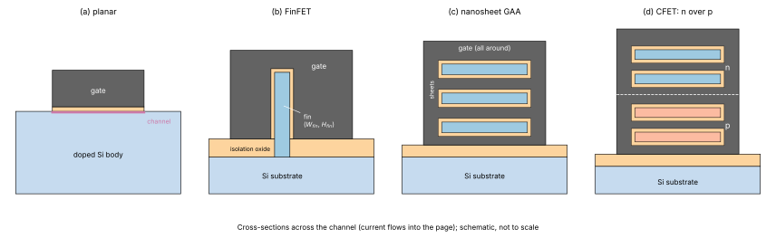
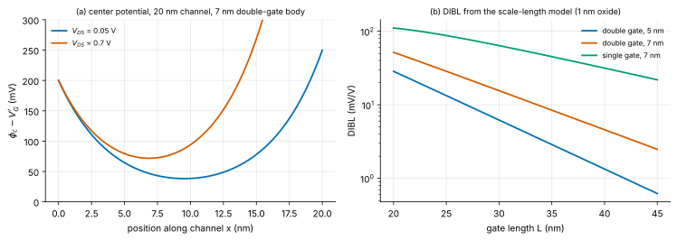

<!-- status: verified -->
# 09-12 · Advanced Transistors: FinFET, GAA, CFET and Backside Power

| | |
|---|---|
| **Course** | [09 · Semiconductor Devices](../README.md) |
| **University equivalent** | The "beyond planar CMOS" unit of a senior devices course: thin-body and multigate electrostatics, the scale length, FinFETs and gate-all-around nanosheets, stacked complementary FETs, backside power delivery, and new channel materials (Hu, *Modern Semiconductor Devices for Integrated Circuits*, §7.8; Taur & Ning, *Fundamentals of Modern VLSI Devices*, the double-gate MOSFET sections) |
| **Prerequisites** | [09-10 Short-Channel Effects and Leakage](09-10-short-channel-effects-and-leakage.md) (DIBL, characteristic length), [09-11 CMOS and Scaling](09-11-cmos-and-scaling.md) (pitches, cell height, power density), [04-10 Introduction to Quantum Mechanics](../../04-physics-for-ee/chapters/04-10-intro-quantum-mechanics.md) (particle in a box), [04-05 Current, Resistance and Conduction](../../04-physics-for-ee/chapters/04-05-current-resistance-and-conduction.md) (narrow-wire resistivity) |
| **Estimated study hours** | 6 |
| **Last verified** | 2026-11-19 |

**Learning objectives.** After this chapter you can:

1. Explain why a thin body with gates on two or more sides controls short-channel effects without heavy doping.
2. Derive the scale length of a double-gate transistor and use it to estimate threshold roll-off and DIBL against body thickness and gate length.
3. Compute the effective width and drive per footprint of FinFETs and nanosheet stacks, and explain width quantization.
4. State why stacking NMOS over PMOS (CFET) and moving power wiring to the back of the wafer (backside power) raise density, and estimate the IR-drop benefit.
5. Place FinFET, gate-all-around, CFET and 2D-channel devices on a dated, sourced timeline, separating production facts from roadmap targets and vendor claims.

---

## 1. Big picture

By the late 2000s the planar MOSFET of 09-08 to 09-10 was running out of electrostatic control. Shrinking the gate length required shrinking the oxide, the depletion depth and the junction depth together (09-10 §3.4), and none of them could shrink much further. The solution was to change the shape of the transistor: make the silicon body so thin that no part of it is far from a gate, and wrap the gate around it. That idea, the FinFET, reached the market when Intel announced its 22 nm tri-gate transistors in 2011. Gate-all-around nanosheets entered production in 2022, and stacked complementary FETs and backside power delivery are next. Each step is the same physics, the scale length over which the drain's influence decays, pursued with new geometry. This chapter derives that scale length and uses it to explain the whole roadmap.

- **Leading-edge logic chips** (phone SoCs, CPUs, GPUs, AI accelerators) are built on FinFET or gate-all-around processes.
- **Electrostatics, not lithography alone,** set the minimum gate length; thin bodies restored the swing to near its 60 mV/decade limit.
- **Backside power** separates power from signal wiring, a change in how chips are built, not just in the transistor.
- **Investment and supply-chain decisions** track these transitions: new deposition, etch and metrology steps, and new competitive positions among foundries.

## 2. Intuition first

**Leakage takes the path the gate cannot see.** Hu's picture: even with an infinitely thin oxide, a planar gate controls the barrier only at the silicon surface. Some distance below it, the gate is far away and the drain can pull the barrier down, so leakage flows along that buried path [1]. Make the body thin, or put gates on both sides, and there is no buried path: every point of the channel is close to a gate.

**A dam with walls on every side.** In the dam analogy of 09-10, the drain is a flood pushing on the dam. A planar gate holds the dam from above only. A FinFET holds it from three sides, a gate-all-around transistor from four. The more of the dam the gate holds, the shorter it can be before the drain pushes through.

**A finance analogy: concentration of control.** A company controlled by one shareholder with a 30% stake can be outvoted by a coalition; one with 90% cannot. The gate is the controlling shareholder of the channel's barrier, and the drain is the activist. Thin, wrapped bodies raise the gate's stake. *Where the analogy breaks:* the "votes" here are capacitances that depend on geometry continuously, and the drain's influence decays exponentially with distance, not linearly with share.

*Figure 1. Cross-sections of four transistor architectures, viewed along the channel (current flows into the page). (a) Planar bulk MOSFET: one gate above a doped body. (b) FinFET: a thin fin gated on three sides. (c) Gate-all-around nanosheet stack: thin sheets each surrounded by the gate. (d) CFET: an n-channel stack over a p-channel stack sharing one footprint. Schematic, not to scale.*

## 3. Theory

### 3.1 Why a thin body works

Hu's characteristic length, $l_d \propto \sqrt[3]{T_{oxe}W_{dep}X_j}$ (09-10 §3.4), says the drain's influence decays faster when the gate is closer (small $T_{ox}$) and the drain and depletion region are shallower. In an **ultra-thin-body** (UTB) transistor on silicon-on-insulator (SOI), the silicon film itself is only a few nanometers thick, so it caps both the depletion depth and the junction depth. Hu states that the thin-film thickness "should take the places of $W_{dep}$ and $X_j$" in the characteristic length, so the gate length can scale roughly in proportion to it, and that $T_{Si}$ should be thinner than about half the gate length [1] **[Established]**.

Three more benefits follow from a thin, fully depleted body [1]:

- **No heavy channel doping.** Short-channel control comes from geometry, so the channel can be lightly doped or undoped: higher mobility, less random dopant fluctuation (09-10 §3.7) and less junction leakage.
- **Ideal swing.** With gates on both sides at the same voltage, the body potential follows the gate millivolt for millivolt in subthreshold: $m$ (Hu's $\eta$) approaches 1, and $S$ approaches 59.5 mV/decade.
- **No body effect.** The fully depleted body floats, so there is no source-to-body bias to raise the threshold.

The price is series resistance: a thin film makes thin source and drain regions, so they are thickened with epitaxial growth (raised source/drain) [1].

### 3.2 The scale length of a double-gate transistor

To make the thin-body argument quantitative, derive the length over which the drain's potential decays in a **double-gate** transistor. The body is undoped silicon of thickness $t_{si}$ between two identical gates, each separated from it by an oxide of thickness $t_{ox}$. Take $x$ along the channel and $y$ across the body, from $-t_{si}/2$ to $+t_{si}/2$. In subthreshold the mobile charge is negligible, so the potential $\phi(x, y)$ in the body obeys Laplace's equation, $\partial^2\phi/\partial x^2 + \partial^2\phi/\partial y^2 = 0$.

**The parabolic approximation.** Across a thin body the potential is smooth, so expand it as a parabola in $y$. By symmetry, the linear term vanishes:

$$
\phi(x, y) = \phi_c(x) + c_2(x)\,y^2 ,
$$

where $\phi_c$ is the potential at the center of the body, the most leakage-prone path.

**Boundary condition at each gate.** The normal component of $\varepsilon\mathcal E$ is continuous across the silicon–oxide interface (Gauss's law). In the oxide the potential rises linearly from the surface potential $\phi_s = \phi_c + c_2t_{si}^2/4$ to the gate potential $V_G'$ (the gate voltage minus the flat-band voltage). At the top surface $y = t_{si}/2$:

$$
\varepsilon_s\frac{\partial\phi}{\partial y}\Big|_{t_{si}/2} = C_{ox}\big(V_G' - \phi_s\big)
\quad\Rightarrow\quad
\varepsilon_s c_2t_{si} = C_{ox}\Big(V_G' - \phi_c - \frac{c_2t_{si}^2}{4}\Big),
$$

with $C_{ox} = \varepsilon_{ox}/t_{ox}$. Solve for the curvature:

$$
c_2 = \frac{C_{ox}(V_G' - \phi_c)}{\varepsilon_st_{si} + C_{ox}t_{si}^2/4} .
$$

**Laplace's equation at the center.** At $y$ = 0, $\partial^2\phi/\partial y^2 = 2c_2$, so

$$
\frac{d^2\phi_c}{dx^2} = -2c_2 = \frac{\phi_c - V_G'}{\lambda^2}, \qquad
\lambda^2 = \frac{\varepsilon_st_{si} + C_{ox}t_{si}^2/4}{2C_{ox}} = \frac{\varepsilon_s}{2\varepsilon_{ox}}t_{si}t_{ox} + \frac{t_{si}^2}{8} .
$$

$\lambda$ is the **scale length** (or natural length) of the double-gate transistor. *Units check:* every term in $\lambda^2$ is a length squared. ✓

**The solution along the channel.** Far from the source and drain, $\phi_c \to V_G'$: the gate alone sets the center potential, as in a long channel. Near the ends, the deviation $u = \phi_c - V_G'$ obeys $u'' = u/\lambda^2$, so it decays as $e^{\pm x/\lambda}$. With $u(0) = a$ at the source and $u(L) = b = a + V_{DS}$ at the drain,

$$
u(x) = \frac{a\sinh\big((L - x)/\lambda\big) + b\sinh(x/\lambda)}{\sinh(L/\lambda)} .
$$

Write it as $Pe^{x/\lambda} + Qe^{-x/\lambda}$ with $P = (b - ae^{-L/\lambda})/2\sinh(L/\lambda)$ and $Q = (ae^{L/\lambda} - b)/2\sinh(L/\lambda)$. The barrier is where $u$ is smallest, and the minimum of $Pe^{s} + Qe^{-s}$ is $2\sqrt{PQ}$. For $L \gg \lambda$,

$$
u_{\min} \approx 2\sqrt{ab}\;e^{-L/2\lambda} .
$$

**Reading it.** $u_{\min}$ is how far the short channel's barrier sits below the long-channel barrier, measured in volts. Because the double-gate body follows the gate one-for-one in subthreshold, the threshold falls by the same amount: $\Delta V_t \approx u_{\min}$. At threshold, Hu's criterion puts the channel's conduction band about 0.2 eV above the source's [2], so $a \approx$ 0.2 V and $b \approx 0.2\text{ V} + V_{DS}$. Two results follow.

- Roll-off and DIBL both scale as $e^{-L/2\lambda}$. This is the same exponential form as Hu's $e^{-L/l_d}$ (09-10), now with $l_d = 2\lambda$ expressed in the device dimensions.
- $\lambda$ falls as the body thins ($\lambda^2 \propto t_{si}$ for thin oxides). To shrink $L$ at fixed DIBL, thin the body in proportion to $L^2$ at first, and ultimately in proportion to $L$ once the $t_{si}^2/8$ term dominates.

**Other geometries.** The same method, applied to a thin body with one gate and an insulating back (Problem 09-12.3), gives $\lambda^2 = (\varepsilon_s/\varepsilon_{ox})t_{si}t_{ox} + t_{si}^2/2$, which is larger: a second gate halves the first term and quarters the second. A nanosheet much wider than it is thick behaves like a double-gate body of its thickness; its side gates add a little further control. These are first-order models. Lab Part 2 solves the full two-dimensional problem: for the bodies of Example 09-12.2 the parabolic model's barrier lowering agrees with it within a few percent.

### 3.3 FinFETs

Building a double gate with one gate under the body is hard. Hu's group's solution was to turn the double-gate structure on its side: etch a thin vertical **fin** of silicon and drape the gate over it, so the gate controls both sidewalls (and the top) [1]. The channel width is the perimeter the gate covers:

$$
W_{\text{eff}} = 2H_{fin} + W_{fin} .
$$

Tall fins give a large width, and so a large current, in a small footprint [1]. The electrostatics are those of a double-gate body of thickness $W_{fin}$ (§3.2), with the top gate adding a little control.

Two practical consequences:

- **Width quantization.** A FinFET's width comes in whole fins. A designer cannot choose 1.5 fins, so sizing ratios (such as the PMOS-to-NMOS ratio of 09-11) can only be approximated by ratios of integers.
- **Fin pitch sets density.** Drive per unit footprint is $W_{\text{eff}}$ per fin pitch, so taller, tighter fins raise current density, at the cost of capacitance and difficult etching.

Hu's account of the history: DARPA sent out a request in 1996 "for ideas to develop electronic switches beyond 25 nm", Hu's Berkeley group proposed the FinFET and the UTB SOI transistor, won the contract in 1997, and published a working FinFET in 1999 [3]. His analogy is a garden hose on a soggy lawn: pressing on it from above cannot stop the flow, but pinching it from both sides can [3]. Intel announced its 22 nm "tri-gate" transistor, a FinFET variant, in May 2011 [3] **[Established]**.

### 3.4 Gate-all-around nanosheets

A fin is gated on three sides; its bottom connects to the substrate. A **gate-all-around** (GAA) transistor surrounds the channel completely. Hu's "nanowire FET" is the limiting case [1]. Production GAA devices use **nanosheets**: several thin, wide silicon sheets stacked vertically, each wrapped by the gate. Compared with fins:

- **Better electrostatics.** The gate surrounds each sheet, so the worst-case leakage path is shorter. The IRDS notes that lateral GAA devices bring "better electrostatics than finFET by providing a gate control from all-sides of device channel" [4] **[Established]**.
- **Width as a design variable.** Sheet width can be drawn continuously, not in whole fins, and $W_{\text{eff}} = N_{sheets} \times 2(W_{sheet} + t_{sheet})$.
- **More drive per footprint**, by stacking more sheets. The IRDS warns of a limit. Taller stacks add fringing capacitance and series resistance, and "energy per switch vs. delay relationship seems to quickly saturate and then decline with increasing device height" [4] **[Industry estimate]**.

Process complexity rises: the stacked sheets must be formed and released, and "inner spacer schemes" are needed to isolate the gate from the source and drain in the gaps between sheets [4] (Course 25 covers the process).

### 3.5 CFET: stacking N over P

In a CMOS cell, the n-channel and p-channel transistors sit side by side, separated by a gap. A **complementary FET** (CFET) stacks the n-channel device directly on top of the p-channel device (or the reverse), sharing one footprint. Ideally this nearly halves the cell's device area. The IRDS expects the industry to push GAA "until 2031 while ensuring a swift transition to complementary-FET (CFET) devices", with early 3D integration starting with CFET in 2031 "where NMOS and PMOS are placed on top of each other" [4] **[Industry estimate]** (roadmap). The challenges are making contacts to the buried lower device, matching two different channels in one stack, and removing heat. The IRDS notes that GAA and CFET devices "have limited heat conductance due to confined architecture" [4].

### 3.6 Backside power delivery

On a conventional chip, transistors sit at the bottom and all wiring, signal and power alike, is built above them. The power rails must be wide (low resistance) and share the densest, most valuable wiring layers with signals. **Backside power delivery** thins the wafer from behind and builds the power network on the back, connected through nano-scale vias to the transistors. The benefits follow directly from 04-05 and 09-11:

- **Lower IR drop.** Backside power wires can be thick and wide, so their resistance is far lower. The IRDS links backside power to reducing supply noise in order to keep lowering the supply voltage [4].
- **Freed front-side tracks.** Removing power rails from the front frees routing tracks for signals and can shrink the cell height.

**IR drop along a rail.** Model a rail of total resistance $R$ that feeds a uniformly distributed load current $I$. If it is fed from one end, the current still flowing at distance $x$ along it is $I(1 - x/\ell)$, and the drop accumulates to

$$
\Delta V_{\max} = \int_0^\ell I\Big(1 - \frac{x}{\ell}\Big)\frac{R}{\ell}\,dx = \frac{IR}{2} .
$$

Fed from both ends, each half carries half the current over half the length, so $\Delta V_{\max} = (I/2)(R/2)/2 = IR/8$. Narrow front-side rails have high resistance, because both their cross-section and their resistivity are worse: copper's resistivity rises as lines narrow toward its mean free path (04-05 §3.3). The IRDS states that interconnect resistance "has now entered an exponential increase regime" [4] **[Established]**.

### 3.7 New channel materials

A body only one or a few atomic layers thick would push $\lambda$ down further than silicon allows (§3.2), and quantum confinement makes very thin silicon bodies sensitive to thickness variation (Problem 09-12.11). **Two-dimensional materials** such as transition-metal dichalcogenides are naturally atomically thin. The IRDS is cautious: "2D material channels have not reached manufacturing maturity and are expected to complement the platform devices with specialty devices" [4] **[Industry estimate]**. It lists channel materials evolving "from Si to SiGe, Ge, 2D materials" over the roadmap [4].

## 4. Worked examples

### Example 09-12.1 · Scale lengths (tier A)

**Setup.** With $\varepsilon_s/\varepsilon_{ox}$ = 3 and $t_{ox}$ = 1 nm (EOT), find $\lambda$ for a double-gate body of 7 nm and 5 nm, and for a single-gate thin body of 7 nm.

**Solution.**

- Double gate, 7 nm: $\lambda^2 = (3/2)(7)(1) + 49/8$ = 10.5 + 6.125, so $\lambda$ = **4.077** nm.
- Double gate, 5 nm: $\lambda^2$ = 7.5 + 3.125, so $\lambda$ = **3.260** nm.
- Single gate, 7 nm: $\lambda^2$ = 21 + 24.5, so $\lambda$ = **6.745** nm.

**Sanity check.** The second gate shrinks $\lambda$ by 40% at the same thickness; thinning the double-gate body from 7 to 5 nm shrinks it a further 20%.

### Example 09-12.2 · DIBL against body thickness (tier B)

**Setup.** For $L$ = 20 nm, use the exact minimum $u_{\min} = 2\sqrt{PQ}$ with $a$ = 0.2 V to find the threshold reduction at $V_{DS}$ = 0.05 V and 0.7 V, and the DIBL, for the three bodies of Example 09-12.1.

**Solution.**

| Body | $L/\lambda$ | $\Delta V_t$ at 0.05 V | $\Delta V_t$ at 0.7 V | DIBL |
|---|---|---|---|---|
| Double gate, 7 nm | **4.91** | **38.2** mV | **71.8** mV | **51.6** mV/V |
| Double gate, 5 nm | **6.14** | **20.8** mV | **39.3** mV | **28.5** mV/V |
| Single gate, 7 nm | **2.96** | **96.4** mV | **168.3** mV | **110.6** mV/V |

The approximation $2\sqrt{ab}e^{-L/2\lambda}$ gives **38.5** mV for the first entry, within 1% of the exact value.

**Sanity check.** Two nanometers less body thickness halves DIBL; removing one gate doubles it. Bodies of a few nanometers and gates on several sides are what make 20 nm gates work.

### Example 09-12.3 · Width per footprint (tier A)

**Setup.** (a) A fin is 50 nm tall and 6 nm wide at a 30 nm fin pitch. Find $W_{\text{eff}}$ per fin and the width per micrometer of footprint. (b) A stack of three nanosheets, each 30 nm wide and 6 nm thick, sits in about the footprint of one sheet. Find its $W_{\text{eff}}$ and how many fins match it.

**Solution.**

(a) $W_{\text{eff}}$ = 2 × 50 + 6 = **106** nm per fin. With 1000/30 fins per micrometer, that is **3.53** µm of channel width per micrometer of footprint.

(b) $W_{\text{eff}}$ = 3 × 2 × (30 + 6) = **216** nm, equal to **2.04** fins.

**Sanity check.** Both structures put several times more channel width into a given footprint than a planar device (1 µm per µm). The nanosheet stack matches two fins in a narrower footprint, and its width can be tuned by drawing the sheet narrower or wider, which fins cannot do.

### Example 09-12.4 · The swing dividend (tier B)

**Setup.** Compare an ideal double-gate transistor ($m$ = 1) with a planar device with $m$ = 1.3, both with the same current-defined threshold of 0.25 V at 300 K. (a) Find both swings and the ratio of their off-currents. (b) If the double-gate device is instead given the same off-current, what threshold can it use, and how much overdrive does it gain?

**Solution.**

(a) $S = mV_T\ln 10$ = **59.5** and **77.4** mV/decade. The off-current ratio is $10^{0.25/0.0595 - 0.25/0.0774}$ = **9.3**.

(b) The same off-current needs $V_t/S$ equal, so $V_t$ = 0.25 × 59.5/77.4 = **0.192** V, a gain of **57.7** mV of overdrive.

**Sanity check.** At a 0.7 V supply the overdrive rises from 0.45 V to **0.508** V, **12.8**% more, and in a velocity-saturated device (09-10) on-current rises roughly in proportion. The swing improvement alone is a strong argument for multigate structures.

### Example 09-12.5 · How thin must the body be? (tier B)

**Setup.** With a 0.9 nm oxide (the IRDS 2024 CET target from 2027, 09-08), find the double-gate body thickness that gives $L/\lambda$ = 6 for $L$ = 12 nm and 16 nm. Then find the DIBL at $L = 6\lambda$, and compare the thicknesses with Hu's rule $T_{si} < L/2$.

**Solution.** Solve $\lambda(t_{si}) = L/6$:

- $L$ = 12 nm ($\lambda$ = 2 nm): $t_{si}$ = **2.42** nm.
- $L$ = 16 nm: $t_{si}$ = **3.88** nm.

At $L = 6\lambda$ the model gives DIBL = **30.4** mV/V. Hu's rule allows 6 and 8 nm. At $t_{si} = L/2$, $\lambda$ = **3.55** nm and **4.34** nm, so $L/\lambda$ = **3.38** and **3.69**, with DIBL of **98.4** and **87.9** mV/V.

**Sanity check.** Hu's rule is the threshold for a thin body to help at all; holding DIBL to about 30 mV/V needs bodies two to three times thinner. A 12 nm gate needs a body of 2.42 nm, only **4.46** silicon unit cells (lattice constant 0.543 nm, 09-01), which is why sub-12 nm gate lengths are hard in silicon and why 2D channels are studied.

### Example 09-12.6 · Backside power and IR drop (tier B)

**Setup.** A front-side power rail is 20 nm wide, 40 nm thick and 10 µm long between taps at both ends. Take an effective resistivity of 5 µΩ·cm (an assumption, about three times bulk copper because of size effects, 04-05 §3.3). The cells along it draw 0.2 mA in total. (a) Find the rail resistance and the worst-case IR drop. (b) A backside rail of the same length is 200 nm × 200 nm with an effective resistivity of 3 µΩ·cm. Find its drop. (c) With $V_{DD}$ = 0.7 V, $V_t$ = 0.3 V and delay ∝ $V_{DD}/(V_{DD} - V_t)$ (09-11 Problem 4), how much slower are the gates at the end of the front-side rail?

**Solution.**

(a) $R = \rho\ell/(wt)$ = 5 × 10⁻⁶ Ω·cm × 10⁻³ cm/(2 × 10⁻⁶ cm × 4 × 10⁻⁶ cm) = **625** Ω. Fed at both ends: $IR/8$ = **15.6** mV. (Fed from one end it would be **62.5** mV.)

(b) $R$ = **7.50** Ω and $IR/8$ = **0.188** mV.

(c) The local supply is 0.6844 V, and the delay factor is $(0.6844/0.3844)/(0.7/0.4)$ = **1.017**: 1.7% slower.

**Sanity check.** A 2% supply droop costs nearly 2% of speed here, and the slowest gates set the clock. Designers pay for the droop with a voltage margin across the whole chip, which costs power ∝ $V_{DD}^2$. Lowering the droop by two orders of magnitude, as in (b), is the core argument for backside power.

### Answer key

<!-- answer-key -->
| ID | Quantity | Value | Unit |
|---|---|---|---|
| Ex 09-12.1a | λ, double gate 7 nm | 4.077 | nm |
| Ex 09-12.1b | λ, double gate 5 nm | 3.260 | nm |
| Ex 09-12.1c | λ, single gate 7 nm | 6.745 | nm |
| Ex 09-12.2a | L/λ, DG 7 nm | 4.91 | — |
| Ex 09-12.2b | ΔV_t at 0.05 V, DG 7 nm | 38.2 | mV |
| Ex 09-12.2c | ΔV_t at 0.7 V, DG 7 nm | 71.8 | mV |
| Ex 09-12.2d | DIBL, DG 7 nm | 51.6 | mV/V |
| Ex 09-12.2e | L/λ, DG 5 nm | 6.14 | — |
| Ex 09-12.2f | ΔV_t at 0.05 V, DG 5 nm | 20.8 | mV |
| Ex 09-12.2g | ΔV_t at 0.7 V, DG 5 nm | 39.3 | mV |
| Ex 09-12.2h | DIBL, DG 5 nm | 28.5 | mV/V |
| Ex 09-12.2i | L/λ, SG 7 nm | 2.96 | — |
| Ex 09-12.2j | ΔV_t at 0.05 V, SG 7 nm | 96.4 | mV |
| Ex 09-12.2k | ΔV_t at 0.7 V, SG 7 nm | 168.3 | mV |
| Ex 09-12.2l | DIBL, SG 7 nm | 110.6 | mV/V |
| Ex 09-12.2m | approximate ΔV_t, DG 7 nm, 0.05 V | 38.5 | mV |
| Ex 09-12.3a | W_eff per fin | 106 | nm |
| Ex 09-12.3b | width per µm of footprint | 3.53 | µm |
| Ex 09-12.3c | W_eff of the sheet stack | 216 | nm |
| Ex 09-12.3d | equivalent fins | 2.04 | — |
| Ex 09-12.4a | S, m = 1 | 59.5 | mV/decade |
| Ex 09-12.4b | S, m = 1.3 | 77.4 | mV/decade |
| Ex 09-12.4c | off-current ratio | 9.3 | — |
| Ex 09-12.4d | equal-leakage threshold | 0.192 | V |
| Ex 09-12.4e | overdrive gained | 57.7 | mV |
| Ex 09-12.4f | new overdrive at 0.7 V | 0.508 | V |
| Ex 09-12.4g | overdrive increase | 12.8 | % |
| Ex 09-12.5a | t_si for L = 12 nm | 2.42 | nm |
| Ex 09-12.5b | t_si for L = 16 nm | 3.88 | nm |
| Ex 09-12.5c | DIBL at L = 6λ | 30.4 | mV/V |
| Ex 09-12.5d | λ at t_si = 6 nm | 3.55 | nm |
| Ex 09-12.5e | λ at t_si = 8 nm | 4.34 | nm |
| Ex 09-12.5f | L/λ, 12 nm at L/2 rule | 3.38 | — |
| Ex 09-12.5g | L/λ, 16 nm at L/2 rule | 3.69 | — |
| Ex 09-12.5h | DIBL, 12 nm at L/2 rule | 98.4 | mV/V |
| Ex 09-12.5i | DIBL, 16 nm at L/2 rule | 87.9 | mV/V |
| Ex 09-12.5j | unit cells in a 2.42 nm body | 4.46 | — |
| Ex 09-12.6a | front-side rail resistance | 625 | Ω |
| Ex 09-12.6b | IR drop, fed at both ends | 15.6 | mV |
| Ex 09-12.6c | IR drop, fed from one end | 62.5 | mV |
| Ex 09-12.6d | backside rail resistance | 7.50 | Ω |
| Ex 09-12.6e | backside IR drop | 0.188 | mV |
| Ex 09-12.6f | delay factor | 1.017 | — |

*Every value is recomputed by [verify_09_12.py](../verify/verify_09_12.py) by an independent route: scale lengths by solving the boundary-value problem for the parabolic potential numerically and fitting the decay; threshold shifts by solving the center-potential equation by finite differences and locating the barrier; widths by direct geometry; swings and thresholds by root finding on the subthreshold current; body thicknesses by root finding; and IR drops by solving a resistor-ladder network with distributed loads.*

## 5. Simulate it

The lab, [labs/09-12-lab](../labs/09-12-lab/README.md), is a notebook that:

1. Solves the center-potential equation along the channel by finite differences and plots the barrier for different body thicknesses and drain voltages (Figure 2).
2. Solves Laplace's equation in two dimensions for a double-gate body with its oxides, and compares the barrier lowering with the parabolic scale-length model.
3. Compares effective width and drive per footprint for fins and nanosheet stacks.
4. Solves a power-rail resistor ladder and compares front-side and backside delivery.

**Guided exercise (predict, then run).** **Before running Part 1**, predict: at $L$ = 20 nm, by what factor does DIBL fall when a double-gate body thins from 7 nm to 5 nm? Then compute it and compare with $e^{-\Delta(L/2\lambda)}$.

*Figure 2. Scale-length model of a double-gate transistor (1 nm oxide). (a) Center potential along a 20 nm channel for a 7 nm body at $V_{DS}$ = 0.05 V and 0.7 V, relative to the long-channel value: the barrier minimum rises (the barrier lowers) with drain bias. (b) DIBL against gate length (20–45 nm) for 5 nm and 7 nm double-gate bodies and a 7 nm single-gate body.*

## 6. Engineering tradeoffs

| Knob | Improves | Costs | Typical decision owner |
|---|---|---|---|
| Thinner body / fin | Scale length, DIBL, swing | Series resistance, sensitivity to thickness variation (Problem 11) | Technology development |
| Taller fin / more sheets | Drive per footprint | Capacitance, etch and fill difficulty; energy-delay saturates [4] | Technology development |
| Wider nanosheets | Drive per device, design flexibility | Footprint, capacitance | Library and device teams |
| FinFET → GAA | Electrostatics, width tuning | Process complexity (SiGe release, inner spacers) | Technology roadmap |
| GAA → CFET | Footprint per inverter | Contacts to buried device, thermal, yield | Technology roadmap |
| Backside power | IR drop, front-side routing, cell height | Wafer thinning and bonding, debug access, heat path | Technology and product |
| 2D channels | Ultimate thinness | Manufacturing maturity [4] | Research |

## 7. Numbers to know

| Quantity | Value | Note |
|---|---|---|
| Double-gate scale length | $\lambda^2 = (\varepsilon_s/2\varepsilon_{ox})t_{si}t_{ox} + t_{si}^2/8$ | §3.2 |
| Single-gate thin body | $\lambda^2 = (\varepsilon_s/\varepsilon_{ox})t_{si}t_{ox} + t_{si}^2/2$ | §3.2 |
| DIBL scaling | ∝ $e^{-L/2\lambda}$; $L \approx 6\lambda$ for ~30 mV/V in this model | Example 09-12.5 |
| UTB rule of thumb | $T_{si} < L/2$ | [1] |
| FinFET width | $W_{\text{eff}} = 2H_{fin} + W_{fin}$ | [1] |
| Nanosheet width | $N \times 2(W_{sheet} + t_{sheet})$ | §3.4 |
| Ideal multigate swing | 59.5 mV/decade at 300 K | [1] |
| Intel 22 nm tri-gate announced | May 2011 | [3] |
| Samsung 3 nm GAA production start | 30 Jun 2022 | [5] |
| Intel 18A (RibbonFET + PowerVia) HVM | announced Jan 2026 | [6] |
| IRDS: GAA to 2031, then CFET | roadmap | [4] |

## 8. Common mistakes

1. **Thinking multigate devices are about more current.** The main reason is electrostatics: a shorter scale length, lower DIBL and a near-ideal swing. The extra width per footprint is a bonus.
2. **Treating fin width as channel width.** A fin's channel width is $2H_{fin} + W_{fin}$; the fin width is the *body thickness* that sets the electrostatics.
3. **Assuming any GAA device beats any FinFET.** A wide or thick sheet can be worse than a thin fin; compare scale lengths, not names.
4. **Forgetting quantization.** FinFET widths come in whole fins; device ratios in libraries are integers.
5. **Assuming backside power is a transistor change.** It is a wiring and wafer-processing change; its benefit is lower IR drop and freed front-side tracks.
6. **Reading roadmap years as production dates.** IRDS dates are targets; vendor dates are claims until products ship.

## 9. Practitioner lens

### State of the art (as of Nov 2026)

- **FinFET history.** Intel announced its 22 nm tri-gate transistors in May 2011, which Hu describes as a variation of the FinFET his Berkeley group published in 1999 after a 1996 DARPA call [3] **[Established]**.
- **GAA in production.** Samsung announced on 30 June 2022 that it had "started initial production of its 3-nanometer (nm) process node applying Gate-All-Around (GAA) transistor architecture" (MBCFET, nanosheet) [5] **[Established]**. Against its 5 nm process, Samsung claimed 45% lower power, 23% higher performance and 16% smaller area [5] **[Industry estimate]** (vendor claim).
- **GAA plus backside power in production.** Intel's 18A combines RibbonFET (GAA) and PowerVia (backside power). Intel reported in its fourth-quarter 2025 results (22 Jan 2026) that "Intel 18A ramped to high-volume manufacturing in Arizona and Oregon" [6] **[Established]**. In June 2026 it said 18A-P had entered risk production, claiming 9% more performance at the same power or 18% less power at the same performance than 18A [6] **[Industry estimate]**.
- **CFET demonstrations.** At the VLSI Symposium in June 2026, Intel "demonstrated monolithic CFET inverters with vertically stacked NMOS and PMOS devices at a 45nm gate pitch" [6] **[Established]** (a research demonstration, not a product).
- **Roadmap.** The IRDS 2024 plans GAA until 2031, then CFET, with 3D VLSI after 2035, and expects SoC area to improve "less than 25%, node-to-node on average" from 2024 to 2039 [4] **[Industry estimate]**. TSMC's N2 and A16 timing and pitches could not be confirmed from a primary source for this build (open issue).

### Why it matters commercially

- **Each transition changes the process flow.** GAA adds sheet formation and inner spacers; backside power adds wafer thinning and processing on the back. New steps mean new equipment demand. **Deeper:** see companion repo *Semiconductor Capital Equipment*.
- **Foundry competition is fought on these transitions.** Vendors announce each architecture change as a milestone, and customers weigh its timing and yield when choosing a foundry.
- **Design ecosystems must follow.** New device structures need new compact models, standard-cell libraries and design rules, so a process is not competitive until its design kit is mature.

### Marketing vs Reality

- **"First with GAA."** *Reality:* "first" claims differ by definition (announcement, risk production, high-volume production, a product on shelves). *Sanity check:* ask which milestone, which product and what yield.
- **"Backside power gives X% frequency."** *Reality:* the gain depends on how much IR-drop margin the design carried before (Example 09-12.6). *Sanity check:* ask for the voltage droop before and after, and on which design.
- **"CFET will double density."** *Reality:* stacking removes the n–p spacing, but wiring tracks and contacts limit how far the cell can shrink (Problem 09-12.12). The IRDS expects modest node-to-node SoC area gains [4]. *Sanity check:* ask for cell height in tracks and metal pitch, not device footprint.

### Questions for engineering leaders

1. **"What body thickness and scale length do your devices have, and what DIBL and swing do they achieve at the supply?"**
   - *Strong:* quotes fin or sheet thickness, $L/\lambda$ or equivalent, DIBL and swing at temperature.
   - *Evasive:* only the node name.
2. **"How do you size devices in your GAA library, and what did you gain over fin quantization?"**
   - *Strong:* describes sheet-width options and their effect on power and area per cell type.
   - *Evasive:* "Same as before."
3. **"What did backside power buy you, in droop, cell height or frequency, on a real design?"**
   - *Strong:* gives before/after IR drop and the margin recovered.
   - *Evasive:* repeats the foundry's headline.
4. **"What is your thermal model for stacked devices?"**
   - *Strong:* identifies hot spots and heat paths through the stack and the backside network.
   - *Evasive:* "Within limits."

<!-- answer-key -->
| ID | Quantity | Value | Unit |
|---|---|---|---|
| P 09-12.a | FinFET publication year (Hu) | 1999 | — |
| P 09-12.b | DARPA call year (Hu) | 1996 | — |
| P 09-12.c | Intel tri-gate announcement year | 2011 | — |
| P 09-12.d | Samsung 3 nm GAA production start year | 2022 | — |
| P 09-12.e | Samsung claimed power reduction | 45 | % |
| P 09-12.f | Samsung claimed performance gain | 23 | % |
| P 09-12.g | Samsung claimed area reduction | 16 | % |
| P 09-12.h | 18A-P performance claim | 9 | % |
| P 09-12.i | 18A-P power claim | 18 | % |
| P 09-12.j | CFET demonstration gate pitch | 45 | nm |
| P 09-12.k | IRDS end year for GAA | 2031 | — |
| P 09-12.l | IRDS SoC area gain bound per node | 25 | % |
| P 09-12.m | DARPA target (beyond) | 25 | nm |

## 10. Concept check

**Q1.** Why does a planar transistor leak even with a very thin gate oxide?

Answer

The gate controls the barrier strongly only near the silicon surface. Some distance below it, the drain's influence can exceed the gate's, so the barrier is pulled down along a buried path and current leaks there. A thin body or a wrap-around gate removes that buried path.

**Q2.** What does the scale length $\lambda$ measure, and why does a second gate shrink it?

Answer

$\lambda$ is the distance over which a disturbance of the channel potential (from the source or drain) decays along the channel; roll-off and DIBL scale as $e^{-L/2\lambda}$. A second gate pins the body potential from both sides, so the potential across the body has less room to bend, which halves the $t_{si}t_{ox}$ term and quarters the $t_{si}^2$ term in $\lambda^2$.

**Q3.** Why can a multigate transistor use an undoped channel when a planar one needed heavy doping?

Answer

In a planar device, heavy doping was needed to make the depletion depth shallow, so the drain's field could not reach far below the surface. In a thin body the body thickness itself limits how far the field can reach, so doping is not needed. An undoped channel gives higher mobility, no random dopant fluctuation and lower junction leakage.

**Q4.** Why is a FinFET's width quantized, and how do nanosheets relax that?

Answer

Each fin contributes a fixed width $2H_{fin} + W_{fin}$ set by the process, so a device can only have a whole number of fins. A nanosheet's width is drawn in the layout, so the designer can choose it continuously within the process limits.

**Q5.** What problem does backside power delivery solve?

Answer

Front-side power rails are narrow, high-resistance and share the densest wiring layers with signals, so they cause IR drop and consume routing tracks. Moving power to thick, wide wires on the wafer's back lowers IR drop and frees front-side tracks for signals, which can also shrink the cell height.

**Q6.** Why does the IRDS treat 2D channels as specialty devices rather than the next platform?

Answer

Their atomic thinness is ideal electrostatically, but the IRDS judges that they "have not reached manufacturing maturity", so it expects them first as specialty devices alongside silicon platform devices.

Now work the [problem set](../problems/09-12-problems.md).

## 11. Key terms

[Ultra-thin-body transistor](../../../reference/glossary.md#ultra-thin-body-transistor) · [Silicon-on-insulator](../../../reference/glossary.md#silicon-on-insulator) · [Multigate transistor](../../../reference/glossary.md#multigate-transistor) · [Scale length](../../../reference/glossary.md#scale-length) · [FinFET](../../../reference/glossary.md#finfet) · [Gate-all-around transistor](../../../reference/glossary.md#gate-all-around-transistor) · [Nanosheet](../../../reference/glossary.md#nanosheet) · [Width quantization](../../../reference/glossary.md#width-quantization) · [Complementary FET](../../../reference/glossary.md#complementary-fet) · [Backside power delivery](../../../reference/glossary.md#backside-power-delivery) · [IR drop](../../../reference/glossary.md#ir-drop) · [Two-dimensional channel material](../../../reference/glossary.md#two-dimensional-channel-material)

## 12. Connections

- **Builds on:** [09-10](09-10-short-channel-effects-and-leakage.md) (characteristic length, DIBL, swing), [09-11](09-11-cmos-and-scaling.md) (pitches, cell height, supply limits), [04-10](../../04-physics-for-ee/chapters/04-10-intro-quantum-mechanics.md) (confinement), [04-05](../../04-physics-for-ee/chapters/04-05-current-resistance-and-conduction.md) (interconnect resistivity).
- **Next:** [09-13 Compound and Wide-Bandgap Semiconductors](09-13-compound-and-wide-bandgap-semiconductors.md): materials other than silicon for RF and power.
- **Used later:** standard cells, power grids and IR drop in [Course 19](../../19-digital-vlsi-design/README.md); process steps for fins, nanosheets and backside power in [Course 25](../../25-fabrication-packaging-test-and-reliability/README.md); SRAM in GAA processes in [Course 23](../../23-memory-and-storage-technology/README.md).

## 13. Further study

- C. Hu, *Modern Semiconductor Devices for Integrated Circuits*, §7.8 (ultra-thin-body SOI, FinFET and nanowire FET) (free from the author's site).
- Y. Taur and T. H. Ning, *Fundamentals of Modern VLSI Devices*, the sections on the scale length of double-gate MOSFETs and SOI devices.
- IEEE IRDS, *More Moore* (2024), §3–4: the device and interconnect roadmap, performance boosters, and the GAA-to-CFET transition.

## 14. Sources

1. C. Hu, *Modern Semiconductor Devices for Integrated Circuits* (Pearson, 2010), §7.8: buried leakage paths, UTB MOSFET and SOI ($T_{Si}$ replaces $W_{dep}$ and $X_j$; $T_{Si} < L_g/2$; raised source/drain), multigate MOSFET with η = 1, FinFET ($W = 2H_{fin} + W_{fin}$), tall and short FinFETs, nanowire FET. [Ch. 7](https://www.chu.berkeley.edu/wp-content/uploads/2020/01/Chenming-Hu_ch7.pdf). [R-173](../../../reference/research-log.md#r-173--advanced-transistor-references).
2. C. Hu, ch. 7, §7.3: the threshold criterion of a ~0.2 eV source–channel barrier. [Ch. 7](https://www.chu.berkeley.edu/wp-content/uploads/2020/01/Chenming-Hu_ch7.pdf). [R-171](../../../reference/research-log.md#r-171--short-channel-and-leakage-references).
3. R. Courtland, "The Origins of Intel's New Transistor, and Its Future" (Q&A with Chenming Hu), *IEEE Spectrum*, May 2011: [copy on the author's site](https://www.chu.berkeley.edu/wp-content/uploads/2020/01/Origins-of-Intel-New-Transistor-IEEE-Spectrum.pdf). [R-173](../../../reference/research-log.md#r-173--advanced-transistor-references).
4. IEEE IRDS, 2024 Edition, More Moore: [text](https://irds.ieee.org/images/files/pdf/2024/2024IRDS_MM.pdf) (§1–2 key messages, Tables MM-5/MM-6 challenges, §4.1–4.2 device roadmap and performance boosters) and [tables](https://irds.ieee.org/images/files/pdf/2024/2024IRDS_MM_Tables.xlsx). [R-173](../../../reference/research-log.md#r-173--advanced-transistor-references).
5. Samsung Newsroom, "Samsung Begins Chip Production Using 3nm Process Technology With GAA Architecture", 30 Jun 2022: [press release](https://news.samsung.com/global/samsung-begins-chip-production-using-3nm-process-technology-with-gaa-architecture). [R-173](../../../reference/research-log.md#r-173--advanced-transistor-references).
6. Intel press releases: "Intel Unveils Panther Lake Architecture: First AI PC Platform Built on 18A", 9 Oct 2025, [release](https://www.intc.com/news-events/press-releases/detail/1752/intel-unveils-panther-lake-architecture-first-ai-pc); "Intel Reports Fourth-Quarter and Full-Year 2025 Financial Results", 22 Jan 2026, [release](https://www.intc.com/news-events/press-releases/detail/1759/intel-reports-fourth-quarter-and-full-year-2025-financial); "Intel Foundry Details Process Milestones and Future Innovation at VLSI Symposium", 16 Jun 2026, [release](https://www.intc.com/news-events/press-releases/detail/1772/intel-foundry-details-process-milestones-and-future). [R-173](../../../reference/research-log.md#r-173--advanced-transistor-references).
