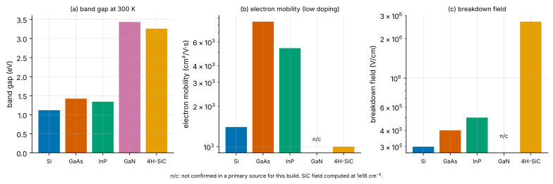
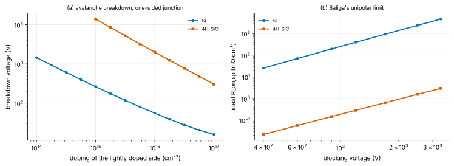

<!-- status: reviewed -->
# 09-13 · Compound and Wide-Bandgap Semiconductors

| | |
|---|---|
| **Course** | [09 · Semiconductor Devices](../README.md) |
| **University equivalent** | The "beyond silicon" unit of a senior devices course: III–V and wide-bandgap materials, heterojunctions, high-electron-mobility and heterojunction bipolar transistors, and the physics of power devices (Baliga's limit) (Pierret ch. on heterojunctions; B. J. Baliga, *Fundamentals of Power Semiconductor Devices*, ch. 1–3; Kimoto and Cooper, *Fundamentals of Silicon Carbide Technology*, ch. 1) |
| **Prerequisites** | [09-01 Crystals and Energy Bands](09-01-crystals-and-energy-bands.md) (band gaps, alloys), [09-06 PN Junction I–V, Capacitance and Breakdown](09-06-pn-junction-iv-and-capacitance.md) (avalanche breakdown), [09-07 The Bipolar Junction Transistor](09-07-bipolar-junction-transistor.md) (emitter efficiency, SiGe HBT), [09-03 Drift and Diffusion](09-03-drift-and-diffusion.md) (mobility, saturation velocity) |
| **Estimated study hours** | 6 |
| **Last verified** | 2026-11-19 |

**Learning objectives.** After this chapter you can:

1. Compare Si, GaAs, InP, GaN and 4H-SiC by band gap, mobility, intrinsic concentration and critical field, and say which property matters for which application.
2. Compute avalanche breakdown and the drift-layer design of a power device from impact-ionization data, and derive Baliga's limit on specific on-resistance.
3. Derive the polarization charge that forms the two-dimensional electron gas at an AlGaN/GaN interface from published material constants.
4. Explain modulation doping and the HEMT, and the gain advantage of a heterojunction bipolar transistor.
5. Relate substrates, wafer sizes and supply-chain events to the cost and availability of wide-bandgap devices.

---

## 1. Big picture

Silicon wins wherever density and cost matter, which is most of electronics. Two physical limits leave room for other materials. The first is **speed**: electrons in some compound semiconductors are lighter and faster, which matters for millimeter-wave radios and the fastest optical links. The second is **voltage and heat**: silicon's 1.12 eV gap lets carriers be generated thermally at high temperature, and its modest critical field forces thick, resistive layers to hold high voltage. Wide-bandgap materials (SiC, GaN) push both limits by an order of magnitude. This chapter explains these advantages from the physics already developed in this course, and the costs that keep these materials in specialized roles.

- **Electric vehicles and chargers** use SiC MOSFETs and GaN transistors in inverters and power supplies, where the lower on-resistance at high voltage reduces losses.
- **Phones, base stations and radar** use GaAs and GaN power amplifiers, and InP serves some of the highest-frequency circuits (Course 21).
- **AI data centers** use GaN and SiC in power conversion (Infineon names AI power supplies among its GaN targets [5]).
- **Supply chains are concentrated and capital-intensive**: substrate makers and wafer-size transitions decide cost, and a leading SiC company went through bankruptcy reorganization in 2025 [6].

## 2. Intuition first

**A wider gap is a taller wall.** Carriers are generated thermally across the gap at a rate ∝ $e^{-E_g/2kT}$ (09-02), so a wider gap means fewer stray carriers at a given temperature, and so less leakage and a higher operating temperature. A wider gap also means an electron must gain more energy before it can create an electron–hole pair by impact ionization (09-06), so the material holds a much higher field before it avalanches.

**Holding voltage is about the field, not the thickness.** A junction holds voltage by spreading a field across a depletion layer: $V \approx \tfrac12\mathcal E_{\max}W$. If the material tolerates ten times the field, the layer can be ten times thinner, and, since the doping that sets the field slope must then rise as $\mathcal E_c^2$, a hundred times more heavily doped for the same voltage. Its resistance, thickness divided by doping, falls about a thousandfold: $R \propto 1/\mathcal E_c^3$ (§3.3).

**A finance analogy: specialist and generalist.** Silicon is the diversified conglomerate: cheapest per unit, enormous scale, good at almost everything. Compound semiconductors are specialist firms that win specific markets on superior performance, at higher unit cost and on thinner supply chains. *Where the analogy breaks:* physical constants, not management, set the specialists' advantages, so the market boundaries move only when costs change, not when silicon "tries harder".

*Figure 1. Key properties of five semiconductors at 300 K: band gap, and electron mobility and breakdown field (log scales), from the handbook, Vurgaftman et al. and the 4H-SiC review [1]–[3]. GaN's critical field is omitted because it was not confirmed in a primary source for this build.*

## 3. Theory

### 3.1 The materials

| Property (300 K) | Si | GaAs | InP | GaN (wurtzite) | 4H-SiC |
|---|---|---|---|---|---|
| Band gap (eV) | 1.12 | 1.424 | 1.344 | 3.435 | 3.26 |
| Gap type | indirect | direct | direct | direct | indirect |
| Electron mass ($m_0$) | 0.26 (cond.) | 0.063 | 0.08 | 0.20 | — |
| Electron mobility (cm²/V·s) | ≤ 1400 | ≤ 8500 | ≤ 5400 | — | ~1000 |
| Static permittivity | 11.7 | 12.9 | 12.5 | — | 9.96 |
| Breakdown field (V/cm) | ~3 × 10⁵ | ~4 × 10⁵ | ~5 × 10⁵ | not confirmed | ~2.7–3 × 10⁶ (computed, §3.3) |

Sources: Si, GaAs and InP from the Levinshtein–Rumyantsev handbook [1]; GaN from Vurgaftman et al., whose recommended gap of 3.507 eV at 0 K with Varshni parameters α = 0.909 meV/K and β = 830 K gives 3.435 eV at 300 K, and whose electron mass is 0.20 $m_0$ [2]; 4H-SiC from the 2025 review by Burin et al.: band gap about 3.26 eV, mean static permittivity 9.96 (reported values span 9.6–10.65), and constant electron mobilities in the literature clustering around 950–1000 cm²/V·s [3] **[Established]** for the orders of magnitude; the third digit of the SiC gap is **[Contested]** [3]. The handbook's mobility entries are upper limits for the purest material.

Three groupings emerge:

- **III–V compounds for speed** (GaAs, InP): light electrons and high mobility, direct gaps for optics (09-14), moderate breakdown.
- **Wide-bandgap materials for power** (SiC, GaN): gaps above 3 eV. SiC's critical field is about ten times silicon's (§3.2); GaN's is reported to be at least comparable, but this course has not confirmed a value from a primary source (R-174). GaN adds a high-mobility electron gas at heterointerfaces (§3.4).
- **Silicon** as the reference: cheapest, largest wafers, best oxide (09-08), and adequate for everything below a few hundred volts and a few tens of gigahertz.

### 3.2 Intrinsic carriers and temperature

From 09-02, $n_i = \sqrt{N_CN_V}\,e^{-E_g/2kT}$. The exponential dominates any difference in the prefactors. Ignoring those, the ratio of intrinsic concentrations of two materials is

$$
\frac{n_{i,2}}{n_{i,1}} \approx e^{-(E_{g2} - E_{g1})/2kT} .
$$

For 4H-SiC against Si at 300 K this is $e^{-(3.26 - 1.12)/(2 \times 0.025852)} \approx 10^{-18}$. Junction leakage from thermal generation, proportional to $n_i$ (09-06), is negligible in SiC, and a SiC device can run at temperatures where silicon would be swamped by intrinsic carriers. The handbook gives GaAs an $n_i$ of 2.1 × 10⁶ cm⁻³ and an intrinsic resistivity of 3.3 × 10⁸ Ω·cm, against 1 × 10¹⁰ cm⁻³ and 3.2 × 10⁵ Ω·cm for silicon [1]. The small $n_i$ is necessary but not sufficient: even the purest GaAs contains residual impurities far above 2 × 10⁶ cm⁻³. Practical **semi-insulating** GaAs is compensated with deep levels (the native EL2 defect, or chromium doping) that pin the Fermi level near mid-gap, and the wide gap is what lets that pinning give resistivities approaching the intrinsic value. Such substrates make low-loss bases for microwave circuits. Silicon RF circuits reach for the same goal differently, with high-resistivity silicon or silicon-on-insulator substrates.

### 3.3 Breakdown and Baliga's limit

**Breakdown from ionization data.** In 09-06 avalanche breakdown came from the ionization integral: in a one-sided junction with peak field $\mathcal E_m$ and width $W = \varepsilon_s\mathcal E_m/qN$, breakdown occurs when

$$
\int_0^W \alpha_n\exp\Big[-\int_0^x(\alpha_n - \alpha_p)\,dx'\Big]dx = 1 .
$$

For 4H-SiC the review tabulates many fits of the form $\alpha = a\,e^{-b/\mathcal E}$. One widely used set, from Hatakeyama et al. for fields along the c-axis, is $\alpha_n = 1.76\times10^8\,e^{-3.3\times10^7/\mathcal E}$ and $\alpha_p = 3.41\times10^8\,e^{-2.5\times10^7/\mathcal E}$ cm⁻¹, valid for 2–5 MV/cm [3] **[Established]** as a fit (the review shows other fits differing noticeably; **[Contested]** in detail). Holes ionize more readily than electrons in SiC, the reverse of silicon. Solving the integral at $N_D$ = 10¹⁶ cm⁻³ gives a peak field of 2.69 MV/cm and a breakdown voltage near 2 kV, against 0.41 MV/cm and 56 V for silicon (Example 09-13.2). The **critical field** is therefore about 6.5 times higher at equal doping, and it is higher still at the heavier dopings a SiC design actually uses.

**Designing a drift layer.** A power transistor holds its blocking voltage across a lightly doped **drift layer**. With a triangular field profile (doping just low enough that the layer is fully depleted at breakdown),

$$
V_B = \tfrac12\mathcal E_cW, \qquad W = \frac{\varepsilon_s\mathcal E_c}{qN_D}
\quad\Rightarrow\quad
N_D = \frac{\varepsilon_s\mathcal E_c^2}{2qV_B}, \qquad W = \frac{2V_B}{\mathcal E_c} .
$$

When the device is on, current flows through this layer, whose **specific on-resistance** (resistance × area) is

$$
R_{on,sp} = \frac{W}{q\mu N_D} = \frac{2V_B/\mathcal E_c}{q\mu\,\varepsilon_s\mathcal E_c^2/(2qV_B)} = \frac{4V_B^2}{\varepsilon_s\mu\mathcal E_c^3} .
$$

*Units check:* V² ÷ [(F/cm)(cm²/V·s)(V/cm)³] = V²·cm·V·s·cm³/(F·cm²·V³) = s·cm²/F = Ω·cm². ✓

This is **Baliga's unipolar limit**: the lowest on-resistance a majority-carrier device of a given blocking voltage can have, set by the material alone. The denominator $\varepsilon_s\mu\mathcal E_c^3$ is **Baliga's figure of merit** (BFOM). The cube on $\mathcal E_c$ dominates: ten times the critical field is worth a thousand times in on-resistance at equal mobility, which is why SiC and GaN power devices exist. Because $\mathcal E_c$ itself depends on doping, the exact design is found numerically (Example 09-13.3).

**Real devices fall short of the limit.** A real SiC MOSFET adds channel, substrate, contact and package resistance to the drift-layer value. Its total is several times the ideal, and its channel resistance is a known weakness (SiC's oxide interface is poorer than silicon's). The limit still sets the scale of the advantage.

### 3.4 Heterojunctions, modulation doping and the HEMT

A **heterojunction** joins two semiconductors with different band gaps, such as AlGaAs on GaAs or AlGaN on GaN. At the interface the conduction and valence bands jump by the band offsets $\Delta E_c$ and $\Delta E_v$ (with $\Delta E_c + \Delta E_v = \Delta E_g$). Electrons collect on the side with the lower conduction band.

**Modulation doping.** In a uniformly doped semiconductor, the electrons share space with the ionized donors they came from, and scatter off them; mobility falls as doping rises (09-03). If the donors are placed in the wide-gap barrier layer and the electrons fall across the heterojunction into an undoped narrow-gap layer, the electrons are spatially separated from their donors. They form a thin sheet, a **two-dimensional electron gas** (2DEG), confined in a triangular quantum well at the interface (04-10) and moving with high mobility. A **high-electron-mobility transistor** (HEMT) uses a gate on the barrier to modulate the 2DEG density, exactly as a MOSFET gate modulates its inversion layer (09-09). The barrier acts as the gate dielectric, and $n_s \approx C_b(V_{GS} - V_{th})/q$ with $C_b$ the barrier capacitance per area.

**Polarization in GaN.** Wurtzite GaN and AlN are polar crystals: even unstrained, they carry a **spontaneous polarization** $P_{sp}$ along the c-axis. A thin AlGaN layer grown on GaN is stretched to GaN's lattice constant, and this strain adds a **piezoelectric polarization** $P_{pz}$. Where the total polarization changes abruptly, at the AlGaN/GaN interface, a fixed bound sheet charge appears. A non-uniform polarization leaves uncompensated bound charge, $\rho_{\text{bound}} = -\nabla\cdot\mathbf P$ (04-04). With $z$ pointing from the GaN into the AlGaN, integrate across the thin interface: $\sigma = -\int(dP_z/dz)\,dz = -(P_{\text{AlGaN}} - P_{\text{GaN}})$, the jump $\sigma = P_{\text{GaN}} - P_{\text{AlGaN}}$. For gallium-face growth it is positive, and it attracts a 2DEG with no doping at all. For an AlGaN layer of composition $x$, coherently strained to GaN, the in-plane strain is $\epsilon = (a_{\text{GaN}} - a_{\text{AlGaN}})/a_{\text{AlGaN}}$, and the piezoelectric polarization along c is

$$
P_{pz} = 2\epsilon\Big(e_{31} - e_{33}\frac{c_{13}}{c_{33}}\Big),
$$

where $e_{31}$, $e_{33}$ are piezoelectric coefficients and $c_{13}$, $c_{33}$ elastic constants. (Where the bracket comes from: the layer is strained in-plane, $\epsilon_{xx} = \epsilon_{yy} = \epsilon$, but free to relax along c, so the stress along c vanishes, $\sigma_{zz} = c_{13}(\epsilon_{xx} + \epsilon_{yy}) + c_{33}\epsilon_{zz} = 0$, giving $\epsilon_{zz} = -2c_{13}\epsilon/c_{33}$. The piezoelectric polarization along c is $P_{pz} = e_{31}(\epsilon_{xx} + \epsilon_{yy}) + e_{33}\epsilon_{zz} = 2e_{31}\epsilon - 2e_{33}c_{13}\epsilon/c_{33}$, the formula above.) Vurgaftman et al. tabulate all of these for GaN and AlN (Table X: lattice constants 3.189 and 3.112 Å; $e_{31}$ −0.35 and −0.50 C/m²; $e_{33}$ 1.27 and 1.79 C/m²; $c_{13}$ 106 and 108 GPa; $c_{33}$ 398 and 373 GPa; $P_{sp}$ −0.029 and −0.081 C/m²) [2] **[Established]** as recommended values; they flag $P_{sp}$ as uncertain, with calculations differing by more than a factor of two [2] **[Contested]**, and warn that interpolating it linearly in composition may fail for AlGaN, because of bowing or ordering [2]. Interpolating linearly in $x$, Example 09-13.4 finds a polarization sheet charge near 1.4 × 10¹³ cm⁻² for $x$ = 0.25. This is the upper limit of the 2DEG density: part of the charge is compensated at the AlGaN surface, so the measured density depends on barrier thickness and surface treatment.

The result is a transistor with a high-density, high-mobility channel in a wide-gap material that tolerates far higher fields than silicon (GaN's critical field is reported to be comparable to SiC's or higher; not confirmed from a primary source here, R-174). GaN HEMTs are used both as RF power amplifiers and as fast power switches. Because the 2DEG exists without a gate voltage, a basic GaN HEMT is **normally on** (depletion mode); power applications need extra structures to make it normally off.

### 3.5 Heterojunction bipolar transistors

In 09-07 the base current of a bipolar transistor came partly from holes injected back into the emitter. The emitter efficiency was improved by doping the emitter much more heavily than the base. In a **heterojunction bipolar transistor** (HBT), the emitter has a wider gap than the base. The holes that would be injected into the emitter must climb an extra barrier. In a **graded** emitter–base junction, where the composition changes smoothly, the whole gap difference counts and back-injection falls by $e^{-\Delta E_g/kT}$, the $n_i^2$ ratio of 09-07. In an **abrupt** junction, a conduction-band spike of height $\Delta E_c$ also impedes the electrons going the other way, and the net advantage falls toward $e^{\Delta E_v/kT}$. For the graded case:

$$
\beta_{\max} \propto \frac{N_E}{N_B}\,e^{\Delta E_g/kT} .
$$

At 300 K, every 60 meV of gap difference multiplies the attainable gain by ten. The designer can spend this on a heavily doped base (low base resistance, higher $f_{max}$) and a lightly doped emitter (lower emitter capacitance), the opposite of a homojunction design. SiGe HBTs (09-07) apply the same idea within silicon processing; InP and GaAs HBTs use III–V heterojunctions (Course 21).

### 3.6 Substrates and cost

Device physics favors these materials. Manufacturing economics often does not:

- **Substrate cost and size.** SiC substrates are grown at very high temperature and are expensive; the industry is moving from 150 mm to 200 mm (§9). GaN can be grown on silicon substrates (GaN-on-Si), which allows large wafers in existing silicon fabs, as in Infineon's 300 mm power technology [5]; GaN is also grown on SiC substrates, which conduct heat well.
- **Defects.** Hetero-epitaxy on a mismatched substrate creates dislocations; SiC has its own crystal defects. Yield and reliability depend on controlling them.
- **Scale.** Silicon fabs make wafers by the millions; compound and wide-bandgap supply chains are far smaller, so each fab, substrate maker and wafer-size transition matters to the whole market.

**Dies per wafer.** A wafer of diameter $d$ holds about $\pi(d/2)^2/A$ dies of area $A$, minus those cut by the edge. A common estimate of the edge loss is the circumference divided by the die diagonal, $\pi d/\sqrt{2A}$. Larger wafers gain slightly more than their area ratio because proportionally fewer dies are lost at the edge (Example 09-13.7).

## 4. Worked examples

### Example 09-13.1 · Intrinsic carriers (tier A)

**Setup.** (a) Estimate $n_i$(4H-SiC)/$n_i$(Si) at 300 K and at 600 K from the gaps alone (3.26 and 1.12 eV, held fixed). (b) From the handbook, find the ratios of GaAs to Si intrinsic concentration and intrinsic resistivity.

**Solution.**

(a) $e^{-2.14/(2 \times 0.025852)}$ = **1.06 × 10⁻¹⁸** at 300 K. At 600 K, $kT/q$ = 0.051704 V, and the ratio is **1.03 × 10⁻⁹**.

(b) $n_i$: 2.1 × 10⁶/10¹⁰ = **2.1 × 10⁻⁴**. Resistivity: 3.3 × 10⁸/3.2 × 10⁵ = **1031**.

**Sanity check.** Even at 600 K, where silicon junctions leak heavily, SiC's thermal generation is a billion times smaller. GaAs's thousandfold higher intrinsic resistivity is what "semi-insulating" means.

### Example 09-13.2 · Breakdown at equal doping (tier B)

**Setup.** A one-sided junction has its lightly doped side at $N_D$ = 10¹⁶ cm⁻³. Using the ionization integral, find the peak field at breakdown, the depletion width and $V_B = \mathcal E_mW/2$ (ignoring the built-in potential) for silicon (handbook fits, 09-06) and for 4H-SiC (Hatakeyama c-axis fits, $\varepsilon_r$ = 9.96).

**Solution.**

- Silicon: $\mathcal E_m$ = **4.15 × 10⁵** V/cm, $W$ = **2.68** µm, $V_B$ = **55.6** V.
- 4H-SiC: $\mathcal E_m$ = **2.69 × 10⁶** V/cm, $W$ = **14.8** µm, $V_B$ = **1996** V.

The critical field is **6.49** times higher, and the breakdown voltage **35.9** times higher at the same doping.

**Sanity check.** At equal doping, $V_B = \varepsilon\mathcal E_m^2/2qN$, so the ratio should be about $(9.96/11.7) \times 6.49^2$ = 35.9. ✓ The silicon result matches 09-06 (whose 54.7 V subtracts the built-in potential).

### Example 09-13.3 · A 1200 V drift layer (tier B)

**Setup.** Design the drift layer of a 1200 V unipolar device in silicon and in 4H-SiC: find the doping that makes the ionization integral reach 1 at 1200 V with a triangular field, the peak field, the thickness, and $R_{on,sp} = W/q\mu N_D$. Use the handbook mobility model for silicon (09-03) and 1000 cm²/V·s for SiC.

**Solution.**

| | $N_D$ (cm⁻³) | $\mathcal E_c$ (V/cm) | $W$ (µm) | $\mu_n$ (cm²/V·s) | $R_{on,sp}$ (mΩ·cm²) |
|---|---|---|---|---|---|
| Si | **1.28 × 10¹⁴** | **2.18 × 10⁵** | **110** | **1358** | **395** |
| 4H-SiC | **1.85 × 10¹⁶** | **2.84 × 10⁶** | **8.45** | 1000 | **0.285** |

The ideal on-resistance ratio is **1386**.

**Sanity check.** Baliga's formula with these critical fields gives the same ratio: $(\varepsilon\mu\mathcal E_c^3)_{\text{SiC}}/(\varepsilon\mu\mathcal E_c^3)_{\text{Si}}$ = **1386**. ✓ For 0.1 Ω, a 1200 V silicon unipolar device would need **3.95** cm² of drift layer, against **0.285** mm² in SiC. That is why silicon uses bipolar IGBTs at this voltage (Course 22), which lower their on-resistance by injecting minority carriers, and why SiC MOSFETs can compete with them.

### Example 09-13.4 · The AlGaN/GaN polarization charge (tier C)

**Setup.** An Al₀.₂₅Ga₀.₇₅N layer is grown coherently on gallium-face GaN. Using Vurgaftman's Table X values interpolated linearly in $x$, find the AlGaN lattice constant, the in-plane strain, the spontaneous and piezoelectric polarizations of the AlGaN, the interface sheet charge and the corresponding electron density. Repeat the density for $x$ = 0.30.

**Solution.**

- $a$ = 0.75 × 3.189 + 0.25 × 3.112 = **3.1698** Å, so $\epsilon$ = (3.189 − 3.1698)/3.1698 = **0.00607** (tensile).
- $P_{sp}$ = −0.029 − 0.25 × 0.052 = **−0.0420** C/m².
- With $e_{31}$ = −0.3875, $e_{33}$ = 1.40, $c_{13}$ = 106.5 and $c_{33}$ = 391.75 (interpolated), $P_{pz} = 2\epsilon(e_{31} - e_{33}c_{13}/c_{33})$ = **−0.00933** C/m².
- $\sigma = P_{sp,\text{GaN}} - (P_{sp} + P_{pz})_{\text{AlGaN}}$ = −0.029 + 0.0513 = **+0.0223** C/m²: the polarization is larger in magnitude in the AlGaN, so a positive bound charge is left at the interface.
- Density: 0.0223/(1.602 × 10⁻¹⁹ C) = **1.39 × 10¹³** cm⁻². For $x$ = 0.30: **1.69 × 10¹³** cm⁻².

**Sanity check.** About 1.4 × 10¹³ electrons per cm² is comparable to the inversion charge of a MOSFET at 1 V of overdrive on a 2 nm oxide (1.727 µF/cm² × 1 V/q = **1.08 × 10¹³** cm⁻²). Here it arrives with no gate voltage and no doping, and it grows with aluminum content.

### Example 09-13.5 · Why modulation doping helps (tier B)

**Setup.** (a) A 2DEG holds 10¹³ electrons/cm² with a mobility of 1500 cm²/V·s (an illustrative value). Find its sheet resistance. (b) The same number of electrons in a 50 nm silicon layer doped at 2 × 10¹⁸ cm⁻³ has the handbook mobility for that doping. Find its mobility and sheet resistance.

**Solution.**

(a) $R_{sh} = 1/(qn_s\mu)$ = **416** Ω/□.

(b) $\mu_n$(2 × 10¹⁸) = **189** cm²/V·s, so $R_{sh}$ = **3297** Ω/□, **7.9** times higher.

**Sanity check.** The comparison is illustrative rather than like for like: the 2DEG is a few nanometers thick, not 50 nm, and its 1500 cm²/V·s exceeds even silicon's lattice-limited electron mobility, so the materials differ as well as the doping. The lesson stands: putting the electrons where the donors are not removes ionized-impurity scattering, the term that drags doped-silicon mobility down to 189 cm²/V·s.

### Example 09-13.6 · HBT gain (tier A)

**Setup.** A heterojunction adds a hole barrier $\Delta E_g$ at the emitter. At 300 K, by what factor does the maximum gain rise for $\Delta E_g$ = 0.1 eV and 0.2 eV? If the designer also reverses the doping ratio to $N_E/N_B$ = 0.1, what net factor remains (relative to equal doping without the heterojunction)?

**Solution.** $e^{\Delta E_g/kT}$ = **47.9** and **2290**. With $N_E/N_B$ = 0.1: **4.79** and **229**.

**Sanity check.** A 0.2 eV heterojunction leaves gain to spare even with a base ten times more heavily doped than the emitter, so the base can be thin and low-resistance, which raises $f_{max}$.

### Example 09-13.7 · Wafer size and dies (tier A)

**Setup.** For a 25 mm² die, estimate the gross dies per wafer on 150 mm and 200 mm wafers, the die ratio, and the area ratio. What is the area ratio for 300 mm against 200 mm?

**Solution.**

- 150 mm: π(75)²/25 − π(150)/√50 = **640** dies.
- 200 mm: **1168** dies.

The die ratio is **1.82**, against an area ratio of **1.78**; 300 mm against 200 mm is **2.25** in area.

**Sanity check.** The die gain slightly exceeds the area gain because the edge loss grows only with circumference. If wafer cost rises less than 1.8× in the transition, cost per die falls, which is the economic case for 200 mm SiC and 300 mm GaN-on-Si.

### Answer key

<!-- answer-key -->
| ID | Quantity | Value | Unit |
|---|---|---|---|
| Ex 09-13.1a | n_i ratio SiC/Si, 300 K | 1.06e-18 | — |
| Ex 09-13.1b | n_i ratio SiC/Si, 600 K | 1.03e-9 | — |
| Ex 09-13.1c | n_i ratio GaAs/Si | 2.1e-4 | — |
| Ex 09-13.1d | intrinsic resistivity ratio | 1031 | — |
| Ex 09-13.2a | Si peak field at breakdown | 4.15e5 | V/cm |
| Ex 09-13.2b | Si depletion width | 2.68 | µm |
| Ex 09-13.2c | Si V_B | 55.6 | V |
| Ex 09-13.2d | SiC peak field at breakdown | 2.69e6 | V/cm |
| Ex 09-13.2e | SiC depletion width | 14.8 | µm |
| Ex 09-13.2f | SiC V_B | 1996 | V |
| Ex 09-13.2g | critical-field ratio | 6.49 | — |
| Ex 09-13.2h | V_B ratio | 35.9 | — |
| Ex 09-13.3a | Si drift doping | 1.28e14 | cm⁻³ |
| Ex 09-13.3b | Si critical field | 2.18e5 | V/cm |
| Ex 09-13.3c | Si drift thickness | 110 | µm |
| Ex 09-13.3d | Si mobility | 1358 | cm²/V·s |
| Ex 09-13.3e | Si R_on,sp | 395 | mΩ·cm² |
| Ex 09-13.3f | SiC drift doping | 1.85e16 | cm⁻³ |
| Ex 09-13.3g | SiC critical field | 2.84e6 | V/cm |
| Ex 09-13.3h | SiC drift thickness | 8.45 | µm |
| Ex 09-13.3i | SiC R_on,sp | 0.285 | mΩ·cm² |
| Ex 09-13.3j | on-resistance ratio | 1386 | — |
| Ex 09-13.3k | BFOM ratio | 1386 | — |
| Ex 09-13.3l | Si drift area for 0.1 Ω | 3.95 | cm² |
| Ex 09-13.3m | SiC drift area for 0.1 Ω | 0.285 | mm² |
| Ex 09-13.4a | AlGaN lattice constant | 3.1698 | Å |
| Ex 09-13.4b | in-plane strain | 0.00607 | — |
| Ex 09-13.4c | AlGaN P_sp | -0.0420 | C/m² |
| Ex 09-13.4d | AlGaN P_pz | -0.00933 | C/m² |
| Ex 09-13.4e | interface bound charge | 0.0223 | C/m² |
| Ex 09-13.4f | sheet density, x = 0.25 | 1.39e13 | cm⁻² |
| Ex 09-13.4g | sheet density, x = 0.30 | 1.69e13 | cm⁻² |
| Ex 09-13.4h | MOSFET comparison density | 1.08e13 | cm⁻² |
| Ex 09-13.5a | 2DEG sheet resistance | 416 | Ω/□ |
| Ex 09-13.5b | Si mobility at 2e18 | 189 | cm²/V·s |
| Ex 09-13.5c | Si layer sheet resistance | 3297 | Ω/□ |
| Ex 09-13.5d | ratio | 7.9 | — |
| Ex 09-13.6a | gain factor, 0.1 eV | 47.9 | — |
| Ex 09-13.6b | gain factor, 0.2 eV | 2290 | — |
| Ex 09-13.6c | net factor, 0.1 eV, N_E/N_B = 0.1 | 4.79 | — |
| Ex 09-13.6d | net factor, 0.2 eV, N_E/N_B = 0.1 | 229 | — |
| Ex 09-13.7a | dies, 150 mm | 640 | — |
| Ex 09-13.7b | dies, 200 mm | 1168 | — |
| Ex 09-13.7c | die ratio | 1.82 | — |
| Ex 09-13.7d | area ratio 200/150 | 1.78 | — |
| Ex 09-13.7e | area ratio 300/200 | 2.25 | — |
| T 09-13.a | GaN gap at 300 K (Vurgaftman, Varshni) | 3.435 | eV |
| T 09-13.b | 4H-SiC electron α prefactor (Hatakeyama, c-axis) | 1.76e8 | cm⁻¹ |
| T 09-13.c | 4H-SiC electron α field constant | 3.3e7 | V/cm |
| T 09-13.d | 4H-SiC hole α prefactor | 3.41e8 | cm⁻¹ |
| T 09-13.e | 4H-SiC hole α field constant | 2.5e7 | V/cm |
| T 09-13.f | 4H-SiC mean static permittivity | 9.96 | — |

*Every value is recomputed by [verify_09_13.py](../verify/verify_09_13.py) by an independent route: intrinsic ratios from the exponential; breakdown by integrating the carrier-continuity equations with avalanche generation (as in 09-06) and root finding on the peak field and on the doping; the polarization charge by solving the elastic equations of a biaxially strained film for the vertical strain and applying the piezoelectric tensor; sheet resistances from the mobility model; gain factors from Boltzmann factors; and dies per wafer from the formula, cross-checked by counting whole dies on a grid inside the wafer circle.*

## 5. Simulate it

The lab, [labs/09-13-lab](../labs/09-13-lab/README.md), is a notebook that:

1. Computes breakdown voltage against doping for Si and 4H-SiC from the ionization integral, and Baliga's on-resistance limit against blocking voltage (Figure 2).
2. Designs the 600 V and 3300 V drift layers and compares the on-resistance limits (the guided exercise below).
3. Computes the AlGaN/GaN polarization charge against aluminum content.
4. Compares 2DEG and doped-layer sheet resistance against electron density.
5. Counts whole dies on 150, 200 and 300 mm wafers for a range of die sizes.

**Guided exercise (predict, then run).** **Before running Part 2**, predict: at 600 V and at 3300 V, does SiC's on-resistance advantage over silicon grow, shrink or stay the same? Then compute both.

*Figure 2. (a) Breakdown voltage of a one-sided junction against doping of the lightly doped side, for silicon and 4H-SiC, from the ionization integral. (b) Ideal specific on-resistance of the drift layer against breakdown voltage (Baliga's limit with the computed critical fields).*

## 6. Engineering tradeoffs

| Knob | Improves | Costs | Typical decision owner |
|---|---|---|---|
| Wider band gap (SiC, GaN) | Critical field, temperature, leakage | Substrate cost, defects, poorer gate oxide (SiC) | Product line, technology |
| Thinner, more heavily doped drift layer | On-resistance | Blocking voltage | Device designers |
| GaN on Si substrates | Large wafers in existing fabs | Lattice and thermal mismatch, defects | Technology |
| GaN on SiC substrates | Heat removal (SiC conducts heat well) | Substrate cost | RF product line |
| Higher Al content in AlGaN | 2DEG density | Strain, reliability | Epitaxy and device teams |
| Heterojunction emitter (HBT) | Gain, so heavier base doping and higher f_max | Epitaxy cost, material system | RF device teams |
| Larger wafers | Cost per die | Capital, transition risk | Executives |

## 7. Numbers to know

| Quantity | Value | Note |
|---|---|---|
| Band gaps (eV) | Si 1.12, GaAs 1.424, InP 1.344, GaN 3.435, 4H-SiC ~3.26 | [1]–[3] |
| Electron mobility (cm²/V·s) | Si ≤ 1400, GaAs ≤ 8500, InP ≤ 5400, 4H-SiC ~1000 | [1], [3] |
| Breakdown field | Si ~3 × 10⁵, GaAs ~4 × 10⁵ V/cm; 4H-SiC ~2.7–3 MV/cm | [1], computed |
| Baliga's limit | $R_{on,sp} = 4V_B^2/\varepsilon\mu\mathcal E_c^3$ | §3.3 |
| SiC vs Si, 1200 V | ~1400× lower ideal $R_{on,sp}$ | Example 09-13.3 |
| AlGaN/GaN 2DEG | ~10¹³ cm⁻² from polarization | Example 09-13.4 |
| HBT gain | ×10 per 60 meV of $\Delta E_g$ at 300 K | §3.5 |

## 8. Common mistakes

1. **Comparing materials by band gap alone.** Speed depends on mobility and saturation velocity; power devices depend on $\varepsilon\mu\mathcal E_c^3$; optics depends on whether the gap is direct.
2. **Using one critical field for all dopings.** The breakdown field rises with doping; compute it from the ionization integral or a fit valid at that doping.
3. **Treating Baliga's limit as a device rating.** Real devices add channel, substrate, contact and package resistance.
4. **Thinking the GaN 2DEG comes from doping.** It comes from polarization discontinuities; doping is not needed, and the device is normally on unless engineered otherwise.
5. **Ignoring the substrate.** Cost, wafer size, defect density and thermal conductivity often decide which material wins, not the intrinsic physics.

## 9. Practitioner lens

### State of the art (as of Nov 2026)

- **200 mm SiC.** Wolfspeed opened its Mohawk Valley 200 mm SiC fab in April 2022, calling it the world's largest (a company claim, **[Contested]**) [6]. It announced the commercial launch of 200 mm SiC bare wafers and epitaxy in September 2025, "after initially offering 200mm SiC to select customers" [6] **[Established]**. Infineon said in February 2025 that it would release its first products based on 200 mm SiC to customers in the first quarter of 2025, with its Kulim, Malaysia conversion "fully on track" [5] (a forward-looking statement; its delivery was not separately confirmed for this build) **[Industry estimate]**. Wolfspeed's newsroom lists, in October 2026, an expanded and extended long-term SiC wafer supply agreement with Infineon that includes 200 mm, and a conditional 30-year, $1.5 billion loan commitment from the U.S. Department of War for its wide-bandgap supply chain [6] **[Established]** (as announced; terms not examined here).
- **A restructured supplier.** Wolfspeed filed a prepackaged Chapter 11 reorganization on 30 June 2025 and emerged on 29 September 2025, cutting its debt by about 70% and its annual cash interest by about 60% [6] **[Established]**.
- **GaN on 300 mm.** Infineon announced in September 2024 "the world's first 300 mm power gallium nitride (GaN) wafer technology", produced in an existing high-volume 300 mm silicon fab, for AI-system power supplies, solar inverters, chargers and motor control [5] **[Established]** (the "world's first" is a company claim). Infineon estimates the GaN market will reach "several billion US-Dollars by the end of the decade" [5] **[Industry estimate]**.
- **Market penetration in vehicles** (SiC's share of EV traction inverters) is widely reported by analysts but was not confirmed from a primary source for this build (open issue).

### Why it matters commercially

- **Power conversion efficiency is money.** Every percent of loss in an EV inverter or a data-center power supply becomes range, heat and electricity cost; wide-bandgap switches cut conduction and switching loss.
- **Substrates are the bottleneck.** Wafer-size transitions and substrate supply decide cost curves, and the supplier base is small. The Wolfspeed restructuring shows how capital-intensive and fragile it can be. **Deeper:** see companion repo *Semiconductor Capital Equipment*.
- **RF front ends are materials businesses.** GaAs, GaN and InP each own a frequency and power range, and those boundaries move with cost and integration.

### Marketing vs Reality

- **"SiC is 10× better than silicon."** *Reality:* the ideal drift-layer advantage is about a thousandfold at 1200 V (Example 09-13.3), but device totals are set by channel and package resistance, and cost per ampere matters more than resistance per area. *Sanity check:* ask for $R_{DS(on)}$ × area at temperature, and cost per ampere at the system level.
- **"GaN replaces SiC."** *Reality:* the two are positioned differently: GaN-on-Si is offered mainly at lower voltages, where its fast switching pays, and SiC at higher voltages and currents, with the two competing in the 650 V class **[Industry estimate]** (common industry positioning, not confirmed from a primary source for this build). *Sanity check:* ask for the voltage class, switching frequency and thermal design.
- **"World's first / largest."** *Reality:* such claims depend on the definition (first announced, first sampled, first in volume). *Sanity check:* ask for the milestone and volumes.

### Questions for engineering leaders

1. **"What is your device's specific on-resistance against Baliga's limit, and what fraction is the drift layer?"**
   - *Strong:* breaks the total into drift, channel, substrate and package, against the limit.
   - *Evasive:* only quotes $R_{DS(on)}$ at room temperature.
2. **"How exposed is your supply to substrate availability and wafer-size transitions?"**
   - *Strong:* names qualified substrate sources, wafer sizes and the cost curve.
   - *Evasive:* "We have long-term agreements."
3. **"Is your GaN device normally off, and how?"**
   - *Strong:* explains the gate structure, threshold stability and failure mode.
   - *Evasive:* "It behaves like a MOSFET."
4. **"Where do you see the boundary between GaN and SiC in your products, and why?"**
   - *Strong:* gives voltage, frequency and thermal reasons, with costs.
   - *Evasive:* "Both are growing."

<!-- answer-key -->
| ID | Quantity | Value | Unit |
|---|---|---|---|
| P 09-13.a | Wolfspeed debt reduction | 70 | % |
| P 09-13.b | Wolfspeed cash-interest reduction | 60 | % |
| P 09-13.c | Wolfspeed 200 mm fab opening year | 2022 | — |
| P 09-13.d | Infineon 300 mm GaN announcement year | 2024 | — |
| P 09-13.e | Wolfspeed loan commitment | 1.5 | $ billion |
| P 09-13.f | loan term | 30 | years |

## 10. Concept check

**Q1.** Why does a wider band gap raise both the operating temperature and the breakdown field?

Answer

Thermal generation across the gap scales as $e^{-E_g/2kT}$, so a wider gap keeps intrinsic carriers negligible to higher temperatures. Impact ionization requires a carrier to gain energy comparable to the gap before it can create a pair, so a wider gap requires a higher field before avalanche.

**Q2.** Why does Baliga's figure of merit contain the critical field cubed?

Answer

For a given blocking voltage, a higher critical field allows a thinner drift layer ($W \propto 1/\mathcal E_c$) and a heavier doping ($N \propto \mathcal E_c^2$). The resistance $W/q\mu N$ therefore falls as $1/\mathcal E_c^3$.

**Q3.** How does modulation doping raise mobility?

Answer

The donors sit in the wide-gap barrier while their electrons collect in the undoped narrow-gap channel across the heterojunction. Separated from the ionized donors, the electrons are not scattered by them, so mobility stays high even at high electron density.

**Q4.** Where does the 2DEG in an AlGaN/GaN HEMT come from if nothing is doped?

Answer

From polarization. Both AlGaN and GaN carry spontaneous polarization, and the strained AlGaN adds piezoelectric polarization. The total polarization changes abruptly at the interface, leaving a positive bound sheet charge (for gallium-face growth) that attracts electrons into the GaN, forming the 2DEG.

**Q5.** What does a heterojunction emitter give a bipolar transistor?

Answer

It adds a barrier of about $\Delta E_g$ to holes injected from the base into the emitter, cutting that base-current component by about $e^{-\Delta E_g/kT}$. The gain can then be kept high even with a heavily doped base (lower base resistance, higher $f_{max}$) and a lightly doped emitter.

**Q6.** Why is semi-insulating GaAs useful for microwave circuits?

Answer

Its intrinsic carrier concentration is about 10⁴ times lower than silicon's and its intrinsic resistivity about 10³ times higher, so the substrate barely conducts. Transmission lines and passive components on it lose little signal to the substrate.

Now work the [problem set](../problems/09-13-problems.md).

## 11. Key terms

[Compound semiconductor](../../../reference/glossary.md#compound-semiconductor) · [Wide-bandgap semiconductor](../../../reference/glossary.md#wide-bandgap-semiconductor) · [Semi-insulating substrate](../../../reference/glossary.md#semi-insulating-substrate) · [Critical field](../../../reference/glossary.md#critical-field) · [Drift layer](../../../reference/glossary.md#drift-layer) · [Specific on-resistance](../../../reference/glossary.md#specific-on-resistance) · [Baliga's figure of merit](../../../reference/glossary.md#baligas-figure-of-merit) · [Heterojunction](../../../reference/glossary.md#heterojunction) · [Modulation doping](../../../reference/glossary.md#modulation-doping) · [Two-dimensional electron gas](../../../reference/glossary.md#two-dimensional-electron-gas) · [High-electron-mobility transistor](../../../reference/glossary.md#high-electron-mobility-transistor) · [Spontaneous polarization](../../../reference/glossary.md#spontaneous-polarization) · [Piezoelectric polarization](../../../reference/glossary.md#piezoelectric-polarization) · [Heterojunction bipolar transistor](../../../reference/glossary.md#heterojunction-bipolar-transistor)

## 12. Connections

- **Builds on:** [09-01](09-01-crystals-and-energy-bands.md) (band structure, alloys), [09-02](09-02-carriers-doping-fermi-level.md) (intrinsic concentration), [09-03](09-03-drift-and-diffusion.md) (mobility), [09-06](09-06-pn-junction-iv-and-capacitance.md) (avalanche), [09-07](09-07-bipolar-junction-transistor.md) (emitter efficiency, SiGe HBT), [09-09](09-09-long-channel-mosfet.md) (gate control of a channel).
- **Next:** [09-14 Optoelectronic Devices](09-14-optoelectronic-devices.md): direct gaps, LEDs, lasers and detectors.
- **Used later:** power devices and converters in [Course 22](../../22-power-electronics-and-energy-conversion/README.md); RF transistors and amplifiers in [Course 21](../../21-rf-and-microwave-engineering/README.md); materials and substrates in [Course 25](../../25-fabrication-packaging-test-and-reliability/README.md).

## 13. Further study

- B. J. Baliga, *Fundamentals of Power Semiconductor Devices*, ch. 1–3: breakdown, drift layers and the figure of merit.
- T. Kimoto and J. A. Cooper, *Fundamentals of Silicon Carbide Technology*: SiC materials, devices and processing.
- J. Burin et al., "TCAD Parameters for 4H-SiC: A Review" (arXiv, 2025): a critical survey of SiC material parameters, including how much they disagree.
- I. Vurgaftman, J. R. Meyer and L. R. Ram-Mohan, "Band parameters for III–V compound semiconductors and their alloys" (2001): the standard compilation, including the nitrides.

## 14. Sources

1. M. E. Levinshtein, S. L. Rumyantsev and M. S. Shur (eds.), *Handbook Series on Semiconductor Parameters, Vol. 1* (World Scientific, 1996): basic parameters at 300 K for Si (§1.1), GaAs (§4.1) and InP (§8.1). [R-161](../../../reference/research-log.md#r-161--crystal-band-structure-and-alloy-parameters), [R-163](../../../reference/research-log.md#r-163--carrier-statistics-dopants-and-dopant-fluctuation), [R-174](../../../reference/research-log.md#r-174--compound-and-wide-bandgap-references).
2. I. Vurgaftman, J. R. Meyer and L. R. Ram-Mohan, "Band parameters for III–V compound semiconductors and their alloys", *J. Appl. Phys.* 89, 5815 (2001), Table X (wurtzite nitrides) and the GaN and AlN sections, [doi:10.1063/1.1368156](https://doi.org/10.1063/1.1368156). [R-174](../../../reference/research-log.md#r-174--compound-and-wide-bandgap-references).
3. J. Burin, P. Gaggl, S. Waid, A. Gsponer and T. Bergauer, "TCAD Parameters for 4H-SiC: A Review", arXiv:2410.06798v8 (22 Dec 2025): band gap (§VI), permittivity, impact ionization (Table XIII), mobility (§X): [arXiv PDF](https://arxiv.org/pdf/2410.06798). [R-174](../../../reference/research-log.md#r-174--compound-and-wide-bandgap-references).
4. B. J. Baliga's figure of merit and unipolar limit are derived in §3.3; see Baliga's textbook (Further study) for the original treatment.
5. Infineon press releases: "300 mm GaN" (11 Sep 2024), [release](https://www.infineon.com/regional/austria/press-release/2024/gan300); "200 mm silicon carbide" (13 Feb 2025), [release](https://www.infineon.com/regional/austria/press-release/2025/200-mm-silicon-carbide). [R-174](../../../reference/research-log.md#r-174--compound-and-wide-bandgap-references).
6. Wolfspeed press releases: Mohawk Valley fab opening (25 Apr 2022), [release](https://www.wolfspeed.com/company/news-events/news/wolfspeed-opens-the-worlds-largest-200mm-silicon-carbide-fab-enabling-highly-anticipated-device-production/); restructuring support agreement (22 Jun 2025), Chapter 11 filing (30 Jun 2025), plan confirmation (8 Sep 2025) and emergence (29 Sep 2025), [emergence release](https://www.wolfspeed.com/company/news-events/news/wolfspeed-successfully-completes-financial-restructuring-emerges-as-financially-stronger-company-well-positioned-in-silicon-carbide-market/); 200 mm materials launch (10 Sep 2025), [release](https://www.wolfspeed.com/company/news-events/news/wolfspeed-announces-the-commercial-launch-of-200mm-silicon-carbide-materials-portfolio-unlocking-the-industrys-ability-to-manufacture-at-scale/). Newsroom listing, read Nov 2026, for the October 2026 headlines (Infineon supply agreement extended to 200 mm, 15 Oct 2026; conditional $1.5 billion loan commitment, 7 Oct 2026): [newsroom](https://www.wolfspeed.com/company/news-events/news/). [R-174](../../../reference/research-log.md#r-174--compound-and-wide-bandgap-references).
