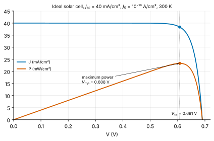
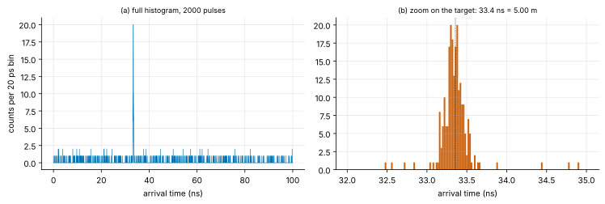

<!-- status: reviewed -->
# 09-14 · Optoelectronic Devices

| | |
|---|---|
| **Course** | [09 · Semiconductor Devices](../README.md) |
| **University equivalent** | The optoelectronics unit of a junior/senior devices course: absorption and emission, photodiodes, avalanche and single-photon detectors, image sensors, LEDs, laser diodes and solar cells (Hu, *Modern Semiconductor Devices for Integrated Circuits*, §4.12–4.15; Pierret ch. on optoelectronic devices) |
| **Prerequisites** | [09-04 Generation, Recombination and Continuity](09-04-generation-recombination-continuity.md), [09-06 PN Junction I–V, Capacitance and Breakdown](09-06-pn-junction-iv-and-capacitance.md) (diode equation, avalanche), [09-13 Compound and Wide-Bandgap Semiconductors](09-13-compound-and-wide-bandgap-semiconductors.md) (direct gaps, heterojunctions), [03-06 Random Processes Preview: Noise](../../03-probability-statistics-and-random-variables/chapters/03-06-random-processes-preview.md) (shot noise) |
| **Estimated study hours** | 7 |
| **Last verified** | 2026-11-19 |

**Learning objectives.** After this chapter you can:

1. Relate photon energy to wavelength and band gap, and explain why direct-gap materials absorb and emit light efficiently.
2. Compute photodiode quantum efficiency, responsivity and shot-noise-limited signal-to-noise ratio.
3. Explain avalanche photodiodes and single-photon avalanche diodes, and compute time-of-flight range, depth resolution and detection probability.
4. Analyze an image-sensor pixel: conversion gain, full well, photon shot noise, read noise and dynamic range.
5. Estimate LED extraction and wall-plug efficiency and a laser diode's threshold gain.
6. Derive the solar-cell I–V curve, open-circuit voltage, maximum-power point and fill factor, and explain the band-gap trade-off.

---

## 1. Big picture

A PN junction converts between electrons and photons in both directions. Absorb a photon in or near the depletion region and its electron–hole pair becomes current: a **photodiode**, an image-sensor pixel, a solar cell. Inject electrons and holes into a direct-gap junction and they recombine by emitting photons: a **light-emitting diode**; add optical feedback and you have a **laser diode**. Every device in this chapter is the diode of 09-06 with light added, so the physics is already in hand. What changes is the bookkeeping: photons per second, quantum efficiencies, and noise counted in individual electrons.

- **Phone cameras** use CMOS image sensors, and some phones also carry single-photon depth sensors (§9).
- **Data-center optics** use laser diodes and photodiodes to move data over fiber (Course 24; **Deeper:** see companion repo *Datacenter Networking*).
- **Automotive LiDAR** uses pulsed lasers and single-photon detectors.
- **Solid-state lighting and solar power** are judged almost entirely by efficiency, which this chapter derives.

## 2. Intuition first

**Photons as coins of fixed value.** Light arrives in packets of energy $h\nu$. A photon can lift an electron across the gap only if $h\nu \ge E_g$, like a coin that buys an item only if it is worth at least the price; any excess energy is lost as heat. Silicon (1.12 eV) is blind beyond about 1.1 µm, which is why 1.55 µm fiber links need germanium or InGaAs detectors.

**Direct and indirect gaps.** In a direct-gap material (GaAs, InP, GaN) the conduction-band minimum and valence-band maximum sit at the same crystal momentum, so a photon alone can move an electron between them. In an indirect-gap material (Si, Ge) the transition also needs a lattice vibration (phonon) to supply momentum, which makes absorption weaker and emission very slow [1]. Silicon detects light well enough with a thick enough layer, but it is a poor light emitter. LEDs and lasers are made from direct-gap compounds [1].

**A finance analogy: a solar cell as a business with two constraints.** Revenue is current: every absorbed photon contributes one electron, so a smaller gap captures more of the spectrum. Margin is voltage: the cell's voltage is limited by its gap, so a larger gap earns more per electron. Profit (power) is maximized at an intermediate gap. *Where the analogy breaks:* the "price" each photon pays is fixed by physics, and the losses (heat from excess photon energy, recombination) cannot be negotiated away, only engineered down.

*Figure 1. Current–voltage curve of a solar cell with $J_{sc}$ = 40 mA/cm² and $J_0$ = 10⁻¹³ A/cm² at 300 K (Example 09-14.8), with its power curve. The maximum-power point sits just below the open-circuit voltage.*

## 3. Theory

### 3.1 Photons, absorption and penetration depth

A photon of wavelength $\lambda$ has energy $E = h\nu = hc/\lambda$. In convenient units [1]:

$$
E\,(\text{eV}) = \frac{1.24}{\lambda\,(\text{µm})} .
$$

A semiconductor absorbs photons with $E \ge E_g$, so its **cutoff wavelength** is $\lambda_c = 1.24/E_g$. Absorbed light decays exponentially with depth, $I(x) \propto e^{-\alpha x}$, where $\alpha$ is the **absorption coefficient** and $1/\alpha$ the **penetration depth** [1]. A layer of thickness $d$ absorbs a fraction $1 - e^{-\alpha d}$. Direct-gap materials have absorption coefficients that rise steeply above the gap. Hu notes that a GaAs solar cell needs to be only about 1 µm thick, while a silicon cell should be no thinner than about 50 µm to absorb most of the useful photons [1] **[Established]**.

### 3.2 Photodiodes

**Photocurrent.** A photon flux $\Phi$ (photons per second) that generates carriers collected by the junction produces a current $I_{ph} = \eta q\Phi$. The **quantum efficiency** $\eta$ (electrons out per photon in) includes the reflection at the surface, the fraction absorbed in the collecting region, and the fraction of generated carriers that reach the junction before recombining. With incident optical power $P = \Phi h\nu$, the **responsivity** is

$$
\mathcal R = \frac{I_{ph}}{P} = \frac{\eta q}{h\nu} = \eta\,\frac{\lambda\,(\text{µm})}{1.24}\ \text{A/W} .
$$

Even a perfect detector ($\eta$ = 1) delivers only 1.25 A/W at 1.55 µm and less at shorter wavelengths, because each photon yields at most one electron.

**Collection.** Hu's analysis of a P⁺N junction under uniform generation $G$ shows that only carriers generated within about a diffusion length of the junction are collected: $I_{sc} = AqL_pG$ [1]. A good photodiode therefore puts the absorption inside the depletion region (fast drift collection) or within a diffusion length of it. A **PIN photodiode** inserts a thick intrinsic layer so that most light is absorbed where the field sweeps carriers out quickly.

**Shot noise.** Photons and the electrons they create arrive at random, as a Poisson process (03-02, 03-06). A current $I$ carries **shot noise** with mean-square value $\overline{i_n^2} = 2qIB$ in a bandwidth $B$. For a photodiode with photocurrent $I_{ph}$ and dark current $I_d$, the shot-noise-limited signal-to-noise ratio is

$$
\text{SNR} = \frac{I_{ph}}{\sqrt{2q(I_{ph} + I_d)B}} .
$$

Here SNR is a ratio of rms currents, an amplitude ratio, so in decibels it is $20\log_{10}\text{SNR}$. Optical-link texts (Course 24) often quote the power ratio, its square; $10\log_{10}$ of that gives the same decibels. Real receivers add the thermal noise of the amplifier, often the dominant term (Course 17, Course 24).

**Bandwidth.** A photodiode responds no faster than its carriers cross the depletion region. Carriers generated at one edge cross the width $W$ at the saturation velocity in $t_{tr} = W/v_{sat}$, so a short light pulse produces a rectangular current pulse of that length. Its Fourier transform has magnitude $|\sin(\pi ft_{tr})/(\pi ft_{tr})|$, which falls to $1/\sqrt2$ at $ft_{tr}$ = **0.443**, so $f_{3\text{dB}} \approx 0.443\,v_{sat}/W$. A thicker depletion region absorbs more light but responds more slowly, and its capacitance with the load resistance sets a second, RC limit (Problem 09-14.4).

### 3.3 Avalanche photodiodes and single-photon detectors

**Avalanche photodiodes.** If the photodiode is reverse-biased near breakdown, photogenerated carriers are multiplied by impact ionization as they cross the depletion region: an **avalanche photodiode** (APD) [1]. The multiplication factor $M$ is the one computed in 09-06. Gain lifts small signals above amplifier noise, at the cost of extra noise from the randomness of the multiplication. Each carrier's gain fluctuates, so the shot noise grows as $M^2F$ rather than $M^2$: $\overline{i_n^2} = 2qI_{ph}M^2FB$, where $F \ge 1$ is the **excess noise factor**. McIntyre's analysis gives $F = kM + (1 - k)(2 - 1/M)$ when electrons start the avalanche, with $k$ the ratio of the hole to the electron ionization coefficient [8]. For $M$ = 10, $k$ = 0.1 gives $F$ = **2.71**, while $k$ = 1 gives $F = M$ = 10: low-noise APDs need a material in which one carrier ionizes far more readily than the other, as electrons do in silicon (09-06's coefficients).

**Single-photon avalanche diodes.** Bias the junction *above* breakdown and a single carrier can trigger a self-sustaining avalanche, a macroscopic current pulse from one photon. This **single-photon avalanche diode** (SPAD), operated in "Geiger mode", must then be quenched (the bias lowered below breakdown) and recharged before it can detect again; this recovery time is its **dead time**. The probability that an incident photon triggers a detectable avalanche is the **photon detection efficiency** (PDE). If $\bar n$ photons arrive on average in a time window, the number detected is Poisson with mean PDE × $\bar n$, so the probability of at least one detection is

$$
P_{\text{det}} = 1 - e^{-\text{PDE}\cdot\bar n} .
$$

**Direct time-of-flight ranging.** A pulsed laser illuminates a target, and a SPAD timestamps the returning photons. A target at distance $d$ returns light after $t = 2d/c$, so $d = ct/2$. The timing uncertainty $\Delta t$ of the detector and electronics sets the depth resolution, $\Delta d = c\Delta t/2$: 15 cm per nanosecond. Histogramming many pulses averages the timing noise down and separates signal photons from ambient light.

### 3.4 Image sensors

A **CMOS image sensor** pixel integrates photocharge on a photodiode (in modern pixels a **pinned photodiode**, a buried N layer under a thin P⁺ surface layer, which lowers dark current and allows complete charge transfer). It then transfers the charge to a small **floating diffusion** node of capacitance $C_{FD}$, where a source follower (09-09) reads the voltage. The pixel's figures of merit follow from charge counting:

- **Conversion gain** $q/C_{FD}$: the voltage per electron. 1.6 fF gives 100 µV/e⁻.
- **Full-well capacity** $N_{FW}$: the largest charge the pixel holds before saturating.
- **Photon shot noise**: a signal of $N$ electrons fluctuates by $\sqrt N$, so the best possible SNR is $\sqrt N$, reached at full well: $\text{SNR}_{\max} = \sqrt{N_{FW}}$.
- **Read noise** $\sigma_r$ (electrons rms): the noise floor of the readout chain in the dark.
- **Dynamic range**: $\text{DR} = N_{FW}/\sigma_r$, usually quoted as $20\log_{10}$ of that ratio in decibels.

Smaller pixels hold less charge, so their SNR and dynamic range fall. Lowering read noise and adding high-dynamic-range techniques are the main competitive levers. Some image sensors are made as stacked chips, a pixel layer bonded to a logic layer (Sony's IMX479, for example, is a stacked SPAD sensor [3]), so logic foundries matter to the image-sensor business (§9).

### 3.5 Light-emitting diodes

An LED is a forward-biased junction in a direct-gap material. Injected electrons and holes recombine radiatively, emitting photons with $h\nu \approx E_g$, so the emission wavelength is $\lambda \approx 1.24/E_g$ [1]. Its efficiency is a product of factors:

- **Internal quantum efficiency** (IQE): the fraction of recombinations that emit a photon. Radiative recombination is fast in direct-gap materials (nanoseconds) and slow in indirect ones (milliseconds), where trap-assisted recombination wins [1]. Quantum wells raise the carrier densities where recombination happens [1].
- **Extraction efficiency**: the fraction of photons that escape the chip. Semiconductors have high refractive indices $n$, so light hitting the surface beyond the critical angle $\theta_c = \arcsin(1/n)$ is totally internally reflected. Only a cone of half-angle $\theta_c$ escapes each face. For light emitted equally in all directions, the fraction inside the cone is its solid angle over the full sphere, $\int_0^{\theta_c}2\pi\sin\theta\,d\theta/4\pi = (1 - \cos\theta_c)/2$, and even inside the cone the Fresnel reflection $[(n-1)/(n+1)]^2$ at normal incidence returns part of it. Shaped chips, textured surfaces, reflectors and lenses raise extraction [1].
- **Electrical efficiency**: the photon energy $h\nu$ against the energy $qV$ each injected electron costs.

The **wall-plug efficiency** (optical power out per electrical power in) is the product of IQE, extraction and $h\nu/qV$.

**White light and luminous efficacy.** Lighting is judged in lumens, optical power weighted by the eye's sensitivity, which peaks at 555 nm, where 1 W of light gives 683 lm [1]. White LEDs usually pump a phosphor with a blue LED; the phosphor converts part of the blue light to longer wavelengths and loses the energy difference (the **Stokes loss**). The U.S. Department of Energy puts the maximum luminous efficacy of a lossless white source with reasonable color rendering at about 414 lm/W, and judged in 2022 that about 250 lm/W "should be practically possible" for phosphor-converted LEDs [6] **[Industry estimate]** for the target.

### 3.6 Laser diodes

**Gain.** A photon passing an excited electron can stimulate it to emit a second, identical photon: **stimulated emission**. Light is amplified when more electrons occupy the upper states than the lower ones (**population inversion**). In a forward-biased junction this requires the quasi-Fermi levels to separate by more than the gap, $E_{Fn} - E_{Fp} > E_g$ [1]. Quantum wells reach inversion with fewer injected carriers, which lowers the threshold current [1].

**Feedback and threshold.** A laser is an optical oscillator: gain plus feedback (as in an electronic oscillator, Course 12). The simplest cavity uses the cleaved end facets as mirrors with reflectivities $R_1$ and $R_2$. Oscillation requires the round-trip gain to reach unity, $R_1R_2G \ge 1$ [1]. With a material gain $g$ and internal loss $\alpha_i$ per unit length over a cavity of length $L$, the round trip multiplies the intensity by $R_1R_2e^{2(g - \alpha_i)L}$, so the **threshold gain** is

$$
g_{th} = \alpha_i + \frac{1}{2L}\ln\frac{1}{R_1R_2} .
$$

Above threshold the gain is clamped at $g_{th}$, so the carrier density stops rising and every extra injected electron produces stimulated photons. Of those, the fraction that leaves through the mirrors rather than being absorbed inside is the mirror loss over the total loss, $\alpha_m/(\alpha_m + \alpha_i)$ with $\alpha_m = (1/2L)\ln(1/R_1R_2)$. With an internal efficiency $\eta_i$ for converting injected electrons to photons, the output power is

$$
P = \eta_d\,\frac{h\nu}{q}\,(I - I_{th}), \qquad \eta_d = \eta_i\frac{\alpha_m}{\alpha_m + \alpha_i} ,
$$

a straight line above threshold, whose slope $\eta_dh\nu/q$ (in W/A) is the **slope efficiency**.

**VCSELs.** A vertical-cavity surface-emitting laser (VCSEL) uses stacks of alternating layers, distributed Bragg reflectors (DBRs), as mirrors, and emits from the wafer surface [1]. Because they can be built and tested by the thousands on a wafer [1], VCSELs suit applications that need many inexpensive lasers.

**Applications.** Hu notes that fiber is most transparent at 1.55 µm and that lasers for that band are made of InGaAsP on InP [1] **[Established]**. Lasers, with their narrow spectrum, are preferred for long, fast links because different wavelengths travel at different speeds in fiber [1].

### 3.7 Solar cells

A solar cell is a large-area diode under illumination. Its current is the dark diode current minus the light-generated short-circuit current [1]:

$$
I = I_0\big(e^{qV/kT} - 1\big) - I_{sc} .
$$

It operates in the fourth quadrant, where $IV < 0$: it delivers power [1].

**Open-circuit voltage.** Setting $I$ = 0 gives

$$
V_{oc} = \frac{kT}{q}\ln\Big(\frac{I_{sc}}{I_0} + 1\Big) .
$$

$V_{oc}$ grows logarithmically with light intensity, and grows with the band gap because $I_0 \propto n_i^2 \propto e^{-E_g/kT}$ [1]. A hotter cell has a larger $n_i$ and a lower $V_{oc}$ [1].

**Maximum power.** The output power $P = V(I_{sc} - I_0(e^{qV/kT} - 1))$ peaks at the **maximum-power point** $(V_{mp}, I_{mp})$, found from $dP/dV = 0$:

$$
I_{sc} + I_0 = I_0\,e^{qV_{mp}/kT}\Big(1 + \frac{qV_{mp}}{kT}\Big) ,
$$

a transcendental equation solved numerically. The **fill factor** $FF = V_{mp}I_{mp}/(V_{oc}I_{sc})$ measures how square the curve is; Hu gives about 0.75 as typical [1]. The output power is $P_{\max} = FF \cdot V_{oc}I_{sc}$ [1], and a load-matching circuit (a maximum-power-point tracker) keeps the cell at that point (Course 22).

**The band-gap trade-off.** A larger gap raises $V_{oc}$ but wastes the photons below the gap; a smaller gap absorbs more photons but wastes more of each photon's energy as heat and lowers $V_{oc}$. The efficiency of a single junction therefore peaks at an intermediate gap. Hu places the best single-junction efficiencies at gaps between 1.2 and 1.9 eV [1]. **Tandem** cells stack a wide-gap cell over a narrow-gap one, so each converts part of the spectrum, and can exceed 30% [1].

## 4. Worked examples

### Example 09-14.1 · Photon energies and cutoffs (tier A)

**Setup.** Using $hc$ = 1.2398 eV·µm, find the cutoff wavelengths of Si (1.12 eV), GaAs (1.424 eV) and GaN (3.435 eV), and the photon energies at 1.55 µm, 940 nm and 450 nm.

**Solution.**

- Cutoffs: **1.107** µm, **0.871** µm and **0.361** µm.
- Photon energies: **0.800** eV, **1.319** eV and **2.755** eV.

**Sanity check.** A 1.55 µm photon (0.800 eV) is below silicon's gap, so silicon cannot detect fiber-band light. A 940 nm photon is above it and is detected, though weakly because absorption near the gap is slow in an indirect material. GaN emits and absorbs in the near ultraviolet.

### Example 09-14.2 · Absorption and responsivity (tier A)

**Setup.** (a) What thickness absorbs 95% of the light for $\alpha$ = 10⁴ cm⁻¹ and for 10³ cm⁻¹ (illustrative values)? (b) Find the responsivity at 850 nm for $\eta$ = 0.8, and the maximum possible responsivity at 1.55 µm.

**Solution.**

(a) $d = \ln 20/\alpha$ = **3.00** µm and **30.0** µm.

(b) $\mathcal R = 0.8 \times 0.85/1.2398$ = **0.548** A/W. At 1.55 µm with $\eta$ = 1: **1.25** A/W.

**Sanity check.** A tenfold weaker absorber needs a tenfold thicker layer, which is why silicon detectors for near-infrared light are thick and slow, and why fast fiber receivers use direct-gap InGaAs.

### Example 09-14.3 · Shot-noise-limited SNR (tier B)

**Setup.** A photodiode delivers 1 nA of photocurrent with 10 pA of dark current, read in a 1 MHz bandwidth. Find the rms shot-noise current and the SNR (ignoring amplifier noise).

**Solution.** $i_n = \sqrt{2q(I_{ph} + I_d)B}$ = **1.80 × 10⁻¹¹** A. SNR = 10⁻⁹/1.80 × 10⁻¹¹ = **55.6**, or **34.9** dB.

**Sanity check.** 1 nA is about 6 × 10⁹ electrons per second, so in 1 µs (the inverse bandwidth) about 6000 electrons are counted. $\sqrt{6000} \approx 78$, and the factor $\sqrt 2$ from the definition of bandwidth brings it to about 55. ✓

### Example 09-14.4 · Time of flight with a SPAD (tier B)

**Setup.** (a) A target is 5.00 m away. Find the round-trip time. (b) What depth resolution does 100 ps of timing jitter give? (c) A return pulse brings on average 2 photons to a pixel with a PDE of 28%. What is the probability of at least one detection?

**Solution.**

(a) $t = 2d/c$ = **33.4** ns.

(b) $\Delta d = c\Delta t/2$ = **1.50** cm.

(c) $1 - e^{-0.28 \times 2}$ = **0.429**.

**Sanity check.** Light travels 30 cm per nanosecond, so picosecond timing is what makes centimeter-scale depth sensing possible. With fewer than one detection per pulse on average, a dToF sensor accumulates a histogram over many pulses.

### Example 09-14.5 · An image-sensor pixel (tier B)

**Setup.** A pixel has a 1.6 fF floating diffusion, a full well of 6000 electrons and a read noise of 2 electrons rms. Find the conversion gain, the full-well voltage swing, the maximum SNR, and the dynamic range.

**Solution.**

- Conversion gain $q/C_{FD}$ = **100** µV/e⁻.
- Full-well swing: 6000 × 100 µV = **0.601** V.
- $\text{SNR}_{\max} = \sqrt{6000}$ = **77.5**, or **37.8** dB.
- DR = 20 log₁₀(6000/2) = **69.5** dB.

**Sanity check.** Even a perfect pixel at full well has only about 38 dB of SNR, because of photon shot noise. Images look clean because the eye and the image processing average over many pixels, and because the brightest areas rarely sit at full well.

### Example 09-14.6 · LED extraction and efficiency (tier B)

**Setup.** (a) For GaAs, estimate the refractive index from the handbook's high-frequency dielectric constant (10.89) as $n = \sqrt{\varepsilon_\infty}$. (This is a lower bound: the index rises toward the band edge, where the LED emits, so the true escape cone is a little smaller and the estimate a little optimistic.) Find the critical angle, the escape-cone fraction for one face, the normal-incidence Fresnel transmission, and their product as a crude extraction estimate for a flat chip. (b) A blue LED emits at 450 nm, with an IQE of 0.9 and a shaped-chip extraction of 0.8, at 3.0 V. Find its wall-plug efficiency. (c) What fraction of the photon energy survives conversion from 450 nm to 555 nm?

**Solution.**

(a) $n$ = **3.30**; $\theta_c = \arcsin(1/3.30)$ = **17.6°**; escape cone $(1 - \cos\theta_c)/2$ = **0.0235**; Fresnel transmission $1 - (2.30/4.30)^2$ = **0.714**; product **0.0168**.

(b) $h\nu$ = 2.755 eV, so the wall-plug efficiency is 0.9 × 0.8 × 2.755/3.0 = **0.661**.

(c) 450/555 = **0.811**.

**Sanity check.** A flat, unshaped chip would emit less than 2% of its light through one face, which is why every LED chip is shaped, textured or mounted with reflectors.

### Example 09-14.7 · Laser threshold (tier B)

**Setup.** A GaAs laser has cleaved facets ($R = [(n-1)/(n+1)]^2$ with $n$ = 3.30), a 300 µm cavity and an internal loss of 10 cm⁻¹ (assumed). Find the facet reflectivity and the threshold gain. Repeat with one facet coated to $R$ = 0.95.

**Solution.**

- $R$ = **0.286**.
- $g_{th} = 10 + \ln(1/0.286^2)/(2 \times 0.03\text{ cm})$ = **51.7** cm⁻¹.
- With one high-reflection facet: **31.7** cm⁻¹.

**Sanity check.** Mirror loss dominates in a short, uncoated cavity; coating one facet cuts the threshold gain by almost 40%, and lower gain means lower threshold current.

### Example 09-14.8 · A solar cell (tier B)

**Setup.** A cell has $J_{sc}$ = 40 mA/cm² and $J_0$ = 10⁻¹³ A/cm² at 300 K under an incident power of 100 mW/cm². Find $V_{oc}$, the maximum-power voltage and current, the maximum power density, the fill factor and the efficiency.

**Solution.**

- $V_{oc} = V_T\ln(J_{sc}/J_0 + 1)$ = **0.6906** V.
- Maximizing $P(V)$ numerically gives $V_{mp}$ = **0.6079** V and $J_{mp}$ = **38.37** mA/cm².
- $P_{\max}$ = **23.32** mW/cm².
- $FF$ = **0.844**.
- Efficiency **23.3**%.

**Sanity check.** $V_{mp}$ sits about 83 mV (about $3V_T$) below $V_{oc}$, where the diode current is only a few percent of $J_{sc}$. The fill factor exceeds Hu's typical 0.75 because this ideal cell has no series or shunt resistance. The ngspice netlist in the lab reproduces $V_{oc}$ and the operating point.

### Answer key

<!-- answer-key -->
| ID | Quantity | Value | Unit |
|---|---|---|---|
| Ex 09-14.1a | Si cutoff | 1.107 | µm |
| Ex 09-14.1b | GaAs cutoff | 0.871 | µm |
| Ex 09-14.1c | GaN cutoff | 0.361 | µm |
| Ex 09-14.1d | photon energy, 1.55 µm | 0.800 | eV |
| Ex 09-14.1e | photon energy, 940 nm | 1.319 | eV |
| Ex 09-14.1f | photon energy, 450 nm | 2.755 | eV |
| Ex 09-14.2a | thickness for 95%, 1e4 cm⁻¹ | 3.00 | µm |
| Ex 09-14.2b | thickness for 95%, 1e3 cm⁻¹ | 30.0 | µm |
| Ex 09-14.2c | responsivity, 850 nm, η = 0.8 | 0.548 | A/W |
| Ex 09-14.2d | maximum responsivity, 1.55 µm | 1.25 | A/W |
| Ex 09-14.3a | shot-noise current | 1.80e-11 | A |
| Ex 09-14.3b | SNR | 55.6 | — |
| Ex 09-14.3c | SNR | 34.9 | dB |
| Ex 09-14.4a | round-trip time, 5 m | 33.4 | ns |
| Ex 09-14.4b | depth resolution, 100 ps | 1.50 | cm |
| Ex 09-14.4c | detection probability | 0.429 | — |
| Ex 09-14.5a | conversion gain | 100 | µV/e⁻ |
| Ex 09-14.5b | full-well swing | 0.601 | V |
| Ex 09-14.5c | maximum SNR | 77.5 | — |
| Ex 09-14.5d | maximum SNR | 37.8 | dB |
| Ex 09-14.5e | dynamic range | 69.5 | dB |
| Ex 09-14.6a | refractive index | 3.30 | — |
| Ex 09-14.6b | critical angle | 17.6 | ° |
| Ex 09-14.6c | escape-cone fraction | 0.0235 | — |
| Ex 09-14.6d | Fresnel transmission | 0.714 | — |
| Ex 09-14.6e | flat-chip extraction estimate | 0.0168 | — |
| Ex 09-14.6f | wall-plug efficiency | 0.661 | — |
| Ex 09-14.6g | Stokes ratio 450/555 | 0.811 | — |
| Ex 09-14.7a | facet reflectivity | 0.286 | — |
| Ex 09-14.7b | threshold gain | 51.7 | cm⁻¹ |
| Ex 09-14.7c | threshold gain, HR facet | 31.7 | cm⁻¹ |
| Ex 09-14.8a | V_oc | 0.6906 | V |
| Ex 09-14.8b | V_mp | 0.6079 | V |
| Ex 09-14.8c | J_mp | 38.37 | mA/cm² |
| Ex 09-14.8d | P_max | 23.32 | mW/cm² |
| Ex 09-14.8e | fill factor | 0.844 | — |
| Ex 09-14.8f | efficiency | 23.3 | % |
| Ex 09-14.8g | V_oc − V_mp | 83 | mV |
| T 09-14.a | luminous efficacy at 555 nm | 683 | lm/W |
| T 09-14.b | Hu typical fill factor | 0.75 | — |
| T 09-14.c | transit-time bandwidth factor | 0.443 | — |
| T 09-14.d | excess noise factor, M = 10, k = 0.1 | 2.71 | — |

*Every value is recomputed by [verify_09_14.py](../verify/verify_09_14.py) by an independent route: photon energies from CODATA constants; absorption thickness by root finding on the absorbed fraction; shot noise by simulating Poisson photoelectron counts and measuring their spread (seeded), cross-checked against the formula; time of flight from the speed of light; detection probability by summing the Poisson series; the escape cone by integrating over solid angle; the laser threshold by finding where the round-trip gain reaches one; and the solar-cell maximum-power point by solving $dP/dV = 0$ with root finding.*

## 5. Simulate it

The lab, [labs/09-14-lab](../labs/09-14-lab/README.md), has a notebook and an ngspice netlist:

1. The notebook computes solar-cell I–V and power curves and shows how $V_{oc}$, fill factor and efficiency change with light intensity, temperature, and series and shunt resistance.
2. It simulates photon arrivals at a pixel to show shot noise, read noise and the photon-transfer curve.
3. It simulates a SPAD time-of-flight histogram with ambient light and finds the target.
4. It ray-traces photons in a planar LED chip to measure the escape fraction.
5. The netlist models the solar cell as a current source in parallel with a diode, and confirms $V_{oc}$ and the maximum-power operating point.

**Guided exercise (predict, then run).** **Before running Part 1**, predict: if the light intensity doubles, by how much does $V_{oc}$ rise, and does the efficiency go up, down or stay the same? Then compute both.

*Figure 2. A simulated SPAD time-of-flight histogram for a target at 5 m: 20 ps time bins, 2000 laser pulses, a mean of 0.1 detected signal photons per pulse with 100 ps rms jitter, and a uniform ambient background. The target appears as a peak at 33.4 ns above the flat background.*

## 6. Engineering tradeoffs

| Knob | Improves | Costs | Typical decision owner |
|---|---|---|---|
| Thicker absorber | Quantum efficiency at long wavelengths | Speed (transit time), crosstalk, dark current | Detector designers |
| Avalanche gain (APD) | Sensitivity against amplifier noise | Excess noise, bias voltage, temperature sensitivity | Receiver designers |
| SPAD dead time and pixel size | Count rate, resolution | Fill factor, PDE, power | Sensor designers |
| Smaller image pixel | Resolution, cost per megapixel | Full well, SNR, dynamic range | Product line |
| Larger floating-diffusion capacitance | Full well (in volts) | Conversion gain, read noise in electrons | Pixel designers |
| LED drive current | Light output | Efficiency (droop), heat | Product line |
| Cavity length, mirror reflectivity | Threshold, output coupling | Efficiency, power | Laser designers |
| Band gap of a solar cell | $V_{oc}$ (larger) or current (smaller) | The other | Technology |
| Tandem cells | Efficiency above single-junction limits | Cost, stability, complexity | Technology and business |

## 7. Numbers to know

| Quantity | Value | Note |
|---|---|---|
| Photon energy | $E = 1.24/\lambda$ (eV, µm) | [1] |
| Silicon cutoff | ~1.1 µm | §3.1 |
| Maximum responsivity | $\lambda/1.24$ A/W (1.25 A/W at 1.55 µm) | §3.2 |
| Shot noise | $\overline{i_n^2} = 2qIB$ | 03-06 |
| ToF depth | 15 cm per ns of round trip | §3.3 |
| Image-sensor SNR limit | $\sqrt{N}$ electrons | §3.4 |
| Luminous efficacy at 555 nm | 683 lm/W | [1] |
| White-light efficacy limit | ~414 lm/W | [6] |
| Fiber low-loss window | 1.55 µm | [1] |
| Solar cell typical fill factor | ~0.75 | [1] |
| Record lab cells (2026) | mono-Si 28.1%, perovskite–Si tandem 35.2%, III–V concentrator 47.6% | [5] |

## 8. Common mistakes

1. **Forgetting that each photon gives at most one electron.** Responsivity is capped at $\lambda/1.24$ A/W; quantum efficiencies above 1 need avalanche gain.
2. **Confusing APDs and SPADs.** An APD has finite gain below breakdown; a SPAD is biased above breakdown and gives a digital pulse per detected photon.
3. **Treating LED IQE as LED efficiency.** Extraction and the voltage drop matter as much; a perfect emitter in a flat chip loses most of its light.
4. **Reading solar efficiency at the wrong conditions.** Efficiency depends on irradiance, spectrum and temperature; $V_{oc}$ falls as the cell heats.
5. **Comparing image sensors by megapixels.** Full well, read noise, quantum efficiency and dynamic range determine image quality.

## 9. Practitioner lens

### State of the art (as of Nov 2026)

- **SPAD depth sensors in phones and cars.** Sony announced the IMX611 smartphone dToF SPAD sensor in March 2023, about 23,000 effective pixels with a photon detection efficiency of 28%, which Sony called the highest in the industry [3] **[Established]** for the specification and **[Contested]** for "highest". In June 2025 Sony announced the IMX479 stacked SPAD sensor for automotive LiDAR, with 520 dToF pixels each made of 3 × 3 SPADs and up to 20 frames per second [3] **[Established]**. Apple's 2020 iPad Pro introduced a "LiDAR Scanner" that measures distances "up to 5 meters away" and "operates at the photon level at nano-second speeds" [4] **[Established]**.
- **Image sensors and foundries.** In August 2026 Sony Semiconductor Solutions and TSMC agreed to form a joint venture in Kumamoto to make smartphone image sensors on advanced processes, with volume production expected in 2029; Sony contributes about ¥465 billion and TSMC about ¥282 billion [3] **[Established]**.
- **Solar-cell records.** Fraunhofer ISE's July 2026 report, citing the Solar Cell Efficiency Tables (version 68), lists record laboratory cells of 28.1% for monocrystalline silicon, 35.2% for perovskite–silicon tandems, 26.9% for single-junction perovskites, 23.4% for CIGS, 21.0% for CdTe and 47.6% for III–V multi-junction cells under high concentration, with a best laboratory silicon module of 26.0% [5] **[Established]**. In September 2026 LONGi announced a 28.29% silicon cell verified by ISFH, newer than those tables [7] **[Contested]** until independently tabulated.
- **LED efficacy.** The U.S. DOE's 2022 assessment put phosphor-converted LED packages near 185 lm/W at 35 A/cm² and 25 °C (up from about 85 lm/W a decade earlier), the best mid-power packages at up to 240 lm/W cool white, and about 250 lm/W as practically achievable, against a white-light limit of about 414 lm/W; color-mixed LEDs were held back by the "green gap" [6] **[Industry estimate]** (2022 status; perishable).

### Why it matters commercially

- **Sensing is a semiconductor growth market.** Depth, imaging and LiDAR combine detectors, lasers and dense logic; the Sony–TSMC venture shows image sensors pulling advanced logic capacity.
- **Optical interconnect is a data-center bottleneck.** Laser and photodiode performance, cost and power set how far and how fast data moves (Course 24).
- **Energy markets are efficiency markets.** Every point of solar or LED efficiency is a point of system cost or energy.

### Marketing vs Reality

- **"Highest PDE in the industry."** *Reality:* PDE depends on wavelength, bias and fill factor, and records are overtaken. Sony called the IMX611's 28% (2023) the highest in the industry; its own IMX479 (2025) quotes 37% at 940 nm [3] **[Industry estimate]** (vendor specifications), for a different product, market and date. *Sanity check:* ask at which wavelength and excess bias, and whether it includes fill factor.
- **"Record solar efficiency."** *Reality:* records are for small laboratory cells under standard conditions; modules and field performance are lower (26.0% for the best laboratory silicon module, against 28.1% for cells [5]). *Sanity check:* ask for cell or module, area, and who verified it.
- **"200 lm/W LEDs."** *Reality:* package efficacy at low current and 25 °C exceeds luminaire efficacy at operating temperature. *Sanity check:* ask for luminaire efficacy at operating current and temperature.

### Questions for engineering leaders

1. **"What limits your sensor's SNR in low light: read noise, dark current or quantum efficiency?"**
   - *Strong:* gives a photon-transfer analysis with numbers in electrons.
   - *Evasive:* "Our pixels are the best."
2. **"How does your dToF sensor handle sunlight?"**
   - *Strong:* explains the ambient-photon rate, histogramming and filtering, with range under sunlight.
   - *Evasive:* quotes range only indoors.
3. **"What is your LED's wall-plug efficiency at operating current and temperature?"**
   - *Strong:* separates IQE, extraction and electrical efficiency, and quantifies droop.
   - *Evasive:* quotes peak efficacy at low current.
4. **"Where does your solar product sit against the Shockley–Queisser-type limit for its band gap?"**
   - *Strong:* breaks down losses (optical, recombination, resistive) and the roadmap to reduce them.
   - *Evasive:* only quotes record cells.

<!-- answer-key -->
| ID | Quantity | Value | Unit |
|---|---|---|---|
| P 09-14.a | IMX611 PDE | 28 | % |
| P 09-14.b | IMX479 dToF pixels | 520 | — |
| P 09-14.c | IMX479 frame rate | 20 | fps |
| P 09-14.d | Apple LiDAR range | 5 | m |
| P 09-14.e | JV volume-production year | 2029 | — |
| P 09-14.f | record mono-Si cell | 28.1 | % |
| P 09-14.g | record perovskite–Si tandem | 35.2 | % |
| P 09-14.h | record single-junction perovskite | 26.9 | % |
| P 09-14.i | record CIGS | 23.4 | % |
| P 09-14.j | record CdTe | 21.0 | % |
| P 09-14.k | record III–V concentrator | 47.6 | % |
| P 09-14.l | best lab Si module | 26.0 | % |
| P 09-14.m | LONGi HIBC claim | 28.29 | % |
| P 09-14.n | white-light efficacy limit | 414 | lm/W |
| P 09-14.o | practical PC-LED efficacy | 250 | lm/W |
| P 09-14.p | 2022 PC-LED package efficacy | 185 | lm/W |
| P 09-14.q | best mid-power cool white | 240 | lm/W |
| P 09-14.r | Sony JV contribution | 465 | ¥ billion |
| P 09-14.s | TSMC JV contribution | 282 | ¥ billion |
| P 09-14.t | IMX611 effective pixels | 23000 | — |
| P 09-14.u | PC-LED package efficacy a decade earlier | 85 | lm/W |
| P 09-14.v | IMX479 PDE | 37 | % |
| P 09-14.w | IMX479 wavelength | 940 | nm |

## 10. Concept check

**Q1.** Why can silicon detect 940 nm light but not 1.55 µm light?

Answer

A 940 nm photon carries 1.32 eV, above silicon's 1.12 eV gap, so it can create an electron–hole pair. A 1.55 µm photon carries only 0.80 eV, below the gap, so silicon is transparent to it. Fiber receivers use narrower-gap materials such as InGaAs or germanium.

**Q2.** Why is silicon a poor light emitter but an acceptable detector?

Answer

Silicon has an indirect gap: radiative recombination needs a phonon and is very slow (milliseconds), so trap-assisted recombination wins and few photons are emitted. Absorption also needs phonons and is weaker, but this can be compensated by a thicker absorbing layer, so silicon still detects visible and near-infrared light well.

**Q3.** What is the difference between an APD and a SPAD?

Answer

An APD is biased below breakdown and multiplies each photocarrier by a finite average gain M, giving an analog current proportional to the light. A SPAD is biased above breakdown, so a single carrier triggers a self-sustaining avalanche, a digital pulse, that must be quenched and reset before the next detection.

**Q4.** Why does an image sensor's best SNR equal the square root of its full well?

Answer

Photoelectrons arrive as a Poisson process, so a signal of N electrons has a standard deviation of √N. The SNR is N/√N = √N, largest when the pixel is full. Read noise and dark current only lower it further.

**Q5.** Why does a flat LED chip emit so little light?

Answer

The semiconductor's refractive index is high (about 3.3 for GaAs), so only rays within about 17.6° of the surface normal escape; the rest are totally internally reflected and eventually absorbed. That cone holds only about 2.4% of the emitted directions per face, and Fresnel reflection removes part of that.

**Q6.** Why does a solar cell's efficiency peak at an intermediate band gap?

Answer

A small gap absorbs most of the spectrum (high current) but gives a low voltage and wastes each photon's excess energy as heat. A large gap gives a high voltage but cannot absorb the photons below the gap (low current). The product, power, peaks between; Hu puts the best single-junction gaps between 1.2 and 1.9 eV.

Now work the [problem set](../problems/09-14-problems.md).

## 11. Key terms

[Absorption coefficient](../../../reference/glossary.md#absorption-coefficient) · [Direct band gap](../../../reference/glossary.md#direct-band-gap) · [Quantum efficiency](../../../reference/glossary.md#quantum-efficiency) · [Responsivity](../../../reference/glossary.md#responsivity) · [Shot noise](../../../reference/glossary.md#shot-noise) · [Avalanche photodiode](../../../reference/glossary.md#avalanche-photodiode) · [Single-photon avalanche diode](../../../reference/glossary.md#single-photon-avalanche-diode) · [Photon detection efficiency](../../../reference/glossary.md#photon-detection-efficiency) · [Direct time-of-flight](../../../reference/glossary.md#direct-time-of-flight) · [CMOS image sensor](../../../reference/glossary.md#cmos-image-sensor) · [Full-well capacity](../../../reference/glossary.md#full-well-capacity) · [Conversion gain](../../../reference/glossary.md#conversion-gain) · [Extraction efficiency](../../../reference/glossary.md#extraction-efficiency) · [Wall-plug efficiency](../../../reference/glossary.md#wall-plug-efficiency) · [Luminous efficacy](../../../reference/glossary.md#luminous-efficacy) · [Population inversion](../../../reference/glossary.md#population-inversion) · [Threshold gain](../../../reference/glossary.md#threshold-gain) · [VCSEL](../../../reference/glossary.md#vcsel) · [Open-circuit voltage](../../../reference/glossary.md#open-circuit-voltage) · [Fill factor](../../../reference/glossary.md#fill-factor)

## 12. Connections

- **Builds on:** [09-04](09-04-generation-recombination-continuity.md) (generation and recombination), [09-06](09-06-pn-junction-iv-and-capacitance.md) (diode equation, avalanche), [09-13](09-13-compound-and-wide-bandgap-semiconductors.md) (direct-gap materials, heterojunctions), [03-06](../../03-probability-statistics-and-random-variables/chapters/03-06-random-processes-preview.md) (shot noise), [04-09](../../04-physics-for-ee/chapters/04-09-waves-and-optics.md) (refraction and total internal reflection).
- **Next:** this is the last chapter of Course 09. The course exam and reference sheet follow, then [Course 10 Electronics I](../../10-electronics-1/README.md).
- **Used later:** optical transceivers in [Course 24](../../24-high-speed-io-signal-integrity-and-photonics/README.md); image-sensor readout and analog front ends in [Course 20](../../20-analog-and-mixed-signal-ic-design/README.md); solar inverters and maximum-power-point tracking in [Course 22](../../22-power-electronics-and-energy-conversion/README.md).

## 13. Further study

- C. Hu, *Modern Semiconductor Devices for Integrated Circuits*, §4.12–4.15 (solar cells, LEDs and solid-state lighting, diode lasers, photodiodes) (free from the author's site).
- R. F. Pierret, *Semiconductor Device Fundamentals*, the chapter on optoelectronic diodes.
- U.S. Department of Energy, *Solid-State Lighting R&D Opportunities* (2022): efficiency limits and loss breakdowns for LEDs.

## 14. Sources

1. C. Hu, *Modern Semiconductor Devices for Integrated Circuits* (Pearson, 2010), §4.12 (solar cells: Eqs. 4.12.1–4.12.13, absorption, direct and indirect gaps, fill factor ~0.75, best gaps 1.2–1.9 eV, tandems), §4.13 (LEDs: Eq. 4.13.1, radiative lifetimes, quantum wells, extraction, 683 lm/W), §4.14 (diode lasers: Eqs. 4.14.1–4.14.2, quantum wells, DBRs and VCSELs, 1.55 µm InGaAsP lasers), §4.15 (photodiodes and APDs). [Ch. 4](https://www.chu.berkeley.edu/wp-content/uploads/2020/01/Chenming-Hu_ch4-1.pdf). [R-175](../../../reference/research-log.md#r-175--optoelectronic-device-references).
2. M. E. Levinshtein, S. L. Rumyantsev and M. S. Shur (eds.), *Handbook Series on Semiconductor Parameters, Vol. 1* (1996), GaAs basic parameters (high-frequency dielectric constant 10.89). [R-174](../../../reference/research-log.md#r-174--compound-and-wide-bandgap-references).
3. Sony Semiconductor Solutions news releases: IMX611 (6 Mar 2023), [release](https://www.sony-semicon.com/en/news/2023/2023030601.html); IMX479 (10 Jun 2025), [release](https://www.sony-semicon.com/en/news/2025/2025061001.html); joint venture with TSMC (11 Aug 2026), [release](https://www.sony-semicon.com/en/news/2026/2026081101.html). [R-175](../../../reference/research-log.md#r-175--optoelectronic-device-references).
4. Apple Newsroom, "Apple unveils new iPad Pro with LiDAR Scanner and trackpad support in iPadOS", 18 Mar 2020, [release](https://www.apple.com/newsroom/2020/03/apple-unveils-new-ipad-pro-with-lidar-scanner-and-trackpad-support-in-ipados/). [R-175](../../../reference/research-log.md#r-175--optoelectronic-device-references).
5. Fraunhofer ISE, *Photovoltaics Report*, updated 14 Jul 2026, p. 7 (citing the Solar Cell Efficiency Tables, version 68), [report](https://www.ise.fraunhofer.de/content/dam/ise/de/documents/publications/studies/Photovoltaics-Report.pdf). [R-175](../../../reference/research-log.md#r-175--optoelectronic-device-references).
6. U.S. Department of Energy, *2022 Solid-State Lighting R&D Opportunities*, Feb 2022, [report](https://www.energy.gov/sites/default/files/2022-02/2022-ssl-rd-opportunities.pdf). [R-175](../../../reference/research-log.md#r-175--optoelectronic-device-references).
7. LONGi, "ISFH-verified HIBC crystalline silicon cell efficiency" (Sep 2026), [news](https://www.longi.com/en/news/isfh-hibc-crystalline-silicon-cell-efficiency/). [R-175](../../../reference/research-log.md#r-175--optoelectronic-device-references).
8. R. J. McIntyre, "Multiplication noise in uniform avalanche diodes," *IEEE Transactions on Electron Devices* ED-13 (1966) 164–168 (excess noise factor; cited for the formula, not read for this build).
