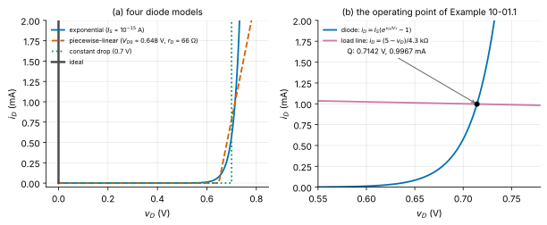
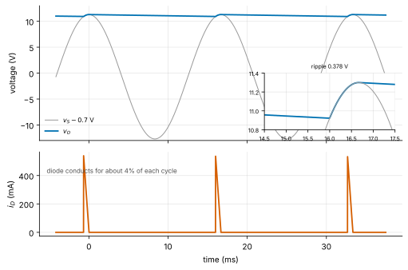
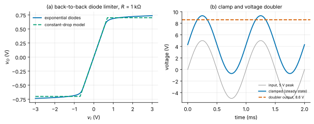

<!-- status: reviewed -->
# 10-01 · Diodes and Diode Circuits

| | |
|---|---|
| **Course** | [10 · Electronics I (Microelectronic Circuits)](../README.md) |
| **University equivalent** | Diode circuits in a junior Electronics I course: diode models, load lines, small-signal operation, rectifiers and filters, Zener regulators, limiters and clamps (Sedra & Smith, *Microelectronic Circuits*, ch. 4; Razavi, *Fundamentals of Microelectronics*, ch. 3) |
| **Prerequisites** | [09-06 PN Junction I–V, Capacitance and Breakdown](../../09-semiconductor-devices/chapters/09-06-pn-junction-iv-and-capacitance.md) (the diode equation, temperature, breakdown, storage), [06-08 Thévenin and Norton](../../06-circuit-analysis-1-dc/chapters/06-08-thevenin-and-norton.md), [07-01 Capacitors and Inductors](../../07-circuit-analysis-2-transient-and-ac/chapters/07-01-capacitors-and-inductors.md), [07-09 Mutual Inductance and Transformers](../../07-circuit-analysis-2-transient-and-ac/chapters/07-09-mutual-inductance-and-transformers.md), [02-10 Numerical Methods](../../02-complex-numbers-des-and-linear-algebra/chapters/02-10-numerical-methods.md) (Newton's method) |
| **Estimated study hours** | 10 |
| **Last verified** | 2026-11-19 |

**Learning objectives.** After this chapter you can:

1. Solve a circuit containing diodes with the exponential model (load line, fixed-point iteration, Newton's method) and with the ideal, constant-drop and piecewise-linear models, and judge which model a question needs.
2. Use the assumed-state method to find which diodes conduct in a multi-diode circuit.
3. Derive the diode's small-signal resistance and the amplitude limit on small-signal operation.
4. Derive and apply the ripple, conduction-interval, peak-current and peak-inverse-voltage relations of half-wave, center-tapped and bridge rectifiers with a reservoir capacitor.
5. Design a Zener shunt regulator for worst-case supply and load, and derive its line and load regulation.
6. Analyze limiters, clamps and voltage doublers, and connect each diode circuit to the product it lives in.

---

## 1. Big picture

Course 09 explained why a PN junction conducts one way: forward current grows as $e^{V/V_T}$, reverse current is a tiny leakage until breakdown. This chapter turns that device into circuits. The diode is the simplest nonlinear element, and it is the first place where a circuit can no longer be solved by linear algebra alone. The skills built here carry through the rest of the course: replace a nonlinear device by the simplest model that answers the question, solve, then check that the model's assumptions held. Transistor biasing (10-02, 10-03) and small-signal analysis (10-04) are the same moves.

- **Every mains-powered product starts with rectification.** A laptop adapter, a phone charger and a server power supply all turn the AC line into DC; the diodes (or the transistors that now replace them) and the reservoir capacitor set ripple, inrush and efficiency.
- **Every pin of every chip is guarded by diodes.** Electrostatic discharge (ESD) protection clamps each input to the supply rails, so a person's spark of several kilovolts never reaches a gate oxide only nanometers thick.
- **Diodes make references and protections.** Zener diodes and their integrated successors set reference voltages; clamps protect inputs; diodes isolate redundant power supplies in servers and cars.
- **The same exponential is inside every transistor.** The base–emitter junction of a bipolar transistor is a diode, and the subthreshold MOSFET (09-09) obeys the same exponential law, so the small-signal ideas of §3.4 return in 10-04.

## 2. Intuition first

**A check valve with a cracking pressure.** In plumbing, a check valve lets water flow one way and blocks it the other, and it needs a small "cracking pressure" before it opens. A silicon diode behaves similarly: almost no current flows until the forward voltage reaches about 0.6–0.7 V, and beyond that the current rises steeply. Reverse voltage closes it.

*Where the analogy breaks.* A valve's opening is a threshold; a diode's is not. The diode's current rises *exponentially*, by a factor of ten for every 60 mV (at room temperature, for an ideal junction), so "0.7 V" is a convention for the milliampere range, not a property of silicon: the same diode carries a microampere at about 0.55 V and an ampere near 0.9 V. A diode also stores charge while it conducts (09-06), so it does not close instantly when reversed, and it leaks a little in reverse.

**A finance analogy for the exponential.** Current against voltage behaves like compound growth against time: a fixed increment of voltage multiplies the current by a fixed factor, just as a fixed holding period multiplies a balance by a fixed factor. The "rule of 72" has a diode cousin: the current doubles every $V_T\ln2$ ≈ 18 mV. *Where it breaks:* unlike interest, the diode's growth is checked by whatever resistance is in series, which is exactly what makes diode circuits solvable.

*Figure 1. (a) Four models of the same diode: the exponential law ($I_S$ = 10⁻¹⁵ A, $n$ = 1), a piecewise-linear fit through 0.1 mA and 1 mA, the constant-drop model and the ideal switch. (b) The load line of Example 10-01.1 crossing the exponential curve at the operating point.*

## 3. Theory

> **Notation and course values.** $v_D$, $i_D$ are the total diode voltage and current, $V_D$, $I_D$ their DC values and $v_d$, $i_d$ the small signals (passive sign convention, anode to cathode). $I_S$ is the saturation current, $n$ the ideality factor (1 for an ideal junction, up to about 2 when recombination in the depletion region or high injection matter; 09-06), and $V_T = kT/q$ = 25.852 mV at 300 K. Unless stated otherwise, the **course diode** has $I_S$ = 10⁻¹⁵ A and $n$ = 1, a small integrated junction.

### 3.1 The diode as a circuit element

From 09-06, a junction diode obeys

$$
i_D = I_S\left(e^{v_D/nV_T} - 1\right) .
$$

For $v_D$ more than a few $V_T$ positive, the $-1$ is negligible and $v_D = nV_T\ln(i_D/I_S)$. Three consequences matter for circuits.

- **Decades per volt.** Each factor of ten in current needs $nV_T\ln10$ = 59.5 mV more (for $n$ = 1). The course diode carries 0.1 mA at **0.6548** V and 1 mA at **0.7143** V.
- **Temperature.** At constant current the forward voltage falls by about 2 mV/K (derived in 09-06), and $I_S$ roughly doubles every 5 K, so a diode's voltage is a thermometer and a hot diode leaks more.
- **Reverse breakdown.** Beyond a reverse voltage $V_{ZK}$ the junction breaks down by tunneling or avalanche (09-06 §3.9). Ordinary diodes must never get there; Zener diodes are built to operate there (§3.7).

### 3.2 Solving a circuit with an exponential diode

Put the diode in series with a resistor $R$ and a source $V_{DD}$ (or, by Thévenin's theorem, 06-08, with whatever linear network drives it). Kirchhoff's voltage law gives one equation and the diode gives another:

$$
i_D = \frac{V_{DD} - v_D}{R}, \qquad i_D = I_S\left(e^{v_D/nV_T} - 1\right) .
$$

**Graphically**, the first is a straight **load line** from $(0, V_{DD}/R)$ to $(V_{DD}, 0)$; the operating point, or **quiescent point** Q, is where it crosses the diode curve (Figure 1b). The picture shows why the answer is insensitive to the diode: the load line is nearly flat where it meets the steep exponential, so the current is set almost entirely by $V_{DD}$ and $R$.

**By fixed-point iteration.** Guess $v_D$, compute $i_D$ from the resistor, recompute $v_D = nV_T\ln(i_D/I_S + 1)$ from the diode, and repeat. This converges fast because the map is a strong contraction (02-10): a change $\delta v$ in the guess changes $i_D$ by $-\delta v/R$, which changes the new $v_D$ by $-(nV_T/RI_D)\,\delta v$. With $RI_D$ of volts and $nV_T$ of 26 mV, each step shrinks the error by a factor near 100.

**By Newton's method.** Write $f(v) = I_S(e^{v/nV_T} - 1) - (V_{DD} - v)/R$ and iterate $v \leftarrow v - f(v)/f'(v)$ (02-10). Newton converges quadratically near the root, but the direction of the start matters. Because $f$ is convex, a start *above* the root converges from above, monotonically, though slowly at first: high on the exponential each step descends by only about $nV_T$. A start *below* the root, on the flat side of the curve, overshoots far to the right, because the tangent there is nearly the resistor's line. For Example 10-01.1 (root 0.7142 V), a start at 0.3 V jumps to **5.0** V on the first step and then needs **170** steps in all to come within 1 µV; a start at 0.6 V jumps to 2.05 V and needs **56**; a start at 0.75 V needs only **5**. That is why circuit simulators limit how far the junction voltage may move per iteration (SPICE's `pnjlim`). (Iterating the other way, $v_D$ from the exponential and $i_D$ from the resistor, diverges: the slope of that map is $RI_D/nV_T$, far above 1.)

> **Going deeper — an exact solution with the Lambert W function.** The Lambert W function is defined by $W(z)e^{W(z)} = z$. Let $I = i_D + I_S$, so $I = I_Se^{v_D/nV_T}$ and $v_D = V_{DD} + RI_S - RI$. Substituting, $I = I_Se^{(V_{DD} + RI_S - RI)/nV_T}$, so $(RI/nV_T)e^{RI/nV_T} = (RI_S/nV_T)e^{(V_{DD} + RI_S)/nV_T}$. Therefore
>
> $$
> i_D = \frac{nV_T}{R}\,W\!\left(\frac{RI_S}{nV_T}e^{(V_{DD} + RI_S)/nV_T}\right) - I_S .
> $$
>
> Scientific libraries evaluate $W$ directly (`scipy.special.lambertw`); the lab checks it against iteration.

### 3.3 Simpler models and the assumed-state method

Most questions do not need the exponential. Three models trade accuracy for speed (Figure 1a):

| Model | On | Off | Use when |
|---|---|---|---|
| **Ideal** | short circuit ($v_D$ = 0) | open circuit ($i_D$ = 0) | voltages are much larger than 0.7 V |
| **Constant drop** | $v_D = V_{D0}$, typically 0.7 V | open | voltages of a few volts; most hand analysis |
| **Piecewise linear** | $v_D = V_{D0} + r_Di_D$ | open | the drop's change with current matters |

A piecewise-linear fit through two points of the exponential curve, 0.1 mA and 1 mA for the course diode, has slope $r_D = (0.7143 - 0.6548)/0.9\text{ mA}$ = **66.1** Ω and intercept $V_{D0}$ = **0.6482** V. It is accurate only near the currents it was fitted at.

**The assumed-state method.** With several diodes, guess which conduct, replace each by its model (on: a 0.7 V source; off: an open circuit), solve the linear circuit, then check every guess: an "on" diode must carry forward current ($i_D > 0$), an "off" diode must see less than its turn-on voltage ($v_D < V_{D0}$). If any check fails, change that guess and repeat. With $k$ diodes there are $2^k$ combinations, but physical reasoning (which source is higher, which way current wants to flow) usually finds the right one first.

The method's checks have a subtlety: "off" in the constant-drop model means $v_D < 0.7$ V, not reverse bias. A diode with 0.3 V across it is "off" in the model but still carries $e^{-0.4/V_T}$ ≈ 2 × 10⁻⁷ of the current it would carry at 0.7 V (Example 10-01.2).

### 3.4 Small-signal operation

Often a diode carries a DC bias current $I_D$ plus a small signal. Write $v_D = V_D + v_d$:

$$
i_D = I_Se^{(V_D + v_d)/nV_T} = I_De^{v_d/nV_T} = I_D\left(1 + \frac{v_d}{nV_T} + \frac{1}{2}\left(\frac{v_d}{nV_T}\right)^2 + \cdots\right) ,
$$

using the Taylor series of the exponential (01-08) and neglecting $I_S$ against $I_D$. Keeping the linear term, the signal current is

$$
i_d = \frac{I_D}{nV_T}\,v_d \equiv \frac{v_d}{r_d}, \qquad r_d = \frac{nV_T}{I_D} .
$$

The **small-signal resistance** $r_d$ is the inverse slope of the exponential at Q: 25.85 Ω at 1 mA for $n$ = 1. It is set by the bias current alone, not by the diode's size, which is why the same formula serves every junction in this course. The ratio of the quadratic term to the linear one is $v_d/2nV_T$, so the linear model is within 10% for signals up to $0.2nV_T$ ≈ **5.17** mV, and the error grows as the signal does (the distortion that 10-04 and Course 12 quantify).

Two uses follow. A diode is a current-controlled resistor, so a bias current can steer a signal attenuator (Example 10-01.3). And a string of forward-biased diodes is a crude voltage reference: its voltage changes by only $nV_T$ per factor of $e$ in current.

### 3.5 Rectifiers

A **rectifier** converts AC to a voltage of one polarity. Take a transformer secondary $v_S = V_s\cos\omega t$ (peak $V_s$, frequency $f = \omega/2\pi$, period $T = 1/f$) and a constant-drop diode.

- **Half-wave.** One diode in series with the load conducts when $v_S > V_{D0}$, so the output follows $v_S - V_{D0}$ during positive half-cycles and is zero otherwise. Its peak is $V_p = V_s - V_{D0}$.
- **Full-wave, center-tapped.** A transformer with a grounded center tap gives two antiphase halves; two diodes pass whichever half is positive, so every half-cycle reaches the load.
- **Bridge.** Four diodes steer either polarity of a single winding to the load (Figure 2). Current flows through two diodes in series, so $V_p = V_s - 2V_{D0}$.

**Peak inverse voltage (PIV).** The largest reverse voltage a diode must block sets its rating. In a bridge each idle diode blocks about $V_s - V_{D0}$ (it is connected across the winding through one conducting diode). In a center-tapped circuit the idle diode sees the full winding, about $2V_s - V_{D0}$. In a half-wave rectifier with a reservoir capacitor, the cathode sits near $+V_p$ while the anode swings to $-V_s$, so the PIV is about $2V_s - V_{D0}$.

*Figure 2. A linear power supply: step-down transformer, bridge rectifier (D1 to D4), reservoir capacitor $C$, and a Zener shunt regulator ($R$, $V_Z$). On positive half-cycles D1 and D4 conduct; on negative ones D2 and D3.*

### 3.6 The peak rectifier: ripple and diode current

A rectifier's output pulses. A **reservoir capacitor** $C$ across the load smooths it: the diode charges $C$ to the peak, and $C$ feeds the load while the diode is off. This is the **peak rectifier**, and three results describe it. Take the half-wave case, a load current $I_L$ that is nearly constant (a resistor $R$ with $I_L \approx V_p/R$, or a regulator), and $C$ large enough that the output droops only a little.

**Ripple.** Between peaks the diode is off and the capacitor discharges into the load. With a resistive load $v_O = V_pe^{-t/RC}$, which for $RC \gg T$ is nearly the straight line $V_p(1 - t/RC)$. The droop over almost a full period is the **ripple**:

$$
V_r \approx \frac{V_pT}{RC} = \frac{I_L}{fC} \qquad\text{(half-wave)}.
$$

(With a constant-current load the discharge is exactly linear, and $V_r = I_L(T - \Delta t)/C$, where $\Delta t$ is the conduction interval below; neglecting $\Delta t$ gives the same formula.) The output averages about $V_p - V_r/2$.

**Conduction interval.** The diode turns on again only when $v_S - V_{D0}$ climbs back to the drooped output, $V_p - V_r$. With the peak at $t = 0$ and the turn-on at $t = -\Delta t$: $V_p\cos\omega\Delta t = V_p - V_r$. For small angles, $\cos\theta \approx 1 - \theta^2/2$ (01-08), so

$$
\omega\Delta t \approx \sqrt{\frac{2V_r}{V_p}} .
$$

A 1% ripple means a conduction angle of about 0.14 rad, 8°: the diode conducts for only about 2% of each cycle.

**Diode current.** In steady state the capacitor ends each cycle with the charge it started with, so the diode must deliver, in the short interval $\Delta t$, all the charge the load draws in a whole period, $Q = I_LT$. Its average current while conducting is therefore

$$
i_{D,\text{av}} = \frac{I_LT}{\Delta t} = \frac{2\pi I_L}{\omega\Delta t} \approx \pi I_L\sqrt{\frac{2V_p}{V_r}} .
$$

(Some textbooks write $I_L(1 + \pi\sqrt{2V_p/V_r})$: the extra $I_L$ is the load's own current during conduction, counted while also taking the discharge to last a full period. The two differ by less than the approximation's own error.) The current is largest when conduction starts, where the source rises fastest within the interval. There $i_D = C\,dv_S/dt + I_L$, with $dv_S/dt = \omega V_s\sin\omega\Delta t \approx \omega V_p\sqrt{2V_r/V_p}$. Using $C = I_L/(fV_r)$:

$$
i_{D,\max} \approx I_L + C\omega\sqrt{2V_rV_p} = I_L\left(1 + 2\pi\sqrt{\frac{2V_p}{V_r}}\right) .
$$

**Full-wave.** The capacitor is recharged twice per period, so replace $T$ by $T/2$: $V_r \approx I_L/(2fC)$, $i_{D,\text{av}} \approx \pi I_L\sqrt{V_p/2V_r}$ and $i_{D,\max} \approx I_L(1 + \pi\sqrt{2V_p/V_r})$.

**What the formulas say.** Halving the ripple needs twice the capacitance, and it makes the diode current pulses narrower and taller, growing as $1/\sqrt{V_r}$. A supply with small ripple therefore stresses its diodes, its capacitor (which carries the same pulses as ripple current) and the transformer, and it draws a peaky current from the line, which is why mains equipment above modest power must add power-factor correction (Course 22). Figure 3 shows the waveforms of Example 10-01.4.

*Figure 3. The half-wave peak rectifier of Example 10-01.4 (12 V peak, 60 Hz, 1 kΩ, 470 µF), with an ideal constant-drop diode. Top: source minus 0.7 V and the output; the inset magnifies one recharge. Bottom: the diode current, a narrow pulse each cycle.*

### 3.7 Zener shunt regulators

A peak rectifier's output moves with the line voltage and with the load. A **Zener diode** operated in reverse breakdown holds a nearly constant voltage over a wide range of current, and a series resistor turns it into a **shunt regulator** (Figure 2, right).

**The Zener model.** Above a knee current $I_{ZK}$, the reverse characteristic is close to a straight line,

$$
V_Z = V_{Z0} + r_zI_Z ,
$$

with $r_z$ the **dynamic resistance**. A data sheet gives $V_Z$ at a test current $I_{ZT}$, the dynamic impedance $Z_{ZT}$ there, a larger $Z_{ZK}$ at the knee, and the maximum current $I_{ZM}$ set by power dissipation. For the 1N4733A, a 1.3 W, 5.1 V part: $V_Z$ = 5.1 V at 49 mA (±5%), $Z_{ZT}$ = 7 Ω typical (the data sheet gives no maximum), $Z_{ZK}$ ≤ 550 Ω at 1 mA and $I_{ZM}$ = 178 mA [3]. Taking $r_z$ = 7 Ω, $V_{Z0} = 5.1 - 0.049 \times 7$ = **4.757** V.

**Solving the regulator.** The resistor $R$ carries the Zener current plus the load current. Kirchhoff's current law at the output:

$$
\frac{V_S - V_O}{R} = I_L + \frac{V_O - V_{Z0}}{r_z}
\quad\Longrightarrow\quad
V_O = \frac{r_zV_S + RV_{Z0} - Rr_zI_L}{R + r_z} .
$$

Differentiating gives the two figures of merit:

$$
\text{line regulation} = \frac{\partial V_O}{\partial V_S} = \frac{r_z}{R + r_z}, \qquad
\text{load regulation} = \frac{\partial V_O}{\partial I_L} = -\frac{Rr_z}{R + r_z} = -(R \parallel r_z) .
$$

The load regulation is just the regulator's Thévenin output resistance (06-08): $R$ and $r_z$ in parallel, dominated by the small $r_z$.

**Design for the worst case.** Two corners decide everything.

- *Lowest supply, highest load.* The Zener must still carry at least a chosen minimum $I_{Z,\min}$, comfortably above the knee: $R \le (V_{S,\min} - V_{Z0} - r_zI_{Z,\min})/(I_{Z,\min} + I_{L,\max})$.
- *Highest supply, lowest load.* All the current $R$ passes goes through the Zener, which must stay below $I_{ZM}$ and its power rating; $R$ must also be rated for its own dissipation.

**The cost.** A shunt regulator burns the difference between its input and output in $R$, and its Zener current flows even with no load. Efficiency is poor (Example 10-01.6 finds about 20%), so Zener regulators serve references and small loads. Larger loads use a linear regulator with a transistor in series (Course 12) or a switching converter (Course 22). A programmable shunt reference such as the TL431 replaces the Zener with an amplifier around an internal 2.495 V reference. Its dynamic impedance is 0.2 Ω typical when its cathode is tied to its reference input ($V_{KA} = V_{ref}$). Programmed to a higher voltage with a divider $R_1$ (cathode to reference input) and $R_2$ (reference input to anode), $V_{KA} = V_{ref}(1 + R_1/R_2)$ and the impedance rises to about $Z_{KA}(1 + R_1/R_2)$ [4]. At 5.1 V that is $0.2 \times 5.1/2.495$ = **0.409** Ω, still about **17** times lower than the 1N4733A's 7 Ω. (A worst-case design must also note that the data sheet only guarantees $\lvert Z_{KA}\rvert$ ≤ 0.5 Ω, and gives the Zener's 7 Ω only as typical.)

### 3.8 Wave shaping: limiters, clamps and doublers

**Limiters (clippers).** A diode, or a diode in series with a reference voltage, across the output of a resistive divider holds the output below a level. Two back-to-back diodes from a signal line to ground limit it to about ±0.7 V: they protect sensitive inputs, and they are the shape of an ESD clamp (§9). Because the diode is exponential, the limiting is soft: well below 0.7 V the output follows the input; near 0.7 V it bends; above, it rises only by $V_T\ln k$ for a $k$-fold increase in current (Figure 4a).

**Clamps (DC restorers).** A series capacitor and a diode to ground shift a waveform's DC level. With the diode's cathode at the output, the diode conducts whenever the output tries to go below $-V_{D0}$, charging the capacitor to the input's negative peak minus the drop. In steady state the capacitor holds $V_p - V_{D0}$, so the output is the input shifted up: a sine of peak $V_p$ swings from $-V_{D0}$ to $2V_p - V_{D0}$. Television receivers once used clamps to restore the black level of a video signal; today they appear in level shifters and gate-drive circuits.

**Voltage doubler.** Follow a clamp with a peak rectifier: the second diode and capacitor capture the clamped waveform's peak, $2V_p - 2V_{D0}$ (Figure 4b). Cascading stages multiplies further (a Cockcroft–Walton multiplier), the basis of many high-voltage, low-current supplies.

*Figure 4. (a) A back-to-back diode limiter with a 1 kΩ series resistor: the exponential diodes against the constant-drop model. (b) A 5 V peak sine, its clamped version and the doubler's DC output.*

### 3.9 Real diodes: speed, Schottky diodes and ratings

A diode that has been conducting stores minority charge, and it keeps conducting in reverse until that charge is removed (09-06 §3.8): the **reverse-recovery time** $t_{rr}$. A small-signal switching diode such as the 1N4148 is specified at $t_{rr}$ ≤ 4 ns, with ≤ 4 pF of capacitance at zero bias [1]; a general-purpose rectifier such as the 1N4001 has more capacitance (15 pF typical) and no reverse-recovery specification at all, because it is designed for line frequencies [2]. In a 60 Hz supply that does not matter; in a switching converter at hundreds of kilohertz it does, because every recovery dumps charge and wastes energy.

A **Schottky diode** (09-06 §3.10) is a metal–semiconductor junction with no minority storage and a lower forward drop: the 1N5817 drops at most 0.45 V at 1 A [5]. The price is leakage: at its rated reverse voltage, at most 1 mA at 25 °C, against at most 5 µA for the 1N4001 [2, 5]. Schottky diodes win where forward loss and speed matter more than leakage: low-voltage rectifiers, freewheeling paths, and the clamps of fast logic.

Every diode has an absolute-maximum list: repetitive peak reverse voltage, average forward current, surge current, power dissipation and junction temperature. The design examples below check each one.

## 4. Worked examples

### Example 10-01.1 · One diode, four ways (tier A)

**Setup.** The course diode ($I_S$ = 10⁻¹⁵ A, $n$ = 1) is in series with $R$ = 4.3 kΩ across $V_{DD}$ = 5 V. Find the current (a) with the constant-drop model, $V_{D0}$ = 0.7 V; (b) exactly; (c) by fixed-point iteration from 0.7 V and by Newton's method from 0.7 V, showing the first steps; (d) with the piecewise-linear model fitted at 0.1 mA and 1 mA.

**Solution.**

(a) $I_D = (5 - 0.7)/4.3\text{ kΩ}$ = **1.000** mA.

(b) Solving the two equations numerically gives $V_D$ = **0.7142** V and $I_D$ = **0.9967** mA. The constant-drop answer is **0.33**% high.

(c) Iteration: $i = (5 - 0.7)/4300$ = 1.000 mA gives $v = V_T\ln(i/I_S)$ = **0.7143** V; the next step gives **0.7142** V, already converged to four digits. Newton from 0.7 V: **0.7189** V (an overshoot, because the exponential is convex), then **0.7146** V, then **0.7142** V.

(d) $r_D$ = 66.1 Ω and $V_{D0}$ = 0.6482 V (§3.3), so $I_D = (5 - 0.6482)/(4300 + 66.1)$ = **0.9967** mA and $V_D$ = **0.7141** V.

**Units check.** $V_T\ln(\text{A}/\text{A})$ is in volts; $(V - V)/\Omega$ in amperes. ✓

**Sanity check.** The load line is so flat that a 14 mV error in the diode voltage moves the current by only 14 mV/4.3 kΩ = 3.3 µA. With volts across the resistor, the constant-drop model is good to a fraction of a percent; it fails only when the supply is a volt or two.

### Example 10-01.2 · Two supplies on one bus: diode ORing (tier A)

**Setup.** Two supplies, $V_A$ = 12.0 V and $V_B$ = 11.5 V, feed a 5 A load through diodes D_A and D_B to a common bus (a redundant supply). (a) With the constant-drop model, which diode conducts, and what are the bus voltage and D_B's voltage? (b) With identical exponential diodes ($n$ = 1), what fraction of D_A's current does D_B carry, and how much is that at 5 A? (c) Compare the power lost in the conducting diode with a 0.7 V PN diode, a 0.45 V Schottky, and a MOSFET "ideal diode" of 5 mΩ. (d) If supply A fails to 0 V, what reverse voltage must D_A block? (e) An ideal-diode controller's data sheet suggests choosing $R_{DS(on)}$ between 20 mV/$I$ and 50 mV/$I$ at the nominal current [6]. What range is that at 5 A?

**Solution.**

(a) Assume D_A on and D_B off. The bus sits at $12.0 - 0.7$ = **11.3** V. Check D_B: its anode is at 11.5 V and cathode at 11.3 V, a forward voltage of **0.2** V, below 0.7 V, so it is off in the model. Assumption confirmed.

(b) Both diodes share the bus as their cathode, so their voltages differ by exactly $V_A - V_B$ = 0.5 V, and their currents by $e^{-0.5/V_T}$ = **3.98 × 10⁻⁹**. D_B carries about **19.9** nA: "off" in practice, though not reverse-biased.

(c) $P = I v_D$: **3.50** W for the PN diode and **2.25** W for the Schottky. The MOSFET drops $5 \times 0.005$ = **25** mV and dissipates $I^2R$ = **0.125** W.

(d) With A at 0 V the bus is held at $11.5 - 0.7$ = **10.8** V by B, so D_A blocks 10.8 V.

(e) From **4** mΩ to **10** mΩ; the 5 mΩ of (c) lies inside.

**Sanity check.** At 5 A, a diode's 0.7 V costs watts and needs a heat sink, which is why servers and cars replace ORing diodes with MOSFETs driven by controllers (§9). The exponential makes the sharing in (b) extreme: 0.5 V of supply difference is about 19 $V_T$, a factor of 250 million.

### Example 10-01.3 · A diode as a signal attenuator (tier B)

**Setup.** A signal source with 1 kΩ of internal resistance drives a node that is AC-coupled to the course diode, which a separate DC path biases at $I_D$. (a) Find $r_d$ and the attenuation $v_d/v_s = r_d/(1\text{ kΩ} + r_d)$ at $I_D$ = 0.1 mA and 1 mA, in ratio and in decibels. (b) Over what range of decibels can the bias current tune the attenuation? (c) What signal amplitude across the diode keeps the second-order term below 10% of the first? (d) With a 10 mV peak source at 0.1 mA bias, is the small-signal model valid?

**Solution.**

(a) $r_d = V_T/I_D$ = **258.5** Ω at 0.1 mA and **25.85** Ω at 1 mA. The attenuations are **0.2054** (**−13.75** dB) and **0.02520** (**−31.97** dB).

(b) **18.22** dB for one decade of bias current.

(c) $v_d < 0.2V_T$ = **5.17** mV (§3.4).

(d) The diode sees $10 \times 0.2054$ = **2.05** mV peak, below 5.17 mV: valid, with second-order error near 4%.

**Sanity check.** The attenuation depends on bias current, not on the diode's area or $I_S$, so the circuit needs no trimming: $r_d$ is set by physics, $V_T/I_D$.

### Example 10-01.4 · A half-wave peak rectifier (tier B)

**Setup.** A 60 Hz transformer secondary of 12 V peak feeds a half-wave rectifier (constant-drop diode, 0.7 V), a 470 µF capacitor and a 1 kΩ load. (a) Find $V_p$, the load current and the ripple from §3.6. (b) Find the conduction angle, in radians and degrees, and the fraction of the cycle. (c) Find the average diode current during conduction and the peak diode current. (d) Solve the circuit exactly for an ideal constant-drop diode, and compare the ripple, conduction angle and peak current with (a)–(c).

**Solution.**

(a) $V_p$ = 12 − 0.7 = **11.3** V and $I_L \approx V_p/R$ = **11.3** mA. $V_r = V_p/(fRC) = 11.3/(60 \times 1000 \times 470\times10^{-6})$ = **0.401** V; the average output is about $V_p - V_r/2$ = **11.10** V.

(b) $\omega\Delta t = \sqrt{2 \times 0.401/11.3}$ = **0.2663** rad = **15.26°**, **4.24**% of the cycle.

(c) $i_{D,\text{av}} = \pi I_L\sqrt{2V_p/V_r}$ = **267** mA and $i_{D,\max} = I_L(1 + 2\pi\sqrt{2V_p/V_r})$ = **545** mA.

(d) The exact solution has two pieces. The diode stops conducting slightly *after* the peak, when the capacitor current $C\,dv_S/dt$ needed to follow the falling source equals $-v_O/R$, so that the diode current reaches zero; that is at **0.30°**. The output then decays as $e^{-t/RC}$ until it meets the rising source. Solving for that crossing numerically: peak-to-peak ripple **0.378** V (the output peaks with the source, just before the diode turns off), conduction angle **14.72°**, peak diode current **540** mA, average output **11.11** V. The approximation overstates the ripple by **6.0**% (it lets the capacitor discharge for a whole period and linearizes the exponential), but its conduction angle and peak current are within 4% and 1%.

**Units check.** $I_L/(fC)$: A/(s⁻¹ × F) = A·s/F = V. ✓

**Sanity check.** Half an ampere of peak current to deliver 11 mA on average is the price of a 3.5% ripple: the narrower the conduction window, the taller the pulse (Figure 3).

### Example 10-01.5 · Designing a bridge supply (tier B)

**Setup.** A bridge rectifier fed by a 9 V rms, 60 Hz winding must feed a downstream regulator drawing a constant 0.5 A, with no more than 1 V of ripple. Use 1.0 V per diode: at peaks of several amperes a 1 A silicon rectifier drops about 1 V, not 0.7 V (§8, mistake 1; the lab's rectifier model gives **1.01** V at 8 A). (a) Find the secondary's peak, the peak output and the minimum capacitance; choose the next standard value, 4700 µF, and find the actual ripple and the minimum output voltage. (b) Find the conduction angle, the average diode current during conduction and the peak diode current. (c) Find the PIV and the average and RMS current per diode, and compare with a 1N4001 (50 V repetitive peak reverse voltage, 1 A average for 60 Hz half-wave operation into a resistive load, 30 A non-repetitive surge for one 8.3 ms half-sine) [2]. (d) Solve the circuit exactly for ideal constant-drop diodes and compare with (a) and (b).

**Solution.**

(a) $V_s = 9\sqrt2$ = **12.73** V and $V_p$ = 12.73 − 2.0 = **10.73** V. $C \ge I_L/(2fV_r)$ = **4167** µF. With 4700 µF, $V_r$ = **0.887** V and the output never falls below **9.84** V.

(b) $\omega\Delta t = \sqrt{2V_r/V_p}$ = **23.29°**. During conduction the diodes average $I_L(T/2)/\Delta t$ = **3.86** A, and the peak is $I_L(1 + \pi\sqrt{2V_p/V_r})$ = **8.23** A.

(c) PIV ≈ $V_s - 1.0$ = **11.73** V; each diode carries half the load on average, **0.25** A. The 1N4001 has a fourfold voltage margin and a fourfold margin on its average-current rating, but the average is not what heats a diode in this circuit: its losses grow with the current's square, and the current comes in tall, narrow pulses. Integrating the square of the exact current pulses of (d), each diode carries **1.18** A RMS. The waveform behind the 1 A rating, a half-sine averaging 1 A, has an RMS value of $\pi/2$ = **1.57** A, so the real thermal margin is about 1.3×, not 4×. The 30 A rating is no help here: it is a non-repetitive surge rating for a single half-cycle, the right yardstick for the switch-on inrush (when the empty 4700 µF capacitor looks like a short and only the winding's resistance limits the current), not for steady repetitive peaks.

(d) With a constant-current load the capacitor discharges linearly. Conduction ends **1.27°** after the source peak, when the source falls faster than the load alone would discharge the capacitor. Solving for the next crossing: peak-to-peak ripple **0.784** V, minimum output **9.94** V, conduction angle **21.48°**, peak diode current **8.29** A and average current during conduction **4.19** A. (With a constant-current load the ripple, angles and currents do not depend on the diode drop; only the output level does.) The approximation overstates the ripple by about 13%, because the capacitor actually discharges for a half-period *minus* the 12% spent charging; for design it errs on the safe side.

**Sanity check.** The downstream regulator needs some headroom above its own output; 9.9 V at the ripple trough is ample for a 5 V regulator and too little for a 9 V one. Had the example used 0.7 V per diode, the trough would have been 0.6 V higher, an optimistic error of exactly the kind §8 warns about.

### Example 10-01.6 · A Zener regulator, designed and checked (tier B)

**Setup.** A 1N4733A (model $V_{Z0}$ = 4.757 V, $r_z$ = 7 Ω, §3.7) regulates a supply that varies from 8 to 10 V (9 V nominal) for a load of 0 to 50 mA. Keep $I_Z \ge$ 5 mA. (a) Find the largest $R$, and choose the next lower standard value, 56 Ω. (b) Check $V_O$ and $I_Z$ at 8 V and 50 mA. (c) Find the worst-case Zener current and power and the worst-case resistor power. (d) Find the line and load regulation. (e) At 9 V and 25 mA, find $V_O$ and the efficiency. (f) How much would $V_O$ move between no load and 50 mA with a TL431 programmed to about 5.1 V instead (§3.7)?

**Solution.**

(a) $V_Z$ at 5 mA is $4.757 + 0.035$ = **4.792** V, so $R \le (8 - 4.792)/(5 + 50)\text{ mA}$ = **58.3** Ω. Choose 56 Ω.

(b) From the regulator equation: $V_O$ = **4.806** V and $I_Z$ = **7.03** mA, above the 5 mA floor.

(c) At 10 V and no load: $I_Z = (10 - 4.757)/(56 + 7)$ = **83.2** mA, $V_O$ = **5.340** V and $P_Z$ = **444** mW, well inside 1.3 W and 178 mA. The resistor is worst at 10 V and full load: $(10 - 5.028)^2/56$ = **441** mW, so it needs a 1 W rating.

(d) Line regulation $7/63$ = **111** mV/V; load regulation $-(56 \parallel 7)$ = **−6.22** mV/mA. Across the supply range at full load, $V_O$ moves **222** mV; across the load range at 9 V, **−311** mV.

(e) $V_O$ = **5.073** V. The load takes $5.073 \times 0.025$ = 0.127 W; the supply delivers $9 \times (9 - 5.073)/56$ = 0.631 W: efficiency **20.1**%.

(f) The programmed TL431's impedance is about 0.409 Ω, so the output moves $(56 \parallel 0.409) \times 50$ mA = **20.3** mV, about **15** times less than the Zener's 311 mV. (Its cathode current at 9 V and no load, $(9 - V_O)/56$ = **69.1** mA, is inside the 100 mA recommended maximum [4].)

**Sanity check.** The constant $r_z$ = 7 Ω is optimistic at the 5 mA corner: toward the knee the impedance rises (the data sheet allows up to 550 Ω at 1 mA), so the real output at 8 V and full load sits somewhat below 4.806 V, and a careful design keeps $I_{Z,\min}$ well above the knee. A Zener regulator's output is good to a few percent, its efficiency is poor and its no-load current is its full-load current: fine for a reference or a 50 mA rail, wrong for anything that matters to a battery.

### Example 10-01.7 · Limiter, clamp and doubler (tier B)

**Setup.** (a) Two course diodes, back to back, limit the output of a 1 kΩ series resistor. Find the output for inputs of 0.5 V, 2 V and 5 V with the exponential model, and compare with the constant-drop model. (b) A 5 V peak, 1 kHz sine drives a clamp (series capacitor, diode to ground with its cathode at the output). With 0.7 V diodes, find the output's range in steady state and the capacitor's voltage. (c) Add a peak rectifier to make a doubler. Find its DC output with no load.

**Solution.**

(a) Solving $2I_S\sinh(v_O/V_T) = (v_I - v_O)/1\text{ kΩ}$ numerically: **0.4998** V, **0.7207** V and **0.7517** V. The constant-drop model gives 0.5, 0.7 and 0.7 V: right in the middle, 3% low at 2 V and 7% low at 5 V, because the exponential keeps rising slowly.

(b) The capacitor charges to $5 - 0.7$ = **4.3** V, so the output swings from **−0.7** V to **9.3** V.

(c) The peak rectifier captures $9.3 - 0.7$ = **8.6** V.

**Sanity check.** In (a), going from 2 V to 5 V of drive raises the diode current from **1.279** mA to **4.248** mA, **3.32** times, yet the output rises by only **31** mV, which is $V_T\ln 3.32$: the exponential at work.

### Answer key

<!-- answer-key -->
| ID | Quantity | Value | Unit |
|---|---|---|---|
| T 10-01.a | course diode voltage at 0.1 mA | 0.6548 | V |
| T 10-01.b | course diode voltage at 1 mA | 0.7143 | V |
| T 10-01.c | piecewise-linear r_D | 66.1 | Ω |
| T 10-01.d | piecewise-linear V_D0 | 0.6482 | V |
| T 10-01.e | 10% small-signal limit | 5.17 | mV |
| T 10-01.f | 1N4733A V_Z0 | 4.757 | V |
| T 10-01.g | doubling voltage V_T ln 2 | 18 | mV |
| T 10-01.h | programmed TL431 impedance over 1N4733A r, inverted | 17 | — |
| T 10-01.k | programmed TL431 impedance at 5.1 V | 0.409 | Ω |
| T 10-01.l | Newton first iterate from 0.3 V | 5.0 | V |
| T 10-01.m | Newton steps from 0.3 V to 1 µV | 170 | — |
| T 10-01.n | Newton steps from 0.6 V | 56 | — |
| T 10-01.o | Newton steps from 0.75 V | 5 | — |
| T 10-01.q | Newton first iterate from 0.6 V | 2.05 | V |
| T 10-01.p | peak over load current, Example 10-01.4 | 49 | — |
| T 10-01.i | ripple ratio, 500 Ω to 1 kΩ | 1.93 | — |
| T 10-01.j | peak-current ratio, 500 Ω to 1 kΩ | 1.39 | — |
| Ex 10-01.1a | constant-drop current | 1.000 | mA |
| Ex 10-01.1b | exact V_D | 0.7142 | V |
| Ex 10-01.1c | exact I_D | 0.9967 | mA |
| Ex 10-01.1d | constant-drop error | 0.33 | % |
| Ex 10-01.1e | iteration step 1 | 0.7143 | V |
| Ex 10-01.1f | iteration step 2 | 0.7142 | V |
| Ex 10-01.1g | Newton step 1 | 0.7189 | V |
| Ex 10-01.1h | Newton step 2 | 0.7146 | V |
| Ex 10-01.1i | Newton step 3 | 0.7142 | V |
| Ex 10-01.1j | piecewise-linear I_D | 0.9967 | mA |
| Ex 10-01.1k | piecewise-linear V_D | 0.7141 | V |
| Ex 10-01.2a | bus voltage | 11.3 | V |
| Ex 10-01.2b | D_B forward voltage | 0.2 | V |
| Ex 10-01.2c | current ratio | 3.98e-9 | — |
| Ex 10-01.2d | D_B current | 19.9 | nA |
| Ex 10-01.2e | PN diode loss | 3.50 | W |
| Ex 10-01.2f | Schottky loss | 2.25 | W |
| Ex 10-01.2g | MOSFET drop | 25 | mV |
| Ex 10-01.2h | MOSFET loss | 0.125 | W |
| Ex 10-01.2i | reverse voltage on D_A | 10.8 | V |
| Ex 10-01.2j | R_DS(on) lower bound | 4 | mΩ |
| Ex 10-01.2k | R_DS(on) upper bound | 10 | mΩ |
| Ex 10-01.3a | r_d at 0.1 mA | 258.5 | Ω |
| Ex 10-01.3b | r_d at 1 mA | 25.85 | Ω |
| Ex 10-01.3c | attenuation at 0.1 mA | 0.2054 | — |
| Ex 10-01.3d | attenuation at 0.1 mA, dB | -13.75 | dB |
| Ex 10-01.3e | attenuation at 1 mA | 0.02520 | — |
| Ex 10-01.3f | attenuation at 1 mA, dB | -31.97 | dB |
| Ex 10-01.3g | tuning range | 18.22 | dB |
| Ex 10-01.3h | signal across the diode | 2.05 | mV |
| Ex 10-01.4a | V_p | 11.3 | V |
| Ex 10-01.4b | load current | 11.3 | mA |
| Ex 10-01.4c | ripple, approximate | 0.401 | V |
| Ex 10-01.4d | average output, approximate | 11.10 | V |
| Ex 10-01.4e | conduction angle | 0.2663 | rad |
| Ex 10-01.4f | conduction angle | 15.26 | ° |
| Ex 10-01.4g | conduction fraction | 4.24 | % |
| Ex 10-01.4h | average diode current in conduction | 267 | mA |
| Ex 10-01.4i | peak diode current, approximate | 545 | mA |
| Ex 10-01.4j | turn-off angle after the peak | 0.30 | ° |
| Ex 10-01.4k | ripple, exact | 0.378 | V |
| Ex 10-01.4l | conduction angle, exact | 14.72 | ° |
| Ex 10-01.4m | peak diode current, exact | 540 | mA |
| Ex 10-01.4n | average output, exact | 11.11 | V |
| Ex 10-01.4o | ripple overstatement | 6.0 | % |
| Ex 10-01.5a | secondary peak | 12.73 | V |
| Ex 10-01.5b | peak output | 10.73 | V |
| Ex 10-01.5c | minimum capacitance | 4167 | µF |
| Ex 10-01.5d | ripple with 4700 µF | 0.887 | V |
| Ex 10-01.5e | minimum output | 9.84 | V |
| Ex 10-01.5f | conduction angle | 23.29 | ° |
| Ex 10-01.5g | average diode current in conduction | 3.86 | A |
| Ex 10-01.5h | peak diode current | 8.23 | A |
| Ex 10-01.5i | PIV | 11.73 | V |
| Ex 10-01.5j | average current per diode | 0.25 | A |
| Ex 10-01.5k | turn-off angle after the peak | 1.27 | ° |
| Ex 10-01.5l | ripple, exact | 0.784 | V |
| Ex 10-01.5m | minimum output, exact | 9.94 | V |
| Ex 10-01.5n | conduction angle, exact | 21.48 | ° |
| Ex 10-01.5o | peak diode current, exact | 8.29 | A |
| Ex 10-01.5p | average diode current in conduction, exact | 4.19 | A |
| Ex 10-01.5q | ripple overstatement | 13 | % |
| Ex 10-01.5r | rectifier model drop at 8 A | 1.01 | V |
| Ex 10-01.5s | RMS current per diode | 1.18 | A |
| Ex 10-01.5t | RMS of a 1 A-average half-sine | 1.57 | A |
| Ex 10-01.5u | trough rise with 0.7 V diodes | 0.6 | V |
| Ex 10-01.6a | V_Z at 5 mA | 4.792 | V |
| Ex 10-01.6b | largest R | 58.3 | Ω |
| Ex 10-01.6c | V_O at 8 V, 50 mA | 4.806 | V |
| Ex 10-01.6d | I_Z at 8 V, 50 mA | 7.03 | mA |
| Ex 10-01.6e | worst-case I_Z | 83.2 | mA |
| Ex 10-01.6f | V_O at 10 V, no load | 5.340 | V |
| Ex 10-01.6g | worst-case Zener power | 444 | mW |
| Ex 10-01.6h | worst-case resistor power | 441 | mW |
| Ex 10-01.6i | line regulation | 111 | mV/V |
| Ex 10-01.6j | load regulation | -6.22 | mV/mA |
| Ex 10-01.6k | output change over supply range | 222 | mV |
| Ex 10-01.6l | output change over load range | -311 | mV |
| Ex 10-01.6m | V_O at 9 V, 25 mA | 5.073 | V |
| Ex 10-01.6n | efficiency | 20.1 | % |
| Ex 10-01.6o | programmed TL431 load step | 20.3 | mV |
| Ex 10-01.6p | Zener step over TL431 step | 15 | — |
| Ex 10-01.6q | TL431 cathode current at 9 V, no load | 69.1 | mA |
| Ex 10-01.7a | limiter output at 0.5 V | 0.4998 | V |
| Ex 10-01.7b | limiter output at 2 V | 0.7207 | V |
| Ex 10-01.7c | limiter output at 5 V | 0.7517 | V |
| Ex 10-01.7d | clamp capacitor voltage | 4.3 | V |
| Ex 10-01.7e | clamp minimum | -0.7 | V |
| Ex 10-01.7f | clamp maximum | 9.3 | V |
| Ex 10-01.7g | doubler output | 8.6 | V |
| Ex 10-01.7h | limiter diode current at 2 V | 1.279 | mA |
| Ex 10-01.7i | limiter diode current at 5 V | 4.248 | mA |
| Ex 10-01.7j | current ratio | 3.32 | — |
| Ex 10-01.7k | output rise | 31 | mV |
| P 10-01.a | 1N4148 reverse recovery | 4 | ns |
| P 10-01.b | 1N4148 capacitance | 4 | pF |
| P 10-01.c | 1N4001 typical capacitance | 15 | pF |
| P 10-01.d | 1N5817 forward drop at 1 A | 0.45 | V |
| P 10-01.e | 1N5817 reverse current | 1 | mA |
| P 10-01.f | 1N4001 reverse current | 5 | µA |
| P 10-01.g | TL431 reference | 2.495 | V |
| P 10-01.h | TL431 dynamic impedance | 0.2 | Ω |
| P 10-01.i | LM74700-Q1 regulated drop | 20 | mV |
| P 10-01.j | LM74700-Q1 reverse-current response | 0.75 | µs |
| P 10-01.k | TPD1E10B06 capacitance | 12 | pF |
| P 10-01.l | TPD1E10B06 contact ESD rating | 30 | kV |
| P 10-01.m | TPD1E10B06 clamp at 1 A | 10 | V |
| P 10-01.n | TPD1E10B06 leakage | 100 | nA |

*Every value is recomputed by [verify_10_01.py](../verify/verify_10_01.py) by an independent route: diode circuits by root finding on the full exponential (and the Lambert W function as a cross-check); the iterations replayed step by step; rectifiers by integrating the circuit's differential equation through many cycles with an ideal constant-drop diode until it reaches steady state, against the closed-form approximations; the Zener regulator by solving the nodal equation numerically at each corner; limiter outputs by root finding. Datasheet values are quoted (R-176). A few values that are one arithmetic step from other keyed values (for example the Zener and resistor powers of Example 10-01.6) are restated rather than recomputed independently.*

## 5. Simulate it

The lab, [labs/10-01-lab](../labs/10-01-lab/README.md), has a notebook and five ngspice netlists:

1. Solves the diode–resistor circuit by iteration, Newton's method and Lambert W, and maps how many Newton steps each starting guess needs.
2. Simulates the half-wave peak rectifier with an exponential diode, against the constant-drop exact solution and the ripple formula.
3. Sweeps the Zener regulator over supply and load, and compares a Zener with a 0.2 Ω shunt reference.
4. Simulates the limiter, clamp and doubler, including how many cycles the clamp needs to settle.

The netlists confirm Example 10-01.1's operating point (`diode_bias.cir`), the rectifier's ripple with a real diode model (`rectifier.cir`), the Zener regulator's output at two supply voltages (`zener.cir`), the exact solution of Example 10-01.5's bridge supply (`bridge.cir`) and Example 10-01.7's limiter, clamp and doubler (`limiter.cir`). Data-sheet values quoted in this chapter were checked by hand against the cited PDFs; the verify script can only restate them.

**Guided exercise (predict, then run).** **Before running Part 2**, predict: if the 1 kΩ load of Example 10-01.4 is replaced by 500 Ω, does the ripple double, and does the peak diode current double? Then run it. (The ripple nearly doubles, by **1.93**, as $I_L/fC$ says. The peak current rises only by about $\sqrt2$, **1.39** in the exact solution, because $i_{D,\max} \propto I_L/\sqrt{V_r}$ and $V_r \propto I_L$, so $i_{D,\max} \propto \sqrt{I_L}$.)

## 6. Engineering tradeoffs

| Knob | Improves | Costs | Typical decision owner |
|---|---|---|---|
| Reservoir capacitance | Lower ripple, more hold-up time | Size and cost; taller, narrower diode current pulses; higher inrush; worse line power factor | Power-supply designer |
| Full-wave instead of half-wave | Half the ripple for the same capacitor; no DC in the transformer | Two more diodes (bridge) or a center-tapped winding | Power-supply designer |
| Schottky instead of PN diode | Lower forward drop and loss; no reverse recovery | Hundreds of times more leakage, rising with temperature; lower voltage ratings | Circuit designer |
| MOSFET "ideal diode" | Millivolts of drop instead of hundreds | A controller IC, a MOSFET, gate drive and cost | System architect |
| Smaller Zener series resistor | More load current at low line | More Zener dissipation at high line and light load; worse efficiency | Circuit designer |
| Shunt reference (TL431-class) instead of Zener | ~17× lower dynamic impedance at 5 V; adjustable voltage | Needs a minimum cathode current; an active device to stabilize | Circuit designer |
| ESD diode capacitance | Lower capacitance protects faster signal lines | Smaller diodes clamp to higher voltages and absorb less energy | I/O designer |

## 7. Numbers to know

| Quantity | Typical value | Note |
|---|---|---|
| Silicon junction forward drop | 0.6–0.7 V at 0.1–1 mA (small diodes); about 1 V at 1 A (rectifiers) | depends on $I_S$, current and temperature |
| Voltage per decade of current | 59.5 mV × $n$ at 300 K | 09-06 |
| Temperature coefficient of forward drop | about −2 mV/K | 09-06 |
| Small-signal resistance | $nV_T/I_D$: 25.9 Ω at 1 mA ($n$ = 1) | |
| Small-signal limit | about 5 mV across the diode for 10% error | §3.4 |
| Half-wave ripple | $I_L/fC$; full-wave $I_L/2fC$ | §3.6 |
| 1N4148 switching diode | $t_{rr}$ ≤ 4 ns, $C_D$ ≤ 4 pF, $V_F$ ≤ 1 V at 10 mA [1] | Vishay data sheet, rev. Nov 2024 |
| 1N4001 rectifier | 1 A average, 30 A surge, $V_F$ ≤ 1.1 V at 1 A, $I_R$ ≤ 5 µA [2] | Vishay, rev. Apr 2020 |
| 1N5817 Schottky | $V_F$ ≤ 0.45 V at 1 A, $I_R$ ≤ 1 mA at 20 V [5] | Vishay, rev. Jul 2020 |
| 1N4733A Zener | 5.1 V ± 5% at 49 mA, $Z_{ZT}$ = 7 Ω typical, 1.3 W [3] | Vishay, rev. Nov 2024 |
| TL431 shunt reference | 2.495 V; 0.2 Ω typical at $V_{KA} = V_{ref}$, ≤ 0.5 Ω; × $(1 + R_1/R_2)$ when programmed higher [4] | TI, rev. May 2024 |

## 8. Common mistakes

1. **Treating 0.7 V as a property of the diode.** It is the drop of a small silicon diode at about a milliampere. Power rectifiers at amperes drop about 1 V; integrated junctions at microamperes, about 0.55 V.
2. **Iterating the wrong way.** Computing the current from the exponential and the voltage from the resistor amplifies errors by $RI_D/nV_T$ per step and diverges (§3.2).
3. **Calling a diode "off" and then ignoring it.** "Off" in the constant-drop model can mean 0.4 V forward and nanoamperes of current, which matters for leakage budgets and for diode ORing (Example 10-01.2).
4. **Using the small-signal model for large signals.** Above about 5 mV across a diode, the exponential's curvature distorts the signal.
5. **Forgetting the PIV doubles in a half-wave peak rectifier.** The capacitor holds the cathode at $+V_p$ while the anode swings to $-V_s$.
6. **Sizing rectifier diodes by the average current only.** The repetitive peak current is tens of times the load current (about **49** times in Example 10-01.4), the RMS current that heats the diode is several times its average (Example 10-01.5), and switch-on inrush is larger still.
7. **Designing a Zener regulator at the nominal corner.** It must work at low line with full load and survive high line with no load.
8. **Ignoring a Schottky diode's leakage at temperature.** A low forward drop buys orders of magnitude more reverse current, which grows steeply when hot.

## 9. Practitioner lens

### State of the art (as of Nov 2026)

- **Ideal-diode controllers replace ORing and reverse-polarity diodes.** TI's LM74700-Q1, an automotive-qualified controller, drives an external N-channel MOSFET so that it behaves as a diode with its forward drop regulated at 20 mV, blocks reverse current within 0.75 µs, and survives −65 V; its data sheet recommends choosing the MOSFET's $R_{DS(on)}$ between 20 mV and 50 mV divided by the nominal current [6] **[Established]** (data-sheet specification).
- **Synchronous rectification.** The same idea, a MOSFET switched in place of a diode, is standard in low-voltage switching converters, where a 0.4 V Schottky drop would cost several percent of efficiency (Course 22) **[Established]**.
- **ESD protection is a diode problem.** A single-channel TVS diode such as TI's TPD1E10B06 is rated for ±30 kV contact and air-gap discharge under IEC 61000-4-2, well beyond the ±8 kV contact and ±15 kV air of the standard's level 4, clamps to at most 10 V at 1 A, and adds 12 pF typical to the line, suiting data rates up to about 400 Mbps [7] **[Established]** (data-sheet specification). Faster interfaces need diodes of a picofarad or less (Course 24).
- **Discrete diodes are mature commodities.** The 1N4148, 1N4001 and 1N5817 families, decades old, remain in current data sheets from several manufacturers [1, 2, 5] **[Established]**.

### Why it matters commercially

- **Every watt lost in a diode is heat that must be removed and power that is paid for.** A 5 A ORing diode wastes 3.5 W; the MOSFET alternative wastes about 0.1 W (Example 10-01.2). In a server rack with many such paths, and in cars where heat limits module size, that difference decides architectures.
- **Protection is part of the bill of materials of every connector.** ESD and surge diodes sit on USB, audio and sensor lines of phones and wearables; their capacitance limits signal speed, and their clamping voltage decides whether the chip behind them survives.
- **References and supervisors are a standard analog product category** **[Industry estimate]**. Shunt references (TL431-class) and voltage supervisors appear in the feedback and monitoring paths of power supplies, built on the same junction physics as the Zener.

### Marketing vs Reality

- **"20 mV forward drop."** *Reality:* an ideal-diode controller regulates 20 mV only while $I \times R_{DS(on)}$ is below that; at higher currents the drop is $IR_{DS(on)}$, which is why the data sheet ties the MOSFET choice to the nominal current [6]. *Sanity check:* ask for the drop and dissipation at full load and maximum temperature.
- **"±30 kV ESD protection."** *Reality:* the rating says the diode survives a standard system-level test pulse; what protects the chip behind it is the clamping voltage the chip sees (10 V at 1 A for this part [7]) and the board's layout. *Sanity check:* ask for the clamping voltage at the test current and the chip's own absolute-maximum rating.
- **"Low-loss Schottky rectifier."** *Reality:* the 1N5817's 0.45 V at 1 A comes with up to 1 mA of leakage at 20 V and 25 °C, two hundred times the 1N4001's limit [2, 5], and leakage rises steeply when hot. *Sanity check:* ask for leakage at the maximum junction temperature.
- **"Precision Zener."** *Reality:* a standard Zener is specified to ±5%, its dynamic impedance at the knee may be up to 550 Ω (guaranteed maximum) against 7 Ω typical at the test current, for which no maximum is given (1N4733A [3]), and its voltage drifts with temperature. *Sanity check:* ask for the tolerance, the current at which it is specified, and the temperature coefficient.

### Questions for engineering leaders

1. **"Where in this power path do we still use diodes, and what do they cost us in watts at full load?"**
   *Strong:* a list of rectifier, ORing and freewheeling paths with current, drop and dissipation, and which ones have moved to MOSFETs. *Evasive:* "diodes are negligible."
2. **"What is our ESD strategy on the high-speed lines?"**
   *Strong:* the capacitance budget per line, the clamping voltage against the chip's tolerance, and the system-level test results. *Evasive:* only the kilovolt rating.
3. **"How did you size the bulk capacitor and the rectifiers?"**
   *Strong:* ripple at low line and full load, repetitive peak and inrush currents against diode and capacitor ratings, capacitor ripple-current heating. *Evasive:* "we used the reference design."
4. **"Where do our reference voltages come from, and what is their error budget?"**
   *Strong:* initial tolerance, temperature drift, load and line regulation, ageing, each with a number. *Evasive:* "it's a precision part."
5. **"What happens if a redundant supply fails short?"**
   *Strong:* the reverse-blocking element, its response time, and the bus droop during the event. *Evasive:* "the diodes handle it."

## 10. Concept check

**Q1.** Why does Example 10-01.1's current barely depend on the diode model?

Answer

Most of the 5 V falls across the resistor, so the load line is nearly flat where it meets the steep exponential: an error of tens of millivolts in the diode voltage changes the resistor's current by only that error divided by 4.3 kΩ, a fraction of a percent.

**Q2.** Fixed-point iteration converges when you compute $v_D$ from the logarithm and $i_D$ from the resistor, but diverges the other way. Why?

Answer

Each step multiplies the error by the slope of the map. Through the logarithm that slope is $nV_T/RI_D$, about 1/160 in Example 10-01.1; through the exponential it is the inverse, $RI_D/nV_T$, about 160, so errors grow.

**Q3.** A diode biased at 0.2 mA carries a 20 mV peak signal. Is the small-signal model adequate?

Answer

No. The ratio of the quadratic to the linear term is $v_d/2V_T$ = 20/51.7 ≈ 39%, far beyond the 10% that 5 mV allows. The current waveform would be visibly distorted. The bias current does not matter for this limit; only the signal amplitude across the diode does.

**Q4.** Why does reducing the ripple of a peak rectifier make its diodes work harder?

Answer

The diode must replace each cycle's load charge during the conduction window, whose width shrinks as $\sqrt{V_r}$. Smaller ripple means a shorter window and therefore taller current pulses, rising as $1/\sqrt{V_r}$, which heat the diodes, the capacitor and the transformer.

**Q5.** What two worst-case corners set a Zener regulator's design, and what does each limit?

Answer

Low supply with full load sets the largest series resistance that still keeps the Zener above its knee. High supply with no load sets the largest Zener current and power, and the resistor's own power at high supply and full load sets its rating.

**Q6.** In diode ORing, the lower supply's diode has 0.2 V of forward bias. Why is its current negligible, and why might it still matter?

Answer

Its current is the conducting diode's times $e^{-\Delta V/V_T}$, a factor of about 4 × 10⁻⁹ for 0.5 V of supply difference, so it carries nanoamperes. It matters if the supplies drift closer: within a few tens of millivolts, both diodes share current, and the share swings with temperature.

**Q7.** Why does a clamp need several cycles to settle, and what sets the number?

Answer

The diode conducts only near the input's negative peaks, and only while the capacitor is charging, through the source and diode resistance. Each cycle adds a fraction of the remaining charge, so the approach is roughly exponential with a time constant of the capacitor times that resistance, divided by the fraction of the cycle during which the diode conducts. The lab simulates it.

[Problem set for this chapter](../problems/10-01-problems.md)

## 11. Key terms

[Load line](../../../reference/glossary.md#load-line) · [Constant-drop diode model](../../../reference/glossary.md#constant-drop-diode-model) · [Piecewise-linear diode model](../../../reference/glossary.md#piecewise-linear-diode-model) · [Assumed-state method](../../../reference/glossary.md#assumed-state-method) · [Small-signal resistance](../../../reference/glossary.md#small-signal-resistance) · [Rectifier](../../../reference/glossary.md#rectifier) · [Bridge rectifier](../../../reference/glossary.md#bridge-rectifier) · [Peak rectifier](../../../reference/glossary.md#peak-rectifier) · [Ripple voltage](../../../reference/glossary.md#ripple-voltage) · [Conduction angle](../../../reference/glossary.md#conduction-angle) · [Peak inverse voltage](../../../reference/glossary.md#peak-inverse-voltage) · [Zener diode](../../../reference/glossary.md#zener-diode) · [Line regulation](../../../reference/glossary.md#line-regulation) · [Load regulation](../../../reference/glossary.md#load-regulation) · [Limiter](../../../reference/glossary.md#limiter) · [Clamp circuit](../../../reference/glossary.md#clamp-circuit) · [Voltage doubler](../../../reference/glossary.md#voltage-doubler) · [Ideal-diode controller](../../../reference/glossary.md#ideal-diode-controller) · [Schottky diode](../../../reference/glossary.md#schottky-diode) · [Electrostatic discharge (ESD)](../../../reference/glossary.md#electrostatic-discharge-esd)

## 12. Connections

- **Builds on:** the diode equation, temperature dependence, breakdown and charge storage from [09-06](../../09-semiconductor-devices/chapters/09-06-pn-junction-iv-and-capacitance.md); Thévenin equivalents from [06-08](../../06-circuit-analysis-1-dc/chapters/06-08-thevenin-and-norton.md); capacitor charge and discharge from [07-01](../../07-circuit-analysis-2-transient-and-ac/chapters/07-01-capacitors-and-inductors.md) and [07-02](../../07-circuit-analysis-2-transient-and-ac/chapters/07-02-first-order-rc-rl-transients.md); transformers from [07-09](../../07-circuit-analysis-2-transient-and-ac/chapters/07-09-mutual-inductance-and-transformers.md); Newton's method from [02-10](../../02-complex-numbers-des-and-linear-algebra/chapters/02-10-numerical-methods.md).
- **Next:** [10-02 MOSFET DC Operation and Biasing](10-02-mosfet-dc-operation-and-biasing.md) uses the same model-solve-check routine with a three-terminal device; [10-04 Small-Signal Models](10-04-small-signal-models.md) generalizes §3.4.
- **Used later:** output stages and linear regulators in [12-07](../../12-electronics-2/chapters/12-07-output-stages.md); rectifiers, freewheeling diodes and synchronous rectification in [22-01](../../22-power-electronics-and-energy-conversion/chapters/22-01-power-conversion-principles.md) and [22-06](../../22-power-electronics-and-energy-conversion/chapters/22-06-converter-losses-and-wide-bandgap.md); ESD and reliability in [25-09](../../25-fabrication-packaging-test-and-reliability/chapters/25-09-reliability-physics.md).

## 13. Further study

- A. S. Sedra and K. C. Smith, *Microelectronic Circuits*, ch. 4 (diodes: models, small-signal operation, Zener diodes, rectifiers, limiting and clamping).
- B. Razavi, *Fundamentals of Microelectronics*, ch. 3 (diode models and circuits).
- MIT OpenCourseWare, 6.012 *Microelectronic Devices and Circuits* (Fall 2009), lecture notes on the PN diode and its circuit models.
- The data sheets cited below: reading the absolute-maximum and electrical-characteristics tables of a few real diodes is the fastest way to calibrate the numbers in this chapter.

## 14. Sources

1. Vishay Semiconductors, *1N4148 Small Signal Fast Switching Diode*, document 81857, rev. 1.6, 7 Nov 2024: [data sheet](https://www.vishay.com/docs/81857/1n4148.pdf). [R-176](../../../reference/research-log.md#r-176--diode-and-protection-device-data-sheets).
2. Vishay General Semiconductor, *1N4001 thru 1N4007 General Purpose Plastic Rectifier*, document 88503, rev. 29 Apr 2020: [data sheet](https://www.vishay.com/docs/88503/1n4001.pdf). [R-176](../../../reference/research-log.md#r-176--diode-and-protection-device-data-sheets).
3. Vishay Semiconductors, *1N4728A to 1N4761A Zener Diodes*, document 85816, rev. 2.7, 7 Nov 2024: [data sheet](https://www.vishay.com/docs/85816/1n4728a.pdf). [R-176](../../../reference/research-log.md#r-176--diode-and-protection-device-data-sheets).
4. Texas Instruments, *TL431, TL432 Precision Programmable Reference*, SLVS543S, revised May 2024: [data sheet](https://www.ti.com/lit/ds/symlink/tl431.pdf). [R-176](../../../reference/research-log.md#r-176--diode-and-protection-device-data-sheets).
5. Vishay General Semiconductor, *1N5817, 1N5818, 1N5819 Schottky Barrier Plastic Rectifier*, document 88525, rev. 1 Jul 2020: [data sheet](https://www.vishay.com/docs/88525/1n5817.pdf). [R-176](../../../reference/research-log.md#r-176--diode-and-protection-device-data-sheets).
6. Texas Instruments, *LM74700-Q1 Low IQ Reverse Battery Protection Ideal Diode Controller*, SNOSD17G, revised December 2020: [data sheet](https://www.ti.com/lit/ds/symlink/lm74700-q1.pdf). [R-176](../../../reference/research-log.md#r-176--diode-and-protection-device-data-sheets).
7. Texas Instruments, *TPD1E10B06 Single-Channel ESD Protection Diode*, SLLSEB1G, revised August 2024: [data sheet](https://www.ti.com/lit/ds/symlink/tpd1e10b06.pdf). [R-176](../../../reference/research-log.md#r-176--diode-and-protection-device-data-sheets).
8. CODATA 2022 constants ($k$, $q$) for $V_T$. [R-073](../../../reference/research-log.md#r-073--codata-2022-fundamental-constants).
