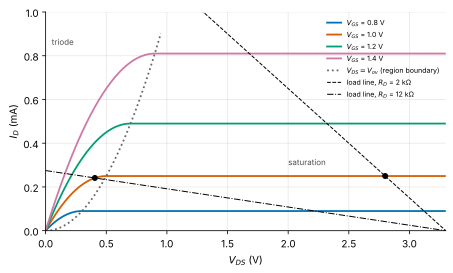
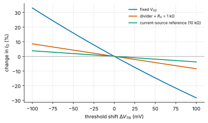

<!-- status: verified -->
# 10-02 · MOSFET DC Operation and Biasing

| | |
|---|---|
| **Course** | [10 · Electronics I (Microelectronic Circuits)](../README.md) |
| **University equivalent** | MOSFET DC analysis and biasing in a junior Electronics I course: regions of operation, the square law, NMOS and PMOS circuits, bias networks and their stability, the MOSFET as a switch (Sedra & Smith, *Microelectronic Circuits*, ch. 5; Razavi, *Fundamentals of Microelectronics*, ch. 6) |
| **Prerequisites** | [09-09 The Long-Channel MOSFET](../../09-semiconductor-devices/chapters/09-09-long-channel-mosfet.md) (the square law derived), [10-01 Diodes and Diode Circuits](10-01-diodes-and-diode-circuits.md) (the model–solve–check routine), [06-04 Nodal Analysis](../../06-circuit-analysis-1-dc/chapters/06-04-nodal-analysis.md) |
| **Estimated study hours** | 10 |
| **Last verified** | 2026-11-19 |

**Learning objectives.** After this chapter you can:

1. State the square-law equations of an NMOS and a PMOS transistor in cutoff, triode and saturation, and identify the region from terminal voltages.
2. Find the DC operating point of a MOSFET circuit by assuming a region, solving, and checking, including choosing the physical root of the quadratic.
3. Design resistor bias networks (divider with source degeneration, drain feedback, current-source reference) and derive how strongly each suppresses threshold variation.
4. Analyze diode-connected transistors and the basic current mirror as bias elements.
5. Use a MOSFET as a switch: compute on-resistance, conduction loss and the dependence on gate drive and temperature, and read a power-MOSFET data sheet.
6. Include the body effect in a DC solution by iteration.

---

## 1. Big picture

Course 09 derived the MOSFET's current from its physics. This chapter treats it as a circuit element with three terminals and a few equations, and asks the two questions every design starts with: *where does it sit* (its DC operating point), and *will it stay there* (bias stability)? An amplifier works only if its transistors are biased in saturation with a predictable current; a switch works only if its transistor is driven hard into the triode region. The analysis routine is the one from 10-01, applied to a device with three regions instead of two.

- **Every analog block starts as a bias network.** Before an amplifier can amplify (10-06), its transistors need a stable drain current; most of an analog chip's transistors exist to set and hold currents.
- **Every digital gate is a pair of switches.** A CMOS inverter (09-11) is an NMOS and a PMOS used as switches; their on-resistance and leakage set speed and standby power.
- **Every power path has a MOSFET switch.** Load switches in phones and wearables, battery protection, the high- and low-side switches of every DC–DC converter, and the ORing transistors of 10-01 are MOSFETs whose on-resistance sets efficiency.
- **Threshold spread is a fact of manufacturing.** Thresholds vary from wafer to wafer and die to die, and fall with temperature; a design that depends on the exact threshold will not yield.

## 2. Intuition first

**A valve with a control knob.** The gate sets how far the channel is "open" (the overdrive $V_{ov} = V_{GS} - V_{TH}$); the drain voltage pushes current through it. With a small drain voltage, the channel behaves like a resistor whose conductance the gate controls: the **triode** region. With a larger drain voltage, the channel pinches off at the drain end and the current stops rising: the **saturation** region, where the transistor acts as a current source controlled by the gate. Below threshold the valve is shut: **cutoff** (apart from the subthreshold leakage of 09-09).

*Where the analogy breaks.* In a water valve, more pressure always means more flow. In saturation, a MOSFET's current is nearly independent of drain voltage: the extra voltage is absorbed in the pinched-off region near the drain. And the name "saturation" means the opposite of what it means for a bipolar transistor (10-03): there, saturation is the switch-like low-voltage region.

**A finance analogy for bias stability.** Suppose a portfolio's return depends on an interest rate you cannot control precisely (the threshold). A position whose value goes as the *square* of the spread above that rate is highly levered to it. A hedge, a second position that moves the other way when the first one does, reduces the exposure. Source degeneration is that hedge: when the current rises, the source voltage rises and takes back part of the gate drive. *Where it breaks:* the circuit's "hedge" is automatic and instantaneous, and it also costs gain (10-06), which a financial hedge's cost does not map onto neatly.

*Figure 1. Output characteristics of the NMOS of Example 10-02.1 ($k_n$ = 2 mA/V², $V_{TN}$ = 0.5 V), with the region boundary $V_{DS} = V_{ov}$ and two load lines from 3.3 V. With $R_D$ = 2 kΩ the operating point sits in saturation; with 12 kΩ it falls into triode.*



## 3. Theory

> **Notation and course values.** $V_{GS}$, $V_{DS}$, $I_D$ are DC terminal quantities (passive sign convention into the drain). $V_{TH}$ is the threshold ($V_{TN} > 0$ for NMOS, $V_{TP} < 0$ for PMOS). $k_n' = \mu_nC_{ox}$ is the process transconductance parameter (A/V²), and the device transconductance parameter is $k_n = k_n'(W/L)$. $V_{ov} = V_{GS} - V_{TN}$ is the overdrive and $\lambda$ the channel-length-modulation coefficient (V⁻¹). Unless stated otherwise, examples use $V_{TN}$ = 0.5 V, $|V_{TP}|$ = 0.5 V and $\lambda$ = 0.

### 3.1 The square law as a circuit model

From 09-09, a long-channel NMOS with gate overdrive $V_{ov} = V_{GS} - V_{TN} > 0$ carries

$$
I_D = \begin{cases}
0 & V_{ov} \le 0 \quad\text{(cutoff)}\\[4pt]
k_n\left(V_{ov}V_{DS} - \tfrac12V_{DS}^2\right) & 0 \le V_{DS} \le V_{ov} \quad\text{(triode)}\\[4pt]
\tfrac12k_nV_{ov}^2\,(1 + \lambda V_{DS}) & V_{DS} \ge V_{ov} \quad\text{(saturation)}
\end{cases}
$$

with $k_n = \mu_nC_{ox}W/L$. Three remarks connect it to Course 09.

- **The bulk-charge factor.** 09-09 derived the same equations with a factor $m \approx$ 1.1–1.3 ($V_{Dsat} = V_{ov}/m$, $I_{Dsat} = k_nV_{ov}^2/2m$). Circuit texts set $m$ = 1 and absorb the difference into a measured $k_n'$; so does this course from here on.
- **The boundary.** Triode and saturation meet where $V_{DS} = V_{ov}$, equivalently $V_{GD} = V_{TN}$: the channel just reaches zero at the drain. At that point both formulas give $\tfrac12k_nV_{ov}^2$, so the model is continuous.
- **Channel-length modulation.** In saturation, raising $V_{DS}$ moves the pinch-off point toward the source and shortens the effective channel, so the current rises slowly: the factor $(1 + \lambda V_{DS})$, with $\lambda$ roughly inversely proportional to $L$ (09-09 §3.5). It matters for gain (10-04) and for current-mirror accuracy (§3.5); for most bias calculations it is a small correction.

**Body effect.** If the source is above the body (substrate) potential, the threshold rises (09-09 §3.1):

$$
V_{TN} = V_{TN0} + \gamma\left(\sqrt{2\phi_F + V_{SB}} - \sqrt{2\phi_F}\right) ,
$$

with $\gamma$ the body-effect coefficient (typically 0.3–0.6 V$^{1/2}$) and $2\phi_F$ the surface potential at threshold (written $2\phi_B$ in Course 09; about 0.6–0.9 V). It appears whenever a transistor's source is not tied to its body (§3.7).

**PMOS.** A PMOS conducts when its gate is *below* its source by more than $|V_{TP}|$. Writing everything with positive quantities, $V_{SG}$, $V_{SD}$ and $I_D$ flowing out of the drain:

$$
I_D = \begin{cases}
0 & V_{SG} \le |V_{TP}|\\[4pt]
k_p\left[(V_{SG} - |V_{TP}|)V_{SD} - \tfrac12V_{SD}^2\right] & V_{SD} \le V_{SG} - |V_{TP}|\\[4pt]
\tfrac12k_p(V_{SG} - |V_{TP}|)^2(1 + \lambda V_{SD}) & V_{SD} \ge V_{SG} - |V_{TP}|
\end{cases}
$$

with $k_p = \mu_pC_{ox}W/L$. Holes are about two to three times less mobile than electrons (09-03), so a PMOS needs a wider channel for the same current.

### 3.2 Finding the operating point

The routine is the assumed-state method of 10-01, with three states.

1. **Assume a region**, usually saturation for an amplifier and triode for a switch.
2. **Solve** the circuit equations with that region's formula. Saturation with a source resistor gives a quadratic in $V_{GS}$.
3. **Choose the physical root.** A quadratic in $V_{GS}$ has two roots; the square law $(V_{GS} - V_{TN})^2$ is symmetric about $V_{TN}$, but the model is valid only for $V_{GS} > V_{TN}$. Discard the root below threshold.
4. **Check the region.** Saturation needs $V_{DS} \ge V_{ov}$ (NMOS) or $V_{SD} \ge V_{SG} - |V_{TP}|$ (PMOS). If the check fails, re-solve in triode.

**Why the gate draws no current.** The gate is insulated by oxide, so at DC no current flows into it (apart from leakage through very thin oxides, 09-08). The gate voltage is therefore set by the gate network alone, often a resistive divider, and that divider can use megohm resistors.

### 3.3 Why bias is a problem: sensitivity to the threshold

At a fixed $V_{GS}$, a threshold shift $\delta V_{TN}$ changes the saturation current by

$$
\frac{\delta I_D}{I_D} = \frac{2\,\delta(V_{GS} - V_{TN})}{V_{ov}} = -\frac{2\,\delta V_{TN}}{V_{ov}} .
$$

With an overdrive of 0.2–0.5 V, typical of discrete bias, a 50 mV threshold shift changes the current by 20–50%; at the 0.1 V overdrives common in low-power analog bias it changes it by 100%. Thresholds vary that much: a discrete small-signal MOSFET such as onsemi's BSS138 is specified from 0.8 to 1.5 V [1], and a power MOSFET such as TI's CSD17573Q5B from 1.1 to 1.8 V [2]. They also drift with temperature, about −2 mV/K for the BSS138 [1]. Fixing $V_{GS}$ and hoping is therefore not a bias strategy.

### 3.4 Bias networks and negative feedback

**Source degeneration.** Put a resistor $R_S$ in the source and set the gate with a divider at $V_G$. Then $V_G = V_{GS} + I_DR_S$. If the current tries to rise, the source rises with it and reduces $V_{GS}$: negative feedback. To see how much, differentiate. In saturation $\delta I_D = g_m(\delta V_{GS} - \delta V_{TN})$ with $g_m = \partial I_D/\partial V_{GS} = k_nV_{ov}$ (the transconductance, 10-04), and the fixed gate voltage forces $\delta V_{GS} = -R_S\,\delta I_D$. Eliminating $\delta V_{GS}$:

$$
\delta I_D = -\frac{g_m}{1 + g_mR_S}\,\delta V_{TN}
\quad\Longrightarrow\quad
\frac{\delta I_D}{I_D} = -\frac{2\,\delta V_{TN}}{V_{ov}}\cdot\frac{1}{1 + g_mR_S} .
$$

The degeneration divides the sensitivity by $1 + g_mR_S$, the **loop gain plus one**, the first appearance of a factor that dominates feedback theory (Course 12). The price is headroom (the voltage $I_DR_S$ is lost from the signal swing) and, in an amplifier, gain, unless $R_S$ is bypassed by a capacitor at signal frequencies.

**Drain-to-gate feedback.** A resistor from drain to gate (with the gate otherwise floating at DC, so it carries no current) sets $V_{GS} = V_{DS} = V_{DD} - I_DR_D$: the transistor is always saturated, since $V_{DS} = V_{GS} > V_{ov}$, and an increase in current lowers the drain and hence the gate. The same differentiation as for degeneration, now with $\delta V_{GS} = -R_D\,\delta I_D$, gives

$$
\frac{\delta I_D}{I_D} = -\frac{2\,\delta V_{TN}}{V_{ov}}\cdot\frac{1}{1 + g_mR_D} .
$$

The suppression factor is $1 + g_mR_D$, and it comes free: $R_D$ is the load resistor already there. The cost is that the operating point is tied to the drain voltage, which can no longer be chosen independently.

**Current-source bias.** The most robust approach sets the current directly. A resistor $R_{ref}$ from the supply feeds a **diode-connected** transistor (gate tied to drain), whose voltage adjusts itself to carry whatever current arrives: $I_{ref} = (V_{DD} - V_{GS})/R_{ref}$, nearly independent of $V_{TN}$ when $V_{DD}$ is several volts more than $V_{GS}$. Electrically this is drain feedback with $R_D = R_{ref}$, so

$$
\frac{\delta I_{ref}}{I_{ref}} = -\frac{2\,\delta V_{TN}}{V_{ov}}\cdot\frac{1}{1 + g_mR_{ref}} ,
$$

and because $R_{ref}$ can be large (it need not leave signal swing), $g_mR_{ref}$ can be 10 or more: Example 10-02.5 has $g_mR_{ref}$ = **14.0**, so its 28.6% fixed-bias sensitivity to a 50 mV shift falls to $28.6/15$ = **1.90**%. A second transistor with the same $V_{GS}$ then copies the current: a **current mirror** (§3.5, and 10-08 in full).

**Comparing the three.** Figure 2 plots each scheme's current against threshold shift, for the designs of Examples 10-02.3 to 10-02.5.

*Figure 2. Fractional change in drain current against threshold shift for a fixed gate voltage, a divider with a 1 kΩ source resistor (Example 10-02.3, 0.849 mA nominal) and a 10 kΩ current reference (Example 10-02.5, 0.245 mA nominal). The nominal currents differ; the fractional changes are what the schemes are compared on.*



### 3.5 Diode-connected transistors and the mirror

With gate tied to drain, $V_{DS} = V_{GS}$, which always exceeds $V_{ov} = V_{GS} - V_{TN}$, so a diode-connected MOSFET is **always in saturation** (once on). Its current–voltage law is $I = \tfrac12k_n(V - V_{TN})^2$: a square-law "diode" whose small-signal resistance is $1/g_m$ (10-04).

Connect the gate of a second transistor, M2, to the diode-connected M1, with both sources grounded. They share $V_{GS}$, so if both are saturated

$$
\frac{I_{D2}}{I_{D1}} = \frac{(W/L)_2}{(W/L)_1}\cdot\frac{1 + \lambda V_{DS2}}{1 + \lambda V_{DS1}} .
$$

The ratio of sizes sets the ratio of currents, and the threshold cancels: the reason current mirrors bias nearly every analog circuit. The second factor is the mirror's error when the two drains sit at different voltages (Example 10-02.5); cascodes (10-08) remove most of it.

### 3.6 The MOSFET as a switch

A switch should look like a small resistance when on. Drive the gate hard, so that $V_{ov}$ is large, and keep $V_{DS}$ small. In deep triode the quadratic term is negligible and

$$
R_{on} = \frac{V_{DS}}{I_D} \approx \frac{1}{k_n(V_{GS} - V_{TN})} = \frac{1}{\mu_nC_{ox}(W/L)(V_{GS} - V_{TN})} .
$$

Three consequences follow.

- **More gate drive, less resistance.** Doubling the overdrive halves $R_{on}$. Data sheets therefore quote $R_{DS(on)}$ at stated gate voltages: the CSD17573Q5B is 1.19 mΩ typical at 4.5 V and 0.84 mΩ at 10 V [2]. "Logic-level" MOSFETs are specified at gate voltages a microcontroller can supply.
- **Wider is better, up to capacitance.** $R_{on} \propto L/W$, but gate capacitance grows with $WL$, and charging it costs energy each switching cycle ($Q_gV_{GS}$; Course 22). The figure of merit of a switching MOSFET is $R_{DS(on)}$ times gate charge.
- **Hot is worse.** Mobility falls with temperature (09-03), so on-resistance rises: the BSS138's typical $R_{DS(on)}$ rises from 0.7 Ω at 25 °C to 1.1 Ω at 125 °C [1]. This is a stabilizing property: in parallel transistors, the hotter one carries less current. (At small overdrive the falling threshold can win instead, so the current *rises* with temperature; between the two lies a gate voltage where they cancel.)

The conduction loss is $I^2R_{on}$. Integrated **load switches** package a MOSFET with its gate driver and a controlled turn-on; TI's TPS22918, for example, switches up to 2 A at 1–5.5 V with 52 mΩ typical at 5 V and limits inrush by slowing its rise [3].

### 3.7 The body effect in a bias calculation

When a transistor's source sits above its body, for instance with a source resistor and the body at ground, the threshold depends on the source voltage, which depends on the current, which depends on the threshold. Solve by iteration: guess $V_S$, compute $V_{TN}(V_{SB})$, then solve the *degenerated* quadratic $V_S = R_S\tfrac12k_n(V_G - V_S - V_{TN})^2$ for $V_S$ with that threshold held fixed, and repeat. Each pass multiplies the error by a factor well below one (the source feedback is inside each solve), so a few passes suffice (Example 10-02.7). The tempting shortcut, computing $I_D = \tfrac12k_n(V_G - V_S - V_{TN})^2$ from the *old* $V_S$ and setting $V_S = I_DR_S$, multiplies the error by about $-g_mR_S(1 + \chi)$ per pass, with $\chi$ the body-effect factor of 10-04; in Example 10-02.7 that is about **−3.4**, and the iteration diverges. In integrated circuits the body effect is avoided where it matters by putting a transistor in its own well tied to its source, which PMOS devices in an n-well allow in a standard process.

## 4. Worked examples

### Example 10-02.1 · Saturation or triode? (tier A)

**Setup.** An NMOS with $k_n$ = 2 mA/V² and $V_{TN}$ = 0.5 V has $V_{GS}$ = 1.0 V and a drain resistor $R_D$ to $V_{DD}$ = 3.3 V. (a) With $R_D$ = 2 kΩ, find $I_D$ and $V_D$, and check the region. (b) With $R_D$ = 12 kΩ, show that saturation fails, and find $V_{DS}$ and $I_D$ in triode. (c) What is the largest $R_D$ that keeps saturation?

**Solution.**

(a) Assume saturation: $I_D = \tfrac12 \times 2 \times 0.5^2$ = **0.250** mA, so $V_D$ = 3.3 − 0.5 = **2.8** V. The overdrive is **0.5** V and $V_{DS}$ = 2.8 V exceeds it: saturation confirmed.

(b) Saturation would give $V_D = 3.3 - 12 \times 0.25$ = **0.3** V, below $V_{ov}$ = 0.5 V: the assumption fails. In triode, $I_D = k_n(V_{ov}V_{DS} - V_{DS}^2/2) = (3.3 - V_{DS})/12\text{ kΩ}$. Solving the quadratic (or by root finding): $V_{DS}$ = **0.4060** V and $I_D$ = **0.2412** mA. The current barely changed, but the transistor is no longer a current source: its output now depends on $V_{DS}$.

(c) The edge is $V_D = V_{ov}$ = 0.5 V: $R_D = (3.3 - 0.5)/0.25\text{ mA}$ = **11.2** kΩ.

**Sanity check.** Figure 1 shows both load lines: the 2 kΩ line crosses the $V_{GS}$ = 1.0 V curve on its flat part, the 12 kΩ line on its rising part, just left of the boundary.

### Example 10-02.2 · A PMOS with a resistive load (tier A)

**Setup.** A PMOS with $k_p$ = 1 mA/V² and $|V_{TP}|$ = 0.5 V has its source at $V_{DD}$ = 3.3 V, its gate at 2.1 V and a 4 kΩ resistor from drain to ground. Find $I_D$, $V_D$ and $V_{SD}$, and check the region.

**Solution.** $V_{SG}$ = 3.3 − 2.1 = 1.2 V, so $V_{SG} - |V_{TP}|$ = **0.7** V. Assume saturation: $I_D = \tfrac12 \times 1 \times 0.7^2$ = **0.245** mA, $V_D = 4\text{ kΩ} \times 0.245\text{ mA}$ = **0.98** V and $V_{SD}$ = 3.3 − 0.98 = **2.32** V ≥ 0.7 V: saturation confirmed.

**Sanity check.** The PMOS circuit is the NMOS circuit turned upside down: the supply is the PMOS's "ground", and the current flows out of the drain into the load.

### Example 10-02.3 · Divider bias with source degeneration (tier B)

**Setup.** $V_{DD}$ = 5 V; a 3 MΩ / 2 MΩ divider sets the gate; $R_S$ = 1 kΩ, $R_D$ = 2 kΩ; $k_n$ = 4 mA/V², $V_{TN}$ = 0.5 V.

```text
        VDD = 5 V
          |        |
         3 MΩ     2 kΩ (R_D)
          |        |
  gate ---+----||  drain
          |        |
         2 MΩ     1 kΩ (R_S)
          |        |
         GND      GND
```

(a) Find $V_G$, $V_{GS}$, $I_D$, $V_S$, $V_D$ and $V_{DS}$; check saturation. (b) What is the other root of the quadratic, and why is it rejected? (c) Find $g_m$ and the degeneration factor $1 + g_mR_S$.

**Solution.**

(a) No gate current, so $V_G = 5 \times 2/5$ = **2.0** V. Assume saturation: $2.0 = V_{GS} + R_S\tfrac12k_n(V_{GS} - 0.5)^2 = V_{GS} + 2(V_{GS} - 0.5)^2$. The physical root is $V_{GS}$ = **1.151** V, so $V_{ov}$ = **0.651** V, $I_D$ = **0.849** mA, $V_S$ = **0.849** V, $V_D$ = 5 − 2 × 0.849 = **3.303** V and $V_{DS}$ = **2.454** V, well above $V_{ov}$: saturation confirmed.

(b) The quadratic's other root is $V_{GS}$ = **−0.651** V, below threshold, where the square law does not apply (the transistor would be off). The two roots are not symmetric about $V_{TN}$: writing $x = V_{GS} - V_{TN}$, the bias equation $(k_nR_S/2)x^2 + x - (V_G - V_{TN}) = 0$ has roots summing to $-2/(k_nR_S)$, so they are centred on $V_{TN} - 1/(k_nR_S)$ = **0.25** V.

(c) $g_m = k_nV_{ov}$ = **2.61** mS, so $1 + g_mR_S$ = **3.61**.

**Sanity check.** Most of the 2 V of gate bias appears as $V_{GS}$ (1.15 V) and the rest across $R_S$ (0.85 V): the source resistor absorbs the excess.

### Example 10-02.4 · How much does degeneration buy? (tier B)

**Setup.** For the circuit of Example 10-02.3, let the threshold vary by ±50 mV. (a) Find the current at $V_{TN}$ = 0.45 V and 0.55 V. (b) Compare with a fixed-$V_{GS}$ bias at the same nominal point ($V_{GS}$ = 1.151 V, no $R_S$). (c) Compare both with the first-order predictions of §3.3–3.4.

**Solution.**

(a) Re-solving the quadratic: **0.885** mA and **0.813** mA, that is **+4.27**% and **−4.25**%.

(b) With $V_{GS}$ held at 1.151 V: **0.984** mA and **0.723** mA, **+15.9**% and **−14.8**%.

(c) First order: $2 \times 0.05/0.651$ = **15.4**% for fixed bias, and that divided by 3.61, **4.26**%, with degeneration. The predictions match the average of the two directions; the asymmetry of the fixed bias is the square law's curvature.

**Sanity check.** A factor of 3.6 in stability for 0.85 V of headroom: the standard trade of discrete biasing.

### Example 10-02.5 · A current reference and mirror (tier B)

**Setup.** A 10 kΩ resistor from 3.3 V feeds a diode-connected NMOS M1 ($k_n$ = 4 mA/V², $V_{TN}$ = 0.5 V). (a) With $\lambda$ = 0, find $V_{GS}$ and $I_{ref}$. (b) With $\lambda$ = 0.1 V⁻¹, find $V_{GS}$ and $I_{ref}$ again, and the current of an identical M2 whose drain sits at 2.0 V. (c) With $\lambda$ = 0, how much does $I_{ref}$ change for $V_{TN}$ = 0.45 and 0.55 V?

**Solution.**

(a) $(3.3 - V_{GS})/10\text{ kΩ} = \tfrac12 \times 4\text{ mA/V}^2(V_{GS} - 0.5)^2$ gives $V_{GS}$ = **0.850** V and $I_{ref}$ = **0.245** mA.

(b) Including $(1 + \lambda V_{GS})$ for M1: $V_{GS}$ = **0.8371** V and $I_{ref}$ = **0.2463** mA. M2 has the same $V_{GS}$ but $V_{DS}$ = 2.0 V: $I_{D2}$ = **0.2727** mA, **10.7**% more than $I_{ref}$.

(c) **0.2497** mA and **0.2403** mA: about ±1.9%, against ±15% for a fixed gate voltage.

**Sanity check.** The resistor carries the current, and 2.45 V across it changes by only the change in $V_{GS}$ (tens of millivolts), so the threshold barely matters. The mirror's 10.7% error comes entirely from the different drain voltages.

### Example 10-02.6 · MOSFETs as switches (tier B)

**Setup.** (a) An integrated NMOS switch has $k_n$ = 50 mA/V² and $V_{TN}$ = 0.5 V, driven at $V_{GS}$ = 1.8 V. Find $R_{on}$. (b) A CSD17573Q5B carries 20 A. Find its conduction loss at $V_{GS}$ = 4.5 V (typical and maximum $R_{DS(on)}$) and at 10 V (typical) [2]. (c) By what factor does a BSS138's typical $R_{DS(on)}$ rise from 25 °C to 125 °C [1]? (d) A TPS22918 load switch (53 mΩ typical at a 3.3 V input; 52 mΩ at 5 V) passes 2 A from a 3.3 V rail [3]. Find the drop, the loss and the drop as a percentage of the rail.

**Solution.**

(a) $R_{on} = 1/(0.05 \times 1.3)$ = **15.4** Ω.

(b) $I^2R$: **0.476** W typical and **0.580** W maximum at 4.5 V; **0.336** W at 10 V.

(c) $1.1/0.7$ = **1.57**.

(d) **0.106** V, **0.212** W and **3.21**% of the rail. (A guaranteed design would use the 71 mΩ maximum over −40 to 85 °C at 3.3 V [3].)

**Sanity check.** A power MOSFET of about 1 mΩ handles 20 A with half a watt of loss; the same current through a 0.7 V diode would dissipate 14 W.

### Example 10-02.7 · The body effect, by iteration (tier C)

**Setup.** An NMOS ($k_n$ = 2 mA/V², $V_{TN0}$ = 0.5 V, $\gamma$ = 0.4 V$^{1/2}$, $2\phi_F$ = 0.7 V, body at ground) has its gate at 2.5 V and $R_S$ = 2 kΩ to ground, with the drain at a supply high enough to keep it saturated. (a) Find $V_S$, $V_{TN}$ and $I_D$ including the body effect. (b) Find them without it. (c) Show the first iterations starting from the no-body-effect answer.

**Solution.**

(a) Solving $V_S = R_S\tfrac12k_n(2.5 - V_S - V_{TN}(V_S))^2$ with $V_{TN} = 0.5 + 0.4(\sqrt{0.7 + V_S} - \sqrt{0.7})$: $V_S$ = **1.071** V, $V_{TN}$ = **0.698** V and $I_D$ = **0.535** mA.

(b) With $\gamma$ = 0: $V_S$ = **1.219** V and $I_D$ = **0.610** mA. The body effect costs **12.2**% of the current.

(c) Start from $V_S$ = 1.219 V: the threshold becomes **0.719** V, giving $V_S$ = **1.054** V; then **1.073** V, then **1.071** V. The error shrinks about tenfold per pass.

**Sanity check.** The body effect acts like extra degeneration: a higher source raises the threshold, which reduces the current, which lowers the source.

### Answer key

<!-- answer-key -->
| ID | Quantity | Value | Unit |
|---|---|---|---|
| T 10-02.a | BSS138 threshold, min | 0.8 | V |
| T 10-02.b | BSS138 threshold, max | 1.5 | V |
| T 10-02.c | CSD17573Q5B threshold, min | 1.1 | V |
| T 10-02.d | CSD17573Q5B threshold, max | 1.8 | V |
| T 10-02.e | BSS138 threshold tempco | -2 | mV/K |
| T 10-02.f | CSD17573Q5B R_DS(on) at 4.5 V | 1.19 | mΩ |
| T 10-02.g | CSD17573Q5B R_DS(on) at 10 V | 0.84 | mΩ |
| T 10-02.h | BSS138 R_DS(on) at 25 °C, typical | 0.7 | Ω |
| T 10-02.i | BSS138 R_DS(on) at 125 °C, typical | 1.1 | Ω |
| T 10-02.j | TPS22918 maximum current | 2 | A |
| T 10-02.k | TPS22918 R_ON at 5 V | 52 | mΩ |
| T 10-02.n | TPS22918 R_ON at 3.3 V | 53 | mΩ |
| T 10-02.o | g_m R_ref of Example 10-02.5 | 14.0 | — |
| T 10-02.p | fixed-bias sensitivity, Example 10-02.5 | 28.6 | % |
| T 10-02.q | current-reference sensitivity, Example 10-02.5 | 1.90 | % |
| T 10-02.r | naive body-effect iteration factor | -3.4 | — |
| T 10-02.l | predicted σ, fixed bias | 7.7 | % |
| T 10-02.m | predicted σ, degenerated bias | 2.1 | % |
| Ex 10-02.1a | I_D, 2 kΩ | 0.250 | mA |
| Ex 10-02.1b | V_D, 2 kΩ | 2.8 | V |
| Ex 10-02.1c | overdrive | 0.5 | V |
| Ex 10-02.1d | V_D if saturated, 12 kΩ | 0.3 | V |
| Ex 10-02.1e | V_DS in triode, 12 kΩ | 0.4060 | V |
| Ex 10-02.1f | I_D in triode, 12 kΩ | 0.2412 | mA |
| Ex 10-02.1g | largest R_D for saturation | 11.2 | kΩ |
| Ex 10-02.2a | PMOS overdrive | 0.7 | V |
| Ex 10-02.2b | PMOS I_D | 0.245 | mA |
| Ex 10-02.2c | PMOS V_D | 0.98 | V |
| Ex 10-02.2d | PMOS V_SD | 2.32 | V |
| Ex 10-02.3a | V_G | 2.0 | V |
| Ex 10-02.3b | V_GS | 1.151 | V |
| Ex 10-02.3c | V_ov | 0.651 | V |
| Ex 10-02.3d | I_D | 0.849 | mA |
| Ex 10-02.3e | V_S | 0.849 | V |
| Ex 10-02.3f | V_D | 3.303 | V |
| Ex 10-02.3g | V_DS | 2.454 | V |
| Ex 10-02.3h | rejected root | -0.651 | V |
| Ex 10-02.3i | g_m | 2.61 | mS |
| Ex 10-02.3j | degeneration factor | 3.61 | — |
| Ex 10-02.3k | centre of the two roots | 0.25 | V |
| Ex 10-02.4a | I_D at V_TN 0.45 V, degenerated | 0.885 | mA |
| Ex 10-02.4b | I_D at V_TN 0.55 V, degenerated | 0.813 | mA |
| Ex 10-02.4c | change, low threshold, degenerated | 4.27 | % |
| Ex 10-02.4d | change, high threshold, degenerated | -4.25 | % |
| Ex 10-02.4e | I_D at V_TN 0.45 V, fixed V_GS | 0.984 | mA |
| Ex 10-02.4f | I_D at V_TN 0.55 V, fixed V_GS | 0.723 | mA |
| Ex 10-02.4g | change, low threshold, fixed | 15.9 | % |
| Ex 10-02.4h | change, high threshold, fixed | -14.8 | % |
| Ex 10-02.4i | first-order sensitivity, fixed | 15.4 | % |
| Ex 10-02.4j | first-order sensitivity, degenerated | 4.26 | % |
| Ex 10-02.5a | V_GS, λ = 0 | 0.850 | V |
| Ex 10-02.5b | I_ref, λ = 0 | 0.245 | mA |
| Ex 10-02.5c | V_GS, λ = 0.1 | 0.8371 | V |
| Ex 10-02.5d | I_ref, λ = 0.1 | 0.2463 | mA |
| Ex 10-02.5e | mirror output | 0.2727 | mA |
| Ex 10-02.5f | mirror error | 10.7 | % |
| Ex 10-02.5g | I_ref at V_TN 0.45 V | 0.2497 | mA |
| Ex 10-02.5h | I_ref at V_TN 0.55 V | 0.2403 | mA |
| Ex 10-02.6a | integrated switch R_on | 15.4 | Ω |
| Ex 10-02.6b | power MOSFET loss, 4.5 V typical | 0.476 | W |
| Ex 10-02.6c | power MOSFET loss, 4.5 V maximum | 0.580 | W |
| Ex 10-02.6d | power MOSFET loss, 10 V typical | 0.336 | W |
| Ex 10-02.6e | BSS138 R_DS(on) ratio, 125 °C to 25 °C | 1.57 | — |
| Ex 10-02.6f | load-switch drop | 0.106 | V |
| Ex 10-02.6g | load-switch loss | 0.212 | W |
| Ex 10-02.6h | drop as share of the rail | 3.21 | % |
| Ex 10-02.7a | V_S with body effect | 1.071 | V |
| Ex 10-02.7b | V_TN with body effect | 0.698 | V |
| Ex 10-02.7c | I_D with body effect | 0.535 | mA |
| Ex 10-02.7d | V_S without | 1.219 | V |
| Ex 10-02.7e | I_D without | 0.610 | mA |
| Ex 10-02.7f | current lost to the body effect | 12.2 | % |
| Ex 10-02.7g | iteration 1 | 1.054 | V |
| Ex 10-02.7h | iteration 2 | 1.073 | V |
| Ex 10-02.7i | iteration 3 | 1.071 | V |
| Ex 10-02.7j | threshold at the first pass | 0.719 | V |

*Every value is recomputed by [verify_10_02.py](../verify/verify_10_02.py) by an independent route: operating points by nodal root finding on the full three-region model (the solver is not told the region), the region then read off the solution; sensitivities by re-solving at shifted thresholds and by numerical differentiation; the body-effect point by a two-variable root finder. Data-sheet values are quoted (R-177) and were checked by hand against the cited PDFs; the script can only restate them, and several switch-loss values (Example 10-02.6) are plain arithmetic on them. The ngspice netlists in the lab confirm Examples 10-02.1(b), 10-02.2, 10-02.3, 10-02.5(b) and 10-02.7(a).*

## 5. Simulate it

The lab, [labs/10-02-lab](../labs/10-02-lab/README.md), has a notebook and two ngspice netlists:

1. Maps the regions of operation and sweeps load lines across them (Figure 1), including the PMOS case.
2. Runs a Monte Carlo of 10,000 transistors with a threshold spread of σ = 25 mV through the three bias schemes, and compares the current distributions.
3. Plots on-resistance against gate drive for a switch, with the square-law estimate.
4. Solves the body-effect bias by iteration and by direct root finding.

The netlists use SPICE's level-1 MOSFET, which is the square law: `mosfet_bias.cir` confirms the operating points of Examples 10-02.2 and 10-02.3, and `mosfet_regions.cir` the triode point of Example 10-02.1(b), the mirror with channel-length modulation of Example 10-02.5(b) and the body-effect point of Example 10-02.7(a).

**Guided exercise (predict, then run).** **Before running Part 2**, predict: with σ = 25 mV of threshold spread, what is the standard deviation of the drain current, in percent, for the fixed-$V_{GS}$ bias of Example 10-02.4, and for the degenerated bias? Then run it. (About $2 \times 25/651$ = 7.7% and 7.7/3.61 = 2.1%, by the first-order formulas.)

## 6. Engineering tradeoffs

| Knob | Improves | Costs | Typical decision owner |
|---|---|---|---|
| Overdrive $V_{ov}$ (bias) | Speed and current per width; lower sensitivity to threshold (∝ 1/$V_{ov}$) | Headroom ($V_{DS} \ge V_{ov}$); lower $g_m/I_D$ (10-04) | Analog designer |
| Source degeneration $R_S$ | Bias stability by $1 + g_mR_S$; linearity | Headroom $I_DR_S$; gain unless bypassed | Analog designer |
| Current-source bias | Current set by a resistor or reference, nearly threshold-independent | A reference circuit and mirror; mirror errors from $\lambda$ | Analog designer |
| Channel length $L$ | Lower $\lambda$, better mirror accuracy and gain; less variability | Lower current per width; more capacitance; slower | Analog designer, process |
| Switch width $W$ | Lower $R_{on}$ and conduction loss | Gate charge and switching loss; area and leakage | Power or I/O designer |
| Gate drive voltage | Lower $R_{on}$ | Gate-driver power; oxide stress limits | Power designer |

## 7. Numbers to know

| Quantity | Typical value | Note |
|---|---|---|
| Overdrive | 0.1–0.3 V in analog bias; 0.2–0.5 V or more in discrete bias and switches | larger for speed and matching, smaller for $g_m/I_D$ |
| Threshold spread, discrete MOSFET | 0.7 V min-to-max (BSS138: 0.8–1.5 V) [1] | specified, not typical |
| Threshold temperature coefficient | about −2 mV/K [1] | |
| Fixed-bias current sensitivity | $2\,\delta V_{TN}/V_{ov}$: 50 mV / 0.5 V → 20% | §3.3 |
| Power MOSFET on-resistance | about 1 mΩ at 10 V gate drive (CSD17573Q5B: 0.84 mΩ typical) [2] | 30 V class, 5 × 6 mm package |
| On-resistance rise, 25 → 125 °C | about 1.5× (BSS138 typical 0.7 → 1.1 Ω) [1] | |
| Load switch | 52 mΩ at 5 V, 53 mΩ at 3.3 V typical; 71 mΩ maximum; 2 A (TPS22918) [3] | |

## 8. Common mistakes

1. **Forgetting to check the region.** A solution assuming saturation is only valid if $V_{DS} \ge V_{ov}$.
2. **Keeping the wrong root.** The quadratic's second root lies below threshold, where the square law does not apply.
3. **Mixing NMOS and PMOS signs.** Write PMOS equations in $V_{SG}$, $V_{SD}$ and $|V_{TP}|$ and keep every quantity positive.
4. **Calling the BJT's saturation and the MOSFET's saturation the same thing.** For a MOSFET, saturation is the current-source region; for a BJT it is the switch-like low-voltage region.
5. **Biasing with a fixed gate voltage.** The current then follows the threshold's spread and temperature drift, squared.
6. **Quoting $R_{DS(on)}$ without the gate voltage and temperature.** It can differ by tens of percent between 4.5 V and 10 V of drive, and by 50% between 25 °C and 125 °C.
7. **Ignoring the body effect when the source is not at the body.** It can cost 10% or more of the current (Example 10-02.7).

## 9. Practitioner lens

### State of the art (as of Nov 2026)

- **Discrete MOSFETs are specified by ranges, not values.** Current data sheets give thresholds as minimum–typical–maximum (BSS138: 0.8/1.3/1.5 V [1]; CSD17573Q5B: 1.1/1.4/1.8 V [2]) and on-resistance as typical and maximum at stated gate voltages and temperatures **[Established]**. Design to the limits, not the typical value.
- **Power MOSFETs of about a milliohm are commodity parts.** A 30 V device in a 5 × 6 mm package reaches 0.84 mΩ typical at 10 V gate drive, with 49 nC of gate charge at 4.5 V [2] **[Established]**.
- **Load switches integrate the MOSFET, its gate drive and its inrush control.** Parts such as the TPS22918 switch rails of phones, wearables and laptops with tens of milliohms and microamperes of quiescent current [3] **[Established]**.

### Why it matters commercially

- **Bias circuits are on every analog die** **[Industry estimate]**. References, mirrors and their start-up circuits appear on every mixed-signal chip; their accuracy over process and temperature is a design-review topic in its own right (Course 20).
- **On-resistance and gate charge decide power-stage efficiency** **[Established]**. In a phone's battery path or a server's voltage regulator, milliohms are watts and watts are thermal design and battery life (Course 22).
- **Spec ranges are a yield and margin problem** **[Established]**. A circuit that works for the typical device but not for the extreme of the data-sheet range will fail in the field at a predictable rate.

### Marketing vs Reality

- **"On-resistance: 0.84 mΩ."** *Reality:* typical, at 10 V of gate drive and 25 °C [2]; at 4.5 V the maximum is 1.45 mΩ, and hot devices are higher again. *Sanity check:* ask for the maximum at the gate voltage the design will use and at the operating junction temperature.
- **"Logic-level threshold."** *Reality:* a threshold is defined at a tiny current (250 µA for the CSD17573Q5B, 1 mA for the BSS138); the device is far from fully on there. *Sanity check:* look at the on-resistance specified at the gate voltage you actually have.
- **"Our bias is accurate to 1%."** *Reality:* accurate over what: process corners, temperature, supply, ageing? A resistor-referenced mirror inherits the resistor's tolerance and temperature coefficient. *Sanity check:* ask for the distribution over corners and temperature, not one simulation.

### Questions for engineering leaders

1. **"How does your bias current vary over process, voltage and temperature, and what in the design sets that?"**
   *Strong:* a number per corner, the reference (bandgap, resistor, $g_m$-referenced) and its error budget. *Evasive:* "it's within spec in simulation."
2. **"What gate drive do your power switches get, and at what junction temperature did you size $R_{DS(on)}$?"**
   *Strong:* the drive voltage, the maximum on-resistance at hot, and the resulting loss. *Evasive:* only the typical value.
3. **"Where is the body effect in your critical paths, and how is it handled?"**
   *Strong:* which transistors have source above body, whether they sit in separate wells, and the margin it costs. *Evasive:* "the models include it."
4. **"How much of your analog die is bias and reference circuitry, and is it shared across blocks?"**
   *Strong:* an area and current budget and a distribution scheme. *Evasive:* no idea of the number.

## 10. Concept check

**Q1.** A MOSFET has $V_{GS}$ = 1.2 V, $V_{DS}$ = 0.5 V and $V_{TN}$ = 0.5 V. Which region is it in?

<details><summary>Answer</summary>

Triode: the overdrive is 0.7 V and $V_{DS}$ = 0.5 V is less than it (equivalently $V_{GD}$ = 0.7 V exceeds $V_{TN}$, so the channel reaches the drain).

</details>

**Q2.** Why does a diode-connected MOSFET never enter triode?

<details><summary>Answer</summary>

Its drain is its gate, so $V_{DS} = V_{GS} = V_{ov} + V_{TN}$, which always exceeds $V_{ov}$ by $V_{TN}$.

</details>

**Q3.** Why does source degeneration reduce sensitivity to the threshold by $1 + g_mR_S$?

<details><summary>Answer</summary>

A threshold shift that would change the current by $g_m\,\delta V_{TN}$ also changes the source voltage by $R_S$ times that change, which feeds back to oppose it. The fraction that survives is $1/(1 + g_mR_S)$, the standard result of negative feedback with loop gain $g_mR_S$.

</details>

**Q4.** Two identical NMOS share a gate; one is diode-connected at 0.85 V, the other has its drain at 2.0 V, with $\lambda$ = 0.1 V⁻¹. Which carries more current, and by roughly how much?

<details><summary>Answer</summary>

The second, by about $\lambda(V_{DS2} - V_{DS1}) = 0.1 \times 1.15$ ≈ 11%: channel-length modulation makes the mirror's output depend on its drain voltage (Example 10-02.5 finds 10.7%).

</details>

**Q5.** Why is a MOSFET switch's on-resistance quoted at a gate voltage, and why does it rise with temperature?

<details><summary>Answer</summary>

In triode $R_{on} \approx 1/[k_n(V_{GS} - V_{TN})]$, so it depends on the overdrive, which the gate voltage sets. Mobility falls as temperature rises (more phonon scattering), lowering $k_n$ and raising $R_{on}$; at large overdrive this outweighs the falling threshold.

</details>

**Q6.** A PMOS has its source at 3.3 V and its gate at 3.0 V, with $|V_{TP}|$ = 0.5 V. Is it on?

<details><summary>Answer</summary>

No: $V_{SG}$ = 0.3 V is below $|V_{TP}|$, so it is in cutoff (apart from subthreshold leakage).

</details>

[Problem set for this chapter](../problems/10-02-problems.md)

## 11. Key terms

[Triode (linear) region](../../../reference/glossary.md#linear-region) · [Saturation region](../../../reference/glossary.md#saturation-region) · [Overdrive voltage](../../../reference/glossary.md#overdrive-voltage) · [Square law](../../../reference/glossary.md#square-law) · [Channel-length modulation](../../../reference/glossary.md#channel-length-modulation) · [Body effect](../../../reference/glossary.md#body-effect) · [Operating point](../../../reference/glossary.md#operating-point) · [Source degeneration](../../../reference/glossary.md#source-degeneration) · [Diode-connected transistor](../../../reference/glossary.md#diode-connected-transistor) · [Current mirror](../../../reference/glossary.md#current-mirror) · [On-resistance](../../../reference/glossary.md#on-resistance) · [Load switch](../../../reference/glossary.md#load-switch) · [Ideal-diode controller](../../../reference/glossary.md#ideal-diode-controller)

## 12. Connections

- **Builds on:** the long-channel square law, body effect and channel-length modulation from [09-09](../../09-semiconductor-devices/chapters/09-09-long-channel-mosfet.md); the assumed-state method from [10-01](10-01-diodes-and-diode-circuits.md); nodal analysis from [06-04](../../06-circuit-analysis-1-dc/chapters/06-04-nodal-analysis.md).
- **Next:** [10-03 BJT DC Operation and Biasing](10-03-bjt-dc-operation-and-biasing.md) applies the same routine to the bipolar transistor; [10-04 Small-Signal Models](10-04-small-signal-models.md) linearizes the square law around the operating point found here.
- **Used later:** amplifiers in [10-06](10-06-mos-single-stage-amplifiers.md); mirrors in [10-08](10-08-current-sources-and-mirrors.md); CMOS logic in [19](../../19-digital-vlsi-design/README.md); power switches in [22-02](../../22-power-electronics-and-energy-conversion/chapters/22-02-buck-converter-steady-state.md).

## 13. Further study

- A. S. Sedra and K. C. Smith, *Microelectronic Circuits*, ch. 5 (MOSFETs: device structure and physical operation, current–voltage characteristics, DC circuits, biasing).
- B. Razavi, *Fundamentals of Microelectronics*, ch. 6 (physics of MOS transistors) and the biasing sections of ch. 7.
- MIT OpenCourseWare, 6.002 *Circuits and Electronics* (Spring 2007, A. Agarwal), video lectures on the MOSFET switch, the MOSFET amplifier and large-signal analysis.
- Data sheets [1]–[3]: read the electrical-characteristics table of a small-signal MOSFET and a power MOSFET side by side.

## 14. Sources

1. onsemi, *BSS138 N-Channel Logic Level Enhancement Mode Field Effect Transistor*, Publication Order Number BSS138/D, Rev. 7, April 2024: [data sheet](https://www.onsemi.com/pdf/datasheet/bss138-d.pdf). [R-177](../../../reference/research-log.md#r-177--mosfet-and-load-switch-data-sheets).
2. Texas Instruments, *CSD17573Q5B 30 V N-Channel NexFET Power MOSFET*, SLPS492B, June 2014, revised April 2017: [data sheet](https://www.ti.com/lit/ds/symlink/csd17573q5b.pdf). [R-177](../../../reference/research-log.md#r-177--mosfet-and-load-switch-data-sheets).
3. Texas Instruments, *TPS22918 5.5-V, 2-A, 52-mΩ On-Resistance Load Switch*, SLVSD76C, February 2016, revised July 2017: [data sheet](https://www.ti.com/lit/ds/symlink/tps22918.pdf). [R-177](../../../reference/research-log.md#r-177--mosfet-and-load-switch-data-sheets).
