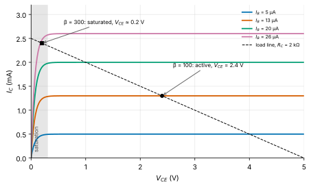
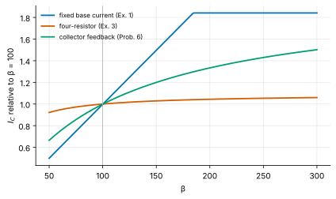

<!-- status: reviewed -->
# 10-03 · BJT DC Operation and Biasing

| | |
|---|---|
| **Course** | [10 · Electronics I (Microelectronic Circuits)](../README.md) |
| **University equivalent** | BJT DC analysis and biasing in a junior Electronics I course: regions of operation, the constant-$V_{BE}$ model, NPN and PNP circuits, the four-resistor bias and its stability, current mirrors, the BJT as a switch, thermal stability (Sedra & Smith, *Microelectronic Circuits*, ch. 6; Razavi, *Fundamentals of Microelectronics*, ch. 4–5) |
| **Prerequisites** | [09-07 The Bipolar Junction Transistor](../../09-semiconductor-devices/chapters/09-07-bipolar-junction-transistor.md) (the device physics), [10-02 MOSFET DC Operation and Biasing](10-02-mosfet-dc-operation-and-biasing.md) (the bias routine and negative feedback), [06-08 Thévenin and Norton](../../06-circuit-analysis-1-dc/chapters/06-08-thevenin-and-norton.md) |
| **Estimated study hours** | 9 |
| **Last verified** | 2026-11-19 |

**Learning objectives.** After this chapter you can:

1. State the NPN and PNP terminal relations in the active region, recognize cutoff and saturation, and check a solution's region.
2. Find the DC operating point of a BJT circuit with the constant-$V_{BE}$ model, including saturated switches with a forced β.
3. Derive the emitter current of the four-resistor bias and its sensitivity to β and to $V_{BE}$, and design a bias that is stable against both.
4. Derive the error of a BJT current mirror from finite β and the Early effect.
5. Design a saturated BJT switch from data-sheet limits.
6. Compute the loop gain of thermal feedback and explain why emitter degeneration prevents thermal runaway.

---

## 1. Big picture

The bipolar transistor was the first transistor of commercial electronics and remains the device of choice wherever its exponential law is the point: high transconductance per unit current, precise voltage references, low-noise and high-frequency front ends, and many power and automotive circuits. Its DC analysis follows the same routine as the MOSFET's (10-02), with two differences that shape every bias network. The base draws current, so the base network must supply it; and the collector current is an exponential function of $V_{BE}$ and depends on the current gain β, which varies severalfold between devices and rises with temperature. Good BJT biasing makes the current depend on resistors instead.

- **Analog front ends and references.** Bandgap voltage references (Course 20), RF low-noise amplifiers in SiGe (09-07) and precision op-amp input stages rely on bipolar transistors.
- **Switches and drivers.** A small BJT driven from a logic pin switches relays, LEDs, buzzers and motor drivers in countless products.
- **Discrete and legacy design.** Generations of audio, industrial and automotive circuits are bipolar; reading them requires this chapter.
- **The same bias ideas appear everywhere.** Emitter degeneration, the current mirror and thermal feedback are the bipolar versions of ideas every analog designer uses.

## 2. Intuition first

**A current amplifier with a gate fee.** In the active region a small base current $I_B$ controls a collector current $\beta$ times larger, and the collector behaves as a current source that does not care much about its voltage. Unlike the MOSFET's insulated gate, the base charges a fee: it must be supplied with $I_C/\beta$. Equivalently, and more accurately, the base–emitter *voltage* sets the collector current exponentially, $I_C = I_Se^{V_{BE}/V_T}$; the base current is a by-product.

**Two pictures, one device.** For hand analysis of DC bias, treat the base–emitter junction as a 0.7 V drop (the constant-drop diode of 10-01) and the collector current as $\beta I_B$. For anything involving small changes, temperature or precision, remember the exponential: 18 mV more $V_{BE}$ doubles the current (10-01 §2).

**Saturation means switch.** If the collector circuit cannot accept $\beta I_B$, the collector voltage collapses to about 0.2 V and the transistor becomes a closed switch: **saturation**. This is the opposite of a MOSFET's "saturation", which is its current-source region (10-02).

*Where the "current amplifier" picture breaks.* β is not a dependable number: a 2N3904 is specified anywhere from 100 to 300 at 10 mA, and only "at least 30" at 100 mA [1]. A design that needs a particular β will not survive production. And the base current is not the cause of the collector current but a loss; the cause is $V_{BE}$.

**A finance analogy.** Bias by base current alone is like budgeting a project as "β times whatever we spend on management": if β triples, so does the bill. A four-resistor bias is a budget with a hard cap set by an external constraint (the emitter resistor's voltage), so the outcome depends weakly on the multiplier. *Where it breaks:* the "cap" in the circuit adjusts continuously and instantly through negative feedback, which a budget does not.

*Figure 1. Idealized output characteristics ($I_C = \beta I_B$ with β = 100) and the 2 kΩ load line of Example 10-03.1. With β = 100 the operating point is active at 2.4 V; with β = 300, the 13 µA of base current would ask for 3.9 mA, more than the load line allows, so the transistor saturates at about 2.4 mA and 0.2 V.*

## 3. Theory

> **Notation and course values.** For an NPN: $V_{BE}$, $V_{CE}$, $I_B$, $I_C$ and $I_E = I_B + I_C$, all positive in the active region. $\beta = I_C/I_B$ (the data sheet's $h_{FE}$), $\alpha = I_C/I_E = \beta/(\beta + 1)$. $V_A$ is the Early voltage. Hand analysis uses $V_{BE}$ = 0.7 V in the active region, $V_{CE,sat}$ = 0.2 V in saturation (data sheets write $V_{CE(sat)}$ for their guaranteed values) and $V_T$ = 25.852 mV. For a PNP, use $V_{EB}$, $V_{EC}$ and currents flowing out of the collector and into the emitter.

### 3.1 The active region as a circuit model

From 09-07, in the forward-active region (base–emitter forward-biased, base–collector reverse-biased):

$$
I_C = I_Se^{V_{BE}/V_T}\left(1 + \frac{V_{CE}}{V_A}\right), \qquad I_B = \frac{I_C}{\beta}, \qquad I_E = \frac{I_C}{\alpha} = (\beta + 1)I_B .
$$

Because $I_C$ changes by a factor of ten for every 60 mV of $V_{BE}$, any collector current from microamperes to tens of milliamperes needs $V_{BE}$ between about 0.5 and 0.8 V for a small transistor. Replacing the exponential with a fixed **0.7 V** is the constant-drop model of 10-01, accurate to a few tens of millivolts, which is good enough whenever the bias network drops volts across its resistors. Neglecting the Early term (set $V_A \to \infty$) is the usual first pass; it returns in mirrors (§3.5) and in gain (10-04).

**The regions.**

| Region | Base–emitter | Base–collector | Behavior |
|---|---|---|---|
| Cutoff | off | off | open switch, $I_C \approx 0$ |
| Forward active | on (≈ 0.7 V) | reverse | current source, $I_C = \beta I_B$ |
| Saturation | on | forward | closed switch, $V_{CE} \approx$ 0.2 V, $I_C < \beta I_B$ |
| Reverse active | reverse | on | rarely used; very low gain |

A transistor is active while $V_{CE}$ exceeds about 0.3 V (so the collector junction is not significantly forward-biased); below that it saturates.

**PNP.** Every relation holds with signs reversed: the emitter is the most positive terminal, $V_{EB}$ ≈ 0.7 V when on, and current flows into the emitter and out of base and collector.

### 3.2 Finding the operating point

1. **Assume active.** Replace the base–emitter junction by 0.7 V; relate the currents by β.
2. **Solve** the base loop for $I_B$ (or $I_E$), then the collector loop for $V_{CE}$.
3. **Check** $V_{CE}$ ≥ 0.3 V (NPN) or $V_{EC}$ ≥ 0.3 V (PNP). If not, the transistor is saturated.
4. **If saturated**, set $V_{CE}$ = 0.2 V, solve for $I_C$ from the collector circuit, and confirm saturation: the **forced β**, $I_C/I_B$, must be smaller than the device's β.

### 3.3 Why base-current bias fails

The simplest bias drives the base from a voltage through a resistor: $I_B = (V_{BB} - 0.7)/R_B$ and $I_C = \beta I_B$. The collector current is proportional to β, which a data sheet lets vary threefold, and β itself rises with temperature. Example 10-03.1 shows the consequence: a design that works with β = 100 saturates with β = 300.

The opposite extreme, holding $V_{BE}$ fixed, is worse in another way. At fixed $V_{BE}$ the current follows $e^{V_{BE}/V_T}$, and $V_{BE}$ at constant current falls by about 2 mV/K (09-06), so near room temperature the current at fixed $V_{BE}$ rises by about $2/25.85$ = 7.7% per kelvin, a doubling every 9 K. That rate is local. Over a wide range the shift in $V_{BE}$, about $(2\text{ mV/K})\,\Delta T$, is divided by the thermal voltage *at the hot temperature*, which has grown: from 25 °C to 85 °C the 120 mV shift is worth $e^{120/30.86}$, about fiftyfold (Example 10-03.4), not the $e^{120/25.85} \approx$ **104**-fold that a constant 7.7%/K would give. The loop-gain analysis of thermal runaway below (Example 10-03.7, the lab) uses the local rate at the operating temperature, which is right for small disturbances.

### 3.4 The four-resistor bias

The standard discrete bias uses a divider $R_1$, $R_2$ at the base, an emitter resistor $R_E$ and a collector resistor $R_C$. Replace the divider by its Thévenin equivalent (06-08): $V_{Th} = V_{CC}R_2/(R_1 + R_2)$ and $R_{Th} = R_1 \parallel R_2$. Around the base–emitter loop, with $I_B = I_E/(\beta + 1)$:

$$
V_{Th} = \frac{I_E}{\beta + 1}R_{Th} + V_{BE} + I_ER_E
\quad\Longrightarrow\quad
I_E = \frac{V_{Th} - V_{BE}}{R_E + R_{Th}/(\beta + 1)} .
$$

The design rules follow from the denominator and numerator.

- **Insensitivity to β.** If $R_{Th} \ll (\beta + 1)R_E$, then $I_E \approx (V_{Th} - V_{BE})/R_E$, set by resistors. A common rule makes the divider current about ten times the base current, which makes $R_{Th}/(\beta + 1)$ a small fraction of $R_E$. Differentiating the expression for $I_E$ gives the relative sensitivity below, small when $R_{Th}/(\beta + 1) \ll R_E$.
- **Insensitivity to $V_{BE}$.** A change $\delta V_{BE}$ changes $I_E$ by $-\delta V_{BE}/[R_E + R_{Th}/(\beta + 1)]$; in relative terms, $\delta V_{BE}/(V_{Th} - V_{BE})$. A volt or more across $R_E$ makes 100 mV of temperature drift a 10% effect instead of a fifty-fold one.

The β sensitivity referred to above is

$$
\frac{\beta}{I_E}\frac{\partial I_E}{\partial \beta} = \frac{\beta}{(\beta + 1)^2}\cdot\frac{R_{Th}}{R_E + R_{Th}/(\beta + 1)} .
$$

The price is headroom, the volt or two across $R_E$ that the collector cannot use, and, in an amplifier, gain (unless a bypass capacitor shorts $R_E$ at signal frequencies; 10-07). The negative feedback is the same as the MOSFET's source degeneration (10-02 §3.4): a rising current raises the emitter, which reduces $V_{BE}$.

*Figure 2. Collector current against β, relative to β = 100, for the base-current bias of Example 10-03.1, the four-resistor bias of Example 10-03.3 and the collector-feedback bias of Problem 10-03.6.*

### 3.5 The BJT current mirror

Two matched transistors share $V_{BE}$; Q1 is diode-connected (collector tied to base) and fed a reference current $I_{ref}$. Q2's collector copies Q1's. The base currents spoil the copy: $I_{ref}$ must supply Q1's collector current plus both base currents, $I_{ref} = I_C + 2I_C/\beta$, so

$$
I_{out} = I_{C2} = \frac{I_{ref}}{1 + 2/\beta} .
$$

With β = 100 the output is 2% low. The Early effect adds a second error when the two collectors sit at different voltages: $I_{C2}/I_{C1} = (1 + V_{CE2}/V_A)/(1 + V_{CE1}/V_A)$. Both errors, and the cures (a buffer transistor to supply the base currents; cascodes), are the subject of 10-08.

### 3.6 The BJT as a switch

To switch a load fully on, drive the base hard enough that the collector circuit, not β, limits the current: saturation. Design with the worst-case (minimum) β and an **overdrive**: data sheets specify $V_{CE(sat)}$ at a forced β of 10, so designers commonly use $I_B = I_C/10$. For the 2N3904, $V_{CE(sat)}$ is at most 0.2 V at 10 mA and 0.3 V at 50 mA with $I_C/I_B$ = 10, and $V_{BE(sat)}$ at most 0.85 V and 0.95 V [1].

- **Dissipation** is $V_{CE(sat)}I_C$ plus the base drive $V_{BE}I_B$, small compared with the load's power.
- **Speed.** A saturated transistor stores charge in its base and collector (09-07 §3.10); turning it off waits for that charge to be removed, a storage delay of tens to hundreds of nanoseconds in small switching transistors. Heavier overdrive speeds turn-on but lengthens turn-off. A Schottky diode from base to collector (a "Baker clamp") keeps the transistor just out of saturation, as in Schottky TTL logic.
- **Inductive loads** need a flyback diode across the load, or the collector voltage spikes when the current is interrupted (07-01).

### 3.7 Thermal feedback and runaway

A transistor's power $V_{CE}I_C$ heats its junction by $\Delta T = PR_{\theta JA}$, where $R_{\theta JA}$ is the junction-to-ambient thermal resistance (200 K/W for a 2N3904 in its TO-92 package [1]). A hotter junction needs less $V_{BE}$ for the same current. Two effects close a loop:

- current → power → temperature: $dT/dI_C = V_{CE}R_{\theta JA}$ (at fixed $V_{CE}$);
- temperature → current: at fixed $V_{BE}$, $dI_C/dT = I_C(2\text{ mV/K})/V_T$; with emitter resistance, the 2 mV/K appears across $R_E + V_T/I_C$ instead, so $dI_C/dT = (2\text{ mV/K})/(R_E + V_T/I_C)$.

The product is the **thermal loop gain** $L$. A small temperature disturbance is amplified by $1/(1 - L)$; if $L \ge 1$ the loop has no stable operating point, and the current grows until something limits it or the transistor fails: **thermal runaway**. Emitter degeneration cuts $L$ by the ratio $(V_T/I_C)/(R_E + V_T/I_C)$ (Example 10-03.7). Power output stages use small emitter resistors (often fractions of an ohm) for exactly this reason (Course 12).

## 4. Worked examples

### Example 10-03.1 · Base-current bias and β (tier A)

**Setup.** An NPN's base is driven from 2 V through 100 kΩ; $R_C$ = 2 kΩ to $V_{CC}$ = 5 V. (a) Find $I_B$. (b) With β = 100, find $I_C$ and $V_C$, and check the region. (c) With β = 300, show that the transistor saturates, and find $I_C$ and the forced β. (d) Above what β does it saturate (take the edge at $V_{CE}$ = 0.3 V)?

**Solution.**

(a) $I_B = (2 - 0.7)/100\text{ kΩ}$ = **13.0** µA.

(b) $I_C$ = **1.30** mA and $V_C = 5 - 2 \times 1.3$ = **2.4** V: active.

(c) Active would need $I_C$ = **3.9** mA and $V_C$ = 5 − 7.8 = **−2.8** V, impossible. Saturated: $I_C = (5 - 0.2)/2\text{ kΩ}$ = **2.40** mA, and the forced β is 2.40 mA/13 µA = **184.6**, below 300: consistent.

(d) The edge is $I_C = (5 - 0.3)/2\text{ kΩ}$ = 2.35 mA, so β = 2.35/0.013 = **180.8**.

**Sanity check.** A threefold spread in β produced a threefold spread in the intended current, enough to push the transistor out of its region. That is why this bias is used only for switches, never for amplifiers.

### Example 10-03.2 · A PNP stage (tier A)

**Setup.** A PNP has its emitter connected through $R_E$ = 3.3 kΩ to $V_{CC}$ = 5 V, its base held at 3.0 V by a stiff divider, and its collector through $R_C$ = 2 kΩ to ground; β = 100. Find $V_E$, $I_E$, $I_C$, $V_C$ and $V_{EC}$.

**Solution.** The emitter sits one $V_{EB}$ above the base: $V_E$ = **3.7** V, so $I_E = (5 - 3.7)/3.3\text{ kΩ}$ = **0.3939** mA and $I_C = \alpha I_E$ = **0.3900** mA. Then $V_C$ = **0.780** V and $V_{EC}$ = **2.920** V: active.

**Sanity check.** Holding the base, not the base current, fixed makes the emitter current depend only on $R_E$: the four-resistor idea of §3.4 in its limit $R_{Th} \to 0$.

### Example 10-03.3 · The four-resistor bias (tier B)

**Setup.** $V_{CC}$ = 12 V, $R_1$ = 47 kΩ, $R_2$ = 10 kΩ, $R_E$ = 1 kΩ, $R_C$ = 4.7 kΩ. (a) Find $V_{Th}$ and $R_{Th}$. (b) With β = 100, find $I_E$, $I_C$, $I_B$, $V_C$, $V_E$ and $V_{CE}$. (c) Find $I_C$ for β = 300 and β = 50, and the percentage changes. (d) Find the divider current and its ratio to the base current.

**Solution.**

(a) $V_{Th} = 12 \times 10/57$ = **2.105** V and $R_{Th}$ = 47 ∥ 10 = **8.246** kΩ.

(b) $I_E = (2.105 - 0.7)/(1 + 8.246/101)\text{ kΩ}$ = **1.299** mA, $I_C$ = **1.286** mA and $I_B$ = **12.86** µA. $V_C = 12 - 4.7 \times 1.286$ = **5.954** V, $V_E$ = **1.299** V and $V_{CE}$ = **4.655** V: active, with room for a signal to swing.

(c) β = 300: $I_C$ = **1.363** mA, **+5.98**%. β = 50: **1.186** mA, **−7.80**%. A sixfold range of β moves the current by about 14%.

(d) The divider carries 12/57 kΩ = **0.2105** mA, **16.4** times the base current.

**Sanity check.** $R_{Th}/(\beta + 1)$ = 82 Ω is about 8% of $R_E$; making the divider stiffer (smaller resistors) would reduce the β sensitivity further, at the cost of more divider current and lower input resistance.

### Example 10-03.4 · Temperature (tier B)

**Setup.** (a) For Example 10-03.3, $V_{BE}$ falls by 2 mV/K. Find $I_C$ at 85 °C (β held at 100) and the change from 25 °C. (b) Compare with a bias that holds $V_{BE}$ fixed: by what factor does the current rise over the same 60 K?

**Solution.**

(a) $V_{BE}$ falls by 120 mV, so $I_E = (2.105 - 0.58)/1.0816\text{ kΩ}$, giving $I_C$ = **1.396** mA, **+8.54**%.

(b) At fixed $V_{BE}$, the curve shifts by 120 mV and the current grows by $e^{0.12/V_T(358\text{ K})}$ = **48.8** times (the same computation as Problem 10-01.4).

**Sanity check.** Volts across $R_E$ turn a fiftyfold drift into 8.5%.

### Example 10-03.5 · A BJT current mirror (tier B)

**Setup.** A reference resistor from 5 V sets $I_{ref}$ = 1 mA into a diode-connected Q1. (a) Find the resistor (with $V_{BE}$ = 0.7 V). (b) With β = 100 and no Early effect, find $I_{out}$ and its error. (c) Add $V_A$ = 50 V, with Q2's collector at 3 V and Q1's at 0.7 V. Find $I_{out}$ and its error.

**Solution.**

(a) $R = (5 - 0.7)/1\text{ mA}$ = **4.3** kΩ.

(b) $I_{out} = 1/(1 + 2/100)$ = **0.9804** mA, **−1.96**%.

(c) Treating the two corrections as independent factors, $I_{out} \approx 0.9804 \times (1 + 3/50)/(1 + 0.7/50)$ = **1.025** mA, **+2.49**%: the Early effect overcorrects the base-current error. Solving the two transistors' equations together (Early effect on the collector currents, base currents $I_Se^{V_{BE}/V_T}/\beta$) gives $I_{out} = 1 \times 1.06/(1 + 0.014 + 0.02)$ = **1.0251** mA, **+2.51**%; the product form is accurate to second order.

**Sanity check.** The two errors are of similar size and opposite sign here only by coincidence of the chosen voltages; a mirror's accuracy depends on its output voltage, which is why precision mirrors use cascodes (10-08).

### Example 10-03.6 · Switching a relay from a logic pin (tier B)

**Setup.** A 2N3904 switches a 12 V relay coil of 240 Ω from a 3.3 V logic output. (a) Find the coil current. (b) With a forced β of 10, find the base current and the base resistor, using the data sheet's maximum $V_{BE(sat)}$ at this current, 0.95 V at 50 mA and 5 mA of base current. (c) With the next lower standard value, 430 Ω, find $I_B$ and the forced β. (d) Find the transistor's dissipation using the maximum $V_{CE(sat)}$ of 0.3 V at 50 mA [1]. (e) What else does the circuit need?

**Solution.**

(a) $12/240$ = **50** mA.

(b) $I_B$ = **5.0** mA and $R_B = (3.3 - 0.95)/5\text{ mA}$ = **470** Ω. (The 0.85 V maximum belongs to the 10 mA row; using it here would size $R_B$ at 490 Ω and leave the transistor short of base drive.)

(c) $I_B = 2.35/430$ = **5.47** mA, forced β = **9.15**. The exact 470 Ω would give a forced β of exactly 10 at the worst-case $V_{BE(sat)}$, no margin at all; rounding the resistor *down* buys the margin.

(d) Collector: $0.3 \times 50$ = **15** mW; base: $0.95 \times 5.47$ = **5.19** mW; total **20.2** mW, far below the 625 mW rating [1].

(e) A flyback diode across the coil: interrupting 50 mA in an inductor would otherwise drive the collector far above the 40 V $V_{CEO}$ rating [1]. Also check that the logic pin can source 5.5 mA at a high level of 3.3 V; many cannot, and a weaker pin calls for a MOSFET instead (10-02).

**Sanity check.** The data sheet guarantees only β ≥ 60 at 50 mA [1]; a forced β of 10 leaves a sixfold margin, so every transistor in production saturates.

### Example 10-03.7 · The thermal loop (tier C)

**Setup.** A 2N3904 ($R_{\theta JA}$ = 200 K/W) carries 10 mA with $V_{CE}$ = 5 V. (a) Find its dissipation and temperature rise. (b) Find the thermal loop gain and the amplification $1/(1 - L)$ if $V_{BE}$ is held fixed. (c) Repeat with $R_E$ = 100 Ω. (d) Find $V_T/I_C$.

**Solution.**

(a) $P$ = **50** mW and $\Delta T$ = **10** K.

(b) $dI_C/dT = I_C(2\text{ mV/K})/V_T$ = 0.774 mA/K and $dT/dI_C = V_{CE}R_{\theta JA}$ = 1000 K/A, so $L$ = **0.774** and $1/(1 - L)$ = **4.42**: any temperature disturbance is more than quadrupled. Since $L$ is proportional to current, voltage and thermal resistance, raising any of them by $1/0.774 - 1$ = **29**% would push $L$ past 1.

(c) $dI_C/dT = 0.002/(100 + 2.585)$, so $L$ = **0.0195** and the amplification is **1.020**.

(d) $V_T/I_C$ = **2.585** Ω, which is the emitter's own small-signal resistance (10-04): 100 Ω of $R_E$ is 39 times larger, and $L$ falls by that factor.

**Sanity check.** At a fixed $V_{BE}$, the transistor is already three-quarters of the way to runaway ($L$ = 0.774 of the 1 that defines it); a hundred ohms of emitter resistance makes it irrelevant.

### Answer key

<!-- answer-key -->
| ID | Quantity | Value | Unit |
|---|---|---|---|
| T 10-03.a | 2N3904 β at 10 mA, min | 100 | — |
| T 10-03.b | 2N3904 β at 10 mA, max | 300 | — |
| T 10-03.c | 2N3904 β at 100 mA, min | 30 | — |
| T 10-03.d | 2N3904 V_CE(sat) at 10 mA, max | 0.2 | V |
| T 10-03.e | 2N3904 V_CE(sat) at 50 mA, max | 0.3 | V |
| T 10-03.f | 2N3904 V_BE(sat) at 10 mA, max | 0.85 | V |
| T 10-03.g | 2N3904 V_BE(sat) at 50 mA, max | 0.95 | V |
| T 10-03.h | 2N3904 thermal resistance | 200 | K/W |
| T 10-03.i | current growth per kelvin at fixed V_BE | 7.7 | % |
| T 10-03.p | constant-rate growth over 60 K | 104 | — |
| T 10-03.j | mirror error at β = 100 | 2 | % |
| T 10-03.k | 2N3904 β at 50 mA, min | 60 | — |
| T 10-03.l | 2N3904 power rating | 625 | mW |
| T 10-03.m | 2N3904 V_CEO | 40 | V |
| T 10-03.n | predicted max/min I_C over β 100–300 | 1.06 | — |
| T 10-03.o | predicted V_BE contribution | 1.4 | % |
| Ex 10-03.1a | I_B | 13.0 | µA |
| Ex 10-03.1b | I_C, β = 100 | 1.30 | mA |
| Ex 10-03.1c | V_C, β = 100 | 2.4 | V |
| Ex 10-03.1d | I_C if active, β = 300 | 3.9 | mA |
| Ex 10-03.1e | V_C if active, β = 300 | -2.8 | V |
| Ex 10-03.1f | I_C saturated | 2.40 | mA |
| Ex 10-03.1g | forced β | 184.6 | — |
| Ex 10-03.1h | β at the edge of saturation | 180.8 | — |
| Ex 10-03.2a | V_E | 3.7 | V |
| Ex 10-03.2b | I_E | 0.3939 | mA |
| Ex 10-03.2c | I_C | 0.3900 | mA |
| Ex 10-03.2d | V_C | 0.780 | V |
| Ex 10-03.2e | V_EC | 2.920 | V |
| Ex 10-03.3a | V_Th | 2.105 | V |
| Ex 10-03.3b | R_Th | 8.246 | kΩ |
| Ex 10-03.3c | I_E | 1.299 | mA |
| Ex 10-03.3d | I_C | 1.286 | mA |
| Ex 10-03.3e | I_B | 12.86 | µA |
| Ex 10-03.3f | V_C | 5.954 | V |
| Ex 10-03.3g | V_E | 1.299 | V |
| Ex 10-03.3h | V_CE | 4.655 | V |
| Ex 10-03.3i | I_C, β = 300 | 1.363 | mA |
| Ex 10-03.3j | change, β = 300 | 5.98 | % |
| Ex 10-03.3k | I_C, β = 50 | 1.186 | mA |
| Ex 10-03.3l | change, β = 50 | -7.80 | % |
| Ex 10-03.3m | divider current | 0.2105 | mA |
| Ex 10-03.3n | divider over base current | 16.4 | — |
| Ex 10-03.4a | I_C at 85 °C | 1.396 | mA |
| Ex 10-03.4b | change | 8.54 | % |
| Ex 10-03.4c | growth at fixed V_BE | 48.8 | — |
| Ex 10-03.5a | reference resistor | 4.3 | kΩ |
| Ex 10-03.5b | I_out, β = 100 | 0.9804 | mA |
| Ex 10-03.5c | error | -1.96 | % |
| Ex 10-03.5d | I_out with Early effect | 1.025 | mA |
| Ex 10-03.5e | error with Early effect | 2.49 | % |
| Ex 10-03.5f | I_out with Early effect, solved together | 1.0251 | mA |
| Ex 10-03.5g | error, solved together | 2.51 | % |
| Ex 10-03.6a | coil current | 50 | mA |
| Ex 10-03.6b | base current | 5.0 | mA |
| Ex 10-03.6c | base resistor | 470 | Ω |
| Ex 10-03.6d | I_B with 430 Ω | 5.47 | mA |
| Ex 10-03.6e | forced β | 9.15 | — |
| Ex 10-03.6f | collector dissipation | 15 | mW |
| Ex 10-03.6g | base dissipation | 5.19 | mW |
| Ex 10-03.6h | total dissipation | 20.2 | mW |
| Ex 10-03.6i | base resistor with the 10 mA row | 490 | Ω |
| Ex 10-03.6j | base drive needed | 5.5 | mA |
| Ex 10-03.7a | dissipation | 50 | mW |
| Ex 10-03.7b | temperature rise | 10 | K |
| Ex 10-03.7c | loop gain, fixed V_BE | 0.774 | — |
| Ex 10-03.7d | amplification, fixed V_BE | 4.42 | — |
| Ex 10-03.7e | loop gain, R_E = 100 Ω | 0.0195 | — |
| Ex 10-03.7f | amplification, R_E = 100 Ω | 1.020 | — |
| Ex 10-03.7g | V_T/I_C | 2.585 | Ω |
| Ex 10-03.7h | increase that makes L = 1 | 29 | % |

*Every value is recomputed by [verify_10_03.py](../verify/verify_10_03.py) by an independent route: bias networks as linear systems of Kirchhoff equations (the transistor as a 0.7 V source and a current-controlled current source), with the region checked from the solved voltages; the mirror with an exponential transistor and the Early effect; sensitivities by re-solving; the thermal loop gain by numerically differentiating a self-heated exponential transistor. Data-sheet values are quoted (R-178) and were checked by hand against the cited PDFs (an earlier draft used the wrong $V_{BE(sat)}$ row in Example 10-03.6, which a script restating the literal could not catch); the switch and thermal arithmetic of Examples 10-03.6 and 10-03.7 restates the stated model. The lab's ngspice netlists confirm Examples 10-03.1(b), 10-03.3 and 10-03.5 and Problem 10-03.6.*

## 5. Simulate it

The lab, [labs/10-03-lab](../labs/10-03-lab/README.md), has a notebook and two ngspice netlists:

1. Sweeps β from 50 to 400 through the three bias networks of Figure 2 and marks where each saturates.
2. Runs a Monte Carlo of β (uniform 100–300, the 2N3904's range at 10 mA [1]) and $V_{BE}$ (±20 mV) through the four-resistor bias.
3. Simulates the self-heated transistor of Example 10-03.7 as a dynamic thermal system, with and without $R_E$, and shows runaway when the loop gain exceeds one.
4. Simulates the saturated switch's turn-off delay with a charge-control model (09-07).

The netlists run Example 10-03.3 (`bjt_bias.cir`), and Example 10-03.1(b), the mirror of Example 10-03.5 with and without the Early effect and Problem 10-03.6's collector feedback (`bjt_more.cir`), with a Gummel–Poon transistor.

**Guided exercise (predict, then run).** **Before running Part 2**, predict: with β uniform between 100 and 300, what is the spread (maximum over minimum) of $I_C$ in Example 10-03.3's bias? Then run it. (From Example 10-03.3, $I_C$ rises from 1.286 mA at β = 100 to 1.363 mA at β = 300, a ratio of **1.06**; ±20 mV of $V_{BE}$ adds about ±**1.4**%, that is $0.02/(V_{Th} - V_{BE})$.)

## 6. Engineering tradeoffs

| Knob | Improves | Costs | Typical decision owner |
|---|---|---|---|
| Emitter resistor $R_E$ (voltage across it) | Stability against β, $V_{BE}$ and temperature | Headroom; gain unless bypassed | Circuit designer |
| Divider stiffness ($R_{Th}$) | Stability against β | Divider current; lower input resistance | Circuit designer |
| Switch overdrive (forced β) | Guaranteed saturation, lower $V_{CE(sat)}$ | Base drive current; slower turn-off (stored charge) | Circuit designer |
| Collector current | Speed, $g_m$ (10-04) | Power; self-heating; lower input resistance | Circuit designer |
| Mirror buffering or cascoding | Mirror accuracy | Headroom; another device | Analog designer |
| BJT instead of MOSFET | $g_m$ per current, matching of $V_{BE}$, low noise | Base current; process cost (BiCMOS) | Architect |

## 7. Numbers to know

| Quantity | Typical value | Note |
|---|---|---|
| Active $V_{BE}$ (small transistor, mA) | 0.6–0.75 V; 0.7 V for hand analysis | |
| $V_{CE(sat)}$ | 0.1–0.3 V (2N3904: ≤ 0.2 V at 10 mA, ≤ 0.3 V at 50 mA) [1] | at forced β = 10 |
| β spread | 3× between min and max (2N3904: 100–300 at 10 mA) [1] | falls at high current |
| $V_{BE}$ temperature coefficient | about −2 mV/K | 09-06 |
| Current growth at fixed $V_{BE}$ | about 7.7% per K; doubles every ~9 K | §3.3 |
| Small-signal emitter resistance | $V_T/I_C$: 25.9 Ω at 1 mA | 10-04 |
| 2N3904 limits | 40 V $V_{CEO}$, 200 mA, 625 mW, 200 K/W [1] | TO-92 |

## 8. Common mistakes

1. **Designing with a typical β.** Use the data sheet's minimum for switches and the full range for bias.
2. **Forgetting the base current in the divider.** Neglecting $R_{Th}/(\beta + 1)$ is fine only if the divider is stiff; check it.
3. **Calling a saturated transistor active.** Always check $V_{CE}$; a negative or tiny $V_{CE}$ from an active-mode solution means saturation.
4. **Confusing BJT and MOSFET saturation.** Opposite meanings (10-02).
5. **Holding $V_{BE}$ fixed.** The current then drifts exponentially with temperature and can run away.
6. **Switching inductive loads without a flyback diode.** The collector voltage spikes past $V_{CEO}$.
7. **Ignoring storage time.** A heavily saturated BJT turns off slowly; it matters in switching circuits above tens of kilohertz.

## 9. Practitioner lens

### State of the art (as of Nov 2026)

- **Small-signal BJTs are specified by ranges.** The 2N3904 data sheet still in production gives β from 100 to 300 at 10 mA, at least 30 at 100 mA, and $V_{CE(sat)}$ limits at a forced β of 10 [1]; its complement, the 2N3906, is specified similarly [2] **[Established]**.
- **Where bipolar transistors still win.** On integrated circuits, bipolar (and SiGe) transistors serve bandgap references, high-frequency front ends and precision analog (09-07, Course 20); discretely, they remain the cheapest way to switch small loads from logic **[Established]**.
- **MOSFETs have taken over most power switching.** Above a few hundred milliamperes, a logic-level MOSFET's milliohms (10-02) beat a BJT's 0.2–0.3 V saturation voltage and its base drive **[Established]** (by the data-sheet comparison of this chapter and 10-02).

### Why it matters commercially

- **Bias stability is yield** **[Established]**. A bias that drifts with β fails a fraction of units in production; one that drifts with temperature fails in the field.
- **Thermal runaway is a reliability failure mode** **[Established]**. Output stages, linear regulators and paralleled transistors fail by it if the thermal loop is not designed; emitter (or source) resistors are cheap insurance.
- **Legacy bipolar products are long-lived** **[Industry estimate]**. Industrial and automotive designs keep bipolar parts in production for decades (the 2N3904 itself is still in current data sheets [1]), so the skills remain commercially relevant even where new designs use CMOS.

### Marketing vs Reality

- **"High gain: $h_{FE}$ = 300."** *Reality:* a maximum or typical at one current; the guaranteed minimum may be a third of it, and it falls at high current [1]. *Sanity check:* ask for the minimum at your operating current and temperature.
- **"Low saturation voltage."** *Reality:* specified at a forced β, usually 10, so achieving it costs base current [1]. *Sanity check:* ask at what $I_C/I_B$.
- **"Thermally stable design."** *Reality:* only if the loop gain is known. *Sanity check:* ask for the emitter (or source) degeneration, the thermal resistance and the worst-case dissipation.

### Questions for engineering leaders

1. **"How does your bias current vary with β and temperature, and what in the circuit sets it?"**
   *Strong:* the bias topology, the voltage across the degeneration resistor, and the worst-case spread. *Evasive:* "the transistors are matched."
2. **"For each switching transistor, what is the forced β at the worst-case minimum $h_{FE}$?"**
   *Strong:* a number with margin, plus turn-off timing. *Evasive:* "it saturates on the bench."
3. **"Where could thermal runaway occur, and what prevents it?"**
   *Strong:* paralleled devices and output stages listed, with ballast resistors and thermal resistance. *Evasive:* "the heat sink is big."
4. **"Why bipolar here instead of a MOSFET, or the reverse?"**
   *Strong:* the specific advantage ($g_m$ per current, noise, matching, cost, $R_{DS(on)}$). *Evasive:* habit.

## 10. Concept check

**Q1.** An NPN has $V_{BE}$ = 0.7 V and $V_{CE}$ = 0.15 V. Which region is it in?

Answer

Saturation: $V_{CE}$ is below about 0.3 V, so the base–collector junction is forward-biased ($V_{BC}$ = 0.55 V).

**Q2.** Why does the four-resistor bias need $R_{Th} \ll (\beta + 1)R_E$?

Answer

Seen from the base, $R_E$ looks like $(\beta + 1)R_E$, because the emitter carries $\beta + 1$ times the base current. If $R_{Th}$ is small against that, the base voltage barely sags with base current, so $V_E$ and $I_E \approx (V_{Th} - V_{BE})/R_E$ do not depend on β.

**Q3.** Why is the forced β of a switch chosen around 10 rather than just below the data sheet's minimum β?

Answer

The data sheet specifies $V_{CE(sat)}$ at $I_C/I_B$ = 10; driving the base that hard guarantees deep saturation (low $V_{CE}$) for every device, at every temperature, and with margin for β's fall at high current. Driving just below the minimum β would leave the transistor at the edge of saturation, with a large and variable $V_{CE}$.

**Q4.** In a BJT mirror with β = 50, what is the output error from base currents alone?

Answer

$1/(1 + 2/50) = 0.962$: about −3.8%.

**Q5.** What is the thermal loop gain, and what makes it exceed one?

Answer

It is the product of how much the current rises per kelvin and how much the junction heats per ampere. It grows with current (through $I_C/V_T$ at fixed $V_{BE}$), with $V_{CE}$ and with thermal resistance; emitter resistance reduces the first factor.

[Problem set for this chapter](../problems/10-03-problems.md)

## 11. Key terms

[Forward-active region](../../../reference/glossary.md#forward-active-region) · [Current gain](../../../reference/glossary.md#current-gain) · [Four-resistor bias](../../../reference/glossary.md#four-resistor-bias) · [Forced beta](../../../reference/glossary.md#forced-beta) · [Emitter degeneration](../../../reference/glossary.md#emitter-degeneration) · [Current mirror](../../../reference/glossary.md#current-mirror) · [Thermal runaway](../../../reference/glossary.md#thermal-runaway) · [Thermal resistance](../../../reference/glossary.md#thermal-resistance) · [Early effect](../../../reference/glossary.md#early-effect) · [Operating point](../../../reference/glossary.md#operating-point)

## 12. Connections

- **Builds on:** bipolar device physics from [09-07](../../09-semiconductor-devices/chapters/09-07-bipolar-junction-transistor.md); the $V_{BE}$ temperature coefficient from [09-06](../../09-semiconductor-devices/chapters/09-06-pn-junction-iv-and-capacitance.md); the bias routine and negative feedback from [10-02](10-02-mosfet-dc-operation-and-biasing.md); Thévenin equivalents from [06-08](../../06-circuit-analysis-1-dc/chapters/06-08-thevenin-and-norton.md).
- **Next:** [10-04 Small-Signal Models](10-04-small-signal-models.md) linearizes $I_C = I_Se^{V_{BE}/V_T}$ around the operating points found here.
- **Used later:** BJT amplifiers in [10-07](10-07-bjt-single-stage-amplifiers.md); mirrors in [10-08](10-08-current-sources-and-mirrors.md); output stages and thermal design in [12-07](../../12-electronics-2/chapters/12-07-output-stages.md); bandgap references in [20-03](../../20-analog-and-mixed-signal-ic-design/chapters/20-03-bandgap-references.md).

## 13. Further study

- A. S. Sedra and K. C. Smith, *Microelectronic Circuits*, ch. 6 (BJTs: device operation, current–voltage characteristics, DC circuits, biasing, the BJT as a switch).
- B. Razavi, *Fundamentals of Microelectronics*, ch. 4 (physics of bipolar transistors) and ch. 5 (bipolar amplifiers: biasing).
- MIT OpenCourseWare, 6.012 *Microelectronic Devices and Circuits* (Fall 2009), lecture notes on the bipolar junction transistor and its large-signal models.
- The 2N3904 and 2N3906 data sheets [1, 2]: read the β and saturation tables with this chapter's Examples 1 and 6.

## 14. Sources

1. onsemi, *2N3903, 2N3904 General Purpose Transistors NPN Silicon*, Publication Order Number 2N3903/D, Rev. 9, August 2021: [data sheet](https://www.onsemi.com/pdf/datasheet/2n3903-d.pdf). [R-178](../../../reference/research-log.md#r-178--bipolar-transistor-data-sheets).
2. onsemi, *2N3906 General Purpose Transistors PNP Silicon*, Publication Order Number 2N3906/D, Rev. 4, February 2010: [data sheet](https://www.onsemi.com/pdf/datasheet/2n3906-d.pdf). [R-178](../../../reference/research-log.md#r-178--bipolar-transistor-data-sheets).
