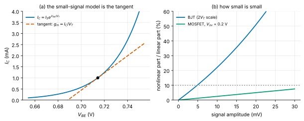
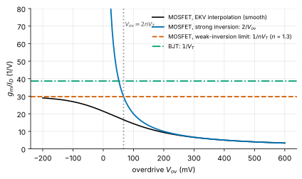

<!-- status: verified -->
# 10-04 · Small-Signal Models

| | |
|---|---|
| **Course** | [10 · Electronics I (Microelectronic Circuits)](../README.md) |
| **University equivalent** | Small-signal models in a junior Electronics I course: linearization at the operating point, $g_m$, $r_o$, $r_\pi$, $r_e$ and $g_{mb}$, the hybrid-π and T models of the MOSFET and BJT, validity limits and distortion, and the small-signal analysis procedure (Sedra & Smith, *Microelectronic Circuits*, ch. 7; Razavi, *Fundamentals of Microelectronics*, ch. 5 and 7) |
| **Prerequisites** | [10-02 MOSFET DC Operation and Biasing](10-02-mosfet-dc-operation-and-biasing.md), [10-03 BJT DC Operation and Biasing](10-03-bjt-dc-operation-and-biasing.md), [01-08 Sequences, Series and Taylor](../../01-calculus-for-engineers/chapters/01-08-sequences-series-and-taylor.md), [06-06 Dependent Sources](../../06-circuit-analysis-1-dc/chapters/06-06-dependent-sources.md) |
| **Estimated study hours** | 10 |
| **Last verified** | 2026-11-19 |

**Learning objectives.** After this chapter you can:

1. Explain small-signal analysis as linearization at the operating point, and derive each small-signal parameter as a partial derivative of a large-signal law.
2. Compute $g_m$, $r_o$, $g_{mb}$ for a MOSFET and $g_m$, $r_\pi$, $r_e$, $r_o$ for a BJT from their bias, and compare their transconductance efficiency and intrinsic gain.
3. Draw and use the hybrid-π and T models, and show they are equivalent.
4. Derive the amplitude limits of the small-signal model and the second-harmonic distortion of each device.
5. Carry out the small-signal analysis procedure on a single-transistor circuit: DC solution, parameters, small-signal circuit, gain and resistances.
6. Use $g_m/I_D$ to choose a bias, and explain why low-power designs bias MOSFETs near weak inversion.

---

## 1. Big picture

A transistor amplifier is a nonlinear circuit biased so that small signals see a linear one. The DC operating point of 10-02 and 10-03 fixes where on its curves the transistor sits; the slopes of those curves at that point are the **small-signal parameters**, and with them every amplifier, filter and feedback loop in analog electronics can be analyzed with the linear circuit theory of Courses 06 and 07. This chapter derives the parameters, builds the two standard models, and states precisely when the linear approximation holds.

- **Every analog specification starts here.** Gain, input and output resistance, bandwidth (Course 12) and noise all come from $g_m$, $r_o$ and the device capacitances.
- **$g_m/I_D$ is the currency of low-power design.** In a wearable sensor front end or a battery-powered radio, transconductance per microampere decides battery life.
- **Intrinsic gain sets the architecture.** A transistor's $g_mr_o$ (tens for short-channel MOSFETs, thousands for BJTs) decides how many stages and how much cascoding a design needs (Courses 12 and 20).
- **Distortion is the price of large signals.** The amplitude limits derived here set the dynamic range of radios, audio converters and sensor interfaces.

## 2. Intuition first

**Zoom in on a curve.** Any smooth curve looks straight under enough magnification. Around the operating point Q, a transistor's current changes in proportion to small changes in its voltages; the constants of proportionality are conductances. Small-signal analysis is calculus' tangent line (01-03) applied to circuits.

**A finance analogy: duration.** A bond's price is a nonlinear function of interest rates, but for small rate moves a portfolio manager uses its *duration*, the slope of price against rate at today's rate. $g_m$ is the transistor's duration: the slope of current against input voltage at today's bias. *Where it breaks:* duration is rescaled by convexity for large moves, exactly as the transistor's linear model is corrected by second-order terms that cause distortion (§3.6). Unlike a bond, the transistor's "convexity" can be designed: more bias current or more overdrive shrinks it.

**Two devices, one picture.** Both transistors are voltage-controlled current sources at heart: a control voltage ($v_{gs}$ or $v_{be}$) sets an output current $g_mv$, with a large output resistance $r_o$ in parallel. They differ in the input: the MOSFET's gate draws no current, while the BJT's base draws $i_c/\beta$, which appears as an input resistance $r_\pi$.

*Figure 1. (a) The BJT's exponential characteristic and its tangent at 1 mA: the small-signal model replaces the curve by the tangent. (b) How large the nonlinear part of the response is, relative to the linear part, against signal amplitude, for a BJT and for a MOSFET biased at 0.2 V of overdrive.*



## 3. Theory

> **Notation and course values.** Total quantities $v_{GS}$, $i_D$; DC quantities $V_{GS}$, $I_D$; small signals $v_{gs}$, $i_d$ (so $v_{GS} = V_{GS} + v_{gs}$). $g_m$ transconductance (S), $r_o$ output resistance (Ω), $r_\pi$ BJT input resistance, $r_e$ emitter resistance, $g_{mb}$ body transconductance. $V_T$ = 25.852 mV. Square law with $m$ = 1 for the MOSFET (10-02).

### 3.1 Linearization

A three-terminal device's current depends on two voltages. For a MOSFET with its source as reference, $i_D = f(v_{GS}, v_{DS})$. Expand around Q in a two-variable Taylor series (01-10):

$$
i_D = I_D + \frac{\partial f}{\partial v_{GS}}\bigg|_Q v_{gs} + \frac{\partial f}{\partial v_{DS}}\bigg|_Q v_{ds} + \text{(second-order terms)} .
$$

Dropping the second-order terms leaves the small-signal relation $i_d = g_mv_{gs} + v_{ds}/r_o$, with

$$
g_m \equiv \frac{\partial i_D}{\partial v_{GS}}\bigg|_Q, \qquad \frac{1}{r_o} \equiv \frac{\partial i_D}{\partial v_{DS}}\bigg|_Q .
$$

Every small-signal parameter is a partial derivative evaluated at the operating point. Two consequences shape every analysis:

- **Superposition separates DC and signal.** In the linearized circuit, DC sources contribute only to the operating point. In the small-signal circuit, DC voltage sources become short circuits, DC current sources become open circuits, and large coupling or bypass capacitors become short circuits at signal frequencies.
- **The parameters depend on the bias.** Change the operating point and the model changes: the designer chooses the parameters by choosing the bias.

### 3.2 MOSFET parameters

In saturation, $i_D = \tfrac12k_n(v_{GS} - V_{TN})^2(1 + \lambda v_{DS})$. Differentiating (and setting $\lambda V_{DS} \ll 1$ in the first result):

$$
g_m = k_nV_{ov} = \frac{2I_D}{V_{ov}} = \sqrt{2k_nI_D}, \qquad
r_o = \frac{1 + \lambda V_{DS}}{\lambda I_D} \approx \frac{1}{\lambda I_D} .
$$

The three forms of $g_m$ say different things. At fixed size ($k_n$), $g_m$ grows only as $\sqrt{I_D}$; at fixed overdrive it grows in proportion to $I_D$; and per unit current it is $g_m/I_D = 2/V_{ov}$, better at small overdrive.

**Body transconductance.** If the source is not at the body potential, the body acts as a second gate through the body effect (10-02 §3.1): $i_d$ also responds to $v_{bs}$. Differentiating through $V_{TN}(V_{SB})$:

$$
g_{mb} = \frac{\partial i_D}{\partial v_{BS}} = g_m\cdot\frac{\gamma}{2\sqrt{2\phi_F + V_{SB}}} \equiv \chi g_m ,
$$

with χ typically 0.1–0.3. It matters in source followers and cascodes (10-06, 10-08).

**Intrinsic gain.** The largest voltage gain one transistor can give is its $g_m$ times its own $r_o$ (a load of infinite resistance):

$$
A_0 = g_mr_o \approx \frac{2I_D}{V_{ov}}\cdot\frac{1}{\lambda I_D} = \frac{2}{\lambda V_{ov}} ,
$$

independent of current. Long channels (small λ) and small overdrive raise it.

### 3.3 BJT parameters

In the active region, $i_C = I_Se^{v_{BE}/V_T}(1 + v_{CE}/V_A)$. Differentiating:

$$
g_m = \frac{I_C}{V_T}, \qquad r_o \approx \frac{V_A}{I_C}, \qquad r_\pi = \frac{\partial v_{BE}}{\partial i_B} = \frac{\beta}{g_m}, \qquad r_e = \frac{\partial v_{BE}}{\partial i_E} = \frac{\alpha}{g_m} \approx \frac{V_T}{I_E} .
$$

($r_\pi$ uses $i_B = i_C/\beta$ with β constant; strictly the small-signal β, $h_{fe}$, can differ from the DC $h_{FE}$, and data sheets list both [1].) Three facts stand out.

- **$g_m$ depends only on current.** Every bipolar transistor at 1 mA has $g_m$ = 38.7 mS, whatever its size or β.
- **$g_m/I_C = 1/V_T$** = 38.7 V⁻¹, the largest transconductance efficiency of any device at room temperature (§3.7).
- **Intrinsic gain $g_mr_o = V_A/V_T$**, also independent of current: 1934 for $V_A$ = 50 V.

The 2N3904 data sheet lists the small-signal input impedance $h_{ie}$ ($= r_\pi$) between 1 and 10 kΩ and the output admittance $h_{oe}$ ($= 1/r_o$) between 1 and 40 µS at 1 mA [1]: consistent with $r_\pi = \beta V_T/I_C$ = 2.6–10 kΩ for β from 100 to 400, and implying Early voltages from 25 V to 1 kV.

### 3.4 The hybrid-π and T models

**Hybrid-π.** A current source $g_mv_\pi$ from collector (drain) to emitter (source), controlled by the voltage $v_\pi$ across the input, with $r_o$ in parallel. For the BJT, $r_\pi$ connects base and emitter; for the MOSFET, the gate is an open circuit (add $g_{mb}v_{bs}$ when the body effect matters).

```text
  BJT hybrid-π                                    MOSFET hybrid-π

  B o-----+          +---------+------o C         G o            +---------+------o D
          |  +       |         |                     +           |         |
        [r_π] v_π   (↓) g_m·v_π [r_o]                v_gs        (↓) g_m·v_gs [r_o]
          |  −       |         |                     −           |         |
  E o-----+----------+---------+------o E         S o------------+---------+------o S
```

```text
  BJT T model                 MOSFET T model

        C o                         D o
          |                           |
         (↓) α·i_e                   (↓) i_d = g_m·v_gs
          |                           |
  B o-----+                   G o-----+        (i_g = 0, since i_s = i_d)
          |                           |
        [r_e]  ↓ i_e               [1/g_m]
          |                           |
        E o                         S o
```

**T model.** The same device drawn with the emitter (source) resistance $r_e$ in the emitter lead and a controlled source $\alpha i_e$ (equal to $g_mv_\pi$) from the collector to the base node. For the MOSFET, $r_e$ becomes $1/g_m$, and the gate connects to the top of that resistor without drawing current: the gate voltage sets $v_{gs}$ across $1/g_m$, the resulting current $g_mv_{gs}$ flows out of the source, and the same current enters the drain.

**Why they are equivalent.** In the T model, the emitter current $i_e = v_\pi/r_e$ and the collector current is $\alpha i_e = (\alpha/r_e)v_\pi = g_mv_\pi$; the base current is $i_e - \alpha i_e = (1 - \alpha)v_\pi/r_e = v_\pi/(\beta r_e/\alpha)$, so the base sees $r_\pi = (\beta + 1)r_e$. Both models give the same terminal currents for the same terminal voltages. Use whichever makes the circuit easier: the hybrid-π when the emitter (source) is grounded, the T model when there is resistance in the emitter (source) lead or the input is at the emitter (Example 10-04.4).

**Resistance reflection.** Two rules follow and recur throughout Course 10.

- Looking into the base of a BJT with a resistance $R_E$ in its emitter, one sees $r_\pi + (\beta + 1)R_E$: the emitter resistance is multiplied by $\beta + 1$.
- Looking into the emitter with the base grounded through $R_B$, one sees $r_e + R_B/(\beta + 1)$: base resistance is divided by $\beta + 1$.

### 3.5 The small-signal analysis procedure

1. **Solve the DC circuit** (10-02, 10-03) and confirm the region.
2. **Compute the parameters** at Q: $g_m$, $r_o$ (and $r_\pi$, $r_e$ or $g_{mb}$).
3. **Draw the small-signal circuit:** DC voltage sources to ground, DC current sources open, coupling and bypass capacitors short, the transistor replaced by its model.
4. **Solve the linear circuit** for gain, input resistance and output resistance (06-04 to 06-08).
5. **Check the signal amplitude** against §3.6.

For a common-source stage with drain resistor $R_D$ and the source grounded for signals, step 4 is one line: $v_o = -g_mv_{gs}(R_D \parallel r_o)$, so $A_v = -g_m(R_D \parallel r_o)$. 10-06 and 10-07 apply the procedure to every single-transistor configuration.

### 3.6 How small is small: the amplitude limits and distortion

**BJT.** Write $v_{be} = \hat v\cos\omega t$. Then

$$
i_C = I_Ce^{v_{be}/V_T} = I_C\left[1 + \frac{v_{be}}{V_T} + \frac12\left(\frac{v_{be}}{V_T}\right)^2 + \cdots\right] .
$$

The quadratic term, with $\cos^2\omega t = \tfrac12(1 + \cos2\omega t)$, produces a second harmonic of amplitude $I_C\hat v^2/(4V_T^2)$ against the fundamental's $I_C\hat v/V_T$. The **second-harmonic distortion** is

$$
\text{HD}_2 = \frac{\hat v}{4V_T} \qquad\text{(BJT)} .
$$

For 1% second-harmonic distortion, $\hat v$ = $4V_T \times 0.01$ = 1.03 mV. The ratio of the quadratic to the linear term in the expansion is $v_{be}/2V_T$, the 10% at 5.17 mV of 10-01 §3.4.

> **Going deeper — the exact harmonics of an exponential.** The Fourier series of $e^{x\cos\theta}$ is $I_0(x) + 2\sum_{k\ge1} I_k(x)\cos k\theta$, where $I_k$ are modified Bessel functions. With $x = \hat v/V_T$, the exact second-harmonic distortion is $I_2(x)/I_1(x)$. Expanding, $I_1(x) = \tfrac{x}{2}(1 + \tfrac{x^2}{8} + \cdots)$ and $I_2(x) = \tfrac{x^2}{8}(1 + \tfrac{x^2}{12} + \cdots)$, so $\text{HD}_2 = \tfrac{x}{4}(1 - \tfrac{x^2}{24} + \cdots)$: slightly *below* $\hat v/4V_T$, because the cubic term adds to the fundamental faster than the quartic term adds to the second harmonic. The same expansion also yields the DC shift $I_C[I_0(x) - 1]$, which is why a large signal moves a BJT's average current.

**MOSFET.** The square law has exactly one nonlinear term: $i_D = \tfrac12k_n(V_{ov} + v_{gs})^2 = I_D + g_mv_{gs} + \tfrac12k_nv_{gs}^2$. Its second harmonic has amplitude $k_n\hat v^2/4$ against $k_nV_{ov}\hat v$:

$$
\text{HD}_2 = \frac{\hat v}{4V_{ov}} \qquad\text{(square-law MOSFET)} .
$$

The MOSFET's "$V_T$" is its overdrive: at $V_{ov}$ = 0.2 V it tolerates about eight times the BJT's signal for the same distortion (Example 10-04.3). This is the flip side of §3.7: the device with the higher $g_m/I$ is the less linear one. Negative feedback (degeneration; Course 12) trades gain for linearity in both.

*Figure 2. Transconductance efficiency against overdrive: the square law's $2/V_{ov}$, the weak-inversion limit $1/nV_T$ (n = 1.3) and the bipolar $1/V_T$. The MOSFET curves cross near $V_{ov} = 2nV_T$; real devices move smoothly between the two.*



### 3.7 Transconductance efficiency, $g_m/I_D$

In power-limited design the question is not "what $g_m$?" but "what $g_m$ per ampere?", because current is battery life.

- **BJT:** $g_m/I_C = 1/V_T$ = 38.7 V⁻¹, fixed by physics.
- **MOSFET in strong inversion:** $g_m/I_D = 2/V_{ov}$, which rises as the overdrive falls.
- **MOSFET in weak inversion** (subthreshold, 09-09): the current is exponential, $I_D \propto e^{V_{GS}/nV_T}$, so $g_m/I_D = 1/nV_T$, with $n$ ≈ 1.2–1.5, about 30 V⁻¹ for $n$ = 1.3.

The square-law formula would grow without limit as $V_{ov} \to 0$; it is replaced by the weak-inversion limit near $V_{ov} \approx 2nV_T$, where the two expressions meet (about 67 mV for $n$ = 1.3). Biasing near that point, in **moderate inversion**, is the standard compromise of low-power analog design: nearly bipolar efficiency, at the cost of larger devices (and so more capacitance and less speed). The **$g_m/I_D$ methodology** sizes transistors from a chosen $g_m/I_D$ and measured curves rather than from the square law.

## 4. Worked examples

### Example 10-04.1 · BJT parameters and a quick gain (tier A)

**Setup.** A BJT has $I_C$ = 1 mA, β = 100 and $V_A$ = 50 V. (a) Find $g_m$, $r_\pi$, $r_e$ and $r_o$. (b) Find its intrinsic gain. (c) It drives $R_C$ = 5 kΩ with its emitter grounded for signals; find the voltage gain without and with $r_o$.

**Solution.**

(a) $g_m$ = 1 mA/25.852 mV = **38.68** mS; $r_\pi = \beta/g_m$ = **2.585** kΩ; $r_e = \alpha/g_m$ = **25.60** Ω; $r_o = V_A/I_C$ = **50** kΩ.

(b) $g_mr_o = V_A/V_T$ = **1934**.

(c) $-g_mR_C$ = **−193.4**; with $r_o$, $-g_m(R_C \parallel r_o)$ = **−175.8**.

**Sanity check.** A gain of about 200 from one transistor and a 5 kΩ resistor at 1 mA: $g_mR_C = I_CR_C/V_T$, the DC voltage across the load (5 V) divided by $V_T$. Gain is bought with voltage headroom.

### Example 10-04.2 · MOSFET parameters, and the comparison (tier A)

**Setup.** Take the MOSFET of Example 10-02.3 ($k_n$ = 4 mA/V², $I_D$ = 0.849 mA, $V_{ov}$ = 0.651 V) with λ = 0.05 V⁻¹. (a) Find $g_m$ two ways. (b) Find $r_o$ and the intrinsic gain. (c) Compare its $g_m/I_D$ with a BJT's.

**Solution.**

(a) $2I_D/V_{ov}$ = **2.606** mS and $\sqrt{2k_nI_D}$ = **2.606** mS.

(b) $r_o = 1/(\lambda I_D)$ = **23.57** kΩ and $g_mr_o$ = **61.4**.

(c) $g_m/I_D$ = **3.07** V⁻¹ against the BJT's **38.68** V⁻¹: **12.6** times less, because 0.651 V of overdrive is large. At equal current the BJT gives 12.6 times the transconductance.

**Sanity check.** Intrinsic gain 61 against 1934: a MOSFET stage needs either a smaller overdrive, a longer channel, or cascoding to reach the gains a single BJT gives.

### Example 10-04.3 · How small is small? (tier B)

**Setup.** (a) What input amplitude gives 1% second-harmonic distortion in a BJT, and in a square-law MOSFET at $V_{ov}$ = 0.2 V? (b) Find $\text{HD}_2$ for a 10 mV amplitude in each.

**Solution.**

(a) BJT: $4V_T \times 0.01$ = **1.034** mV. MOSFET: $4 \times 0.2 \times 0.01$ = **8.0** mV.

(b) BJT: $10/(4 \times 25.852)$ = **9.67**%. MOSFET: $10/800$ = **1.25**%.

**Sanity check.** The verify script computes these by sampling the exact exponential and square law over a cycle and taking a Fourier transform; for the MOSFET the square law has no higher terms, so the formula is exact. For the BJT the exact value is $I_2(x)/I_1(x)$ (the Going-deeper callout in §3.6): **9.61**% at 10 mV, 0.6% below the formula, and at 1.034 mV the two agree to four digits. The first-order formula is good to about a percent of itself up to $\hat v \approx V_T/2$.

### Example 10-04.4 · Two models, one answer (tier B)

**Setup.** The BJT of Example 10-04.1 (β = 100, $I_C$ = 1 mA, $r_o$ ignored) has an unbypassed $R_E$ = 200 Ω and $R_C$ = 5 kΩ. (a) Find the input resistance looking into the base. (b) Find the voltage gain from base to collector with the hybrid-π model and with the T model. (c) Compare with the approximation $-g_mR_C/(1 + g_mR_E)$.

**Solution.**

(a) $r_\pi + (\beta + 1)R_E$ = 2.585 + 101 × 0.2 = **22.79** kΩ, **8.81** times $r_\pi$.

(b) Hybrid-π: $i_b = v_b/[r_\pi + (\beta + 1)R_E]$ and $v_c = -\beta i_bR_C$, so $A_v = -\beta R_C/[r_\pi + (\beta + 1)R_E]$ = **−21.94**. T model: $i_e = v_b/(r_e + R_E)$ with $r_e$ = **25.60** Ω and $v_c = -\alpha i_eR_C$, so $A_v = -\alpha R_C/(r_e + R_E)$ = **−21.94**. The two agree exactly.

(c) $-g_mR_C/(1 + g_mR_E)$ = **−22.14**, 0.9% high: it neglects α.

**Sanity check.** Degeneration cut the gain from 193 to 22 and raised the input resistance ninefold; the gain is now about $R_C/R_E$ = 25, set by resistors (the theme of feedback, Course 12).

### Example 10-04.5 · Body transconductance (tier B)

**Setup.** For the MOSFET of Example 10-04.2 with $\gamma$ = 0.4 V$^{1/2}$, $2\phi_F$ = 0.7 V and $V_{SB}$ = 1.0 V, find χ and $g_{mb}$.

**Solution.** $\chi = 0.4/(2\sqrt{1.7})$ = **0.1534** and $g_{mb} = \chi g_m$ = **0.400** mS.

**Sanity check.** About 15% of $g_m$: small, but in a source follower it reduces the gain below one by about that fraction (10-06).

### Example 10-04.6 · A common-source stage, start to finish (tier B)

**Setup.** Example 10-02.3's circuit ($R_D$ = 2 kΩ, $R_S$ = 1 kΩ) with λ = 0.05 V⁻¹. (a) With $R_S$ bypassed by a large capacitor, find the gain with and without $r_o$. (b) With $R_S$ unbypassed (and $r_o$ ignored), find the gain.

**Solution.**

(a) $-g_m(R_D \parallel r_o)$ = **−4.80**; without $r_o$, $-g_mR_D$ = **−5.21**.

(b) $-g_mR_D/(1 + g_mR_S)$ = **−1.445**.

**Sanity check.** The same degeneration that stabilized the bias (factor 3.61, 10-02) divides the signal gain by the same factor, unless a bypass capacitor removes it at signal frequencies: the classic trade of discrete design.

### Example 10-04.7 · Buying $g_m$ with the least current (tier C)

**Setup.** A sensor front end needs $g_m$ = 1 mS. Find the bias current for (a) a BJT, (b) a MOSFET at $V_{ov}$ = 0.2 V, (c) a MOSFET in weak inversion with $n$ = 1.3. (d) Find the overdrive where the square-law and weak-inversion expressions meet, and the weak-inversion $g_m/I_D$.

**Solution.**

(a) $I = g_mV_T$ = **25.85** µA.

(b) $I = g_mV_{ov}/2$ = **100** µA.

(c) $I = g_mnV_T$ = **33.61** µA.

(d) $2/V_{ov} = 1/nV_T$ at $V_{ov} = 2nV_T$ = **67.2** mV; $1/nV_T$ = **29.76** V⁻¹.

**Sanity check.** Weak inversion comes within 30% of the bipolar current, which is why CMOS low-power analog lives near threshold; the cost is wide transistors with large capacitance, hence lower bandwidth.

### Answer key

<!-- answer-key -->
| ID | Quantity | Value | Unit |
|---|---|---|---|
| T 10-04.a | bipolar g_m at 1 mA | 38.7 | mS |
| T 10-04.b | 2N3904 h_ie, min | 1 | kΩ |
| T 10-04.c | 2N3904 h_ie, max | 10 | kΩ |
| T 10-04.d | 2N3904 h_oe, min | 1 | µS |
| T 10-04.e | 2N3904 h_oe, max | 40 | µS |
| T 10-04.f | implied V_A, low | 25 | V |
| T 10-04.g | implied V_A, high | 1000 | V |
| T 10-04.h | r_pi range, β = 100 | 2.6 | kΩ |
| T 10-04.i | r_pi range, β = 400 | 10 | kΩ |
| T 10-04.j | 2N3904 h_fe, min | 100 | — |
| T 10-04.k | 2N3904 h_fe, max | 400 | — |
| T 10-04.l | BJT amplitude for 1% HD2 | 1.03 | mV |
| T 10-04.m | 10% linearity limit, 0.2 V_T | 5.17 | mV |
| T 10-04.n | weak-inversion g_m/I_D, n = 1.3 | 30 | 1/V |
| T 10-04.o | crossover overdrive, n = 1.3 | 67 | mV |
| T 10-04.p | strong-inversion g_m/I_D at 0.2 V | 10 | 1/V |
| T 10-04.q | intrinsic gain, V_A = 50 V | 1934 | — |
| Ex 10-04.1a | g_m | 38.68 | mS |
| Ex 10-04.1b | r_pi | 2.585 | kΩ |
| Ex 10-04.1c | r_e | 25.60 | Ω |
| Ex 10-04.1d | r_o | 50 | kΩ |
| Ex 10-04.1e | intrinsic gain | 1934 | — |
| Ex 10-04.1f | gain without r_o | -193.4 | — |
| Ex 10-04.1g | gain with r_o | -175.8 | — |
| Ex 10-04.2a | g_m from 2I_D/V_ov | 2.606 | mS |
| Ex 10-04.2b | g_m from sqrt(2 k_n I_D) | 2.606 | mS |
| Ex 10-04.2c | r_o | 23.57 | kΩ |
| Ex 10-04.2d | intrinsic gain | 61.4 | — |
| Ex 10-04.2e | MOSFET g_m/I_D | 3.07 | 1/V |
| Ex 10-04.2f | BJT g_m/I_C | 38.68 | 1/V |
| Ex 10-04.2g | ratio | 12.6 | — |
| Ex 10-04.3a | BJT amplitude for 1% HD2 | 1.034 | mV |
| Ex 10-04.3b | MOSFET amplitude for 1% HD2 | 8.0 | mV |
| Ex 10-04.3c | BJT HD2 at 10 mV | 9.67 | % |
| Ex 10-04.3d | MOSFET HD2 at 10 mV | 1.25 | % |
| Ex 10-04.3e | BJT HD2 at 10 mV, exact | 9.61 | % |
| Ex 10-04.4a | input resistance at the base | 22.79 | kΩ |
| Ex 10-04.4b | ratio to r_pi | 8.81 | — |
| Ex 10-04.4c | gain, hybrid-π | -21.94 | — |
| Ex 10-04.4d | r_e | 25.60 | Ω |
| Ex 10-04.4e | gain, T model | -21.94 | — |
| Ex 10-04.4f | approximate gain | -22.14 | — |
| Ex 10-04.5a | χ | 0.1534 | — |
| Ex 10-04.5b | g_mb | 0.400 | mS |
| Ex 10-04.6a | gain, bypassed, with r_o | -4.80 | — |
| Ex 10-04.6b | gain, bypassed, without r_o | -5.21 | — |
| Ex 10-04.6c | gain, unbypassed | -1.445 | — |
| Ex 10-04.7a | BJT current | 25.85 | µA |
| Ex 10-04.7b | strong-inversion current | 100 | µA |
| Ex 10-04.7c | weak-inversion current | 33.61 | µA |
| Ex 10-04.7d | crossover overdrive | 67.2 | mV |
| Ex 10-04.7e | weak-inversion g_m/I_D | 29.76 | 1/V |

*Every value is recomputed by [verify_10_04.py](../verify/verify_10_04.py) by an independent route: each parameter as a numerical partial derivative of the large-signal law at the operating point; gains by solving the small-signal circuit's nodal equations (both models, separately); distortion by sampling the exact large-signal law over a cycle and taking an FFT. The lab's ngspice netlist confirms Examples 10-04.1 ($r_\pi$ and the gain) and 10-04.6 (both common-source gains without $r_o$) by AC analysis.*

## 5. Simulate it

The lab, [labs/10-04-lab](../labs/10-04-lab/README.md), has a notebook and an ngspice netlist:

1. Measures $\text{HD}_2$ and $\text{HD}_3$ by FFT for a BJT and a MOSFET against amplitude and compares with §3.6.
2. Drives a common-emitter stage with growing sine inputs and overlays the large-signal output on the small-signal prediction.
3. Plots $g_m/I_D$ for a model MOSFET from weak to strong inversion and compares with the asymptotes of Figure 2.
4. Checks the hybrid-π and T models against each other on random circuits.

The netlist (`ce_cs_ac.cir`) runs an AC analysis of the stages of Examples 10-04.1 and 10-04.6 and reads their gains and the BJT's $r_\pi$.

**Guided exercise (predict, then run).** **Before running Part 2**, predict: at what input amplitude does the common-emitter output of Example 10-04.1 (gain 193) visibly flatten on one side, and which side? Then run it. (The positive input half-cycle raises the current exponentially, so the output's *negative* swing stretches and the positive swing compresses; at a 5 mV peak the nonlinear part is already about 10%.)

## 6. Engineering tradeoffs

| Knob | Improves | Costs | Typical decision owner |
|---|---|---|---|
| Bias current | $g_m$, speed | Power; lower $r_o$ (∝ 1/I) and $r_\pi$ | Analog designer |
| Overdrive (MOSFET) | Linearity (HD₂ ∝ 1/$V_{ov}$), speed, matching of current | Lower $g_m/I_D$; lower intrinsic gain; less headroom | Analog designer |
| Channel length | Intrinsic gain ($r_o$ ∝ $L$) | Speed; area; capacitance | Analog designer |
| BJT instead of MOSFET | $g_m/I$ = 1/$V_T$; intrinsic gain $V_A/V_T$ | Base current ($r_\pi$ finite); less linear per volt; process cost | Architect |
| Degeneration | Linearity and predictability of gain | Gain (by $1 + g_mR$) | Analog designer |

## 7. Numbers to know

| Quantity | Typical value | Note |
|---|---|---|
| BJT $g_m$ | 38.7 mS per mA | any size, room temperature |
| BJT $r_\pi$ at 1 mA | 2.6 kΩ × (β/100) | |
| BJT intrinsic gain | $V_A/V_T$: 1000–4000 | |
| MOSFET $g_m/I_D$ | 2/$V_{ov}$: 10 V⁻¹ at 0.2 V; up to about 30 V⁻¹ in weak inversion | |
| MOSFET intrinsic gain | 2/($\lambda V_{ov}$): tens for short channels | |
| Small-signal limit | BJT: a few mV ($2V_T$ scale); MOSFET: a fraction of $V_{ov}$ | §3.6 |
| HD₂ | $\hat v/4V_T$ (BJT); $\hat v/4V_{ov}$ (MOSFET) | |
| 2N3904 at 1 mA | $h_{ie}$ 1–10 kΩ, $h_{fe}$ 100–400, $h_{oe}$ 1–40 µS [1] | data-sheet ranges |

## 8. Common mistakes

1. **Leaving DC sources in the small-signal circuit.** DC voltage sources become shorts and DC current sources opens.
2. **Using the small-signal model for large swings.** Check the amplitude against §3.6.
3. **Computing $g_m$ from $k_n$ alone.** $g_m$ depends on the bias: $\sqrt{2k_nI_D}$.
4. **Forgetting $r_o$** when the load resistance is comparable to it: it caps the gain at $g_mr_o$.
5. **Confusing $r_\pi$ and $r_e$.** $r_\pi$ is seen from the base, $r_e$ from the emitter; they differ by $\beta + 1$.
6. **Ignoring the body effect** in source followers and stacked transistors.
7. **Extrapolating the square law into weak inversion.** $2/V_{ov}$ does not grow without limit; it saturates near $1/nV_T$.

## 9. Practitioner lens

### State of the art (as of Nov 2026)

- **Discrete data sheets still give h-parameters.** The 2N3904 lists $h_{ie}$, $h_{fe}$, $h_{re}$ and $h_{oe}$ ranges at 1 mA [1]: wide ranges, which is why designs rely on feedback rather than on exact small-signal values **[Established]**.
- **$g_m/I_D$ design is standard in integrated analog.** Designers size CMOS transistors from simulated or measured $g_m/I_D$ curves rather than the square law, because short-channel devices depart from it (09-10) **[Established]** (standard practice in analog IC design texts; Course 20 develops it).
- **Low-power analog runs near threshold.** Biasing in weak or moderate inversion to approach the bipolar $g_m/I$ limit is common in ultra-low-power sensor interfaces and wearables (§3.7) **[Established]** as a design principle; specific products' bias points are proprietary.

### Why it matters commercially

- **Microamperes are battery life.** A sensor interface that needs 1 mS of $g_m$ costs 26 µA with a bipolar transistor, 34 µA in weak inversion and 100 µA in strong inversion (Example 10-04.7): a fourfold difference in that block's current.
- **Intrinsic gain shrinks with scaling.** Short-channel CMOS has low $g_mr_o$, so advanced-node analog uses more stages, cascodes and digital calibration; this shapes the cost and design effort of mixed-signal chips (Course 20).
- **Linearity is dynamic range.** In radios and converters the amplitude limits of §3.6 set how much signal can be handled before distortion, against the noise floor below.

### Marketing vs Reality

- **"High-gain amplifier."** *Reality:* a transistor's intrinsic gain is fixed by $V_A/V_T$ or $2/\lambda V_{ov}$; a high-gain amplifier is several stages or a cascode, each with its bandwidth and power cost. *Sanity check:* ask how many gain stages and at what current.
- **"Ultra-low-power front end."** *Reality:* the power is set by the $g_m$ needed for noise and bandwidth divided by the $g_m/I$ achieved. *Sanity check:* ask for the $g_m/I_D$ of the input pair and the noise it gives.
- **"Linear to X mV."** *Reality:* linearity is a distortion figure at an amplitude and frequency. *Sanity check:* ask for HD₂, HD₃ or IP3 at a stated input level.

### Questions for engineering leaders

1. **"What $g_m/I_D$ does your input stage run at, and why?"**
   *Strong:* a number, the inversion region, and the noise-power-bandwidth trade behind it. *Evasive:* "it's optimized."
2. **"Where does your gain come from, and what limits it at this node?"**
   *Strong:* intrinsic gain per device, number of stages, cascoding, calibration. *Evasive:* only the total.
3. **"How did you verify linearity beyond the small-signal simulation?"**
   *Strong:* transient or harmonic-balance simulation at full amplitude, measured distortion. *Evasive:* AC analysis only.

## 10. Concept check

**Q1.** Why does a DC voltage source become a short circuit in the small-signal circuit?

<details><summary>Answer</summary>

Its voltage does not change, so the small-signal (incremental) voltage across it is zero, which is what a short circuit imposes.

</details>

**Q2.** Two BJTs, one tiny and one large, both carry 1 mA. Which has the larger $g_m$?

<details><summary>Answer</summary>

Neither: $g_m = I_C/V_T$ depends only on the current. Size changes $I_S$, and so the $V_{BE}$ needed for 1 mA, but not the slope at 1 mA.

</details>

**Q3.** Why does doubling a MOSFET's current at fixed size raise $g_m$ by only √2?

<details><summary>Answer</summary>

At fixed $k_n$, more current needs more overdrive ($I_D \propto V_{ov}^2$), and $g_m = \sqrt{2k_nI_D}$ grows as the square root of current; $g_m/I_D = 2/V_{ov}$ falls as the overdrive rises.

</details>

**Q4.** When should you use the T model instead of the hybrid-π?

<details><summary>Answer</summary>

When there is resistance in the emitter (source) lead, or the signal enters at the emitter (source): the T model puts $r_e$ (or $1/g_m$) in series with that resistance, so the current is found in one step.

</details>

**Q5.** Which device distorts less for a 5 mV input: a BJT or a MOSFET at 0.3 V overdrive?

<details><summary>Answer</summary>

The MOSFET: $\text{HD}_2 = 5/(4 \times 300)$ ≈ 0.4% against $5/(4 \times 25.9)$ ≈ 4.8% for the BJT. The BJT's higher transconductance per volt comes with proportionally more curvature.

</details>

**Q6.** Why does the square law's $g_m/I_D = 2/V_{ov}$ not apply near threshold?

<details><summary>Answer</summary>

Near threshold the inversion charge and current become exponential in $V_{GS}$ (09-09), so $g_m/I_D$ approaches $1/nV_T$; the square law's infinite limit is an artifact of extrapolating it beyond its range.

</details>

[Problem set for this chapter](../problems/10-04-problems.md)

## 11. Key terms

[Small-signal model](../../../reference/glossary.md#small-signal-model) · [Transconductance](../../../reference/glossary.md#transconductance) · [Output resistance](../../../reference/glossary.md#output-resistance) · [Hybrid-π model](../../../reference/glossary.md#hybrid-model) · [T model](../../../reference/glossary.md#t-model) · [Intrinsic gain](../../../reference/glossary.md#intrinsic-gain) · [Transconductance efficiency](../../../reference/glossary.md#transconductance-efficiency) · [Body transconductance](../../../reference/glossary.md#body-transconductance) · [Second-harmonic distortion](../../../reference/glossary.md#second-harmonic-distortion) · [Weak inversion](../../../reference/glossary.md#weak-inversion)

## 12. Connections

- **Builds on:** operating points from [10-02](10-02-mosfet-dc-operation-and-biasing.md) and [10-03](10-03-bjt-dc-operation-and-biasing.md); Taylor series from [01-08](../../01-calculus-for-engineers/chapters/01-08-sequences-series-and-taylor.md); dependent sources from [06-06](../../06-circuit-analysis-1-dc/chapters/06-06-dependent-sources.md); subthreshold conduction from [09-09](../../09-semiconductor-devices/chapters/09-09-long-channel-mosfet.md).
- **Next:** [10-05 Amplifier Fundamentals](10-05-amplifier-fundamentals.md) describes amplifiers as two-ports; [10-06](10-06-mos-single-stage-amplifiers.md) and [10-07](10-07-bjt-single-stage-amplifiers.md) apply these models to every single-stage configuration.
- **Used later:** frequency response with device capacitances in [12-03](../../12-electronics-2/chapters/12-03-frequency-response-miller-poles-zeros.md); noise in [12-10](../../12-electronics-2/chapters/12-10-noise-in-circuits.md); $g_m/I_D$ design in Course [20](../../20-analog-and-mixed-signal-ic-design/README.md).

## 13. Further study

- A. S. Sedra and K. C. Smith, *Microelectronic Circuits*, ch. 7 (small-signal operation and models; the hybrid-π and T models).
- B. Razavi, *Fundamentals of Microelectronics*, ch. 5 and 7 (bipolar and MOS small-signal models).
- P. G. A. Jespers and B. Murmann, *Systematic Design of Analog CMOS Circuits Using Pre-Computed Lookup Tables* (Cambridge University Press, 2017): the $g_m/I_D$ methodology.

## 14. Sources

1. onsemi, *2N3903, 2N3904 General Purpose Transistors NPN Silicon*, Rev. 9, August 2021, small-signal characteristics ($h_{ie}$, $h_{fe}$, $h_{re}$, $h_{oe}$ at 1 mA): [data sheet](https://www.onsemi.com/pdf/datasheet/2n3903-d.pdf). [R-178](../../../reference/research-log.md#r-178--bipolar-transistor-data-sheets).
