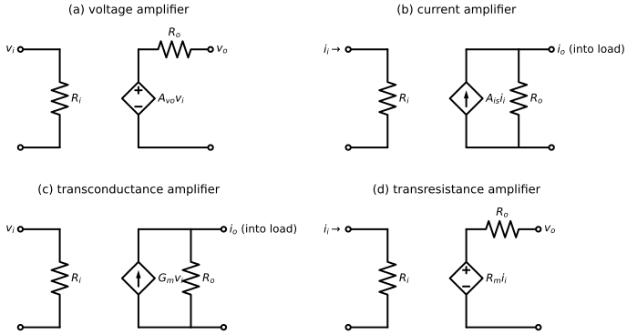
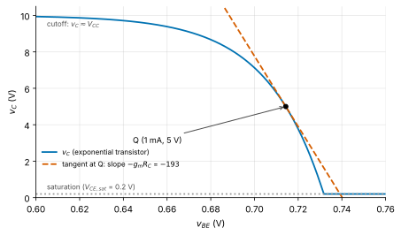

<!-- status: verified -->
# 10-05 · Amplifier Fundamentals

| | |
|---|---|
| **Course** | [10 · Electronics I (Microelectronic Circuits)](../README.md) |
| **University equivalent** | Amplifier basics in a junior Electronics I course: gain and decibels, the four amplifier models, input and output resistance, loading and cascading, the transfer characteristic and output swing, a frequency-response preview and power efficiency (Sedra & Smith, *Microelectronic Circuits*, ch. 1; Razavi, *Fundamentals of Microelectronics*, ch. 1) |
| **Prerequisites** | [10-04 Small-Signal Models](10-04-small-signal-models.md), [06-08 Thévenin and Norton](../../06-circuit-analysis-1-dc/chapters/06-08-thevenin-and-norton.md), [06-09 Maximum Power Transfer](../../06-circuit-analysis-1-dc/chapters/06-09-maximum-power-transfer.md), [07-10 Two-Port Networks](../../07-circuit-analysis-2-transient-and-ac/chapters/07-10-two-port-networks.md) |
| **Estimated study hours** | 6 |
| **Last verified** | 2026-11-19 |

**Learning objectives.** After this chapter you can:

1. Express voltage, current and power gain as ratios and in decibels, and convert between dB, dBm and absolute levels.
2. Model an amplifier as a voltage, current, transconductance or transresistance two-port, state the ideal input and output resistance of each, and convert between the models.
3. Compute the gain of an amplifier between a real source and a real load, and of a cascade with interstage loading, and choose stage order and buffers.
4. Measure input and output resistance from voltage readings, and explain when the unilateral model fails.
5. Find an amplifier's output swing from its transfer characteristic and bias point, and its low-frequency corner from coupling capacitors.
6. Derive the efficiency limit of a resistively loaded class-A stage and compare amplifier classes.

---

## 1. Big picture

10-04 turned a transistor into a linear circuit. This chapter steps back and treats a whole amplifier as a block with a few numbers: how much it amplifies, how it loads what drives it, how it behaves when loaded, how far its output can swing, at what frequencies it works and how much supply power it wastes. These are the numbers on every amplifier data sheet, and they are how designers compose systems from stages without redoing transistor-level analysis each time.

- **System design is block design.** A sensor front end, a radio receiver chain or an audio path is a cascade of amplifiers specified by gain, input and output resistance, bandwidth and swing.
- **Loading is where systems lose gain.** A stage with excellent open-circuit gain can deliver little of it into the wrong load or from the wrong source (Example 10-05.5).
- **Decibels are the common currency.** Gains multiply, so engineers add them in dB; link budgets, noise figures and data-sheet curves all use them.
- **Efficiency sets battery life and heat.** In a phone, a speaker amplifier or a datacenter's power path, the fraction of supply power that reaches the load decides the thermal design.

## 2. Intuition first

**An amplifier is a valve.** The input signal does not supply the output power: it controls how much power flows from the supply into the load. A small hand on a tap controls a large flow of water. That is why an amplifier has three ports in reality (input, output and supply), why power gain can exceed one without violating energy conservation, and why efficiency is a separate question from gain.

**A finance analogy: a fund of funds.** Each stage of a cascade takes a fee at its input (the input divider loses part of the signal) and another at its output (the output divider), and multiplies what survives. The overall return is the product of each stage's gross multiplier and all the fees, and a stage that charges a large fee on a large base (a low input resistance after a high source resistance) can destroy most of the value. *Where it breaks:* in an amplifier the "fee" at one interface depends on both neighbors (the source's output resistance and the next input resistance), which has no analogue in a fund's fixed fee schedule; and with feedback, stages also affect the ones *before* them (§3.5).

**Four ways to amplify.** The input can be sensed as a voltage or a current, and the output delivered as a voltage or a current. Each combination is a model, and each has an ideal: sense a voltage with infinite input resistance, sense a current with zero input resistance, deliver a voltage with zero output resistance, deliver a current with infinite output resistance.

*Figure 1. The four unilateral amplifier models. Each has an input resistance $R_i$, a controlled source and an output resistance $R_o$; they differ in what controls the source and whether the output is a Thévenin (voltage) or Norton (current) form.*

## 3. Theory

> **Notation.** $v_i$, $i_i$ input voltage and current; $v_o$, $i_o$ output voltage and current (with $i_o$ flowing into the load); $R_{sig}$ source resistance, $R_L$ load resistance, $R_i$ and $R_o$ the amplifier's input and output resistances. Amplitudes are peak unless "rms" is stated.

### 3.1 Gain and decibels

The **voltage gain** is $A_v = v_o/v_i$ and the **current gain** $A_i = i_o/i_i$. The input power is $v_ii_i$ and the output power $v_oi_o$, so the **power gain** is

$$
A_p = \frac{v_oi_o}{v_ii_i} = A_vA_i .
$$

Because the output power comes from the supply, $A_p$ can be very large: a voltage gain of 100 and a current gain of 1000 deliver $10^5$ times the input power (Example 10-05.1).

> **Math refresher — logarithms of products.** $\log(ab) = \log a + \log b$ (00-02). Multiplying gains becomes adding their logarithms, which is the point of decibels.

The **decibel** measures a *power* ratio: $10\log_{10}(P_2/P_1)$ dB. Since power in a resistance is $v^2/R$, a voltage ratio across *equal* resistances is $10\log_{10}(v_2^2/v_1^2) = 20\log_{10}(v_2/v_1)$ dB. By convention, voltage and current gains are quoted as $20\log_{10}|A|$ even when the resistances differ; then the voltage gain in dB is a power gain only if $R_i = R_L$. In general

$$
A_p\text{ (dB)} = \tfrac12\left[A_v\text{ (dB)} + A_i\text{ (dB)}\right] \qquad\text{since}\qquad A_p = A_vA_i .
$$

Absolute levels use a reference: **dBm** is power relative to 1 mW (0 dBm = 1 mW; 30 dBm = 1 W), and **dBV** is voltage relative to 1 V rms. In a 50 Ω system, 0 dBm is 0.224 V rms.

Two numbers recur: a factor of 2 in power is 3.01 dB and a factor of 2 in voltage is 6.02 dB; the half-power point of a response is −3.01 dB, where the voltage is $1/\sqrt2$ of its reference.

### 3.2 The four amplifier models

A **unilateral** amplifier passes signal only forward: its input port does not see what is connected to its output. It is then fully described by an input resistance, an output resistance and one gain parameter. The four models of Figure 1 are:

| Model | Senses | Delivers | Gain parameter (open or short circuit) | Ideal $R_i$ | Ideal $R_o$ |
|---|---|---|---|---|---|
| Voltage | $v_i$ | voltage | $A_{vo} = v_o/v_i$ with $R_L = \infty$ (V/V) | ∞ | 0 |
| Current | $i_i$ | current | $A_{is} = i_o/i_i$ with $R_L = 0$ (A/A) | 0 | ∞ |
| Transconductance | $v_i$ | current | $G_m = i_o/v_i$ with $R_L = 0$ (S) | ∞ | ∞ |
| Transresistance | $i_i$ | voltage | $R_m = v_o/i_i$ with $R_L = \infty$ (Ω) | 0 | 0 |

The ideals follow from the dividers of §3.3. To sense a voltage without disturbing it, the amplifier must draw no current ($R_i \to \infty$); to sense a current, it must drop no voltage ($R_i \to 0$, like an ammeter). To deliver a voltage regardless of load, it needs $R_o \to 0$; to deliver a current regardless of load, $R_o \to \infty$.

**Any model can be converted to any other.** They describe the same two-port, so they must give the same open-circuit output voltage and the same short-circuit output current for the same input. With $i_i = v_i/R_i$, the open-circuit output voltage of the transconductance model is $G_mv_iR_o$ (the Norton source into $R_o$), so its equivalent open-circuit voltage gain is $G_mR_o$. Working through all four:

$$
A_{vo} = G_mR_o = \frac{R_m}{R_i} = A_{is}\frac{R_o}{R_i} .
$$

The choice is a matter of convenience: use the model whose ideal the real amplifier approaches. A common-source MOSFET stage (infinite $R_i$, large $R_o$) is naturally a transconductance amplifier; an op-amp with feedback is close to an ideal voltage amplifier; a photodiode front end is a transresistance amplifier (10-10).

### 3.3 Loading: gain between a real source and a real load

Connect a voltage amplifier ($A_{vo}$, $R_i$, $R_o$) between a source $v_{sig}$ with resistance $R_{sig}$ and a load $R_L$. At the input, $R_{sig}$ and $R_i$ form a voltage divider; at the output, $R_o$ and $R_L$ form another (06-03). The overall gain is the product of three factors:

$$
\frac{v_o}{v_{sig}} = \underbrace{\frac{R_i}{R_i + R_{sig}}}_{\text{input loading}} \cdot A_{vo} \cdot \underbrace{\frac{R_L}{R_L + R_o}}_{\text{output loading}} .
$$

Both loading factors approach 1 when $R_i \gg R_{sig}$ and $R_o \ll R_L$. This is **bridging**: for voltage transfer, interfaces want a low source resistance into a high load resistance, not the matched $R_L = R_o$ that maximizes *power* (06-09). Matching halves the voltage and wastes half the power in $R_o$; it is used where power transfer or reflections matter (RF and transmission lines, Course 15), and almost nowhere else.

**Measuring $R_o$ and $R_i$.** An amplifier's output is a Thévenin source, so two readings determine it (06-08). Measure the open-circuit output $v_{oc}$, then the output $v_L$ with a known load $R_L$:

$$
R_o = R_L\left(\frac{v_{oc}}{v_L} - 1\right) .
$$

The input is measured the same way from the source side: with a known series resistance $R_s$ between a source of open-circuit voltage $v_s$ and the input, a reading $v_i$ at the input gives $R_i = R_s v_i/(v_s - v_i)$. A test resistance close to the unknown gives the best accuracy, because the reading then sits in the steep middle of the divider (Example 10-05.4).

### 3.4 Cascades

Most systems need more gain, or a better combination of input and output resistance, than one stage provides. In a **cascade**, each stage's output drives the next stage's input. For $n$ voltage-amplifier stages:

$$
\frac{v_o}{v_{sig}} = \frac{R_{i1}}{R_{i1} + R_{sig}}\,A_{vo1}\,\frac{R_{i2}}{R_{i2} + R_{o1}}\,A_{vo2}\cdots\frac{R_{in}}{R_{in} + R_{o,n-1}}\,A_{von}\,\frac{R_L}{R_L + R_{on}} .
$$

Each interface contributes a divider, so the order of stages matters. The usual architecture:

- an **input stage** with high input resistance (a buffer, or a stage whose input is a MOSFET gate) to avoid loading the source;
- **gain stages** in the middle;
- an **output stage** with low output resistance to drive the load. A **buffer** is a stage with gain near 1 whose only job is impedance transformation: high input, low output resistance (the source and emitter followers of 10-06 and 10-07).

In decibels, a cascade's gain is the sum of each stage's unloaded gain and each divider's (negative) dB. Examples 10-05.5 and 10-05.7 show buffers recovering tens of dB.

### 3.5 When the unilateral model fails

Real amplifiers have some reverse transmission. A general linear two-port (07-10) in admittance parameters is

$$
i_1 = y_{11}v_1 + y_{12}v_2, \qquad i_2 = y_{21}v_1 + y_{22}v_2 .
$$

The unilateral voltage amplifier is the special case $y_{12} = 0$, with $R_i = 1/y_{11}$, $R_o = 1/y_{22}$ and $A_{vo} = -y_{21}/y_{22}$. When $y_{12} \neq 0$, the input admittance depends on the load. With $Y_L = 1/R_L$ at the output, $i_2 = -Y_Lv_2$, so $v_2 = -y_{21}v_1/(y_{22} + Y_L)$ and

$$
Y_{in} = \frac{i_1}{v_1} = y_{11} - \frac{y_{12}y_{21}}{y_{22} + Y_L} .
$$

The second term can dominate: a small feedback path from output to input, multiplied by a large forward gain, can cut the input resistance by orders of magnitude (Problem 10-05.10). This is the **Miller effect** in resistive form; with a capacitor as the feedback element it limits the bandwidth of common-emitter and common-source stages (12-03). Feedback amplifiers (12-05) use the bilateral behavior deliberately. The unilateral models are accurate for single stages with no feedback element, and are always a first approximation to be checked.

### 3.6 The transfer characteristic, bias and output swing

The linear models hold only over a range. The **transfer characteristic** $v_O(v_I)$ of a real amplifier is a nonlinear curve; the bias point sets where on it the amplifier sits, and the small-signal gain is its slope there (10-04).

*Figure 2. The transfer characteristic of the common-emitter stage of Example 10-04.1. The output is limited above by cutoff ($v_C \to V_{CC}$) and below by saturation ($v_{CE} \to$ 0.2 V); the bias point Q at 5 V gives a small-signal gain of −193 (the tangent).*

For a common-emitter stage with a collector resistor $R_C$ and the emitter grounded:

- **Downward swing** ends when the transistor saturates: $v_C$ cannot fall below $V_{CE,sat}$ (about 0.2 V), so the room is $V_C - V_{CE,sat}$.
- **Upward swing** ends at cutoff: the current cannot fall below zero, so $v_C$ cannot rise above $V_{CC}$, and the room is $V_{CC} - V_C = I_CR_C$.

The largest *symmetric* swing is the smaller of the two, and the bias point that maximizes it puts $V_C$ halfway between $V_{CE,sat}$ and $V_{CC}$. With a capacitively coupled load $R_L$, the signal sees $R_C \parallel R_L$, and the upward room becomes $I_C(R_C \parallel R_L)$: the bias current, not the supply, then limits the swing (Example 10-05.6). As 10-04 §3.6 showed, distortion grows well before these hard limits for a bare BJT stage; the limits matter most for stages linearized by feedback.

### 3.7 A preview of frequency response

An amplifier's gain is flat only over a band. At low frequencies, **coupling capacitors** (which block DC between stages so that each keeps its own bias) and **bypass capacitors** stop acting as shorts. A coupling capacitor $C$ between $R_{sig}$ and $R_i$ forms a high-pass filter (07-07) with

$$
f_L = \frac{1}{2\pi C(R_{sig} + R_i)} ,
$$

because the capacitor sees the series resistance of everything around it. At high frequencies, the transistors' internal capacitances (09-06, 09-07) shunt the signal and set an upper corner $f_H$. Between them lies the **midband**, where the capacitors are negligible and the analysis of this chapter applies; the **bandwidth** is $f_H - f_L$, nearly $f_H$ when $f_L \ll f_H$. For a single dominant pole, raising the gain by feedback lowers $f_H$ in proportion, so the **gain–bandwidth product** is roughly constant (10-09). Course 12 derives $f_H$ from the device capacitances.

### 3.8 Power and efficiency

The supply delivers $P_{DC} = V_{CC}I_{supply}$; part reaches the load as signal power $P_L$, and the rest heats the transistors and resistors. The **conversion efficiency** is

$$
\eta = \frac{P_L}{P_{DC}} .
$$

**The class-A limit.** In a **class-A** stage the transistor conducts throughout the cycle around a fixed bias current. Take a resistor $R$ from $V_{CC}$ to the collector, biased at $I_Q$ with $V_C = V_{CC}/2$, so $I_Q = V_{CC}/(2R)$, and ignore saturation voltage. The largest sine output swings $\pm V_{CC}/2$, delivering $P_L = (V_{CC}/2)^2/(2R) = V_{CC}^2/(8R)$ to $R$. The supply current averages $I_Q$ whatever the signal, so $P_{DC} = V_{CC}I_Q = V_{CC}^2/(2R)$, and

$$
\eta_{max} = \frac{V_{CC}^2/8R}{V_{CC}^2/2R} = 25\% .
$$

At smaller signals $P_L$ falls as the square of the amplitude while $P_{DC}$ stays fixed, so a class-A stage at a tenth of full power runs at 2.5%. Feeding the load through an inductor or transformer instead of a resistor raises the limit to 50%, because the collector can then swing above $V_{CC}$.

**Better classes.** A **class-B** stage uses two transistors that each conduct for half the cycle, so the supply current follows the signal; its limit is π/4 = 78.5% (derived in 12-07). A **class-D** amplifier switches its output transistors fully on or off at a high frequency and filters the result; ideal switches dissipate nothing, and practical ones exceed 90% at high output (§9). The tradeoff is linearity and switching noise against efficiency, and it shapes every power amplifier from earbuds to cellular base stations.

## 4. Worked examples

### Example 10-05.1 · Gains and decibels (tier A)

**Setup.** An amplifier with $R_i$ = 10 kΩ drives a 1 kΩ load. A 10 mV rms input produces 1.0 V rms at the output. Find (a) the voltage, current and power gains as ratios and in dB; (b) the input and output power in dBm.

**Solution.**

(a) $A_v = 1.0/0.01$ = 100, or **40** dB. The input current is 10 mV/10 kΩ = 1 µA and the output current 1 V/1 kΩ = 1 mA, so $A_i$ = 1000, or **60** dB. $A_p = A_vA_i$ = **100000**, or **50** dB, the average of 40 and 60.

(b) $P_{in}$ = 10 mV × 1 µA = 10 nW = **−50** dBm and $P_L$ = 1 mW = **0** dBm, 50 dB apart.

**Sanity check.** The power gain in dB is not the voltage gain in dB, because $R_i \neq R_L$: the output resistance is ten times smaller, so the same voltage ratio carries ten times more power gain (10 dB more than 40 dB). Remember: $20\log$ for voltage is a power statement only across equal resistances.

### Example 10-05.2 · A loaded voltage amplifier (tier A)

**Setup.** An amplifier has $A_{vo}$ = 200, $R_i$ = 10 kΩ and $R_o$ = 2 kΩ. It is driven from $R_{sig}$ = 5 kΩ and loaded by $R_L$ = 3 kΩ. Find the input and output loading factors, the overall gain in V/V and dB, and the loss due to loading in dB.

**Solution.** Input: $10/(10 + 5)$ = **0.667**. Output: $3/(3 + 2)$ = **0.6**. Overall: $0.667 \times 200 \times 0.6$ = **80**, or **38.06** dB. The loading costs $20\log(80/200)$ = **−7.96** dB.

**Sanity check.** Each divider is between ½ and 1, and the overall gain lies well below $A_{vo}$: an amplifier's open-circuit gain is an upper bound, not a prediction.

### Example 10-05.3 · One stage, four models (tier B)

**Setup.** Model the common-emitter stage of Example 10-04.1 ($g_m$ = 38.68 mS, $r_\pi$ = 2.585 kΩ, $r_o$ = 50 kΩ, $R_C$ = 5 kΩ). (a) Find $R_i$, $R_o$ and $G_m$. (b) Convert to $A_{vo}$, $R_m$ and $A_{is}$. (c) Find the overall voltage gain from a 1 kΩ source into a 10 kΩ load.

**Solution.**

(a) Looking into the base, $R_i = r_\pi$ = **2.585** kΩ. With the input shorted, looking into the collector, $R_o = R_C \parallel r_o$ = **4.545** kΩ. The short-circuit output current is $-g_mv_\pi$ (the current source pulls current out of the output node), so $G_m$ = **−38.68** mS.

(b) $A_{vo} = G_mR_o$ = **−175.8**; $R_m = A_{vo}R_i$ = **−454.5** kΩ; $A_{is} = G_mR_i = -g_mr_\pi = -\beta$ = **−100**.

(c) $\frac{2.585}{3.585} \times (-175.8) \times \frac{10}{14.545}$: input factor **0.721**, output factor **0.6875**, overall **−87.16**.

**Sanity check.** The short-circuit current gain is −β, as it must be: with the output shorted, the collector current is β times the base current. No single model is "ideal" for this stage; its input resistance is low and its output resistance moderate, which is why it loses half its gain at each interface here.

### Example 10-05.4 · Measuring output and input resistance (tier B)

**Setup.** (a) An amplifier's output reads 2.00 V rms open-circuit and 1.60 V rms with a 1 kΩ load. Find $R_o$. (b) A 100 mV source drives the input through an added 10 kΩ series resistor, and the input reads 80 mV. Find $R_i$. (c) Suppose the loaded reading in (a) is 1% high (1.616 V). What $R_o$ results, and its error? Repeat with a 250 Ω test load, whose correct reading is 1.00 V, read 1% high.

**Solution.**

(a) $R_o = 1\text{ kΩ} \times (2.00/1.60 - 1)$ = **250** Ω.

(b) $R_i = 10\text{ kΩ} \times 80/(100 - 80)$ = **40** kΩ.

(c) With the 1 kΩ load: $1\text{ kΩ} \times (2/1.616 - 1)$ = **237.6** Ω, an error of **−4.95**%. With 250 Ω: $250 \times (2/1.01 - 1)$ = **245.0** Ω, an error of **−1.98**%.

**Sanity check.** A 1% reading error becomes a 5% error in $R_o$ with a test load four times $R_o$, but only 2% with a matched test load: choose the test resistance near the value you are measuring.

### Example 10-05.5 · A cascade, and why buffers exist (tier B)

**Setup.** A source with $R_{sig}$ = 10 kΩ drives two identical gain stages ($R_i$ = 10 kΩ, $A_{vo}$ = −50, $R_o$ = 5 kΩ) and a buffer ($R_i$ = 100 kΩ, $A_{vo}$ = 1, $R_o$ = 50 Ω) into a 100 Ω load. (a) Find the overall gain and its dB. (b) Remove the buffer and repeat. (c) What would the gain be with no loading at all?

**Solution.**

(a) The dividers are 10/20, 10/15, 100/105 and 100/150:

$$
0.5 \times (-50) \times 0.667 \times (-50) \times 0.952 \times 1 \times 0.667 = 529.1 ,
$$

or **529.1** (**54.47** dB).

(b) The second gain stage now drives 100 Ω directly: the last divider is 100/5100, and the gain is **16.34** (**24.26** dB).

(c) $50 \times 50$ = 2500, or **67.96** dB.

**Sanity check.** The buffer has no gain, yet removing it costs 30 dB, because a 5 kΩ output cannot drive 100 Ω. The remaining 13.5 dB of loading loss (from 67.96 dB) is spread across the first three interfaces.

### Example 10-05.6 · Output swing and class-A efficiency (tier B)

**Setup.** The common-emitter stage of Example 10-04.1 runs from $V_{CC}$ = 10 V with $R_C$ = 5 kΩ at $I_C$ = 1 mA ($V_C$ = 5 V); $V_{CE,sat}$ = 0.2 V. (a) Find the largest symmetric output swing, the signal power in $R_C$ and the efficiency. (b) What efficiency would the ideal limit give? (c) A 5 kΩ load is now capacitively coupled to the collector. Find the largest symmetric swing, the power in that load and the efficiency.

**Solution.**

(a) Downward room $5 - 0.2$ = 4.8 V, upward room $1\text{ mA} \times 5\text{ kΩ}$ = 5 V; the swing is **4.8** V peak. $P = 4.8^2/(2 \times 5\text{ kΩ})$ = **2.304** mW, against $P_{DC}$ = 10 V × 1 mA = 10 mW: η = **23.04**%.

(b) **25**%, with $V_{CE,sat}$ = 0 and the full 5 V swing.

(c) The signal now sees $R_C \parallel R_L$ = 2.5 kΩ. The current can fall by at most 1 mA, so the upward room is 1 mA × 2.5 kΩ = **2.5** V, which now limits the swing. The load receives $2.5^2/(2 \times 5\text{ kΩ})$ = **0.625** mW, and η = **6.25**%.

**Sanity check.** Three quarters of the supply power heats the stage even at full swing, and with a coupled load most of the rest is wasted in $R_C$. Resistively loaded class A suits small signals, where linearity matters and efficiency does not.

### Example 10-05.7 · A sensor front end (tier C)

**Setup.** A biopotential sensor with 100 kΩ source resistance must be amplified at least 1000 times (60 dB) into an ADC with 10 kΩ input resistance. Available: a buffer ($R_i$ = 10 MΩ, $A_{vo}$ = 1, $R_o$ = 100 Ω) and gain stages ($R_i$ = 10 kΩ, $A_{vo}$ = 40, $R_o$ = 1 kΩ). (a) Find the gain of buffer + two gain stages. (b) Find the gain without the buffer. (c) The signal must be AC-coupled into the buffer with a corner at 0.05 Hz. Find the coupling capacitor, and the corner with the next standard value, 330 nF.

**Solution.**

(a) Buffer: $\frac{10}{10.1} \times 1 \times \frac{10}{10.1}$ = **0.980** (input divider and the buffer's output into the first gain stage). Each gain stage then contributes $40 \times \frac{10}{11}$ = **36.36** (its own gain times the divider into the next 10 kΩ input). Overall: $0.980 \times 36.36^2$ = **1296**, or **62.25** dB.

(b) Without the buffer, the first divider is $10/110$: $\frac{10}{110} \times 36.36^2$ = **120.2**, or **41.60** dB, which fails the specification by 18 dB.

(c) $C = 1/(2\pi \times 0.05 \times 10.1\text{ MΩ})$ = **315** nF; with 330 nF, $f_L$ = **47.75** mHz.

**Sanity check.** A high source resistance is the norm for sensors (electrodes, piezo elements, photodiodes as current sources), and the front-end stage must have an input resistance far above it. The high input resistance also lets a small capacitor give a very low corner.

### Answer key

<!-- answer-key -->
| ID | Quantity | Value | Unit |
|---|---|---|---|
| T 10-05.a | 0 dBm in 50 Ω | 0.224 | V rms |
| T 10-05.b | power factor 2 | 3.01 | dB |
| T 10-05.c | voltage factor 2 | 6.02 | dB |
| T 10-05.d | half-power point | -3.01 | dB |
| T 10-05.e | class-A resistive-load limit | 25 | % |
| T 10-05.f | class-A at a tenth of full power | 2.5 | % |
| T 10-05.g | transformer-coupled class-A limit | 50 | % |
| T 10-05.h | class-B limit | 78.5 | % |
| T 10-05.i | 30 dBm | 1 | W |
| Ex 10-05.1a | voltage gain | 40 | dB |
| Ex 10-05.1b | current gain | 60 | dB |
| Ex 10-05.1c | power gain | 100000 | — |
| Ex 10-05.1d | power gain | 50 | dB |
| Ex 10-05.1e | input power | -50 | dBm |
| Ex 10-05.1f | output power | 0 | dBm |
| Ex 10-05.2a | input loading factor | 0.667 | — |
| Ex 10-05.2b | output loading factor | 0.6 | — |
| Ex 10-05.2c | overall gain | 80 | — |
| Ex 10-05.2d | overall gain | 38.06 | dB |
| Ex 10-05.2e | loading loss | -7.96 | dB |
| Ex 10-05.3a | R_i | 2.585 | kΩ |
| Ex 10-05.3b | R_o | 4.545 | kΩ |
| Ex 10-05.3c | G_m | -38.68 | mS |
| Ex 10-05.3d | A_vo | -175.8 | — |
| Ex 10-05.3e | R_m | -454.5 | kΩ |
| Ex 10-05.3f | A_is | -100 | — |
| Ex 10-05.3g | input factor | 0.721 | — |
| Ex 10-05.3h | output factor | 0.6875 | — |
| Ex 10-05.3i | overall gain | -87.16 | — |
| Ex 10-05.4a | R_o | 250 | Ω |
| Ex 10-05.4b | R_i | 40 | kΩ |
| Ex 10-05.4c | R_o from a 1% high reading, 1 kΩ load | 237.6 | Ω |
| Ex 10-05.4d | error | -4.95 | % |
| Ex 10-05.4e | R_o from a 1% high reading, 250 Ω load | 245.0 | Ω |
| Ex 10-05.4f | error | -1.98 | % |
| Ex 10-05.5a | gain with buffer | 529.1 | — |
| Ex 10-05.5b | gain with buffer | 54.47 | dB |
| Ex 10-05.5c | gain without buffer | 16.34 | — |
| Ex 10-05.5d | gain without buffer | 24.26 | dB |
| Ex 10-05.5e | unloaded gain | 67.96 | dB |
| Ex 10-05.6a | largest symmetric swing | 4.8 | V |
| Ex 10-05.6b | signal power | 2.304 | mW |
| Ex 10-05.6c | efficiency | 23.04 | % |
| Ex 10-05.6d | ideal efficiency | 25 | % |
| Ex 10-05.6e | swing with coupled load | 2.5 | V |
| Ex 10-05.6f | power in the coupled load | 0.625 | mW |
| Ex 10-05.6g | efficiency with coupled load | 6.25 | % |
| Ex 10-05.7a | buffer factor | 0.980 | — |
| Ex 10-05.7b | gain-stage factor | 36.36 | — |
| Ex 10-05.7c | overall gain | 1296 | — |
| Ex 10-05.7d | overall gain | 62.25 | dB |
| Ex 10-05.7e | gain without buffer | 120.2 | — |
| Ex 10-05.7f | gain without buffer | 41.60 | dB |
| Ex 10-05.7g | coupling capacitor | 315 | nF |
| Ex 10-05.7h | corner with 330 nF | 47.75 | mHz |

*Every value is recomputed by [verify_10_05.py](../verify/verify_10_05.py): gains by solving each cascade's nodal equations with the stages as controlled sources (not by multiplying dividers), resistances from simulated two-reading measurements, swing and efficiency from the exponential transistor's transfer characteristic, and corners by finding the −3 dB point of the complex response. The lab's ngspice netlist confirms Examples 10-05.2, 10-05.5 and 10-05.7.*

## 5. Simulate it

The lab, [labs/10-05-lab](../labs/10-05-lab/README.md), has a notebook and an ngspice netlist:

1. Sweeps $R_L$ and $R_{sig}$ around Example 10-05.2's amplifier and plots voltage gain against load power, showing bridging against matching.
2. Searches every order of a set of stages for the best cascade.
3. Drives the common-emitter stage of Figure 2 with growing sines and measures output swing, distortion and efficiency against amplitude.
4. Plots the full frequency response of Example 10-05.7's front end, including the coupling capacitor.

The netlist (`amp_cascade.cir`) builds the cascades of Examples 10-05.2 and 10-05.5 from controlled sources and runs an AC sweep of Example 10-05.7's coupling network.

**Guided exercise (predict, then run).** **Before running Part 1**, predict: for Example 10-05.2's amplifier ($R_o$ = 2 kΩ), at what load resistance is the power delivered to the load largest, and what fraction of the open-circuit voltage gain survives there? Then run it. (At $R_L = R_o$ = 2 kΩ, by 06-09; the output divider is then exactly ½, so half the voltage gain is lost to deliver the most power.)

## 6. Engineering tradeoffs

| Knob | Improves | Costs | Typical decision owner |
|---|---|---|---|
| Higher input resistance | Less source loading; smaller coupling capacitors | Often more noise (current noise, Course 12) or a buffer stage's power | Analog designer |
| Lower output resistance | Drives heavy loads | Output-stage current and area | Analog designer |
| More stages | Gain | Bandwidth, power, stability with feedback (Course 12) | Architect |
| Matching (vs bridging) | Power transfer; no reflections on lines | Half the voltage; half the power lost in the source | RF/system designer |
| Class A → B → D | Efficiency (25% → 78.5% → over 90%) | Linearity, crossover distortion, switching noise and filtering | Product architect |
| Lower $f_L$ (bigger coupling capacitors) | Low-frequency response | Size, cost, settling time after steps | Board designer |

## 7. Numbers to know

| Quantity | Value | Note |
|---|---|---|
| 2× power / 2× voltage | 3.01 dB / 6.02 dB | |
| −3 dB | half power, $1/\sqrt2$ voltage | |
| 0 dBm | 1 mW; 0.224 V rms in 50 Ω | |
| 30 dBm | 1 W | |
| Class-A limit | 25% (resistive load), 50% (inductor or transformer) | |
| Class-B limit | 78.5% | 12-07 |
| Class-D audio | over 90% at high output [1] | data sheet; as of Nov 2026 |
| Coupling corner | $1/[2\pi C(R_{sig} + R_i)]$ | |

## 8. Common mistakes

1. **Quoting $20\log A_v$ as a power gain** when the input and load resistances differ.
2. **Using $A_{vo}$ as the gain in a system.** It is the open-circuit gain; the loaded gain is always lower.
3. **Matching for voltage transfer.** Matching maximizes power, not voltage; voltage interfaces bridge.
4. **Forgetting the source and load in a coupling-capacitor corner.** The capacitor sees $R_{sig} + R_i$, not $R_i$ alone.
5. **Assuming a unilateral model with a feedback element present.** The input resistance then depends on the load (§3.5).
6. **Computing efficiency at full swing only.** Class-A efficiency falls with the square of the signal; real signals are mostly small.
7. **Ignoring the coupled load in swing calculations.** The AC load $R_C \parallel R_L$ can limit swing through the bias current.

## 9. Practitioner lens

### State of the art (as of Nov 2026)

- **Integrated class-D audio amplifiers dominate speaker drive.** The TI TPA3116D2 family, a representative part, specifies over 90% power efficiency, up to 2 × 50 W into 4 Ω at 21 V (at 10% THD+N), 0.1% THD+N at 25 W, and a quiescent current of 20 mA typical at 12 V [1] **[Established]** (data-sheet specification).
- **Gain and input resistance trade in integrated amplifiers.** The same part sets its gain to 20, 26, 32 or 36 dB with a resistor divider on one pin, and its input impedance falls from 60 kΩ to 9 kΩ (±20%) as the gain rises; the data sheet sizes the input coupling capacitors (1.5 to 10 µF) for corners near 2 Hz [1] **[Established]**. This is §3.3 and §3.7 in a data sheet.
- **Standardized interfaces are matched, everything else bridges.** 50 Ω RF chains and transmission lines are matched for power transfer and reflections (06-09, Course 15), while audio, sensor and on-chip interfaces bridge **[Established]** (textbook practice).

### Why it matters commercially

- **Efficiency is thermal design and battery life.** At 50 W of output, a 90%-efficient class-D stage dissipates about 5.6 W, while an ideal class-A stage would dissipate 150 W (Problem 10-05.9): the difference between no heat sink and a large one, and in a portable product, between a usable and an unusable battery life.
- **Interfaces are where integration pays.** Every off-chip interface needs buffers, coupling capacitors and protection; integrating stages removes interfaces and their loading losses, part of the case for system-on-chip and system-in-package designs.
- **Sensor front ends are a growth category.** Wearables, medical patches and industrial IoT all begin with a high-impedance, low-power amplifier (Example 10-05.7), a design problem that 10-04's $g_m/I_D$ and this chapter's loading rules frame.

### Marketing vs Reality

- **"2 × 50 W amplifier."** *Reality:* the 50 W figure is at 10% THD+N, a heavily clipped waveform; the data sheet's 0.1% THD+N figure is given at 25 W [1]. *Sanity check:* ask for output power at 1% THD+N or less, at a stated supply and load.
- **"Over 90% efficient."** *Reality:* efficiency is a curve against output power. Idle loss alone (20 mA at 12 V = 0.24 W) caps efficiency at 1 W of output below 81% (Problem 10-05.12). *Sanity check:* ask for efficiency at the typical listening or operating level, not at full power.
- **"High-gain front end."** *Reality:* open-circuit gain is not system gain; with a high-impedance sensor, input loading can erase tens of dB (Example 10-05.7). *Sanity check:* ask for the input resistance and the source resistance it was specified with.

### Questions for engineering leaders

1. **"What is the loaded gain of this signal chain, end to end, and where are the losses?"**
   *Strong:* a stage-by-stage budget in dB including interface dividers. *Evasive:* the sum of stage gains from data sheets.
2. **"At what output level do you quote efficiency, and what is it at typical use?"**
   *Strong:* a curve, the idle loss and the typical operating point. *Evasive:* the peak number only.
3. **"What source impedance does your front end assume, and what happens at the worst-case sensor?"**
   *Strong:* a range, the input resistance and the resulting gain spread. *Evasive:* "the input is high impedance."

## 10. Concept check

**Q1.** Can an amplifier's power gain exceed one without violating conservation of energy?

Answer

Yes. The output power comes from the supply; the input only controls its flow. Energy conservation applies to supply plus input against output plus dissipation, not to input against output.

**Q2.** Why is the ideal input resistance of a current amplifier zero?

Answer

A current-sensing input sits in series with the signal path, like an ammeter; any resistance there drops voltage and, with a real source resistance, diverts some of the source's current. Zero input resistance takes all of it.

**Q3.** A 40 dB voltage amplifier has $R_i$ = 50 Ω and drives 50 Ω. What is its power gain in dB?

Answer

40 dB: with equal input and load resistances, the voltage ratio squared is the power ratio, so $20\log A_v = 10\log A_p$.

**Q4.** Why do voltage interfaces bridge rather than match?

Answer

Bridging ($R_L \gg R_o$) delivers nearly the full open-circuit voltage and wastes little power in $R_o$; matching delivers half the voltage and the most power, which matters only when power or reflections are the goal.

**Q5.** Why does a buffer with a gain of 1 raise the gain of a cascade?

Answer

It replaces a bad interface (a high output resistance into a low load, or a high source resistance into a low input resistance) with two good ones; the dividers it removes cost more than its own slight loss.

**Q6.** A class-A stage is 25% efficient at full swing. What is it at half the full-swing amplitude?

Answer

6.25%: output power scales with the square of the amplitude, while the supply power is fixed by the bias.

**Q7.** An amplifier's input resistance changes when you change its load. What does that tell you?

Answer

It is bilateral: some signal path ($y_{12} \neq 0$) runs from output to input, such as a feedback resistor or a capacitance, and the unilateral model is not valid.

[Problem set for this chapter](../problems/10-05-problems.md)

## 11. Key terms

[Decibel](../../../reference/glossary.md#decibel) · [dBm](../../../reference/glossary.md#dbm) · [Voltage amplifier](../../../reference/glossary.md#voltage-amplifier) · [Current amplifier](../../../reference/glossary.md#current-amplifier) · [Transconductance amplifier](../../../reference/glossary.md#transconductance-amplifier) · [Transresistance amplifier](../../../reference/glossary.md#transresistance-amplifier) · [Input resistance](../../../reference/glossary.md#input-resistance) · [Output resistance](../../../reference/glossary.md#output-resistance) · [Loading effect](../../../reference/glossary.md#loading-effect) · [Unilateral amplifier](../../../reference/glossary.md#unilateral-amplifier) · [Buffer amplifier](../../../reference/glossary.md#buffer-amplifier) · [Midband gain](../../../reference/glossary.md#midband-gain) · [Conversion efficiency](../../../reference/glossary.md#conversion-efficiency) · [Class-A amplifier](../../../reference/glossary.md#class-a-amplifier) · [Class-D amplifier](../../../reference/glossary.md#class-d-amplifier)

## 12. Connections

- **Builds on:** small-signal models from [10-04](10-04-small-signal-models.md); Thévenin and Norton from [06-08](../../06-circuit-analysis-1-dc/chapters/06-08-thevenin-and-norton.md); maximum power transfer from [06-09](../../06-circuit-analysis-1-dc/chapters/06-09-maximum-power-transfer.md); two-port parameters from [07-10](../../07-circuit-analysis-2-transient-and-ac/chapters/07-10-two-port-networks.md); Bode plots from [07-07](../../07-circuit-analysis-2-transient-and-ac/chapters/07-07-frequency-response-and-bode-plots.md).
- **Next:** [10-06 MOS Single-Stage Amplifiers](10-06-mos-single-stage-amplifiers.md) finds $A_{vo}$, $R_i$ and $R_o$ for each MOSFET configuration; [10-07](10-07-bjt-single-stage-amplifiers.md) does the same for the BJT.
- **Used later:** the Miller effect and frequency response in [12-03](../../12-electronics-2/chapters/12-03-frequency-response-miller-poles-zeros.md); feedback topologies in [12-05](../../12-electronics-2/chapters/12-05-feedback-topologies.md); output stages and amplifier classes in [12-07](../../12-electronics-2/chapters/12-07-output-stages.md).

## 13. Further study

- A. S. Sedra and K. C. Smith, *Microelectronic Circuits*, ch. 1 (amplifiers, the four models, frequency response).
- B. Razavi, *Fundamentals of Microelectronics*, ch. 1 (amplifier basics and loading).
- The TPA3116D2 data sheet [1], sections 6 and 7.3: a real amplifier's gain, input impedance and efficiency specifications.

## 14. Sources

1. Texas Instruments, *TPA3116D2, TPA3118D2, TPA3130D2 15-W, 30-W, 50-W Filter-Free Class-D Stereo Amplifier Family With AM Avoidance*, SLOS708G, revised December 2017: features, §6.5–6.6 (quiescent current, output power, THD+N), Table 1 (gain and input impedance) and Table 2 (coupling capacitors): [data sheet](https://www.ti.com/lit/ds/symlink/tpa3116d2.pdf). [R-179](../../../reference/research-log.md#r-179--class-d-audio-amplifier-data-sheet).
