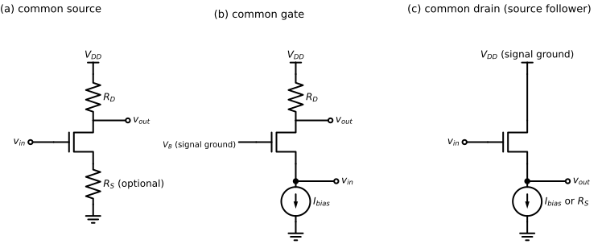
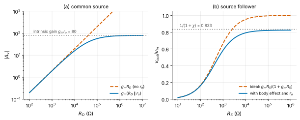

<!-- status: verified -->
# 10-06 · MOS Single-Stage Amplifiers

| | |
|---|---|
| **Course** | [10 · Electronics I (Microelectronic Circuits)](../README.md) |
| **University equivalent** | MOSFET single-stage amplifiers in a junior Electronics I course: common source with and without degeneration, common gate and common drain; gain, input and output resistance with $r_o$ and body effect (Sedra & Smith, *Microelectronic Circuits*, ch. 7; Razavi, *Fundamentals of Microelectronics*, ch. 7; Razavi, *Design of Analog CMOS Integrated Circuits*, ch. 3) |
| **Prerequisites** | [10-04 Small-Signal Models](10-04-small-signal-models.md), [10-05 Amplifier Fundamentals](10-05-amplifier-fundamentals.md), [10-02 MOSFET DC Operation and Biasing](10-02-mosfet-dc-operation-and-biasing.md) |
| **Estimated study hours** | 12 |
| **Last verified** | 2026-11-19 |

**Learning objectives.** After this chapter you can:

1. Identify the common-source, common-gate and common-drain configurations and state what each is for.
2. Derive the voltage gain, input resistance and output resistance of each, including $r_o$ and the body effect, by drawing and solving the small-signal circuit.
3. Derive how source degeneration trades transconductance for output resistance and linearity, and compute $r_o(1 + g_mR_S)$-type output resistances with a test source.
4. Relate common-source gain to voltage headroom and overdrive ($A_v = -2V_{RD}/V_{ov}$), and to the intrinsic gain limit.
5. Combine stages using 10-05's two-port models, and choose a configuration for a given source, load and specification.

---

## 1. Big picture

A MOSFET has three terminals; an amplifier needs an input, an output and a common reference for both. Choosing which terminal is common (at signal ground) gives three single-stage amplifiers, and every CMOS analog circuit, from an op-amp to a radio receiver to an image sensor's pixel, is built from them. This chapter derives each one's gain, input resistance and output resistance from the small-signal model of 10-04, and casts the results as 10-05's two-port models so that stages can be combined.

- **Common source (CS)** is the gain stage: input at the gate, output at the drain.
- **Common gate (CG)** is the current buffer: input at the source, low input resistance, used in cascodes and wideband 50 Ω inputs.
- **Common drain (CD)**, the **source follower**, is the voltage buffer: high input resistance, low output resistance, gain just under one; every CMOS image sensor pixel contains one.
- **Degeneration and output resistance** are the bridge to Course 12: the $r_o(1 + g_mR_S)$ boost derived here is the principle behind cascodes and high-gain op-amps.

## 2. Intuition first

**Three ways to use a valve.** The MOSFET is a voltage-controlled current source from drain to source (10-04). Which terminal you drive and which you watch decides the stage:

- Drive the gate, watch the drain (CS): the gate voltage sets a current, and the current through $R_D$ makes an inverted, amplified voltage.
- Drive the source, watch the drain (CG): pulling the source down raises $v_{GS}$ just as raising the gate would, so the drain moves in the *same* direction as the input, and the source draws current: its input resistance is about $1/g_m$.
- Drive the gate, watch the source (CD): the source follows the gate one $V_{GS}$ below it, because any difference changes the current until the source catches up.

**A finance analogy: three ways to hold an exposure.** A CS stage is a leveraged position: a small move in the input becomes a large, inverted move in the output, and the leverage ($g_mR_D$) is bought with headroom. A source follower is a fully hedged position: the output tracks the input almost one for one, adding no gain but changing who carries the load (its low output resistance). A CG stage is a pass-through vehicle: it takes current in at one price (low impedance) and delivers it at another (high impedance) without changing the amount. *Where it breaks:* leverage in finance scales returns symmetrically; the CS stage's "leverage" is bounded by the transistor's own $g_mr_o$ however large $R_D$ is, and its gain falls at high frequency (Course 12).

*Figure 1. The three configurations. In each, one terminal is at signal ground: the source in CS (or through $R_S$), the gate in CG ($V_B$ is a DC bias) and the drain in CD ($V_{DD}$).*

## 3. Theory

> **Conventions.** Square-law NMOS with $g_m = \sqrt{2k_nI_D} = 2I_D/V_{ov}$ and $r_o = 1/(\lambda I_D)$ (10-04). The body effect enters as $g_{mb}v_{bs}$ with $g_{mb} = \chi g_m$ when the source is not at the body potential. Capacitors are short circuits and DC sources are signal ground. All results are midband.

### 3.1 The analysis recipe

For each configuration we find the three numbers of 10-05's model:

- **Voltage gain** $A_v = v_{out}/v_{in}$ with the stated load (open circuit or $R_D$ only gives $A_{vo}$).
- **Input resistance** $R_{in}$: apply a test voltage at the input, find the current.
- **Output resistance** $R_{out}$: set the input source to zero (keep its resistance), apply a test voltage $v_x$ at the output, find the current $i_x$; $R_{out} = v_x/i_x$.

The test-source method is necessary whenever a controlled source is involved: the controlled source must stay in the circuit (06-06).

### 3.2 Common source

**Basic stage.** Gate driven, source grounded, $R_D$ to $V_{DD}$. The small-signal circuit is $g_mv_{gs}$ in parallel with $r_o$ and $R_D$ at the drain, with $v_{gs} = v_{in}$:

$$
A_v = -g_m(R_D \parallel r_o), \qquad R_{in} = \infty, \qquad R_{out} = R_D \parallel r_o .
$$

It is a transconductance amplifier with $G_m = g_m$ in 10-05's terms, or a voltage amplifier with $A_{vo} = -g_m(R_D \parallel r_o)$. A load $R_L$ appears in parallel with $R_D$ and $r_o$.

**Gain is a voltage budget.** Ignoring $r_o$ and using $g_m = 2I_D/V_{ov}$:

$$
|A_v| = g_mR_D = \frac{2I_DR_D}{V_{ov}} = \frac{2V_{RD}}{V_{ov}} ,
$$

where $V_{RD}$ is the DC voltage across $R_D$. The gain depends only on two voltages: the drop across the load and the overdrive. With $V_{RD}$ = 2.5 V and $V_{ov}$ = 0.5 V the gain is 10 at any current (Example 10-06.1). To raise the gain you must either spend more supply voltage across $R_D$ (less output swing, a larger supply) or lower the overdrive (lower speed and linearity, 10-04 §3.6). This is why low-voltage CMOS cannot get gain from resistors: at a 0.9 V supply there is no room for a large $V_{RD}$.

**The intrinsic limit.** As $R_D \to \infty$ the gain approaches $g_mr_o$, the intrinsic gain (Figure 2a). Replacing $R_D$ with a current source (a PMOS transistor, the **active load** of 12-02) achieves that: $A_v = -g_m(r_{on} \parallel r_{op})$, about $g_mr_o/2$ for equal output resistances, without spending headroom on a resistor.

### 3.3 Common source with degeneration

Add an unbypassed resistor $R_S$ in the source. Now $v_{gs} = v_{in} - v_s$ and the source moves with the current: the negative feedback of 10-02 §3.4, applied to signals.

**Transconductance.** Short the drain to signal ground and find the output current $i$ (flowing from drain to source inside the device). With $v_s = iR_S$ and the body at ground ($v_{bs} = -v_s$), the current through the device is the controlled sources plus the current in $r_o$ (from drain at 0 V to the source):

$$
i = g_m(v_{in} - iR_S) - g_{mb}iR_S - \frac{iR_S}{r_o} \quad\Rightarrow\quad G_m = \frac{i}{v_{in}} = \frac{g_m}{1 + (g_m + g_{mb})R_S + R_S/r_o} \approx \frac{g_m}{1 + g_mR_S} .
$$

**Output resistance.** Ground the gate, drive the drain with $v_x$ and call the drain current $i_x$. Then $v_s = i_xR_S$, and

$$
i_x = g_m(0 - v_s) + g_{mb}(0 - v_s) + \frac{v_x - v_s}{r_o}
\quad\Rightarrow\quad
R_{out,D} = \frac{v_x}{i_x} = r_o + R_S + (g_m + g_{mb})r_oR_S .
$$

Check the units: every term is a resistance, since $g_mr_o$ is dimensionless. Without the body effect and for $g_mR_S \gg 1$, $R_{out,D} \approx r_o(1 + g_mR_S)$. **Degeneration multiplies the output resistance by about $1 + g_mR_S$**, the same factor by which it divides the transconductance. Physically: when the drain voltage rises, the extra current through $r_o$ raises $v_s$, which lowers $v_{gs}$ and pushes the current back down. The transistor fights to hold its current constant.

**Voltage gain.** The stage is still unilateral (no current flows into the gate), so with $R_D$ at the drain:

$$
A_v = -G_m(R_D \parallel R_{out,D}) \approx -\frac{g_mR_D}{1 + g_mR_S} = -\frac{R_D}{1/g_m + R_S} .
$$

The last form says the gain is the ratio of the resistance at the drain to the resistance "in the source," $1/g_m + R_S$. For $g_mR_S \gg 1$ it becomes $-R_D/R_S$: set by resistors, insensitive to $g_m$, and therefore to threshold, temperature and signal amplitude. That insensitivity is also linearity. The same $1 + g_mR_S$ that divides the gain divides the distortion of the square law, which is why degenerated stages handle larger signals (Problem 10-06.9).

**The cascode preview.** If the "resistor" in the source is itself the output resistance $r_o$ of another transistor, the output resistance becomes about $g_mr_o \cdot r_o$, and the gain with an ideal current-source load reaches about $(g_mr_o)^2$ (Example 10-06.7). This is the **cascode**, the workhorse of 12-02 and Course 20.

### 3.4 Common gate

Gate at signal ground ($V_B$ is DC), input at the source, output at the drain with $R_D$.

**Input resistance.** Drive the source with $v_x$. Then $v_{gs} = -v_x$ and $v_{bs} = -v_x$ (body at ground). Let $i$ be the current from drain to source inside the device, and $v_d = -iR_D$ (the current comes down through $R_D$). Then

$$
i = -(g_m + g_{mb})v_x + \frac{v_d - v_x}{r_o} = -(g_m + g_{mb})v_x - \frac{iR_D + v_x}{r_o} ,
$$

so $i = -v_x[1 + (g_m + g_{mb})r_o]/(r_o + R_D)$. The current *into* the source terminal is $-i$, and

$$
R_{in} = \frac{r_o + R_D}{1 + (g_m + g_{mb})r_o} \approx \frac{1}{g_m + g_{mb}} \quad\text{(for } R_D \ll r_o\text{)} .
$$

The input resistance is low, about $1/g_m$, but it rises with the load: with $R_D = r_o$ it is about $2/(g_m + g_{mb})$, and with an ideal current-source load ($R_D \to \infty$) it grows without bound. The CG stage is bilateral through $r_o$ (10-05 §3.5): what hangs on the drain changes what the source sees.

**Gain.** From the same solution, $v_d/v_x = R_D[1 + (g_m + g_{mb})r_o]/(r_o + R_D)$, or

$$
A_v = (g_m + g_{mb} + 1/r_o)(R_D \parallel r_o) \approx (g_m + g_{mb})R_D ,
$$

positive (non-inverting) and about the same size as the CS gain, plus the body effect's help: here the body effect *raises* the gain, because the source is the input and $v_{bs}$ adds to $v_{gs}$.

**Output resistance.** With the input source's resistance $R_{sig}$ at the source, the drain sees exactly the degenerated output resistance of §3.3 with $R_S = R_{sig}$, in parallel with $R_D$:

$$
R_{out} = R_D \parallel [r_o + R_{sig} + (g_m + g_{mb})r_oR_{sig}] .
$$

**What it is for.** A CG stage takes a current in at low impedance and delivers it at high impedance with unity current gain: a **current buffer**. It does not load a current source driving it, and its high output resistance makes it the upper device of a cascode. With $1/(g_m + g_{mb})$ = 50 Ω it presents a matched input to a 50 Ω antenna or cable over a wide band (Example 10-06.3). Its weakness is that low input resistance: driven from a high-resistance *voltage* source, most of the signal is lost at the input divider.

### 3.5 Common drain: the source follower

Drain at signal ground, input at the gate, output at the source, with a bias resistor or current source $R_S$ from source to ground and a load $R_L$.

**Gain.** At the source node, the device current $g_m(v_{in} - v_{out}) + g_{mb}(0 - v_{out})$ plus the current through $r_o$ from the drain (at signal ground), $-v_{out}/r_o$, flows into $R_S \parallel R_L$:

$$
g_m(v_{in} - v_{out}) - g_{mb}v_{out} - \frac{v_{out}}{r_o} = \frac{v_{out}}{R_S \parallel R_L} .
$$

Solving,

$$
A_v = \frac{g_m}{g_m + g_{mb} + 1/r_o + 1/(R_S \parallel R_L)} = \frac{g_mR_{eq}}{1 + g_mR_{eq}}, \qquad R_{eq} = R_S \parallel R_L \parallel r_o \parallel \frac{1}{g_{mb}} .
$$

The body effect appears as a resistor $1/g_{mb}$ from the output to ground: the body, held at ground, pulls back on the source as it rises. Even with an ideal current-source bias and no load, the gain is only

$$
A_{v,max} = \frac{g_m}{g_m + g_{mb}} = \frac{1}{1 + \chi} ,
$$

0.83 for χ = 0.2 (Figure 2b). Putting the transistor in its own well with the body tied to the source removes this loss, at the cost of area and the well's capacitance.

**Output resistance.** Ground the input and drive the output with $v_x$: the current is $(g_m + g_{mb} + 1/r_o + 1/R_S)v_x$, so

$$
R_{out} = \frac{1}{g_m} \parallel \frac{1}{g_{mb}} \parallel r_o \parallel R_S \approx \frac{1}{g_m + g_{mb}} .
$$

A few hundred ohms for $g_m$ of a few mS: much lower than a CS stage's output resistance, which is the point.

**Input resistance:** infinite at midband (the gate). The follower is a near-ideal voltage-buffer input with a modest output resistance; 10-05's loading rules then say when it helps (Example 10-06.6).

**Swing and level shift.** The output sits one $V_{GS}$ below the input: a DC level shift that is sometimes useful (to bias the next stage) and always a cost in headroom. The output cannot rise above $V_{DD} - V_{GS}$ for an NMOS follower, and with the body effect $V_{GS}$ itself grows as the output rises (10-02 §3.1).

*Figure 2. (a) Common-source gain against $R_D$ for $g_m$ = 2 mS: without $r_o$ the gain grows without limit; with $r_o$ = 40 kΩ it saturates at the intrinsic gain 80. (b) Source-follower gain against $R_S$: the ideal approaches 1; with body effect (χ = 0.2) and $r_o$ it approaches 0.83.*

### 3.6 Summary and selection

| | Common source | CS + degeneration | Common gate | Common drain |
|---|---|---|---|---|
| $A_v$ (approx.) | $-g_m(R_D \parallel r_o)$ | $-R_D/(1/g_m + R_S)$ | $(g_m + g_{mb})R_D$ | $\dfrac{g_mR_{eq}}{1 + g_mR_{eq}} < \dfrac{1}{1 + \chi}$ |
| $R_{in}$ | ∞ | ∞ | ≈ $1/(g_m + g_{mb})$ | ∞ |
| $R_{out}$ | $R_D \parallel r_o$ | $R_D \parallel r_o(1 + g_mR_S)$ | $R_D \parallel r_o(1 + g_mR_{sig})$ | ≈ $1/(g_m + g_{mb})$ |
| Inverts? | yes | yes | no | no |
| Role | voltage gain | predictable, linear gain | current buffer, cascode, 50 Ω input | voltage buffer, level shift |

Choosing among them is 10-05's loading problem: a high-resistance voltage source wants a gate input (CS or CD); a current source or a 50 Ω line wants a source input (CG); a low-resistance load wants a source output (CD). Multistage amplifiers combine them: CS for gain, CD to drive, CG to cascode.

## 4. Worked examples

Unless stated otherwise, the transistor has $k_n$ = 4 mA/V², $V_{TN}$ = 0.5 V and λ = 0.05 V⁻¹, and runs at $I_D$ = 0.5 mA from $V_{DD}$ = 5 V.

### Example 10-06.1 · Common source (tier A)

**Setup.** Source grounded, $R_D$ = 5 kΩ. (a) Find $V_{ov}$, $g_m$ and $r_o$. (b) Find $A_{vo}$ and $R_{out}$. (c) Find the gain into a 10 kΩ load coupled to the drain. (d) Compare $g_mR_D$ with $2V_{RD}/V_{ov}$.

**Solution.**

(a) $V_{ov} = \sqrt{2I_D/k_n}$ = **0.5** V; $g_m = \sqrt{2k_nI_D}$ = **2.0** mS; $r_o$ = **40** kΩ.

(b) $R_{out} = 5 \parallel 40$ = **4.444** kΩ and $A_{vo} = -2 \times 4.444$ = **−8.889**.

(c) $-g_m(5 \parallel 40 \parallel 10)$ = **−6.154**.

(d) $g_mR_D$ = **10**, and $V_{RD}$ = 2.5 V gives $2 \times 2.5/0.5$ = **10**: the same number, by the voltage-budget identity.

**Sanity check.** The drain sits at 2.5 V, above $V_{ov}$ = 0.5 V, so the transistor is saturated with 2 V of room for the output to fall.

### Example 10-06.2 · Degeneration (tier B)

**Setup.** Add $R_S$ = 500 Ω (unbypassed; body tied to source). (a) Find $G_m$ without and with $r_o$. (b) Find $R_{out}$ at the drain (excluding $R_D$). (c) Find the voltage gain with $R_D$ = 5 kΩ, and compare with $-R_D/(1/g_m + R_S)$.

**Solution.**

(a) Without $r_o$: $2/(1 + 1)$ = **1.0** mS. With $r_o$: $2/(1 + 1 + 0.0125)$ = **0.9938** mS.

(b) $40 + 0.5 + 2 \times 40 \times 0.5$ = **80.5** kΩ: degeneration with $g_mR_S$ = 1 roughly doubles the output resistance.

(c) $-0.9938 \times (5 \parallel 80.5)$ = **−4.678**; the approximation gives $-5/(0.5 + 0.5)$ = **−5.0**.

**Sanity check.** Half the gain of Example 10-06.1, as $1 + g_mR_S$ = 2 predicts; the 6% difference is $r_o$, which now matters less because the output resistance has grown.

### Example 10-06.3 · Common gate (tier B)

**Setup.** Gate at a DC bias, input at the source, $R_D$ = 5 kΩ, χ = 0.2 (body at ground). (a) Ignoring $r_o$, find $g_{mb}$, $R_{in}$, the gain from the source node and the overall gain from a 50 Ω source. (b) Including $r_o$, find $R_{in}$ and the gain from the source node. (c) For a matched 50 Ω input at $V_{ov}$ = 0.2 V, what $g_m$ and drain current are needed?

**Solution.**

(a) $g_{mb}$ = **0.4** mS; $R_{in} = 1/2.4\text{ mS}$ = **416.7** Ω; $A_v = 2.4 \times 5$ = **12.0**; overall $12 \times 416.7/466.7$ = **10.71**.

(b) $R_{in} = (40 + 5)\text{ kΩ}/(1 + 2.4 \times 40)$ = **463.9** Ω; $A_v = (2.4 + 0.025) \times 4.444$ = **10.78**.

(c) $g_m(1 + \chi)$ = 20 mS gives $g_m$ = **16.67** mS, and $I_D = g_mV_{ov}/2$ = **1.667** mA.

**Sanity check.** The input resistance (417 Ω) is far from 50 Ω at 0.5 mA: matching costs current. And $r_o$ raised $R_{in}$ by 11%, because the drain load is not small against $r_o$: a CG stage's input depends on its load.

### Example 10-06.4 · Source follower (tier B)

**Setup.** Drain at $V_{DD}$, $R_S$ = 5 kΩ from source to ground, χ = 0.2, $r_o$ = 40 kΩ. (a) Find $R_{eq}$, the gain and its upper limit. (b) Find $R_{out}$. (c) Find the gain with a 1 kΩ load coupled to the source.

**Solution.**

(a) $1/R_{eq} = 1/5 + 1/40 + 0.4$ mS = 0.625 mS, so $R_{eq}$ = **1.6** kΩ and $A_v = 3.2/4.2$ = **0.7619**. The limit is $1/1.2$ = **0.8333**.

(b) $1/(2 + 0.4 + 0.025 + 0.2)$ mS = **381** Ω.

(c) $R_{eq}$ falls to $1.6 \parallel 1$ kΩ = 615.4 Ω, and $A_v$ = **0.5517**.

**Sanity check.** The follower's 381 Ω output resistance into 1 kΩ is a divider of about 0.72, and 0.7619 × 0.72 ≈ 0.55. The Thévenin view (open-circuit gain 0.7619, output resistance 381 Ω) and the direct solution agree.

### Example 10-06.5 · Gain, headroom and current (tier B)

**Setup.** A CS stage in a 1.8 V process must bias its output at 0.9 V ($V_{RD}$ = 0.9 V) with $V_{ov}$ = 0.2 V and $I_D$ = 100 µA; λ = 0.2 V⁻¹ (a short channel). (a) Find the gain ignoring $r_o$. (b) Find $g_m$, $r_o$, $R_D$, the intrinsic gain and the gain with $r_o$.

**Solution.**

(a) $2 \times 0.9/0.2$ = **9.0**, so $A_v$ = **−9.0**.

(b) $g_m = 2 \times 100\ \mu\text{A}/0.2\text{ V}$ = **1.0** mS; $r_o = 1/(0.2 \times 100\ \mu\text{A})$ = **50** kΩ; $R_D$ = 0.9 V/100 µA = 9 kΩ; $g_mr_o$ = **50**; $A_v = -1 \times (9 \parallel 50)$ = **−7.627**.

**Sanity check.** At 1.8 V, a resistively loaded stage gives single-digit gain; at a tenth of the current with ten times $R_D$, the gain would be the same 9 (the budget identity). Gain in low-voltage CMOS comes from active loads and cascodes, not resistors.

### Example 10-06.6 · Adding a follower (tier B)

**Setup.** The CS stage of Example 10-06.1 must drive 1 kΩ. (a) Find its gain driving 1 kΩ directly. (b) Insert a follower biased at 1 mA by an ideal current source (same $k_n$, λ = 0.05 V⁻¹, χ = 0.2), coupled to the 1 kΩ load. Find the follower's $g_m$, $r_o$, $R_{eq}$ and gain, and the overall gain. (c) By what factor does the follower improve the gain?

**Solution.**

(a) $-2 \times (5 \parallel 40 \parallel 1)$ = **−1.633**.

(b) $g_m = \sqrt{2 \times 4 \times 1}$ = **2.828** mS; $r_o$ = **20** kΩ; $1/R_{eq} = 1/20 + 0.5657 + 1$ mS, so $R_{eq}$ = **618.9** Ω; $A_{CD}$ = **0.6364**. The follower's gate draws no current, so the CS stage keeps its open-circuit gain −8.889, and the overall gain is **−5.657**.

(c) **3.465** times (10.8 dB).

**Sanity check.** The follower loses 36% of the signal itself, yet the cascade wins, because the CS stage's 4.4 kΩ output resistance into 1 kΩ lost 82%: the buffer rule of 10-05 §3.4.

### Example 10-06.7 · Degeneration as an output-resistance multiplier (tier C)

**Setup.** With $g_m$ = 2 mS and $r_o$ = 40 kΩ (no body effect): (a) find the drain output resistance for $R_S$ = 0, 1 kΩ and 10 kΩ; (b) replace $R_S$ by the output resistance of a second identical transistor (a cascode: the lower device's drain is the upper device's source) and find the output resistance; (c) with an ideal current-source load, find the gain of the single CS stage and of the cascode.

**Solution.**

(a) $r_o + R_S + g_mr_oR_S$: **40**, **121** and **850** kΩ.

(b) With $R_S = r_o$ = 40 kΩ: **3280** kΩ, that is $(g_mr_o + 2)r_o$.

(c) Single stage: $-g_mr_o$ = **−80**. Cascode: the lower transistor's drain current $g_mv_{in}$ must flow through the upper transistor into the open output, so the lower drain voltage is $-g_mr_ov_{in}$, and the upper transistor multiplies it by $1 + g_mr_o$: $A_v = -g_mr_o(1 + g_mr_o)$ = **−6480**.

**Sanity check.** About $(g_mr_o)^2$: a cascode squares the intrinsic gain, at the cost of one more $V_{ov}$ of headroom. This is why advanced-node amplifiers, whose $g_mr_o$ is small, stack devices (12-02, Course 20).

### Answer key

<!-- answer-key -->
| ID | Quantity | Value | Unit |
|---|---|---|---|
| T 10-06.a | follower gain limit at χ = 0.2 | 0.83 | — |
| Ex 10-06.1a | V_ov | 0.5 | V |
| Ex 10-06.1b | g_m | 2.0 | mS |
| Ex 10-06.1c | r_o | 40 | kΩ |
| Ex 10-06.1d | R_out | 4.444 | kΩ |
| Ex 10-06.1e | A_vo | -8.889 | — |
| Ex 10-06.1f | gain into 10 kΩ | -6.154 | — |
| Ex 10-06.1g | g_m R_D | 10 | — |
| Ex 10-06.1h | 2 V_RD / V_ov | 10 | — |
| Ex 10-06.2a | G_m without r_o | 1.0 | mS |
| Ex 10-06.2b | G_m with r_o | 0.9938 | mS |
| Ex 10-06.2c | drain output resistance | 80.5 | kΩ |
| Ex 10-06.2d | gain | -4.678 | — |
| Ex 10-06.2e | approximate gain | -5.0 | — |
| Ex 10-06.3a | g_mb | 0.4 | mS |
| Ex 10-06.3b | R_in without r_o | 416.7 | Ω |
| Ex 10-06.3c | gain from the source node | 12.0 | — |
| Ex 10-06.3d | overall gain from 50 Ω | 10.71 | — |
| Ex 10-06.3e | R_in with r_o | 463.9 | Ω |
| Ex 10-06.3f | gain with r_o | 10.78 | — |
| Ex 10-06.3g | g_m for 50 Ω | 16.67 | mS |
| Ex 10-06.3h | I_D for 50 Ω | 1.667 | mA |
| Ex 10-06.4a | R_eq | 1.6 | kΩ |
| Ex 10-06.4b | follower gain | 0.7619 | — |
| Ex 10-06.4c | gain limit | 0.8333 | — |
| Ex 10-06.4d | R_out | 381 | Ω |
| Ex 10-06.4e | gain into 1 kΩ | 0.5517 | — |
| Ex 10-06.5a | gain without r_o | -9.0 | — |
| Ex 10-06.5b | g_m | 1.0 | mS |
| Ex 10-06.5c | r_o | 50 | kΩ |
| Ex 10-06.5d | intrinsic gain | 50 | — |
| Ex 10-06.5e | gain with r_o | -7.627 | — |
| Ex 10-06.6a | CS gain into 1 kΩ | -1.633 | — |
| Ex 10-06.6b | follower g_m | 2.828 | mS |
| Ex 10-06.6c | follower r_o | 20 | kΩ |
| Ex 10-06.6d | follower R_eq | 618.9 | Ω |
| Ex 10-06.6e | follower gain | 0.6364 | — |
| Ex 10-06.6f | overall gain | -5.657 | — |
| Ex 10-06.6g | improvement | 3.465 | — |
| Ex 10-06.7a | R_out, R_S = 0 | 40 | kΩ |
| Ex 10-06.7b | R_out, R_S = 1 kΩ | 121 | kΩ |
| Ex 10-06.7c | R_out, R_S = 10 kΩ | 850 | kΩ |
| Ex 10-06.7d | R_out, cascode | 3280 | kΩ |
| Ex 10-06.7e | single-stage intrinsic gain | -80 | — |
| Ex 10-06.7f | cascode gain | -6480 | — |

*Every value is recomputed by [verify_10_06.py](../verify/verify_10_06.py), which builds each stage's small-signal circuit as a nodal (or modified nodal) matrix with the transistor's controlled sources, solves it with numpy, and finds output resistances by an explicit test source, independent of the closed forms. The lab's ngspice netlist confirms Examples 10-06.1 to 10-06.4 with level-1 MOSFETs whose $k_n$, λ and γ are chosen so that $g_m$, $r_o$ and χ match the examples at their operating points.*

## 5. Simulate it

The lab, [labs/10-06-lab](../labs/10-06-lab/README.md), has a notebook and an ngspice netlist:

1. Builds each configuration as a nodal matrix and sweeps $R_D$, $R_S$ and $R_L$ to reproduce Figure 2 and the summary table.
2. Drives a CS stage with and without degeneration at growing amplitudes and measures second-harmonic distortion, to see degeneration trade gain for linearity.
3. Explores the gain–headroom identity: gain against $V_{ov}$ at fixed $V_{RD}$, and against current at fixed $V_{ov}$.
4. Measures the CG input resistance as the drain load grows from 0 to a current source.

The netlist (`mos_stages.cir`) runs the CS, degenerated CS, CG and CD stages of Examples 10-06.1 to 10-06.4 as level-1 MOSFET circuits and reads gains and resistances from AC analyses.

**Guided exercise (predict, then run).** **Before running Part 2**, predict: at a 50 mV input amplitude, roughly what second-harmonic distortion does the CS stage of Example 10-06.1 produce, and by what factor does $R_S$ = 500 Ω reduce it? Then run it. (Without degeneration, $\hat v/4V_{ov}$ = 2.5%; with $g_mR_S$ = 1, the gate–source voltage swings about half as much and the distortion falls by roughly $(1 + g_mR_S)^2$ = 4, to about 0.6%.)

## 6. Engineering tradeoffs

| Knob | Improves | Costs | Typical decision owner |
|---|---|---|---|
| $V_{RD}$ (voltage across the load) | CS gain ($2V_{RD}/V_{ov}$) | Output swing; needs supply headroom | Analog designer |
| Lower $V_{ov}$ | Gain and $g_m/I_D$ | Linearity, speed, device area | Analog designer |
| Source degeneration | Linearity, gain accuracy, output resistance | Gain ($\div(1 + g_mR_S)$), headroom, noise | Analog designer |
| Active load or cascode | Gain toward $g_mr_o$ or $(g_mr_o)^2$ | Headroom per device, bias circuitry | Analog designer |
| Source follower buffer | Drive capability (low $R_{out}$) | Gain < 1, a $V_{GS}$ of headroom, power | Architect |
| Separate well for followers | Removes body-effect gain loss | Area, well capacitance | Layout and process |

## 7. Numbers to know

| Quantity | Typical value | Note |
|---|---|---|
| CS gain with a resistor load | $2V_{RD}/V_{ov}$: about 5 to 20 | |
| CS gain with an active load | $g_mr_o/2$: tens at short channel lengths | |
| Cascode gain | about $(g_mr_o)^2$ | |
| CG input resistance | about $1/(g_m + g_{mb})$: 50 Ω needs 20 mS | |
| Source-follower gain | below $1/(1 + \chi)$: 0.77 to 0.91 for χ = 0.1 to 0.3 | before loading |
| Source-follower output resistance | about $1/(g_m + g_{mb})$: hundreds of ohms | |
| Degeneration factor | $1 + g_mR_S$ on $G_m$ (÷) and $R_{out}$ (×) | |

## 8. Common mistakes

1. **Writing CG gain as negative.** The common-gate stage does not invert.
2. **Dropping the body effect in CG and CD stages.** It raises CG gain and lowers follower gain; the source is not at the body potential.
3. **Finding output resistance by inspection when a controlled source is present.** Use a test source; degeneration's $g_mr_oR_S$ term appears only that way.
4. **Using $1/g_m$ as a CG input resistance with a large drain load.** With a current-source load the input resistance can be far larger.
5. **Expecting a follower gain of one.** Body effect and loading keep it below, often well below.
6. **Forgetting headroom.** A follower needs $V_{GS}$ of headroom; a CS stage's output must stay above $V_{ov}$ (plus any source voltage).
7. **Confusing the degenerated $R_{out}$ with $R_D$.** The stage's output resistance is $R_D$ in parallel with the boosted resistance looking into the drain.

## 9. Practitioner lens

### State of the art (as of Nov 2026)

- **Every CMOS image-sensor pixel contains a source follower.** The standard 4T active pixel consists of a pinned photodiode, a floating diffusion and four transistors: transfer gate, reset, row select and a source-follower readout transistor that buffers the floating-diffusion voltage onto the column line [1, 2] **[Established]**. Its gain below one (§3.5) and its noise are first-order terms in a sensor's conversion gain and read noise.
- **Common-gate inputs set wideband impedance.** Wideband low-noise amplifiers use a CG input stage because $1/(g_m + g_{mb})$ can be set to 50 Ω over a broad band without inductors [4] **[Established]** (textbook practice).
- **Cascodes and gain boosting compensate for falling intrinsic gain.** As channel length shrinks, $g_mr_o$ falls (09-10), so advanced-node amplifiers stack devices or use gain-boosting loops rather than relying on single stages [3] **[Established]**.

### Why it matters commercially

- **Imaging is a single-stage problem at scale.** A 12-megapixel sensor has twelve million pixels, each with its own source follower; the follower's gain, noise and swing are multiplied across the array and set a large part of the sensor's performance.
- **Headroom is the scarce resource of advanced nodes.** The identity $|A_v| = 2V_{RD}/V_{ov}$ explains why analog blocks resist voltage scaling: less supply means less gain per stage, more stages, and more design effort and area. That is part of why mixed-signal chips often keep analog on older nodes or in separate chiplets.
- **Configurations map to IP blocks.** LNAs, buffers, sample-and-hold drivers and pixel arrays are each built around one configuration; knowing which one a block uses tells you its likely limits.

### Marketing vs Reality

- **"Unity-gain buffer."** *Reality:* a CMOS source follower's gain is below $1/(1 + \chi)$, which is 0.77 to 0.91 for χ = 0.1 to 0.3, unless the transistor sits in its own well; and it loses more into a load. *Sanity check:* ask for the measured buffer gain and whether the body is tied to the source.
- **"Rail-to-rail output."** *Reality:* a source-follower output cannot reach the positive rail; it stops a $V_{GS}$ (plus body effect) below. Rail-to-rail outputs use common-source output stages (12-07). *Sanity check:* ask for the output swing at a stated load current.
- **"Single-stage high gain."** *Reality:* one stage is bounded by $g_mr_o$, or $(g_mr_o)^2$ with a cascode. *Sanity check:* ask what the intrinsic gain is at the chosen channel length and how the stage reaches the claimed gain.

### Questions for engineering leaders

1. **"What sets the gain of your critical stage, and how much headroom does it consume?"**
   *Strong:* a stage-level budget of $V_{ov}$, $V_{DS}$ and gain against supply. *Evasive:* only the closed-loop gain.
2. **"Where are the buffers in this signal chain, and what do they cost?"**
   *Strong:* each buffer's gain, output resistance and current, and the interface it fixes. *Evasive:* "the buffers are ideal."
3. **"How does your design respond to the lower intrinsic gain at the next node?"**
   *Strong:* cascodes, gain boosting, calibration, or keeping the block on a mature node, with a cost estimate. *Evasive:* "it will scale."

## 10. Concept check

**Q1.** Which configuration would you use to drive a 1 kΩ load from a high-impedance CS stage, and why?

Answer

A common-drain (source follower): its input does not load the CS stage, and its output resistance (about $1/g_m$) is low enough to drive 1 kΩ with little divider loss (Example 10-06.6).

**Q2.** A CS stage has $V_{RD}$ = 1 V and $V_{ov}$ = 0.25 V. What is its gain ignoring $r_o$? Does doubling the current at the same $V_{ov}$ and $V_{RD}$ change it?

Answer

$-2 \times 1/0.25 = -8$. No: doubling the current doubles $g_m$ but halves $R_D$ (to keep $V_{RD}$), so $g_mR_D$ is unchanged.

**Q3.** Why does the body effect raise the gain of a CG stage but lower that of a source follower?

Answer

In the CG stage the input drives the source, and $v_{bs} = -v_{in}$ adds to $v_{gs} = -v_{in}$, increasing the controlled current. In the follower the *output* is the source, and $v_{bs} = -v_{out}$ opposes the gate drive, acting like a resistor $1/g_{mb}$ to ground.

**Q4.** How does source degeneration raise the output resistance?

Answer

A rise in drain voltage pushes extra current through $r_o$; that current raises the source voltage across $R_S$, which lowers $v_{gs}$ and reduces the controlled current, opposing the change. The result is $r_o(1 + g_mR_S)$ approximately.

**Q5.** Why is a CG stage a poor choice after a high-resistance voltage source?

Answer

Its input resistance is about $1/g_m$, a few hundred ohms; a high source resistance forms a divider that loses most of the signal before it reaches the transistor.

**Q6.** What is the maximum gain of a CS stage with an ideal current-source load, and of a cascode with one?

Answer

$g_mr_o$ for the single stage, and about $(g_mr_o)^2$ for the cascode (Example 10-06.7).

[Problem set for this chapter](../problems/10-06-problems.md)

## 11. Key terms

[Common-source amplifier](../../../reference/glossary.md#common-source-amplifier) · [Common-gate amplifier](../../../reference/glossary.md#common-gate-amplifier) · [Source follower](../../../reference/glossary.md#source-follower) · [Source degeneration](../../../reference/glossary.md#source-degeneration) · [Active load](../../../reference/glossary.md#active-load) · [Cascode](../../../reference/glossary.md#cascode) · [Intrinsic gain](../../../reference/glossary.md#intrinsic-gain) · [Body transconductance](../../../reference/glossary.md#body-transconductance) · [Test source](../../../reference/glossary.md#test-source)

## 12. Connections

- **Builds on:** small-signal models from [10-04](10-04-small-signal-models.md); two-port amplifier models and loading from [10-05](10-05-amplifier-fundamentals.md); bias and the body effect from [10-02](10-02-mosfet-dc-operation-and-biasing.md); test sources from [06-06](../../06-circuit-analysis-1-dc/chapters/06-06-dependent-sources.md).
- **Next:** [10-07 BJT Single-Stage Amplifiers](10-07-bjt-single-stage-amplifiers.md) repeats this analysis for the bipolar transistor and compares the two; [10-08](10-08-current-sources-and-mirrors.md) builds current-source loads.
- **Used later:** active loads and cascodes in [12-02](../../12-electronics-2/chapters/12-02-active-loads-cascodes-multistage.md); frequency response of each configuration in [12-03](../../12-electronics-2/chapters/12-03-frequency-response-miller-poles-zeros.md); output stages in [12-07](../../12-electronics-2/chapters/12-07-output-stages.md); CMOS amplifier design in Course [20](../../20-analog-and-mixed-signal-ic-design/README.md).

## 13. Further study

- A. S. Sedra and K. C. Smith, *Microelectronic Circuits*, ch. 7 (MOS amplifier configurations).
- B. Razavi, *Fundamentals of Microelectronics*, ch. 7 (CMOS amplifiers).
- B. Razavi, *Design of Analog CMOS Integrated Circuits*, ch. 3 (single-stage amplifiers with body effect and cascodes).

## 14. Sources

1. E. R. Fossum and D. B. Hondongwa, "A Review of the Pinned Photodiode for CCD and CMOS Image Sensors," *IEEE Journal of the Electron Devices Society*, vol. 2, no. 3, pp. 33–43, 2014, doi:10.1109/JEDS.2014.2306412. [R-180](../../../reference/research-log.md#r-180--image-sensor-pixel-readout).
2. Wikipedia, "Active-pixel sensor" (read 19 Nov 2026), section on the 4T pixel, which cites [1]: [article](https://en.wikipedia.org/wiki/Active-pixel_sensor). [R-180](../../../reference/research-log.md#r-180--image-sensor-pixel-readout).
3. B. Razavi, *Design of Analog CMOS Integrated Circuits*, 2nd ed., McGraw-Hill, 2017, ch. 3 (single-stage amplifiers and cascodes) and ch. 9 (gain boosting).
4. B. Razavi, *RF Microelectronics*, 2nd ed., Prentice Hall, 2011, ch. 5 (low-noise amplifiers, including common-gate input stages).
