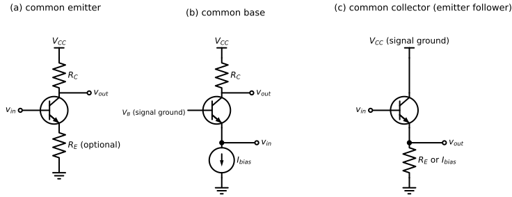
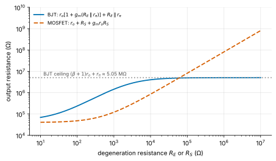

<!-- status: verified -->
# 10-07 · BJT Single-Stage Amplifiers

| | |
|---|---|
| **Course** | [10 · Electronics I (Microelectronic Circuits)](../README.md) |
| **University equivalent** | Bipolar single-stage amplifiers in a junior Electronics I course: common emitter with and without emitter degeneration, common base and common collector (emitter follower); input and output resistance with $r_\pi$, β and $r_o$; MOS–BJT comparison (Sedra & Smith, *Microelectronic Circuits*, ch. 7; Razavi, *Fundamentals of Microelectronics*, ch. 5) |
| **Prerequisites** | [10-03 BJT DC Operation and Biasing](10-03-bjt-dc-operation-and-biasing.md), [10-04 Small-Signal Models](10-04-small-signal-models.md), [10-05 Amplifier Fundamentals](10-05-amplifier-fundamentals.md), [10-06 MOS Single-Stage Amplifiers](10-06-mos-single-stage-amplifiers.md) |
| **Estimated study hours** | 10 |
| **Last verified** | 2026-11-19 |

**Learning objectives.** After this chapter you can:

1. Derive the gain, input resistance and output resistance of the common-emitter, common-base and common-collector stages, including $r_\pi$, β, $r_o$ and source resistance.
2. Apply the reflection rules: emitter resistance multiplied by $\beta + 1$ seen from the base, base resistance divided by $\beta + 1$ seen from the emitter.
3. Derive the degenerated output resistance $r_o[1 + g_m(R_E \parallel r_\pi)]$ and explain why it saturates near $\beta r_o$.
4. Analyze a discrete common-emitter amplifier with its bias network, bypass capacitor and loading, and design its degeneration for gain accuracy.
5. Compare MOS and bipolar stages quantitatively ($g_m/I$, intrinsic gain, input resistance, linearity, headroom) and say which suits a given job.

---

## 1. Big picture

The bipolar transistor's three single-stage amplifiers mirror the MOSFET's: common emitter (CE) for gain, common base (CB) as a current buffer, common collector (CC) as a voltage buffer. The analysis method of 10-06 carries over unchanged. What changes is the device: the BJT has far more transconductance per ampere and far higher intrinsic gain, but its base draws current, so its input resistance is finite and every resistance in the emitter or base is reflected through β. This chapter derives the three stages, then puts the two technologies side by side, because choosing between them (or combining them, in BiCMOS) is a recurring architectural decision.

- **Discrete and RF design still lean on bipolar stages.** Low noise, high $g_m$ per ampere and high speed keep BJTs and SiGe HBTs in radio front ends, precision amplifiers and high-speed links.
- **Every op-amp data sheet hides these stages.** Input bias current, input resistance and output swing of bipolar-input op-amps (10-09) come straight from this chapter's formulas.
- **β is the price of the BJT's strengths.** It sets the input resistance and caps the output resistance, and it varies widely; good designs make the gain depend on resistors, not on β.
- **The MOS–BJT comparison is a business question too.** It explains why bipolar and BiCMOS processes persist as specialty technologies alongside mainstream CMOS.

## 2. Intuition first

**Same valve, leakier handle.** The BJT is again a voltage-controlled current source, $g_mv_\pi$ from collector to emitter. But the "handle" (the base) is not insulated: to set the collector current $i_c$ it must also accept a base current $i_c/\beta$. That one difference explains the chapter:

- Looking into the base, you see $r_\pi = \beta/g_m$ rather than an open circuit.
- A resistor in the emitter carries $(\beta + 1)$ times the base current, so from the base it looks $(\beta + 1)$ times larger.
- A resistor in the base carries $1/(\beta + 1)$ of the emitter current, so from the emitter it looks $(\beta + 1)$ times smaller.

**A finance analogy: a leveraged fund with a redemption fee.** A BJT stage is a leveraged position ($g_m$ per ampere is high, so gain is cheap) that charges a small fee on every unit of control (the base current). The fee is small, one part in β, but it compounds through the structure: it caps how much feedback can raise the output resistance, and it makes the input resistance depend on β, a parameter that varies 3:1 between units (10-03). *Where it breaks:* a fee is a cost you pay once; the base current is also a signal path, through which the source and the load interact (the emitter follower's output resistance depends on the source resistance, §3.5).

*Figure 1. The three configurations. As in 10-06, one terminal is at signal ground: the emitter in CE (directly or through $R_E$), the base in CB and the collector in CC.*

## 3. Theory

> **Conventions.** Hybrid-π model (10-04): $g_m = I_C/V_T$, $r_\pi = \beta/g_m$, $r_e = \alpha/g_m$, $r_o = V_A/I_C$, $V_T$ = 25.852 mV. No body effect. Capacitors are short circuits at midband. $R_B$ denotes the Thévenin resistance of the base bias network.

### 3.1 Common emitter

Base driven, emitter at signal ground (bypassed), $R_C$ to $V_{CC}$. The small-signal circuit is $r_\pi$ from base to ground and $g_mv_\pi$ in parallel with $r_o$ and $R_C$ at the collector:

$$
A_v = -g_m(R_C \parallel r_o), \qquad R_{in} = r_\pi \ (\parallel R_B), \qquad R_{out} = R_C \parallel r_o .
$$

**The voltage budget is generous.** Ignoring $r_o$,

$$
|A_v| = g_mR_C = \frac{I_CR_C}{V_T} = \frac{V_{RC}}{V_T} ,
$$

the DC voltage across $R_C$ divided by 25.9 mV. Compare the MOSFET's $2V_{RD}/V_{ov}$ (10-06 §3.2): with $V_{ov}$ = 0.2 V, the BJT gives about four times the gain for the same voltage budget, because $V_T$ plays the role of $V_{ov}/2$ and is fixed by physics at a small value. The intrinsic limit is $g_mr_o = V_A/V_T$, 1934 for $V_A$ = 50 V.

**The input is the weak point.** $r_\pi = \beta V_T/I_C$ is only a few kilohms at a milliampere, in parallel with the bias network's $R_B$. Driven from a source with resistance $R_{sig}$, the input divider $R_{in}/(R_{in} + R_{sig})$ can lose much of the signal (Example 10-07.1). And because $r_\pi \propto \beta$, the input resistance varies with β from unit to unit.

### 3.2 Common emitter with emitter degeneration

Leave a resistor $R_E$ unbypassed in the emitter.

**Input resistance.** With base current $i_b$, the emitter current is $(\beta + 1)i_b$, so the base voltage is $i_br_\pi + (\beta + 1)i_bR_E$ (ignoring $r_o$):

$$
R_{in,base} = r_\pi + (\beta + 1)R_E = (\beta + 1)(r_e + R_E) .
$$

The emitter resistance is reflected, multiplied by $\beta + 1$. A few hundred ohms of $R_E$ raises the input resistance from a few kilohms to tens of kilohms.

**Gain.** The collector current is $\alpha$ times the emitter current, $i_e = v_{in}/(r_e + R_E)$ (the T model, 10-04 §3.4), so

$$
A_v = -\frac{\alpha R_C}{r_e + R_E} \approx -\frac{R_C}{R_E} \quad (R_E \gg r_e) .
$$

As in 10-06, the gain is "resistance at the collector over resistance in the emitter," and for $R_E \gg r_e$ it depends on resistors, not on $g_m$ or the bias current. It still depends weakly on β through α, a fraction of a percent (Example 10-07.7).

**Output resistance and its ceiling.** Ground the source (leaving its resistance $R_{sig}$ in series with the base), drive the collector with $v_x$ and let $i_x$ flow into the collector. The emitter current $i_x$ splits between $R_E$ and the path back through $r_\pi$ and $R_{sig}$ to ground, so the emitter voltage is $v_e = i_xR_E'$ with $R_E' = R_E \parallel (r_\pi + R_{sig})$. The voltage across $r_\pi$ is the part of $-v_e$ that falls on it, $v_\pi = -v_er_\pi/(r_\pi + R_{sig})$. The collector current is

$$
i_x = g_mv_\pi + \frac{v_x - v_e}{r_o} = -g_m\frac{r_\pi}{r_\pi + R_{sig}}i_xR_E' + \frac{v_x - i_xR_E'}{r_o} ,
$$

and solving for $v_x/i_x$:

$$
R_{out,C} = r_o\left[1 + g_mR_E'\frac{r_\pi}{r_\pi + R_{sig}}\right] + R_E' .
$$

With $R_{sig}$ = 0 this is $r_o[1 + g_m(R_E \parallel r_\pi)] + R_E \parallel r_\pi$, the MOSFET result of 10-06 §3.3 with $R_S$ replaced by $R_E \parallel r_\pi$. The difference is decisive: however large $R_E$ becomes, $R_E \parallel r_\pi$ cannot exceed $r_\pi$, so

$$
R_{out,C} \le r_o(1 + g_mr_\pi) + r_\pi = (\beta + 1)r_o + r_\pi \approx \beta r_o .
$$

*Physically:* the feedback works by moving the emitter voltage, which changes $v_\pi$; but the base current lets part of the emitter current escape through $r_\pi$ instead of developing voltage across $R_E$. A MOSFET's gate draws no current, so its degenerated output resistance grows without limit (Figure 2). This ceiling limits bipolar cascodes and current sources to about $\beta r_o$ (10-08, 12-02).

*Figure 2. Output resistance against degeneration resistance for the BJT of Example 10-07.3 ($I_C$ = 1 mA, β = 100, $r_o$ = 50 kΩ) and the MOSFET of 10-06 ($g_m$ = 2 mS, $r_o$ = 40 kΩ). The BJT rises faster (its $g_m$ is larger) but saturates at about $(\beta + 1)r_o$.*

### 3.3 Common base

Base at signal ground, input at the emitter, output at the collector with $R_C$. With $r_o$ ignored:

- **Input resistance:** looking into the emitter with the base grounded, $R_{in} = r_e = \alpha/g_m \approx 1/g_m$, tens of ohms at a milliampere. (With a base resistance $R_B$, it becomes $r_e + R_B/(\beta + 1)$.)
- **Gain:** $i_c = \alpha i_e$ and $i_e = -v_{in}/r_e$, so $v_{out} = -i_cR_C = \alpha R_Cv_{in}/r_e$, and $A_v = g_mR_C$: the CE gain, non-inverting.
- **Current gain:** α, just under one: a current buffer.
- **Output resistance:** $R_C$ in parallel with the degenerated $R_{out,C}$ of §3.2 with $R_E$ replaced by $R_{sig}$, which with $r_o$ is large.

Like the MOS common gate, the CB stage suits current-mode inputs and wideband 50 Ω matching; unlike it, it needs only about 0.52 mA for $r_e$ = 50 Ω, a third of the MOSFET's current at $V_{ov}$ = 0.2 V (Example 10-07.4). With $r_o$ included the input resistance depends on the load, as for the CG stage (10-06 §3.4).

### 3.4 Common collector: the emitter follower

Collector at signal ground, input at the base through the source resistance $R_{sig}$ (including any $R_B$), output at the emitter with $R_E' = R_E \parallel R_L$ (and $\parallel r_o$, usually negligible).

**Gain.** The base current $i_b$ flows through $R_{sig}$ and $r_\pi$, and $(\beta + 1)i_b$ through $R_E'$:

$$
\frac{v_{out}}{v_{sig}} = \frac{(\beta + 1)R_E'}{R_{sig} + r_\pi + (\beta + 1)R_E'} .
$$

From the base alone ($R_{sig}$ = 0), $A_v = (\beta + 1)R_E'/(r_\pi + (\beta + 1)R_E') = R_E'/(r_e + R_E')$, very close to 1 when $R_E' \gg r_e$. There is no body effect, so the bipolar follower's gain approaches 1, not $1/(1 + \chi)$ as for the MOS follower.

**Input resistance:** $R_{in} = r_\pi + (\beta + 1)R_E'$: the load is reflected to the input multiplied by $\beta + 1$. With β = 100, a 1 kΩ load looks like 101 kΩ (plus $r_\pi$).

**Output resistance.** Set $v_{sig}$ to zero and drive the emitter. The current into the emitter flows mostly as $(\beta + 1)$ times the base current through $r_\pi + R_{sig}$, so

$$
R_{out} = R_E \parallel \frac{r_\pi + R_{sig}}{\beta + 1} = R_E \parallel \left(r_e + \frac{R_{sig}}{\beta + 1}\right) .
$$

The source resistance is divided by $\beta + 1$. This is the impedance transformation that makes the emitter follower the classic output buffer: it presents the load with a source resistance β times smaller, and the source with a load β times larger.

**Swing.** The output sits $V_{BE}$ below the input. It can rise until the collector saturates and fall until the transistor cuts off; with a resistor $R_E$ to a negative supply, the downward swing into a load $R_L$ is limited by the bias current, $I_ER_E'$, as in 10-05 §3.6. Push-pull output stages remove that limit (12-07).

### 3.5 MOS against BJT

The same stages, two devices. At equal bias current:

| Property | BJT | MOSFET (strong inversion) | Consequence |
|---|---|---|---|
| $g_m/I$ | $1/V_T$ = 38.7 V⁻¹ | $2/V_{ov}$ (10 V⁻¹ at 0.2 V) | BJT: more $g_m$ per ampere, lower noise per ampere |
| CE/CS gain, resistor load | $V_{RC}/V_T$ | $2V_{RD}/V_{ov}$ | BJT: more gain per volt of headroom |
| Intrinsic gain | $V_A/V_T$: about 1000–4000 | $2/(\lambda V_{ov})$: tens to a few hundred | BJT: fewer stages for high gain |
| Input resistance | $r_\pi = \beta/g_m$, finite | infinite at DC | MOS: no input current, ideal for sampling and storage |
| Degenerated $R_{out}$ | at most about $\beta r_o$ | unlimited | MOS cascodes go further |
| Linearity (HD₂ at fixed input) | $\hat v/4V_T$ | $\hat v/4V_{ov}$ | MOS: larger signals for the same distortion |
| Follower gain | → 1 | → $1/(1 + \chi)$ | BJT follower closer to ideal |
| Integration | larger devices, specialty process | dense, mainstream CMOS | MOS dominates digital and mixed-signal SoCs |

There is no winner, only jobs. The BJT wins where transconductance per ampere, low noise and intrinsic gain matter and where its base current is tolerable: RF front ends, precision op-amp inputs, bandgap references (Course 20). The MOSFET wins where input current must be zero (sample-and-hold, switched capacitors, CMOS image sensors), where density matters, and wherever the rest of the chip is CMOS. **BiCMOS** processes integrate both, at extra process cost.

## 4. Worked examples

### Example 10-07.1 · A discrete common-emitter amplifier (tier B)

**Setup.** Take Example 10-03.3's four-resistor bias ($V_{CC}$ = 12 V, $R_1$ = 47 kΩ, $R_2$ = 10 kΩ, $R_C$ = 4.7 kΩ, $R_E$ = 1 kΩ, β = 100, $I_C$ = 1.2863 mA, carried to five figures because the gain is sensitive to it) with $R_E$ fully bypassed; ignore $r_o$. (a) Find $g_m$, $r_\pi$, $R_B$ and $R_{in}$. (b) Find $A_{vo}$, and confirm $|A_{vo}| = V_{RC}/V_T$. (c) Find the overall gain from a 1 kΩ source into a 10 kΩ load.

**Solution.**

(a) $g_m$ = 1.2863 mA/25.852 mV = **49.76** mS; $r_\pi = 100/g_m$ = **2.010** kΩ; $R_B$ = 47 ∥ 10 = **8.246** kΩ; $R_{in} = R_B \parallel r_\pi$ = **1.616** kΩ.

(b) $A_{vo} = -g_mR_C$ = **−233.9**; $V_{RC}$ = 1.2863 mA × 4.7 kΩ = **6.046** V, and $6.046/0.025852$ = **233.9**. (Rounding $I_C$ to 1.286 mA first would give 233.8: in a gain this large, the fourth digit of the bias current shows.)

(c) Input factor $1.616/2.616$ = **0.618**; gain from base $-g_m(4.7 \parallel 10)$ = **−159.1**; overall **−98.27**.

**Sanity check.** The bias network ($R_B$ = 8.2 kΩ) and $r_\pi$ together load a 1 kΩ source by 38%. The gain is large but β-dependent through $r_\pi$, and the stage is very nonlinear (a 1% HD₂ input is only 1 mV).

### Example 10-07.2 · Partial bypass (tier B)

**Setup.** Split Example 10-07.1's $R_E$ into $R_{E1}$ = 100 Ω (unbypassed) and 900 Ω (bypassed), leaving the bias unchanged. Find $r_e$, the input resistance at the base and of the stage, the gain from the base and the overall gain from 1 kΩ into 10 kΩ.

**Solution.** $r_e = \alpha/g_m$ = **19.90** Ω. $R_{in,base} = r_\pi + 101 \times 100$ = **12.11** kΩ, and with $R_B$, $R_{in}$ = **4.91** kΩ. Gain from the base: $-\alpha \times 4.7\text{ kΩ}/(119.9\ \Omega)$ = **−38.81**. Overall: $\frac{4.91}{5.91} \times (-\alpha)\frac{4.7 \parallel 10}{0.1199}$ = **−21.93**.

**Sanity check.** 100 Ω of degeneration cut the gain from the base by a factor of 6 (from 234 to 39) but tripled the stage's input resistance, so the overall gain fell only by 4.5 (from 98 to 22). The gain is now set mostly by $R_C/R_{E1}$, and at a given output amplitude the distortion falls by about $1 + g_mR_{E1}$ ≈ 6.

### Example 10-07.3 · The β ceiling on output resistance (tier B)

**Setup.** A BJT at $I_C$ = 1 mA with β = 100 and $V_A$ = 50 V, base grounded for signals ($R_{sig}$ = 0). Find the collector output resistance for $R_E$ = 0, 1 kΩ, 10 kΩ and in the limit $R_E \to \infty$.

**Solution.** $g_m$ = 38.68 mS, $r_\pi$ = 2.585 kΩ, $r_o$ = 50 kΩ. With $R_{out} = r_o[1 + g_m(R_E \parallel r_\pi)] + R_E \parallel r_\pi$: **50** kΩ, **1445** kΩ, **4025** kΩ, and the ceiling **5053** kΩ.

**Sanity check.** The first kilohm multiplies $r_o$ by 29; the next nine add less than a factor of 3, and nothing gets past about $(\beta + 1)r_o$ = 5.05 MΩ. A MOSFET with the same $g_m$ would keep climbing.

### Example 10-07.4 · Common base, and matching to 50 Ω (tier B)

**Setup.** A CB stage at $I_C$ = 1 mA (β = 100) with $R_C$ = 5 kΩ is driven from a 50 Ω source; ignore $r_o$. (a) Find $R_{in}$, the gain from the emitter, the input factor and the overall gain. (b) Find the current gain. (c) What emitter and collector currents give $R_{in}$ = 50 Ω?

**Solution.**

(a) $R_{in} = r_e$ = **25.60** Ω; $A_v = g_mR_C$ = **193.4**; input factor $25.6/75.6$ = **0.3386**; overall **65.49**.

(b) α = **0.9901**.

(c) $r_e = V_T/I_E$ = 50 Ω gives $I_E$ = **0.5170** mA and $I_C = \alpha I_E$ = **0.5119** mA.

**Sanity check.** A MOS common gate needed 1.667 mA for 50 Ω at $V_{ov}$ = 0.2 V (Example 10-06.3), with its body effect helping: the BJT does it with a third of the current.

### Example 10-07.5 · Emitter follower (tier B)

**Setup.** An emitter follower at $I_C$ = 1 mA (β = 100) has $R_E$ = 5 kΩ and drives a 1 kΩ load through a coupling capacitor; the source resistance (including bias) is 10 kΩ; ignore $r_o$. Find $R_E'$, $R_{in}$, the input factor, the gain from base to emitter, the overall gain and the output resistance.

**Solution.** $R_E'$ = 5 ∥ 1 = **833.3** Ω. $R_{in} = r_\pi + 101R_E'$ = 2.585 + 84.17 = **86.75** kΩ. Input factor $86.75/96.75$ = **0.8966**. From the base: $101R_E'/R_{in}$ = **0.9702**. Overall: **0.8699**. Output: $(r_\pi + R_{sig})/101$ = **124.6** Ω, in parallel with 5 kΩ: **121.6** Ω.

**Sanity check.** The follower turned a 10 kΩ source into a 122 Ω source, and a 1 kΩ load into 87 kΩ: two factors of about β, in opposite directions.

### Example 10-07.6 · MOS against BJT at equal current (tier B)

**Setup.** At 0.5 mA, compare a BJT (β = 100, $V_A$ = 50 V) with a MOSFET at $V_{ov}$ = 0.2 V (λ = 0.1 V⁻¹): (a) $g_m$ and the CE/CS gain with a 5 kΩ load resistor; (b) input resistance; (c) intrinsic gain; (d) the input amplitude for 1% HD₂.

**Solution.**

(a) BJT: **19.34** mS and **−96.70**. MOSFET: $2I/V_{ov}$ = **5.0** mS and **−25.0**. Ratio **3.868**.

(b) BJT: $r_\pi$ = **5.170** kΩ. MOSFET: infinite.

(c) BJT: $V_A/V_T$ = **1934**. MOSFET: $2/(\lambda V_{ov})$ = **100**.

(d) BJT: **1.034** mV. MOSFET: **8.0** mV.

**Sanity check.** The BJT's advantages in (a) and (c) and its disadvantages in (b) and (d) are the same fact: its current responds to $V_T$, a small fixed voltage, while the MOSFET responds to $V_{ov}$, a designable and larger one.

### Example 10-07.7 · Designing gain that ignores β (tier C)

**Setup.** A CE stage at $I_C$ = 1 mA with $R_C$ = 4.7 kΩ must have a gain of −10 at β = 100, using an unbypassed $R_{E1}$ ($r_o$ ignored). (a) Find $R_{E1}$ and round it to a standard value of 440 Ω. (b) With 440 Ω, find the gain at β = 100 and β = 300, and the change. (c) Find the input resistance at the base for both βs, and compare with the bypassed stage ($R_{in} = r_\pi$).

**Solution.**

(a) $\alpha R_C/(r_e + R_{E1})$ = 10 gives $R_{E1} = \alpha R_C/10 - r_e$ = **465.3** Ω − 25.60 Ω, just under 440 Ω; use **440** Ω.

(b) β = 100: $-0.9901 \times 4700/(25.60 + 440)$ = **−9.995**. β = 300: $\alpha$ = **0.99668** and $r_e$ = **25.77** Ω, so **−10.06**, a change of **+0.63**%.

(c) $(\beta + 1)(r_e + R_{E1})$: **47.03** kΩ and **140.2** kΩ. Bypassed: $r_\pi$ = **2.585** and **7.756** kΩ.

**Sanity check.** The gain moves 0.6% across a 3:1 spread of β, because it depends on β only through α. The input resistance still triples; if the source resistance matters, the overall gain will vary more than the stage gain, which is why precision designs drive degenerated stages from low-resistance sources or use feedback around several stages (Course 12).

### Answer key

<!-- answer-key -->
| ID | Quantity | Value | Unit |
|---|---|---|---|
| T 10-07.a | BJT g_m per ampere | 38.7 | 1/V |
| T 10-07.b | intrinsic gain, V_A = 50 V | 1934 | — |
| T 10-07.c | 1 kΩ load reflected through β = 100 | 101 | kΩ |
| Ex 10-07.1a | g_m | 49.76 | mS |
| Ex 10-07.1b | r_pi | 2.010 | kΩ |
| Ex 10-07.1c | R_B | 8.246 | kΩ |
| Ex 10-07.1d | R_in | 1.616 | kΩ |
| Ex 10-07.1e | A_vo | -233.9 | — |
| Ex 10-07.1f | V_RC / V_T | 233.9 | — |
| Ex 10-07.1g | input factor | 0.618 | — |
| Ex 10-07.1h | gain from the base | -159.1 | — |
| Ex 10-07.1i | overall gain | -98.27 | — |
| Ex 10-07.1j | V_RC | 6.046 | V |
| Ex 10-07.1k | A_vo from I_C rounded to 1.286 mA | 233.8 | — |
| Ex 10-07.1l | I_C to five figures | 1.2863 | mA |
| Ex 10-07.2a | r_e | 19.90 | Ω |
| Ex 10-07.2b | R_in at the base | 12.11 | kΩ |
| Ex 10-07.2c | R_in of the stage | 4.91 | kΩ |
| Ex 10-07.2d | gain from the base | -38.81 | — |
| Ex 10-07.2e | overall gain | -21.93 | — |
| Ex 10-07.3a | R_out, R_E = 0 | 50 | kΩ |
| Ex 10-07.3b | R_out, R_E = 1 kΩ | 1445 | kΩ |
| Ex 10-07.3c | R_out, R_E = 10 kΩ | 4025 | kΩ |
| Ex 10-07.3d | R_out ceiling | 5053 | kΩ |
| Ex 10-07.4a | R_in | 25.60 | Ω |
| Ex 10-07.4b | gain from the emitter | 193.4 | — |
| Ex 10-07.4c | input factor | 0.3386 | — |
| Ex 10-07.4d | overall gain | 65.49 | — |
| Ex 10-07.4e | current gain | 0.9901 | — |
| Ex 10-07.4f | I_E for 50 Ω | 0.5170 | mA |
| Ex 10-07.4g | I_C for 50 Ω | 0.5119 | mA |
| Ex 10-07.5a | R_E' | 833.3 | Ω |
| Ex 10-07.5b | R_in | 86.75 | kΩ |
| Ex 10-07.5c | input factor | 0.8966 | — |
| Ex 10-07.5d | gain from the base | 0.9702 | — |
| Ex 10-07.5e | overall gain | 0.8699 | — |
| Ex 10-07.5f | (r_pi + R_sig)/(β + 1) | 124.6 | Ω |
| Ex 10-07.5g | R_out | 121.6 | Ω |
| Ex 10-07.6a | BJT g_m | 19.34 | mS |
| Ex 10-07.6b | BJT gain | -96.70 | — |
| Ex 10-07.6c | MOSFET g_m | 5.0 | mS |
| Ex 10-07.6d | MOSFET gain | -25.0 | — |
| Ex 10-07.6e | ratio | 3.868 | — |
| Ex 10-07.6f | BJT r_pi | 5.170 | kΩ |
| Ex 10-07.6g | BJT intrinsic gain | 1934 | — |
| Ex 10-07.6h | MOSFET intrinsic gain | 100 | — |
| Ex 10-07.6i | BJT 1% HD2 amplitude | 1.034 | mV |
| Ex 10-07.6j | MOSFET 1% HD2 amplitude | 8.0 | mV |
| Ex 10-07.7a | R_E1 | 440 | Ω |
| Ex 10-07.7b | gain at β = 100 | -9.995 | — |
| Ex 10-07.7c | gain at β = 300 | -10.06 | — |
| Ex 10-07.7d | change | 0.63 | % |
| Ex 10-07.7e | R_in at β = 100 | 47.03 | kΩ |
| Ex 10-07.7f | R_in at β = 300 | 140.2 | kΩ |
| Ex 10-07.7g | r_pi at β = 100 | 2.585 | kΩ |
| Ex 10-07.7h | r_pi at β = 300 | 7.756 | kΩ |
| Ex 10-07.7i | α R_C / 10 | 465.3 | Ω |
| Ex 10-07.7j | α at β = 300 | 0.99668 | — |
| Ex 10-07.7k | r_e at β = 300 | 25.77 | Ω |

*Every value is recomputed by [verify_10_07.py](../verify/verify_10_07.py): the bias of Example 10-07.1 from Kirchhoff's equations, and every gain and resistance from a modified-nodal-analysis solution of the hybrid-π circuit with explicit test sources, independent of the closed forms. The lab's ngspice netlist confirms Examples 10-07.1, 10-07.2, 10-07.4 and 10-07.5 with Gummel–Poon transistors.*

## 5. Simulate it

The lab, [labs/10-07-lab](../labs/10-07-lab/README.md), has a notebook and an ngspice netlist:

1. Builds the CE, CB and CC stages as hybrid-π matrices and sweeps β from 50 to 400 to see what moves (input resistance, overall gain) and what does not (degenerated stage gain).
2. Reproduces Figure 2 by test-source simulation and finds the degeneration at which the BJT's output resistance reaches 90% of its ceiling.
3. Drives the emitter follower with a large sine into a resistive load and finds where the negative swing clips.
4. Repeats Example 10-07.6's comparison over current, from 10 µA to 10 mA.

The netlist (`bjt_stages.cir`) runs the discrete CE amplifier (bypassed and partly bypassed), the CB stage and the emitter follower of the examples.

**Guided exercise (predict, then run).** **Before running Part 1**, predict: when β goes from 100 to 300 in Example 10-07.1's bypassed amplifier (with the bias current held fixed), does the overall gain from the 1 kΩ source rise or fall, and by roughly how much? Then run it. (It rises: $r_\pi$ triples to 6.03 kΩ, $R_{in}$ rises from 1.62 to 3.48 kΩ, and the input factor from 0.62 to 0.78, about +26%; the gain from the base is unchanged.)

## 6. Engineering tradeoffs

| Knob | Improves | Costs | Typical decision owner |
|---|---|---|---|
| Bias current | $g_m$, speed, lower $r_e$ | $r_\pi$ and $R_{in}$ fall; power | Analog designer |
| Emitter degeneration | Gain accuracy (≈ $R_C/R_E$), linearity, $R_{in}$ (×(β + 1)) | Gain, headroom | Analog designer |
| Bypass capacitor on $R_E$ | Gain (back to $g_mR_C$) | Linearity, β sensitivity of $R_{in}$; a large capacitor and a low-frequency pole | Board designer |
| Emitter follower output | Drives low loads; $R_{out}$ ÷ (β + 1) | $V_{BE}$ of headroom, base current from the previous stage | Architect |
| BJT instead of MOSFET | $g_m/I$, intrinsic gain, noise | Input current, β spread, linearity per volt, process cost | Product architect |

## 7. Numbers to know

| Quantity | Typical value | Note |
|---|---|---|
| BJT CE gain, resistor load | $V_{RC}/V_T$: about 40 per volt across $R_C$ | |
| $r_\pi$ at 1 mA | 2.6 kΩ × (β/100) | |
| $r_e$ at 1 mA | about 26 Ω | |
| Reflection | × (β + 1) into the base, ÷ (β + 1) into the emitter | |
| Degenerated $R_{out}$ ceiling | about $\beta r_o$ | |
| Emitter-follower gain | 0.9–0.99 into moderate loads | no body effect |
| 2N3904 $h_{fe}$ at 1 mA | 100–400 [1] | data sheet |
| SiGe HBT $f_T/f_{max}$ (IHP SG13G2) | 300/500 GHz [2] | as of Feb 2026 |

## 8. Common mistakes

1. **Forgetting the bias network in $R_{in}$.** The source sees $R_B \parallel r_\pi$ (or $\parallel$ the degenerated input), not $r_\pi$ alone.
2. **Reflecting the wrong way.** Emitter resistance seen from the base is multiplied by $\beta + 1$; base resistance seen from the emitter is divided.
3. **Using the MOSFET's unlimited $r_o(1 + g_mR_S)$ for a BJT.** Replace $R_E$ by $R_E \parallel r_\pi$; the result saturates near $\beta r_o$.
4. **Ignoring source resistance in an emitter follower's output resistance.** It appears as $R_{sig}/(\beta + 1)$ and often dominates $r_e$.
5. **Assuming β cancels everywhere.** Degenerated gain is nearly β-independent; input resistance and base current are not.
6. **Applying small-signal gain to large signals.** A bypassed CE stage reaches 1% HD₂ at about 1 mV of input (10-04).

## 9. Practitioner lens

### State of the art (as of Nov 2026)

- **BJTs persist where speed, noise and output power matter.** Hu's device text notes that BJTs are still preferred in some high-frequency and analog applications for their speed, low noise and output power, often integrated with CMOS as BiCMOS [3] **[Established]**.
- **SiGe HBT processes reach hundreds of gigahertz.** IHP's SG13G2 BiCMOS process offers SiGe HBTs with peak $f_T/f_{max}$ of 300/500 GHz, available to researchers with an open-source PDK, and its SG13G3Cu variant up to 470/650 GHz [2] **[Established]** (foundry data sheet, Feb 2026).
- **Discrete small-signal BJTs are specified by ranges.** The 2N3904's $h_{fe}$ spans 100 to 400 at 1 mA and $h_{ie}$ 1 to 10 kΩ [1] **[Established]**, which is why the design rules of this chapter aim to make gain independent of β.

### Why it matters commercially

- **Specialty processes are a strategic niche.** RF front ends, optical-link drivers and precision analog often use SiGe BiCMOS rather than leading-edge CMOS; their foundries and design teams are distinct businesses with different economics from digital logic.
- **Transconductance per ampere is battery life and noise.** For a given noise or bandwidth target, a bipolar input stage often needs several times less current than a MOS one (Example 10-07.6), which matters in sensor front ends and receivers.
- **Input current is a system specification.** Bipolar-input amplifiers draw bias current through the source resistance, creating offsets; CMOS inputs do not. For high-impedance sensors (pH probes, photodiodes, piezo elements), that alone decides the technology (10-09).

### Marketing vs Reality

- **"High input impedance bipolar amplifier."** *Reality:* a bipolar input is $r_\pi$-scaled; high input resistance comes from degeneration, a follower input or bootstrapping, each with a cost. *Sanity check:* ask for input bias current and input resistance at the operating current.
- **"Gain of 200 from one transistor."** *Reality:* a bypassed CE stage can do it, but only for millivolt inputs and with gain that tracks bias and temperature. *Sanity check:* ask for distortion at the rated input and the gain's temperature coefficient.
- **"Hundreds of GHz transistors, so a 100 GHz amplifier."** *Reality:* $f_T$ and $f_{max}$ are device limits; a circuit's useful gain falls well below them (Course 12). *Sanity check:* ask for the amplifier's gain at the operating frequency, not the transistor's $f_T$.

### Questions for engineering leaders

1. **"Why bipolar (or BiCMOS) here instead of CMOS?"**
   *Strong:* a quantified reason: noise per ampere, gain, speed, or output drive, against the process cost. *Evasive:* "it's always been bipolar."
2. **"How does your gain and input resistance vary across the β distribution and temperature?"**
   *Strong:* corner simulations or measured spreads, and the degeneration or feedback that bounds them. *Evasive:* nominal values only.
3. **"What source impedance does your input stage assume, and what is the offset from its bias current?"**
   *Strong:* the numbers and the system budget they fit in. *Evasive:* "negligible."

## 10. Concept check

**Q1.** Why does the CE stage give more gain than the CS stage for the same DC drop across the load?

Answer

$|A_v| = V_{RC}/V_T$ for the BJT against $2V_{RD}/V_{ov}$ for the MOSFET. $V_T$ (25.9 mV) is smaller than $V_{ov}/2$ for any practical overdrive in strong inversion.

**Q2.** A 500 Ω emitter resistor in a stage with β = 150: what does it look like from the base?

Answer

$(\beta + 1) \times 500\ \Omega$ = 75.5 kΩ, in series with $r_\pi$.

**Q3.** Why can't emitter degeneration raise the BJT's output resistance indefinitely?

Answer

The base current lets part of the emitter current return through $r_\pi$ instead of developing feedback voltage across $R_E$; the effective degeneration is $R_E \parallel r_\pi$, which is bounded by $r_\pi$, so $R_{out}$ is bounded by about $(\beta + 1)r_o$.

**Q4.** Why is an emitter follower's gain closer to 1 than a MOS source follower's?

Answer

The BJT has no body effect, and its larger $g_m$ makes $r_e$ smaller relative to the load; the MOS follower is capped at $1/(1 + \chi)$.

**Q5.** An emitter follower is driven from a 50 kΩ source with β = 100 at 1 mA. Roughly what is its output resistance?

Answer

$(r_\pi + R_{sig})/(\beta + 1) \approx (2.6 + 50)\text{ kΩ}/101 \approx$ 520 Ω: dominated by the source resistance divided by β + 1, not by $r_e$.

**Q6.** Name one job where the MOSFET is clearly preferable and one where the BJT is.

Answer

MOSFET: sampling a capacitor or reading a high-impedance sensor, where any input current is an error (and wherever the rest of the chip is CMOS). BJT: a low-noise, low-current RF or precision input stage, where $g_m$ per ampere and intrinsic gain matter.

[Problem set for this chapter](../problems/10-07-problems.md)

## 11. Key terms

[Common-emitter amplifier](../../../reference/glossary.md#common-emitter-amplifier) · [Common-base amplifier](../../../reference/glossary.md#common-base-amplifier) · [Emitter follower](../../../reference/glossary.md#emitter-follower) · [Emitter degeneration](../../../reference/glossary.md#emitter-degeneration) · [Resistance reflection](../../../reference/glossary.md#resistance-reflection) · [Bypass capacitor](../../../reference/glossary.md#bypass-capacitor) · [BiCMOS](../../../reference/glossary.md#bicmos) · [Small-signal model](../../../reference/glossary.md#small-signal-model)

## 12. Connections

- **Builds on:** bias from [10-03](10-03-bjt-dc-operation-and-biasing.md); the hybrid-π and T models from [10-04](10-04-small-signal-models.md); loading from [10-05](10-05-amplifier-fundamentals.md); the analysis method and MOS results of [10-06](10-06-mos-single-stage-amplifiers.md); the device physics of [09-07](../../09-semiconductor-devices/chapters/09-07-bipolar-junction-transistor.md).
- **Next:** [10-08 Current Sources and Current Mirrors](10-08-current-sources-and-mirrors.md) uses this chapter's output-resistance results to build better current sources.
- **Used later:** the differential pair in [12-01](../../12-electronics-2/chapters/12-01-differential-pairs.md); cascodes in [12-02](../../12-electronics-2/chapters/12-02-active-loads-cascodes-multistage.md); frequency response in [12-03](../../12-electronics-2/chapters/12-03-frequency-response-miller-poles-zeros.md); output stages in [12-07](../../12-electronics-2/chapters/12-07-output-stages.md); op-amp inputs in [10-09](10-09-real-op-amps-nonidealities.md).

## 13. Further study

- A. S. Sedra and K. C. Smith, *Microelectronic Circuits*, ch. 7 (BJT amplifier configurations and the MOS–BJT comparison).
- B. Razavi, *Fundamentals of Microelectronics*, ch. 5 (bipolar amplifiers, with the impedance-reflection viewpoint used here).
- P. R. Gray, P. J. Hurst, S. H. Lewis and R. G. Meyer, *Analysis and Design of Analog Integrated Circuits*, ch. 3 (single-transistor and two-transistor amplifiers, bipolar and MOS side by side).

## 14. Sources

1. onsemi, *2N3903, 2N3904 General Purpose Transistors NPN Silicon*, Rev. 9, August 2021, small-signal characteristics: [data sheet](https://www.onsemi.com/pdf/datasheet/2n3903-d.pdf). [R-178](../../../reference/research-log.md#r-178--bipolar-transistor-data-sheets).
2. Europractice, *IHP February 2026* technology sheet (SG13S, SG13G2, SG13G3Cu): [PDF](https://europractice-ic.com/wp-content/uploads/2026/02/IHP_February_2026.pdf). [R-168](../../../reference/research-log.md#r-168--bipolar-transistor-references).
3. C. Hu, *Modern Semiconductor Devices for Integrated Circuits*, ch. 8, §8.1: [chapter PDF](https://www.chu.berkeley.edu/wp-content/uploads/2020/01/Chenming-Hu_ch8-2.pdf). [R-168](../../../reference/research-log.md#r-168--bipolar-transistor-references).
